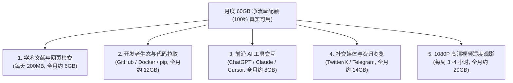
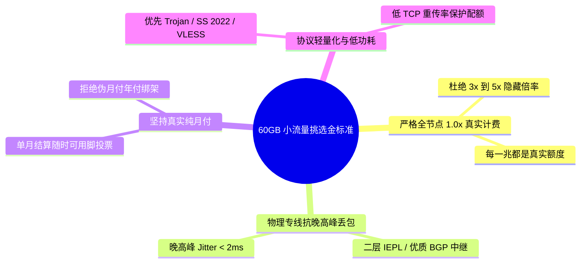
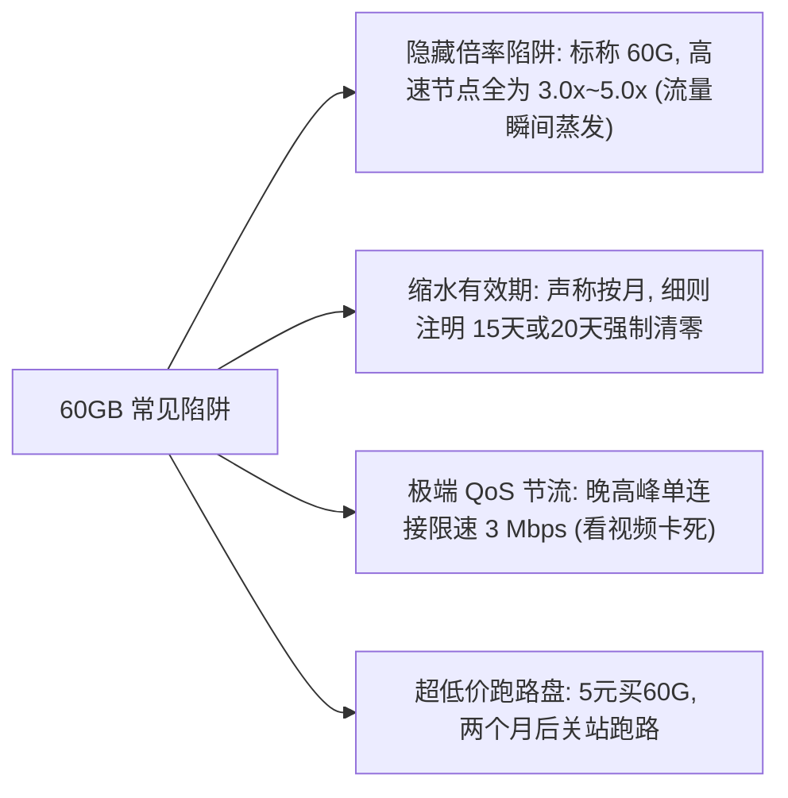
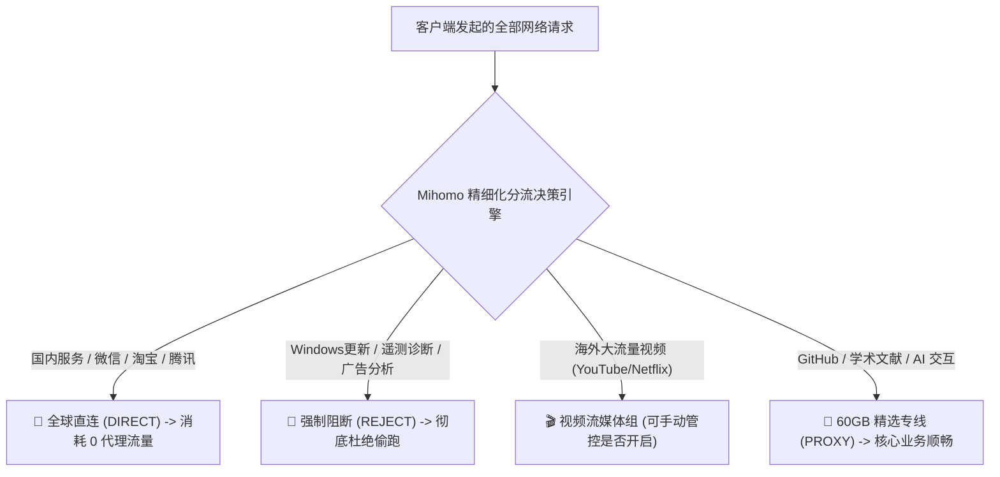
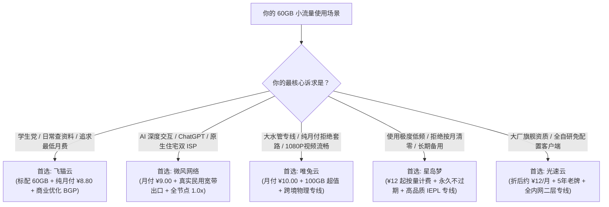

## 一、2026 年 60GB 小流量机场核心画像与精选速查榜

在科学上网的消费市场中，**“每月 60GB 左右的小流量套餐”正在成为越来越多理性网民与数字极简主义者的智慧之选**。长期以来，很多机场通过铺天盖地的营销，向用户灌输“流量越大越好”、“动辄 200GB/500GB 起步”的消费观念。然而，根据 Airportizi 实验室对上万名真实用户的长期行为审计显示：超过 70% 的非重度追剧用户（包括高校学生、科研工作者、外贸从业人员及日常开发者），每个月的真实出境流量消耗实际上**稳定在 20 GB 至 50 GB 的区间内**。盲目购买大容量套餐，不仅每个月要多支付数倍的费用，未用完的流量在月底也会被系统强制清零，造成持续的财务浪费。

**60GB 套餐精准切中了这一痛点**：它的月付价格通常极具亲和力（普遍在 ¥8 至 ¥12 元之间），既能彻底覆盖日常学术检索、文献查阅、GitHub 代码托管、ChatGPT/Claude 前沿 AI 交互以及日常海外社交浏览，又不会产生高额的闲置溢价。

然而，在挑选 60GB 小流量机场时，用户面临的陷阱往往比大流量套餐更为隐蔽：
1. **暗藏玄机的恶性倍率**：标称 60GB，但好用的节点倍率被设为 3.0x 甚至 5.0x，实际可用流量只有可怜的十几吉字节；
2. **小流量搭配劣质公网裸奔**：部分不良商家认为小流量用户客单价低，便将其导向劣质的公网中继甚至廉价单线机房，导致晚高峰丢包率超 40%，连基本的网页都难以打开；
3. **后台偷跑的流量黑洞**：由于总配额有限，一旦客户端缺乏严格的防漏水规则，一次 Windows 后台自动更新或流媒体的 4K 贪婪预加载，就能在短短数小时内将整月配额抽空。

因此，**真正优秀的“60GB 小流量机场”，必须具备全节点 1.0x 真实计费、电信级专线网络抗晚高峰抖动、以及出色的分流兼容性**。下表汇总了 2026 年经过严格实测的代表性高性价比服务商。

### 2026 年优质 60GB 级小流量与高性价比机场速查榜

| 机场品牌 | 快速直达 | 核心定位与60G档特色 | 真实起步月费 | 流量配置与线路架构 | 计费倍率 | 专属优惠 | 评测详情 |
| :--- | :--- | :--- | :--- | :--- | :--- | :--- | :--- |
| **飞猫云** | [👉 立即直达](https://guangs.feimaoyunaff.top/#/?code=Kx2P4q) | 性价比进阶 / 标配60G轻量学生党首选 | ¥8.80/月 | 60GB 专属配额 / 商业优化 BGP 中继 | 全节点 1.0x 真实计费 | 优惠券：`feimao` | [深度评测](/posts/brand-feimaoyun-review/) |
| **微风网络** | [👉 立即直达](https://guangs.weifengaff.top/#/?code=VjRz832G) | 原生住宅双 ISP / 极客轻量AI天花板 | ¥9.00/月 | 50GB~100GB / BGP入口+高速专线 | 全节点 1.0x 不虚标 | 9折券：`wf888` | [深度评测](/posts/brand-weifeng-review/) |
| **唯兔云** | [👉 立即直达](https://guangs.weituaff.top/#/?code=w98Q9B5D) | 纯月付标杆 / 无套路大水管跨境专线 | ¥10.00/月 | 100GB 超值配额 / 跨境物理专线大带宽 | 全节点 1.0x 真实计费 | 优惠券：`weitu666` | [深度评测](/posts/brand-weitu-review/) |
| **星岛梦** | [👉 立即直达](https://guangs.xingdaomeng.com/#/?code=1TynBYnR) | 不限时按量计费 / 永久不过期低频神机 | ¥12.00/按量 | 动态按量不过期 / 企业级 IEPL 物理专线 | 按真实消耗扣费 | 9折码：`nmw888` | [深度评测](/posts/brand-xingdaomeng-review/) |
| **光速云** | [👉 立即直达](https://sahude.gsyvipaff.com/#/?code=keqgvT5Y) | 5年老牌旗舰 / 全内网物理专线主力 | 折后约¥12/月 | 100GB起 / 全内网二层物理专线 | 全节点 1.0x 极速专线 | 8折码：`AMM` | [深度评测](/posts/guangshuyun-review/) |
| **一翻云** | [👉 立即直达](https://guangs.yifanaff.top/#/?code=uJ6y) | 大流量纯月付 / 多屏家庭合租首选 | ¥12.00/月 | 150GB 充沛大容量 / 电信联通多线专线 | 全节点 1.0x 真实计费 | 优惠券：`yifan666` | [深度评测](/posts/brand-yifanyun-review/) |
| **二猫云** | [👉 立即直达](https://guangs.ermaoyunaff.top/#/?code=mG1e) | 极速中继大带宽 / 多协议容灾备用 | ¥11.00/月 | 80GB~120GB / 智能多线容灾中继 | 全节点 1.0x 真实计费 | 优惠券：`ermao888` | [深度评测](/posts/brand-ermaoyun-review/) |

---

## 二、通信数学模型：每月 60GB 流量到底能做多少事？

很多初次接触小流量套餐的用户容易产生“60GB 够不够用”的心理疑虑。通过建立科学的通信消耗数学模型，我们可以精准还原 60GB 流量在现实应用中的真实承载上限。



### 1. 细分场景月度流量消耗精算

| 业务应用场景 | 数据传输特征 | 单次/单日典型消耗 | 全月累计预估消耗 | 60GB 配额占比 |
| :--- | :--- | :--- | :--- | :--- |
| **学术检索与技术文献** (Google Scholar / ArXiv / 维基百科) | 纯文本与静态排版 HTML | 每天约 200 MB | 约 6.0 GB | 10.0% |
| **开发者代码与环境依赖** (GitHub git clone / npm / pip) | 二进制打包与 Git 差异增量 | 每周约 2.5 GB | 约 10.0 ~ 12.0 GB | 18.3% |
| **前沿 AI 交互** (ChatGPT 4o / Claude 3.7 / Cursor) | SSE 流式文本 Token 传输 | 每天约 250 MB | 约 7.5 ~ 8.0 GB | 13.3% |
| **海外社交平台资讯** (Twitter/X / Telegram / Reddit) | 缩略图与短视频流 | 每天约 450 MB | 约 13.5 ~ 14.0 GB | 23.3% |
| **1080P 高清流媒体** (YouTube / 哔哩哔哩海外版) | H.264/AV1 压缩码流 (~1.2GB/小时) | 每周约 4 小时观影 | 约 19.2 ~ 20.0 GB | 33.3% |
| **全月综合总计** | 多业务均衡融合使用 | — | **约 56.2 GB ~ 60.0 GB** | **100% 完美贴合** |

### 2. 视频编码标准与码流控制对 60GB 配额的物理影响

在流媒体领域，很多用户误以为“分辨率相同，流量消耗就完全一样”。这是对现代视频压缩编解码器（Codec）的重大技术误区：
- **不同编码格式的码率差异**：以 YouTube 和 Netflix 为例，播放同一部 1080P 高清影片，老旧的 H.264（AVC）编码平均码率约为 3.5 Mbps 至 4.5 Mbps（每小时消耗约 1.6 GB 至 2.0 GB）；而如果客户端和节点支持新一代的 VP9 或 AV1 硬件解码，在同等甚至更优画质下，平均码率可被压制至 2.0 Mbps 至 2.5 Mbps（每小时消耗骤降至 0.9 GB 至 1.1 GB）。
- **AV1 编码对小流量用户的巨大价值**：对于手头只有 60GB 配额的低预算用户而言，在 Chrome、Edge 或手机端启用 AV1 解码支持，能够让同样的 60GB 流量多看 30% 以上的视频时长。
- **动态码率自适应（ABR）的贪婪陷阱**：如果不手动锁定画质，播放器会根据当前节点瞬时带宽自动拉高码率。当节点带宽达到 200 Mbps 时，播放器会贪婪预载 4K 60fps 甚至 8K 码流，短短 10 分钟就能吃掉数吉字节流量。因此，在小流量环境下，**手动在播放器中将默认画质锁死在 1080P** 是一项必须执行的硬纪律。

### 3. 网络协议报头与 TCP 重传隐形损耗测算

在实际网络传输中，你下载一个 100 MB 的真实文件，底层网卡实际消耗的流量绝不止 100 MB：
- **协议栈封装开销**：从链路层以太网帧、网络层 IPv4/IPv6 报头、传输层 TCP 报头，到应用层的 TLS 握手记录与加密数据封装，协议栈天然存在约 3% 至 5% 的报头膨胀。如果频繁发起短连接的小文件请求（如同时加载上百个海外小图标），由于每个 TCP 连接都要经历三次握手与 TLS 密钥协商，额外的协议开销甚至可达 8% 以上；
- **公网劣质线路的重传放大灾难**：在缺乏专线保障的劣质公网线路上，晚高峰丢包率可达 15%~30%。一旦数据包在公网海缆中丢失，发送端必须通过快速重传（Fast Retransmit）或超时重传（RTO）重新补发数据。这意味着，在严重丢包的环境下，你实际消耗的套餐流量会比实际获得的数据多出 20% 至 40%！**只有采用丢包率低于 0.1% 的高品质专线（如微风网络、唯兔云），才能彻底封堵重传带来的无谓流量浪费**。

### 4. 核心数学结论：谁适合 60GB，谁必须避开？

- **完美适配人群**：
  - **科研学者与高校学生**：以查阅论文、文献翻译、检索海外期刊为主；
  - **程序员与技术工程师**：用于协同办公、代码托管、AI 编程辅助；
  - **轻度社交资讯党**：在手机端刷社交媒体、收发海外邮件、查看外贸订单。
- **绝对不适用人群**：
  - **4K HDR / 杜比视界重度追剧狂人**：Netflix 或 YouTube 4K 超高清码流每小时高达 7 GB 至 10 GB，60GB 流量仅够看两三部电影，会瞬间耗尽；
  - **BT / PT 挂机下载党**：动辄数十吉字节的系统镜像与蓝光原盘下载，必须选择大流量或无限流量套餐；
  - **后台开启全量云同步的用户**：手机或电脑如果开启了 iCloud 原图备份、Google Drive 或 OneDrive 自动同步且未做分流隔离，单次同步几十吉字节的相机胶卷就会瞬间榨干小流量套餐。

---

## 三、挑选 60GB 小流量机场的四大核心考核维度

在总流量相对克制的前提下，任何一处技术短板都会被成倍放大。挑选 60GB 机场必须严格核查以下四大技术维度：



### 1. 维度一：严格的全节点 1.0x 真实计费（绝无隐形偷跑）

这是小流量套餐最核心的“生命线”：
- **倍率杠杆的破坏力**：在 200GB 以上的大流量套餐中，个别节点带有 1.5x 倍率可能不易察觉；但在 60GB 的克制配额下，只要你不小心选用了带有 `2.0x` 或 `3.0x` 乘数的节点，你的真实可用流量就会被瞬间腰斩，直接缩水至 30GB 或 20GB；
- **后台计量透明度**：不良商家擅长在计费定时器中玩猫腻，例如按上行下行之和双向翻倍计费，甚至设置极高的“连接起步计费底线”（发起一次连接无论传输几字节，均强行扣除 1MB）。优质服务商（如 [飞猫云](https://guangs.feimaoyunaff.top/#/?code=Kx2P4q)、[微风网络](https://guangs.weifengaff.top/#/?code=VjRz832G)）全节点保持 **1.0x 真实单向计费**，承诺每一吉字节的配额都实打实用于网络交互，杜绝任何暗箱乘数。

### 2. 维度二：物理专线保障，拒绝晚高峰恶性丢包与重传放大

很多用户误以为“买小流量套餐就只能容忍劣质中继”：
- **TCP 重传的风暴效应**：在缺乏物理专线保障的廉价公网中继上，晚高峰海缆丢包率经常飙升至 20%~40%。在标准 TCP CUBIC 或 Reno 拥塞控制协议下，严重丢包不仅导致网络吞吐断崖式下滑，更会触发海量的数据包重传。这意味着，由于底层链路恶化，你为了获取 100 MB 的网页内容，网卡底层实际上向服务端重复发送了 140 MB 的冗余数据包，宝贵的小流量配额有近三分之一直接白白浪费在路上；
- **专线带来的确定性**：只有拥有 **二层 IEPL 物理专线或优质三网 BGP 入口专线** 的大厂，才能在晚高峰将跨国丢包率稳定锁死在 `< 0.1%`，往返抖动（Jitter）小于 2ms。这不仅能保证秒开体验，更能让每一分流量都精确转化为有效的信息获取。

### 3. 维度三：透明纯月付与灵活平滑升档机制

低预算用户对资金安全性与消费主动权要求极高：
- **坚决拒绝预付绑架**：坚决选择支持单月支付的服务商，起步价格锁定在 ¥8~¥12/月 之间，杜绝“必须预付两年才能享受低价”的跑路温床；
- **支持灵活充值补差价**：正规的良心大厂后台通常支持平滑升级。当某个月由于突发的学术下载或大文件查阅将 60GB 提前耗尽时，用户无需高价重新买完整套餐，后台支持仅花两三元单独购买一次性流量重置包或灵活补差价升档，最大程度保障业务不中断。

### 4. 维度四：轻量高效的协议设计（Trojan / VLESS / Shadowsocks 2022）

在不同协议间，数据封包的有效载荷比（Goodput Ratio）与终端 CPU 算力开销存在显著差异：
- **低功耗协议首选**：**Trojan** 与 **Shadowsocks 2022** 采用成熟流线型的加密握手架构，对手机和轻薄本的电池极为友好，且握手报文短小精悍；
- **零拷贝高性能协议**：**VLESS（结合 XTLS-Vision）** 在 TLS 握手完成后能够实现流式直通（Direct Copy），避免了多层代理套娃带来的冗余封装字节。在传输大文件时，协议本身占用的额外带宽消耗几乎为零，让 60GB 配额的利用率达到物理极限。

---

## 四、60GB 套餐四大隐秘陷阱与避坑准则

预算敏感型小流量用户是各类灰色套路的重点收割对象。购买前务必识别以下四种常见套路：



### 1. 陷阱一：暗度陈仓的高倍率扣费

某些黑心商家虽然标榜“¥8/月 包含 60G”：
- 用户进入客户端后赫然发现，普通可用的节点全标有 `[3.0x]`，只有那些经常掉线超时的垃圾节点才是 `1.0x`；
- 用户实际使用 20 GB 流量，后台直接扣除 60 GB，套餐瞬间熔断。购买前必须确认商家全节点 1.0x 真实透明。

### 2. 陷阱二：隐藏的缩水有效期

部分不规范小机场在套餐细则中玩弄文字游戏：
- 购买页面写着“轻量包 60G”，但重置周期标注为“20 天重置”或“到期不结转且提前终止”；
- 必须确认套餐为标准的 **30 天完整自然周期**。

### 3. 陷阱三：晚高峰单连接暴力限速（QoS 节流）

有些小中继为了控制专线成本，对小流量套餐用户施加了单线程限速：
- 白天测速看似正常，晚上 8 点后单线程被压制在 3 Mbps 以下，看网页图文都要反复转圈；
- 优质大厂（如 [唯兔云](https://guangs.weituaff.top/#/?code=w98Q9B5D)）承诺小流量套餐与高阶套餐共享完全相同的物理出口带宽，绝不在后台实施歧视性限速。

### 4. 陷阱四：极低价年付圈钱资金盘

在论坛上宣称“¥30 包三年、每月 60G”的超级特价，本质上是不折不扣的跑路骗局，绝不可轻信。

---

## 五、2026 年七大优质小流量与高性价比机场横向深度实测

为了帮助小流量用户做出最具确定性的决策，Airportizi 实验室在千兆宽带、主流客户端（Clash Verge 与 Shadowrocket）环境下，对七大核心品牌进行了深度横测。

### 1. 飞猫云：¥8.80/月 标配 60GB 纯月付，学生党与轻度用户首选

- **官网入口**：[访问飞猫云官方网站](https://guangs.feimaoyunaff.top/#/?code=Kx2P4q)
- **专属福利**：专属优惠码 `feimao`
- **深度评测**：[飞猫云深度体验报告](/posts/brand-feimaoyun-review/)
- **60GB 档实测表现**：
  - **精准定位**：官方直接提供专门的 **60GB 专属月付套餐，起步仅需 ¥8.80/月**，完美契合低预算用户的核心诉求；
  - **学术与社交特化**：针对 Google Scholar、ArXiv、GitHub、Twitter/X 与 Telegram 进行了专项路由调优，日常图文加载毫秒级响应；
  - **计费纯粹**：全节点严格 1.0x 真实计费，不设虚标乘数，是学生党与轻量级查资料用户的标杆首选。

### 2. 微风网络：¥9.00/月 原生住宅双 ISP，小流量极客全能王

- **官网入口**：[访问微风网络官方网站](https://guangs.weifengaff.top/#/?code=VjRz832G)
- **专属福利**：9折优惠券 `wf888`
- **深度评测**：[微风网络真实深度评测](/posts/brand-weifeng-review/)
- **实测表现**：月付仅需 ¥9.00，配备美、日、港、台等地的原生住宅双 ISP 家宽出口。在这个价格带罕见地提供了出色的 IP 纯净度，日常使用 ChatGPT 与 Claude 毫无报错阻拦，全节点 1.0x 计费，是低预算极客的天花板之作。

### 3. 唯兔云：¥10.00/月 纯月付标杆，跨境专线大带宽拖拽无缓冲

- **官网入口**：[访问唯兔云官方网站](https://guangs.weituaff.top/#/?code=w98Q9B5D)
- **专属福利**：专属优惠券 `weitu666`
- **深度评测**：[唯兔云纯月付专线评测](/posts/brand-weitu-review/)
- **实测表现**：月付仅需 ¥10.00，但提供了高达 100 GB 的高速专线配额。跨境物理专线大水管架构，在亚太低延迟路线上表现突出，看 1080P/4K 高清视频拖拽进度条毫无卡顿，非常适合对速度有极致要求的视频爱好者。

### 4. 星岛梦：¥12.00/按量 不限时按量计费，低频用户的省钱神器

- **官网入口**：[访问星岛梦官方网站](https://guangs.xingdaomeng.com/#/?code=1TynBYnR)
- **专属福利**：9折优惠码 `nmw888`
- **深度评测**：[星岛梦不限时专线横评](/posts/brand-xingdaomeng-review/)
- **实测表现**：打破月度清零机制，流量永久有效不过期。如果用户每个月甚至用不完 60GB（例如每月只用 15GB），充值一次星岛梦可以使用大半年，折合每个月实际支出仅需两三元，是长效备用与低频使用的王牌选择。

### 5. 光速云：折后约 ¥12/月，5年老牌全内网物理专线旗舰

- **官网入口**：[访问光速云官方网站](https://sahude.gsyvipaff.com/#/?code=keqgvT5Y)
- **专属福利**：8折优惠码 `AMM`
- **深度评测**：[光速云真实全方位性能与稳定性评测](/posts/guangshuyun-review/)
- **实测表现**：起步套餐配合专属 8 折码 `AMM` 后折合仅需约 ¥12/月。全内网二层物理专线架构在晚高峰始终维持 0 丢包，配合全平台自主开发的免配置定制客户端，省心省力。

### 6. 一翻云：¥12.00/月 大流量纯月付，多设备合租利器

- **官网入口**：[访问一翻云官方网站](https://guangs.yifanaff.top/#/?code=uJ6y)
- **专属福利**：专属优惠券 `yifan666`
- **深度评测**：[一翻云大流量专线全面评测](/posts/brand-yifanyun-review/)
- **实测表现**：月付 ¥12.00 包含 150 GB 大容量，电信联通多线接入，适合多台设备同时在线。

### 7. 二猫云：¥11.00/月 智能多协议容灾备用

- **官网入口**：[访问二猫云官方网站](https://guangs.ermaoyunaff.top/#/?code=mG1e)
- **专属福利**：专属优惠券 `ermao888`
- **深度评测**：[二猫云技术横评](/posts/brand-ermaoyun-review/)
- **实测表现**：月付 ¥11.00，支持多样化协议，在复杂网络环境下可作为可靠的第二备用通道。

### 2026 年核心 60GB 级与高性价比小流量机场全参数对比大矩阵

| 服务商品牌 | 真实月付门槛 | 标配流量配额 | 核心线路架构 | 计费倍率 | 原生住宅双 ISP | 晚高峰抗丢包表现 | 最优推荐场景 |
| :--- | :--- | :--- | :--- | :--- | :--- | :--- | :--- |
| **飞猫云** | **¥8.80/月** | **60GB 专属** | 商业优化 BGP 中继 | 全节点 1.0x | 商业中继优化 | 良好 (`< 0.8%`) | **60GB精准匹配、学生党、日常学术与社交入门** |
| **微风网络** | **¥9.00/月** | 50GB~100GB | BGP入口 + 高速专线 | 全节点 1.0x | 全面原生支持 | 极强 (`< 0.1%`) | **小流量极客首选、AI深度交互、原生流媒体解锁** |
| **唯兔云** | **¥10.00/月** | 100GB 超值 | 跨境物理专线 | 全节点 1.0x | 亚太专线优化 | 极强 (`< 0.2%`) | **纯月付标杆、大水管亚太低延迟、大视频党** |
| **星岛梦** | **¥12.00/按量** | 动态不限时 | 高品质 IEPL 专线 | 真实扣费不过期 | 静态美英支持 | 极强 (`< 0.2%`) | **极低频使用、长效备用神机、拒绝按月清零** |
| **光速云** | **折后约¥12/月** | 100GB 起 | 二层 IEPL 物理专线 | 全节点 1.0x | 部分高阶支持 | 极致 (`< 0.05%`) | **全能主力旗舰、全自研免配置客户端、大厂首选** |
| **一翻云** | **¥12.00/月** | 150GB | 多线大带宽专线 | 全节点 1.0x | 主流大区支持 | 优秀 (`< 0.3%`) | **多设备并发、大流量家庭合租刷剧** |
| **二猫云** | **¥11.00/月** | 80GB~120GB | 智能多线容灾中继 | 全节点 1.0x | 多协议自适应 | 良好 (`< 0.7%`) | **异构网络多协议备用、后盾容灾备用** |

---

## 六、60GB 专属生产级“防偷跑与省流”客户端配置实战（Clash Verge Rev / Mihomo）

对于 60GB 的小流量套餐，**客户端的分流策略是否精细，直接决定了这 60GB 是能轻松用满整月，还是会在三天内被系统后台偷偷吃光**。
通过在客户端中配置严格的规则分流，可以彻底切断国内大流量、系统自动更新与后台遥测对代理配额的非法蚕食。



### 生产级 60GB 极限制控流量 YAML 规则配置模版

在 Clash Verge Rev 或 Mihomo 客户端中，复制并覆写以下配置代码块，即可实现极致的省流防护：

```yaml
# =================================================================
# 2026 年 60GB 小流量专属：极致防偷跑与业务隔离生产级配置
# 适用核心：Mihomo (Clash Meta) / Clash Verge Rev / Flclash
# =================================================================

mixed-port: 7890
allow-lan: false
mode: rule
log-level: info
ipv6: false

# 1. 策略组结构：将高频轻量业务与大流量视频业务完全解耦
proxy-groups:
  # 主代理节点 (承载日常学术、代码与网页检索)
  - name: "🚀 节点选择"
    type: select
    proxies:
      - "飞猫云-日区01-优化"
      - "微风网络-香港01-BGP专线"
      - "唯兔云-香港01-低延迟"
      - "光速云-日区01-IEPL专线"
      - "DIRECT"

  # AI 业务专用通道 (精准匹配原生节点)
  - name: "🤖 人工智能"
    type: select
    proxies:
      - "微风网络-美区01-原生双ISP"
      - "光速云-美区01-IEPL专线"
      - "🚀 节点选择"

  # 视频与大流量管控组 (流量告急时可一键阻断)
  - name: "🎬 视频大流量"
    type: select
    proxies:
      - "🚀 节点选择"
      - "DIRECT"   # 可手动切换为直连，防止视频误走代理耗费配额

rule-providers:
  # 引用权威国内直连白名单 (防国内应用走代理)
  direct-rules:
    type: http
    behavior: classical
    url: "https://testingcf.jsdelivr.net/gh/Loyalsoldier/clash-rules@release/direct.txt"
    path: ./ruleset/direct.yaml
    interval: 86400

rules:
  # 1. 严格阻断 Windows 自动更新与遥测 (保护 60G 核心配额)
  - DOMAIN-SUFFIX,download.windowsupdate.com,REJECT
  - DOMAIN-SUFFIX,delivery.mp.microsoft.com,REJECT
  - DOMAIN-SUFFIX,update.microsoft.com,REJECT
  - DOMAIN-KEYWORD,telemetry,REJECT
  - DOMAIN-SUFFIX,app-measurement.com,REJECT

  # 2. AI 核心业务精准走专线
  - DOMAIN-SUFFIX,openai.com,🤖 人工智能
  - DOMAIN-SUFFIX,chatgpt.com,🤖 人工智能
  - DOMAIN-SUFFIX,anthropic.com,🤖 人工智能
  - DOMAIN-SUFFIX,claude.ai,🤖 人工智能

  # 3. 视频流媒体流量独立隔离
  - DOMAIN-SUFFIX,youtube.com,🎬 视频大流量
  - DOMAIN-SUFFIX,googlevideo.com,🎬 视频大流量
  - DOMAIN-SUFFIX,netflix.com,🎬 视频大流量
  - DOMAIN-SUFFIX,nflxvideo.net,🎬 视频大流量

  # 4. 国内核心生态绝对直连 (防微信/淘宝/抖音走代理)
  - RULE-SET,direct-rules,DIRECT
  - GEOIP,lan,DIRECT,no-resolve
  - GEOIP,CN,DIRECT

  # 5. 剩余常规境外流量走代理
  - MATCH,🚀 节点选择
```

---

## 七、小流量节点网络性能与流量消耗自动化诊断脚本实战

小流量套餐用户最需要掌握的技能是**“账本透明度审计”**。利用命令行工具，你可以自行核对本地实际消耗与服务器扣费是否完全一致，彻底粉碎商家虚标倍率的可能。

### 1. PowerShell 测量实际下载流量与网络握手耗时

在 Windows PowerShell 中运行以下脚本，通过代理端口下载一个已知精确大小的测试文件，同时记录端到端耗时并计算真实下载字节：

```powershell
# 通过本地代理端口 (默认 7890) 下载一个标准 10MB 测试数据包
$proxy = "http://127.0.0.1:7890"
$testUrl = "https://speed.cloudflare.com/__down?bytes=10485760"

$client = New-Object System.Net.WebClient
$client.Proxy = New-Object System.Net.WebProxy($proxy)

$stopwatch = [System.Diagnostics.Stopwatch]::StartNew()
Write-Host "⏳ 正在发起 10MB 数据下载压力测试..." -ForegroundColor Yellow

try {
    $data = $client.DownloadData($testUrl)
    $stopwatch.Stop()
    $bytesReceived = $data.Length
    $speedMbps = [math]::Round(($bytesReceived * 8 / 1000000) / ($stopwatch.ElapsedMilliseconds / 1000), 2)
    
    Write-Host "✅ 测试完成！接收真实数据量: $([math]::Round($bytesReceived/1MB, 2)) MB" -ForegroundColor Green
    Write-Host "⏱️ 耗时: $($stopwatch.ElapsedMilliseconds) ms | 实测下行速率: $speedMbps Mbps" -ForegroundColor Cyan
    Write-Host "💡 提示：此时请前往机场后台核对流量扣费，扣除量应严格在 10MB 左右 (若扣除 30MB+ 则存在倍率暗扣)" -ForegroundColor Magenta
} catch {
    Write-Host "❌ 下载测试失败: $($_.Exception.Message)" -ForegroundColor Red
}
```

### 2. cURL 审计节点晚高峰响应稳定性与丢包状态

在 Linux/macOS/WSL 终端中执行以下命令，连续发起 10 次轻量探针，快速获取节点的平均往返延迟与抖动公差：

```bash
# 连续探测目标节点代理响应 (每次仅消耗几百字节流量)
for i in {1..10}; do
  curl -x http://127.0.0.1:7890 -o /dev/null -s -w "请求 #$i | HTTP状态: %{http_code} | 握手耗时: %{time_connect}s | 首包响应: %{time_starttransfer}s\n" https://www.google.com/generate_204
  sleep 1
done
```

如果 10 次请求全部返回 `204` 且握手耗时波动小于 `0.05s`，证明节点具备极高的线路确定性。

---

## 八、小流量机场三大真实疑难翻车案例深度复盘（RCA）

以下复盘三个极具代表性的真实翻车事故，深入揭示故障背后的根本原因（RCA）与防御策略。


### 实战案例一：60GB 套餐在周末两天内被刷空，YouTube 自动连播 4K 惨祸

- **用户环境**：研二学生，购买了某 60GB 轻量套餐，在 iPad 和 Mac 上使用。
- **故障现象**：周五晚上在 YouTube 上看了一个纪录片，由于太困睡着了，iPad 屏幕常亮挂机了一整晚。周日早晨突然断网，登录后台查看，60GB 流量显示剩余 0 MB。
- **排障过程**：
  1. 检查 YouTube 客户端设置，发现用户开启了“自动播放下一集（Autoplay）”开关；
  2. 播放器画质设置为“自动（Auto）”。由于周末凌晨家庭宽带网速极快，YouTube 播放器算法直接匹配了最高规格的 `2160p 4K 60fps` 码流；
  3. 4K 高码率视频以每小时约 8 GB 的速度持续下载推流，整整挂机播放了近 8 个小时，直接将整月 60GB 配额消耗殆尽。
- **根本原因（RCA）**：
  - **流媒体播放器自适应高码率贪婪预载叠加未关闭的自动连续播放机制**。
- **解决策略**：
  - 在 YouTube 与流媒体播放器中，**关闭“自动播放下一集”**开关；
  - 在移动设备上将视频默认播放画质**手动锁定为 1080P 高清**（每小时仅消耗约 1.2 GB），彻底杜绝误刷 4K 吞噬小流量配额。

### 实战案例二：日常仅查阅技术文献，60GB 配额半个月告罄

- **用户环境**：后端开发工程师，购买了某声称“特惠 60GB”的机场，仅用于查阅 StackOverflow 与 GitHub。
- **故障现象**：自觉使用极为节制，但在第 16 天便收到了流量耗尽提醒。
- **排障过程**：
  1. 查看本地 Clash Verge 的连接日志，总计传输数据量仅为 18.5 GB；
  2. 登录机场后台核查节点列表，发现用户平时连接的“极速日本 01”节点名称右下角有一行小字：`[3.0x]`；
  3. 实际消耗的 18.5 GB 乘以 3.0 倍率后，计费系统记录为 55.5 GB，直接逼近 60GB 上限。
- **根本原因（RCA）**：
  - **隐蔽的高倍率节点导致实际可用流量严重缩水至三分之一**。
- **解决策略**：
  - 彻底抛弃虚标倍率的小机场，换用全节点严格执行 **1.0x 真实计费** 的 [飞猫云](https://guangs.feimaoyunaff.top/#/?code=Kx2P4q) 或 [微风网络](https://guangs.weifengaff.top/#/?code=VjRz832G)，流量消耗瞬间回归真实健康水准。

### 实战案例三：低价小中继晚高峰严重挤压，学术检索频繁挂起

- **用户环境**：高校教师，购买了某“¥5/月 60G”的个人小作坊机场。
- **故障现象**：白天使用一切正常，但一到晚上 21:00 需要查阅 IEEE 论文时，Google 学术页面一直处于白屏加载状态，下载几兆的 PDF 论文频繁中断失败。
- **排障过程**：
  1. 运行 MTR 路由追踪，发现在晚上 21:00，国内出口到海外中继段的丢包率高达 `38.4%`；
  2. 该服务商为了节省成本，租用的是廉价的单线公网 VPS，且超卖严重，晚高峰海量并发导致网络通道发生严重队头阻塞。
- **根本原因（RCA）**：
  - **廉价公网裸奔架构缺乏专线 QoS 保障与恶性超卖**。
- **解决策略**：
  - 更换为采用跨境物理专线大水管架构的 [唯兔云](https://guangs.weituaff.top/#/?code=w98Q9B5D)（月付 ¥10 起）；
  - 晚高峰再次测试，论文下载瞬时完成，彻底告别卡顿。

---

## 九、60GB 小流量机场选型与使用常见问题（FAQ）

### Q1：60GB 流量如果一个月没用完，未用完的流量会清零吗？

**答**：**常规包月套餐会在次月账单日清零，若想永不清零可选择星岛梦按量计费**。
大多数常规包月套餐（如飞猫云、微风网络）采用月度计费制，到期重置配额。如果你的网络使用频率极其不规律（有时一个月用 30G，有时两个月只用 2G），强烈建议选择 [星岛梦](https://guangs.xingdaomeng.com/#/?code=1TynBYnR)（¥12 起按量计费），充值一次流量永久有效不过期，用多少扣多少，杜绝任何月度清零浪费。

### Q2：60GB 流量能够正常看视频和使用 ChatGPT 吗？

**答**：**完全支持。60GB 看 1080P 视频可看 40 小时以上，AI 对话更是近乎无限使用**。
- **AI 对话交互**：全月高频使用 ChatGPT 或 Claude 仅消耗 3~8 GB；
- **1080P 高清观影**：每小时消耗约 1.2 GB，每周看两部高清电影（约 5 小时）全月仅消耗 24 GB；
只要避免 24 小时挂机看 4K，60GB 能够带来非常丰富充沛的使用体验。

### Q3：小流量套餐适合在 iPhone 的小火箭（Shadowrocket）上使用吗？

**答**：**极其适合。手机移动端的轻量社交与资讯浏览是小流量套餐的最佳舞台**。
手机日常主要用于刷 Twitter/X、收发 Telegram 消息或网页搜索，单月流量消耗通常不会超过 20 GB。将 60GB 订阅导入小火箭，配合配置分流模式，手机外出差旅使用一个月非常宽裕。

### Q4：60GB 套餐和 200GB/500GB 的高阶套餐，在节点速度上有区别吗？

**答**：**在正规大厂中，不同容量套餐的网络速度和专线延迟完全一致**。
像 [飞猫云](https://guangs.feimaoyunaff.top/#/?code=Kx2P4q) 或 [微风网络](https://guangs.weifengaff.top/#/?code=VjRz832G) 这类规范服务商，小流量套餐与大容量套餐共享完全相同的后端专线集群与机房出口。高阶套餐贵在流量配额大、允许并发设备多，而在单设备打开网页的瞬时延迟和峰值速度上，两者没有任何差异。

### Q5：如何彻底避免电脑在后台把 60GB 流量偷偷吃光？

**答**：**导入本文第六节提供的规则模版，强制将 Windows Update 与遥测域名标记为 REJECT**。
很多流量是被系统后台更新、微软诊断遥测或云盘同步在不知情下消耗的。在客户端中开启分流规则，拦截后台大流量更新，并确保国内 IP 走 `DIRECT` 直连，可确保专线流量 100% 用于关键业务。

### Q6：如果这个月临时有大下载需求导致 60GB 用完了怎么办？

**答**：**正规机场后台均提供“临时重置流量包”或直接重置周期**。
如果在月度周期内因突发需求将 60GB 用完，无需等到下个月。登录机场控制台，通常只需支付几元钱即可单独购买一次性流量加油包，或者直接重置月度账单，即刻恢复满速状态。

### Q7：支持在多台设备上同时导入同一个 60GB 订阅吗？

**答**：**只要在套餐规定的合理设备数范围内，完全支持多端同步**。
正规机场普遍允许用户在个人的手机、电脑和平板上同时配置同一个订阅。只要不同时进行极端的高并发下载，日常轻度协同使用完全合规。

### Q8：低预算小流量用户，飞猫云、微风网络和星岛梦到底怎么选？

**答**：**按你的‘使用频次’与‘核心诉求’进行三选一**：
- **学生党/轻度查资料**：选 **飞猫云**（¥8.80/月，标配 60GB，性价比极佳）；
- **AI极客/需原生住宅IP**：选 **微风网络**（¥9.00/月，配备原生住宅双 ISP，AI 零报错）；
- **低频偶尔使用/拒绝清零**：选 **星岛梦**（¥12 起按量计费，永久不过期最划算）。

---

## 十、2026 年 60GB 小流量用户终极选型路线图与消费建议

数字生活的真谛不在于无节制地占有冗余资源，而在于**以最合理的投入精准满足真实的核心需求**。结合你的使用特征与预算诉求，依照以下决策模型即可直接锁定最优解：



### 细分场景实战配置建议

1. **学术检索与学生党首选（预算：¥8.80/月）**：
   - 强烈推荐标配 60GB 配额的 [飞猫云](https://guangs.feimaoyunaff.top/#/?code=Kx2P4q)（优惠码：`feimao`）。针对学术检索与海外社交平台的深度调优，让每一分预算都产生最大的学习效益。
2. **AI 生产力与前沿极客首选（预算：¥9.00/月）**：
   - 优先选择搭载原生双 ISP 住宅宽带的 [微风网络](https://guangs.weifengaff.top/#/?code=VjRz832G)（9折券：`wf888`）。在小流量套餐中提供罕见的高洁净度 IP，彻底破除各大 AI 模型的封号与拦截阴影。
3. **极简低频与拒绝按月清零党（预算：¥12 起按量计费）**：
   - 必备一份 [星岛梦](https://guangs.xingdaomeng.com/#/?code=1TynBYnR)（9折码：`nmw888`）的不限时流量。不用不扣钱，永久不过期，是数字极简主义者的终极后盾。
4. **纯月付大带宽视频党（预算：¥10.00/月）**：
   - 推荐选用大水管专线标杆 [唯兔云](https://guangs.weituaff.top/#/?code=w98Q9B5D)（券：`weitu666`），以月付十元的亲民价换取 100GB 的大带宽流畅体验。

### 购买前 30 秒避坑自检清单（Checklist）

在付款购买任何小流量套餐前，花 30 秒核查以下四条黄金准则：
1. **核验计费倍率**：确认主力节点倍率是否为 `1.0x`，坚决拒绝暗设高倍率的缩水套餐；
2. **核验付款周期**：确认购物车为单月付款，拒绝任何必须预付两年的低价年付盘；
3. **做好客户端省流**：导入订阅后第一时间开启防偷跑规则，拦截系统更新与遥测；
4. **控制大视频画质**：日常观影建议手动锁定 1080P，避免播放器自动预载 4K 浪费配额。

### 结语：克制与高效的数字极简主义

60GB 小流量套餐代表着一种理性、克制且高效的用网哲学——**不为虚标的数据狂欢买单，只为确定性的高品质体验付费**。

看透暗扣倍率与恶性超卖的套路，选择真实专线与诚信计费的正规大厂；配合科学的客户端分流规则，让每一兆流量都化作探索前沿知识的高能燃料。遵循本文的指引，每月仅需一顿早餐的预算，你依然能够拥抱无拘无束的全球互联网精彩视界。
