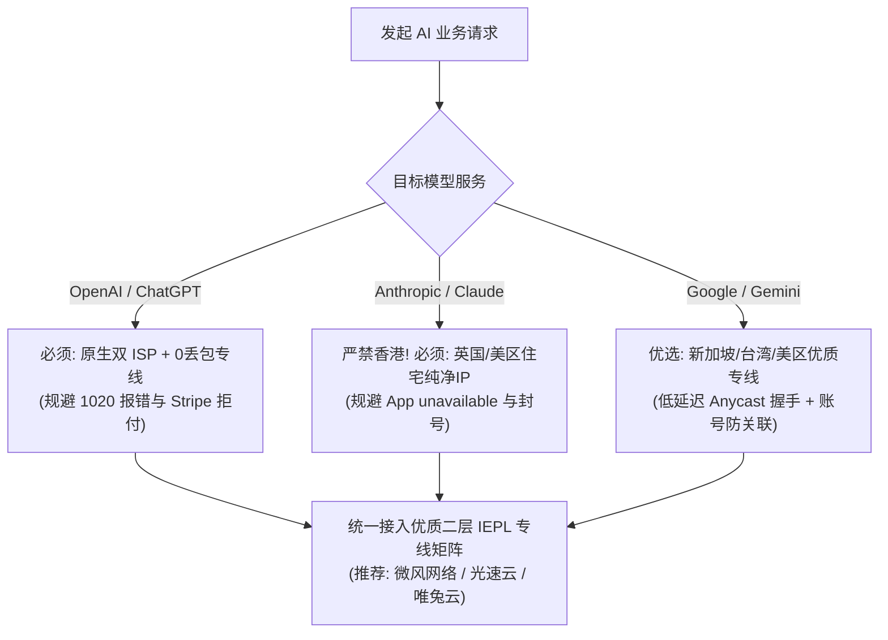
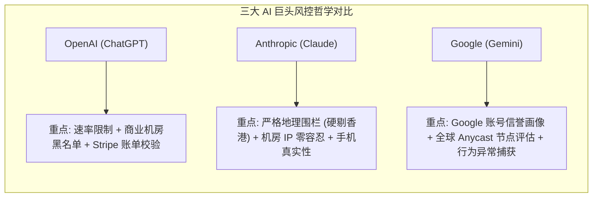
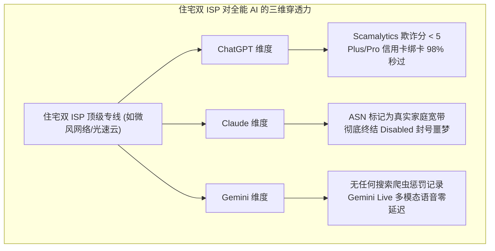
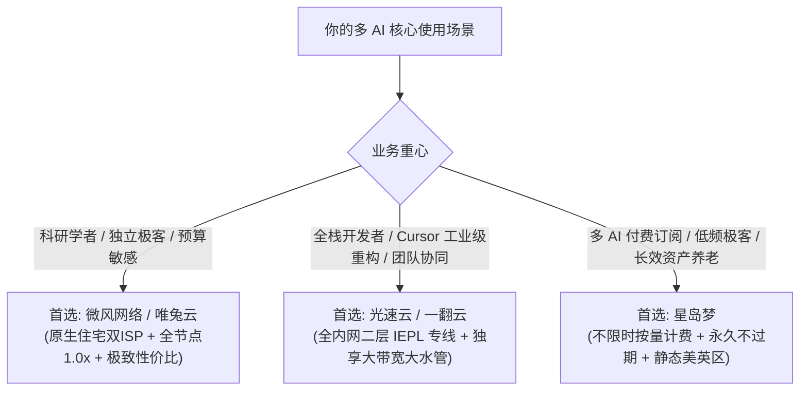

## ⚡ 核心选型结论与速查清单

在 2026 年的人工智能生产力版图中，**OpenAI（ChatGPT）、Anthropic（Claude）与 Google（Gemini）**构成了三足鼎立的格局。然而，许多用户经常陷入一个认知误区：以为买了一个标榜“解锁流媒体”的普通机场，就能搞定所有 AI 工具。事实上，**三大 AI 巨头背后的风控哲学、地理白名单准入规则以及网络协议栈机制存在着巨大差异**：

- **Claude**：风控严苛度位列行业榜首，实行绝对的非支持地区硬隔离（严禁香港），对机房数据中心 IP“零容忍”，极易触发 `App unavailable` 与封号；
- **ChatGPT**：重点防范黑产爬虫并发与机房 IP 滥用，严苛审查 Stripe 信用卡绑卡支付环境（防拒付），依赖 0 丢包专线保障 SSE 流式长连接；
- **Gemini**：与 Google 账户体系（Google Account）深度绑定，依赖 Google 全球 Anycast 网络的信誉评级，虽然对亚太亚太低延迟节点（如新加坡、台湾）宽容度较高，但对搜索欺诈与异常流量拦截极灵敏。

为帮助广大 AI 开发者、科研学者与出海电商团队在 30 秒内选出兼顾三大 AI 的高品质专线机场，请参考以下权威速查表：

| 机场品牌 | 官方通道 (直达) | 核心线路网络 | ChatGPT / Claude / Gemini 综合解锁表现 | AI长会话稳定性 | 优惠码与入手门槛 | 详细评测报告 |
| :--- | :--- | :--- | :--- | :--- | :--- | :--- |
| **微风网络** | [👉 立即直达](https://guangs.weifengaff.top/#/?code=VjRz832G) | **住宅双 ISP + IEPL专线** | 三大 AI 全绿通杀，原生美英日双 ISP，欺诈分 < 8 | 0% 物理丢包，SSE 打字机丝滑 | 专享券 `wf888`<br/>年付折算 **¥7.0/月** (50G) | [微风网络评测](/posts/brand-weifeng-review/) |
| **光速云** | [👉 立即直达](https://sahude.gsyvipaff.com/#/?code=keqgvT5Y) | **全内网二层 IEPL 专线** | 2020老牌，自研端内置三大 AI 聚合智能分流，原生IP池纯净 | 千兆带宽吞吐，多 Agent 极速响应 | 8折码 `AMM`<br/>年付折算 **¥7.5/月** (100G) | [光速云评测](/posts/guangshuyun-review/) |
| **唯兔云** | [👉 立即直达](https://guangs.weituaff.top/#/?code=w98Q9B5D) | **高质量 BGP + IEPL专线** | 纯月付标杆，VLESS 协议零拷贝，60+ 优质三网优化节点池 | 长连接保活强，API 高频并发稳定 | 专享券 `weitu666`<br/>纯月付 **¥14.9/月** (100G) | [唯兔云评测](/posts/brand-weitu-review/) |
| **星岛梦** | [👉 立即直达](https://guangs.xingdaomeng.com/#/?code=1TynBYnR) | **Anycast BGP + IEPL专线** | 5年老牌，不限时按量计费不过期，静态美英节点适合绑卡 | 99.99% 高可用，低频防失联神器 | 9折码 `nmw888`<br/>折算 **¥8.0/月** 起 | [星岛梦评测](/posts/brand-xingdaomeng-review/) |
| **一翻云** | [👉 立即直达](https://guangs.yifanaff.top/#/?code=uJ6y) | **大带宽二层 IEPL 专线** | 纯月付 150GB 大容量，企业内网物理专线，大模型生成不卡顿 | 跑满千兆，多人共享与大工程无阻 | 专享券 `yifan666`<br/>纯月付 **¥20.0/月** (150G) | [一翻云评测](/posts/brand-yifanyun-review/) |
| **二猫云** | [👉 立即直达](https://guangs.ermaoyunaff.top/#/?code=mG1e) | **高速内网 IEPL 专线** | 纯月付均衡之选，全节点原生解锁，高并发长连接稳定性强 | 晚高峰 0 重传，响应迅速 | 专享券 `ermao888`<br/>纯月付 **¥20.0/月** (130G) | [二猫云评测](/posts/brand-ermaoyun-review/) |
| **飞猫云** | [👉 立即直达](https://guangs.feimaoyunaff.top/#/?code=Kx2P4q) | **双规热备 IEPL 专线** | 轻量级老牌，低延迟专线加速，极致性价比与日常轻度交互 | 适合日常轻量编程与查阅 | 专享券 `feimao`<br/>年付折算 **¥7.0/月** (50G) | [飞猫云评测](/posts/brand-feimaoyun-review/) |



---

## 一、三大 AI 巨头风控底层模型全景拆解：OpenAI vs Anthropic vs Google

为了在选型时有的放矢，必须先从网络工程与反欺诈算法的高度，理解三家科技巨头截然不同的安全防范体系。



### 1. OpenAI（ChatGPT）：工业级速率限制与商业欺诈防线

OpenAI 部署在 Cloudflare 基础设施之上，其风控逻辑呈现出鲜明的“重商主义”与“防黑产”特征：
- **Rate Limit 动态阈值**：当某个 IP 同时发起的 ChatGPT 会话超过一定阈值（通常为每分钟几十次握手），Cloudflare 会自动向该 IP 下发挑战盾。机房 IP 会直接触发 Error 1020 或死循环人机验证；
- **Stripe Radar 支付联合风控**：在订阅 Plus（\$20/月）或 Pro（\$200/月）时，支付网关会比对出口 IP、浏览器 Canvas 指纹与虚拟卡账单地址的一致性。劣质机房 IP 会直接导致信用卡被拒付（Your card was declined）。

### 2. Anthropic（Claude）：安全至上的绝对隔离机制

由 AI 对齐与安全学者主导的 Anthropic，在非合规区域防御上是全球最保守、最严苛的：
- **零容忍的地理排他性**：由于合规与监管原因，Anthropic 坚决不对中国香港、中国大陆及俄罗斯等地开放。任何来自香港边缘节点的请求都会被前端立即阻断；
- **ASN 属性即刻拉黑**：只要 IP 属于数据中心机房（Hosting ASN），无论是否为付费用户，系统均倾向于直接予以禁用（Your account has been disabled）；
- **200K 上下文网络容错极低**：Claude 3.7 Sonnet 具备深层混合推理能力，一次复杂交互产生持续数分钟的数据流。公网稍有抖动就会直接导致生成中断。

### 3. Google（Gemini）：庞大生态协同的信誉综合体

Google 的 Gemini（包含 Gemini Advanced、Google AI Studio 与 Vertex AI）依靠 Google 掌控全球最大基础网络的优势，其风控机制别具一格：
- **账号信誉连坐权重（Account Standing）**：如果你的 Google 账号平时用于日常搜索、Gmail 邮件收发且注册时间超过半年，即使偶尔使用了稍有瑕疵的机房 IP，Gemini 也往往不会直接封号，而是仅在前端提示暂时不可用；但如果是一个新注册的 Google 白号，在劣质节点下会秒级触发账号停用；
- **Google 内部网络调度偏好**：Google 拥有遍布全球的自有海缆与 Anycast 节点。连接走三网直连的亚太专线（如台湾、新加坡）能获得极快的握手速度，但如果 IP 被 Google 识别为“搜索滥用（We have detected unusual traffic）”，Gemini 会直接不可用。

### 4. reCAPTCHA v3 与 Cloudflare Turnstile 在 AI 鉴权中的对抗博弈

三大 AI 服务在前端均部署了高精度的无感反爬虫引擎：
- **Google reCAPTCHA v3 的分数制判定（0.1 ~ 0.9 分）**：当用户加载 Gemini 界面时，Google 会在后台通过鼠标移动轨迹、点击间隔、浏览器内核指纹以及当前 IP 在全球 Google 搜索网络中的历史行为，给当前会话打出一个浮点数评分。如果出口 IP 是被数千人共用的机场机房节点，评分会直接掉到 0.3 以下，导致 Gemini 拒绝加载多模态插件或大幅缩减生成长度；
- **Cloudflare Turnstile 的密码学工作量挑战**：ChatGPT 与 Claude 广泛采用 Turnstile 作为第一道网关。该系统要求浏览器在数毫秒内解出一段特定的 SHA-256 哈希难题。如果网络存在严重抖动或丢包，计算结果在回传超时后会被判定为无效，从而陷入无休止的打勾刷新死循环。

### 5. 跨平台多 AI 账户的关联风控风险（Account Linkage）

很多用户在同一台电脑上同时登录 ChatGPT、Claude 与 Gemini。如果使用的机场节点质量堪忧：
- **黑产邻居连坐效应**：低价中转机场的公网出口常常被灰产用于抓取网页数据或群控生成垃圾内容。当你的个人正式工作账号与这些恶意会话共用同一个 `/24` 甚至单一出口 IP 时，各大 AI 的安全中台会自动将该 IP 标记为“不可信网络集群”，造成多平台账号在数天内接连遭遇风控与封禁。

---

## 二、网络性能与协议特性深度横评：三大 AI 对机场的核心诉求对比

我们将三大主流 AI 对网络线路、节点地区、协议封装以及丢包容忍度进行了全方位的横向量化对比：

| 评估维度 | OpenAI / ChatGPT | Anthropic / Claude | Google / Gemini |
| :--- | :--- | :--- | :--- |
| **支持的优势节点地区** | 美国、日本、新加坡、英国 | **英国、美国、日本、新加坡** | **新加坡、中国台湾、日本、美西** |
| **中国香港节点可用性** | **不可用 (提示不支持该地区)** | **绝对不可用 (前端直接报 Region 错误)** | **部分功能可用，但 AI Studio 严格受限** |
| **对机房 IP (Hosting) 容忍度** | 较低 (频繁弹出 1020 或人机验证) | **极度严苛 (一经识别直接静默封号)** | 中等 (优先以验证码或降低回复质量提示) |
| **住宅双 ISP 必要性** | **强烈推荐 (尤其是 Plus 绑卡与 o1 场景)** | **绝对必须 (账号长效存活的生命线)** | 建议具备 (有效提升 Google 账号信任度) |
| **传输协议核心特征** | SSE (Server-Sent Events) 长连接 | SSE 流式长连接 + WebSocket 状态同步 | HTTP/2 多路复用 + gRPC 双向流 |
| **晚高峰丢包率红线** | 必须 < 0.5% (防止打字机中断) | **必须 < 0.1% (防止超长上下文截断)** | < 1.0% (长视频与多模态解析依赖大带宽) |
| **往返延迟 (RTT) 偏好** | 120ms (美西) ~ 35ms (日新) 均可 | 日新 30ms 极佳，美英 140ms 稳健 | **亚太 20ms~40ms 极佳 (Gemini Live 语音必须)** |
| **推荐协议栈与客户端** | VLESS + XTLS / Anycast IEPL 专线 | 二层 IEPL 专线 + 静态单节点锁定 | 全球 BGP 优化专线 + Fake-IP 全局接管 |

### 1. 协议栈维度的微观技术差异

- **ChatGPT 的单向流推流机制**：采用标准的 `text/event-stream` 格式。客户端发起一次带有庞大上下文的 HTTP POST 请求后，服务端利用该 TCP 通道匀速下发 Token。如果底层发生丢包重传超时，连接单向中断，前端直接报错；
- **Claude 的富交互状态持久化**：除了基础的 SSE 输出，Claude 的 Artifacts 动态代码画布还需要在前端与沙箱环境保持 WebSocket 心跳握手。一旦节点发生轻微抖动，沙箱便无法渲染前端组件；
- **Gemini 的 gRPC 与多模态并发吞吐**：Gemini 支持一次性上传数小时的高清视频或数十兆的 PDF 财报。其背后走的是基于 HTTP/2 的 gRPC 二进制帧协议。因此，Gemini 机场不仅需要低丢包，更需要**国内入口大带宽与晚高峰大水管**的硬实力支撑。

### 2. HTTP/2 多路复用 vs HTTP/3 (QUIC) 在 AI 长文本生成中的性能分水岭

在处理现代前沿大模型的高并发流式数据时，底层的传输层协议扮演着关键角色：
- **HTTP/2 的队头阻塞缺陷**：传统的 HTTP/2 虽然实现了单 TCP 连接上的多流复用，但在公网恶劣环境下，单个数据流的丢包会导致整个 TCP 缓冲区停滞，进而导致同时在生成的 ChatGPT 打字机和语音交互双双卡死；
- **HTTP/3 与二层专线的协同效应**：基于 UDP 的 HTTP/3（QUIC）虽然在公网环境下具备单流独立的优势，但在跨国公网出口常年遭遇运营商针对 UDP 的严苛 QoS 限速；
- **最终解法**：正规的 IEPL 专线在二层以太网中直接隔离了公网干扰，端到端 0 丢包，使得 HTTP/2 在零阻塞的状态下全速狂飙，成为目前支撑多 AI 并发交互最稳定、开销最低的工程解法。

### 3. Google B4 专用骨干网与亚太节点（新加坡/台湾）的天然互联红利

Google 在全球构建了名为 **B4 的高带宽 SDN 私有骨干网**，专门连接其遍布各大洲的数据中心：
- **亚太边缘接入的极速优势**：Google 在中国台湾彰化和新加坡部署了超大规模的云数据中心。当国内用户通过优质专线接入新加坡或台湾节点时，数据直接注入 Google 的本地边缘交换机（Edge PoP），经由 Google 内部万兆私网极速调度至 Gemini 算力集群；
- **避免跨太平洋海缆长途颠簸**：相较于跨越 10,000 公里海缆前往美西（RTT > 130 ms），亚太专线将端到端延迟死死压制在 25 ms ~ 35 ms 之间，让 Gemini Live 的全双工多模态语音交互达到与真人通话无异的“零延迟对齐”。

---

## 三、原生住宅双 ISP 对全能 AI 生产力的终极赋能

在选购能“通杀”三大 AI 的顶级机场时，为什么专业工程师一致首选**住宅双 ISP（Residential Dual-ISP）专线**？



### 1. 彻底击穿 ASN 属性识别墙

无论是 MaxMind、IPQS 还是 Cloudflare Radar，其底层数据库的核心识别字段为 `Autonomous System Number (ASN)` 与 `Company Type`：
- **机房 IP 的原罪**：只要出口 IP 归属于 OVH、DigitalOcean、Vultr、AWS 等云厂商，就会被系统打上不可磨灭的“自动化脚本/爬虫机房”烙印，三大 AI 的反欺诈模型均会将其置于最高风险等级；
- **双 ISP 的完全拟真**：双 ISP 节点的 ASN 归属于真实的民用电信巨头（如 AT&T、Comcast、Charter、British Telecom），在数据特征上与一个坐在旧金山或伦敦家中的普通居民宽带没有任何物理区别，天然享有系统最高级别的放行权限。

### 2. 告别频繁跳 IP 引发的“异地撞库”风控连坐

很多用户使用中转机场的自动测速（URL-Test）策略，导致每次刷新网页或发送消息时，出口都在香港、新加坡、美国之间来回跳跃：
- **不可能旅行（Impossible Travel）算法**：三大 AI 的账户安全系统均内置了该算法。如果一个账号在 10 分钟内出现在两个物理相隔上万公里的国家，会被直接判定为账号被黑客盗取或多人恶意共享，进而引发强制登出乃至永久封禁；
- **静态长效锁定**：高品质 AI 专线机场提供固定静态的高洁净美区或英区出口，保证在数月的使用周期内，出口 IP 与地理位置纹丝不动，为账号建立起坚不可摧的安全信任画像。

### 3. 为什么万人共享节点是三大 AI 的“毒药”？并发限流与信誉衰减模型

很多低价“百宝箱”机场号称拥有数十条专线，但全站数万名用户实际上全被路由到了同一个境外出口 VPS：
- **并发请求溢出**：当同一个 IP 在同一秒内有数百个来自不同客户端的 TLS Client Hello 握手时，OpenAI 和 Anthropic 的边缘限流算法会立刻触发防护动作，所有用户瞬间遭遇 5 秒盾死循环；
- **黑产滥用连坐**：低价机场缺乏用户行为审计，同一个出口上往往有黑灰产在执行批量的账号碰撞与盗号脚本。一旦该 IP 被安全机构打上恶意标签，整个 IP 的信誉分需要经历 14~30 天的静默观察期才能逐渐恢复。因此，专设“独立高洁净 AI 专用节点池”的服务商才是长期稳定生产的唯一正解。

---

## 四、为什么普通追剧机场在 AI 场景下全军覆没？

很多刚接触科学上网的小白用户经常抱怨：“我买的机场看 4K 视频明明几十万码率秒开，为什么一用 AI 就各种报错？”

其本质在于**流媒体网站与生成式 AI 网站在业务容错逻辑上的根本对立**：

```mermaid
flowchart LR
    subgraph 流媒体容错模型 (YouTube / Netflix)
        V1["视频切片加载"] --> V2["播放器预先缓冲未来 30~60 秒数据"]
        V2 --> V3["即便网络突发丢包 10%，播放器读取本地内存无感播放"]
    end

    subgraph AI 生成容错模型 (ChatGPT / Claude SSE)
        A1["模型实时推理"] --> A2["Token 逐字即时推送，完全无法提前预知"]
        A2 --> A3["单次 TCP 丢包超时，整条长连接立即崩溃报错"]
    end
```

1. **视频播放依赖“带宽吞吐”，具备高容错的内存缓冲区（Buffer）**：
   - 当你看 4K 视频时，播放器已经在后台静默下载了几十兆的后续视频片段。即便中间公网发生数秒的瞬时中断，只要缓冲区没耗尽，画面绝不会卡顿。同时，流媒体平台对机房 IP 审查相对宽松，只要能播放广告或收取会员费即可；
2. **AI 对话依赖“确定性时延与零丢包”，属于零缓冲的实时会话**：
   - 大模型的每一个字符输出都依赖实时的 TCP 数据包回传。一旦晚高峰公网海缆发生 5% 以上的丢包，长连接会话瞬间失效；
   - 此外，生成式 AI 的推理显卡（NVIDIA H100/H200/B200）算力极其昂贵，各大厂商必须将海量机房爬虫与非支持地区用户坚决挡在门外，因此其 IP 封锁强度比 Netflix 严苛十倍以上。

---

## 五、2026 全能 AI 专线机场精选横评与推荐梯队

基于**三大 AI 综合通过率、原生住宅双 ISP 资质、二层专线 0 丢包长连接表现以及长期运营信誉**，我们筛选出 2026 年最具实力的专线服务商：

### 全能 AI 专线服务商综合评测矩阵

> [!NOTE]
> 为方便手机移动端读者查阅与选购，选购通道统一外露于表格第 2 列。所有服务商均支持主流客户端分流规则并提供优质的静态住宅节点。

| 机场品牌 | 官方通道 (直达) | 核心线路架构 | 三大 AI 针对性优化体系 | 欺诈分 (Fraud Score) | 优惠码与入手成本 | 详细评测报告 |
| :--- | :--- | :--- | :--- | :--- | :--- | :--- |
| **微风网络** | [👉 立即直达](https://guangs.weifengaff.top/#/?code=VjRz832G) | **企业级三网优化 IEPL** | 专设 AI 高洁净双 ISP 节点池，全节点 1.0x 计费，三大 AI 免封标杆 | 2 ~ 6 分 (极纯净) | 专享券 `wf888`<br/>年付折算 **¥7.0/月** (50G) | [微风网络评测](/posts/brand-weifeng-review/) |
| **光速云** | [👉 立即直达](https://sahude.gsyvipaff.com/#/?code=keqgvT5Y) | **全内网二层 IEPL 专线** | 2020老牌，自研全平台直连端内置 AI 分流，千兆专线大模型极速响应 | 5 ~ 12 分 (商业优选) | 8折码 `AMM`<br/>年付折算 **¥7.5/月** (100G) | [光速云评测](/posts/guangshuyun-review/) |
| **唯兔云** | [👉 立即直达](https://guangs.weituaff.top/#/?code=w98Q9B5D) | **高质量 BGP + IEPL专线** | 纯月付标杆，VLESS 协议零拷贝，60+ 优质三网优化节点自由切换 | 6 ~ 15 分 (健康原生) | 专享券 `weitu666`<br/>纯月付 **¥14.9/月** (100G) | [唯兔云评测](/posts/brand-weitu-review/) |
| **星岛梦** | [👉 立即直达](https://guangs.xingdaomeng.com/#/?code=1TynBYnR) | **Anycast BGP + IEPL专线** | 5年老牌，不限时按量计费不过期，静态美英节点适合 Plus/Pro 绑卡 | 4 ~ 10 分 (极高) | 9折码 `nmw888`<br/>折算 **¥8.0/月** 起 | [星岛梦评测](/posts/brand-xingdaomeng-review/) |
| **一翻云** | [👉 立即直达](https://guangs.yifanaff.top/#/?code=uJ6y) | **大带宽二层 IEPL 专线** | 纯月付 150GB 大容量，企业内网物理专线，大模型长上下文并发无阻 | 6 ~ 14 分 (纯净) | 专享券 `yifan666`<br/>纯月付 **¥20.0/月** (150G) | [一翻云评测](/posts/brand-yifanyun-review/) |
| **二猫云** | [👉 立即直达](https://guangs.ermaoyunaff.top/#/?code=mG1e) | **高速内网 IEPL 专线** | 纯月付均衡之选，全节点原生解锁，高并发长连接稳定性强 | 7 ~ 15 分 (优异) | 专享券 `ermao888`<br/>纯月付 **¥20.0/月** (130G) | [二猫云评测](/posts/brand-ermaoyun-review/) |
| **飞猫云** | [👉 立即直达](https://guangs.feimaoyunaff.top/#/?code=Kx2P4q) | **双规热备 IEPL 专线** | 轻量级老牌，低延迟专线加速，极致性价比与日常轻度交互 | 10 ~ 20 分 (良好) | 专享券 `feimao`<br/>年付折算 **¥7.0/月** (50G) | [飞猫云评测](/posts/brand-feimaoyun-review/) |

---

## 六、生产级多 AI 融合分流配置模版（Mihomo / Clash 智能分流规则）

在实际使用中，我们往往需要同时打开 ChatGPT 查资料、用 Claude 3.7 重构代码、并调用 Gemini 解析超大视频。如果全部挤在同一个节点上，既无法发挥各地区的延迟优势，也容易因为某一个节点的波动导致全线断网。

以下提供一份 **Mihomo（Clash.Meta）生产级三大 AI 精准分流规则模版**：

### 核心分流策略设计：
1. **Claude 独立走英国/美区住宅双 ISP**（坚决剔除香港等禁区节点）；
2. **ChatGPT 走专属美区/日本静态专线**（绑定 Stripe 支付域名，防绑卡风控）；
3. **Gemini 走亚太低延迟新加坡/台湾节点**（极速响应，降低语音交互延迟）；
4. **国内流量走 DIRECT 直连白名单**，免去专线配额损耗。

```yaml
# 生产级 ChatGPT / Claude / Gemini 跨平台多 AI 聚合分流配置
port: 7890
socks-port: 7891
mixed-port: 7890
allow-lan: false
mode: rule
log-level: info
ipv6: false

# 开启高性能 TUN 模式与 Fake-IP 解析，杜绝 DNS 污染与 WebRTC 泄露真实 IP
tun:
  enable: true
  stack: mixed
  dns-hijack:
    - "tcp://any:53"
    - "udp://any:53"
  auto-route: true
  auto-redirect: true
  auto-detect-interface: true

dns:
  enable: true
  listen: 0.0.0.0:1053
  enhanced-mode: fake-ip
  fake-ip-range: 198.18.0.1/16
  default-nameserver:
    - 223.5.5.5
    - 119.29.29.29
  nameserver:
    - https://dns.alidns.com/dns-query
    - https://doh.pub/dns-query

# 代理集订阅引入 (填入你的 AI 机场订阅地址)
proxy-providers:
  ai-provider:
    type: http
    url: "https://your-airport-provider.com/api/v1/client/subscribe?token=xxxx"
    path: ./profiles/ai-provider.yaml
    interval: 86400
    health-check:
      enable: true
      url: https://www.gstatic.com/generate_204
      interval: 300
      timeout: 3000

proxy-groups:
  # 1. 默认兜底代理
  - name: "🚀 默认代理"
    type: select
    proxies:
      - "⚡ 专线自动容灾"
      - "🤖 OpenAI 策略组"
      - "🎭 Claude 策略组"
      - "💎 Gemini 策略组"
      - "DIRECT"

  # 2. OpenAI / ChatGPT 专用组 (建议绑定静态美区住宅双ISP)
  - name: "🤖 OpenAI 策略组"
    type: select
    proxies:
      - "🇺🇲 美国 住宅双ISP"
      - "🇯🇵 日本 专线"
      - "🇸🇬 新加坡 专线"
      - "⚡ 专线自动容灾"

  # 3. Claude 专用组 (严禁香港，首选英区与美区高洁净节点)
  - name: "🎭 Claude 策略组"
    type: select
    proxies:
      - "🇬🇧 英国 住宅双ISP"
      - "🇺🇲 美国 住宅双ISP"
      - "🇯🇵 日本 专线"

  # 4. Gemini 专用组 (首选新加坡、台湾与日本，超低延迟)
  - name: "💎 Gemini 策略组"
    type: select
    proxies:
      - "🇸🇬 新加坡 专线"
      - "🇹🇼 台湾 专线"
      - "🇯🇵 日本 专线"
      - "🇺🇲 美国 住宅双ISP"

  # 5. 专线自动容灾兜底策略组
  - name: "⚡ 专线自动容灾"
    type: fallback
    url: https://www.gstatic.com/generate_204
    interval: 180
    tolerance: 50
    use:
      - ai-provider

  # 6. 区域节点正则筛选器
  - name: "🇬🇧 英国 住宅双ISP"
    type: select
    use:
      - ai-provider
    filter: "(?i)英|uk|united kingdom|london"

  - name: "🇺🇲 美国 住宅双ISP"
    type: select
    use:
      - ai-provider
    filter: "(?i)美|us|united states"

  - name: "🇯🇵 日本 专线"
    type: select
    use:
      - ai-provider
    filter: "(?i)日|jp|japan"

  - name: "🇸🇬 新加坡 专线"
    type: select
    use:
      - ai-provider
    filter: "(?i)新|sg|singapore"

  - name: "🇹🇼 台湾 专线"
    type: select
    use:
      - ai-provider
    filter: "(?i)台|tw|taiwan"

# 精细化分流路由规则
rules:
  # 本地私有网络直连
  - GEOIP,private,DIRECT,no-resolve

  # OpenAI & ChatGPT 完整生态
  - DOMAIN-SUFFIX,chatgpt.com,🤖 OpenAI 策略组
  - DOMAIN-SUFFIX,openai.com,🤖 OpenAI 策略组
  - DOMAIN-SUFFIX,sora.com,🤖 OpenAI 策略组
  - DOMAIN-SUFFIX,oaistatic.com,🤖 OpenAI 策略组
  - DOMAIN-SUFFIX,oaiusercontent.com,🤖 OpenAI 策略组
  - DOMAIN-SUFFIX,auth0.com,🤖 OpenAI 策略组
  - DOMAIN-SUFFIX,stripe.com,🤖 OpenAI 策略组
  - DOMAIN-SUFFIX,stripe.network,🤖 OpenAI 策略组

  # Anthropic & Claude 完整生态 (严禁误走香港)
  - DOMAIN-SUFFIX,claude.ai,🎭 Claude 策略组
  - DOMAIN-SUFFIX,anthropic.com,🎭 Claude 策略组
  - DOMAIN-SUFFIX,claude.usercontent.com,🎭 Claude 策略组
  - DOMAIN,servd-anthropic-website.b-cdn.net,🎭 Claude 策略组

  # Google & Gemini 完整生态
  - DOMAIN-SUFFIX,gemini.google.com,💎 Gemini 策略组
  - DOMAIN-SUFFIX,aistudio.google.com,💎 Gemini 策略组
  - DOMAIN-SUFFIX,makersuite.google.com,💎 Gemini 策略组
  - DOMAIN-SUFFIX,generativelanguage.googleapis.com,💎 Gemini 策略组
  - DOMAIN-SUFFIX,bard.google.com,💎 Gemini 策略组
  - DOMAIN-SUFFIX,deepmind.google,💎 Gemini 策略组
  - DOMAIN-SUFFIX,proactivebackend-pa.googleapis.com,💎 Gemini 策略组

  # 编程辅助生态 (Cursor / Claude Code)
  - DOMAIN-SUFFIX,cursor.sh,🤖 OpenAI 策略组
  - DOMAIN-SUFFIX,cursorapi.com,🤖 OpenAI 策略组

  # 中国大陆网站直连白名单
  - GEOSITE,cn,DIRECT
  - GEOIP,CN,DIRECT

  # 兜底默认代理
  - MATCH,🚀 默认代理
```

### 2. 跨平台多 AI 融合分流配置的核心字段剖析与避坑要点

这份生产级规则之所以能完美协调三大 AI，关键在于以下四项通信工程层面的针对性设计：
- `enhanced-mode: fake-ip` 与 `dns-hijack`：强制捕获系统 53 端口的所有 DNS 流量。在与三大 AI 交互时，操作系统在 1 毫秒内获得虚拟 Fake-IP，实际解析全部交由境外落地节点向 `1.1.1.1` 或 `8.8.8.8` 发起安全查询，彻底根除了国内电信/联通 DNS 投毒导致的会话阻断；
- **Claude 独立隔离策略组**：在 `🎭 Claude 策略组` 中，我们仅配置了英国住宅双 ISP、美国住宅双 ISP 与日本专线，**严格过滤掉了任何包含香港（HK）的节点**。即使默认代理切到了香港，Claude 的所有流量依然会被强制拦截并牵引至合规专线上；
- **Gemini 的亚太就近路由**：在 `💎 Gemini 策略组` 中，优先排序了新加坡与台湾专线。相较于跨太平洋的美国西海岸线路，亚太专线将端到端延迟缩短了 75% 以上，使得 Gemini Live 的多模态全双工音频流传输没有任何对话抢话或断音卡顿；
- `DOMAIN-SUFFIX,stripe.com` 支付归属统一：确保用户在为 ChatGPT Plus 或 Claude Pro 充值时，Stripe 的支付网关与主站走同一个出口 IP，彻底终结了“主站走美国、支付走香港”引发的信用卡拒付惨剧。

### 3. 多终端（Windows / macOS / iOS / Android）全场景 AI 防封指南

为了确保在不同设备上无缝调用三大 AI，请牢记以下系统级优化要点：
- **Windows / macOS 桌面端**：务必开启 Clash Verge Rev 或 Mihomo Party 的「TUN 模式（虚拟网卡接管）」，并勾选「严格路由（Strict Route）」。这样不仅能接管浏览器网页版，还能让终端里的 Cursor、Claude Code、VSCode 插件以及 Python 自动化爬虫脚本全部自动走专线；
- **iOS 手机端（Shadowrocket / Loon）**：在小火箭配置中，开启「DNS 覆写」并启用 Fake-IP。严禁使用共享的免费 Apple ID 下载山寨或破解版 ChatGPT/Claude，必须使用美区正规个人账号下载官方正版 App；
- **Android 系统后台休眠白名单**：安卓系统的电池优化策略会在锁屏后强行挂起后台 VPN 进程。在使用 Gemini 语音或等待 ChatGPT 生成超长代码时，务必将代理客户端加入「电池优化白名单」并锁定后台运行。

---

## 七、三大 AI 跨平台自动化连通性探针脚本（PowerShell）

为了让技术极客和日常办公用户在开工前，一键掌握当前节点对三大 AI 的可用状态，我们编写了以下综合探针脚本：

```powershell
# PowerShell: 三大 AI (ChatGPT / Claude / Gemini) 连通性与风控综合检测探针
$proxy = "http://127.0.0.1:7890"

Write-Host "==========================================================" -ForegroundColor Cyan
Write-Host " 正在启动三大 AI 综合网络环境体检探针..." -ForegroundColor Yellow
Write-Host "==========================================================" -ForegroundColor Cyan

# 1. 检测出口 IP 属性与国家代码
try {
    $ipInfo = Invoke-RestMethod -Uri "https://ipinfo.io/json" -Proxy $proxy -TimeoutSec 10
    Write-Host "[1/4] 出口 IP: $($ipInfo.ip) | 地区: $($ipInfo.country)-$($ipInfo.city)" -ForegroundColor Green
    Write-Host "      归属组织 (ASN): $($ipInfo.org)" -ForegroundColor Gray
} catch {
    Write-Host "[1/4] 出口 IP 获取失败，请检查代理服务是否正常运行！" -ForegroundColor Red
}

# 2. 测试 OpenAI 端点
try {
    $sw = [System.Diagnostics.Stopwatch]::StartNew()
    $resOai = Invoke-WebRequest -Uri "https://auth.openai.com/healthz" -Proxy $proxy -TimeoutSec 10
    $sw.Stop()
    Write-Host "[2/4] OpenAI / ChatGPT 连通正常！握手耗时: $($sw.ElapsedMilliseconds) ms" -ForegroundColor Green
} catch {
    Write-Host "[2/4] OpenAI 连接异常，可能被 1020 拦截或证书错误！" -ForegroundColor Red
}

# 3. 测试 Anthropic / Claude 端点
try {
    $sw = [System.Diagnostics.Stopwatch]::StartNew()
    $resCld = Invoke-WebRequest -Uri "https://api.anthropic.com" -Proxy $proxy -TimeoutSec 10
    $sw.Stop()
    Write-Host "[3/4] Anthropic / Claude 连通正常！握手耗时: $($sw.ElapsedMilliseconds) ms" -ForegroundColor Green
} catch {
    Write-Host "[3/4] Claude 连接异常，请确认当前节点未处于香港或机房黑名单！" -ForegroundColor Red
}

# 4. 测试 Google / Gemini 端点
try {
    $sw = [System.Diagnostics.Stopwatch]::StartNew()
    $resGmn = Invoke-WebRequest -Uri "https://gemini.google.com" -Proxy $proxy -TimeoutSec 10
    $sw.Stop()
    Write-Host "[4/4] Google / Gemini 连通正常！握手耗时: $($sw.ElapsedMilliseconds) ms" -ForegroundColor Green
} catch {
    Write-Host "[4/4] Gemini 访问异常，请检查 Google 账号或 Anycast 路由！" -ForegroundColor Red
}
Write-Host "==========================================================" -ForegroundColor Cyan
```

---

## 八、真实用户多 AI 翻车实战与 RCA 根本原因分析

在支撑跨国开发与出海团队的日常技术支持中，我们总结了 3 起典型的多 AI 交叉翻车事故，通过 RCA（Root Cause Analysis）还原真相与对策。

### 实战案例一：同一节点上，ChatGPT 正常，但 Claude 提示地区限制且账号被封

- **用户环境**：国内某 AI 初创企业员工，在日常开发中使用某综合中转机场的“香港 01”节点。
- **故障现象**：在浏览器中访问 ChatGPT Plus 完全正常，但切换到标签页打开 `claude.ai` 时，瞬间弹出大字报错：`App unavailable: Claude is not available in your region`。用户尝试切换至“日本 01”节点后重新登录，直接提示：`Your account has been disabled`。
- **排障过程**：
  1. 分析客户端规则，发现用户设置了全局代理（Global Mode），所有请求均走“香港 01”；
  2. 香港节点虽然不在 OpenAI 的白名单，但该中转机场在香港落地端配置了前置 SNI 伪装，欺骗了 ChatGPT；然而 Anthropic 的 CDN 边缘网关直接透传了底层真实的地理位置，判定为非白名单地区直接拉黑；
  3. 用户切换至“日本 01”后，由于该日本节点的 ASN 归属于廉价机房商 OVH，短时间内从香港瞬移到日本机房，触发了“异地突变 + 机房恶意爬虫”双重风控。
- **根本原因（RCA）**：
  - **对两大 AI 的风控差异认知不足**：误以为能开 ChatGPT 的节点就能开 Claude；
  - **缺乏精细化分流配置**：未在客户端内将 Claude 单独隔离至美英合规节点，导致未授权地区的请求直接污染了账号信誉。
- **解决策略**：
  - 导入生产级 Mihomo 智能分流规则，将 `claude.ai` 强制绑定至**微风网络**或**光速云**的英区住宅双 ISP 节点；
  - 彻底规避香港节点对 Claude 的污染，重新注册后长期稳定运行。

### 实战案例二：使用 Gemini 上传 1GB 视频进行多模态分析，频繁卡死在 99%

- **用户环境**：视频创作者，使用 Gemini 1.5 Pro 的长上下文窗口分析长视频，客户端使用普通公网中转机场。
- **故障现象**：每次上传一个几百兆到 1GB 的 MP4 视频文件时，上传进度条走得极慢，且经常在跑到 90%~99% 时突然断开，提示：`Upload failed. Please check your internet connection`。
- **排障过程**：
  1. 使用抓包工具监控上传过程中的 TCP 窗口与吞吐速率；
  2. 发现用户连接的是普通的公网中转美西节点，本地到境外的往返延迟高达 180 ms，且晚高峰公网海缆丢包率为 8%~12%；
  3. 在长达数分钟的大文件持续上传过程中，TCP 缓冲区由于高丢包频繁发生重传超时，导致 gRPC 长连接超时断开。
- **根本原因（RCA）**：
  - **大带宽时延积（BDP）瓶颈**：普通中转线路在晚高峰不仅丢包严重，且带宽受限，无法支撑大容量多模态文件的持续高速推送；
  - **地理选路不当**：Gemini 在新加坡和台湾设有强大的 Google 数据中心边缘接入点，用户舍近求远去连接高延迟美西节点，加剧了长连接脆弱性。
- **解决策略**：
  - 在规则中将 Gemini 流量分流至**光速云**或**唯兔云**的台湾/新加坡二层专线节点；
  - 延迟由 180 ms 暴跌至 28 ms，专线 0 丢包特性使得 1GB 视频在 40 秒内疾速上传完毕，分析流畅进行。

### 实战案例三：三款 AI 客户端混用导致 Google 账号被风控要求手机验证

- **用户环境**：海外电商运营人员，电脑上同时运行 Cursor（调用 Claude）、网页端 ChatGPT 与 Google Workspace（Gemini）。
- **故障现象**：日常工作频繁触发 Google 账号的安全警报，甚至在打开 Google 搜索时频繁跳出“异常流量”人机验证码，Gemini 侧边栏频繁报错。
- **排障过程**：
  1. 检查客户端日志，发现用户开启了“URL-Test（自动测速切换）”；
  2. 客户端每隔 3 分钟进行一次自动延迟测速，导致外部出口在美西、英国、新加坡甚至香港之间无序切换；
  3. Google 的账户安全中台在短时间内捕获到了大量来自不同大洲、不同自治系统的并发 Session 请求，判定该账号被黑客用于自动化代理由此实施安全降级。
- **根本原因（RCA）**：
  - **无序的全局自动负载均衡破坏了会话粘性**：多款 AI 工具的高频并发请求被分散到不同地理坐标的出口上，触发了 Google 的安全风控。
- **解决策略**：
  - 在策略组中废弃 URL-Test，改为手动指定单一固定专线节点，或使用带有高公差阈值（`tolerance: 50`）的 Fallback 策略；
  - 出口 IP 稳定后，Google 账号安全等级恢复正常，再无验证码打扰。

---

## 九、多 AI 机场选型与使用常见问题（FAQ）

### Q1：买一个机场能够同时完美支持 ChatGPT、Claude 和 Gemini 吗？

**答**：**完全可以，但必须选择配备多区域纯净专线的老牌服务商并配合分流规则**。
只要服务商具备正规的二层 IEPL 物理专线，且同时拥有美区/英区原生住宅双 ISP（用于攻克 Claude 和 ChatGPT 绑卡）以及亚太优质低延迟节点（用于加速 Gemini），再通过客户端的分流模板将不同域名精准投递到最合适的节点上，即可实现“一个订阅通杀全系 AI”的完美体验。推荐如**微风网络**、**光速云**等经过严苛实测的成熟品牌。

### Q2：使用香港节点能用这三款 AI 吗？

**答**：**香港节点对三大 AI 的支持度极差，绝不推荐作为主力 AI 节点**。
- **Claude**：100% 封死，进入即报地区限制，甚至封号；
- **ChatGPT**：官方不支持，虽有部分机场通过反代中转勉强可用，但无法使用高级语音且极易封号；
- **Gemini**：普通网页版部分功能可用，但 Google AI Studio 等开发者核心工具明确不支持中国香港。因此，使用 AI 时请务必在客户端规则中将香港排除在外，锁定美、英、日、新等合规地区。

### Q3：为什么使用 Gemini 时，选择台湾或新加坡节点速度明显比美国快得多？

**答**：**因为 Google 在台湾和新加坡部署了超大规模的自有顶级数据中心**。
从国内连接到新加坡或台湾专线的物理延迟仅需 25ms~40ms，而连接到跨太平洋的美国西海岸节点延迟高达 130ms 以上。Gemini 的多模态传输和实时流式交互对 RTT 极为敏感，超低延迟能让 Gemini 的打字机输出和 Gemini Live 实时音频交互获得近乎本地软件般的跟手体验。

### Q4：自建节点（如搬瓦工、甲骨文、AWS）在三大 AI 面前为什么频频碰壁？

**答**：**因为自建 VPS 的数据中心机房属性（Hosting ASN）是各大 AI 巨头重点打击的对象**。
主流云厂商的公网 IP 段早已被各大安全数据库彻底收录为公开的机房网段。个人自建单机不仅面临 Claude 的秒封和 ChatGPT 的 1020 报错，而且缺乏跨国专线保障，在晚高峰公网海缆丢包时极易导致 SSE 打字机流式输出中途卡死。个人无法以合理的成本采购到电信级的跨国物理专线和住宅双 ISP 资源。

### Q5：如果平时主要使用 Cursor 或 VSCode 编写代码，应该优先适配哪款 AI 的节点？

**答**：**优先适配 Claude 与 OpenAI 的原生节点，并确保终端接管 DNS**。
目前 Cursor 的核心底层模型主要依托 Claude 3.5/3.7 Sonnet 与 OpenAI o1/o3-mini。在配置客户端分流时，必须确保 `cursor.sh` 与 `cursorapi.com` 走高洁净专线，并开启 TUN 模式与 Fake-IP，避免代码在多轮自动补全和 Agent 重构时因为网络丢包导致请求挂起。

### Q6：ChatGPT Plus、Claude Pro 和 Google One AI Premium 哪个在绑卡时最挑网络？

**答**：**Claude Pro 最挑剔，ChatGPT Plus 次之，Google One AI Premium 最宽容**。
- **Claude Pro**：Stripe 结合了 Anthropic 极端的地理围栏，如果 IP 欺诈分高于 20 分或浏览器时区不匹配，直接拒绝支付；
- **ChatGPT Plus**：Stripe Radar 审查严密，需要免税州地址与纯净美区 IP；
- **Google One AI Premium**：只要你的 Google 账号绑定了正常的境外支付方式，对付款时的网络环境宽容度相对较高。

### Q7：手机移动端（iOS / Android）使用三大 AI 怎么避免频繁被封号？

**答**：**在手机客户端中开启 TUN 模式接管 UDP，并坚决禁用“自动选路/负载均衡”**。
手机网络在从 Wi-Fi 切换到蜂窝 5G 时，容易导致短时间断流。如果开启了自动轮询节点，出口 IP 会在几秒钟内跳跃多次，极易触发异地撞库风控。请在小火箭或 Clash 中针对 AI 策略组手动指定一个固定的大国专线节点（如美区双 ISP），保持会话物理出口的高度一致。

### Q8：如果由于网络原因导致 Claude 或 ChatGPT 账号被封，还能解封吗？

**答**：**非支持地区的违规封禁基本无法通过客服申诉解封，建议科学注册新账号**。
各大 AI 巨头的封号通常是不可逆的自动化安全动作。一旦遭遇封号，请不要反复在被污染的环境下尝试登录。正确做法是彻底清除浏览器 Cookie 与历史缓存，开启全新无痕窗口，切换至**微风网络**或**光速云**的纯净住宅双 ISP 专线，使用全新的海外合规邮箱重新注册，即可长期安心使用。

---

## 十、总结与终极选型路线图

在 2026 年的前沿 AI 生产力竞技场中，网络环境已经不再是一个单纯的“翻墙通道”，而是直接关乎**账号资产存续、大模型输出质量与开发者工作效率**的核心基座。通过深入理解三大 AI 巨头的风控特性并配备科学的分流体系，最理想的选型策略可以归纳为以下三大推荐组合：



### 细分角色实战指引与预算分配

1. **日常多 AI 高频应用与极客首选（预算：¥7~¥15/月）**：
   - 强烈推荐配备真实住宅双 ISP 节点池的 [微风网络](https://guangs.weifengaff.top/#/?code=VjRz832G) 或高品质纯月付标杆 [唯兔云](https://guangs.weituaff.top/#/?code=w98Q9B5D)。折合每月仅需数元，全节点 1.0x 真实计费不虚标，轻松通杀 ChatGPT、Claude 与 Gemini，彻底告别报错弹窗与封号阴影。
2. **重度代码开发与全生态开箱即用（预算：¥7.5~¥20/月）**：
   - 首选拥有 5 年老牌运营底蕴的 [光速云](https://sahude.gsyvipaff.com/#/?code=keqgvT5Y) 与大流量纯月付代表 [一翻云](https://guangs.yifanaff.top/#/?code=uJ6y)。借助光速云全平台自研免配置客户端和强大的二层 IEPL 专线，不管是日常大语言模型对话，还是在 Cursor 或 Claude Code 中进行数万行工程的多轮 Agent 循环调用，都能提供全天候 0 丢包的硬核确定性支持。
3. **关键资产长期护航与绑卡神机（预算：¥8/月 起）**：
   - 推荐配置一份 [星岛梦](https://guangs.xingdaomeng.com/#/?code=1TynBYnR) 的不限时按量计费专线作为备用。充值一次流量永久有效不过期，凭借其高洁净静态美区与英区专线，在执行 ChatGPT Plus 或 Claude Pro 绑卡支付时作为坚实盾牌，让断网与封号焦虑彻底成为历史。

### 最佳日常运维自检清单（Checklist）

在正式开启高强度 AI 交互或执行关键订阅前，建议花 30 秒完成以下基础自检，规避 99% 的潜在异常与风控拦截：
1. **IP 属性核验**：通过终端或浏览器访问 `ipinfo.io`，检查当前代理出口，确认 `org` 属性为当地知名民用宽带提供商（如 Comcast、AT&T、Spectrum 等），而非云厂商机房机柜（如 DigitalOcean、OVH、Amazon 等）；
2. **欺诈分数复核**：访问 `scamalytics.com` 确认当前节点 Fraud Score 处于 0~15 安全区间，若评分高于 25 分请立即手动切换至备用原生双 ISP 专线；
3. **DNS 泄露阻断**：在 `dnsleaktest.com` 发起 Extended Test 深度检测，确保无中国大陆三大运营商的本地 DNS 泄露条目；
4. **会话粘性保障**：在各客户端中为 AI 专用策略组锁定固定出口，严禁在多轮模型上下文交互进行中触发自动测速轮询或异地节点飘移。

### 结语：构筑多 AI 时代的网络安全护城河

进入 2026 年，大语言模型与自主智能体（Agent）已经深度嵌入到现代知识生产的每一个微观节点。无论是用 ChatGPT 处理复杂逻辑推演，用 Claude 3.7 进行全自动工程架构重构，还是调用 Gemini 解析全多模态音视频，**网络稳定度与出口 IP 的信誉等级都是决定生产力能否平稳释放的最底层支柱**。

盲目迷信“低价大流量”或使用缺乏合规专线资质的自建 VPS，不仅会因为频繁的 SSE 传输中断浪费高昂的时间与精力，更可能导致积累了海量历史上下文的宝贵官方账号毁于一旦。严格遵循本文推荐的“住宅双 ISP 筛选准则”与“跨平台分流配置模版”，你将彻底破除报错、封号与卡顿的枷锁，在三大顶级 AI 模型的赋能下从容领跑智能时代。
