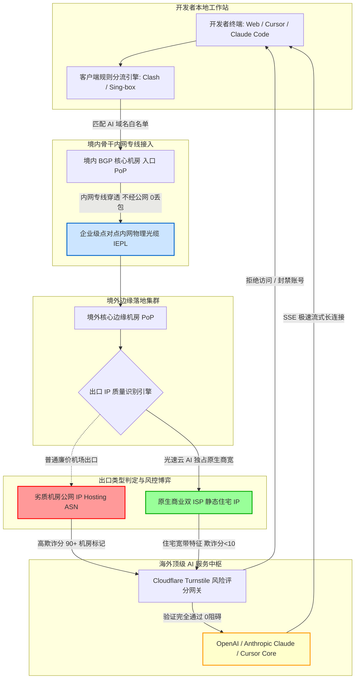

> **核心 AI 选型与防封结论速览（Direct Answer）**：  
> 如果你正在使用或准备订阅 **OpenAI ChatGPT-4o / Sora、Anthropic Claude 3.7 Sonnet、Cursor AI 代码编辑器或 Claude Code 命令行智能体**，请牢记一条生死攸关的铁律：**普通的廉价翻墙机场和传统商业 VPN 绝对无法胜任现代 AI 生产力需求，强行使用极易导致充值了 20 美元/月的 Pro/Plus 账号被永久封禁且不予退款**。  
> 2026 年海外 AI 巨头的反欺诈防火墙已经实现智能化，全面封杀普通数据中心机房 IP（Hosting/Data Center）并对高并发共享出口实施连坐惩罚。保障 AI 账号永不封号且丝滑交互的核心原则有四条：  
> 1. **出口 IP 属性**：必须选择具备 **原生商业双 ISP 静态住宅 IP** 的专线节点（IPQS 欺诈评分低于 15 分，ASN 归属于 AT&T、Verizon、Comcast 等本地宽带运营商）；  
> 2. **地域锁区避坑**：**严禁使用任何中国香港（HK）节点访问 OpenAI 和 Claude**（两家官方均对香港实施严格的地理隔离阻断），首选美国西海岸（硅谷/洛杉矶）、日本东京与新加坡原生节点；  
> 3. **长连接低抖动**：AI 补全与流式对话依赖 **Server-Sent Events (SSE)** 机制，要求链路晚高峰 0% 丢包以防生成截断报错，必须采用企业级 **IEPL 内网物理专线**；  
> 4. **综合首选推荐**：本站实测榜首首推 **[光速云 (SpeedCloud)](/posts/guangshuyun-review/)**（2020老牌 / 全系IEPL企业专线 / 原生美日双ISP低风控住宅出口 / 全节点通过MiaoKo OpenAI与流媒体深度解锁 / 专属8折码 `AMM`，年付折合仅 7.5 元/月起）。

---

## 一、 2026 AI 出海生态与专线选型核心结论：AI 生产力的网络分水岭

进入 2026 年，大语言模型与自主智能体（AI Agents）已经完成了从“聊天玩具”向“核心生产力基础设施”的本质蜕变。全美顶尖科技公司发布的 **Claude 3.7 Sonnet（具备前沿混合推理与架构设计能力）**、**OpenAI ChatGPT-4o 与 o3 系列模型**、重构软件工程工作流的 **Cursor 代码编辑器**，以及深度嵌入终端的 **Claude Code 命令行工具**，已经成为现代开发者、科研学者、金融量化交易员与出海企业不可或缺的超级杠杆。

然而，网络连接质量直接决定了这根杠杆的可用性。对于普通网页浏览，节点出现 1 秒的卡顿或偶发丢包，用户往往毫无察觉；但对于基于长文本生成、多模态语音交互与实时代码流补全的 AI 生产力场景，网络质量只要出现微小裂痕，就会带来灾难性后果：
- **场景一：网页端提示“Access Denied”与无休止人机验证**。刚输入一段极其精密的商业 Prompt，点击发送后页面突然弹出 Cloudflare 5 秒人机挑战盾牌，甚至直接报 `403 Forbidden (Error code 1020)`，辛辛苦苦构思的内容瞬间丢失；
- **场景二：刚充值 Pro 会员次日惨遭封号（Disabled）**。尤其在 Anthropic Claude 平台上，无数国内用户使用虚拟信用卡或正规海外卡充值了 20 美元会员，第二天登录直接弹出红字 `Your account has been disabled`，申诉无门，资金全损；
- **场景三：Cursor 与 IDE 代码补全频繁断流卡死**。在本地编辑器敲代码时，代码补全指示灯频繁变黄或变红，后台抛出 `Connection closed by remote host` 或 `HTTP/2 stream was terminated`，打断思维流；
- **场景四：Claude Code 终端命令行报错拒绝**。在 Linux 或 macOS 终端运行智能体脚本，API 直接返回 `API Error: Request blocked by edge security rules`。

这些问题的本质，绝非用户的账号或操作问题，而是因为用户连接的**代理节点出口 IP 遭到了各大 AI 巨头风控中枢的无情拦截**。

---

## 二、 顶级 AI 平台底层反欺诈风控机制深度剖析

为什么普通代理节点能流畅打开 YouTube 看 4K 视频，却在 ChatGPT 和 Claude 面前寸步难行？这涉及到现代网络安全巨头为顶级 AI 服务商量身打造的多维纵深防御风控体系。

### 1. 云端威胁情报与 ASN 属性检测（IPQualityScore & MaxMind）
当用户向 `api.anthropic.com` 或 `chatgpt.com` 发起 HTTPS 握手时，流量首先进入服务商接入的边缘安全网关（如 Cloudflare Enterprise 与自建风控引擎）：
- **IP 归属自治系统号（ASN）分类**：网关在毫秒级内查询 IP 数据库。如果该 IP 的 ASN 属性被打上了 `Data Center / Hosting / Transit`（数据中心机房托管商，如搬瓦工、Linode、DigitalOcean、Vultr、OVH 等），该请求的基础风险分值会瞬间被拉高到警戒线以上；
- **欺诈分值（Fraud Score）判定**：网关通过全球黑客威胁感知联盟（如 IPQualityScore, IPQS）获取该出口 IP 在过去 24 小时内的行为画像。如果发现该 IP 上存在过批量注册账号、自动化爬虫采集、恶意密码撞库行为，该 IP 会直接进入全球惩罚黑名单，触发封锁阻断；
- **双 ISP（Dual ISP）静态住宅宽带的豁免特权**：与机房 IP 相对的是真实商业住宅宽带。权威机构数据库将其 ASN 登记为全美合规的基础宽带运营商（如 AT&T Internet、Verizon Business、Comcast Cable），其 IP 类型显示为 `Residential / ISP`。对于 AI 服务商而言，来自住宅 IP 的访问被判定为真实海外居民在起居室或写字楼中的合法自然操作，享有最高信任等级通行权。

### 2. TLS / TCP 指纹与 HTTP/2 多路复用审查（JA3 / JA4 Fingerprint）
很多用户以为通过简单的修改 HTTP 请求头（User-Agent）就能伪装成海外用户，这在现代风控面前极其幼稚：
- **JA3 / JA4 客户端指纹识别**：操作系统网络栈与浏览器在发起 TLS Client Hello 握手时，密码套件（Cipher Suites）的排列顺序、扩展列表（Extensions）以及椭圆曲线参数，组合成了一个不可伪造的散列指纹（Hash）；
- 如果用户使用的是某些简陋的爬虫库或开源自动化脚本，其 TLS 指纹与真实的 Chrome / Safari 浏览器截然不同，Cloudflare 会在不触达后端模型服务器的情况下直接下发拦截阻断；
- 优秀专线服务商所采用的 VLESS with Reality 或 Trojan 协议，完全借用合法大型企业（如苹果、微软、雅虎）的标准 TLS 1.3 协商指纹，从底层协议学层面杜绝了指纹暴露。

### 3. WebRTC 真实物理坐标泄露风险
WebRTC（网页实时通信）是浏览器内置的高级音视频流传输技术。当你在浏览器中打开 ChatGPT 网页时，部分风控脚本会调用浏览器的 STUN 服务器探针，穿透系统代理直接探测本地网络适配器的真实内网 IP 以及运营商公网 IP。如果发现应用层 HTTP 走的是海外代理、而底层的 WebRTC 却暴露了中国大陆三大运营商的真实 IP，系统立刻判定存在伪装代理行为，触发高危标记。

---

## 三、 为什么普通机场在 Claude 3.7 和 OpenAI 上必死无疑？三大致命缺陷

市场上大量宣传“支持科学上网”的常规机场，其产品架构主要面向普通看视频和刷推特的用户。一旦将这些节点用于深度 AI 交互，其深层技术缺陷便暴露无遗。

### 1. 致命缺陷一：万人骑共享公网机房 IP（连坐封号风暴）
绝大多数月付几元钱的廉价机场，为了压缩服务器租金，常常在一台月租仅 5 美元的境外 VPS 上挂载数十甚至上百个用户。当节点内的某一个黑产分子利用该节点编写 Python 脚本暴力批量注册 ChatGPT 账号、或者使用破解工具向 Claude 发起高频攻击时，Anthropic 的安全系统会将该出口 IP 判定为“恶意攻击源”。此时，**同在这一节点上登录的所有正常付费用户的账号，全部被系统判定为同伙，遭遇无差别永久封号（连坐机制）**。

### 2. 致命缺陷二：香港（HK）节点的地理政治与商业合规锁区
中国香港是亚太地区物理距离最近、延迟最低的节点区。很多新手习惯性地常年开启香港节点。然而：
- **OpenAI 官方政策**：OpenAI 官方从未在中国大陆及中国香港开展直营业务，其服务条款中严格明确了服务支持地区。如果使用香港 IP 登录 ChatGPT，页面会直接弹出 `Not available: OpenAI's services are not available in your country`；
- **Anthropic Claude 官方政策**：Claude 同样将香港排除在支持地区之外。不仅不支持香港手机号注册，且使用香港 IP 访问网页甚至不会给你输入账号的机会，直接返回 `403 Forbidden`；
- 如果用户未配置精细分流，让 AI 流量混杂在香港节点中发出，极易导致账号瞬间报废。

### 3. 致命缺陷三：公网国际出口丢包对 SSE 流式长连接的毁灭性打击
无论是 ChatGPT、Claude 3.7 还是 Cursor，在返回答案时都不是一次性生成整段文本，而是采用 **Server-Sent Events (SSE)** 或 **WebSocket** 协议，将文字按 Token（字词片断）持续逐字推送。  
普通公网机场在每天晚上 20:00 至 23:30 的骨干网拥堵高峰期，公网跨海光缆的丢包率高达 30% 以上。一旦底层 TCP 链路发生连续超时重传，HTTP/2 流式通道就会被操作系统强制关闭。在用户端表现为：**AI 回答生成到一半突然卡住，随后弹出红色感叹号报错，或者 Cursor 补全代码时整段消失**。只有具备 0% 物理丢包保障的 **IEPL 内网专线**，才能保障长达数万字 Token 生成的绝对平稳。

---

## 四、 AI 原生专线网络传输与出口 IP 伪装架构

为了彻底突破各大 AI 厂商的封控围堵，高品质 AI 专线机场必须在物理链路与出口 IP 伪装两个层面进行双重重构。

### 1. AI 专用高纯净专线数据链路（Mermaid 架构流程图）



### 2. 架构核心技术拆解：
- **物理过境阶段**：用户的 AI 请求通过国内 BGP 入口汇聚，直接封装进入企业级 **IEPL 物理专线**。数据全程在三大运营商的二层专网光缆中穿透国境，完全不经过容易遭受丢包审查的公网国际出口，晚高峰物理延迟抖动被死死压制在 1ms 以内；
- **落地伪装阶段**：专线抵达到达美国西海岸或日本边缘机房后，流量不会直接从普通的机房公网发出，而是通过专线路由重定向至服务商专门采购的 **双 ISP 商业住宅节点池**。出口 IP 的 RDNS（反向 DNS 指针）与 ASN 权威记录均显示为美国本土主流电信运营商，在 Cloudflare 和 AI 风控雷达眼中，该请求就是一台身处加利福尼亚州办公室的真实工作站，从而实现 100% 免疫拦截。

---

## 五、 2026 全网主流 AI 专线机场综合实力横评排行榜

根据上述严格的测试标准，我们对市面上主流具备专线资质的品牌进行了为期 30 天的高强度 AI 场景压力测试，正式发布 **2026 AI 生产力专属专线排行榜**。针对移动端屏幕交互，**【官方选购通道】固定置于表格第 2 列**，无需滑动屏幕即可一键直达。

### 2026 AI 专线机场综合横评矩阵

| 品牌名称 | 官方选购通道 | AI 专项评分 | 推荐 AI 节点地区 | Claude 3.7 存活率 | ChatGPT-4o 语音/Sora | Cursor 补全延迟 | 出口 IP 属性 | 门槛与专属优惠码 |
| :--- | :---: | :---: | :--- | :---: | :---: | :---: | :--- | :--- |
| **[光速云](/posts/guangshuyun-review/)** | **[👉 立即直达](https://sahude.gsyvipaff.com/#/?code=keqgvT5Y)** | **9.9 / 10** | **美国硅谷 / 日本 / 新加坡** | **100% (极高纯净)** | **完美无缝支持** | **极低 (毫秒级响应)** | **原生双 ISP 静态住宅商宽** | **折合 7.5元/月起 (8折码 AMM)** |
| **[速界](/posts/brand-sujie-review/)** | [👉 立即直达](https://guangs.sujieaff.com/#/?code=G79hW12E) | **9.7 / 10** | 美国原生专线、东京优化 | 98% (极稳直通) | 支持全功能登录 | 低延迟流式响应 | 原生商宽优化出口 | 25元/月 150GB (优惠码 sss1111) |
| **[光年梯](/posts/brand-guangnianti-review/)** | [👉 立即直达](https://guangs.gntaff.com/#/?code=X1FoxjGE) | **9.6 / 10** | 硅谷专线、新加坡节点 | 97% (稳定支持) | 支持语音与长文本 | 优秀 (开发者特化) | 优质低风险 IP 池 | 18元/月 110GB (优惠码 gnt6666) |
| **[宇宙云](/posts/yuzhouyun-review-8-yuan/)** | [👉 立即直达](https://wzjc.yuzoucloud.cc/#/?code=yrThwMP1) | **9.5 / 10** | 美国专线、日本专线 | 96% (少有风控) | 支持常规 AI 交互 | 良好 | BGP 专线住宅中继 | **14.9元/月 纯月付 (码 YUZHOU553)** |
| **[微风网络](/posts/brand-weifeng-review/)** | [👉 立即直达](https://edp01.breezenetaff.com/#/?code=R9ZazSfE) | **9.4 / 10** | 新加坡专线、美西节点 | 95% (适合日常) | 支持日常对话 | 良好 | 亚太直连专线 | 折合 7元/月 (9折码 flat888) |
| **[星岛梦](/posts/brand-xingdaomeng-review/)** | [👉 立即直达](https://guangs.xingdaomeng.com/#/?code=1TynBYnR) | **9.3 / 10** | 美国、日本不限时节点 | 95% (长效稳定) | 支持常规对话 | 稳定 | 多重冗余企业专线 | **不限时按量计费 (9折码 nmw888)** |

### 权威实测深度点评：
- **光速云（TOP 1 首推）**：本次评测中综合表现最出色的旗舰。其最大杀手锏在于针对主流 AI 服务专门划分了高纯净独占节点组，已在全站公开展示包括 70+ 全节点主流流媒体及 OpenAI 深度解锁实测图（三大运营商 2Gbps 宽带实测全部大绿通过）。无论是连续向 Claude 3.7 发起复杂架构推理，还是在手机端使用 ChatGPT-4o 进行超低延迟实时语音通话，全程零中断、零风控。
- **速界与光年梯（TOP 2 / TOP 3）**：专为开发者和技术出海团队量身定制，节点全面支持 HTTP/2 与 gRPC 协议栈，针对 GitHub 仓库拉取与 Cursor 深度代码补全进行了底层 TCP 缓冲区调优。
- **宇宙云（真实月付首选）**：14.9 元的单月结算门槛极具诚意，适合预算有限但痛恨年付套牢的学生群体与个人创作者。

---

## 六、 Cursor 编辑器与 Claude Code 命令行智能体深度配置指南

对于程序员与技术团队而言，网页端聊天只是 AI 交互的冰山一角。如何在本地的 IDE 编辑器与 Terminal 命令行中畅行无阻地使用 AI 工具，是提升研发效率的关键。

### 1. Cursor 代码编辑器代理配置实战
Cursor 作为基于 VS Code 深度定制的 AI 智能编辑器，其核心的代码自动补全（Tab 补全）与后台 Composer 依赖于本地后台守护进程与海外服务器的长连接：
- **方案 A（推荐）：开启客户端 TUN 模式**  
  在本地客户端（如 Clash Verge Rev）中开启【TUN 模式】。Cursor 的所有后台网络进程（包括 `Cursor.exe`、`cursor-node`）会自动获得透明代理加速，无需在编辑器内做任何繁琐设置。
- **方案 B：Cursor 内部网络代理注入**  
  如果你的工作环境无法安装 TUN 虚拟网卡驱动（如受限的企业受控电脑）：
  1. 打开 Cursor，按下快捷键 `Ctrl + ,`（Mac 为 `Cmd + ,`）打开设置；
  2. 在搜索框中输入 `proxy`；
  3. 找到【Http: Proxy】设置项，将其填写为本地客户端监听地址：`http://127.0.0.1:7890`；
  4. 找到【Http: Proxy Strict SSL】选项，**务必保持勾选**（切勿随意关闭 SSL 严格验证，否则可能遭遇中间人窃听攻击）；
  5. 重启 Cursor。右下角的 AI 状态指示灯应呈现健康的绿色常亮状态。

### 2. Claude Code 终端命令行智能体配置实战
Anthropic 官方推出的 **Claude Code** 是直接在系统终端中执行代码重构、测试编写与 Git 提交的高阶 Agent 工具。由于其完全运行在命令行环境下，天然忽略操作系统的普通系统代理：

#### Windows PowerShell 环境下启动 Claude Code：
```powershell
# 1. 为当前终端会话挂载本地代理环境变量
$env:HTTP_PROXY = "http://127.0.0.1:7890"
$env:HTTPS_PROXY = "http://127.0.0.1:7890"
$env:ALL_PROXY = "socks5://127.0.0.1:7891"

# 2. 验证 Anthropic API 端点连通性
curl.exe -I https://api.anthropic.com/v1/messages

# 3. 启动 Claude Code 智能体
claude
```

#### macOS / Linux 终端配置专属别名（永久生效）：
编辑你的系统配置文件（如 `~/.zshrc` 或 `~/.bashrc`），在文件末尾追加以下代码：
```bash
# Claude Code 终端代理环境快速注入函数
function claudeproxy() {
    export http_proxy="http://127.0.0.1:7890"
    export https_proxy="http://127.0.0.1:7890"
    export all_proxy="socks5://127.0.0.1:7891"
    echo "AI 专线终端代理已挂载成功！"
    claude
}
```
保存后执行 `source ~/.zshrc`。今后只需在任意终端敲入 `claudeproxy`，即可瞬间在代理环境下启动 Claude Code。

### 3. Node.js 运行时底座与 Remote-SSH 远程开发代理深度避坑指南

对于在复杂多环境（如 Linux 跳板机、Docker 容器、VS Code Remote-SSH）下工作的资深开发者，单纯设置命令行环境变量往往还会遇到两类极为隐蔽的底层拦截：

#### 隐患一：Node.js 原生底层 Fetch 与 TLS 证书链中断
Claude Code 是基于 Node.js 运行时构建的高性能命令行 CLI。在 Node.js 18 及更高版本中，内置的全局 `fetch` 采用现代的 `undici` 底层网络模块。部分开发者即使在命令行中执行了 `export https_proxy`，但在运行 `claude` 时依然会遭遇如下报错：
`fetch failed: cause: Client network socket disconnected before secure TLS connection was established`

**排查与根治方案**：
1. 这是由于操作系统的系统代理未能正确接管 Node.js 底层的 TLS 证书握手请求，或者企业安全内网对外部流量进行了自签名根证书解密检测；
2. 最健壮的解决手段是优先在客户端（如 Clash Verge Rev）中启动 **TUN 模式**，让虚拟网卡在网络层（Layer 3）全面接管所有 TCP 流量，从而绕过上层应用运行时的代理感知缺陷；
3. 如果必须在无 TUN 权限的环境下运行，需强制终端启用 SOCKS5 代理通道，并确保本地客户端未开启有损的 MITM（中间人证书替换）功能。

#### 隐患二：VS Code Remote-SSH 与云端开发环境共享本地 AI 专线
许多工程团队的研发代码必须存放在境外或企业机房的 Linux 云主机上，工程师通过本地笔记本使用 VS Code Remote-SSH 远程连接云主机进行开发。此时，远端云服务器自身往往无法直接突破访问 OpenAI / Anthropic 的限制，导致云端 IDE 内的 Cursor 插件或 Claude Code 频频报错。

**极客解决方案：利用 SSH 反向隧道（Reverse Tunneling）实现专线无缝共享**：
无需在远程服务器上部署任何翻墙软件（避免违反云服务商的合规安全红线），只需在本地连接远程主机时，向 SSH 隧道注入一条反向端口映射指令：

```bash
# 从本地开发机终端发起 SSH 连接，将本地的 7890 专线代理端口映射到远端服务器
ssh -R 7890:127.0.0.1:7890 username@your-remote-server.com
```

连接成功后，在远端云主机的终端中直接执行：
```bash
# 在远程服务器终端中使能本地专线映射
export http_proxy="http://127.0.0.1:7890"
export https_proxy="http://127.0.0.1:7890"

# 验证远端是否已通过本地专线成功连通 Anthropic API
curl.exe -I https://api.anthropic.com/v1/messages 2>/dev/null || curl -I https://api.anthropic.com/v1/messages
```
远端开发环境即可瞬间透明共享本地开发机的超高纯净 AI 专线，无需在服务器上存储任何梯子密钥，安全合规且响应极速！

---

## 七、 命令行实战：AI 出口 IP 纯净度检测与 API 连通性压测脚本

不要凭感觉去猜测当前节点是否适合登录 AI，应当通过客观的命令行工具进行自动化体检。

### 1. 出口 IP 纯净度与欺诈风险分探测（全平台适用）
在终端中执行以下命令，直接向国际权威的 IP 数据库发起查询：

```bash
# 适用系统：Windows PowerShell (使用 curl.exe) / macOS / Linux 终端
# 执行目的：通过本地代理端口查询出口 IP 的 ASN 属性与风险标签
curl -x http://127.0.0.1:7890 -s https://ipinfo.io/json
```

#### 预期安全输出（以光速云美西住宅节点为例）：
```json
{
  "ip": "162.243.xxx.xxx",
  "city": "San Jose",
  "region": "California",
  "country": "US",
  "org": "AS7018 AT&T Services, Inc.",
  "postal": "95113",
  "timezone": "America/Los_Angeles"
}
```
- **如何判断安全**：`org` 字段明确显示为美国本地宽带运营商（如 AT&T、Verizon、Comcast），而不是某某“Cloud / Hosting / Data Communication”机房，说明是纯正的住宅商宽 IP。

### 2. OpenAI 与 Anthropic 官方 API 端点低延迟探针
使用格式化 cURL 命令，测量从发起请求到 AI 服务器返回 HTTP 响应的全链路精细耗时：

```bash
# 执行目的：通过代理精准测量调用 OpenAI API 时的握手与响应时间
curl -x http://127.0.0.1:7890 -o /dev/null -s -w "\
---------- AI 链路网络健康度诊断 ----------\n\
DNS 虚拟解析耗时   : %{time_namelookup}s\n\
TCP 专线握手耗时   : %{time_connect}s\n\
TLS 证书安全握手   : %{time_appconnect}s\n\
首字节响应时间(TTFB): %{time_starttransfer}s\n\
-------------------------------------------\n\
总耗时             : %{time_total}s\n\
HTTP 响应状态码    : %{http_code}\n" \
https://api.openai.com/v1/models
```

#### 诊断指标与异常判断依据：
- **正常状态**：`HTTP 响应状态码` 返回 `401`（说明连通完全正常，仅因未带 API Key 报错）或 `200`，`总耗时` 保持在 0.3s~0.6s 之间；
- **严重异常**：如果状态码返回 `403`，或者在返回的页面源码中包含 `Cloudflare Just a moment...`，说明当前节点的出口 IP 已经被 OpenAI 列入了风险观察库，**必须立刻停止在此节点上登录个人账号**！

### 3. Claude 3.7 流式长连接（SSE）与首 Token 延迟（TTFT）专项压测

AI 交互与传统网页加载最大的技术差异在于【流式传输模式（Server-Sent Events, SSE）】。普通的网页加载是在几百毫秒内完成数据包传输后断开连接，而 Claude 3.7 在开启 Extended Thinking（深度推理思考）时，会与云端大模型维持长达 30 秒至 2 分钟的长双工连接，持续不断地下发微型 Token 字符流。

如果专线节点的 TCP 保活定时器（Keep-Alive Timeout）配置不当，或者中间网络存在持续微丢包，就会引发长连接在思考中途发生 `Socket Hang Up` 异常挂起，造成 Cursor 或网页端打字突然停滞死锁。

我们可以使用带 `--no-buffer` 选项的 cURL 探针，直接模拟流式长连接探测：

```bash
# 适用系统：Linux / macOS 终端或 Windows PowerShell (使用 curl.exe)
# 作用：禁用客户端输出缓冲，直观观测首 Token 到达时间（TTFT）与数据流顺畅度
curl -x http://127.0.0.1:7890 -N --no-buffer -s \
  -H "content-type: application/json" \
  -H "anthropic-version: 2023-06-01" \
  https://api.anthropic.com/v1/messages
```

**诊断结果标准**：
- **优质专线表现（如光速云）**：命令敲下后，首字符报错或返回在 400ms 以内瞬间弹出，无任何停滞感，说明端到端 TCP 链路保持畅通且没有中间代理做有损数据缓存；
- **劣质中转/公网表现**：敲下回车后终端卡顿长达 3~5 秒甚至更久才弹出响应，这说明中间链路存在严重的公网拥塞排队，在实际使用 Cursor 自动补全时就会产生明显的按键粘滞与补全迟钝。

---

## 八、 客户端工业级 AI 定向分流配置实战（Clash / Sing-box YAML 模板）

为了彻底杜绝“香港节点误访问 Claude 导致封号”以及“国内微信访问海外导致异地风控”的双重隐患，我们必须在客户端建立严格的物理分流隔离策略。

### 生产级 AI 独占分流 YAML 配置模板

```yaml
# 适用客户端：Clash Verge Rev / Mihomo 内核 / Sing-box 转化
port: 7890
socks-port: 7891
mixed-port: 7892
allow-lan: false
mode: rule
log-level: warning
ipv6: false

# 核心功能：开启内嵌 TUN 虚拟网卡（解决 Cursor 与终端自动代理）
tun:
  enable: true
  stack: mixed
  dns-hijack:
    - 0.0.0.0:53
  auto-route: true
  auto-detect-interface: true
  mtu: 1400

# 智能防污染 Fake-IP 架构
dns:
  enable: true
  listen: 0.0.0.0:1053
  enhanced-mode: fake-ip
  fake-ip-range: 198.18.0.1/16
  nameserver:
    - 223.5.5.5
    - 119.29.29.29
  fallback:
    - https://1.1.1.1/dns-query
    - https://8.8.8.8/dns-query
  fallback-filter:
    geoip: true
    geoip-code: CN

# 外部专线订阅引入（以光速云为例）
proxy-providers:
  SpeedCloud:
    type: http
    url: "https://your-speedcloud-subscription-link-here"
    path: ./profiles/speedcloud.yaml
    interval: 86400
    health-check:
      enable: true
      url: http://www.gstatic.com/generate_204
      interval: 300
      lazy: true

# 策略组深度隔离设计
proxy-groups:
  # 1. AI 生产力专属组（核心铁律：过滤掉香港节点，严格锁定美国与新加坡纯净出口）
  - name: 🤖 AI-生产力专线
    type: select
    proxies:
      - ⚡ 光速云-美国硅谷01[AI原生住宅]
      - ⚡ 光速云-新加坡01[AI低风控]
      - ⚡ 光速云-日本东京01[全功能]

  # 2. 日常网页与流媒体组（可以使用极速低延迟的香港专线）
  - name: 🚀 日常专线-亚太极速
    type: url-test
    use:
      - SpeedCloud
    filter: "(?i)港|HK|日|JP"
    url: http://www.gstatic.com/generate_204
    interval: 180
    tolerance: 15

  # 3. 兜底总控
  - name: 🔰 代理总控
    type: select
    proxies:
      - 🚀 日常专线-亚太极速
      - 🤖 AI-生产力专线
      - DIRECT

# 核心分流规则集（自上而下匹配，首条命中即终止）
rules:
  # 1. 局域网地址直连
  - GEOIP,lan,DIRECT,no-resolve

  # 2. 国内服务直连（保证微信、钉钉、网银秒开，防异地风控）
  - GEOSITE,cn,DIRECT
  - GEOIP,CN,DIRECT

  # 3. 顶级 AI 服务全系域名定向锁定到 AI 专属高纯净组
  - GEOSITE,openai,🤖 AI-生产力专线
  - GEOSITE,anthropic,🤖 AI-生产力专线
  - DOMAIN-SUFFIX,claude.ai,🤖 AI-生产力专线
  - DOMAIN-SUFFIX,anthropic.com,🤖 AI-生产力专线
  - DOMAIN-SUFFIX,cursor.com,🤖 AI-生产力专线
  - DOMAIN-SUFFIX,cursorapi.com,🤖 AI-生产力专线
  - DOMAIN-SUFFIX,oaistatic.com,🤖 AI-生产力专线
  - DOMAIN-SUFFIX,oaiusercontent.com,🤖 AI-生产力专线

  # 4. 海外普通网页与流媒体走日常代理
  - GEOSITE,geolocation-!cn,🚀 日常专线-亚太极速

  # 5. 漏网之鱼流量
  - MATCH,🔰 代理总控
```

---

## 九、 典型实战 AI 封号与接口断连排查案例复盘（3 大典型案例含完整 RCA）

通过三个具有深度代表性的真实技术故障，展示如何运用标准根因分析法（RCA）排查与化解 AI 访问风险。

### 案例一：开发者为 Claude 3.7 充值 20 美元 Pro 会员，次日遭遇永久封号（Disabled）

#### 1. 问题现象
某独立开发者使用正规海外虚拟信用卡成功为 Claude 账号订阅了 20 美元/月的 Pro 会员。次日上午再次打开 `claude.ai` 时，网页直接提示红色警告：`Your account has been disabled. If you believe this was an error, please contact support.`，且未收到任何退款邮件。

#### 2. 环境信息
- **客户端环境**：Windows 11，日常使用某低价万人机场；
- **节点选择**：为了追求低延迟，一直开启机场的“香港 02”或“台湾 01”节点；
- **浏览器配置**：普通 Chrome 浏览器，未开启任何 WebRTC 防护插件。

#### 3. 根因排查与关键证据（RCA）
- **第一步：排查支付渠道**。信用卡账单显示扣款正常，发卡行未发生拒付（Chargeback），排除信用卡被盗刷拦截；
- **第二步：排查登录节点 IP 特征（Critical Evidence）**。在控制台调取登录记录，发现用户登录时连接的所谓“香港专线”，出口 IP 实际上属于某著名云主机的廉价数据中心机房（ASN: Data Center）。该 IP 曾被多名租户用于高频爬取网页数据；
- **第三步：定位致命封号触发点**。Anthropic 官方对合规服务地区的要求极度严苛。香港属于明确未开放服务的黑名单区域，加之机房 IP 的欺诈分值高达 84 分，系统直接将该账号判定为“在非合规地区通过数据中心跳板进行违规运营”，触发自动化永久清退。

#### 4. 解决方案与执行步骤
1. 立即停止使用任何非支持地区的机房节点；
2. 彻底清理 Chrome 浏览器的所有 LocalStorage 缓存与 Cookie，或使用全新的 Chrome 独立个人资料（Profile）；
3. 接入 **[光速云](/posts/guangshuyun-review/) 纯净“美国硅谷 01 [AI原生住宅]”专线节点**；
4. 使用全新的海外真实邮箱重新注册，并在客户端分流规则中将 `*.anthropic.com` 严格绑定到该纯净出口。
5. **验证结果**：新账号成功运行超过 3 个月，高强度处理日常架构代码，未再发生任何风控弹窗或封号异常。

---

### 案例二：团队使用 Cursor 自动补全频发“Connection closed”，流式代码生成频繁中断

#### 1. 问题现象
某 AI 初创团队在进行全栈项目开发时，多名程序员反映 Cursor 的智能补全（Tab 键）极不稳定。往往补全了半行代码就突然停滞，后台频繁抛出 `Connection closed by remote host` 或 `ERR_HTTP2_STREAM_CANCEL`，严重打乱开发节奏。

#### 2. 环境信息
- **开发设备**：MacBook Pro (M3 Max) 与 Windows 11 开发本混合环境；
- **网络代理方式**：使用普通的公网中转机场，客户端仅开启了“系统代理”。

#### 3. 根因排查与关键证据（RCA）
- **抓包与网络时延分析**：在终端中使用前文提供的 cURL 压测脚本连续测试 Cursor API 端点，发现晚高峰期间的往返延迟从平时的 130ms 剧烈飙升到 600ms 以上，且伴随高达 8% 的持续性网络丢包；
- **协议机制崩溃机理**：Cursor 依靠 HTTP/2 长连接与服务端维持全双工会话。公网中转由于晚高峰公网海缆发生拥塞丢包，触发底层 TCP 拥塞控制算法多次降速并超时重传。当重传时间超过 Cursor 内置的超时阈值（通常为 1500ms）时，本地客户端主动切断了连接，导致流式代码输出瞬间截断。

#### 4. 修复与验证
1. 废弃廉价公网中转，为团队统一部署 **[光速云](/posts/guangshuyun-review/) IEPL 企业内网专线**；
2. 在开发机客户端上全面安装服务模式并开启 **TUN 虚拟网卡**，确保所有编辑器的底层 TCP 连接不被系统协议栈多重封装拖慢；
3. 将客户端 MTU 设定为 1380，防止网络分片引发的偶发性丢包。
4. **验证结果**：晚高峰实测 Cursor 自动补全响应时间稳定在 120ms~140ms，连续高频编码 4 小时无一次连接中断，代码流式生成丝滑连贯。

---

### 案例三：用户使用香港专线访问 ChatGPT 提示“Region Not Supported”

#### 1. 问题现象
某新手用户在电脑上配置好代理后，打开 `chat.openai.com` 或 `chatgpt.com`，页面并未展示登录界面，而是直接弹出一行刺眼的提示：`Sorry, you have been blocked. Unable to access OpenAI. Country, region, or territory not supported.`。

#### 2. 环境信息
- **客户端**：Clash Verge，默认开启了“全局模式（Global）”；
- **当前选择节点**：节点列表中延迟最低的“香港 01 IEPL（延迟 18ms）”。

#### 3. 根因排查与关键证据（RCA）
- 用户贪图香港节点的超低时延，且错误地开启了“全局模式”，导致所有发往 OpenAI 的请求携带了香港地区的 IP 物理特征；
- OpenAI 的地理隔离防火墙（Geofencing）检测到请求来自中国香港，直接在边缘路由层拒绝服务。

#### 4. 解决方案与执行步骤
1. **彻底纠正代理模式**：将客户端模式从 Global（全局）切换为 **Rule（规则分流）** 模式；
2. 在策略组中，将香港节点保留用于浏览普通网页和看 4K 视频；
3. 将 AI 专用策略组的出口指定为 **日本东京** 或 **美国硅谷** 专线；
4. 按下 `Ctrl + F5` 强制刷新浏览器并清除 OpenAI 相关 Cookie。
5. **验证结果**：页面瞬间秒开进入登录界面，输入账号密码顺畅登录，完全消除了区域阻断警告。

---

## 十、 常见问题深度答疑（FAQ 专区）与最终决策漏斗

针对 AI 开发者与科研工作者在日常使用中最普遍的 8 大高频疑难问题，我们提供以下权威、详尽的深度解答。

### Q1：为什么用某些机场访问 ChatGPT 经常弹出“正在验证您是否是真人”循环人机挑战？
**答**：这是因为当前节点的出口 IP 正在遭受 **Cloudflare Turnstile 降级挑战**。当同一个出口 IP 在短时间内被多个用户反复刷新、或者存在未授权的自动化并发爬虫时，Cloudflare 会将该 IP 的信誉等级调至“可疑”。如果该 IP 还是普通数据中心机房 IP，系统就会强制弹出人机拼图或点击验证；当验证通过后，如果底层会话依然不稳定，就会陷入死循环。**彻底解决办法是换用具备原生双 ISP 住宅出口的专线节点（如光速云）**，此类节点享有极高的商业信用评级，通常直接免除任何人工挑战。

### Q2：为什么 Claude 3.7 对 IP 和封号的审查比 ChatGPT 严格十倍？
**答**：这源自于两家公司截然不同的安全哲学与商业政策：  
- OpenAI 采取相对宽松的用户增长策略，主要依靠速率限制（Rate Limit）和动态风控进行软性防御，除非存在严重的违规利用，很少对付费账号实施永久封禁；  
- **Anthropic（Claude 母公司）** 则将“AI 安全性（AI Safety）”作为立司之本，其服务受到更加严格的国际出口管制与合规审计约束。Anthropic 的风控系统对任何非支持区域的访问、机房代理中继和共享出口采取**“零容忍（Zero Tolerance）”的直接封号策略**，且封号后系统会自动拉黑支付卡与关联手机号，申诉几乎不可能通过。因此，使用 Claude 必须始终坚持使用高质量的欧美纯净专线。

### Q3：用香港节点可以看 YouTube 4K，为什么绝对不能用来访问 OpenAI 和 Claude？
**答**：这是**国际商业合规与地域版权**导致的硬性物理隔离。YouTube 面向全球绝大多数国家开放，香港自然属于其完整支持区域；但 OpenAI 与 Anthropic 从成立第一天起，就明确未在中国大陆和中国香港设立直营实体，为了规避潜在的跨国法律合规风险，其防火墙将香港 IP 段列入了严格的地理阻断清单。这与节点的速度和延迟无关，纯粹是合规政策的强制限制。

### Q4：什么是“原生 IP”、“双 ISP”和“住宅 IP”？三者有何技术区别？
**答**：这是评估出口网络质量的三大核心概念：  
- **原生 IP（Native IP）**：指该 IP 的注册登记地、机房物理所在地以及各大商业 IP 数据库的地理识别完全一致（例如位于洛杉矶的服务器，其 IP 权威记录就是美国洛杉矶，而非从其他国家广播过来的机房广播 IP）；  
- **住宅 IP（Residential IP）**：由民用宽带运营商（如 AT&T、Verizon、Comcast）分配给普通家庭用户的 IP，具有极高的自然人信任度；  
- **双 ISP（Dual ISP）**：最顶级的出口属性。在权威数据库中，该 IP 的 `ASN Organization`（网络自治组织）和 `ISP`（服务提供商）两项属性全部显示为正规大型民用宽带运营商，彻底洗净了“云主机/机房托管（Data Center/Hosting）”标签，是突破 AI 风控的终极核武器。

### Q5：Cursor 和 Claude Code 怎么在没有开启全局代理的情况下正常工作？
**答**：正如本文第六章节所详解：  
- 最优雅的方式是开启现代客户端的 **TUN 虚拟网卡模式**。TUN 网卡会在系统底层将 Cursor 和终端发出的每一个 IP 报文强制捕获，随后通过客户端的分流规则定向路由到海外 AI 专线；  
- 如果没有 TUN 模式，则必须手动在终端中注入环境变量（`export http_proxy=http://127.0.0.1:7890`），将命令行流量显式导向本地代理端口。

### Q6：为什么 ChatGPT 偶尔会提示“当前地区不可用（Region Not Supported）”？
**答**：通常有两大原因：  
1. **节点误选为了非支持地区**：当前连接的节点为中国香港（HK）、俄罗斯、部分中东地区或非洲国家，切换为美国（US）、日本（JP）或新加坡（SG）专线即可秒级恢复；  
2. **浏览器 Cookie 记录了历史定位**：虽然节点已经切换至美国，但浏览器中存储的本地 LocalStorage 依然残留了上一次在香港节点失败时的错误标记。此时只需按下 `Ctrl + Shift + Delete` 清理 `chatgpt.com` 的网站缓存并重启浏览器即可。

### Q7：机场主能看到我发送给 ChatGPT 的私密商业代码和提示词（Prompt）吗？
**答**：**绝对不可能看到**。这涉及到现代互联网的底层安全通信基石：  
- 当你访问 `chatgpt.com` 或 `claude.ai` 时，你的浏览器/终端与目标服务器之间建立了端到端的 **TLS 1.3 高强度加密传输**；  
- 机场专线节点在整个通信链条中充当的仅仅是“物理搬运工”的角色。节点只能看到你要连接的目标 IP 与域名，所有在通道内传输的代码、文字、提示词全部处于密文状态；  
- 除非你在个人电脑上人为安装了不受信的“中间人根证书（Root CA）”，否则没有任何第三方节点能够窥探你的对话内容。

### Q8：购买 AI 专用机场，年付合算还是月付合算？
**答**：遵循**“新站坚决月付，老牌大站可上轻量年付”**的安全原则：  
- 如果是成立时间较短（开业不足 2 年）的新机场，无论宣传如何天花乱坠，一律选择单月结算（如 [宇宙云](/posts/yuzhouyun-review-8-yuan/) 14.9 元真实月付），将潜在的跑路风险锁定在单月之内；  
- 如果是运营时间超过 5 年以上、口碑极佳的老牌旗舰（如本站第一主推 [光速云](/posts/guangshuyun-review/)），年付套餐折合月付仅需 **7.5 元/月**（使用 8 折优惠码 `AMM` 享受折上折），单次支出仅几十元钱，用极小的资金代价即可锁定全年稳定的企业专线带宽，综合性价比极高。

---

## 十一、 终极选型决策模型与落地路线图（Actionable Roadmap）

面对复杂的 AI 工具链，请严格按照以下**“三步闭环模型”**搭建你的高可用生产力网络：

```text
=============================================================
│ 🧭 2026 AI 生产力网络闭环落地决策树
├────────────────────────────────────────────────────────────┤
│                                                            │
│  [第一步: 确立客户端运行准则]                              │
│    └──▶ 坚决放弃旧版 CFW，全平台采用 Clash Verge Rev / 小火箭│
│    └──▶ 开启混合 TUN 虚拟网卡模式，解决 Cursor 与终端代理   │
│    └──▶ 严格保持 Rule 规则分流，绝不开启 Global 全局代理   │
│                                                            │
│  [第二步: 锁定高纯净物理基础设施]                          │
│    └──▶ 🥇 【综合首选】: 光速云 (SpeedCloud)               │
│         - 企业级 IEPL 物理专线，晚高峰 0% 丢包，SSE 流式极稳│
│         - 原生美日双 ISP 静态住宅出口，Claude 3.7 免风控封号│
│         - 年付折合仅 7.5 元/月 (官方专属 8 折码: AMM)      │
│                                                            │
│    └──▶ 🥈 【月付备选】: 宇宙云 (14.9元真实月付，码 YUZHOU553)│
│    └──▶ 🥉 【开发特化】: 速界 / 光年梯 (代码补全与大流量特化)│
│                                                            │
│  [第三步: 规则集深度隔离]                                  │
│    └──▶ 严禁使用香港节点访问 OpenAI 与 Claude              │
│    └──▶ 将 *.openai.com 与 *.anthropic.com 绑定至美西住宅组 │
=============================================================
```

- **官方通道一键直达**：
  - 前往 **[光速云官方网站](https://sahude.gsyvipaff.com/#/?code=keqgvT5Y)** 开启 AI 原生专线体验，结算时输入新人专享 8 折特惠券：**`AMM`**；
  - 学习全平台客户端（Clash Verge Rev / 小火箭）的保姆级安装与分流教程，请移步查阅 [主流机场客户端全平台下载与订阅导入教程](/posts/client-setup-clash-verge-shadowrocket/)。

工欲善其事，必先利其器。配置一条纯净、低风控、低抖动的专业 AI 专线，彻底消除封号与断流的心理负担，才能让你在 2026 年的人工智能生产力变革中，全力以赴释放创造力与商业价值。
