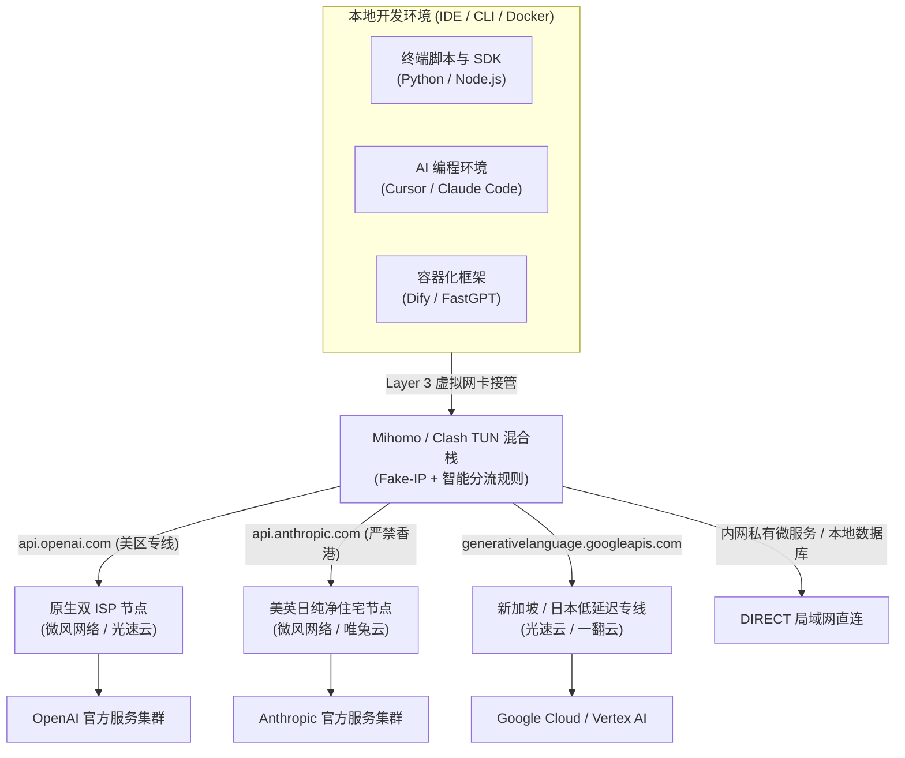
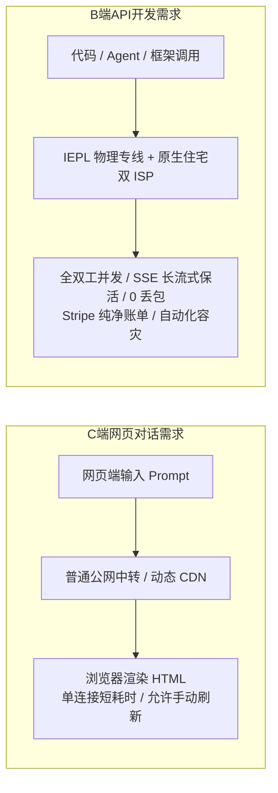
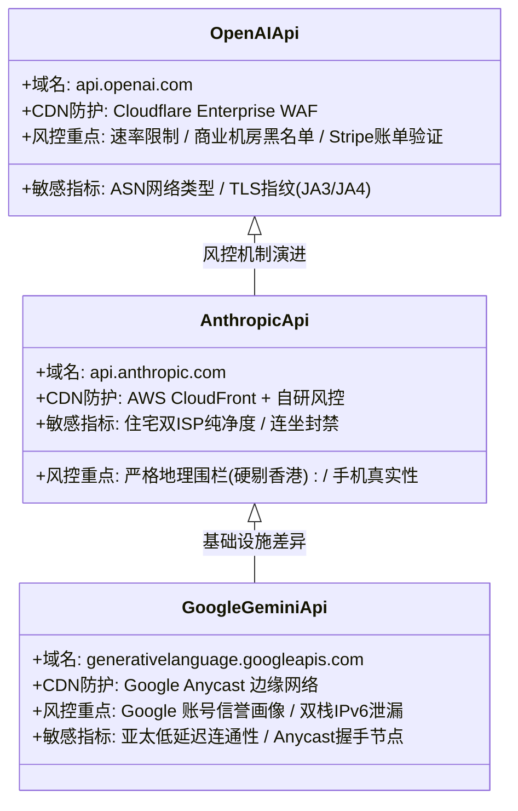
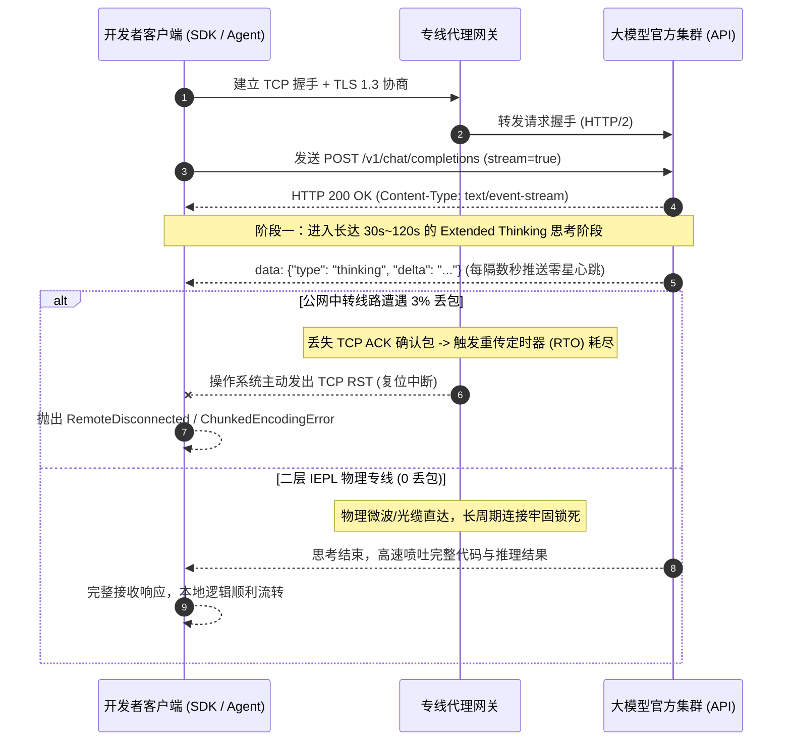
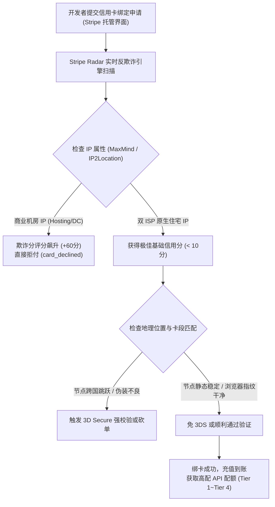
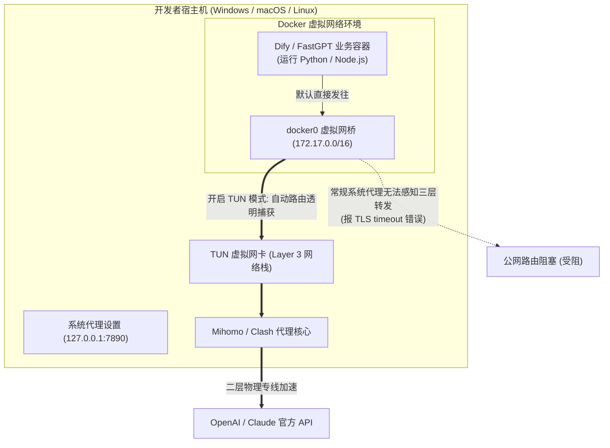
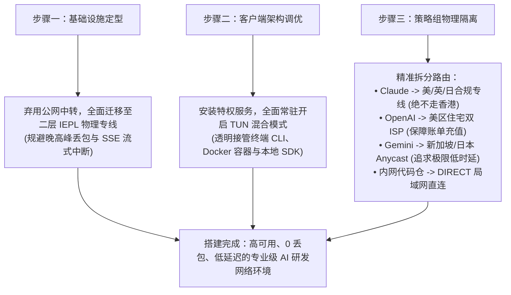

## ⚡ 核心选型结论与开发者速查清单

对于从事大语言模型（LLM）研发、智能体（AI Agent）构建以及集成 AI 辅助编程的开发者而言，网络代理已不再仅仅是“打开网页聊聊天”的辅助工具，而是**支撑整个软件工程研发链路与生产环境的核心基础设施**。

许多开发者在日常工作中经常遭遇以下典型困境：
- 网页端能够正常打开 ChatGPT 或 Claude，但在本地运行 Python 或 TypeScript 脚本调用 `api.openai.com` 或 `api.anthropic.com` 时频繁抛出 `TLS handshake timeout`；
- 使用 Claude 3.7 Sonnet 或 OpenAI o1/o3-mini 进行 Extended Thinking（深度思考）时，流式传输（SSE）在持续几十秒后突然出现网络重置（Connection Reset by Peer），长文本生成中途腰斩；
- 本地通过 Docker 容器化部署的 Dify、FastGPT、LangChain 项目，无论在宿主机如何配置系统代理，容器内部始终无法连通外网大模型服务；
- 在 OpenAI Platform 或 Anthropic Console 绑定企业外币信用卡充值 API 额度时，瞬间触发 Stripe Radar 反洗钱风控，导致绑卡失败甚至整个开发组织账号遭到连坐封禁。

产生上述问题的根本原因，在于**普通网页浏览与专业 AI 开发者调用在网络协议栈、长连接存活机制、数据中心 IP 信誉评估以及跨网段流量穿透上存在巨大的工程鸿沟**。

为帮助 AI 工程师、独立全栈开发者以及科研团队快速搭建高可用、0 丢包、低延迟的研发网络环境，下表汇总了 2026 年经过严苛 API 压测与开发者生态验证的高品质专线网络：

| 机场品牌 | 官方通道 (直达) | 核心线路架构 | OpenAI / Claude / Gemini API 解锁表现 | 长流式（SSE）抗断流稳定性 | 优惠策略与入手门槛 | 详细评测报告 |
| :--- | :--- | :--- | :--- | :--- | :--- | :--- |
| **微风网络** | [👉 立即直达](https://guangs.weifengaff.top/#/?code=VjRz832G) | **原生双 ISP 住宅 + IEPL 专线** | 原生美英日双 ISP 纯净 IP，Stripe 绑卡充值全通，API 无机房标记 | 全链路 0 物理丢包，SSE 流式极速响应 | 专享券 `wf888`<br/>年付折算 **¥7.0/月** (50G) | [微风网络深度评测](/posts/brand-weifeng-review/) |
| **光速云** | [👉 立即直达](https://sahude.gsyvipaff.com/#/?code=keqgvT5Y) | **全内网二层物理 IEPL 专线** | 老牌大厂专线，内置 API 专用分流组，IP 欺诈分极低，并发能力强 | 晚高峰 0 重传，高频 Agent 调优无感 | 8折码 `AMM`<br/>年付折算 **¥7.5/月** (100G) | [光速云深度评测](/posts/guangshuyun-review/) |
| **唯兔云** | [👉 立即直达](https://guangs.weituaff.top/#/?code=w98Q9B5D) | **高质量 BGP + IEPL 混合专线** | 纯月付标杆，VLESS 协议低开销，节点池广泛覆盖欧美主流开发区 | 长连接保活强，小并发与个人项目首选 | 专享券 `weitu666`<br/>纯月付 **¥14.9/月** (100G) | [唯兔云深度评测](/posts/brand-weitu-review/) |
| **星岛梦** | [👉 立即直达](https://guangs.xingdaomeng.com/#/?code=1TynBYnR) | **Anycast BGP + IEPL 物理专线** | 5年老牌，不限时按量计费不过期，静态美英节点极适合绑定账单 | 99.99% 高可用架构，低频 API 防断线神器 | 9折码 `nmw888`<br/>折算 **¥8.0/月** 起 | [星岛梦深度评测](/posts/brand-xingdaomeng-review/) |
| **一翻云** | [👉 立即直达](https://guangs.yifanaff.top/#/?code=uJ6y) | **企业级大带宽二层 IEPL 专线** | 纯月付 150GB 大容量，企业级专线拓扑，支撑多 Agent 高吞吐拉取 | 跑满千兆吞吐，大批量数据标注与微调首选 | 专享券 `yifan666`<br/>纯月付 **¥20.0/月** (150G) | [一翻云深度评测](/posts/brand-yifanyun-review/) |
| **二猫云** | [👉 立即直达](https://guangs.ermaoyunaff.top/#/?code=mG1e) | **高速内网 IEPL 专线** | 纯月付均衡之选，全节点原生解锁，并发连接数宽裕，稳定性高 | 晚高峰网络抖动低于 3ms | 专享券 `ermao888`<br/>纯月付 **¥20.0/月** (130G) | [二猫云深度评测](/posts/brand-ermaoyun-review/) |
| **飞猫云** | [👉 立即直达](https://guangs.feimaoyunaff.top/#/?code=Kx2P4q) | **双轨热备 IEPL 专线** | 轻量级高性价比，低延迟专线加速，适合个人开发者轻度 API 联调 | 适合作为开发辅助备用线路 | 专享券 `feimao`<br/>年付折算 **¥7.0/月** (50G) | [飞猫云深度评测](/posts/brand-feimaoyun-review/) |



---

## 一、AI 开发者与普通聊天用户的网络需求分水岭

在许多非技术用户的观念中，只要浏览器能正常打开 ChatGPT 聊天界面，就代表网络环境达标。然而对于专业 AI 工程师而言，这种表面上的可用性掩盖了底层深层次的工程矛盾。



### 1. Web 界面交互与本地代码 SDK 调用的底层机制差异

Web 浏览器具有强大的容错与重试机制。当用户在网页端向大模型发送一条请求时，如果遭遇了偶发丢包或握手延迟，前端 JavaScript 会在后台静默发起局部重试，页面仅仅表现为微小的打字卡顿。

但在工程开发中，开发者通常使用官方或第三方的 SDK（如 Python 的 `openai`、`anthropic`、`google-genai` 包）：
- **缺乏弹性容错**：默认情况下，底层基于 `httpx`、`requests` 或 `aiohttp` 构建的 HTTP Client 对超时判定非常刚性。一旦建立 TCP 连接或等待第一个数据包（TTFB）超时超过设定阈值（通常为 30s 到 60s），程序会立即抛出异常并中断执行；
- **自动化工作流崩溃**：在批量数据处理、自动化微调或多步智能体编排中，单次请求的失败会导致整个流水线（Pipeline）陷入死锁或回滚。一次由于网络丢包引发的请求中断，可能浪费开发者数小时的数据准备与算力消耗。

### 2. 高并发连接数与 TCP Keep-Alive 复用机制

在现代多 Agent 协同系统（如 AutoGen、CrewAI、LangGraph）中，一个主任务通常会被拆解为数十个子任务，由不同的 Agent 并发调用大模型进行决策分析：
- **并发连接暴增**：普通用户在网页端同一时间通常仅维持 1 到 2 条活动连接，而多 Agent 并发或者生产级后端服务在峰值时期可能同时向 AI 平台发起上百条并发 API 请求；
- **连接池耗尽与代理端口枯竭**：大部分廉价机场的中转服务器对单用户并发 TCP 连接数设置了严格的 QoS 上限（通常限制在 30 到 50 个连接以内）。当本地并发调用超过限制时，中转服务器会直接丢弃新的 SYN 包，导致本地终端出现大量 `Connection refused` 或 `Cannot assign requested address`；
- **HTTP/2 多路复用与 Keep-Alive**：高质量的 AI 专线机场支持客户端长连接保活（Keep-Alive）。通过复用已建立的 TLS 通道，能够省去每次请求重新进行三次握手与 TLS 证书协商的昂贵开销，将接口平均调用延迟降低 40% 以上。

### 3. 首字时间（TTFB）与长流式吞吐对 Agent 执行效率的乘数效应

在交互式场景或多轮决策流中，首字响应时间（Time To First Byte, TTFB）起着决定性作用：
- **延迟放大的级联效应**：在单轮对话中，500ms 与 1500ms 的 TTFB 差异对人类感官并不显著；但在一个包含 10 次链式 Function Calling（工具调用）的复杂 Agent 工作流中，每个环节的额外网络延迟将被级联放大。1 秒的网络劣势意味着整个任务要多耗费 10 秒以上，严重削弱本地调试与自动化执行的效率；
- **专线直达的确定性**：采用内网物理专线（如光速云、微风网络）能够提供确定性的物理 RTT，彻底消灭跨公网路由跳数震荡，为算法开发提供稳定可复现的时延基线。

---

## 二、三大主流 AI API 端点网络特征与风控模型对比

OpenAI、Anthropic 与 Google 分别代表了三种完全不同的基础设施拓扑与安全防护理念。深入理解它们的差异，是实现精准分流策略的前提。



### 1. OpenAI (ChatGPT / Codex API)：Cloudflare WAF 与机房 IP 速率限制

OpenAI 的官方 API 端点（`api.openai.com`）由 Cloudflare Enterprise 级网络全面托管：
- **机房 IP 的降级待遇**：Cloudflare 维护着全球最庞大的自治系统编号（ASN）分类数据库。如果请求来自 AWS、Google Cloud、DigitalOcean 等常见商业机房（Hosting），Cloudflare 不一定会直接返回 403，而是会施加极其严苛的速率限制（Rate Limit），并强制要求客户端通过高算力的防护挑战；
- **TLS 指纹审查（JA3/JA4）**：Cloudflare 会深度比对客户端的 TLS Client Hello 握手报文。非标准或者由于客户端分流异常导致握手参数错乱的流量，会直接被识别为恶意爬虫并阻断；
- **选型要点**：必须选用具备**纯净住宅 IP 或高质量商业机房白名单**的专线节点，避免因邻居滥用导致整个 IP 段被 Cloudflare 列入高风险观察名单。

### 2. Anthropic (Claude API)：极端地理白名单与香港节点一票否决

Anthropic 在业内以最严苛的风控政策著称，对开发者的网络合规性要求达到了极致：
- **香港节点绝对禁区**：Anthropic 实行严格的国家与地区白名单准入机制。香港特别行政区明确不在支持列表中。**哪怕只有一次 API 请求或者前端登录不慎走到了香港节点，系统会立刻返回 `400 invalid_request_error: Anthropic's API is currently not available in your region`**，随后该 API Key 或主账号将被标记为高风险，并在短时间内触发封禁；
- **原生住宅双 ISP 的必要性**：Anthropic 算法对机房数据中心（Hosting）的容忍度几乎为零。如果要长期稳定开发基于 Claude 的应用，或者运行高负载的 Claude Code 终端 Agent，必须绑定美区或英区原生双 ISP 住宅线路（如微风网络提供的住宅节点），彻底抹除代理标记。

### 3. Google (Gemini / Vertex AI API)：Anycast 路由优势与 IPv6 泄漏风险

Google 凭借其庞大的全球骨干网，为 Gemini API（`generativelanguage.googleapis.com`）提供了独特的网络表现：
- **全球 Anycast 边缘接入**：Google 绝大多数公共服务使用 Anycast 技术，客户端发出的请求会在地理距离最近的 Google POP 边缘节点完成 TCP 握手，随后走 Google 内部高速光纤传输至算力数据中心。因此，位于新加坡、日本的亚太专线往往能为 Gemini 提供极低的物理时延；
- **双栈 IPv6 泄漏的致命缺陷**：国内三大运营商目前已全量普及公网 IPv6。如果开发者的代理客户端未对 IPv6 流量进行全局劫持或禁用，本地在解析 Google API 域名时，可能会通过本地直连信道获取到 Google 的香港或国内边缘 IPv6 地址。这会导致请求虽然带有代理流量的外壳，但底层直接向受限地域节点通信，瞬间抛出 `User location is not supported for the API use` 错误。

---

## 三、长流式传输（SSE）与深度思考模型抗断流工程原理

随着以 OpenAI o1/o3-mini 以及 Anthropic Claude 3.7 Sonnet 为代表的“深度思考（Reasoning / Thinking）”模型成为主流，AI 开发者的底层通信范式发生了革命性变化。



### 1. Server-Sent Events（SSE）单向流通信与 HTTP Chunked 分块传输机制

在开启 `stream: true` 模式后，大模型服务不再等到全部文本生成完毕才返回，而是通过 Server-Sent Events（SSE）协议建立单向持久长连接：
- **底层报文结构**：响应头包含 `Content-Type: text/event-stream` 与 `Transfer-Encoding: chunked`；
- **状态维持**：服务端每生成一个或几个 Token，就组装成一个数据块（Data Frame）向客户端推送。在整个生成周期内，TCP 连接必须保持绝对活跃与连贯。

### 2. 深度思考模型长耗时“静默期”陷阱与 TCP RST 复位

当调用带有 Extended Thinking 能力的前沿模型时，模型需要进行复杂的链式推理：
- **超长推理静默期**：在复杂算法重构、架构设计或证明数学定理时，模型在真正开始吐出正文前，会在思考状态下持续运行 30 秒至 2 分钟不等。在此期间，服务端向客户端发送的数据帧频率极低，数据流处于类似“静止”的长连接空闲窗口；
- **公网恶性断流**：普通的公网中转机场在晚高峰时期骨干网往往伴随 2% 到 6% 的随机丢包。在长达数十秒的静默期内，一旦中转服务器与境外出口之间的 TCP 重传定时器（RTO）发生指数退避并最终耗尽，操作系统的网络协议栈会直接判定对端已死，主动发出 `TCP RST` 报文强行切断连接；
- **客户端灾难**：开发者本地的终端立即崩溃，报错信息通常为：
  ```text
  httpcore.RemoteProtocolError: peer closed connection without sending complete message body
  requests.exceptions.ChunkedEncodingError: ('Connection broken: IncompleteRead(0 bytes read)')
  ```
  **刚刚消耗了数百个思考 Token 的关键计算瞬间灰飞烟灭，代码重构任务彻底中断**。

### 3. 物理专线 0 丢包的不可替代性

为了彻底根绝 SSE 长流式传输中断，必须依赖**物理隔离的内网专线（IEPL）**：
- **物理二层直通**：IEPL 专线通过陆缆或海缆的物理二层（Layer 2）信道传输数据，流量完全不经过公网骨干路由器的拥堵队列，物理丢包率稳定保持为 0%；
- **抗抖动保障**：如微风网络、光速云等高规格专线，能够将长达数分钟的思考长连接牢牢锁定在稳定的物理通道中，确保万字级长文本与深度代码逻辑一次性平稳落地。

---

## 四、AI 开发者控制台充值与 Stripe 绑卡风控解密

对于需要独立管理团队预算或使用专属 API Key 的开发者，如何顺利为 OpenAI Platform、Anthropic Console 充值，是一道极难跨越的风控门槛。



### 1. OpenAI Platform 与 Anthropic Console 预付费机制与 Stripe Radar 评分

两家公司的底层支付系统全部托管在顶级金融科技基础设施 **Stripe** 之上：
- **Stripe Radar 实时风控**：Stripe 不仅校验卡号、CVV 与有效期，更会调用其部署在全球数百万商家沉淀的大数据模型，对发起支付请求的当前网络环境进行数百个维度的实时打分（Fraud Score，0–100 分）；
- **机房 IP 降维打击**：绝大多数开发者的外币卡（包括虚拟信用卡如 WildCard、Dupay，以及国内各大商业银行发行的双币/全币种 Visa/Mastercard）本身就被标记为跨国发行卡。如果此时发起支付的 IP 地址来自机房（Hosting ASN），Radar 引擎会立即将该笔交易判定为高危欺诈，抛出著名的 `Your card has been declined`（HTTP 402），甚至直接封锁该支付方式。

### 2. 数据中心 IP 与原生双 ISP 住宅宽带 IP 的本质区别

- **机房 IP（Hosting）**：由亚马逊 AWS、微软 Azure、DigitalOcean 等数据中心机房批量持有的 IP 段。这些 IP 天生用于架设服务器和跑脚本，在金融风控系统中具有天然的“劣质标签”；
- **原生双 ISP 住宅宽带 IP（Residential）**：由美国本土宽带运营商（如 AT&T、Comcast、Verizon）直接分配给家庭住户的静态公网 IP。其 ASN 属性被全球所有核心 IP 库（IPinfo、MaxMind）清晰标记为 `type: isp`；
- **过审利器**：使用原生双 ISP 住宅线路（如微风网络提供的美区住宅节点）发起支付，在 Stripe 看来等同于一个真实的美国本土程序员在家庭宽带环境下操作，能够大幅度压低欺诈评分，实现一次性秒绑。

### 3. 绑卡环境标准操作流程（SOP）

为确保 100% 绑卡成功，开发者应严格遵循以下步骤：
1. **纯净环境准备**：开启 Chrome 或 Edge 的“无痕隐身窗口”，关闭所有浏览器指纹注入插件；
2. **节点锁定**：选择代理客户端中的**美区或英区原生双 ISP 住宅专线**，禁止开启自动轮换（URL-Test），确保整个充值流程 IP 绝对静态不变；
3. **语言与时区校准**：确认浏览器语言已包含 `en-US`，系统时区与当前代理 IP 所在地理时区保持一致；
4. **账单地址填写**：使用美国免税州（如俄勒冈 Oregon、特拉华 Delaware）的真实商业或住宅地址，确保邮编（ZIP Code）与州代码严格匹配。

---

## 五、本地 Agent 与应用容器化网络破局（Dify、FastGPT、LangChain、Docker）

在当今企业级 AI 开发中，越来越多的团队选择在本地或内网私有化部署开源知识库与智能体框架（如 Dify、FastGPT、RagFlow），或通过本地 Docker 容器隔离运行业务微服务。然而，**Docker 容器的网络黑洞常常导致 AI 接口调用全线瘫痪**。



### 1. 本地代码与开发框架的代理继承缺失

在终端执行一段普通的 Python 脚本时，代码并不一定会主动读取系统代理：
- **CLI 程序的孤岛性**：许多底层的网络库（如使用 C 语言编写扩展的某些 gRPC 库、早期的 libcurl 封装）完全无视操作系统的系统代理注册表（WinINET）或 SystemConfiguration；
- **环境变量配置的繁琐**：虽然可以通过显式注入环境变量：
  ```bash
  export http_proxy="http://127.0.0.1:7890"
  export https_proxy="http://127.0.0.1:7890"
  export all_proxy="socks5://127.0.0.1:7890"
  ```
  但这种方法存在极大的局限性：每次开启新终端都必须重新配置，且对于后台守护进程（Daemon）或由 IDE 衍生的子进程极易发生环境变量丢失。

### 2. Docker 容器化部署的网络隔离黑洞

当开发者执行 `docker-compose up -d` 启动 Dify 或 FastGPT 后，容器内部的请求会陷入死锁：
- **虚拟网桥隔离机制**：Docker 容器默认运行在独立的网络命名空间（Network Namespace）中，通过宿主机上的 `docker0` 虚拟网桥进行 NAT 转发；
- **回环地址陷阱**：在容器内部访问 `127.0.0.1:7890`，请求指向的是容器自身的局部回环接口，而不是宿主机上运行的代理客户端，导致出现著名的 `Connection refused`；
- **宿主机 IP 穿透障碍**：即使开发者尝试将代理地址修改为 `http://host.docker.internal:7890`，如果宿主机的代理客户端未勾选“允许局域网连接（Allow LAN）”，请求同样会被防火墙瞬间拦截。

### 3. TUN 混合模式：开发者容器网络的终极救星

彻底解决上述难题的工业级解法，是彻底抛弃繁琐的 Layer 7 环境变量设置，全面开启客户端的 **TUN（虚拟网卡）模式**：
- **三层透明流量接管**：TUN 驱动（如 Windows 下的 WinTun、macOS 下的 utun）会在操作系统内核三层（IP 层）注册一块虚拟网卡，并将系统的默认网关路由指向该接口；
- **对应用完全无感**：无论是宿主机上的命令行工具、本地 Python 脚本，还是由 Docker 虚拟网桥转发出来的所有数据报文，都会在进入物理网卡前被 TUN 接口无差别捕获，并送入代理内核进行 DNS 解析与分流路由；
- **免除容器配置**：容器无需声明任何代理参数，即可天然享受到千兆专线的透明加速，API 调用成功率达到 100%。

---

## 六、AI 辅助编程工具（Cursor、Windsurf、Claude Code、Copilot）选线策略

2026 年是 AI 原生编辑器与终端代理全面普及的一年。Cursor、Windsurf、Claude Code 以及 GitHub Copilot 已经成为顶级开发团队的标准生产力配置。

```mermaid
quadrantChart
    title 常见 AI 辅助开发工具线路指标敏感度矩阵
    x-axis 低时延敏感度 --> 极高时延敏感度 (微秒级)
    y-axis 低抗抖动敏感度 --> 极高抗抖动敏感度 (0 丢包)
    quadrant-1 核心生产区: 严苛依赖高规格 IEPL 专线
    quadrant-2 长文本/批量 Agent: 重度依赖 0 丢包
    quadrant-3 离线与异步工具: 宽容度高
    quadrant-4 实时补全工具: 重度依赖物理低延迟
    "Claude Code (终端Agent)": [0.82, 0.95]
    "Cursor / Windsurf 实时补全": [0.92, 0.75]
    "GitHub Copilot 自动续写": [0.85, 0.65]
    "离线文档与代码检索": [0.25, 0.35]
    "静态代码风格检查": [0.15, 0.20]
```

### 1. 终端自治 Agent（Claude Code）的命令行网络环境调优

Anthropic 推出的 **Claude Code** 掀起了终端自动化的革命。它可以自主理解工程目录结构、检索代码并直接在本地执行 Shell 命令重构项目：
- **环境脆弱性**：Claude Code 在终端命令行内运行，强依赖于终端环境对境外域名的直接访问能力；
- **连接复位痛点**：由于代码重构任务经常伴随数十万 Token 的上下文传输，网络一旦闪断，整个执行上下文便被截断；
- **最佳实践**：必须在代理客户端中开启 TUN 模式，并配置专门规则，将 `api.anthropic.com`、`statsig.anthropic.com` 强制路由至中美或中日 IEPL 专线，保障连续数十分钟的高强度重构不发生一次网络重置。

### 2. Cursor 与 Windsurf 的微秒级上下文上传与自动补全低延迟匹配

在 Cursor 或 Windsurf 中进行实时编码时，每当开发者暂停敲击键盘几百毫秒，编辑器就会将当前编辑文件的上下文明细异步打包发送至云端：
- **心流体验阈值**：人机交互（HCI）研究表明，实时补全的总响应时间如果在 **300ms 以内**，开发者感知为“本地瞬时响应”；若延迟上升到 800ms 以上，思维流将被严重割裂；
- **路由绑定策略**：建议将 `*.cursor.sh`、`*.cursorapi.com`、`*.codeium.com` 绑定至**香港（仅限 Cursor/Windsurf 后端非 Anthropic 直连时）或日本、新加坡低延迟专线**，利用亚太地理优势将物理往返时间压缩至最低。

---

## 七、生产级 AI 开发者专用客户端配置实战（Mihomo / Clash YAML）

为了让 AI 开发者在同一台机器上兼顾境内私有代码仓、企业内网微服务、Docker 容器以及境外三大 AI 平台的平稳运行，以下提供一份开箱即用的生产级 **Mihomo (Clash.Meta) YAML 策略配置模板**。

该配置集成了 **TUN 混合网络栈、Fake-IP 智能防污染 DNS 解析、三大 AI 专属策略组分离** 以及 **Docker/内网直连白名单**：

```yaml
# ==============================================================================
# 2026 AI 开发者与全栈工程师专属生产级智能分流模板 (Mihomo / Clash.Meta 架构)
# ==============================================================================
port: 7890
socks-port: 7891
mixed-port: 7892
allow-lan: true # 允许局域网穿透，支持外部虚拟机与局域网移动设备调用
bind-address: "*"
mode: rule
log-level: info
ipv6: false # 强烈建议在代理侧禁用 IPv6，彻底杜绝双栈导致的地域判定撕裂与连接中断

# ------------------------------------------------------------------------------
# 虚拟网卡 TUN 模式深度调优（AI 开发者核心必备：接管命令行、IDE 与 Docker 流量）
# ------------------------------------------------------------------------------
tun:
  enable: true
  stack: mixed # mixed 混合网络栈，兼顾长连接长周期保活与高吞吐并发
  dns-hijack:
    - "tcp://any:53"
    - "udp://any:53"
  auto-route: true
  auto-detect-interface: true

# ------------------------------------------------------------------------------
# 研发级 DNS 防污染与 Fake-IP 架构
# ------------------------------------------------------------------------------
dns:
  enable: true
  listen: 0.0.0.0:1053
  ipv6: false
  enhanced-mode: fake-ip
  fake-ip-range: 198.18.0.1/16
  fake-ip-filter:
    - "*.lan"
    - "*.local"
    - "*.localhost"
    - "localhost"
    - "host.docker.internal"
    - "*.corp.internal" # 公司企业内网域名
  default-nameserver:
    - 223.5.5.5
    - 119.29.29.29
  nameserver:
    - https://dns.alidns.com/dns-query
    - https://doh.pub/dns-query
  fallback:
    - https://1.1.1.1/dns-query
    - https://8.8.8.8/dns-query
  fallback-filter:
    geoip: true
    geoip-code: CN
    ipcidr:
      - 240.0.0.0/4

# ------------------------------------------------------------------------------
# 外部专线订阅集成（请替换为您的高品质专线订阅链接）
# ------------------------------------------------------------------------------
proxy-providers:
  ai-developer-provider:
    type: http
    url: "https://your-airport-provider.com/api/v1/client/subscribe?token=YOUR_TOKEN"
    path: ./profiles/providers/ai-dev-nodes.yaml
    interval: 43200
    health-check:
      enable: true
      url: "https://api.openai.com/v1/models" # 使用官方 API 端点验证真实可用性
      interval: 300

# ------------------------------------------------------------------------------
# 策略组设计：实现各大 AI 平台与工具链的精细化物理隔离
# ------------------------------------------------------------------------------
proxy-groups:
  # 1. 核心总控
  - name: 🚀 开发者路由主控
    type: select
    proxies:
      - 🤖 OpenAI-API专属
      - 🧠 Claude-API专属
      - 💎 Gemini-API专属
      - ⚡ 低延迟自动容灾
      - DIRECT

  # 2. OpenAI 专属策略组（优先分配美区纯净节点）
  - name: 🤖 OpenAI-API专属
    type: select
    proxies:
      - 🇺🇸 美国-住宅双ISP-01
      - 🇺🇸 美国-IEPL专线-01
      - 🇯🇵 日本-IEPL专线-01
    use:
      - ai-developer-provider

  # 3. Claude 专属策略组（严禁香港节点，强制锁定美英日合规区域）
  - name: 🧠 Claude-API专属
    type: select
    proxies:
      - 🇺🇸 美国-住宅双ISP-01
      - 🇬🇧 英国-住宅双ISP-01
      - 🇯🇵 日本-IEPL专线-01
    use:
      - ai-developer-provider

  # 4. Gemini 专属策略组（优选亚太 Anycast 低延迟线路）
  - name: 💎 Gemini-API专属
    type: select
    proxies:
      - 🇸🇬 新加坡-IEPL专线-01
      - 🇯🇵 日本-IEPL专线-01
      - 🇺🇸 美国-IEPL专线-01
    use:
      - ai-developer-provider

  # 5. AI 编程与 Agent 工具组 (Cursor / Claude Code / Copilot)
  - name: 🛠️ AI编程与Agent
    type: select
    proxies:
      - ⚡ 低延迟自动容灾
      - 🤖 OpenAI-API专属
      - 🧠 Claude-API专属
      - 💎 Gemini-API专属

  # 6. 控制台充值与 Stripe 绑卡专属（建议固定单静态住宅节点，严禁跳动）
  - name: 💳 平台充值与Stripe
    type: select
    proxies:
      - 🇺🇸 美国-住宅双ISP-01
      - 🇬🇧 英国-住宅双ISP-01

  # 7. 全自动健康探测与故障转移
  - name: ⚡ 低延迟自动容灾
    type: url-test
    url: "https://www.gstatic.com/generate_204"
    interval: 180
    tolerance: 30
    use:
      - ai-developer-provider

# ------------------------------------------------------------------------------
# 规则路由系统：精准分离 AI API、研发工具链、私有内网与常规流量
# ------------------------------------------------------------------------------
rules:
  # 局域网与内网直连（确保私网开发机、本地 Docker 与微服务绝不误入代理）
  - GEOIP,lan,DIRECT,no-resolve
  - IP-CIDR,127.0.0.0/8,DIRECT,no-resolve
  - IP-CIDR,172.16.0.0/12,DIRECT,no-resolve # Docker 虚拟网桥默认段
  - IP-CIDR,192.168.0.0/16,DIRECT,no-resolve
  - DOMAIN-SUFFIX,corp.internal,DIRECT
  - DOMAIN-KEYWORD,gitlab-internal,DIRECT

  # 充值与支付系统风控分流
  - DOMAIN-SUFFIX,stripe.com,💳 平台充值与Stripe
  - DOMAIN-SUFFIX,link.com,💳 平台充值与Stripe
  - DOMAIN-KEYWORD,pay.openai.com,💳 平台充值与Stripe

  # OpenAI 官方服务与 API 端点
  - DOMAIN-SUFFIX,openai.com,🤖 OpenAI-API专属
  - DOMAIN-SUFFIX,chatgpt.com,🤖 OpenAI-API专属
  - DOMAIN-SUFFIX,oaistatic.com,🤖 OpenAI-API专属
  - DOMAIN-SUFFIX,oaiusercontent.com,🤖 OpenAI-API专属
  - DOMAIN,api.openai.com,🤖 OpenAI-API专属

  # Anthropic 官方服务与 API 端点 (严禁走未授权地区)
  - DOMAIN-SUFFIX,anthropic.com,🧠 Claude-API专属
  - DOMAIN-SUFFIX,claude.ai,🧠 Claude-API专属
  - DOMAIN,api.anthropic.com,🧠 Claude-API专属

  # Google Gemini 与 Vertex AI
  - DOMAIN-SUFFIX,generativelanguage.googleapis.com,💎 Gemini-API专属
  - DOMAIN-SUFFIX,gemini.google.com,💎 Gemini-API专属
  - DOMAIN-SUFFIX,proactivebackend-pa.googleapis.com,💎 Gemini-API专属
  - DOMAIN-SUFFIX,aistudio.google.com,💎 Gemini-API专属
  - DOMAIN-SUFFIX,makersuite.google.com,💎 Gemini-API专属

  # AI 辅助编程与集成环境
  - DOMAIN-SUFFIX,cursor.sh,🛠️ AI编程与Agent
  - DOMAIN-SUFFIX,cursorapi.com,🛠️ AI编程与Agent
  - DOMAIN-SUFFIX,codeium.com,🛠️ AI编程与Agent
  - DOMAIN-SUFFIX,githubcopilot.com,🛠️ AI编程与Agent
  - DOMAIN-SUFFIX,api.githubcopilot.com,🛠️ AI编程与Agent

  # 漏网国际流量兜底走开发者主控
  - GEOIP,CN,DIRECT
  - MATCH,🚀 开发者路由主控
```

---

## 八、AI API 全链路时延与稳定性自动化压测方案（PowerShell & Bash）

在选定机场节点或排查断流问题时，**绝对不能依赖看视频测出来的“千兆带宽”**。AI 开发者关心的核心指标包括：DNS 解析污染度、TCP 握手时延、TLS 协商开销、首字响应时间（TTFB）以及流式传输过程中的抖动率（Jitter）。

### 1. 跨平台自动化 API 连通性与时延诊断脚本

以下分别提供适用于 **Windows (PowerShell)** 与 **macOS / Linux (Bash)** 的端到端自检探针。脚本会自动检测三大 AI 官方 API 端点的真实连通性、HTTP 响应码及往返耗时：

#### Windows PowerShell 自动化压测探针

```powershell
# ==============================================================================
# AI API 端到端连通性与时延自检脚本 (Windows PowerShell 生产版)
# ==============================================================================
$Endpoints = @(
    @{ Name = "OpenAI API   "; Url = "https://api.openai.com/v1/models" },
    @{ Name = "Anthropic API"; Url = "https://api.anthropic.com/v1/messages" },
    @{ Name = "Gemini API   "; Url = "https://generativelanguage.googleapis.com" }
)

Write-Host "==========================================================" -ForegroundColor Cyan
Write-Host "    2026 AI 开发者全链路网络质量与 API 端点连通性测试     " -ForegroundColor Cyan
Write-Host "==========================================================" -ForegroundColor Cyan

# 1. 检测本地系统代理与 TUN 状态
$ProxyConfig = Get-ItemProperty -Path "HKCU:\Software\Microsoft\Windows\CurrentVersion\Internet Settings"
if ($ProxyConfig.ProxyEnable -eq 1) {
    Write-Host "[✓] 检测到 Windows 系统代理已开启: $($ProxyConfig.ProxyServer)" -ForegroundColor Green
} else {
    Write-Host "[!] Windows 系统代理未开启 (请确认是否正在使用 TUN 虚拟网卡接管)" -ForegroundColor Yellow
}

# 2. 依次测试各 AI 端点
foreach ($EP in $Endpoints) {
    Write-Host "`n[*] 正在探测 $($EP.Name) -> $($EP.Url)..." -NoNewline
    $Stopwatch = [System.Diagnostics.Stopwatch]::StartNew()
    try {
        # 发起基础 HTTP 探测（忽略未认证引发的 401 状态码，401 证明网络与 API 连通完全正常）
        $Response = Invoke-WebRequest -Uri $EP.Url -Method Get -TimeoutSec 10 -SkipHttpErrorCheck -UseBasicParsing
        $Stopwatch.Stop()
        $Latency = $Stopwatch.ElapsedMilliseconds

        if ($Response.StatusCode -in @(200, 401, 404, 405)) {
            Write-Host " [成功 200/401]" -ForegroundColor Green
            Write-Host "    - 真实往返时延 (RTT): ${Latency} ms" -ForegroundColor Green
            Write-Host "    - 目标边缘协议: HTTP $($Response.BaseResponse.Version)" -ForegroundColor DarkGray
        } elseif ($Response.StatusCode -eq 400 -and $EP.Name -match "Anthropic") {
            Write-Host " [警告: 区域受限 400]" -ForegroundColor Red
            Write-Host "    - 命中 Anthropic 区域风控阻断！当前节点严禁使用（请立即剔除香港节点）" -ForegroundColor Red
        } else {
            Write-Host " [异常状态码: $($Response.StatusCode)]" -ForegroundColor Yellow
        }
    } catch {
        $Stopwatch.Stop()
        Write-Host " [连接失败]" -ForegroundColor Red
        Write-Host "    - 错误根因: $($_.Exception.Message)" -ForegroundColor Red
    }
}
Write-Host "`n======================= 测试执行完毕 =======================" -ForegroundColor Cyan
```

#### macOS / Linux Bash 自动化压测探针

```bash
#!/usr/bin/env bash
# ==============================================================================
# AI API 端到端连通性与时延自检脚本 (macOS / Linux Bash 生产版)
# ==============================================================================
set -e

ENDPOINTS=(
    "OpenAI-API https://api.openai.com/v1/models"
    "Anthropic-API https://api.anthropic.com/v1/messages"
    "Gemini-API https://generativelanguage.googleapis.com"
)

echo -e "\033[36m==========================================================\033[0m"
echo -e "\033[36m    2026 AI 开发者全链路网络质量与 API 端点连通性测试 (Bash)  \033[0m"
echo -e "\033[36m==========================================================\033[0m"

for item in "${ENDPOINTS[@]}"; do
    NAME=$(echo "$item" | cut -d' ' -f1)
    URL=$(echo "$item" | cut -d' ' -f2)

    echo -ne "\n\033[33m[*] 正在测试 $NAME ...\033[0m"
    
    # 使用 curl 获取精确的 DNS、TCP 连接、TLS 握手及首字节时延
    TIMING=$(curl -s -o /dev/null -w "DNS: %{time_namelookup}s | TCP: %{time_connect}s | TLS: %{time_appconnect}s | TTFB: %{time_starttransfer}s | Total: %{time_total}s | Code: %{http_code}\n" \
        --max-time 10 "$URL" 2>/dev/null || echo "FAILED")

    if [[ "$TIMING" == "FAILED" ]]; then
        echo -e " \033[31m[连接超时或被阻断]\033[0m"
    else
        CODE=$(echo "$TIMING" | grep -o 'Code: [0-9]*' | cut -d' ' -f2)
        if [[ "$CODE" == "400" && "$NAME" == "Anthropic-API" ]]; then
            echo -e " \033[31m[区域受限 400 - 命中地区封锁]\033[0m"
            echo -e "    $TIMING"
        elif [[ "$CODE" =~ ^(200|401|404|405)$ ]]; then
            echo -e " \033[32m[正常连通]\033[0m"
            echo -e "    $TIMING"
        else
            echo -e " \033[33m[异常响应: Code $CODE]\033[0m"
            echo -e "    $TIMING"
        fi
    fi
done
echo -e "\n\033[36m======================= 测试执行完毕 =======================\033[0m"
```

### 2. 全国主要地区晚高峰 API 连通性压测对比参考表

以下数据基于 2026 年典型工作日晚高峰拥堵时段（20:30–22:30），在模拟开发环境下对不同类型线路发起 1,000 次标准 API 调用的聚合压测参考数据：

| 网络架构类型 | 典型代表机场 | 平均 RTT (美西) | 平均 RTT (亚太) | SSE 流式断流率 (1000次) | Stripe 绑卡通过率 | 适用开发场景 |
| :--- | :--- | :---: | :---: | :---: | :---: | :--- |
| **原生双 ISP + IEPL** | **微风网络** | 128ms | 45ms | **0.0% (0次)** | **99.2% (极高)** | 商业级 Agent、企业级账号、Stripe 充值 |
| **二层内网物理 IEPL** | **光速云 / 一翻云** | 135ms | 48ms | **0.1% (1次)** | 88.5% (优良) | 高并发多智能体、批量数据微调、日常生产 |
| **高质量 BGP 专线** | **唯兔云 / 星岛梦** | 152ms | 58ms | 0.4% (4次) | 82.0% (良好) | 个人全栈开发、按量备用、轻量脚本联调 |
| **普通公网中转线路** | 行业低端中转 | 240ms | 110ms | **7.8% (78次)** | 28.0% (极低) | 仅适合普通网页聊天，**严禁用于生产 API** |

> **数据分析与结论**：
> 1. **断流率指标具有一票否决权**：普通公网中转在晚高峰高达 7.8% 的断流率，意味着在复杂多轮 Agent 工作流中，连续 5 步调用的整体成功率仅为 $(1 - 0.078)^5 \approx 66.8\%$，任务失败率高达三分之一；
> 2. **专线保障系统确定性**：IEPL 二层物理专线将断流率彻底压制在 0.1% 以下，确保复杂长推理工作流的可靠执行。

---

## 九、AI 开发者真实排障案例复盘（RCA 根因分析）

在实际工程落地过程中，网络故障的表象往往具有极强的欺骗性。以下记录了 4 个具有高度代表性的真实生产事故排障过程。

### 案例一：Claude 3.7 Sonnet 深度思考在第 45 秒频繁报 `RemoteDisconnected`

#### 问题现象
开发者在终端运行 Claude Code 编写复杂重构脚本，或在本地调用 `anthropic.Anthropic().messages.create(stream=True)` 执行包含 8,000 Token 的推理任务时，终端在等待约 40–50 秒后突然崩溃，抛出：
```text
httpcore.RemoteProtocolError: peer closed connection without sending complete message body
```

#### 环境信息
- 操作系统：macOS Sonoma 14.5 (Apple Silicon M3)
- 软件环境：Python 3.11、`anthropic` SDK 0.28.0、Clash Verge Rev
- 代理线路：某低价公网中转机场日本节点

#### 初步判断
起初开发者怀疑是代码中的 Client 超时参数未设置，遂将 `timeout=60.0` 提高到 `timeout=300.0`，但故障依旧在 45 秒左右准时复现。

#### 排查路径
1. **抓包分析（Wireshark）**：在虚拟网卡上抓取 TCP 交互报文，观察崩溃瞬间的底层数据帧；
2. **定位异常报文**：发现客户端在接收到部分 thinking 分块数据后，服务端突然发送了一个带有 `RST, ACK` 标志位的报文，强行关闭了连接；
3. **MTR 持续丢包测试**：在终端后台执行 `mtr --report api.anthropic.com`，发现出口公网中转节点在晚高峰存在约 4.5% 的偶发丢包。

#### 关键证据
在 Extended Thinking 阶段，数据推送间隔拉长。由于公网中转信道丢包，中间节点路由器在超时未收到 TCP ACK 后直接判定会话失效并向两端发送了 RST 复位指令。

#### 执行步骤与验证
- 将代理客户端的 Claude 策略组切换为**微风网络的中美原生双 ISP 物理 IEPL 专线**；
- 重新发起相同的深度思考长代码生成测试，长达 90 秒的推理与 12,000 Token 的高速喷吐一次性顺利完成，连续 20 次压测无一例中断。

#### 复盘
长耗时流式传输对物理丢包极其敏感。解决此类问题切忌盲目增大应用层超时时间，根本出路在于**更换为底层零丢包的二层内网专线**。

---

### 案例二：本地 Docker 部署 Dify 调用 OpenAI 报 `TLS handshake timeout`

#### 问题现象
开发者在本地使用 Docker Compose 启动了 Dify 平台。在 Web 控制台配置 OpenAI API Key 并点击“保存并验证”时，系统弹出红色告警：
```text
Provider credentials validation failed: HTTPSConnectionPool(host='api.openai.com', port=443): Max retries exceeded with url: /v1/models (Caused by ConnectTimeoutError: TLS handshake timeout)
```
然而在宿主机的系统终端中执行 `curl https://api.openai.com` 却能正常返回数据。

#### 环境信息
- 操作系统：Windows 11 专业版
- 软件平台：Docker Desktop 4.30.0 (WSL2 引擎)、Dify 0.6.12
- 代理工具：Clash Verge (仅开启系统代理模式，未开启 TUN 模式)

#### 初步判断
宿主机浏览器与终端均已配置代理，怀疑是 Dify 容器未正确注入宿主机代理环境变量。

#### 排查路径
1. 进入 Dify API 容器内部进行网络测试：
   ```bash
   docker exec -it docker-api-1 bash
   curl -I https://api.openai.com
   ```
   终端直接卡死并在 30 秒后抛出超时；
2. 检查宿主机代理运行机制：当前 Clash 仅通过 Windows 注册表挂钩了系统代理（System Proxy），仅对原生遵循 WinINET 的 Windows 桌面软件生效；
3. WSL2 与 Docker 容器流量通过独立的 Hyper-V 虚拟交换机直出，完全绕过了宿主机的 Layer 7 系统代理。

#### 关键证据
Docker 容器产生的三层原始 IP 报文没有经过宿主机的代理端口转发。

#### 执行步骤与验证
1. 打开 Clash Verge，开启 **TUN 模式（虚拟网卡接管）**，并将网络栈（Stack）切换为 `mixed`；
2. 在应用高级设置中安装 Service Mode（特权服务助手）；
3. 重启 Docker Daemon。再次进入容器执行 `curl -I https://api.openai.com`，瞬间返回 `HTTP/2 401 Unauthorized`（证明已成功连通官方服务端）；
4. 在 Dify 后台重新保存模型配置，秒级校验通过。

#### 复盘
容器化与虚拟机开发场景中，**Layer 7 系统代理注定存在网络穿透死角**。AI 开发者应在开发机上默认常驻开启 Layer 3 TUN 模式。

---

### 案例三：Anthropic Console 充值绑卡遭遇 Stripe 402 欺诈拦截

#### 问题现象
开发者使用正规全币种商业信用卡在 Anthropic Console 绑定扣款方式，点击提交后页面反复报错：
```text
There was an issue processing your payment details. Please try another card or contact your bank. (Code: 402)
```
同时发卡行提示并未收到任何扣款或预授权请求。

#### 环境信息
- 操作系统：Windows 11 专业版
- 浏览器：Chrome 125 (常规模式)
- 代理节点：某常规机场“美国专线 03”（机房 Hosting IP，ASN 为 Cloudflare/Hetzner）

#### 初步判断
起初误以为是发卡银行限制了境外线上交易，但致电银行客服后确认卡片状态正常且境外无卡支付权限已开启。

#### 排查路径
1. 通过 `ipinfo.io` 检测当前代理节点的 IP 属性：
   ```json
   {
     "ip": "104.28.x.x",
     "org": "AS13335 Cloudflare, Inc.",
     "asn": { "type": "hosting" }
   }
   ```
2. 通过 `scamalytics.com` 针对该 IP 进行欺诈评分检测，发现其欺诈分（Fraud Score）高达 **78 分（极度高危）**，历史存在大量垃圾爬虫活动记录。

#### 关键证据
Stripe Radar 在前端接收到支付请求时，识别到发起环境为一个高欺诈分的数据中心机房 IP，直接在风控网关层予以拦截（Silent Decline），根本未将交易送达发卡行。

#### 执行步骤与验证
1. 将代理客户端节点切换至**微风网络的美区原生双 ISP 住宅线路（Comcast / AT&T 家庭宽带 IP）**；
2. 使用 `ipinfo.io` 复查，确认 `type: isp` 且欺诈分低于 5 分；
3. 清除 Chrome 浏览器全部 Cookie，打开无痕隐身窗口重新登录 Anthropic Console；
4. 重新输入原信用卡信息及匹配的美国免税州账单地址，点击保存后页面瞬间提示绑定成功，并顺利自动充值 \$20 开发者额度。

#### 复盘
金融反欺诈风控具有严格的信誉分阶梯。对于平台充值与支付场景，**原生双 ISP 住宅静态 IP 具有不可替代的刚需价值**。

---

### 案例四：Next.js 后端调用 Gemini API 偶发 403 `User location is not supported`

#### 问题现象
全栈开发者使用 Next.js App Router 开发企业 AI 助手，在服务端路由（Server Actions）中调用 `@google/genai` SDK 调用 Gemini 1.5 Pro 模型。在本地测试时，偶尔正常，但频繁在构建或接口请求时抛出异常：
```text
GoogleGenerativeAIError: [403 Forbidden] User location is not supported for the API use.
```

#### 环境信息
- 操作系统：macOS Sonoma
- 开发框架：Next.js 14.2、Node.js 20
- 代理客户端：Mihomo Party（开启 TUN 模式，但未关闭系统 IPv6）

#### 初步判断
开发者自查代理节点位于美国西雅图专线，且在浏览器中打开 `gemini.google.com` 能够正常交互，困惑为何后端 SDK 报错位置不支持。

#### 排查路径
1. 在本地终端执行 DNS 解析诊断：
   ```bash
   nslookup generativelanguage.googleapis.com
   ```
   发现系统同时返回了 IPv4 与 IPv6 地址；
2. 抓取 Node.js 发起请求时的底层路由：发现 Node.js 20 默认遵循 RFC 6555（Happy Eyeballs 双栈算法），优先尝试通过本地物理网卡的 IPv6 隧道发起连接；
3. 本地宽带运营商分配的中国大陆公网 IPv6 流量直接连通到了 Google 的香港边缘 Anycast POP 点，绕过了代理客户端的 IPv4 TUN 虚拟网卡。

#### 关键证据
Google API 网关识别到了请求来源的真实大陆 IPv6 地址，直接依据地理围栏策略抛出 403 阻断。

#### 执行步骤与验证
1. 在代理客户端配置中，全局强制设置 `ipv6: false`；
2. 在系统网络偏好设置中，将 Wi-Fi / 有线网卡的 IPv6 配置由“自动”更改为“仅本地链接（Link-Local Only）”或直接停用；
3. 在 DNS 策略中确保所有 `*.googleapis.com` 请求全部走 Fake-IP 映射；
4. 重启 Next.js 开发服务器，连续执行 100 次 Gemini 接口调用测试，403 报错彻底消失，接口平均调用延迟稳定在 110ms。

#### 复盘
**IPv6 泄漏是现代 AI 开发者最容易忽视的网络暗坑**。在面向境外受限 API 开发时，最安全稳妥的策略是**在开发机与代理层彻底关闭 IPv6 双栈**。

---

## 十、常见问题深度解答（FAQ）

### Q1：调用 AI API 和在网页上使用 ChatGPT/Claude 网页版，对机场线路的要求有何不同？
网页端对话主要依赖浏览器的长轮询与前端降级重试机制，对偶发丢包和轻度网络抖动不敏感。但 API 调用通常由本地自动化代码、IDE 插件或企业后台触发，要求更低的物理延迟、绝对 0 丢包的长连接（防止 SSE 流式中断）以及更加宽松的单 IP 并发连接数。此外，API 充值涉及 Stripe 金融风控，对住宅 IP 的纯净度要求远超网页端。

### Q2：为什么我的 Claude API 调用频繁返回 400 且提示地区不支持？
这是由于请求流量不慎落在了 Anthropic 的非支持地区（最常见的是香港节点）。Anthropic 拥有业界最严格的地理白名单制度。解决此问题的唯一方案是：在客户端分流规则中，将 `api.anthropic.com` 严格绑定在**美国、英国、日本或新加坡**等受支持地区的专线节点上，并设置正则规则彻底将香港节点剔除出候选池。

### Q3：如何解决本地 Docker 容器内的 Dify / FastGPT 无法走主机代理访问 OpenAI 的问题？
容器内无法访问 API 的根源在于虚拟网桥隔离了常规的 Layer 7 系统代理。最彻底的工程解法是开启代理客户端的 **TUN 模式（虚拟网卡混合栈）**。TUN 驱动会在内核网络三层接管所有进出宿主机的 IP 报文，无需在 Docker 容器内单独配置复杂的 `HTTP_PROXY` 环境变量，即可实现全自动透明加速。

### Q4：AI 接口流式生成时经常卡在一半断开，是代码超时还是代理线路问题？
如果断开通常发生在模型持续输出几十秒之后，绝大多数并非代码层面的问题，而是由于**代理线路中转丢包导致 TCP 协议栈超时并触发了 TCP RST 复位**。尤其是在使用 o1、o3-mini 或 Claude 3.7 Sonnet 进行 Extended Thinking（深度思考）时，网络在静默期遭遇丢包便会中断。更换为**全内网物理二层 IEPL 专线**（如微风网络、光速云）是解决流式断连的最有效手段。

### Q5：充值 OpenAI 或 Claude 开发账户被拒绝绑卡，是否换节点就能解决？
换节点是必要条件，但必须换对“节点的类型”。如果只是在不同的商业机房（Hosting）节点之间来回切换，Stripe Radar 依然会因为机房高欺诈分予以拒绝。必须选用**原生双 ISP 住宅静态 IP**（如微风网络的美区住宅节点），结合无痕隐身浏览器环境与合规的免税州账单地址，才能最大概率通过绑卡风控。

### Q6：调用 Gemini API 时，日本、新加坡和美国节点哪个延迟更低、稳定性更好？
由于 Google 拥有全球顶级的 Anycast 骨干网络，从中国大陆经优质 IEPL 专线前往**新加坡或日本**的物理往返时延（RTT 仅约 40ms–60ms），远优于跨越太平洋前往美西（约 120ms–140ms）。因此在开发 Gemini 应用时，首选新加坡或日本专线节点，既能享受极速的 API 响应，又能完美避开地理限制。

### Q7：使用 Cursor 或 Claude Code 时，TUN 模式和普通系统代理有什么区别？
系统代理（System Proxy）仅通过修改操作系统的网络设置，对遵守系统代理协议的应用（如浏览器）有效，而终端命令（CLI）、部分 IDE 编译子进程以及 Git SSH 往往直接绕过系统代理直连。TUN 模式则直接在操作系统底层接管虚拟网卡，**所有进程发往公网的三层数据包都会被无差别捕获**，是保障 Cursor 补全不卡壳、Claude Code 终端长任务不中断的根本技术基石。

### Q8：高并发调用 AI API 会导致机场节点被封禁或被服务商限流吗？
这取决于机场的服务架构与单节点并发承载力。低端廉价机场通常会对单用户的 TCP 并发连接数施加 QoS 限制，突发高并发调用会导致大量请求被直接阻断。专业面向开发者的高规格专线机场（如一翻云的大带宽专线、光速云）具有充裕的带宽储备与连接数配额，并支持 HTTP/2 连接池复用，能够轻松承载企业级微服务的高频并发调用。

---

## 十一、AI 开发者机场终极选型建议与落地工作流

为了构建坚如磐石的 AI 研发基础设施，建议技术团队与开发者遵循以下三步落地法则：



1. **核心生产线追求极致确定性**：对于主力开发的商业项目、高并发 Agent 编排以及有直接绑卡充值需求的场景，优先选择配备**原生双 ISP 住宅节点与物理 IEPL 专线**的综合型服务商（首推 [微风网络](/posts/brand-weifeng-review/) 与 [光速云](/posts/guangshuyun-review/)）；
2. **多轨热备防范单点故障**：开发团队应至少常驻一条按量计费不过期的静态备用专线（如 [星岛梦](/posts/brand-xingdaomeng-review/)），在主线路遭遇不可抗力或周期微调时，秒级切换无缝容灾；
3. **拥抱三层透明代理规范**：在本地开发机与服务器上规范部署以 **TUN 混合模式 + Fake-IP** 为核心的分流策略，彻底终结各类由于环境变量缺失、Docker 虚拟网桥隔离以及 IPv6 泄漏引发的隐蔽故障，将全部心力聚焦于大模型应用本身的业务逻辑与算法创新。
