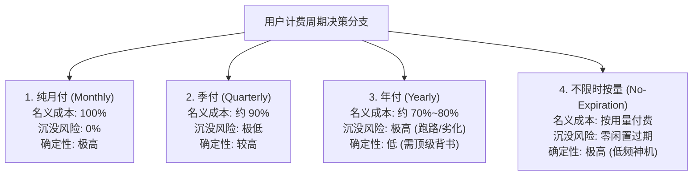
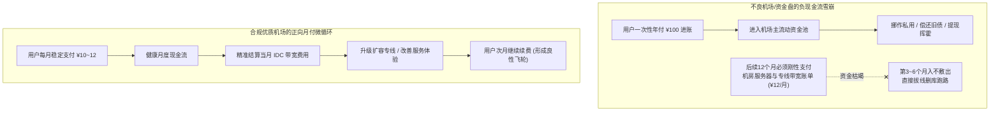
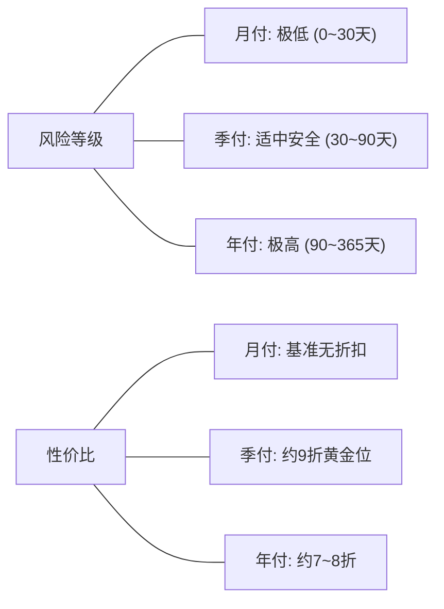

## 一、2026 年机场周期计费核心结论与精选服务商速查榜

在挑选科学上网与跨境代理服务时，面对服务商商品页面琳琅满目的“月付、季付、半年付、年付甚至两年付”选项，**几乎所有消费者都会在“追求单月极致低价”与“防范服务商暴雷跑路”之间产生剧烈的选择困难**。机场商家深谙消费心理学，通常会在年付档位打出极具诱惑力的“限时 6 折”、“买一年送半年”或“月均低至几元钱”的倾销式文案；然而，根据行业维权社区与相关网络审计机构统计，**超过 85% 的消费者遭遇“机场突发失联、线路瘫痪且无法退款”的血泪教训，其根源无一例外都是轻信了高额折扣而一次性支付了年费**。

为了让搜索用户在 30 秒内获得最确定、最符合经济理性的答案，我们先直接给出 2026 年科学上网周期选型的**三大核心铁律**：
1. **对于任何首次接触、运营时间低于 2 年、或小众新兴的机场服务商，无论折扣多么诱人，必须且只能选择「月付」**。月付多支付的 10%~20% 溢价，实质是购买一份“随时用脚投票、零沉没成本”的看跌期权；
2. **对于已经稳定使用满 3 个月、晚高峰速度经受住严苛考验的优质机场，「季付」是综合性价比与风险控制的“黄金平衡点”**。它不仅能锁定 5%~10% 的合理优惠，更将潜在损失周期死死锁定在 90 天的安全阈值以内；
3. **「年付」仅适用于满足两大苛刻前提的场景：一是历经 3 年以上行业洗牌且具备独立全内网专线资产的顶级老牌大厂；二是年付总绝对金额在极其低廉的心理止损线以内（如 ¥100 左右）**。此外，对于低频轻量或备用需求，**“不限时按量付费（一次购买永久不过期）”在财务模型上全面碾压任何包年套餐**。

下表汇总了 2026 年在不同计费周期下表现稳健、价格透明、无暗扣倍率的代表性服务商。

### 2026 年优质机场计费周期支持与综合性价比速查榜

| 机场品牌 | 快速直达 | 推荐周期模式 | 真实起步门槛 | 线路架构与核心特色 | 计费倍率 | 专属优惠 | 评测详情 |
| :--- | :--- | :--- | :--- | :--- | :--- | :--- | :--- |
| **唯兔云** | [👉 立即直达](https://guangs.weituaff.top/#/?code=w98Q9B5D) | **纯月付首选** | ¥10.00/月 | 跨境物理专线大水管 / 无任何捆绑套路 | 全节点 1.0x 真实计费 | 优惠券：`weitu666` | [深度评测](/posts/brand-weitu-review/) |
| **微风网络** | [👉 立即直达](https://guangs.weifengaff.top/#/?code=VjRz832G) | **月付/季付极客首选** | ¥9.00/月 | 原生住宅双 ISP / 极客低延迟 AI 与流媒体 | 全节点 1.0x 不虚标 | 9折券：`wf888` | [深度评测](/posts/brand-weifeng-review/) |
| **一翻云** | [👉 立即直达](https://guangs.yifanaff.top/#/?code=uJ6y) | **大流量月付/季付** | ¥12.00/月 | 150GB~500GB 充沛大容量 / 多线 BGP 中转 | 全节点 1.0x 真实计费 | 优惠券：`yifan666` | [深度评测](/posts/brand-yifanyun-review/) |
| **星岛梦** | [👉 立即直达](https://guangs.xingdaomeng.com/#/?code=1TynBYnR) | **不限时按量 (年付替代)** | ¥12.00/按量 | 动态按量永久不过期 / 企业级 IEPL 物理专线 | 按实际消耗扣费 | 9折码：`nmw888` | [深度评测](/posts/brand-xingdaomeng-review/) |
| **光速云** | [👉 立即直达](https://sahude.gsyvipaff.com/#/?code=keqgvT5Y) | **老牌年付/季付旗舰** | 折后约¥12/月 | 5年老牌全内网物理专线 / 晚高峰 0 丢包 | 全节点 1.0x 极速专线 | 8折码：`AMM` | [深度评测](/posts/guangshuyun-review/) |
| **飞猫云** | [👉 立即直达](https://guangs.feimaoyunaff.top/#/?code=Kx2P4q) | **亲民小额月付** | ¥8.80/月 | 商业优化 BGP 中继 / 适合学生党极低门槛 | 全节点 1.0x 真实计费 | 优惠券：`feimao` | [深度评测](/posts/brand-feimaoyun-review/) |
| **二猫云** | [👉 立即直达](https://guangs.ermaoyunaff.top/#/?code=mG1e) | **月付/容灾备用** | ¥11.00/月 | 智能多线容灾中继 / 多协议大带宽 | 全节点 1.0x 真实计费 | 优惠券：`ermao888` | [深度评测](/posts/brand-ermaoyun-review/) |

---

## 二、月付、季付、年付的财务数学模型与实际折扣深度解剖

许多用户在面对价格表时，容易陷入单纯对比数字表面大小的“认知偏差”。只有通过建立微观经济学与概率论的期望收益模型，才能看清所谓“年付折扣”背后的数学真相。



### 1. 行业主流定价模型与名义月均费率比拼

在当今机场运营的主流计费系统中，服务商的周期定价策略通常呈现如下数学规律：

| 计费周期类别 | 标准定价系数 | 典型实际到手单价示例 | 名义月均支出 | 表面折扣力度 | 资金占用周期 | 突发事故最大资金敞口 |
| :--- | :--- | :--- | :--- | :--- | :--- | :--- |
| **月付（1个月）** | 1.00x（基准） | ¥12.00 / 月 | ¥12.00 / 月 | 无折扣（基准价） | 30 天 | 仅 ¥12.00（几乎无痛） |
| **季付（3个月）** | 0.90x ~ 0.95x | ¥32.40 / 季 | ¥10.80 / 月 | 约 9.0 折 | 90 天 | 约 ¥32.40（小额可控） |
| **半年付（6个月）**| 0.85x ~ 0.90x | ¥61.20 / 半年 | ¥10.20 / 月 | 约 8.5 折 | 180 天 | 约 ¥61.20（中度风险） |
| **年付（12个月）** | 0.70x ~ 0.80x | ¥108.00 / 年 | ¥9.00 / 月 | 约 7.5 折 | 365 天 | 超过 ¥100（高风险暴露） |
| **两年付（24个月）**| 0.50x ~ 0.60x | ¥144.00 / 两年 | ¥6.00 / 月 | 约 5.0 折（倾销） | 730 天 | 极高（典型击鼓传花盘） |

从表面上看，年付每月仅需 ¥9.00，相比月付的 ¥12.00 每月节省了 ¥3.00，全年在账面上可以省下整整 ¥36.00。这也是绝大多数新手被吸引下单的核心诱因。

### 2. 引入风险折现率的真实经济学期望值公式

在现实世界中，跨境代理服务由于受到政策监管、骨干网阻断、黑客攻击、汇率波动以及运营者道德风险的多重冲击，它绝不是一种“无风险金融资产”。

我们可以建立如下**用户真实收益数学期望模型**：
$$E(V) = P_{\text{survive}} \times (V_{\text{service}} - C_{\text{cost}}) - (1 - P_{\text{survive}}) \times C_{\text{lost}}$$

其中：
- $P_{\text{survive}}$ 代表该机场在整个周期内能够正常履约、不跑路、不恶劣劣化的概率；
- $V_{\text{service}}$ 代表用户从网络连接中获得的实际生产力或娱乐价值；
- $C_{\text{cost}}$ 为支付的套餐成本；
- $C_{\text{lost}}$ 为机场一旦跑路后用户损失的剩余未履约本金（沉没成本）。

#### 盈亏平衡临界点深度推导
假设一家月付 ¥12.00、年付 ¥108.00 的机场：
- **场景 A（月付）**：用户每个月单独立约。即便第 4 个月机场突然跑路，用户前 3 个月已充分享受服务，实际损失仅为当月剩余几天的残值（损失 $\le$ ¥12.00），前 3 个月总支出仅为 ¥36.00；
- **场景 B（年付）**：用户在第 1 天一次性支付 ¥108.00。如果该机场在第 3 个月由于专线被查封或经营不善关停跑路，用户实际只享受了 3 个月的服务，而承受了整整 ¥108.00 的财务流出！换算下来，用户在这 3 个月里的**实际月均成本高达惊人的 ¥36.00/月**（是月付原价的 3 倍之多！）。

**数学结论**：**只要一家机场在一年内跑路或彻底劣化的概率高于 20%，年付在数学期望上就是一笔必定亏损的劣质投资**。年付省下的那 ¥36 元蝇头小利，根本无法抵御随时可能蒸发 ¥100+ 本金的非对称下行风险。

---

## 三、机场运营方的现金流困局：为什么不良机场拼命诱导用户年付？

要深刻理解周期选择的底层逻辑，就必须跳出消费者视角，从**机场服务商的财务报表与物理运营成本结构**来拆解其背后的动机。



### 1. 物理专线与服务器的刚性成本结算周期
在正规 IDC 数据中心与电信运营商处，跨境网络资源的采购结算规则极其严格：
- **物理专线（IEPL/IPLC）**：运营商通常采用月结或季度预付方式，按照承诺带宽峰值（95 计费法）硬性收取高昂的月租费，每 1Gbps 专线月租动辄数万元人民币，绝无任何打折赊账可能；
- **海外落地机房 VPS**：主流云服务商（如 AWS、Google Cloud、Linode、DigitalOcean）均按照每小时或每月结算出网流量与实例运行时长。

这意味着：**机场运营方的实际支出是按月连续、刚性发生的动态负债**。

### 2. 资金盘机场的庞氏特征与“年付催化剂”
一些缺乏技术积累、依靠公网中转拼凑节点的小型机场，在面对激烈的市场竞争时，往往走上危险的庞氏融资路径：
1. **现金流前置诱惑**：如果只做月付，每个用户每月进账 ¥10，运营 1000 个用户每月只能拿到 ¥10,000，扣除服务器成本后几乎所剩无几；
2. **年付大肆抽血**：如果通过“买一年送一年”诱导 1000 个用户办理年付，机场主可以在短短一周内瞬间吸纳 ¥100,000 甚至更高的现金巨款！
3. **资金错配与跑路宿命**：这种预收账款在会计学上属于“预收负债”。然而，许多不良机场主将这笔钱视为个人纯利润随意挥霍。当新用户增长放缓、老用户的年付流量却依然在持续消耗机房带宽时，现金流池必然发生干涸崩溃。为了止损，机场主最理性的商业选择就是关停服务器、解散 Telegram 群组，换个马甲重新开张。

### 3. 为什么真正优质的大厂从不惧怕用户月付？
与杂牌小作坊相反，**拥有真实专线实力、注重长远口碑的老牌服务商（如唯兔云、微风网络、光速云）通常以极度欢迎的姿态支持纯月付**：
- **履约底气**：大厂依靠的是过硬的晚高峰低延迟、全天候 0 丢包以及原生双 ISP 节点解锁等真实产品力，拥有极高的用户次月续费留存率（通常大于 85%）；
- **动态弹性容量匹配**：月付机制允许大厂根据当月活跃用户的数量，动态向运营商增减物理带宽切片，实现最健康的单位经济学（Unit Economics）正向循环。

---

## 四、月付（Monthly）：灵活性天花板与防坑护城河

对于普通消费者而言，选择“纯月付”绝非仅仅是一种付款方式，而是一种**构建个人网络韧性与财务风控的高级策略**。

### 1. 纯月付的核心不可替代优势
- **极速避险与用脚投票权**：科学上网生态瞬息万变。某个原本流畅的节点可能因为机房 IP 遭遇 GFW 深度包检测（DPI）干扰、或者落地机房被流媒体平台封锁而突然瘫痪。如果你是月付用户，只需在当月结束时停止续费，立刻无缝切换到其他备选品牌，整个过程无任何经济损失与维权扯皮；
- **安然跨越政策与监管敏感期**：每逢重大国际会议、两会或特殊敏感节点，跨境网络都会经历高强度的全网封锁与封锁测试。在这一时期，大量中小型机场往往集体陷入瘫痪甚至倒闭。月付用户能够随时暂停订阅，静观其变；
- **零资产闲置浪费**：对于经常出差、旅游、高校放寒暑假、或偶尔才需要查阅一次海外文献的用户，按需月付能够实现完美的“用几月付几月”，彻底规避长达半年的无端空置。

### 2. 月付的相对劣势与化解方案
- **名义溢价略高**：月付相比年付在单价上高出 15%~25%；
- **频繁手动续费的繁琐性**：每个月都需要登录后台确认账单，偶尔忘记充值会导致正在开会或查资料时突然断网；
- **化解策略**：绝大多数正规机场客户端（如 Clash Verge Rev / Shadowrocket）内置了订阅状态与过期时间倒计时；同时，可以在日历中设置固定提醒，或采用我们后文提供的自动化 PowerShell 脚本进行余量预警。

### 3. 月付底层的流量重置时序与计费系统机制拆解
深入理解月付，还必须看清机场后台管理面板（主流为 V2board 或 SSPanel-Uim）的底层定时任务调度逻辑：
- **自然月重置 vs 周期滚动重置**：
  1. **自然月重置机制**：无论你是在当月 5 号还是 25 号购买，系统固定在每月 1 日的 00:00 统一清空当月用量并注入新流量。这种机制对月末购入的用户极不友好（极易因天数不足而吃亏）；
  2. **订购日滚动 30 天重置（主流）**：系统根据你的实际支付时间戳，每精确流逝 2,592,000 秒（30 天）执行一次数据库重置。这种模式最为公平，也是唯兔云、微风网络等大厂的标准做法；
- **流量耗尽断流的缓冲熔断阈值**：正规机场在流量达到 100% 时，后端节点守护进程（Node Daemon）会向 API 返回状态码并瞬间拉黑该用户 UUID 的出站转发。月付用户应时刻注意，在关键工作（如视频会议或大模型对话）开始前确认剩余额度，避免在通话过程中突发断流。

### 4. 月付支付渠道的安全性与发卡网隐私风控
月付虽然单笔金额小（通常仅需 ¥8~¥12），但频繁与第三方收单通道打交道也会涉及个人隐私保护：
- **免签个人挂机收款码的隐患**：部分超小型作坊使用个人微信/支付宝转账挂机软件，付款时会直接暴露收款人真实姓名与转账备注，极易触发微信反洗钱风控弹窗；
- **合规商户与多币种通道**：优质老牌服务商通常采用企业资质收款网关或支持 USDT 虚拟货币结算。在选择月付时，首选无需绑定任何敏感银行卡信息的聚合结账页面，付款即走，绝不在不可信系统里留存长效代扣协议。

---

## 五、季付（Quarterly）：被严重低估的“黄金平衡点”

在探讨套餐周期时，很多人非黑即白地将选择局限在“要么月付、要么年付”的极端二元对立中，却往往忽略了**在综合体验与财务风险控制上表现最为均衡的「季付（按 3 个月付费）」**。



### 1. 季付的“90 天安全法则”
为什么 90 天是一个极具战略价值的时间窗口？
- **过滤 90% 的短命资金盘**：根据机场运营黑产历史数据统计，绝大多数以圈钱套现为目的的虚假跑路机场，其平均生命周期集中在 **45 天至 75 天**之间。这类平台通常会在开业初期通过低价营销吸引一波客流，而在第二次机房带宽账单到期前夕迅速卷款蒸发。**一家能够平稳履约满 90 天并支持季付的平台，其具备正常运维能力与长期经营意愿的概率大幅上升至 80% 以上**；
- **锁定合理的理性折扣**：季付通常提供 9.0 折至 9.5 折的优惠。虽然折扣幅度看似不如年付夸张，但它是在服务商不损伤健康利润率的前提下给出的真诚让利，兼顾了商家的持续生存与用户的价格实惠。

### 2. 季付的最佳适用人群
- **高校学期制学生**：完美契合春季学期（3~6 月）或秋季学期（9~12 月）的学习与科研周期，放假回国或回家期间无需为空置买单；
- **企业季度项目组**：针对跨国海外调研、外贸展会冲刺、或短期跨境软件交付等以季度为考核周期的团队协同；
- **已对平台建立初步信任的进阶用户**：在连续月付体验满 2~3 个月、确认晚高峰无断流且节点倍率透明后，果断升级为季付以享受适度优惠并减少频繁充值的精力损耗。

---

## 六、年付（Yearly）：极致性价比还是定时炸弹？三大准入审查条件

并非所有年付都是洪水猛兽。在特定的严苛边界条件下，年付确实能够为高频度、高确定性的长期用户带来极致的省心与成本优势。然而，在按下“确认支付年费”的按钮之前，你必须对其进行**三大硬性准入审查**。

### 1. 审查条件一：品牌存活生命周期是否经受过两轮以上大洗牌？
- **时间硬指标**：该机场必须拥有至少 **3 年以上不间断稳定运营的历史记录**（可通过其主域名历史 Whois 注册时间、官方公告历史归档、以及第三方评测社区历史讨论贴进行交叉验证）；
- **品牌重置与域名跳跃排查**：警惕那些频繁更换品牌名称、每次敏感期过后便宣布“系统升级重新发卡注册”的伪老牌。真正有信誉的专线大厂（如光速云），其核心基础设施与用户身份体系具有极高的历史连贯性。

### 2. 审查条件二：绝对金额是否被牢牢限制在“无痛止损线”以内？
- **心理防线设立**：绝对不要为任何宣称“豪华至尊 1000GB”但年付需要三四百元以上的套餐买单；
- **低门槛止损**：真正理性的年付，应当是单年总额在 **¥80 至 ¥130 元之间**（折合每月仅需 ¥8~¥11 左右）。在这个价格区间内，即便未来某一天真发生无法预料的天灾人祸，损失的绝对金额仅仅相当于一两顿外卖快餐，绝不会对个人财务状况造成丝毫实质性创伤。

### 3. 审查条件三：物理基础设施的独立性与透明度
- 不盲目听信客服口头宣传的“全专线”，必须通过我们后文介绍的网络探测脚本对节点真实延迟、MTR 路由跳数与丢包率进行自检，确认其确系独立二层内网通道而非廉价公网中转拼凑。

### 4. 特殊维度：不限时按量（Pay-as-you-go）对传统年付的“降维打击”
如果你考虑年付仅仅是因为“不想每个月折腾续费”，或者“平时用量较少但希望随时可用”，那么**星岛梦这类“永久不过期按量计费包”在性价比与安全性上全面完爆传统包年套餐**：
- 传统包年：每年 ¥120，每个月固定发 100GB，月底不管用不用完都强制清零；如果你某个月只用了 5GB，剩下的 95GB 彻底蒸发；
- 不限时按量：一次性充值 ¥50~¥100，买入数吉字节到数百吉字节的纯净专线流量，**账户余额与流量永久有效、不设过期时间**，哪怕用上两年三年也不会被扣除一分钱闲置折旧。这是真正意义上的资金零浪费方案。

### 5. 年付准入技术审查清单（Technical Due Diligence Checklist）
在决定支付年费前，建议执行如下技术自检以确保对方具备持续履约能力：
1. **BGP 广播与自治系统（ASN）验证**：通过 `bgp.he.net` 或 `ipinfo.io` 查询该机场入口 IP 的 ASN 编号，确认其入口属于正规数据中心（如中国电信 ChinaNet CN2 AS4809、联通 AS9929 或多线商业 BGP）而非家用动态宽带转接；
2. **落地机房欺诈评分（Fraud Score）**：使用 IPQualityScore 或 SCAMALYTICS 测试落地 IP 的纯净度。欺诈分低于 25 分的节点，说明该服务商采购的是优质原生住宅/双 ISP 资源，遭遇 OpenAI 或 Netflix 批量封禁的概率极低；
3. **多地域物理入口容灾冗余**：检查其订阅中是否同时具备广州、深圳、上海等至少两个以上互为备份的国内入口，单点机房故障时不至于导致全线瘫痪。

---

## 七、双轨容灾财务架构：如何用组合周期实现“最低成本+最高稳定性”

单纯押注任何单一服务商的单一周期，在工程学上都违背了“消除单点故障（SPOF）”的基本准则。**真正高阶的网络极客与专业跨境从业者，普遍采用“主备双轨 + 混合计费周期”的组合策略**。

```mermaid
flowchart TD
    UserReq["用户应用发起网络请求"] --> Mihomo{"本地客户端 (Mihomo/Clash) 容灾分流引擎"}
    
    Mihomo -->|主力日常链路 (低月均成本)| Primary["主力轨: 优质大容量纯月付 (¥10~12/月)<br/>(如 唯兔云 / 一翻云 / 飞猫云)"]
    Primary -->|晚高峰/大流量/追剧/下载| Internet1["国际互联网端点"]
    
    Primary -.->|突发故障/敏感期阻断/单流宕机| Trigger["自动触发 Fallback 健康检查熔断"]
    Trigger ==>|0.5秒无缝切换至备用轨| Backup["备用轨: 不限时永久不过期按量 IEPL<br/>(如 星岛梦 专线 / 纯备用)"]
    Backup -->|核心生产力/关键AI/邮件会议| Internet2["超高可用专属端点"]
```

### 1. 组合周期的综合财务核算矩阵

| 架构分工 | 推荐周期模式 | 推荐服务商类型 | 月度/单次实际支出 | 核心承担职责与技术特征 |
| :--- | :--- | :--- | :--- | :--- |
| **主力轨（85%流量）** | **纯月付（每月续费）** | 唯兔云 / 一翻云 / 飞猫云 | ¥10.00 ~ ¥12.00 / 月 | 承担日常海量数据吞吐、4K流媒体、文件下载与高频交互，提供高达数百吉字节的大容量池 |
| **备用轨（15%应急）** | **不限时按量（长期有效）** | 星岛梦按量 IEPL 专线 | 约 ¥20.00 ~ ¥30.00（单次充值用半年以上） | 长期静默热备，专线 0 丢包，用于关键 AI 检索、外贸订单签署、以及主力轨宕机时的秒级接管 |
| **全系统综合月均总支出** | **混合周期协同** | —— | **仅需约 ¥13.00 ~ ¥15.00 / 月** | **获得 99.99% 企业级双重容灾与随时换车的无限自由度** |

### 2. 生产级 Mihomo (Clash Meta) 主备周期容灾策略组配置示例

以下配置通过 `fallback` 策略组将月付主力订阅与不限时按量备用订阅深度融合，实现故障瞬时热切换：

```yaml
# =================================================================
# 混合周期双轨容灾生产级配置: 月付主力 + 按量备用自动熔断切换
# 适用客户端: Clash Verge Rev / Mihomo Core
# =================================================================

port: 7890
socks-port: 7891
mixed-port: 7892
allow-lan: false
mode: rule
log-level: info
ipv6: false

# 代理集定义: 分别拉取你的主力月付订阅与备用按量订阅
proxy-providers:
  # 主力订阅: 纯月付高性价比大容量
  primary-monthly-provider:
    type: http
    url: "https://your-primary-monthly-airport.com/api/v1/client/subscribe?token=MONTHLY_TOKEN"
    path: ./profiles/primary_monthly.yaml
    interval: 43200
    health-check:
      enable: true
      interval: 120
      url: http://www.gstatic.com/generate_204

  # 备用订阅: 星岛梦不限时按量专线 (永久有效)
  backup-paygo-provider:
    type: http
    url: "https://your-backup-paygo-airport.com/api/v1/client/subscribe?token=PAYGO_TOKEN"
    path: ./profiles/backup_paygo.yaml
    interval: 86400
    health-check:
      enable: true
      interval: 300
      url: http://www.gstatic.com/generate_204

# 策略组核心逻辑: 优先跑月付流量，主力故障自动沉降到按量专线
proxy-groups:
  # 自动健康回退策略组
  - name: "🛡️ 双轨容灾主力流"
    type: fallback
    proxies:
      - "⚡ 月付主力优选组"
      - "💎 按量备用应急组"
    url: "http://www.gstatic.com/generate_204"
    interval: 60
    timeout: 3000

  # 月付主力池 (自动选择延迟最低节点)
  - name: "⚡ 月付主力优选组"
    type: url-test
    use:
      - primary-monthly-provider
    url: "http://www.gstatic.com/generate_204"
    interval: 300
    tolerance: 50

  # 按量专线应急池 (不限时)
  - name: "💎 按量备用应急组"
    type: select
    use:
      - backup-paygo-provider

  # 顶层人工控制组
  - name: "🚀 综合出口选择"
    type: select
    proxies:
      - "🛡️ 双轨容灾主力流"
      - "⚡ 月付主力优选组"
      - "💎 按量备用应急组"
      - "DIRECT"

rules:
  # 基础国内与局域网直连
  - GEOIP,lan,DIRECT
  - GEOIP,CN,DIRECT
  # 全局走双轨容灾机制
  - MATCH,🚀 综合出口选择
```

---

## 八、自动化周期监控与网络健康探测命令行实战

对于采用月付或季付周期的用户，最担心的莫过于“突然某天到期断网”或“订阅在不知情时流量用尽”。通过标准命令行工具直接解析机场订阅接口返回的 HTTP 响应头（`Subscription-Userinfo`），可以实现对**剩余天数、已用上传下载流量与总配额的精准自动化审计与续费预警**。

### 1. PowerShell 自动化订阅天数与流量健康度审计脚本（Windows 环境）

以下脚本能够自动计算当前套餐的剩余到期天数，并在距离过期不足 3 天时发出高亮预警：

```powershell
# =================================================================
# Windows PowerShell 机场订阅周期与到期天数精准监控脚本
# 执行目的: 解析订阅元数据, 测算剩余使用天数与流量剩余百分比
# =================================================================

$SubUrl = "https://your-airport-provider-link.com/api/v1/client/subscribe?token=YOUR_TOKEN" # 替换为真实订阅

Write-Host "======================================================" -ForegroundColor Cyan
Write-Host "正在调取机场服务端周期元数据..." -ForegroundColor Yellow

try {
    # 发起轻量 HEAD 请求, 仅抓取响应头, 零流量损耗
    $Request = [System.Net.WebRequest]::Create($SubUrl)
    $Request.Method = "HEAD"
    $Request.Timeout = 8000
    $Response = $Request.GetResponse()
    
    # 提取核心订阅数据头
    $UserInfoHeader = $Response.Headers["subscription-userinfo"]
    $Response.Close()
    
    if (-not $UserInfoHeader) {
        Write-Host "提示: 该服务商未在响应头中外露标准 subscription-userinfo 字段。" -ForegroundColor DarkYellow
        return
    }
    
    # 正则解析 upload, download, total 与 expire 时间戳
    $Upload = [regex]::Match($UserInfoHeader, 'upload=(\d+)').Groups[1].Value
    $Download = [regex]::Match($UserInfoHeader, 'download=(\d+)').Groups[1].Value
    $Total = [regex]::Match($UserInfoHeader, 'total=(\d+)').Groups[1].Value
    $Expire = [regex]::Match($UserInfoHeader, 'expire=(\d+)').Groups[1].Value
    
    # 字节转换与时间戳推导
    $TotalGB = [math]::Round([int64]$Total / 1GB, 2)
    $UsedGB = [math]::Round(([int64]$Upload + [int64]$Download) / 1GB, 2)
    $RemainGB = [math]::Round(($TotalGB - $UsedGB), 2)
    $PercentUsed = [math]::Round(($UsedGB / $TotalGB) * 100, 1)
    
    $ExpireDate = [DateTimeOffset]::FromUnixTimeSeconds([int64]$Expire).LocalDateTime
    $DaysRemaining = [math]::Round(($ExpireDate - (Get-Date)).TotalDays, 1)
    
    Write-Host "----------------- 周期健康审计报告 -----------------" -ForegroundColor Green
    Write-Host "套餐总额度:     $TotalGB GB"
    Write-Host "已消耗流量:     $UsedGB GB ($PercentUsed %)"
    Write-Host "剩余可用流量:   $RemainGB GB"
    Write-Host "服务到期时间:   $($ExpireDate.ToString('yyyy-MM-dd HH:mm:ss'))"
    Write-Host "距离到期天数:   $DaysRemaining 天" -ForegroundColor Cyan
    
    # 智能周期续费预警
    if ($DaysRemaining -le 3.0) {
        Write-Host "[重要预警] 套餐将在 3 天内到期! 请及时决定是否续费月付。" -ForegroundColor Red
    } elseif ($DaysRemaining -gt 30.0) {
        Write-Host "[状态正常] 当前处于季付或年付周期内，流量供给充沛。" -ForegroundColor Green
    } else {
        Write-Host "[状态正常] 月付周期处于健康运行区间。" -ForegroundColor Gray
    }
}
catch {
    Write-Host "监控请求失败: $_" -ForegroundColor Red
    Write-Host "排查建议: 请检查订阅 URL 是否有效，或是否需要代理后方能访问该 API。" -ForegroundColor DarkYellow
}
```

### 2. Bash / cURL 订阅元数据快速提取单行命令（macOS / Linux 环境）

在 macOS 终端或 Linux Shell 下，只需运行一行 cURL 命令即可秒级获取当前的账户状态指标：

```bash
# 提取订阅周期响应头
curl -s -I "https://your-airport-provider-link.com/api/v1/client/subscribe?token=YOUR_TOKEN" | grep -i "subscription-userinfo"
```

**预期输出结构**：
```text
subscription-userinfo: upload=1073741824; download=21474836480; total=214748364800; expire=1780000000
```
- 通过对比 `total`（总配额字节数）与 `expire`（Unix 时间戳），无需打开任何臃肿的网页即可瞬间了然当前的周期运行状况。

---

## 九、周期选型真实翻车事故复盘与 RCA 根因分析

在现实生活中，因贪图年付折扣或忽视周期风控导致的翻车事故比比皆是。以下精选三个最具代表性的真实案例，提供深刻的根本原因分析（RCA）与防御启示。

### 案例一：贪图“买一年送一年”年付 ¥198，两月后节点全红机场主失联

#### 1. 问题现象
某跨国设计专业学生小李在某社交平台看到广告：“老牌顶级大厂限时大促，年付 ¥198 包含每月 500GB 专线流量，且前 100 名下单用户直接赠送第二年（相当于 ¥198 买两年）”。小李觉得折合每月只要 ¥8 元钱太划算，立刻下单。前两个月使用极其流畅，但在第 3 个月的一个周末，客户端内所有节点瞬间出现全红超时（Ping 超时 100%），官方 Telegram 交流群被管理员开启全员禁言并更名为“已被收购”，官网域名也变为解析失败。

#### 2. 环境信息
- **购买周期**：年付促销档（赠送一年，共计 24 个月）；
- **实付金额**：¥198.00；
- **平台背景**：某不知名新兴中转小机场，实际开业仅 4 个月。

#### 3. 根因剖析（RCA）
- **根本原因**：典型的**低价倾销式资金盘套现模型**。该平台在前期通过购买少量高防服务器与短期按流量计费中转，营造“千兆专线秒开”的虚假繁荣；随后通过“买一送一”制造紧迫感，在短时间内诱导上千名贪图便宜的用户充值年费；一旦收款账户累积到数十万元且后续月度服务器账单即将来临，运营者按计划直接提现离场，斩断所有网络开支。
- **代价核算**：小李实际上花费了 ¥198 元只使用了 2 个月服务，**真实等效月均成本高达 ¥99.00/月**！如果小李从一开始选择 ¥10/月的唯兔云或微风网络月付，即便遇到意外，最多也仅损失当月的 ¥10 元钱。

---

### 案例二：不慎勾选“自动扣款”，月付套餐扣费一年却浑然不知

#### 1. 问题现象
职员王先生在某境外代理平台购买了一个 ¥15/月的轻量月付套餐。使用一个月后，王先生由于工作变动换用公司专线，将该客户端彻底卸载不再使用。整整一年后，王先生在核对信用卡账单时震惊地发现，该平台依然在每个月固定的一号通过境外第三方支付网关自动扣除 ¥15 元，全年轻度损失高达 ¥180 元。

#### 2. 环境信息
- **支付方式**：外币信用卡直接绑定 / 海外发卡网订阅协议；
- **购买周期**：自动循环续费月付（Auto-Recurring Monthly）。

#### 3. 根因剖析（RCA）
- **根本原因**：许多海外收单机构或发卡系统在结账页面默认勾选了“开启按月自动循环扣款（Recurring Billing）”。用户在付款时未仔细阅读协议细则，以为是一次性月付；在停止使用后未登录发卡后台显式解绑授权（Cancel Pre-approved Payment）。
- **防御对策**：**购买月付时，首选国内主流免绑卡支付方式（如微信/支付宝现结），或在 PayPal 后台中随时撤销自动扣款授权**；坚决不将敏感信用卡信息长期静止绑定在不可信的个人小机场后台。

---

### 案例三：科研团队年付单一专线突发敏感期封锁，缺乏备用轨致使项目停工三天

#### 1. 问题现象
某高校人工智能实验室为方便团队五名成员拉取论文与 GitHub 依赖，管理员购买了一家知名专线机场的“企业级年付 1TB 套餐”（花费 ¥480 元）。在某次重大特殊敏感期内，该专线国内入口 IP 被骨干网统一实施路由黑洞清洗，导致专线彻底断流长达 72 小时。由于团队未配置任何备用机场，导致多名研究员的模型训练和代码部署完全陷入停滞。

#### 2. 环境信息
- **采购模式**：单一服务商重度年付；
- **故障持续时间**：72 小时；
- **直接损失**：团队研发进度严重滞后。

#### 3. 根因剖析（RCA）
- **根本原因**：**将所有业务确定性押注在“单一物理服务商”的年付履约能力上**。无论多高端的专线机场，都无法 100% 抵御物理光纤被挖断、机房母机硬件故障或国家级网络封锁等不可抗力。年付套餐的高额一次性投入，反而给管理者造成了“已经买好了就高枕无忧”的虚假安全感。
- **防御对策**：必须坚决执行我们推荐的**“双轨容灾”架构**。与其花费 ¥480 买一个高风险的单一巨额年付，不如以每月 ¥12 订阅一翻云/微风网络月付，同时预充 ¥30 的星岛梦永久不过期按量专线作为底层热备，遇到主线波动时客户端毫秒级自动切换，彻底杜绝单点停工。

---

## 十、2026 年机场计费周期常见疑问深度解答（FAQ）

### Q1：刚接触机场的新手，第一笔订单到底该选什么周期？
**毫无疑问，绝对必须选「月付」**。即便你身边的朋友或某些博主将某家机场夸得天花乱坠，也不要冲动年付。因为每个人的网络环境差异极大（包括你的宽带是电信、联通、移动还是广电校园网，你的路由器型号，以及你所在的地理省份）。在别人的网络下秒开 4K 的节点，在你的本地运营商下可能会因路由绕路而卡顿。花 ¥8~¥12 元买一个月先进行全方位的实地测速、晚高峰抗压与日常工具兼容性检验，确认体验完全符合预期后，再考虑后续规划。

### Q2：机场如果不幸跑路了，我年付没用完的钱还能通过支付宝/微信投诉追回吗？
**客观现实：追回的希望极其渺茫，甚至趋近于零**。绝大多数机场出于合规与隐私安全，其收款通道均挂靠在境外空壳公司、个人免签收款码、或频繁更替的第四方洗钱通道上。在微信或支付宝账单中，你的付款商户通常显示为“某某日用百货经营部”或“网络充值服务”。一旦机场跑路，该收款商户往往早已注销或被冻结，即便你向支付平台申诉，由于跨境代理本身属于监管敏感灰色地带，平台客服根本无法进行跨国仲裁退款。因此，**最好的资金防御不是事后追偿，而是通过选择“月付”主动控制潜在损失上限**。

### Q3：为什么有些机场在套餐列表里只有年付选项，根本没有月付？
**这种机场 90% 以上属于高危收割盘，建议立即关掉网页绕道而行**。除极少数为了严格筛选极高净值极客客户（如年费上千元且采用严格邀请制）的顶级小圈子外，绝大多数拒绝提供月付、强制半年付或年付起步的平台，其核心目的就是为了“快速吸纳预付款”。这类平台的底层线路大多超卖严重，他们心知肚明一旦提供月付，大部分用户在体验完晚高峰的惨淡速度后下个月绝不会续费，因此必须通过年付在第一道门槛把用户全年的费用强行套牢。

### Q4：许多商家声称“购买年付套餐可解锁专属 VIP 高速专线”，这是真的吗？
**大部分属于营销话术分级包装**。在技术实现上，服务商确实可以在后端将不同计费周期的用户打上不同权限标签，仅向年付用户推送某些独立节点。然而，如果一家机场的普通月付节点质量差到无法使用，只能说明其采购的总物理带宽严重不足或超卖成灾；即使你升级到所谓的“年付专属节点”，随着更多被忽悠的用户涌入，用不了两三个月该节点同样会被挤爆。真正有实力的良心大厂（如光速云、唯兔云、微风网络），其全节点均为一视同仁的真实专线与全协议解锁，绝不在核心网络质量上对月付用户进行恶意阉割。

### Q5：不限时按量付费套餐与包年套餐相比，到底哪个更划算？
**对于“月用量低于 30GB”或“用量极其不稳定”的用户，不限时按量付费在划算程度上全面碾压包年套餐**。包年套餐哪怕月均只要 ¥8 元，一年固定成本也是 ¥96 元；如果你一年里有半年在忙于线下工作或很少翻墙，浪费的闲置成本极高。而在星岛梦这类按量不过期的平台，充值 ¥50 元购买的流量池，由于没有任何月度清零限制，你可以从容使用一年甚至两年，用多少扣多少，综合资金利用率接近 100%。但如果你每个月都要固定消耗 200GB 以上的大流量看超清视频，那么大容量的包月/包季套餐则更为经济。

### Q6：续费时是应该等当前套餐彻底到期再买，还是可以提前续费？流量会叠加吗？
这取决于机场后端的计费系统规则。主流的 V2board 或 SSPanel 架构中，通常有**“重置当前流量”**与**“续费延长过期时间”**两种模式：如果你直接购买新套餐，系统通常会立即按新套餐覆盖当前剩余流量；如果是点击原套餐上的“续费（Renew）”，通常会在保留原有到期时间的基础上延长 30 天，但在很多系统中，未用完的流量并不会叠加到下个月，而是在周期结算日准时重置。因此，**最稳妥的做法是在当前套餐距离到期前 1~2 天操作续费**，避免过早续费导致当月未跑完的流量被系统逻辑提前冲刷掉。

### Q7：季付使用满意后想转年付补差价，会有坑吗？
很多机场后台并不支持智能“补差价平滑升级”。如果你在季付还剩两个月时直接下单年付，某些老旧系统会将你剩余的两个月时间清零，直接以新购年付为起点；或者需要人工发工单由客服计算折旧退款。在升级周期前，**务必在官方帮助文档或工单中确认其升级折算机制**；若系统不支持无缝顺延，最稳妥的方案是踏踏实实将当前季付用至最后几天，再行购买年付。

### Q8：学生党低预算（每月仅 10 元左右），怎么选周期性价比最高？
**首选“¥8.80~¥10 左右的高性价比月付”，坚决不买任何低价杂牌年付**。例如飞猫云（¥8.80/月）、微风网络（折后 ¥8~9/月）或唯兔云（¥10/月），每个月的支出相当于一瓶饮料钱，无任何资金压力。每个月学期末或放假回家，随时可以停止续费节省开支。对于预算有限的学生群体，保护好口袋里的本金安全、避免因小失大被跑路骗钱，永远是第一位的智慧。

---

## 十一、终极决策树与选型行动指南

为了让你在面对任何机场服务商时都能做出最无懈可击的明智决策，我们将其提炼为一张直观的**周期选型终极判断树**：

```mermaid
flowchart TD
    Start["准备选购机场服务"] --> Q1{"该机场是否为你首次接触 / 运营是否少于3年?"}
    
    Q1 -->|是 (任何新兴/未验证服务商)| PickMonthly["坚决选择: 纯月付 (Monthly)<br/>(推荐: 唯兔云 ¥10 / 飞猫云 ¥8.80)"]
    Q1 -->|否 (已持续月付稳定验证3个月以上)| Q2{"你的个人月度用量特征是什么?"}
    
    Q2 -->|低频使用 / 经常出差 / 仅作容灾备用| PickPayGo["最佳选择: 不限时按量不过期包<br/>(推荐: 星岛梦 永久有效 IEPL)"]
    Q2 -->|学期制 / 阶段性项目 / 追求适度优惠| PickQuarterly["黄金平衡: 季付 (Quarterly 约9折)<br/>(锁定合理让利, 规避年付高风险)"]
    Q2 -->|高频主力极客 / 预算在¥100左右可承受止损| Q3{"是否具备独立全内网专线与顶级行业口碑?"}
    
    Q3 -->|是 (老牌顶级大厂)| PickYearly["可行选择: 年付 (Yearly)<br/>(推荐: 光速云 全内网物理专线)"]
    Q3 -->|否 (普通公网中转/小作坊)| ForceBack["强制回退到: 纯月付模式"]
```

### 终极选型总结：做掌控网络主动权的聪明消费者
在 2026 年复杂的网络环境中，**真正的“划算”绝不是单价数字上的虚假让利，而是“综合体验确定性”与“资金安全控制权”的完美统一**。
- 拒绝任何贪图低价年付的赌徒心理；
- 坚持以**纯月付为主力、以不限时按量专线为底色**；
- 建立主备双轨网络架构。

唯有如此，你才能在风云变幻的跨境网络浪潮中，始终立于不败之地，以最低的财务成本享受到最稳定、最高品质的全球数字生产力！
