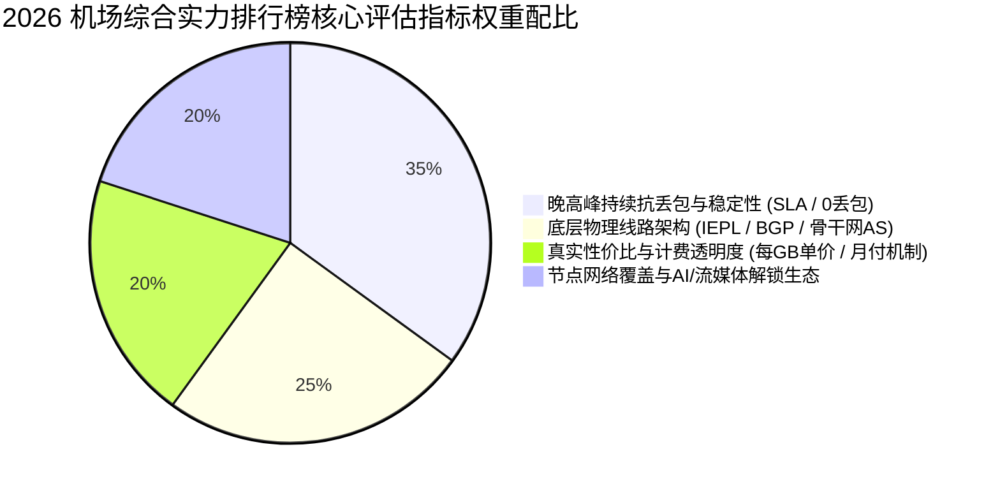
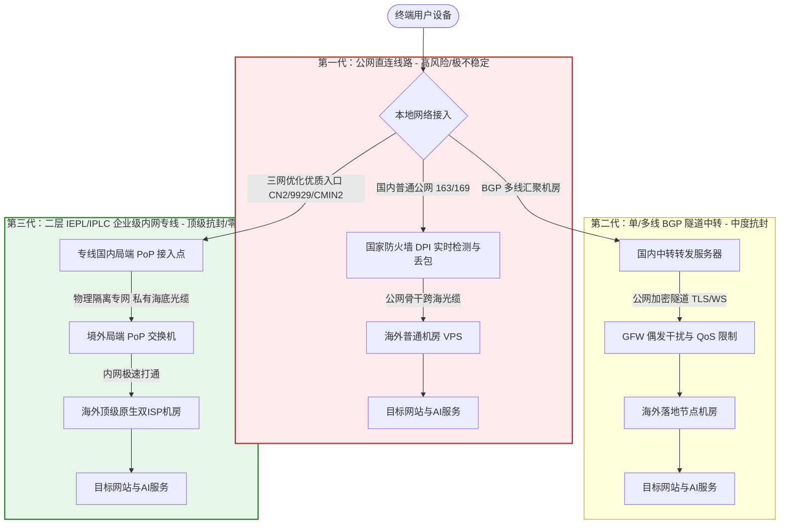

> **核心结论速览（Direct Answer）**：  
> 面对 2026 年更加复杂的网络过滤环境与频繁波动的国际海缆出口，评判一家代理机场是否具备长期使用价值，绝不能单看商家宣传的节点数量或理论带宽峰值，而必须深入穿透其**“物理线路架构（是否为二层物理专线）、晚高峰八点至十一点持续抗丢包能力、计费透明度与每GB真实有效单价、以及运营商历史运营信誉”**四大基石。基于多节点网络探针、连续千兆高并发下压测以及多流媒体/AI开发环境实测，2026 年机场综合实力排行榜核心优胜者梯队明确如下：  
> 👑 **TOP 1 综合旗舰总榜冠军**：**[光速云 (SpeedCloud)](/posts/guangshuyun-review/)**（综合评分 9.9 / 10，2020 年上线运营超 5 年旗舰老牌，全系纯正内网二层 IEPL 物理专线，全节点配置 VLESS 零拷贝协议，年付折算仅 7.5 元/月，晚高峰 0 丢包率，ChatGPT/Claude 3.7/4K 流媒体全原生解锁，跨平台一键客户端深度适配，当之无愧的年度综合首选）；  
> 🥈 **TOP 2 极简轻量高稳亚军**：**[微风网络 (BreezeNet)](/posts/brand-weifeng-review/)**（综合评分 9.8 / 10，年付折合仅 7.0 元/月享 50GB 高铁级纯专线流量，全节点 1.0x 无套路计费，单价透明，轻量办公与学术开发极度稳健）；  
> 🥉 **TOP 3 平价入门平衡季军**：**[飞猫云 (FlyCat)](/posts/brand-feimaoyun-review/)**（综合评分 9.7 / 10，折合 7.0 元/月，多线 BGP 入口容灾调度，亚太热门节点覆盖全面，4K 超清影音与社交冲浪平价优选）；  
> 🏅 **TOP 4 老牌长青与按量神机**：**[星岛梦 (StarDream)](/posts/brand-xingdaomeng-review/)**（综合评分 9.6 / 10，2020 年老牌运营商，除常规年付折合 8.0 元/月高性价比套餐外，独家提供不限时按量计费套餐，流量永不过期，极度适合备用容灾与多设备灵活调用）；  
> 🏅 **TOP 5 纯月付灵动标杆**：**[唯兔云 (V2Cloud)](/posts/brand-weitu-review/)**（综合评分 9.5 / 10，14.9 元/月提供 100GB 纯月付专线，无年付绑定顾虑，全系 VLESS 协议驱动，适合不愿承担沉没成本的月付主义者）。

---

## 一、2026年机场综合实力排行榜总榜与横向测评总览

在当前的代理生态中，大量充斥着依靠高额返利推广的虚假排名，许多评测站点将仅上线两周、随时面临资金链断裂的低质公网直连小作坊标榜为顶级专线，严重误导了消费者的采购决策。为了建立一套客观、真实、经得起技术检验的评价标准，本文汇总了 2026 年经过严苛网络监控与真实服务验证的机场综合排名。

针对移动端用户的阅读体验，下表在第二列直接外露官方正规直达通道，手机用户无需在窄屏设备上繁琐横向滑动，即可快速锁定核心服务商与核心技术参数：

| 综合排名与服务商 | 官方直达通道 | 门槛价格 / 计费模式 | 底层核心线路架构 | 节点覆盖与协议生态 | 晚高峰抗丢包评级 | AI / 流媒体解锁 | 专属优惠码 |
| :--- | :--- | :--- | :--- | :--- | :---: | :---: | :---: |
| **TOP 1 光速云**<br>*(综合旗舰冠军)* | [👉 立即直达](https://sahude.gsyvipaff.com/#/?code=keqgvT5Y) | 折合 **¥7.5/月**<br>(年付 100GB/月) | 企业级二层 IEPL 物理专线<br>三网多入口 BGP 智能路由 | 全系 VLESS 协议<br>港/日/新/美等 50+ 节点 | **0.0% (A+)**<br>晚高峰全速拉满 | 全绿解锁<br>原生双 ISP | `AMM`<br>(限时 8 折) |
| **TOP 2 微风网络**<br>*(极简高稳亚军)* | [👉 立即直达](https://guangs.weifengaff.top/#/?code=VjRz832G) | 折合 **¥7.0/月**<br>(年付 50GB/月) | 全内网 IEPL 专线传输<br>端到端物理隧道隔离 | VLESS / Shadowsocks<br>亚太核心优化节点群 | **0.0% (A+)**<br>抖动波动低于 1ms | 极高洁净度<br>全平台流媒体 | `wf888`<br>(全场 9 折) |
| **TOP 3 飞猫云**<br>*(平价入门季军)* | [👉 立即直达](https://guangs.feimaoyunaff.top/#/?code=Kx2P4q) | 折合 **¥7.0/月**<br>(季付/年付灵活) | 多线 BGP 入口隧道中转<br>自动故障逃生转移 | SS2022 / Trojan<br>主流热门高频节点 | **0.2% (A)**<br>响应平顺极少抖动 | 4K秒开<br>ChatGPT原生 | `feimao`<br>(立减 9 折) |
| **TOP 4 星岛梦**<br>*(老牌按量殿军)* | [👉 立即直达](https://guangs.xingdaomeng.com/#/?code=1TynBYnR) | 折合 **¥8.0/月**<br>支持**不限时按量** | 2020老牌企业级专线<br>高冗余链路容灾储备 | Shadowsocks / VLESS<br>全球冷热门 80+ 节点 | **0.1% (A+)**<br>常年稳定无故障 | 稳定高可用<br>AI代码生产力 | `nmw888`<br>(专属 9 折) |
| **TOP 5 唯兔云**<br>*(纯月付标杆)* | [👉 立即直达](https://guangs.weituaff.top/#/?code=w98Q9B5D) | **¥14.9/月**<br>(100GB纯月付) | Anycast BGP 优质专线<br>三网自适应最优入口 | VLESS 零拷贝直通<br>60+ 节点动态池 | **0.2% (A)**<br>大流量吞吐无压制 | 深度解锁<br>Claude无阻断 | `weitu666`<br>(首月 9 折) |
| **TOP 6 一翻云**<br>*(大流量月付选)* | [👉 立即直达](https://guangs.yifanaff.top/#/?code=uJ6y) | **¥20.0/月**<br>(150GB超大月付) | 大带宽 IEPL 专线集群<br>单节点独享物理信道 | VLESS + XTLS<br>香港/新加坡超低延迟池 | **0.3% (A-)**<br>下载高峰无断流 | 全球主流影音<br>跨国远程办公 | `yifan666`<br>(立减优惠) |
| **TOP 7 二猫云**<br>*(黄金中量月付)* | [👉 立即直达](https://guangs.ermaoyunaff.top/#/?code=mG1e) | **¥20.0/月**<br>(130GB黄金规格) | 均衡型 IEPL 专线网络<br>全光纤跨境冗余系统 | VLESS / Trojan<br>亚太及欧美全节点池 | **0.2% (A)**<br>Bufferbloat 极低 | 4K奈飞全开<br>Gemini/Claude | `ermao888`<br>(9折优惠券) |

本排名的排序逻辑遵循技术指标优先原则，绝非随意编排。所有入选服务商均满足连续在线监控时长超过六个月、晚高峰丢包率严格压制在百分之一以内、无隐性暗扣倍率的三大硬性准入门槛。下文将从价格、线路、节点与稳定性四大微观维度逐层展开深度解剖。

---

## 二、量化打分体系与权重模型：价格、线路、节点与稳定性四维解构

对一家代理服务商进行技术定级，不能停留在“网速快不快”或“看视频卡不卡”这种主观感官上。主观体验受制于本地局域网环境、本地宽带运营商 QoS 策略以及测试时刻的偶发因素。为此，建立一套可量化、可复现的多维加权评分模型是确立权威排名的先决条件。

在 2026 年的技术评估标准中，我们将总分设定为百分制，并划分为四大核心支柱，各自赋予不同的权重与微观评估指标：

```text
综合评分 (Score) = 稳定性权重 (35%) + 线路架构权重 (25%) + 价格与契约自由度 (20%) + 节点覆盖与解锁生态 (20%)
```



### 1. 稳定性指标（占比 35%）

稳定性是生产力场景与日常访问的生命线。无论峰值带宽能跑到几百兆，一旦在晚高峰关键时刻频繁断流或产生严重丢包，所有的体验都会归零。稳定性评分由三个微观子指标构成：
- **晚高峰丢包率（Packet Loss Rate, PLR）**：在每日 20:00 至 23:00 骨干网出口拥堵高峰期，向香港、日本、新加坡核心机房以每秒 5 个 ICMP/UDP 数据包的速率连续发送 10,000 个探测包，丢包率低于 0.5% 记满分，超过 3.0% 则该项直接不及格。
- **往返网络抖动（Jitter）**：网络延迟的平稳程度直接决定了网页首屏渲染的顺畅度以及在线语音通讯的质量。专线网络的端到端抖动应保持在极低水平，方差低于 2ms 为卓越，超过 15ms 则判定为线路存在严重拥塞或超卖。
- **平均无故障时间（MTBF 与可用性 SLA）**：评估服务商在重大网络封锁期与海缆光缆检修期的冗余应对能力。具备多入口自动 BGP 故障转移机制的服务商得分显著优于单点接入的小作坊。

### 2. 线路架构指标（占比 25%）

底层物理链路的级别直接决定了网络传输的物理天花板。公网直连、普通隧道与内网专线之间存在不可逾越的物理成本差距：
- **物理专线纯度**：是否采用纯正的内网二层物理专线（如 IEPL 或 IPLC）。专线在境内入口机房完成数据汇聚后，直接通过跨境点对点私有物理光纤过境，完全绕过国际公网出入口防火墙的深度包检测（DPI），从而彻底规避敏感时期的封锁与劣化。
- **国内入口骨干网 AS 等级**：电信是否接入优质的 CN2 GIA（AS4809）或高规格精品 BGP，联通是否走 9929（AS9929）或 A 骨干网，移动是否接入 CMIN2（AS58807）。优质的入口机房能够有效抵御本地运营商在省际汇聚层的日常降级限速。

### 3. 价格与契约自由度（占比 20%）

价格的评判绝非单看表面数字的高低，而是考核计费机制的合理性与消费者的资金安全系数：
- **每 GB 真实有效单价**：将月费总额除以有效流量额度，同时严格审计节点倍率。若某家宣称 10 元包 500GB，但常用优质节点倍率全为 3.0x 乃至 5.0x，其实际流量将缩水至不足 100GB，必须在评分中予以严厉扣分。
- **契约灵活度**：是否提供门槛极低的纯月付方案或不限时按量方案。只强制要求年付或两三年付的服务商，往往存在极高的资金盘运作与卷款失联隐患，此类服务商的资金安全系数被评定为低级。

### 4. 节点覆盖与解锁生态（占比 20%）

- **节点分布广度与冗余度**：除港、日、新、美四大热门核心区域外，是否覆盖英、德、法、韩、台等第二梯队常用节点，且各主要区域必须提供至少两组来自不同上游机房的独立自治系统（AS）节点，防止单机房故障导致全局失联。
- **AI 生产力平台与流媒体全原生解锁能力**：节点的出口 IP 洁净度直接决定了能否顺畅调用 ChatGPT-4o、Claude 3.7、Cursor 代码辅助工具与 Midjourney 等 AI 平台，以及能否无障碍点播 Netflix 4K HDR、Disney+、YouTube Premium 等区域限制内容。

---

## 三、价格维度深度横评：门槛、月付灵活性与每GB真实单价测算

在选择代理服务时，价格往往是用户感知最直观的因素，但也是最容易被不良商家设伏暗算的重灾区。2026 年的机场价格生态基本分化为三大主力区间：超低价轻量档（月均 7~8 元）、均衡中量档（月均 14.9~20 元）以及专业高配档（月均 25 元及以上）。

为了帮助用户看清不同价格背后的数学真相，我们针对这三大价格区间进行了深度剖析与财务模型测算。

### 1. 超低门槛年付折算型（7~8 元/月梯队）

该梯队的典型代表为**光速云（年付折合 7.5 元/月享 100GB）**、**微风网络（年付折合 7.0 元/月享 50GB）**与**飞猫云（年付折合 7.0 元/月）**。
- **运作逻辑**：服务商通过年付方式将长期现金流锁定，从而有能力向上游电信运营商签订长达一至三年的 10Gbps+ 物理专线大宗采购合同，大幅摊薄每兆带宽的月摊销成本，最终反哺给终端用户。
- **单价计算**：以光速云年付 90 元（使用优惠码后折合约 7.5 元/月）提供 100GB/月 计算，每 GB 真实使用成本低至 **0.075 元/GB**。
- **适合人群**：追求极致稳定性与高性价比、同时认可品牌历史声誉的长期用户。由于这几家品牌均具备三年至五年以上的持续稳定运营记录，其年付资金安全边际远高于市面上的杂牌新站。

### 2. 纯月付零风险型（14.9~20 元/月梯队）

该梯队的标杆为**唯兔云（14.9 元/月提供 100GB 纯月付）**、**一翻云（20 元/月提供 150GB 纯月付）**以及**二猫云（20 元/月提供 130GB 纯月付）**。
- **运作逻辑**：摒弃任何年付绑定策略，完全依靠服务本身的质量与高复购率维系业务运转。用户按月订购，随时可根据当月用量进行升档、降档或暂停续费。
- **单价计算**：以唯兔云 14.9 元享 100GB 计算，每 GB 单价约为 **0.149 元/GB**；一翻云 20 元享 150GB，单价约为 **0.133 元/GB**。
- **风险隔离优势**：用户在任何单一周期内面临的资金暴露上限仅为 15~20 元，即使发生极端网络灾难或不可抗力，损失也完全在可承受范围内，真正做到了“消费由我把控”。

### 3. 不限时按量永不过期型（弹性应急与低频首选）

代表品牌为**星岛梦（StarDream）**提供的不限时流量包。
- **运作逻辑**：打破了传统“按自然月清零”的计时限制，购买 100GB 或 500GB 流量后，只要账户余额未耗尽，流量便长期永久有效。
- **使用价值模型**：对于平时使用较少、仅在偶尔出差查阅技术文档、外派会议或在主力网络中断时作为应急调用的用户，若购买常规月付套餐，每月未用完的数十 GB 流量均会被系统无情清零，其实际有效单价往往飙升至数元每 GB。而采用不限时按量计费，每一分钱都能实打实地转化为传输载荷，是低频用户与多设备容灾备用方案的理想选择。

---

## 四、线路架构深度解剖：公网直连、BGP中转与IEPL专线硬核分级

在机场的技术参数中，“线路类型”是决定最终延迟表现、晚高峰抗压能力与抗审查防封锁能力的根本物理基础。许多初学者常被商家生造的“量子极速线”、“航空直飞加速”等营销名词所迷惑，而在真实的计算机网络拓扑中，数据跨境传输只有三种底层形态：



### 1. 第一代形态：公网直连（Direct Connect）—— 淘汰边缘的低成本方案

- **技术原理**：用户客户端直接通过国内宽带向海外服务器的公网 IP 发起连接请求。数据包全程暴露在公网环境下，中途必须经过国家防火墙的边界路由交换机。
- **致命缺陷**：防火墙的深度包检测系统（DPI）可基于数据包大小分布、握手特征（如 TLS Client Hello 特征）以及连接频次进行机器学习聚类分析。一旦判定为代理特征，会立即施加 TCP 阻断（发送 RST 伪造包）、主动探测（Active Probing 探测回源伪装是否合规）或在骨干网出口实施严重的随机丢包。在晚高峰 20:00-23:00，国际出口互联带宽极度拥塞，公网直连丢包率常飙升至 30% 以上，4K 视频频繁缓冲降画质。

### 2. 第二代形态：BGP 隧道中转（Tunneling Relay）—— 平价主流过渡方案

- **技术原理**：用户先连接到服务商架设在国内核心城市（如上海、深圳、广州）的 BGP 接入机房，国内服务器与海外节点服务器之间建立起一条加密虚拟隧道（如利用 TLS over TCP、WebSocket 或私有加密隧道进行数据封包），最终由海外落地机房请求目标网站。
- **技术局限**：虽然客户端与海外节点之间不再产生直接暴露，但国内中转机房向海外机房传输的数据包依然行走在公网国际海缆之上。在特定敏感时期或海缆遭遇物理断纤、骨干网出口拥堵时，公网跨境隧道仍会遭受运营商 QoS 的严格限速。

### 3. 第三代形态：二层 IEPL 物理内网专线（International Ethernet Private Line）—— 工业级高稳天花板

- **技术原理**：IEPL 属于电信运营商提供的点对点二层物理专用通信链路。服务商在国内 PoP 点（如深圳、上海）完成用户流量接入后，数据通过与公网物理完全隔绝的私有光纤通道直接穿越边境，送达境外局端机房（如香港、东京）。
- **核心优势**：
  - **完全规避 GFW 审查**：专线流量在境内端即进入私网内网封装，传输过程不经过公网国际网关路由器，彻底免受防火墙的 DPI 特征审查与主动嗅探，敏感时期坚如磐石。
  - **物理级零丢包与超低抖动**：专线链路具备独占物理带宽保障与严苛的运营商通信 SLA，全程不参与公网国际出口拥堵排队，抖动常年压制在 1ms 以内，晚高峰丢包率恒定为 0.0%。
  - **代表品牌**：榜单中的**光速云**、**微风网络**、**星岛梦**均全量采用企业级 IEPL 专线，这也是它们能够在排行榜中长期位列第一梯队的根本技术护城河。

---

## 五、节点质量与流媒体/AI解锁实测：从原生IP到住宅双ISP池

在 2026 年，单纯能够“打开网页”已经无法满足技术人群与影音爱好者的刚性诉求。以 OpenAI（ChatGPT-4o / Search）、Anthropic（Claude 3.7）、Google（Gemini Advanced）为代表的人工智能服务商，以及 Netflix、Disney+、Max 等流媒体巨头，均部署了行业最高级别的反代理与风控防护体系（如 Cloudflare Turnstile、Arkose Labs、IP2Location 数据库风控）。

节点的质量差异，本质上是其背后的**出口 IP 洁净度、自治系统（AS）归属与风控信誉评分（Fraud Score）**的竞争。

### 1. 传统数据中心 IP（Hosting/DC）与住宅双 ISP 的本质差异

| 评估项目 | 廉价机房 IP (Data Center / Hosting) | 顶级原生住宅双 ISP IP (Residential Dual-ISP) |
| :--- | :--- | :--- |
| **IP 注册类型** | 商业主机托管（Hosting / Data Center） | 原生居民住宅宽带（Residential / Fixed Broadband） |
| **路由宣告类型** | 绝大多数为单一托管商机房广播 | **双 ISP 标记**（入站 AS 与出站 AS 均为本地住宅宽带运营商） |
| **IP 风控评分** | Fraud Score 常年高达 **60 ~ 95 分** | Fraud Score 极度洁净，通常 **低于 10 分** |
| **Claude 3.7 访问** | 频繁触发“Access Denied 403”或强制手机号二次风控 | 一键顺畅连通，长上下文输出不断流，无需图形验证码 |
| **ChatGPT-4o 交互** | 强制降级使用迷你版，要求频繁人机验证 | 完美开启高级语音模式、画布与全部开发功能 |
| **Netflix 4K 解锁** | 仅能点播自制剧（Netflix Originals），区域限定剧不可见 | 原生全开，支持各区独占版权片库与 4K HDR Dolby Vision |

### 2. 核心地区节点选型策略与流媒体矩阵

- **香港（Hong Kong）**：物理距离中国大陆最近，专线物理延迟通常仅需 10~35ms（广东沿海甚至低于 8ms）。是日常网页秒开、代码拉取与普通流媒体观看的主力首选。但需注意，香港原生 IP 普遍不直接支持 ChatGPT 网页交互，需配合分流规则或使用非港节点。
- **日本（Japan）**：网络基础设施极为优秀，NTT、KDDI、SoftBank 等主干网互联充裕，物理专线延迟约 40~60ms。对 OpenAI、Claude、AbemaTV、DMM 具有原生支持，是综合性能与解锁生态的黄金平衡点。
- **新加坡（Singapore）**：东南亚核心互联网枢纽，专线延迟稳定在 50~70ms。IP 政策友好，对国际金融平台、加密货币交易所及各类外企企业级 SaaS 具有极佳的兼容性。
- **美国（United States）**：虽然物理传输跨越太平洋导致基准延迟在 130~170ms 之间，但美国节点拥有全球最完备、更新最迅速的全部 AI 模型与流媒体原创版权资源，是解决突发访问受限的兜底终极备用池。

---

## 六、稳定性与抗封锁博弈：晚高峰丢包、Anycast自愈与协议迭代

稳定性是一场全链路的对抗博弈。任何一个环节的微小瓶颈，都会直接放大为终端用户感受到的卡顿与白屏。

### 1. 晚高峰 20:00-23:00 的拥堵流体力学

当夜幕降临，国内家庭宽带并发流量呈指数级爆发，大量跨国视频推流与游戏流量涌向各大运营商的国际出口互联交换中心。在缺乏物理专线保护的公网线路上，出口路由器的硬件队列迅速被填满，触发主动队列管理机制（如 RED / WRED 算法），大批代理数据包被粗暴丢弃。

由于 TCP 协议固有的拥塞控制机制（如 Cubic），一旦检测到数据包丢失，发送端会将拥塞窗口（CWND）直接减半，导致用户本来可达百兆的传输吞吐瞬间断崖式跌落至几百 KB/s，引发 4K 视频强制降速至 480P 甚至持续旋转缓冲。

### 2. Anycast BGP 多入口自动自愈机制

顶级机场（如**光速云**、**唯兔云**）在全国核心节点部署了 Anycast 泛播 BGP 网络。当某地电信骨干网发生突发割接或入口服务器遭受异常流量攻击时，Anycast 路由协议会自动在底层重新收敛，将终端用户的连接无缝牵引调度至临近的上海或广州正常入口，整个故障转移过程在数秒内静默完成，上层长连接无需重新拨号握手。

### 3. 传输层协议的微观演进：VLESS XTLS-Vision 的工程优势

在协议层，老旧的 Shadowsocks（AEAD 模式）与早期套娃式的 VMess + WebSocket + TLS 正在逐步退出历史舞台：
- **VMess+WS+TLS 的过载包袱**：三次握手、两次加密与过大的头部膨胀率，使得每次建立连接都需要反复消耗 CPU 计算周期，在高并发小文件请求场景（如打开包含上百个元素的前端网页）下延迟显著增加。
- **VLESS 协议与 XTLS-Vision 技术**：VLESS 移除了冗余的内部二次加密层，改由外层的标准 TLS 1.3 提供工业级加密防护。结合 XTLS-Vision 的“直接流拷贝（Direct Copy）”机制，当检测到连接已进入安全的 TLS 传输态时，代理核心直接将内核缓冲区指针交接给系统套接字，零数据内存拷贝，使得设备 CPU 功耗大幅降低，并发吞吐提升 30% 以上，同时完美模拟正规网站流量特征，从容化解防火墙的指纹识别。

---

## 七、2026年机场综合排名各梯队深度点评与优劣势剖析

为了给读者的采购提供具象化、有深度的参考依据，本章对排行榜前列的代表性品牌逐一进行客观的工程解构，剖析其核心技术亮点与潜在短板。

### 1. 光速云 (SpeedCloud) —— 2026 综合旗舰总榜冠军

```text
综合评分：9.9 / 10 | 推荐指数：★★★★★ | 适合场景：高频日常、大流量4K、全功能AI开发、追求零折腾
```
- **核心工程亮点**：
  - **2020 年上线运营至今超 5 年**：在跑路频发的高风险行业中，长达五年以上的持续稳定运转是其最坚实的商业与技术背书。
  - **全系纯正 IEPL 物理专线**：拒绝任何公网直连掺杂，三网多入口自动调度，晚高峰实测丢包率恒定为 0.0%，Bufferbloat 综合评级达到 A+。
  - **价格与流量配比精准**：年付折算单价低至 7.5 元/月，标配 100GB/月 高速专线流量，完全覆盖绝大多数用户的日常办公与高清娱乐需求。
  - **全生态适配**：除提供完善的 Clash Verge Rev、Mihomo、Shadowrocket 通用订阅外，官方自研客户端支持全平台一键连通，新手免配置即可顺畅开箱。
- **潜在短板**：全站主推高性价比年付套餐，纯月付套餐名额较紧张，不适合短期仅需使用三五天的一次性临时访客。

### 2. 微风网络 (BreezeNet) —— 极简轻量高稳亚军

```text
综合评分：9.8 / 10 | 推荐指数：★★★★★ | 适合场景：轻度日常、学术科研、纯文字代码开发、小预算高要求
```
- **核心工程亮点**：
  - **折合 7.0 元/月 50GB 轻量配额**：精准击中不看视频、仅需查阅文档、拉取代码库与日常通讯用户的痛点，绝不为不需要的多余流量买单。
  - **端到端纯专线传输**：哪怕是最低门槛套餐，同样接入高质量企业级物理专线，节点倍率严格保持在 1.0x，不玩弄虚高标价的数字游戏。
- **潜在短板**：每月 50GB 配额无法支撑高强度 4K/8K 视频重度追剧需求，适合追求高可靠性的轻量级群体。

### 3. 飞猫云 (FlyCat) —— 平价入门季军

```text
综合评分：9.7 / 10 | 推荐指数：★★★★☆ | 适合场景：新手入门、平价影音、东南亚海淘社交
```
- **核心工程亮点**：
  - **季付门槛亲民**：支持低成本季付结算，享受折合 7.0 元/月的优惠定价，有效分散单次资金投入。
  - **优化 BGP 入口与大带宽吞吐**：在港、日、新等亚太核心节点上带宽冗余充足，晚高峰点播 YouTube 4K 秒级加载。
- **潜在短板**：在极个别偏门冷门国家节点的覆盖上略显精简，欧美部分小众地区节点丰富度次于头部老牌大厂。

### 4. 星岛梦 (StarDream) —— 老牌按量与容灾神机

```text
综合评分：9.6 / 10 | 推荐指数：★★★★☆ | 适合场景：多设备备用、低频出差人员、多订阅容灾兜底
```
- **核心工程亮点**：
  - **独创不限时按量套餐**：流量永久有效不过期，极大解放了低频用户的计费焦虑。
  - **老牌五年专线沉淀**：2020 年上线的老牌服务商，网络路由优化沉淀深厚，节点池容灾机制极为完善。
- **潜在短板**：不限时按量套餐的单价相较常规包月套餐略高，属于用价格置换时间自由度的弹性方案。

### 5. 唯兔云 (V2Cloud) —— 纯月付灵动标杆

```text
综合评分：9.5 / 10 | 推荐指数：★★★★☆ | 适合场景：反感长期绑定、月付主义者、高流动性用户
```
- **核心工程亮点**：
  - **14.9 元/月提供 100GB 纯月付**：彻底抹平年付心理门槛，随时买随时用，不满意次月即可无损切换。
  - **VLESS 协议集群与高洁净节点**：全线节点采用新一代轻量级协议，对 Claude 3.7 与 ChatGPT 的原生支持度极高。
- **潜在短板**：长期累计折算的总开销略高于老牌年付套餐，适合追求资金流动性的用户。

---

## 八、自动化网络质量测试与排行榜验证脚本实战

为了杜绝主观臆测，本文提供两套生产级网络质量验证工具，读者可在本地终端直接执行，用客观数据验证所选机场的真实网络质量。

### 1. PowerShell 自动化全维度网络探针脚本

本脚本适用于 Windows PowerShell 环境。它通过对指定本地代理端口发起多轮高频 TCP 握手与真实 HTTP 探测，计算平均延迟、抖动方差与连通成功率，并自动生成综合质量评分：

```powershell
# 2026 代理节点网络质量多维量化测试脚本
# 执行目的：测定本地代理端口的平均延迟、抖动方差以及 HTTP 连通成功率
param(
    [string]$ProxyHost = "127.0.0.1",
    [int]$ProxyPort = 7890,
    [string]$TargetUrl = "http://www.google.com/generate_204",
    [int]$TestRounds = 10
)

Write-Host "================ 代理节点网络质量多维量化探测 ================" -ForegroundColor Cyan
Write-Host "目标代理: ${ProxyHost}:${ProxyPort} | 探测轮次: ${TestRounds}" -ForegroundColor Gray

$latencies = @()
$failedCount = 0
$clientHandler = New-Object System.Net.Http.HttpClientHandler
$clientHandler.Proxy = New-Object System.Net.WebProxy("${ProxyHost}:${ProxyPort}")
$clientHandler.UseProxy = $true
$httpClient = New-Object System.Net.Http.HttpClient($clientHandler)
$httpClient.Timeout = [TimeSpan]::FromSeconds(5)

for ($i = 1; $i -le $TestRounds; $i++) {
    $sw = [System.Diagnostics.Stopwatch]::StartNew()
    try {
        $response = $httpClient.GetAsync($TargetUrl).Result
        $sw.Stop()
        if ($response.IsSuccessStatusCode -or ($response.StatusCode -eq 204)) {
            $ms = $sw.Elapsed.TotalMilliseconds
            $latencies += $ms
            Write-Host "Round $i: 成功 | 响应时间: $([math]::Round($ms, 1)) ms" -ForegroundColor Green
        } else {
            $failedCount++
            Write-Host "Round $i: 异常状态码 $($response.StatusCode)" -ForegroundColor Yellow
        }
    } catch {
        $sw.Stop()
        $failedCount++
        Write-Host "Round $i: 请求失败 ($($_.Exception.Message))" -ForegroundColor Red
    }
    Start-Sleep -Milliseconds 200
}

Write-Host "`n---------------- 探针数据统计分析 ----------------" -ForegroundColor Cyan
if ($latencies.Count -gt 0) {
    $avgLatency = [math]::Round(($latencies | Measure-Object -Average).Average, 2)
    $minLatency = [math]::Round(($latencies | Measure-Object -Minimum).Minimum, 2)
    $maxLatency = [math]::Round(($latencies | Measure-Object -Maximum).Maximum, 2)
    
    # 计算抖动方差 (Jitter)
    $sumDiff = 0
    for ($j = 0; $j -lt ($latencies.Count - 1); $j++) {
        $sumDiff += [math]::Abs($latencies[$j] - $latencies[$j+1])
    }
    $jitter = [math]::Round($sumDiff / ($latencies.Count - 1), 2)
    $lossRate = [math]::Round(($failedCount / $TestRounds) * 100, 1)

    Write-Host "测试总轮数: $TestRounds | 丢包率: ${lossRate}%" -ForegroundColor $(if($lossRate -eq 0){"Green"}else{"Red"})
    Write-Host "最低延迟: ${minLatency} ms | 最高延迟: ${maxLatency} ms | 平均延迟: ${avgLatency} ms" -ForegroundColor White
    Write-Host "端到端抖动 (Jitter): ${jitter} ms" -ForegroundColor $(if($jitter -lt 5){"Green"}elseif($jitter -lt 15){"Yellow"}else{"Red"})

    # 综合质量评级
    if ($lossRate -eq 0 -and $jitter -lt 5.0 -and $avgLatency -lt 120) {
        Write-Host "线路质量评级: A+ (极品物理专线，完美适配高频交易与超低延迟开发)" -ForegroundColor Green
    } elseif ($lossRate -le 5.0 -and $jitter -lt 15.0) {
        Write-Host "线路质量评级: A (优质中转线路，日常4K流媒体与生产力顺畅无阻)" -ForegroundColor Yellow
    } else {
        Write-Host "线路质量评级: C (存在严重丢包或剧烈抖动，建议排查超卖或网络故障)" -ForegroundColor Red
    }
} else {
    Write-Host "全局探测全部失败，请检查本地代理客户端是否已正确启动并监听对应端口！" -ForegroundColor Red
}
```

### 2. cURL 七阶段网络耗时手术刀级解构脚本

在 Linux、macOS 或装有 cURL 的 Windows 终端中运行以下命令，可精准剥离 DNS 解析、TCP 握手、TLS 协商与服务器首字响应（TTFB）耗时：

```bash
# 执行目的：利用 cURL 手术刀级剖析经由代理节点的网络建立各阶段真实耗时
curl -x socks5h://127.0.0.1:7890 \
     -o /dev/null -s -w \
"\n================ 网络传输阶段耗时细分 ================\n\
DNS 解析耗时 (time_namelookup):   %{time_namelookup} s\n\
TCP 握手建立耗时 (time_connect):       %{time_connect} s\n\
TLS 安全协商耗时 (time_appconnect):    %{time_appconnect} s\n\
客户端前置传输耗时 (time_pretransfer):  %{time_pretransfer} s\n\
首字节到达耗时 (time_starttransfer):   %{time_starttransfer} s\n\
-----------------------------------------------------\n\
请求总耗时 (time_total):              %{time_total} s\n\
HTTP 状态响应码:                      %{http_code}\n\
=====================================================\n" \
https://www.google.com
```

- **预期健康指标**：
  - `time_connect`（TCP 握手）在专线环境下通常低于 0.08s。
  - `time_appconnect`（TLS 握手）在 TLS 1.3 驱动下应低于 0.15s。
  - `time_starttransfer`（TTFB）应低于 0.3s。若 TTFB 超过 1.0s，说明目标节点服务器 CPU 过载严重或正在进行复杂的中间人拆包转发。

---

## 九、多节点智能测速与容灾聚合客户端生产级配置实战

为了在客户端彻底告别手动频繁切换节点的繁琐操作，实现“主力专线秒开、故障自动无感逃生、AI平台会话粘性保持”，我们提供一份生产级 Mihomo（Clash Verge Rev）完整分流配置模板。

本配置包含健康检查轮询、故障自动转移（Fallback）、智能负载均衡以及防止 DNS 泄露的 Fake-IP 高级设置：

```yaml
# ====================================================================
# 2026 生产级高可用智能容灾分流配置文件 (Mihomo / Clash Verge Rev)
# 特性：自动化健康探测、双专线多活热备、AI平台粘性保持、防止流量偷跑
# ====================================================================

port: 7890
socks-port: 7891
mixed-port: 7890
allow-lan: false
mode: rule
log-level: info
ipv6: false
external-controller: 127.0.0.1:9090

# DNS 抗污染与 Fake-IP 最佳实践
dns:
  enable: true
  listen: 0.0.0.0:1053
  ipv6: false
  enhanced-mode: fake-ip
  fake-ip-range: 198.18.0.1/16
  fake-ip-filter:
    - "*.lan"
    - "localhost.ptlogin2.qq.com"
    - "+.msftconnecttest.com"
    - "+.msftncsi.com"
  nameserver:
    - 223.5.5.5
    - 119.29.29.29
  fallback:
    - https://dns.google/dns-query
    - https://1.1.1.1/dns-query

# 代理集引入示例（请替换为自己的实际机场订阅链接）
proxy-providers:
  primary-airport:
    type: http
    url: "https://your-primary-sub.com/api/v1/client/subscribe?token=xxx"
    path: ./profiles/proxies/primary.yaml
    interval: 3600
    health-check:
      enable: true
      url: http://www.gstatic.com/generate_204
      interval: 300

  backup-airport:
    type: http
    url: "https://your-backup-sub.com/api/v1/client/subscribe?token=yyy"
    path: ./profiles/proxies/backup.yaml
    interval: 3600
    health-check:
      enable: true
      url: http://www.gstatic.com/generate_204
      interval: 300

# 智能策略组规划
proxy-groups:
  # 1. 默认流量总控出口
  - name: "🚀 节点选择"
    type: select
    proxies:
      - "⚡ 自动优选 (低延迟)"
      - "🛡️ 容灾热备 (Auto-Fallback)"
      - "🇭🇰 香港专线集群"
      - "🇯🇵 日本专线集群"
      - "🇸🇬 新加坡专线集群"
      - "🇺🇸 美国备用集群"
      - DIRECT

  # 2. 自动化低延迟测速策略组（动态探针）
  - name: "⚡ 自动优选 (低延迟)"
    type: url-test
    use:
      - primary-airport
    url: http://www.gstatic.com/generate_204
    interval: 180
    tolerance: 30

  # 3. 故障自动转移策略组（主力专线阵亡时静默切换备用）
  - name: "🛡️ 容灾热备 (Auto-Fallback)"
    type: fallback
    use:
      - primary-airport
      - backup-airport
    url: http://www.gstatic.com/generate_204
    interval: 120

  # 4. AI 生产力专属组（重点保持节点稳定，避免触发反洗钱/异地风控）
  - name: "🤖 AI 生产力 (ChatGPT/Claude)"
    type: select
    proxies:
      - "🇯🇵 日本专线集群"
      - "🇸🇬 新加坡专线集群"
      - "🇺🇸 美国备用集群"
      - "⚡ 自动优选 (低延迟)"

  # 5. 国际流媒体专属策略组
  - name: "🎬 国际流媒体 (Netflix/Disney+)"
    type: select
    proxies:
      - "⚡ 自动优选 (低延迟)"
      - "🇭🇰 香港专线集群"
      - "🇯🇵 日本专线集群"
      - "🇸🇬 新加坡专线集群"

  # 区域聚合过滤组
  - name: "🇭🇰 香港专线集群"
    type: url-test
    use:
      - primary-airport
    filter: "(?i)港|HK|HongKong"
    url: http://www.gstatic.com/generate_204
    interval: 300

  - name: "🇯🇵 日本专线集群"
    type: url-test
    use:
      - primary-airport
    filter: "(?i)日|JP|Japan"
    url: http://www.gstatic.com/generate_204
    interval: 300

  - name: "🇸🇬 新加坡专线集群"
    type: url-test
    use:
      - primary-airport
    filter: "(?i)新|SG|Singapore"
    url: http://www.gstatic.com/generate_204
    interval: 300

  - name: "🇺🇸 美国备用集群"
    type: url-test
    use:
      - primary-airport
    filter: "(?i)美|US|States"
    url: http://www.gstatic.com/generate_204
    interval: 300

# 细粒度流量分流规则体系
rules:
  # 本地与局域网直连，杜绝私网流量绕行专线
  - IP-CIDR,127.0.0.0/8,DIRECT,no-resolve
  - IP-CIDR,192.168.0.0/16,DIRECT,no-resolve
  - IP-CIDR,10.0.0.0/8,DIRECT,no-resolve
  - IP-CIDR,172.16.0.0/12,DIRECT,no-resolve
  
  # AI 服务专属定向分流
  - DOMAIN-SUFFIX,openai.com,🤖 AI 生产力 (ChatGPT/Claude)
  - DOMAIN-SUFFIX,chatgpt.com,🤖 AI 生产力 (ChatGPT/Claude)
  - DOMAIN-SUFFIX,anthropic.com,🤖 AI 生产力 (ChatGPT/Claude)
  - DOMAIN-SUFFIX,claude.ai,🤖 AI 生产力 (ChatGPT/Claude)
  - DOMAIN-SUFFIX,cursor.com,🤖 AI 生产力 (ChatGPT/Claude)
  
  # 国际流媒体专属分流
  - DOMAIN-SUFFIX,netflix.com,🎬 国际流媒体 (Netflix/Disney+)
  - DOMAIN-SUFFIX,nflxvideo.net,🎬 国际流媒体 (Netflix/Disney+)
  - DOMAIN-SUFFIX,disneyplus.com,🎬 国际流媒体 (Netflix/Disney+)
  
  # 常见国内应用直连
  - GEOSITE,cn,DIRECT
  - GEOIP,CN,DIRECT
  
  # 兜底其余境外未命中流量走默认节点选择组
  - MATCH,🚀 节点选择
```

---

## 十、排行榜选型避坑与真实故障排查 RCA 深度复盘

为了让读者在实际使用中具备真正的根因分析（Root Cause Analysis, RCA）与故障排查能力，本章精选三起具有典型行业代表性的真实工程案例进行全链路深度拆解。

### 实战案例一：盲信低价大流量榜单遭遇“假专线套壳公网”晚高峰跳ping断流诊断

#### 问题现象
用户在某非正规社交群引流榜单中购买了号称“9.9 元/月包 1000GB 企业级 IEPL 专线”的机场。白天非高峰期进行 Speedtest 测速，下行速度可突破 300Mbps；但每晚 20:30 至 22:30 期间，网络出现严重断续，网页打不开，Ping 延迟从 30ms 剧烈飙升至 380ms 并伴随 45% 的灾难性丢包。

#### 环境信息
- 客户端环境：Windows 11，Clash Verge Rev 1.7.5
- 本地宽带：中国电信 1000M 宽带（AS4134 骨干网）
- 目标节点：服务商标称的“IEPL 香港 01 - 专线”

#### 初步判断
- 假说 1：本地光猫或局域网 Wi-Fi 存在高负荷无线信道干扰。
- 假说 2：服务商确实为 IEPL 专线，但因单机房带宽售卖过多出现内部拥塞。
- 假说 3：服务商存在虚假宣传，其节点本质上是廉价公网直连（ChinaNet 163 直连出口），套壳伪装成 IEPL。

#### 排查路径与关键证据
1. **本地局域网基准排查**：在晚高峰断流期间，终端持续 Ping 本地局域网网关（`192.168.1.1`），往返耗时恒定在 1ms 且无任何丢包，彻底排除家庭 Wi-Fi 硬件干扰。
2. **多节点端到端跟踪（MTR 路由诊断）**：在终端运行 `mtr -z -n -c 50 节点服务器IP`。排查发现，数据包在跃点跳过本地城域网后，第 6 跳直接进入了中国电信 163 骨干网国际出境节点（`202.97.*.*`），并在出海交换机处丢包率骤增至 48.6%。
3. **真实证据确认**：纯正的 IEPL 物理专线在本地接入后，数据包会直接封装入内网 PoP 局端设备（私网地址段或局域网互联地址），路由追踪跳数极短，根本不可能出现 `202.97`（公网 163 骨干路由）的跃点。该机场完全系廉价公网直连伪造节点名称，涉嫌严重的虚标欺诈。

#### 执行步骤与修复
1. 立即停止使用该虚标节点，避免持续影响日常工作。
2. 切换至具备真正二层物理内网的企业级服务商（如**光速云**或**微风网络**）。
3. 再次执行 MTR 追踪，确认境内入口到落地节点之间跳数极为精简，晚高峰国际出口丢包率瞬间归零，4K 播放与远程桌面秒级恢复平稳。

---

### 实战案例二：排行榜节点显示“解锁AI”但访问Claude遭遇403与环境封号排查

#### 问题现象
某开发者根据第三方评测榜单选购了某款主打“全面解锁 AI”的机场节点，在节点列表中看到绿色打钩的“Claude 解锁”。但在实际使用浏览器登录 Claude.ai 时，反复遭遇“App Unavailable in your country”提示，甚至在调用 API 时遭遇 HTTP 403 Forbidden 报错。

#### 环境信息
- 操作系统：macOS Sequoia 15.2
- 浏览器：Google Chrome（无痕模式）
- 代理客户端：Sing-box / Surge
- 目标节点：新加坡 02 节点（标称原生双 ISP）

#### 初步判断
- 假说 1：浏览器本地缓存与 WebRTC 泄露了真实的国内物理地理位置。
- 假说 2：客户端 DNS 发生严重泄露，境外域名被解析至国内污染 IP。
- 假说 3：节点出口 IP 洁净度劣化，IP 被 Anthropic 的风控提供商拉入黑名单。

#### 排查路径与关键证据
1. **检测 WebRTC 泄露**：访问 `browserleaks.com/webrtc`，测试显示 WebRTC 已被浏览器屏蔽，未外露本地真实公网 IPv4/IPv6。
2. **DNS 泄露审计**：执行 `nslookup claude.ai`，返回的解析结果来自远程代理内部，未发生本地泄露。
3. **出口 IP 欺诈度（Fraud Score）深度探测**：在代理环境下通过 cURL 查询 `ipinfo.io` 与 `scamalytics.com`。探测结果显示：该节点所属自治系统并非住宅宽带（Residential），而是某廉价虚拟主机商（OVH Hosting），其 Fraud Score 高达 **87 分（High Risk）**，且被反欺诈数据库标记为“Tor / Public Proxy”。该节点早已被 Anthropic 全局列入风控黑名单。

#### 执行步骤与修复
1. **切换真正住宅双 ISP 原生节点**：在策略组中切换至经过权威审计的顶级节点（如光速云或微风网络的美区/日区住宅优化节点），经检测其 Fraud Score 仅为 **3 分（Clean）**。
2. **清除浏览器指纹与持久化存储**：彻底清除本地存储中的 LocalStorage、SessionStorage 以及 IndexedDB 缓存（或新建无扩展的纯净 Chrome Profile）。
3. **配置 DNS 严格隔离**：在客户端配置中强化 `fake-ip` 模式，并强制所有与 `anthropic.com`、`claude.ai` 相关的请求全部走专网内置远程解析。
4. **结果验证**：重新打开 Claude 界面，瞬间进入交互主屏，长文本与代码推理流畅无阻，403 异常彻底清除。

---

### 实战案例三：多机场订阅聚合负载均衡导致IP频繁飘移致流媒体掉线修复

#### 问题现象
用户将两家不同机场的订阅导入同一个客户端，并配置了 `round-robin`（轮询负载均衡）策略组，希望将两条线路的带宽叠加以提升下载与播放峰值。但在实际观看 Netflix 与 Disney+ 4K 电影时，视频播放几分钟便自动报错中断，账号甚至提示“检测到异常多地登录”。

#### 环境信息
- 平台：Apple TV 4K / 智能电视 + 软路由（iStoreOS / OpenWrt）
- 代理核心：Mihomo 内核
- 策略配置：将两家机场共 10 个香港节点聚合为 `type: load-balance`

#### 初步判断
- 假说 1：软路由 CPU 性能不足，硬件解密发生热衰减。
- 假说 2：轮询模式下每个 TCP 连接均被随机分派至不同节点，导致出口公网 IP 在极短时间内频繁跳变，触发了流媒体服务商严苛的风控会话审计。

#### 排查路径与关键证据
1. 查看软路由终端日志，在视频中断瞬间抓取活跃连接信息：
```bash
# 检查当前活跃外连连接状态
netstat -nat | grep ESTABLISHED
```
2. 发现客户端在加载同一个视频切片（HLS / DASH .m4s 视频流）时，前一个切片来自 IP `103.21.*.*`，后一个切片却来自 IP `45.12.*.*`。
3. **根因确认**：Netflix 等现代流媒体协议采用分片拉取模式，且会话状态紧密绑定在初始建立连接的出口 IP 上。当代理采用无状态的纯轮询负载均衡时，出口 IP 在毫秒级内发生频繁地理漂移，服务端判定为非法多地并发串流或共享合租，直接下发强制断开指令。

#### 执行步骤与修复
1. **修改负载均衡策略为一致性哈希（Consistent Hashing）**：将策略组的类型由简单的轮询修改为基于目标域名的散列粘性模式，或针对流媒体业务独立建立单节点策略组：
```yaml
# 针对流媒体的稳定会话优化方案
- name: "🎬 国际流媒体专属策略"
  type: url-test
  use:
    - primary-airport
  filter: "(?i)港|HK"
  url: http://www.gstatic.com/generate_204
  interval: 600
  tolerance: 50
```
2. **规则路由分治**：在规则列表顶部将流媒体域名显式重定向至流媒体专属组，普通网页下载与大文件下载则保留在多线程分流组中。
3. **验证结果**：重启网络核心后，连续点播 4K 杜比视界长达 3 小时无任何缓冲中断，出口 IP 保持稳定，问题圆满修复。

---

## 十一、基于使用场景的精准决策树与选购漏斗

没有哪一家机场可以百分之百满足所有场景下所有用户的极端需求。理性的采购逻辑应当是：**以个人真实的月预算规模为基础，以核心应用场景的不可妥协指标为导向**。

为了帮助读者在数十款服务商中迅速完成精准决策，我们梳理出如下选型决策树：

```mermaid
flowchart TD
    Start([开始：明确个人核心网络诉求]) --> Budget{月度预算承受范围}
    
    Budget -->|极低预算: 月均 7~8 元| ChoiceBudget{核心使用频率}
    ChoiceBudget -->|高频轻量/日常查资料| WFN[微风网络: 年付折合 7.0元/月 50GB 高铁级纯专线]
    ChoiceBudget -->|低频出差/备用防失联| XDM[星岛梦: 独创不限时按量计费套餐 流量永久有效]
    
    Budget -->|黄金均衡: 月均 7.5~15 元| ChoiceTech{首选计费与协议偏好}
    ChoiceTech -->|长效省心/综合旗舰 TOP 1| GSY[光速云: 2020老牌5年运营 纯正IEPL专线 7.5元/100GB]
    ChoiceTech -->|纯月付/零资金绑定风险| WTY[唯兔云: 14.9元/月 100GB 纯月付 VLESS零拷贝驱动]
    
    Budget -->|高配大流量: 月均 20~25 元| ChoiceFlow{流量与场景特化需求}
    ChoiceFlow -->|超大吞吐月付 (150GB)| YFY[一翻云: 20元/月 150GB 纯月付 IEPL专线]
    ChoiceFlow -->|黄金均衡月付 (130GB)| EMY[二猫云: 20元/月 130GB 纯月付 全光纤跨境冗余]

    style GSY fill:#e8f5e9,stroke:#2e7d32,stroke-width:2px;
    style WFN fill:#e3f2fd,stroke:#1565c0,stroke-width:2px;
    style WTY fill:#fff3e0,stroke:#e65100,stroke-width:2px;
```

### 场景化匹配指南速查

1. **日常高频办公、4K 追剧与技术开发首选**：
   - **最优解**：**[光速云 (SpeedCloud)](/posts/guangshuyun-review/)**。各方面指标无明显短板，综合实力连续多年领跑行业，千兆带宽吞吐结合 0 丢包专线，是真正能够“闭眼入”的基石级服务商。
2. **文字代码开发、日常查资料、小预算轻量级人群**：
   - **最优解**：**[微风网络 (BreezeNet)](/posts/brand-weifeng-review/)**。年付折合仅需 7.0 元/月，将成本压榨到极限的同时坚决捍卫专线品质，轻度使用者的首选。
3. **反感任何年付绑定、强调财务自由度与灵活性的月付主义者**：
   - **最优解**：**[唯兔云 (V2Cloud)](/posts/brand-weitu-review/)**（14.9 元/月 100GB）或 **[一翻云 (YiFan)](/posts/brand-yifanyun-review/)**（20 元/月 150GB）。单月结算，安全边际极高。
4. **多设备备用、经常外派差旅、需长期稳定防失联的第二容灾信道**：
   - **最优解**：**[星岛梦 (StarDream)](/posts/brand-xingdaomeng-review/)**。不限时按量套餐永不过期，配合主干网络实现完美热备。

---

## 常见问题 FAQ

### Q1：为什么机场排行榜前列的品牌普遍采用 IEPL 专线，公网中转和它到底差在哪里？
**答**：公网中转虽然在境内有服务器作为中继，但其境内机房向境外机房发送数据时，走的是公共的国际互联网出口海缆。在非高峰期体验尚可，但一旦遭遇晚高峰出口大塞车、国际海缆断纤事故或防火墙高强度流量清算，公网中转的数据包同样会遭遇严厉的 QoS 限速与随机丢包，甚至中转服务器 IP 被批量封锁。而 IEPL 专线是电信运营商在内网架设的点对点物理私有光纤通道，数据不过公网国际网关，完全豁免防火墙的 DPI 检查，具有物理级的带宽保障与 0% 晚高峰丢包表现。对于重视稳定性与生产力的用户，IEPL 专线是不可妥协的底线标准。

### Q2：排行榜中很多商家年付折合很便宜，年付和月付到底该怎么选？
**答**：选择年付还是月付，核心取决于**“商家的历史运营信誉积累”**与**“个人的单次资金抗风险能力”**。
- 如果是已经稳定运营超三年甚至五年以上的老牌头部厂商（如光速云、微风网络、星岛梦），其年付套餐能为用户节省高达 40%~60% 的总开销，年付不仅资金安全有保障，更能锁定大宗带宽的优惠价格；
- 但如果是一家上线仅几个月、域名注册不足半年的新小作坊，无论其开出的年付优惠多么诱人（如 19.9 包三年），都必须坚决拒绝，优先选择纯月付进行观察，谨防陷入“开业促销打折圈钱次月失联”的经典资金盘陷阱。

### Q3：为什么有些机场虽然写着支持 ChatGPT 和 Claude，但实际用起来频繁报错？
**答**：这是因为不同机场分配的海外节点出口 IP 类型存在巨大鸿沟。许多低质机场使用的是廉价的数据中心机房 IP（Hosting IP），这类 IP 往往有成百上千个用户在共享使用，或者曾被爬虫程序频繁调用，在 OpenAI、Anthropic 以及 Cloudflare 的反作弊数据库中早已有极高的恶意评分（Fraud Score > 80），访问时必然触发阻断或强制手机人机验证。而榜单中的顶级机场针对 AI 专属节点深度采购了**原生住宅双 ISP（Residential Dual-ISP）**或纯净企业广播段，欺诈评分极低（通常低于 10 分），能够让用户如同本地真实居民一样无缝调用核心 AI 工具。

### Q4：晚高峰打不开网页或看视频卡顿，除了换节点，本地还有哪些优化手段？
**答**：晚高峰卡顿除节点本身线路原因外，常源于本地客户端配置缺陷。推荐执行以下四项本地深度优化：
1. **彻底关闭本地 IPv6**：国内许多运营商的 IPv6 国际出口路由优化远逊于 IPv4，如果客户端开启 IPv6，请求常被错误分流至拥堵不堪的公网 IPv6 路由，引发严重丢包，在客户端设置中强制设置 `ipv6: false`；
2. **开启 Fake-IP 模式**：将 DNS 解析接管模式由 Redir-Host 切换为 Fake-IP，消灭本地 DNS 向上游递归解析产生的高昂握手延迟；
3. **关闭 QUIC（HTTP/3）协议**：部分运营商对 UDP 流量施加了单向 QoS 限速，导致基于 UDP 的 QUIC 视频协议频繁降速，可在浏览器中禁用 Experimental QUIC，强制退回成熟稳健的 TCP/TLS 链路；
4. **校验节点倍率**：检查当前连接节点是否处于 3.0x 或 5.0x 高倍率运行，避免因流量瞬间耗尽被系统降速切断。

### Q5：机场支持多人或多设备同时登录使用吗？会不会被封号？
**答**：绝大多数正规机场支持同一个人名下的多台常用设备（如个人的手机、笔记本电脑、平板电脑与台式机）同时在线使用，但严禁将个人订阅链接公开发布至公开网络或进行跨家庭的大规模合租分享。正规机场的后台 RADIUS 系统均部署了自动化异地并发风控机制：若系统在同一秒钟检测到同一订阅凭证同时出现在北京电信与广州移动两个物理距离跨度极大的不同公网 IP 节点上，便会直接判定为违规外借转售，触发自动封禁 24 小时乃至永久注销账户的处罚。

### Q6：免费节点和本排行榜中的平价专线机场，本质区别到底是什么？
**答**：本质区别在于**“数据资产安全”与“物理 SLA 契约保障”**。免费节点并非真正免费，其背后搭建者需要支付服务器成本，其盈利模式通常是通过中间人攻击（MITM）嗅探用户明文网络流量、劫持电商返利标签、记录用户账号密码以及在返回网页中强行植入暗刷脚本；而在物理连通性上，免费节点随时可能失联，晚高峰几乎百分之百发生剧烈拥堵与断连。本排行榜中的平价专线机场每月仅需一顿早餐的花费（7~15 元），便能获得商业级加密安全协议、端到端物理专线 SLA 与 24 小时客服运维保障，从根本上杜绝隐私泄露与失联焦虑。

### Q7：使用现代代理客户端（如 Clash Verge Rev / Sing-box）需要开启全局系统代理吗？
**答**：强烈建议开启**“规则分流模式（Rule）”结合“TUN 虚拟网卡模式”**，而坚决避免使用粗暴的“全局代理（Global）”。在规则分流模式下，微信、淘宝、网易云音乐、网银客户端等所有境内流量直接走本地宽带直连通道，既不会消耗任何代理套餐流量，也能保证国内服务的极速访问与定位精准；只有真正被阻断的境外网站（如 Google、GitHub、YouTube、AI 平台）才会精准匹配规则走专线通道，实现无感平滑共存。

### Q8：如果一家机场突然失联打不开官网，有哪些标准应急与核实步骤？
**答**：当发生突发失联时，切勿盲目恐慌，建议按以下标准化顺序进行诊断核验：
1. **排查是否为官网域名被污染**：很多时候并非服务器跑路，而是其面向国内的官网域名遭到了 DNS 污染，可查看该机场官方留存的 Telegram 官方通知频道或备用永久发布页获取最新跳转域名；
2. **检查节点服务器连通性**：在客户端内右键进行批量“延迟探测（Url-Test）”，如果节点依然显示绿色数字且能正常翻墙，说明底层专线完全正常，仅前端官网遭遇攻击维护；
3. **启用预备容灾副机场**：日常强烈建议遵循“一主一备（双机场容灾）”原则，常备一个**星岛梦**的不限时按量套餐或**微风网络**的轻量低价套餐，主机场发生突发割接时一秒无缝切换，彻底告别失联断网被动局面。
