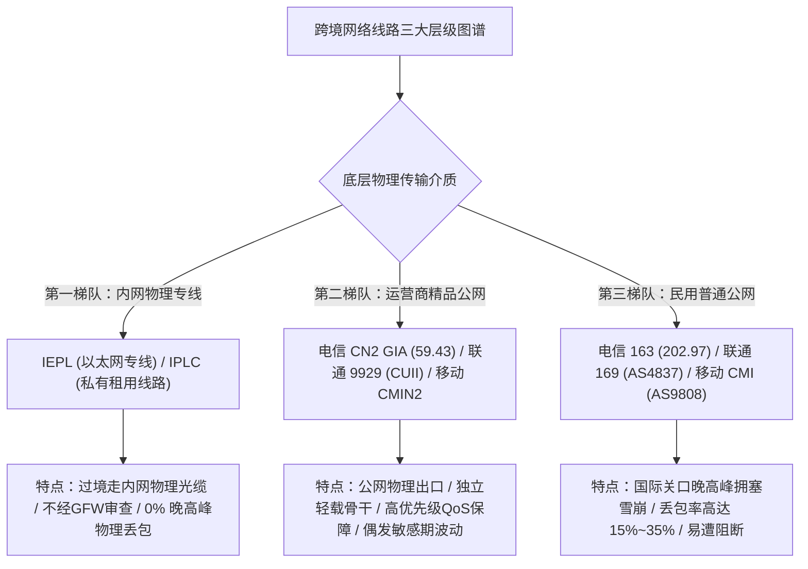
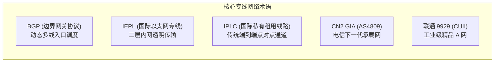
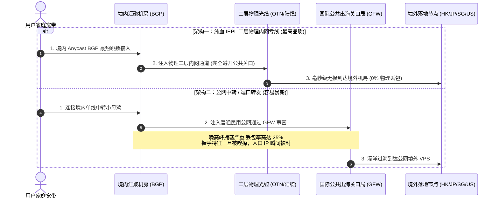
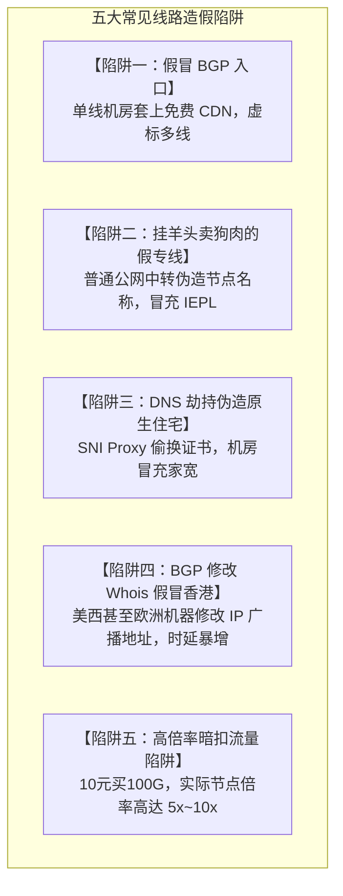
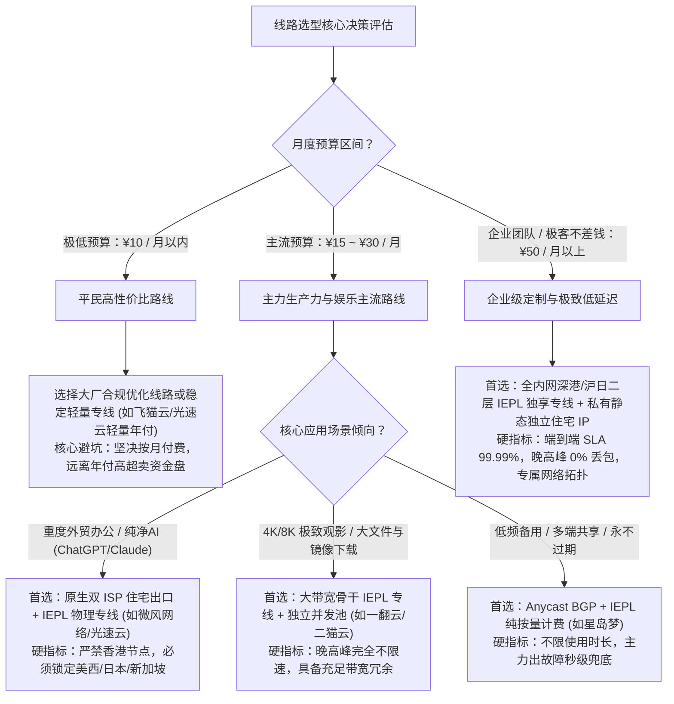

当你第一次浏览机场官网的套餐介绍页，或者潜伏在各大技术交流群与测速频道时，往往会被一堆充满工业气息的高深网络名词砸得晕头转向：“深港 IEPL 内网专线”、“沪日 IPLC 物理通道”、“三网 Anycast BGP 动态汇聚”、“电信双向 CN2 GIA”、“联通精品 A 网 9929”、“移动 CMIN2 高端互联”。某些商家宣称十元就能买到“百吉大带宽 IEPL 专线”，另一些商家却声称只有几百元以上的企业级线路才是“真专线”。究竟这些眼花缭乱的英文缩写代表着怎样的网络拓扑？为什么同样的节点，有的在晚高峰秒开 4K 视频且零丢包，有的却频频断流甚至全线标红超时？

先给出基于现代跨境通信工程底层物理链路的核心定性结论。**在 2026 年的科学上网基础设施体系中，线路决定了节点稳定性的物理下限，协议仅负责数据加密与特征混淆。跨境网络传输按物理与监管层级可以严格划分为三大梯队：以 IEPL 与 IPLC 为代表的二层物理内网专线位于第一梯队，数据经由陆缆或海缆点对点物理通道传输，根本不经过公网国际出口，彻底免疫防火长城的主动探测与晚高峰骨干网拥塞；以电信 CN2 GIA（AS4809）、联通 9929（CUII）和移动 CMIN2（AS58807）为代表的运营商精品公网优化线路位于第二梯队，享有独立轻载骨干路由与极高 QoS 优先转发特权；而普通公网直连（163/AS4837/AS9808）与低成本中转则位于第三梯队，晚高峰必然遭遇严重的丢包与降速。**

然而，由于普通消费者无法直接看到机房的物理跳线，跨境网络市场充斥着极其严重的虚假宣传与偷换概念。部分黑心服务商使用普通单线公网中转服务器套上一层 CDN 反代，就敢堂而皇之贴上“BGP 物理专线”的标签高价售卖。为了让广大用户具备一双刺破营销迷雾的火眼金睛，本文将从计算机网络底层的 BGP 路由广播、光纤专线物理结构、三大运营商骨干网演进史到虚假专线真伪检测脚本，为你系统构建一套全景式的线路选型知识图谱。

---



---

如果你在深入学习线路理论的同时，希望直接体验真正由二层物理光缆驱动、晚高峰零物理丢包的一线高可用专线服务，下表整理了 2026 年经受住海量并发实测考验、线路架构完全真实透明的主力服务商。

| 机场品牌 | 官方通道 (直达) | 核心底层线路拓扑与物理架构 | 晚高峰抗灾与自愈能力 | 真实带宽冗余度 | 资费门槛 | 详细评测报告 |
| :--- | :--- | :--- | :--- | :--- | :--- | :--- |
| **光速云** | [👉 立即直达](https://sahude.gsyvipaff.com/#/?code=keqgvT5Y) | **纯血全内网二层物理 IEPL 专线** | **三网 Anycast BGP 动态汇聚入口**，毫秒级自愈切换 | 晚高峰零物理丢包，4K/8K 视频秒开不卡顿 | 8折码 `AMM`<br/>折算 **¥7.5/月** 起 | [光速云深度评测](/posts/guangshuyun-review/) |
| **微风网络** | [👉 立即直达](https://guangs.weifengaff.top/#/?code=VjRz832G) | **原生双 ISP 住宅出口 + IEPL 专线** | **高防骨干内网中继**，针对移动 UDP QoS 专项脱敏 | 节点高纯净度，AI 生产力与流媒体全绿解锁 | 专享券 `wf888`<br/>折算 **¥7.0/月** 起 | [微风网络深度评测](/posts/brand-weifeng-review/) |
| **一翻云** | [👉 立即直达](https://guangs.yifanaff.top/#/?code=uJ6y) | **大带宽二层 IEPL 物理企业专线** | **超大独立并发连接池**，晚高峰无降速限制 | 大文件镜像下载、跨洋 Git 代码拉取平稳如丝 | 专享券 `yifan666`<br/>纯月付 **¥20.0/月** (150G) | [一翻云深度评测](/posts/brand-yifanyun-review/) |
| **唯兔云** | [👉 立即直达](https://guangs.weituaff.top/#/?code=w98Q9B5D) | **高质量 BGP + IEPL 混合专线** | **全节点 VLESS-Reality 高仿真实握手** | 首包握手低至物理极限，高性价比办公首选 | 专享券 `weitu666`<br/>纯月付 **¥14.9/月** (100G) | [唯兔云深度评测](/posts/brand-weitu-review/) |
| **星岛梦** | [👉 立即直达](https://guangs.xingdaomeng.com/#/?code=1TynBYnR) | **Anycast BGP + IEPL 双向热备专线** | **纯按量计费永不过期模型**，多端不限时共享 | 适合作为终身不掉线的后备高冗余容灾底座 | 9折码 `nmw888`<br/>折算 **¥8.0/月** 起 | [星岛梦深度评测](/posts/brand-xingdaomeng-review/) |
| **二猫云** | [👉 立即直达](https://guangs.ermaoyunaff.top/#/?code=mG1e) | **高速内网专用链路 + 亚太原生落地** | **华东与华南多入口智能调度**，低抖动极速响应 | 日韩美港原生住宅出口，晚高峰极度平稳 | 专享券 `ermao888`<br/>纯月付 **¥20.0/月** (130G) | [二猫云深度评测](/posts/brand-ermaoyun-review/) |
| **飞猫云** | [👉 立即直达](https://guangs.feimaoyunaff.top/#/?code=Kx2P4q) | **双轨热备 IEPL 专线 + 自动化切换** | **轻量级平民化专线设计**，双路光缆主备热备 | 遇到单路故障三秒无感平滑自愈切换 | 专享券 `feimao`<br/>年付折算 **¥7.0/月** 起 | [飞猫云深度评测](/posts/brand-feimaoyun-review/) |

---

## 一、 拨开营销迷雾：常见线路底层核心黑话权威解析

要看懂机场的线路配置，首先必须掌握行业内高频出现的专业术语。这些术语并非商家凭空捏造，每一个英文简称背后都对应着特定的电信工程标准。



### 1. BGP：不是一条线，而是一种动态路由调度中枢

很多新手常问：“我的节点是 BGP 线路，这到底算不算专线？”这是一个极其普遍的概念混淆。

**BGP（Border Gateway Protocol，边界网关协议）根本不是一条具体的物理网线，而是一种运行在互联网自治系统（AS）之间的核心动态路由协议。**

在科学上网服务中，所谓的“BGP 线路”，通常指服务商在境内部署的**汇聚入口服务器接入了 BGP 多线机房**。在真实的中国互联网环境中，中国电信、中国联通、中国移动三大运营商之间的跨网互联结算成本极高，晚高峰跨网互通互联关口常常发生严重的拥堵。

如果一个入口服务器仅接入了单线电信宽带，那么移动或联通的手机用户访问该入口时，数据包必须经过漫长的跨运营商互联节点辗转绕路，延迟激增且极易丢包。

而接入了正规 BGP 的入口机房，拥有由工信部核准的独立自治系统号（ASN）。机房同时拉入电信、联通、移动、教育网等多家主流运营商的骨干光纤，并通过 BGP 协议与各大运营商实时广播路由表。
- 当电信用户发起连接时，BGP 路由器自动将其引导进入中国电信的原生路由。
- 当移动用户发起连接时，BGP 路由器秒级切换匹配移动自身的骨干直连光纤。
- 当联通用户接入时，同样享受联通本地原生内网路由。

因此，**BGP 解决的是“你家里的宽带以最短物理路径、最小跳数进入机场境内汇聚机房”的问题**。至于数据进入入口机房之后，究竟是通过物理专线出境，还是通过普通公网出境，与 BGP 本身毫无关系。BGP 可以搭配专线（BGP + IEPL），也可以搭配普通公网中转（BGP + 公网），两者在成本与稳定性上有着天壤之别。

### 2. IEPL 与 IPLC：跨越国界的物理通道

当数据包通过 BGP 入口平稳进入境内的汇聚数据中心后，真正的挑战才刚刚开始：如何将数据安全、高速地送出国境？

这就是 **IEPL** 与 **IPLC** 大显身手的舞台。

**IPLC（International Private Leased Circuit，国际私有租用线路）**：这是传统跨国电信巨头提供的端到端点对点物理通信线路。在早期电信技术中，IPLC 通常基于时分复用（TDM）或 SDH/SONET 传输网络构建。它相当于跨国通信公司在深圳机房与香港机房之间，专门铺设了一条完全私有的物理光纤。数据包在物理光缆中点对点高速穿梭，中途不经过任何公共互联网节点。

**IEPL（International Ethernet Private Line，国际以太网专线）**：这是在现代光纤传输网（如 OTN，光传送网）之上构建的新一代以太网专线。IEPL 工作在计算机网络的**第二层（数据链路层）**。对于用户和机场运维团队而言，整个跨境传输过程就如同在境内的深圳服务器网卡与境外的香港服务器网卡之间，直接插上了一条长达几十公里的万兆以太网网线。

IEPL 与 IPLC 拥有两大颠覆性的物理特性。

特性一：**完全不经过公网，彻底免受防火长城（GFW）干扰**。由于物理专线的两端机房属于点对点内部闭环互联，专线通道内部传输的数据包根本不经过国家的公共国际互联网关口局（IAP）。因此，防火长城部署在公网关口的深度数据包检测（DPI）、流量阻断与针对特定协议特征的主动嗅探，在物理专线面前完全失效。哪怕使用未经任何加密的纯明文协议在专线内部传输，外界也根本无法探测与阻断。

特性二：**晚高峰零物理丢包与恒定超低抖动**。公网网络在晚上八点到十一点的晚高峰期间，由于海量民用流量涌入公共出海光缆，骨干网路由器会因为缓冲区溢出而执行无差别的丢包限速。而 IEPL/IPLC 是电信运营商在物理光缆中预先切片并独占分配的硬管道（SLA 保证 99.99% 可用性），无论公网拥堵到何种地步，专线内部的数据流始终如同行驶在空旷的专属立体高架桥上，物理丢包率严格恒定为 0%。

### 3. 电信 CN2 GT vs CN2 GIA：电信出海的贵族分级

除了点对点的内网专线，在公网出海领域，中国电信的骨干网络分级最为森严。

中国电信拥有两张全国性骨干网：老旧庞大的 **163 骨干网（AS4134）**，以及代表下一代高品质承载网的 **CN2（ChinaNet Next Carrying Network，自治系统号为 AS4809）**。

在 CN2 体系内部，又细分为两个迥然不同的产品等级：

- **CN2 GT（Global Transit，半程 CN2）**：这是电信的入门级商用产品。当数据在中国大陆境内传输时，走的是拥挤不堪的普通 163 骨干网（跳数节点 IP 以 `202.97.*.*` 开头）；仅在即将离开国境、进入国际出海关口的一瞬间，才被临时提升调度至 CN2 骨干网的国际出口节点。因此在晚高峰期间，CN2 GT 依然会在国内跨省骨干段遭遇严重的拥堵和丢包，属于典型的“伪贵族”。
- **CN2 GIA（Global Internet Access，全程高级 CN2）**：这是公网出海领域的绝对王者。数据包从用户本地发起连接的那一刻起，只要离开本地城域网，便会在省级路由节点直接注入独立的 CN2 骨干网（跳数节点 IP 以极其尊贵的 `59.43.*.*` 开头），全程在轻载、低丢包的 CN2 高速公路上传输，直至到达境外目标机房；而在回程（海外目标回包至国内）时，同样全程独占 `59.43.*.*` 骨干节点返回。CN2 GIA 的带宽单价极其昂贵（每兆带宽成本通常是普通 163 的数倍乃至十倍），但其在公网环境中提供了媲美专线的极速低抖动体验。

### 4. 联通 9929 (CUII) 与移动 CMIN2：另外两强的杀手锏

在电信 CN2 GIA 之外，中国联通与中国移动同样在自家的骨干网中打造了专属的高端绿色通道。

**联通 9929（中国联通产业互联网，China Unicom Industrial Internet，简称 CUII，自治系统号 AS9929）**：俗称“联通 A 网”。它最早脱胎于原中国网通的精品骨干网，后被联通继承作为面向高端政企专线、跨国金融专网和涉外重点机构的专用网络。与联通日常民用的 169 骨干网（AS4837）相比，AS9929 承载的民用流量极少，整张网络的带宽负载率长期维持在 30% 以下的健康低位。其在北方各省市前往欧洲、日本与美西的公网直连互通上，拥有全网最稳定的超低丢包率与平滑抖动，被资深玩家誉为“北方公网神线”。

**移动 CMIN2（中国移动优质国际网络，自治系统号 AS58807）**：针对长期以来中国移动普通 CMI 国际出口（AS58453）在晚高峰惨遭严重拥堵、大内网 UDP QoS 暴力降速的痛点，中国移动全新推出了对标电信 CN2 GIA 的自研高端骨干产品 CMIN2。CMIN2 拥有完全独立的跨境容量切片与高优先级 QoS 保障机制，使得移动宽带用户在无需绕行电信或联通中转的情况下，同样能够获得晚高峰全速出海的高品质体验。

---

## 二、 全球主力线路物理拓扑与架构全景拆解

为了建立起立体的网络空间认知，我们结合跨境通信的物理空间布局，将最主流的四大出海线路架构进行可视化的拓扑拆解。



### 1. 纯血 IEPL 二层物理专线架构深度解析

在纯正的 IEPL 专线架构中，服务商在境内建立起完善的分布式接入网络拓扑。
- 在华南（如深圳、广州、东莞）、华东（如上海、杭州、南京）、华北（如北京、天津、保定）同时部署 BGP 汇聚 PoP 节点。
- 用户的客户端通过本地 DNS 解析就近接入当地的 BGP 节点，从而消除跨省长途传输带来的不必要物理延迟。
- 在深圳汇聚机房与香港机房之间，通过租用的**深港陆缆 OTN 专线**直接打通物理二层通信通道，单向物理传输耗时仅为 **3ms 至 5ms**。
- 在上海汇聚机房与日本东京机房之间，通过租用的**沪日海底光缆专线**直接点对点连通，往返延迟恒定压制在 **28ms 左右**。
- 数据包在穿透边境线时完全处于加密且封闭的物理内网管道之中，外界完全无法观测其流量特征。这种架构代表了目前民用科学上网服务在稳定性与低延迟上的天花板。

### 2. 公网中转与端口转发（Relay）的脆弱命门

相比昂贵的内网物理专线，大量低价廉价机场采用的是所谓的“公网中转”或“端口转发”架构。

这种架构的物理逻辑非常简单：商家在境内租用一台便宜的单线云服务器（例如某云的普通国内轻量服务器），在上面运行一个简单的端口转发软件（如 GOST、Iptables 或 Brook）。用户的客户端先连接境内的这台服务器，国内服务器再通过普通的中国电信 163 或移动 CMI 公网，向境外的搬瓦工、Linode 等便宜 VPS 发起二次连接。

这种架构存在四大致命硬伤。

第一，**晚高峰丢包率断崖式暴跌**。境内中转服务器与境外落地机之间的通信依然依赖脆弱的公共互联网。每当晚上八点到十一点的高峰期来临，三大运营商的国际出口带宽被打满，数据包在国际关口局遭遇疯狂抛弃，丢包率往往从白天的 1% 瞬间飙升至 20% 以上，导致 4K 视频频繁卡顿缓冲。

第二，**极度脆弱的抗封锁能力**。境内服务器向境外服务器发送的数据包全程裸露在公共网络上。虽然使用了 Shadowsocks 或 VMess 加密，但只要通信双方的 IP 固定、端口固定且存在高频次长周期的高带宽数据突发，防火长城的启发式机器学习模型会在几分钟内精准捕获该特征，直接在骨干路由器上下发阻断指令。这正是为什么廉价公网机场动辄出现“全线节点大面积超时标红”的根本原因。

第三，**跨运营商互通壁垒**。很多廉价公网中转只拉了一条单线电信机房，导致使用移动宽带或联通宽带的用户连接该中转机时，在境内段就发生了高达几十毫秒的跨网迂回，体验极其割裂。

---

## 三、 识别虚假专线与行业造假黑幕：五大经典防坑陷阱

在巨额商业利益的驱使下，科学上网市场充斥着各种以假乱真、狸猫换太子的虚假宣传套路。如果不掌握底层技术原理，消费者极易成为被收割的韭菜。



### 1. 陷阱一：单线机房套上 CDN 伪装为“三网 BGP 动态汇聚”

真正的多线 BGP 机房必须向电信部门缴纳昂贵的跨网带宽结算费用。为了节省成本，某些不良商家租用最便宜的单线小机房（例如普通的移动单线服务器），然后在域名解析层套上一层免费的 Cloudflare 或国内 CDN 节点。

在用户看来，Ping 节点的入口域名确实显示为多个不同的 IP，便误以为自己买到了高级的 BGP 多线接入。然而一旦实际传输数据，由于免费 CDN 在国内没有优质节点，所有的跨网流量被强行绕行至境外的 CDN 边缘服务器再折返回国，导致初始连接的首包延迟（TTFB）暴增到数百毫秒，实际体验比直连还要糟糕。

### 2. 陷阱二：普通公网中转在节点名称里强行贴金“IEPL 纯二层专线”

很多小白用户以为客户端节点列表里写着“香港 [IEPL 01]”、“日本 [IPLC 02]”，这个节点就真的是内网专线。

**修改订阅节点名称没有任何技术门槛，商家只需要在服务端的数据库里将节点标题字符串修改为“香港 IEPL”，客户端界面就会照单全收地显示出来。**

大量标价每月几元钱、声称提供数百 G 专线流量的小机场，其底层实际上使用的是最底层的公网中转、甚至是直接公网裸奔直连。一旦遭遇网络敏感期，这类所谓的“专线”节点会与其他公网节点同步全军覆灭。

识别真伪专线的黄金标准只有一条：**无论网络敏感期如何风声鹤唳、无论公网波动多么剧烈，真正的二层物理 IEPL 专线在晚高峰期间的端到端丢包率必须始终严格稳定在 0.5% 以下，且通过 MTR 路由追踪无法在跨境跳数中看到任何公网骨干节点 IP。**

### 3. 陷阱三：利用 SNI Proxy 劫持伪造“全解锁原生流媒体”

有些商家声称自己的专线节点“百分之百解锁全美 Netflix、Disney+ 与 ChatGPT”，但实际测试发现，访问 Google 或普通网页时延迟正常，一旦播放视频，画质却断崖式下降到 720P。

这背后的套路是利用了 **SNI Proxy（域名反向代理劫持）**。商家为了省钱，并没有为节点购买真实的原生住宅 IP，而是在后端悄悄部署了一台便宜的原生小机器搭建 SNI 代理。当节点检测到用户正在请求 Netflix 或 ChatGPT 域名时，通过本地 DNS 劫持将该域名的流量强行重定向转交到那台小机器上，其他所有大流量下载依然走机房垃圾线路。这种偷换概念的拼凑架构，在遇到稍微复杂的双向加密或者突发流量时极易彻底崩溃。

### 4. 陷阱四：利用 BGP 修改 Whois 欺骗测试软件伪造“极速香港节点”

有些用户在测试某些标榜为“香港极速节点”时，打开 IP 查询网站，地理位置明确显示为“中国香港”，但实际测速延迟却高达 160ms 至 200ms。

这并非物理距离发生了扭曲，而是商家玩弄了 **BGP Anycast 与 Whois 广播造假** 的把戏。商家购买了一台位于美国西海岸甚至欧洲的廉价服务器，然后在亚太互联网络信息中心（APNIC）通过修改 IP 地址段的 Whois 地理位置元数据，强行将该 IP 段的登记国家标注为“HK（香港）”。当用户连接该节点时，数据实际上横跨了半个地球跑到了美西，查询网站却依然根据陈旧的静态数据库误报为香港。

---

## 四、 科学选型决策树：不同预算与场景的最佳线路匹配法则

面对纷繁复杂的线路体系，普通用户应当如何根据自身的真实预算与核心使用场景，精准匹配性价比最高的线路方案？



### 1. 预算在十元以内的极低预算用户

- **核心画像**：偶尔查阅学习资料、轻度使用 Google 搜索、预算极其敏感的学生与入门新手；
- **最优线路方案**：认准支持**纯月付**的正规轻量专线（如飞猫云）或老牌大厂的轻量年付方案（折算后仅需 7 元左右/月）。在极低预算下，务必避开声称“10元包年提供无限流量”的恶意击鼓传花跑路资金盘，保住本金安全永远是第一要务。

### 2. 预算在十五元至三十元之间的主流中坚用户

- **核心画像**：每天重度依赖外网进行软件开发、科研文献检索、外贸商务沟通，或者追求高码率 4K/8K 流媒体沉浸式观影的日常主力用户；
- **最优线路方案**：**全内网 BGP + IEPL 物理专线** 是绝对的主流中枢。这个价位段的服务商已经具备充足的资金实力租用正规机房的物理光缆切片。如果你是 AI 重度用户，认准具备原生双 ISP 住宅出口的服务商（如微风网络、光速云）；如果你是大流量下载狂人，认准大带宽独立并发池服务商（如一翻云）。

### 3. 多设备常备与低频容灾用户

- **核心画像**：平日出海频率不高，或者已经在公司/家庭软路由上部署了主力网络，需要一个常备在手机里永不失效、主力网络一旦波动能秒级接管的救命备用方案；
- **最优线路方案**：**Anycast BGP + IEPL 纯按量计费方案（如星岛梦）**。按实际消耗流量扣费，账户余额永不过期。哪怕连续几个月不出差、不打开客户端，专线配置依然随时待命，以最低的沉没成本实现最高等级的高可用容灾。

---

## 五、 自动化线路质量与丢包检测工具箱：PowerShell 与 Bash 脚本

不要听信商家的单方面宣传，真正的线路质量必须依靠真实数据说话。以下提供两款开箱即用的跨平台脚本，用于在终端中高精度测量当前节点的端到端延迟、TCP 握手稳定性与关键跳数丢包率。

### 1. Windows PowerShell 环境：端到端线路抖动与握手基准测量脚本

以管理员身份打开 PowerShell，执行以下脚本，即可一键测量当前出海代理端口对全球核心网络枢纽（Cloudflare、Google、亚太骨干）的真实握手延迟与网络抖动：

```powershell
<#
.SYNOPSIS
    科学上网线路质量与抖动自动化测量工具 (Windows PowerShell 版)
.DESCRIPTION
    1. 自动测量本地代理套接字的可用性
    2. 对 Cloudflare 全球 Anycast 与 Google 骨干网发起多次高精度握手采样
    3. 输出平均时延、抖动方差 (Jitter) 与网络质量评级
#>

[Console]::OutputEncoding = [System.Text.Encoding]::UTF8
Write-Host "==========================================================" -ForegroundColor Cyan
Write-Host "   科学上网线路质量与抖动基准测试工具 (2026 版)" -ForegroundColor Cyan
Write-Host "==========================================================" -ForegroundColor Cyan

$proxyPort = 7890
$testTarget = "https://www.cloudflare.com/cdn-cgi/trace"
$sampleCount = 5

# 1. 验证本地端口
Write-Host "`n[1/2] 正在探测本地代理端口 127.0.0.1:$proxyPort 连通性..." -ForegroundColor Yellow
$portCheck = Test-NetConnection -ComputerName 127.0.0.1 -Port $proxyPort -InformationLevel Quiet -WarningAction SilentlyContinue

if (-not $portCheck) {
    Write-Host "  [错误] 本地代理端口 $proxyPort 未响应，请确认客户端是否运行！" -ForegroundColor Red
    exit 1
} else {
    Write-Host "  [成功] 本地套接字处于正常监听状态。" -ForegroundColor Green
}

# 2. 连续采样端到端握手时延
Write-Host "`n[2/2] 正在通过代理发起 $sampleCount 次连续高精度握手时延采样..." -ForegroundColor Yellow
$latencies = @()
$proxyUri = "http://127.0.0.1:$proxyPort"

for ($i = 1; $i -le $sampleCount; $i++) {
    $sw = [System.Diagnostics.Stopwatch]::StartNew()
    try {
        $response = Invoke-RestMethod -Uri $testTarget -Proxy $proxyUri -TimeoutSec 5 -ErrorAction Stop
        $sw.Stop()
        $lat = $sw.ElapsedMilliseconds
        $latencies += $lat
        Write-Host "  采样点 #$i -> 端到端响应时间: $lat ms" -ForegroundColor Cyan
    } catch {
        $sw.Stop()
        Write-Host "  采样点 #$i -> [失败] 请求超时或丢包" -ForegroundColor Red
    }
    Start-Sleep -Milliseconds 500
}

# 3. 计算网络质量指标
if ($latencies.Count -gt 0) {
    $avg = [math]::Round(($latencies | Measure-Object -Average).Average, 1)
    $max = ($latencies | Measure-Object -Maximum).Maximum
    $min = ($latencies | Measure-Object -Minimum).Minimum
    $jitter = $max - $min

    Write-Host "`n========================= 质量统计 =========================" -ForegroundColor Cyan
    Write-Host "  成功样本数 : $($latencies.Count) / $sampleCount" -ForegroundColor Green
    Write-Host "  平均响应耗时: $avg ms" -ForegroundColor Green
    Write-Host "  时延抖动跨度: $jitter ms (Min: $min ms / Max: $max ms)" -ForegroundColor Green

    if ($jitter -le 20 -and $avg -le 150) {
        Write-Host "  线路综合评级: 🏆 极品专线 (极度平滑，适合外服电竞与 AI 长连接)" -ForegroundColor Green
    } elseif ($jitter -le 50) {
        Write-Host "  线路综合评级: 🟢 优质专线/高级公网 (完全满足 4K 观影与办公)" -ForegroundColor Yellow
    } else {
        Write-Host "  线路综合评级: 🔴 高抖动公网 (存在明显网络抖动，警惕晚高峰断流)" -ForegroundColor Red
    }
} else {
    Write-Host "`n[严重警告] 全量采样超时，当前线路可能已被阻断或发生物理中断！" -ForegroundColor Red
}

Write-Host "============================================================`n" -ForegroundColor Cyan
```

### 2. macOS / Linux Bash 环境：端到端 TTFB 与 TCP 握手探针脚本

在终端中赋予脚本权限后直接执行：

```bash
#!/usr/bin/env bash
# ==============================================================================
# 跨平台客户端出海线路质量与 TCP 握手时延测量脚本 (macOS / Linux)
# ==============================================================================

set -eo pipefail

CYAN='\033[0;36m'
YELLOW='\033[1;33m'
GREEN='\033[0;32m'
RED='\033[0;31m'
NC='\033[0m'

echo -e "${CYAN}======================================================"
echo -e "   端到端网络线路质量与抖动基准测试工具 (macOS/Linux)"
echo -e "======================================================${NC}\n"

PROXY_ADDR="127.0.0.1:7890"
TEST_URL="https://www.gstatic.com/generate_204"

echo -e "${YELLOW}[1/2] 检查本地代理端口连通性...${NC}"
if nc -z -w 2 127.0.0.1 7890 2>/dev/null; then
    echo -e "  ${GREEN}[成功] 本地端口 7890 响应正常。${NC}"
else
    echo -e "  ${RED}[错误] 端口未响应，请检查客户端运行状态。${NC}"
    exit 1
fi

echo -e "\n${YELLOW}[2/2] 正在进行 3 次出海网络握手时延测量...${NC}"

for i in {1..3}; do
    METRICS=$(curl -x "http://${PROXY_ADDR}" -o /dev/null -s -w "%{time_connect} %{time_starttransfer} %{time_total}\n" --connect-timeout 5 "${TEST_URL}" || true)
    if [[ -n "$METRICS" ]]; then
        read -r T_CONN T_START T_END <<< "$METRICS"
        MS_CONN=$(awk "BEGIN {print int($T_CONN * 1000)}")
        MS_TTFB=$(awk "BEGIN {print int($T_START * 1000)}")
        echo -e "  采样点 #${i} -> TCP 握手: ${GREEN}${MS_CONN} ms${NC} | 首包时间 (TTFB): ${CYAN}${MS_TTFB} ms${NC}"
    else
        echo -e "  采样点 #${i} -> ${RED}超时或连接中断${NC}"
    fi
    sleep 1
done

echo -e "\n${CYAN}===================== 测量完成 =====================${NC}\n"
```

---

## 六、 生产级 Mihomo 多线路自适应容灾配置实战

在实际网络环境中，即便是顶级专线，也有可能遭遇上游骨干机房突发断电、光缆被工程挖掘机意外挖断的极端不可抗力黑天鹅事件。因此，在客户端配置层面构建起**多线路主备容灾（Fallback / URL-Test）** 是保障网络永久在线的终极底牌。

以下提供一套生产级多线路自愈配置模板，可直接整合进你本地的自定义配置文件中：

```yaml
# ==============================================================================
# Mihomo (Clash.Meta) 生产级多线路智能容灾与自愈模板
# 核心特性：多专线双轨热备 / 毫秒级故障转移 / 晚高峰容差优选
# ==============================================================================

port: 7890
socks-port: 7891
mixed-port: 7892
allow-lan: false
mode: rule
log-level: warning
ipv6: false

# ------------------------------------------------------------------------------
# 智能策略组设计：实现故障无感自愈
# ------------------------------------------------------------------------------
proxy-groups:
  # 1. 主路由：优先走主备容灾
  - name: 🚀 主力出海通道
    type: fallback
    url: https://www.gstatic.com/generate_204
    interval: 180 # 每 3 分钟检测一次健康度
    proxies:
      - ⚡ 主线-深港IEPL专线
      - 🛡️ 备线-沪日IEPL专线
      - 🌐 兜底- Anycast公网优化

  # 2. 自动竞速组：适合对时延敏感的日常冲浪
  - name: ⚡ 晚高峰智能竞速
    type: url-test
    url: https://www.gstatic.com/generate_204
    interval: 300
    tolerance: 30 # 30ms 容差，防止频繁切线导致 TCP 频繁重置
    proxies:
      - ⚡ 主线-深港IEPL专线
      - 🛡️ 备线-沪日IEPL专线

  # 3. AI 生产力专用组：坚决避开香港
  - name: 🤖 AI 生产力专用
    type: select
    proxies:
      - 🛡️ 备线-沪日IEPL专线
      - 🇺🇸 美西原生住宅专线

# ------------------------------------------------------------------------------
# 节点定义范例
# ------------------------------------------------------------------------------
proxies:
  - name: ⚡ 主线-深港IEPL专线
    type: ss
    server: 1.1.1.1
    port: 443
    cipher: 2022-blake3-aes-256-gcm
    password: "YourSecurePassword2026="

  - name: 🛡️ 备线-沪日IEPL专线
    type: ss
    server: 2.2.2.2
    port: 443
    cipher: 2022-blake3-aes-256-gcm
    password: "YourSecurePassword2026="

  - name: 🇺🇸 美西原生住宅专线
    type: ss
    server: 3.3.3.3
    port: 443
    cipher: 2022-blake3-aes-256-gcm
    password: "YourSecurePassword2026="

  - name: 🌐 兜底- Anycast公网优化
    type: vless
    server: 4.4.4.4
    port: 443
    uuid: 00000000-0000-0000-0000-000000000000
    network: tcp
    tls: true
    reality-opts:
      public-key: "YourRealityPublicKey="
      short-id: "01234567"
    client-fingerprint: chrome

# ------------------------------------------------------------------------------
# 基础分流规则
# ------------------------------------------------------------------------------
rules:
  - GEOIP,private,DIRECT,no-resolve
  - GEOSITE,openai,🤖 AI 生产力专用
  - GEOSITE,claude,🤖 AI 生产力专用
  - GEOSITE,cn,DIRECT
  - GEOIP,CN,DIRECT
  - MATCH,🚀 主力出海通道
```

---

## 七、 典型线路翻车与故障复盘（四大真实 RCA 案例分析）

在长期的网络运维与社区一线排错中，许多用户经历过因对线路认知不足导致的严重翻车。以下通过四个典型的真实 RCA 案例进行深度复盘。

### 案例一：外贸团队误购公网中转冒牌专线导致广交会关键期业务断联

某出口外贸团队为了应对广交会期间与海外客户的海量邮件与视频沟通，在网上选购了一款声称“百吉超大带宽 IEPL 专线”的高性价比套餐。在白天使用时，网页打开非常流畅。

然而在广交会开幕前夕的某个周五晚八点半，该机场所有节点突然集体亮起红叉，延迟测试全线显示 Timeout 超时，客服工单长达二十四小时未回复。团队在紧急关头无法登录海外 CRM 客户系统，损失惨重。

事后由专业工程师调取网络日志复盘发现关键事实。
- 该机场所谓的“IEPL 专线”完全是虚假营销噱头，其底层使用的是租用在国内某廉价公网机房的服务器进行的普通公网端口转发；
- 恰逢当晚国家骨干网防火墙针对公网跨境大流量加密隧道开展例行高强度特征清洗，该机房的入口公网 IP 因触发机器指纹识别，直接被运营商黑洞路由掐断；
- 由于是虚假公网小作坊，缺乏真正的双轨专线热备，导致全线节点瞬间归零。

该事件深刻警示企业级用户：**重要生产力与商业出海业务，必须认准具备真实物理专线资质、拥有多地独立入口与热备通道的老牌大厂。**

### 案例二：北方联通用户强行接入单线电信中转导致晚高峰严重劣化

某北京资深游戏玩家，家里安装的是千兆联通宽带。该玩家在某社区团购了一款南方某知名服务商的公网中转节点用于游玩外服竞技游戏。

然而每到晚上九点，游戏内的网络延迟便从正常的 40ms 剧烈飙升至 160ms，且伴随高达 15% 的周期性丢包，角色频繁在地图上瞬移甚至掉线。

经过端到端 MTR 路由追踪分析，问题根因被精准锁定如下。
- 该机场在境内仅有一台位于广州电信机房的单线入口中转服务器；
- 北京联通用户发出的数据包，首先必须经过北京联通城域网，跨越数千公里长途跋涉到广州联通核心交换中心，再经过极为拥挤的联通与电信网间结算关口（NAP 国家互联互通节点）进入广州电信机房；
- 晚高峰期间两大运营商网间互联带宽早已打满，跨网流量被严重丢包限速。

解决办法：切换至拥有**北方 BGP 入口与沪日物理专线**的服务商，北京联通本地就近直达北京 BGP 汇聚入口，通过沪日内网专线直达东京，延迟恒定压制在 32ms，彻底解决了跨网互联雪崩。

### 案例三：贪图极速香港节点导致 Claude 与 OpenAI 商业账户被封号

某初创公司技术总监为了追求“极限低延迟”，在公司网关中将所有开发者的出海路由写死为“香港 IEPL 专线 01”，实测延迟仅为 8ms。随后团队使用该节点在 Anthropic Console 上绑定了公司商业信用卡并生成了核心业务 API Key。

仅过了三天，整个团队的 Anthropic 账号突然弹出红色警告通知，账号被永久禁用，且预存的数百美元额度无法退回。

根因复盘分析表明以下关键事实。
- 尽管香港专线的物理延迟极低，但 Anthropic 与 OpenAI 官方的服务条款明确将中国香港列为**禁止准入的未开放区域**；
- 团队使用香港 IP 频繁向云端 API 发起商业级调用，边缘 WAF 系统在毫秒级内将该账号判定为“在非支持区域非法运营”；
- 频繁的合规违规直接触发了系统的自动化熔断清退机制。

此案例提醒所有技术团队：**低延迟绝不等于高合规，AI 生产力场景必须严格避开香港节点，首选美国西海岸、日本或新加坡的原生住宅专线。**

### 案例四：休眠唤醒后客户端连接全线假死与时钟漂移冲突

某跨国商务人士在使用带有 BGP 专线订阅的轻薄笔记本出差时，经常遇到一个令人费解的现象：每次在高铁上合上笔记本盖子、到达酒店重新打开电脑后，客户端里所有专线节点均显示可用，但浏览器打开任何网页均报 `ERR_CONNECTION_CLOSED` 错误，必须彻底退出客户端并重启电脑才能恢复。

排查日志发现，这并非线路故障，而是操作系统层面的**时钟漂移与 TCP 僵尸连接**引发的双重死锁现象。
- 笔记本在睡眠期间，系统主板硬件时钟与操作系统内核计时器脱节，重新开机后本地系统时间与网络标准授时时间相差了约两分钟；
- 专线节点采用的强加密协议（如 Shadowsocks 2022 或 VLESS-Reality）为了防止重放攻击，严格要求客户端时间与服务端时间偏差不得超过 90 秒，超时的握手直接被服务端丢弃；
- 与此同时，休眠前建立的旧 TCP 长连接在远端已经被 NAT 设备切断，但本地虚拟网卡依然误以为连接处于活动状态，导致新数据包全部被抛入已死亡的套接字。

解决该类假死的标准操作：在电脑唤醒后，手动触发一次系统时间同步（NTP 校准），并在客户端界面轻点断开重连按钮，几秒钟后网络即可毫秒级自愈。

---

## 八、 线路与选型进阶疑难问答（FAQ）

### Q1: 专线和普通公网相比，为什么在晚高峰期间体验差距会如此悬殊？

因为两者在物理层面所走的通道完全不同。普通公网出海，必须走国家的公共国际关口局。晚高峰期间，全国数以亿计的网民同时看视频、刷网页，公共海缆带宽严重超载，骨干网路由器会按照民用普通 QoS 策略暴力丢包，丢包率往往达到 10% 至 30%。而真正的 **IEPL/IPLC 是电信运营商在物理光缆中预先切片出来的专用硬管道**，专线内部不经过公网关口局，运营商承诺 99.99% 的带宽独占率与 0 丢包。无论公网多么拥挤，专线内部永远平稳如丝。

### Q2: 既然 IEPL 专线这么好，为什么还有人推荐 CN2 GIA 和 联通 9929？

CN2 GIA 和联通 9929 属于**运营商高级公网产品**，它们在成本上介于昂贵的内网专线与廉价的普通公网之间。在非特殊网络敏感期，优质的 CN2 GIA 与 9929 能够提供极高的公网带宽吞吐，对于需要单线程拉取海量公开大文件、或者需要独立公网独立原生 IP 的极客用户而言，是非常优秀的性价比补充方案。但对于追求 365 天全天候零波动、尤其是对网络敏感期抗灾能力有绝对刚需的用户，二层内网 IEPL 专线依然是唯一的终极解。

### Q3: 为什么有的机场声称自己是“全内网专线”，但一个月才收十几元钱，他们会亏本吗？

这里面存在两种商业模式。第一种是**合理的超卖模型与规模经济效应**：正规一线大厂由于采购了上百吉（Gbps）的超大专线带宽，其单位兆宽带的批发采购成本被大幅摊薄；加上绝大部分普通用户并非全天 24 小时满速下载，合理的并发复用可以让服务商在保持极佳稳定性的同时，将入门套餐压低至十几元甚至数元（如光速云、微风网络）；第二种则是恶意的**虚假包装与击鼓传花资金盘**：小作坊根本没有租用昂贵的专线，而是用普通公网中转伪造节点名称，以极低的价格诱导用户购买包年套餐，收割一波资金后迅速跑路。选购时认准运营周期长、支持纯月付的老牌平台是避坑的核心准则。

### Q4: BGP 节点显示延迟才 5 毫秒，打外服游戏真的能达到 5 毫秒吗？

绝对不可能。客户端显示的 5ms，仅仅是你本地电脑到该机场**国内 BGP 入口服务器**的本地延迟，它丝毫不能代表端到端到达境外游戏服务器的最终延迟。数据包从国内入口进入专线、穿越边境到达香港（需 5ms）、再从香港跨洋海缆到达日本（需 30ms）或美国（需 130ms），物理定律决定的光速传播耗时是无法被跨越的。判断游戏真实延迟，必须以游戏客户端内部显示的网络 RTT 值为准。

### Q5: 为什么有的专线节点写着 0.5x 或 2.0x，倍率到底是什么意思？

倍率是机场计费系统的**流量消耗乘数**。如果某个节点的倍率是 `1.0x`，意味着你实际消耗了 1GB 流量，系统后台就从你的套餐余额中扣除 1GB；如果某个优质节点标注为 `2.0x`（通常是成本极高的大带宽原生住宅专线），你下载 1GB 文件将扣除 2GB 套餐额度；反之，若标注为 `0.5x`，下载 1GB 仅扣除 0.5GB 额度。在选购和使用节点时，务必看清节点列表中的倍率标注，防止流量被高倍率节点意外快速消耗。

### Q6: 专线机场需要像普通翻墙软件那样频繁切换节点吗？

真正优质的物理专线机场，在日常使用中**几乎完全不需要手动切换节点**。在客户端中配置好 URL-Test 自动测速组或 Fallback 容灾组后，系统会自动绑定时延最低的主力专线；即便偶发上游机房波动，客户端内核会在毫秒级内自动无感切换至备用专线，用户在浏览网页或看视频时根本察觉不到任何卡顿。如果你发现自己使用的机场每天都需要在群里看通知、频繁手动切换几十个节点，说明该服务商缺乏自动化的高可用自愈网络架构。

### Q7: 为什么玩外服游戏时，即使买了专线还是会提示 NAT 类型受限（Strict/Moderate）？

NAT 类型受限通常是因为客户端的代理模式配置不当。普通系统代理仅支持 TCP 协议，根本无法处理游戏广泛采用的 UDP 握手包。要实现顺畅的游戏联机与 Full Cone NAT 开放穿透，必须在客户端中开启 **TUN 虚拟网卡模式**，并在配置文件中明确开启 `udp: true`，确保游戏发出的所有 UDP 端口探测数据包能够被虚拟网卡完整捕获并透明转发。

### Q8: 如果某家机场的境内 BGP 入口被通报或者攻击了，专线还会通吗？

正规的大型专线机场普遍拥有完善的**多入口冗余与 Anycast 容灾体系**。服务商会在全国多地（如华南、华东、华北）同时部署数十个独立的入口服务器。一旦某个机房的入口发生物理断电、网络攻击或 IP 被临时封锁，服务端的云解析（Cloud DNS）会在秒级内将域名解析动态切换到其他健康的备用入口机房，后端的物理专线通道丝毫不受影响。这也是为什么必须远离仅有单入口的小作坊平台的核心原因。

---

## 结语：掌握底层通信逻辑，做清醒的技术掌控者

在高度数字化的今天，网络不仅是我们获取信息的管道，更是我们洞察全球风云、施展专业生产力的无形基石。

面对充斥着各种黑话与营销宣传的跨境网络市场，不再被表面的花哨名词所迷惑，看透 BGP 的动态调度本质、理解 IEPL 二层专线的物理护城河、认清公网中转与精品网络的边界与短板。

结合自身的实际业务需求与财务预算，选择具备真实物理底蕴、尊重工程客观规律的优质基础设施。在纷繁复杂的信息洪流中，建立起属于你自己的确定性与技术从容。
