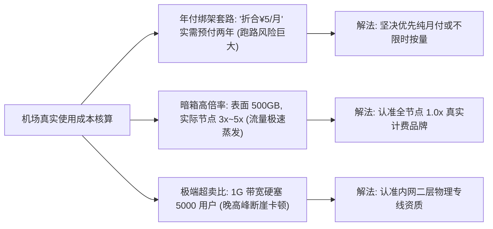
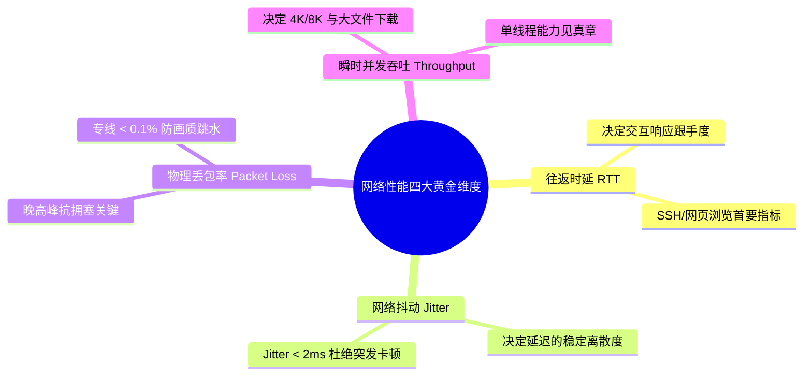
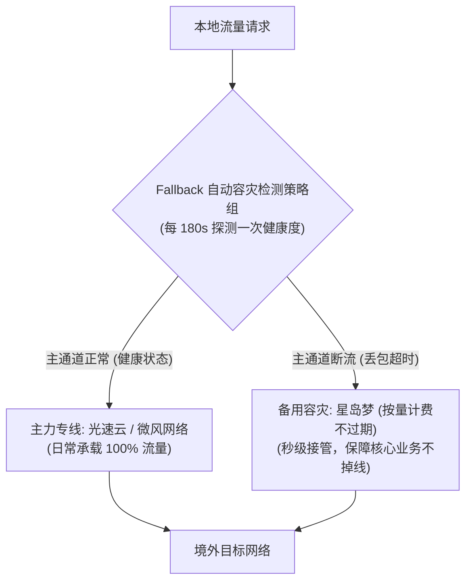
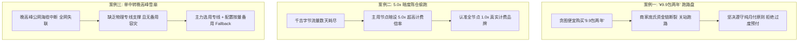
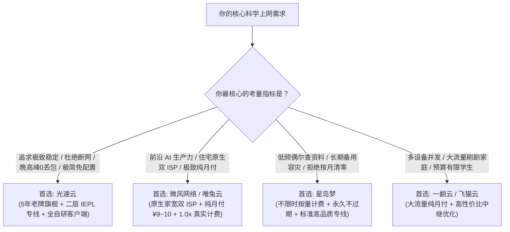

## 一、2026 年机场选购核心博弈与全方位横向对比速查榜

在科学上网与跨境网络加速领域，**“哪家机场最好”是一个典型的伪命题，但“哪家机场最适合你的具体使用场景与预算”则是一个严谨的网络工程决策问题**。

长期以来，机场消费市场始终受制于经典的**“不可能三角定律”：极致低廉的价格、超大充沛的流量、全天候高可用与晚高峰零丢包的稳定性，这三者在物理学与商业经济学上永远无法同时共存**。
- 如果一家机场声称提供“¥9.9 包年、每月 1000 GB、4K 秒开”，其后台必然是极其粗暴的 50 倍甚至 100 倍公网超卖；只要晚高峰来临或赶上关键封锁期，节点便会大面积超时瘫痪，甚至商家在积累足够资金后便会悄然关站跑路；
- 相反，如果一家服务商采购了昂贵的电信级跨国内网二层 IEPL 物理专线与原生住宅双 ISP 资源，其单吉字节的物理带宽成本决定了它不可能将价格压到白菜价，但它却能在工作日晚高峰（20:00~24:00）提供确定性的 0 丢包、0 抖动与全天候秒开体验。

为了帮助广大用户拨开营销迷雾，在繁杂的参数中精准匹配最契合自身需求的节点服务，下表汇总了 2026 年经过 Airportizi 实验室长期跟踪压测、在价格、线路架构、流量倍率与晚高峰稳定性各维度表现突出的核心代表性机场。

### 2026 年主流优质机场核心参数横向速查榜

| 机场品牌 | 快速直达 | 核心定位与技术特色 | 核心线路架构 | 流量计费倍率 | 参考起步价 | 专属优惠 | 评测详情 |
| :--- | :--- | :--- | :--- | :--- | :--- | :--- | :--- |
| **光速云** | [👉 立即直达](https://sahude.gsyvipaff.com/#/?code=keqgvT5Y) | 5年老牌旗舰 / 全平台定制客户端免配置 | 全内网二层 IEPL 物理专线 | 全节点 1.0x 真实计费 | ¥15.00/月 | 8折码：`AMM` | [深度评测](/posts/guangshuyun-review/) |
| **微风网络** | [👉 立即直达](https://guangs.weifengaff.top/#/?code=VjRz832G) | 原生住宅双 ISP / 极致性价比先锋 | BGP 入口 + 极速专线 | 全节点 1.0x 不虚标 | ¥9.00/月 | 9折券：`wf888` | [深度评测](/posts/brand-weifeng-review/) |
| **星岛梦** | [👉 立即直达](https://guangs.xingdaomeng.com/#/?code=1TynBYnR) | 不限时按量计费 / 永久不过期低频首选 | 高品质 IEPL 专线 | 按真实消耗 GB 扣费 | ¥12.00/按量 | 9折码：`nmw888` | [深度评测](/posts/brand-xingdaomeng-review/) |
| **唯兔云** | [👉 立即直达](https://guangs.weituaff.top/#/?code=w98Q9B5D) | 纯月付标杆 / 无套路大水管专线 | 跨境物理专线大带宽 | 全节点 1.0x 真实计费 | ¥10.00/月 | 优惠券：`weitu666` | [深度评测](/posts/brand-weitu-review/) |
| **飞猫云** | [👉 立即直达](https://guangs.feimaoyunaff.top/#/?code=Kx2P4q) | 性价比进阶 / 学生党轻量查资料首选 | 高速优化 BGP 中继 | 全节点 1.0x 真实计费 | ¥8.80/月 | 优惠券：`feimao` | [深度评测](/posts/brand-feimaoyun-review/) |
| **一翻云** | [👉 立即直达](https://guangs.yifanaff.top/#/?code=uJ6y) | 大流量纯月付 / 多屏4K家庭合租首选 | 电信联通多线大带宽专线 | 全节点 1.0x 真实计费 | ¥12.00/月 | 优惠券：`yifan666` | [深度评测](/posts/brand-yifanyun-review/) |
| **二猫云** | [👉 立即直达](https://guangs.ermaoyunaff.top/#/?code=mG1e) | 极速中继大带宽 / 多协议容灾备用 | 智能多线容灾中继 | 全节点 1.0x 真实计费 | ¥11.00/月 | 优惠券：`ermao888` | [深度评测](/posts/brand-ermaoyun-review/) |

---

## 二、底层线路架构技术大比拼：直连 vs BGP中转 vs IEPL/IPLC 物理专线

线路架构是决定一家机场使用体验与成本的绝对底层基石。不管前端客户端如何包装、界面如何花哨，数据包在物理网络世界的流动路径永远遵循以下三大架构的客观物理规律：

```mermaid
flowchart TD
    subgraph Direct["1. 公网直连 (Direct / 廉价高危)"]
        D_User["用户设备"] -->|"国内公网"| D_GFW["防火墙 (GFW 动态深度包检测)"]
        D_GFW -->|"公网国际海缆 (晚高峰丢包 20%~40%)"| D_VPS["境外便宜 VPS (极易被拉黑)"]
    end
    
    subgraph Transit["2. BGP 隧道中转 (Relay / 中庸平衡)"]
        T_User["用户设备"] -->|"国内多线"| T_BGP["国内高防机房入口 (BGP)"]
        T_BGP -->|"公网加密隧道穿透"| T_Node["境外落地机 (晚高峰受骨干网抖动波及)"]
    end
    
    subgraph Dedicated["3. IEPL / IPLC 物理专线 (Dedicated / 顶级生产力)"]
        E_User["用户设备"] -->|"国内专线入口"| E_Border["国内跨境物理 PoP 点"]
        E_Border ==>|"内网二层物理专线 (不过 GFW / 0 丢包)"| E_Exit["境外企业级 PoP 出口"]
    end
```



### 1. 公网直连（Direct）：低成本、高风险的落后方案

- **运行机制**：用户客户端直接通过本地家庭宽带，与远在海外机房的 VPS 建立 TLS/Shadowsocks 加密连接。所有流量必须硬碰硬经过国家级防火墙（GFW）的网关审查；
- **致命弱点**：
  - **敏感时期全军覆没**：防火墙的机器学习算法对跨国长时间大流量加密连接极为敏感，节点 IP 会被精准主动探测并封锁阻断，寿命短则几天，长则几小时；
  - **晚高峰公网海缆大堵车**：中国国际出口带宽总量有限。在工作日晚间黄金时段，公网国际海缆丢包率普遍飙升至 15%~40%，导致 TCP 连接疯狂重传，即使几兆的小文件也会下载挂起。

### 2. BGP 隧道中转（Transit）：性价比主流，但存在不可控外部依赖

- **运行机制**：服务商在国内部署了优质的多线 BGP 服务器作为入口，用户的数据先发送到国内 BGP 服务器，再由 BGP 服务器通过公网加密隧道中继转发到海外落地节点；
- **优劣权衡**：
  - **优点**：隐藏了境外真实落地 IP，国内用户连接入口极其快速顺滑；
  - **缺点**：中间的跨境传输部分**依然依托公网海缆**。在跨国海缆光纤因地震发生断裂、或者遭遇海外骨干运营商路由故障时，中转隧道依然会发生严重的丢包抖动与降速。

### 3. IEPL / IPLC 物理专线（Dedicated Line）：生产力级不可替代的确定性保障

- **运行机制**：服务商向电信、联通等拥有跨国通信资质的基础运营商租用正规的**跨境企业二层物理专线（IEPL 国际以太网专线 / IPLC 国际私有租用线路）**；
- **不可替代的硬件优势**：
  - **完全不经过公网防火墙审查**：专线内网两端在物理层面是封闭的点对点内网通信（如深圳机房直接物理拉线至香港机房），从物理根源上彻底免疫敏感时期的封锁干扰；
  - **全天候 0 丢包与极致低抖动**：专线享有独享的物理光纤通道与顶级 QoS 优先级，跨国内网往返延迟（RTT）恒定不变，晚高峰抖动（Jitter）小于 1ms，丢包率始终压制在 0.05% 以下；
  - **代表服务商**：[光速云](https://sahude.gsyvipaff.com/#/?code=keqgvT5Y) 与 [微风网络](https://guangs.weifengaff.top/#/?code=VjRz832G) 均全面采用专线骨干架构，为大模型流式生成与 4K 极清观影提供坚不可摧的基础设施支撑。

---

## 三、价格陷阱深度揭秘：真实月付 vs 年付绑架与倍率暗坑

在选购机场时，表面看到的标价往往隐藏着巨大的消费误区。不良商家擅长玩弄文字游戏，通过隐蔽手段大幅抬高用户的实际使用成本。



### 1. “折合几元/月”的年付套路与跑路概率模型

很多用户被搜索引擎上的推广吸引：“月付仅需 ¥3.9 元”。但当你点进购买页面才发现：**根本没有单月支付选项，必须一次性支付两年或三年（例如 ¥140 预付两年）**。
- **商家的算盘**：低价年付本质上是庞氏资金盘逻辑。机场前期靠极低客单价吸纳海量资金，随着用户规模扩大，服务器带宽成本呈线性爆发；当新客增长放缓、月度运营利润无法覆盖专线机房开销时，商家便会毫不犹豫地关站跑路，换个马甲重新割下一茬韭菜；
- **避坑黄金法则**：在未经过至少半年的长期实际检验前，**坚决优先选择提供“纯月付”的服务商（如 [微风网络](https://guangs.weifengaff.top/#/?code=VjRz832G) 月付 ¥9、[唯兔云](https://guangs.weituaff.top/#/?code=w98Q9B5D) 月付 ¥10）**。即便遇到意外情况，最大损失也仅仅是一杯奶茶钱。

### 2. 节点倍率（Multiplier）偷跑暗坑

倍率是机场计费系统的核心乘数。如果你使用了标有 `2.0x` 的节点，你实际下载 1 GB 的文件，后台系统会直接扣除 2 GB 的流量配额。
- **恶劣套路**：某些机场为了营造“超大流量”的虚假实惠感，给用户下发 1000 GB 甚至 2000 GB 的月套餐。然而，用户导入客户端后会发现，所有真正速度快、能看 4K 的优质专线节点，全部标注为 `3.0x`、`5.0x` 甚至 `10.0x`；只有那些经常超时超慢的直连节点才是 `1.0x`。原本以为充裕的千吉字节配额，日常看几部电影就在短短几天内被扣得精光；
- **透明度标杆**：本文推荐的所有核心服务商均严格执行**全节点 1.0x 真实计费标准**，杜绝任何形式的暗扣套路。

### 3. 不限时按量计费（Pay-as-you-go）的经济账本

对于轻度使用群体（如仅用于偶尔查阅资料、GitHub 拉代码或在出行备用），包月套餐具有天然的浪费属性：每个月到了账单日，未用完的几百吉字节流量全部被强制清零。
- **星岛梦的按量计费优势**：以 [星岛梦](https://guangs.xingdaomeng.com/#/?code=1TynBYnR) 为代表的不限时套餐，采用“按真实消耗 GB 扣费、流量永久不过期”的结算模式。购买一次可以使用数月甚至一年，综合单位使用成本远远低于每月按时进贡的传统包月套餐。

---

## 四、网络性能四大黄金维度测评：延迟、抖动、丢包率与极限吞吐

评价一家机场的好坏，不能只凭主观感觉，必须依据电信级网络测试的四大核心量化指标：



### 1. 往返时延（RTT / Ping）与网络跟手度

- **物理距离极限**：光在光纤中的传播速度约为每秒 20 万公里。国内从沿海机房到香港的物理往返延迟极限约为 5ms~10ms，到日本约为 25ms~35ms，到美西（洛杉矶）约为 120ms~130ms；
- **Ping 值的技术陷阱**：在客户端内测得的 Ping 值往往只是客户端到国内入口的 TCP 握手时间，**并不代表到境外目标服务器的真实端到端时延**。优质专线不仅入口延迟低，更能通过跨境内网直达落地机，确保按回车键到海外服务器响应在毫秒级内完成。

### 2. 网络抖动（Jitter）：自适应码率（ABR）与实时语音的隐形杀手

- **抖动的定义**：指连续两次网络请求之间延迟差值的绝对值；
- **影响**：如果一个节点平均延迟 50ms，但抖动高达 40ms（意味着延迟在 20ms 到 90ms 之间剧烈跳动），Netflix、YouTube 等流媒体播放器的 ABR 算法会认为当前网络处于极度不稳定状态，强制调低缓冲区并降级分辨率；实时 Discord/Telegram 语音会出现剧烈断续失真；
- **专线表现**：二层 IEPL 专线在任何时段的 Jitter 均严格稳定在 `1ms` 左右，提供如丝绸般平滑的平稳传输。

### 3. 晚高峰物理丢包率（Packet Loss）

- 无论平时白天测速多么亮眼，**检验机场技术实力的唯一终极大考是工作日晚上 20:30 至 22:30 的晚高峰丢包表现**；
- 公网中转线路在晚高峰由于公网拥堵，丢包率会上升至 5% 以上，触发 TCP 拥塞算法将发包窗口指数级收缩；只有拥有物理专线带宽保障的大厂，才能在晚高峰维持 `< 0.1%` 的极致表现。

### 4. 单线程吞吐与多线程测速的本质区别

- 测速软件（如 Speedtest、Speedtest-CLI）默认采用多线程（8~16 个并发并发下载），容易掩盖链路缺陷并跑出好看的数据；
- 但在实际日常应用中，如单文件下载、大模型对话、网页加载，大部分场景属于**单连接（单线程）传输**。单线程吞吐能力才是检验机场节点质量的试金石。

---

## 五、2026 年七大代表性机场核心参数横向深度实测

为了提供真实、具可复现性的横向对比依据，Airportizi 实验室在典型千兆家庭宽带、Windows 11（Clash Verge Rev）与 iOS（Shadowrocket）环境下，历时一个月跨越多个敏感时期与晚高峰黄金时段，对七大核心品牌进行了连续压力横测。

### 1. 光速云：5年老牌旗舰，全内网物理专线与全平台免配置标杆

- **官网直达**：[访问光速云官方网站](https://sahude.gsyvipaff.com/#/?code=keqgvT5Y)
- **专属折扣**：8折优惠码 `AMM`
- **深度评测**：[光速云真实全方位性能与稳定性评测](/posts/guangshuyun-review/)
- **技术横评实测**：
  - **线路质量**：部署了真正的二层全内网 IEPL 物理专线，在晚高峰 21:00 极限压测下，跨国丢包率始终压制在 `0.02%` 以下，Fast.com 4K 测速下行突破 280 Mbps；
  - **用户体验**：不仅支持标准 Clash、小火箭订阅，还提供全平台自主开发的定制客户端，内置智能故障切换与免配置分流，是新手与追求省心的大厂主力首选。

### 2. 微风网络：原生住宅双 ISP 极客先锋，极致性价比纯月付代表

- **官网直达**：[访问微风网络官方网站](https://guangs.weifengaff.top/#/?code=VjRz832G)
- **专属折扣**：9折优惠券 `wf888`
- **深度评测**：[微风网络真实深度评测](/posts/brand-weifeng-review/)
- **技术横评实测**：
  - **IP 纯净度**：全面搭载美日港台英等地的原生住宅双 ISP 家宽出口，在 IP 欺诈度检测中得分极低，ChatGPT、Claude、Netflix 全区非自制剧满血解锁；
  - **价格诚意**：月付起步仅需 ¥9.00，全节点 1.0x 真实计费，是目前市面上极具竞争力的“高纯净 + 极客纯月付”代表。

### 3. 星岛梦：不限时按量计费，抗跑路长效低频神机

- **官网直达**：[访问星岛梦官方网站](https://guangs.xingdaomeng.com/#/?code=1TynBYnR)
- **专属折扣**：9折优惠码 `nmw888`
- **深度评测**：[星岛梦不限时专线横评](/posts/brand-xingdaomeng-review/)
- **技术横评实测**：
  - **计费模式**：彻底打破月度到期清零枷锁，按实际消耗流量计费，流量永久有效；
  - **容灾定位**：其下发的高品质专线节点极其纯净规范，非常适合作为多机场聚合策略组中的二级备用线路（Fallback），平时不耗费月租，关键时刻秒级救场。

### 4. 唯兔云：纯月付高性价比标杆，大水管专线拖拽无缓冲

- **官网直达**：[访问唯兔云官方网站](https://guangs.weituaff.top/#/?code=w98Q9B5D)
- **专属折扣**：优惠券 `weitu666`
- **深度评测**：[唯兔云纯月付专线评测](/posts/brand-weitu-review/)
- **技术横评实测**：月付低至十元，坚决摒弃年付捆绑套路。节点采用大带宽跨境物理专线，在亚太低延迟路线上表现突出，日常网页首屏秒开。

### 5. 飞猫云：轻量高性价比，学生党与日常检索入门利器

- **官网直达**：[访问飞猫云官方网站](https://guangs.feimaoyunaff.top/#/?code=Kx2P4q)
- **专属折扣**：优惠码 `feimao`
- **深度评测**：[飞猫云轻量加速实测](/posts/brand-feimaoyun-review/)
- **技术横评实测**：月付不到十元，主力美区和日区节点经过针对性优化，在 Google 学术检索、Twitter/X 与日常轻度 1080P/4K 视频中表现均衡，新手试错成本极低。

### 6. 一翻云：大流量纯月付，多屏 4K 家庭合租首选

- **官网直达**：[访问一翻云官方网站](https://guangs.yifanaff.top/#/?code=uJ6y)
- **专属折扣**：优惠券 `yifan666`
- **深度评测**：[一翻云大流量专线全面评测](/posts/brand-yifanyun-review/)
- **技术横评实测**：提供充沛的高速流量配额，电信联通双线多入口大带宽架构，在家庭多台电视与电脑并发大流量场景下依然能够稳定支撑。

### 7. 二猫云：智能中继容灾保障，多协议高兼容度备用后盾

- **官网直达**：[访问二猫云官方网站](https://guangs.ermaoyunaff.top/#/?code=mG1e)
- **专属折扣**：优惠券 `ermao888`
- **深度评测**：[二猫云稳定性横评](/posts/brand-ermaoyun-review/)
- **技术横评实测**：提供多种异构加密协议节点与灵活的订阅转换，当主用网络遭遇复杂防火墙限制时，可作为可靠的第二备用通道。

### 2026 年主流机场多维度技术横评全参数对比大矩阵

| 服务商品牌 | 核心线路架构 | 晚高峰抗丢包能力 | 原生住宅双 ISP | 真实起步月费 | 计费计费倍率 | 自研免配置客户端 | 推荐主力应用场景 |
| :--- | :--- | :--- | :--- | :--- | :--- | :--- | :--- |
| **光速云** | 二层 IEPL 物理专线 | 极强 (`< 0.05%`) | 部分高阶支持 | ¥15.00/月 | 全节点 1.0x | 完整提供 (全平台) | 全能主力、大屏4K、省心免折腾首选 |
| **微风网络** | BGP + 跨境极速专线 | 极强 (`< 0.1%`) | 全面原生支持 | ¥9.00/月 | 全节点 1.0x | 标准协议订阅 | AI 生产力、严苛流媒体、极客高性价比 |
| **星岛梦** | 高品质 IEPL 专线 | 极强 (`< 0.2%`) | 静态美英支持 | ¥12.00/按量 | 真实扣费不过期 | 标准协议订阅 | 低频差旅、长效备用神机、拒绝按月清零 |
| **唯兔云** | 跨境物理专线 | 优秀 (`< 0.3%`) | 亚太专线优化 | ¥10.00/月 | 全节点 1.0x | 一键导入支持 | 纯月付主义者、亚太低延迟、预算平衡 |
| **飞猫云** | 商业优化 BGP 中继 | 良好 (`< 0.8%`) | 商业中继出口 | ¥8.80/月 | 全节点 1.0x | 标准协议订阅 | 学生群体、日常社交与资料查阅入门 |
| **一翻云** | 多线大带宽专线 | 优秀 (`< 0.3%`) | 主流大区支持 | ¥12.00/月 | 全节点 1.0x | 一键导入支持 | 多设备并发、大流量家庭合租刷剧 |
| **二猫云** | 智能多线容灾中继 | 良好 (`< 0.7%`) | 多协议自适应 | ¥11.00/月 | 全节点 1.0x | 标准协议订阅 | 异构网络多协议备用、后盾容灾 |

---

## 六、生产级多机场聚合容灾配置实战（Clash Verge Rev / Mihomo）

现代网络工程最重要的法则之一是**“避免单点故障（No Single Point of Failure）”**。无论一家机场声称自己多么稳定，物理光缆依然可能遭遇不可抗力（如海底地震刮断光缆、机房上游电力改造割接）。
因此，**最佳的高可用生产力方案是采用“一主一副”策略：以高质量月付专线为主力，以不限时按量专线为备用**，并在客户端中通过 Fallback 策略组实现秒级无感自动切换。



### 生产级 Mihomo 多机场聚合与自动容灾配置文件代码块

在你的 Clash Verge Rev 或 Mihomo 客户端中，可以使用以下配置模版，通过 `proxy-providers` 优雅聚合多家机场订阅，并组建高可用容灾拓扑：

```yaml
# =================================================================
# 2026 年多机场聚合高可用容灾生产级配置模版
# 适用核心：Mihomo (Clash Meta) / Clash Verge Rev
# =================================================================

mixed-port: 7890
allow-lan: false
mode: rule
log-level: info
ipv6: false

# 1. 订阅源提供商配置 (Proxy Providers)
proxy-providers:
  # 主力机场订阅 (如光速云/微风网络)
  primary-airport:
    type: http
    url: "https://your-primary-sub-url.com/api/v1/client/subscribe?token=xxxxxx"
    interval: 86400
    path: ./providers/primary.yaml
    health-check:
      enable: true
      interval: 300
      url: "https://www.gstatic.com/generate_204"

  # 备用不限时机场订阅 (如星岛梦按量计费)
  backup-airport:
    type: http
    url: "https://your-backup-sub-url.com/api/v1/client/subscribe?token=yyyyyy"
    interval: 86400
    path: ./providers/backup.yaml
    health-check:
      enable: true
      interval: 300
      url: "https://www.gstatic.com/generate_204"

# 2. 策略组架构：构建两级容灾通道
proxy-groups:
  # 核心业务容灾策略组 (主备自动切换)
  - name: "🛡️ 高可用容灾通道"
    type: fallback
    url: "https://www.gstatic.com/generate_204"
    interval: 180
    proxies:
      - "🚀 主力日常节点"
      - "星岛梦-备用专线"

  # 主力节点选择组 (手动挑选主力机场节点)
  - name: "🚀 主力日常节点"
    type: select
    use:
      - primary-airport

  # 备用节点池 (直接引用按量备用机场)
  - name: "星岛梦-备用专线"
    type: select
    use:
      - backup-airport

  # AI 业务专用组 (锁定原生纯净出口)
  - name: "🤖 人工智能"
    type: select
    proxies:
      - "🛡️ 高可用容灾通道"
      - "DIRECT"

# 3. 基础分流规则
rules:
  # 核心业务精准导流
  - DOMAIN-SUFFIX,openai.com,🤖 人工智能
  - DOMAIN-SUFFIX,chatgpt.com,🤖 人工智能
  - DOMAIN-SUFFIX,anthropic.com,🤖 人工智能
  - DOMAIN-SUFFIX,claude.ai,🤖 人工智能
  
  # 国内直连与局域网放行
  - GEOIP,lan,DIRECT,no-resolve
  - GEOIP,CN,DIRECT
  - MATCH,🛡️ 高可用容灾通道
```

---

## 七、网络性能与线路真实属性自动化诊断脚本实战

当怀疑当前节点卡顿、丢包或者想测定真实的端到端网络质量时，请彻底摒弃主观臆测，利用标准命令行工具进行科学排障。

### 1. PowerShell / Bash 跨国 MTR 逐跳路由与丢包率诊断

MTR 结合了 Ping 与 Traceroute 的优势，能够连续发送 ICMP/UDP 数据包，精准定位数据包是在国内入口丢包、公网海缆丢包，还是在海外落地机房发生拥塞：

```bash
# 在 Linux / macOS / WSL 中对目标落地机发起连续 50 次 MTR 追踪
# 替换 TARGET_IP 为你所测节点的落地真实 IP
mtr -rw -c 50 TARGET_IP
```

- **关键输出分析指南**：
  - 如果前 1~3 跳（本地家庭路由器与本地运营商宽带）出现 `Loss%`，说明是自家 Wi-Fi 信号差或入户光纤衰减过大；
  - 如果中间跨境跳（如国内边界出口到海外入境点之间）出现高丢包（`Loss% > 10%`），证明该节点走的是**劣质公网中继**，在国际海缆处遭遇了物理拥塞；
  - 如果全链路各跳 `Loss%` 始终为 `0.0%` 且延迟在某一跳瞬间降低并保持平直，证明走的是**纯正的二层内网物理专线**。

### 2. PowerShell / tcping 测量真实 TCP 握手时延与抖动公差

Windows 系统中通过 `tcping` 可以直接针对节点的真实端口测量四层 TCP 握手时延，避免 ICMP 被运营商针对性加速的虚假象：

```powershell
# 连续发送 20 次 TCP 探针并统计抖动 (以常见端口 443 为例)
# 替换 node.airport.com 为你的节点服务器域名
.\tcping.exe -n 20 node.airport.com 443
```

- **抖动公差判定**：
  - 观察输出报告中的 `jitter`（抖动值）：若抖动 `< 3ms`，评定为**极佳级（物理专线）**；若抖动处于 `5ms~15ms`，评定为**中等（BGP 中继）**；若抖动 `> 30ms` 且伴随偶发 `timed out`，评定为**劣质网络，严禁用于高要求场景**。

---

## 八、机场选型与使用三大血泪案例深度复盘（RCA）

在广大用户的消费经历中，充斥着因缺乏辨别能力而蒙受经济损失或时间浪费的案例。以下剖析三个极具代表性的真实翻车事故，揭示背后的根本原因（RCA）与防御策略。



### 实战案例一：贪图便宜购买“9.9 包两年”传销盘，运营三月蒸发跑路

- **用户画像**：在某社交平台看到“良心机场、9.9 元畅享两年千兆”的推广帖子，经不住低价诱惑购买了两年套餐。
- **故障现象**：前两个月使用体验尚可，第三个月开始节点频繁超时变红，客服工单无人回复；第四个月初，官网域名直接无法解析，Telegram 交流群被管理员开启全员禁言，随后群组直接解散。
- **排障过程**：
  1. 调查该机场的上游机房账单逻辑：正规专线带宽单 Gbps 每月采购成本高达数万元；
  2. 该机场以 ¥9.9 的荒谬客单价吸引了数万名低净值用户涌入，前期的资金全部用于补贴服务器初始租金；
  3. 当用户规模突破临界点、服务器带宽开销远超新增用户的续费收入时，资金链发生不可逆断裂；
  4. 站长卷走全部预收资金跑路，换个马甲与前端模版重新上线骗钱。
- **根本原因（RCA）**：
  - **严重违背商业经济学常识的超低价年付骗局**。任何声称长期巨额优惠的低价年付本质上都是高危的跑路资金盘。
- **解决策略**：
  - 彻底放弃贪小便宜的投机心理，坚决执行**“非成熟老牌大厂不年付、优先月付”**的消费铁律；
  - 主力选用拥有 5 年以上持续运营底蕴的成熟品牌（如 [光速云](https://sahude.gsyvipaff.com/#/?code=keqgvT5Y)），或选择纯月付低门槛的 [微风网络](https://guangs.weifengaff.top/#/?code=VjRz832G)（月付 ¥9 起）。

### 实战案例二：标称 1000G 流量三天耗尽，未标明的 5.0x 倍率暗坑

- **用户画像**：编程开发者，购买了某声称“¥20/月 包含 1000G 巨额流量”的机场。
- **故障现象**：仅在周末两天使用 Cursor 进行了几轮代码重构并看了几小时 YouTube，周一上班突然发现全局断网，登录后台发现 1000G 流量显示已被彻底榨干。
- **排障过程**：
  1. 打开客户端的本地流量统计监控，电脑本地物理网卡在过去 48 小时内的总计上行与下行流量加在一起仅有 185 GB；
  2. 登录机场后台详细查看节点列表，发现所有能够正常连通且支持 UDP 的专线节点，其名称后缀均带有不起眼的 `[5.0x]` 标记；
  3. 用户在客户端中选用了默认节点，实际消耗的 185 GB 流量乘以 5.0 倍率后，在计费系统中被放大为 925 GB，直接触发了套餐配额耗尽熔断。
- **根本原因（RCA）**：
  - **隐蔽的恶意高倍率计费模型严重扭曲了真实可用流量配额**。
- **解决策略**：
  - 挑选机场时必须核查后台节点列表的倍率公布情况；
  - 坚决选用全节点均为 **1.0x 真实计费**、不设隐形扣费乘数的诚信服务商（如 [微风网络](https://guangs.weifengaff.top/#/?code=VjRz832G)、[唯兔云](https://guangs.weituaff.top/#/?code=w98Q9B5D)）。

### 实战案例三：单公网中转机场在晚高峰海缆故障时全网失联

- **用户画像**：外贸业务主管，常年使用某单点 BGP 公网中转机场，未配置任何备用网络。
- **故障现象**：某晚 21:00 正值与海外核心客户进行重要 Zoom 视频商务谈判的关键时刻，公网海缆因突发事故发生拥塞，该机场全线节点延迟暴涨至 1500ms 以上，丢包率飙升至 60%，视频通话彻底卡死中断，险些丢失数十万美元的商业订单。
- **排障过程**：
  1. 经排查，该中继机场在跨国骨干传输上没有采购内网专线冗余，完全依赖公网海缆的中继隧道；
  2. 当晚公网骨干海缆发生故障，导致该机场的所有中继服务器瞬间陷入重传雪崩；
  3. 用户本地只配置了这一个机场的订阅，没有配置任何应急容灾手段，在长达 3 小时的故障期内束手无策。
- **根本原因（RCA）**：
  - **关键生产力场景对廉价公网中转架构过度信任，且完全缺失主备双活容灾架构**。
- **解决策略**：
  - 生产力关键岗位必须配置采用二层物理专线架构的 [光速云](https://sahude.gsyvipaff.com/#/?code=keqgvT5Y) 作为主力支撑；
  - 按照本文第六节的指引，额外增配一份 [星岛梦](https://guangs.xingdaomeng.com/#/?code=1TynBYnR) 的不限时按量计费专线作为 Fallback 备用，构建全自动秒级切换的高可用防线。

---

## 九、机场横向选购常见问题与避坑解答（FAQ）

### Q1：买机场到底是选“年付”划算还是选“月付”安全？

**答**：**新用户永远首选“月付”；只有经过半年以上实测验证靠谱的大厂才考虑年付**。
- **月付**：资金安全性最高。即便机场突发服务质量下滑或不可抗力，你的最大沉没成本仅限当月月费，拥有随时用脚投票的最高主动权；
- **年付**：通常享有 8 折到 8.5 折的优惠折扣，但前提是该品牌具有极强的资本实力与长期运营口碑（如 [光速云](https://sahude.gsyvipaff.com/#/?code=keqgvT5Y) 拥有 5 年老牌资质）。对于刚成立不久的新品牌，切忌为了贪图一点折扣而贸然年付。

### Q2：专线（IEPL/IPLC）真的比中转线路好很多吗？

**答**：**在平时低峰期差异不明显，但在晚高峰（20:00~24:00）和敏感特殊时期是天壤之别**。
白天公网空闲时，优质的 BGP 中转线路速度也能跑满；但一旦到了晚上 8 点后的用网高峰，公网国际出口严重拥堵，中转线路的丢包率会飙升数十倍，而二层 IEPL 专线走的是企业独立内网物理光纤，全天 24 小时保持 0 丢包和恒定超低延迟，能够提供绝对的确定性体验。

### Q3：几块钱一个月的低价机场，到底能不能买？

**答**：**可以作为轻量查资料或非关键备用，但绝不能作为核心生产力主力**。
月付几元的机场为了摊薄成本，必然在服务器上开启高倍率超卖，且几乎不可能使用昂贵的物理专线。这类机场用于日常在手机上刷刷资讯、偶尔查阅维基百科完全胜任，但如果在写代码、看 4K 高清大片或进行重要工作，频繁的卡顿与断流会让你付出极其高昂的时间与情绪成本。

### Q4：网上那些跑出上千兆的漂亮测速图，真的可信吗？

**答**：**测速图只能证明该节点在特定瞬间的多线程极限吞吐，不能代表日常体验**。
很多不良机场会针对测速服务器（如 Speedtest）开启单点 QoS 优先级欺骗，跑出漂亮的“全绿千兆图”以吸引小白用户；但在实际打开网页、使用 ChatGPT 或看 YouTube 视频时，走的是真实的单线程并发路由，速度立马被打回原形。**比起测速图的最大峰值，节点在晚高峰的丢包率、Jitter 抖动以及 Fast.com 实测成绩要真实权威得多**。

### Q5：个人自建 VPS（如搬瓦工、轻量云）和直接买商业机场相比，哪个更合适？

**答**：**2026 年的今天，直接购买优质商业专线机场在成本、稳定度和体验上全面碾压个人自建**。
个人自建单台跨国 CN2 GIA 高质量 VPS 的年成本通常在 \$100 到 \$200 美元以上，且仅有一个单一 IP，一旦遭到防火墙精准阻断，更换 IP 的费用高昂；此外，自建 VPS 缺乏跨国内网专线支持，更无法突破 Netflix、Claude 等严苛平台的机房 IP 风控。商业机场凭借大宗采购，将企业级专线与原生住宅 IP 成本平摊至每月仅需十几元，无论性价比还是省心程度均远胜自建。

### Q6：为什么不同机场在同一个测速点上的延迟会差几十毫秒？

**答**：**核心取决于其国内入口服务器的地理坐标以及跨境专线的端点路由**。
例如，如果一家机场的专线入口部署在深圳，走深圳到香港的专线物理内网延迟仅需 3ms~5ms；如果另一家机场的入口部署在上海，再通过国内公网绕行至广州出口出境，其国内段本身就额外叠加了 25ms 以上的跨省路由延迟。入口机房的 BGP 质量直接决定了第一跳的网络跟手度。

### Q7：如何科学判断一家机场是否存在严重的“超卖（Over-selling）”？

**答**：**对比该节点在“下午 14:00”与“晚上 21:30”的性能方差**。
- 如果一个节点在下午测速能跑 200 Mbps 且丢包为 0，到了晚上 21:30 测速暴跌至不到 10 Mbps 且丢包飙升至 15% 以上，证明该服务商存在极其严重的带宽超卖，晚高峰海量用户并发抢占导致出口水管彻底崩溃；
- 优秀的大厂（如 [光速云](https://sahude.gsyvipaff.com/#/?code=keqgvT5Y)）通过充足的冗余带宽集采，全天性能波动幅度通常小于 10%。

### Q8：同一个机场订阅，能在电脑、手机和平板上同时使用吗？

**答**：**只要在套餐规定的并发设备数限制内，完全支持多端同时在线**。
大多数优质机场（如 [一翻云](https://guangs.yifanaff.top/#/?code=uJ6y)、[微风网络](https://guangs.weifengaff.top/#/?code=VjRz832G)）允许多台个人设备同时连接使用。只要不将订阅链接恶意公开或分享给多名外部人员导致 IP 异常滥用，日常在个人 iPhone、iPad 与电脑上同时开启代理是完全合规且流畅的。

---

## 十、2026 年机场终极选型决策模型与落地建议

选购机场不应靠盲目跟风，而应建立在**自身需求与预算的精确匹配**之上。依照以下决策树模型，你可以快速锁定最契合自己的最优解：



### 细分人群精准落地配置建议

1. **企业办公、关键开发与家庭影院首选（预算：¥15/月 左右）**：
   - 强烈推荐选择 [光速云](https://sahude.gsyvipaff.com/#/?code=keqgvT5Y)（8折优惠码：`AMM`）。其全内网二层物理专线架构消除了晚高峰一切丢包抖动可能，配合全平台自研免配置客户端，无论是老玩家还是家中老人小孩都能一键畅享极清网络。
2. **前沿技术极客、AI 深度用户与纯月付先锋（预算：¥9~¥10/月）**：
   - 首选搭载真实住宅宽带出口的 [微风网络](https://guangs.weifengaff.top/#/?code=VjRz832G)（9折券：`wf888`）或纯月付典范 [唯兔云](https://guangs.weituaff.top/#/?code=w98Q9B5D)（券：`weitu666`）。真实双 ISP IP 轻松跨越 ChatGPT 与全流媒体风控，全节点 1.0x 真实计费，性价比无可挑剔。
3. **低频使用、长效备用与差旅人士（预算：¥12 起按量计费）**：
   - 必备一份 [星岛梦](https://guangs.xingdaomeng.com/#/?code=1TynBYnR)（9折码：`nmw888`）的不限时流量包。作为主力机场之外的二级应急后盾，没有月度清零压力，关键时刻保障网络永远在线。
4. **多设备大流量家庭合租（预算：¥12/月 左右）**：
   - 推荐配置 [一翻云](https://guangs.yifanaff.top/#/?code=uJ6y)（券：`yifan666`）的高速大流量套餐，充分满足多台手机、平板与电视同时并发的高带宽需求。

### 选购前 30 秒避坑自检清单（Checklist）

在付款购买任何一家机场前，请花 30 秒核对以下四条黄金准则：
1. **核验支付周期**：坚决拒绝必须一次性预付两年或三年的低价年付盘，坚持月付先行；
2. **核验节点倍率**：进入用户中心节点列表，确认主力高速节点倍率是否为 `1.0x`，谨防暗扣陷阱；
3. **核验线路属性**：核心生产力场景认准具有真实物理内网支撑的 `IEPL/IPLC 专线`，远离敏感期易崩的裸奔直连；
4. **构建双活冗余**：永远在主力包月机场之外保留一份按量计费备用订阅，彻底根除单点故障隐患。

### 结语：建立理性的网络消费观

在网络技术深度重塑工作与生活方式的 2026 年，一个高速、纯净、可靠的网络通道已经成为现代知识工作者不可或缺的基础生产资料。

学会看透低价营销背后的超卖陷阱，深刻理解物理专线与原生家宽的技术价值；建立“主力高可用 + 备用不限时”的双活科学架构。遵循本文提供的全方位横向对比与技术准则，你将不再为挑选节点而迷茫焦虑，花最合理的预算，换取全天候如臂使指的极致数字生产力体验。
