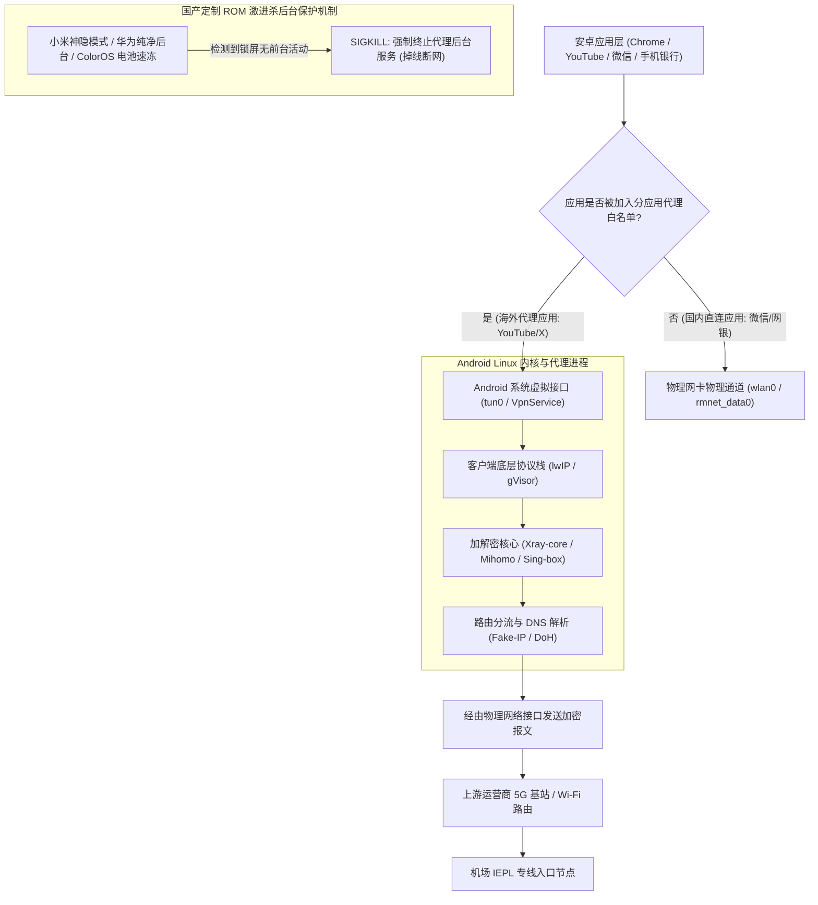
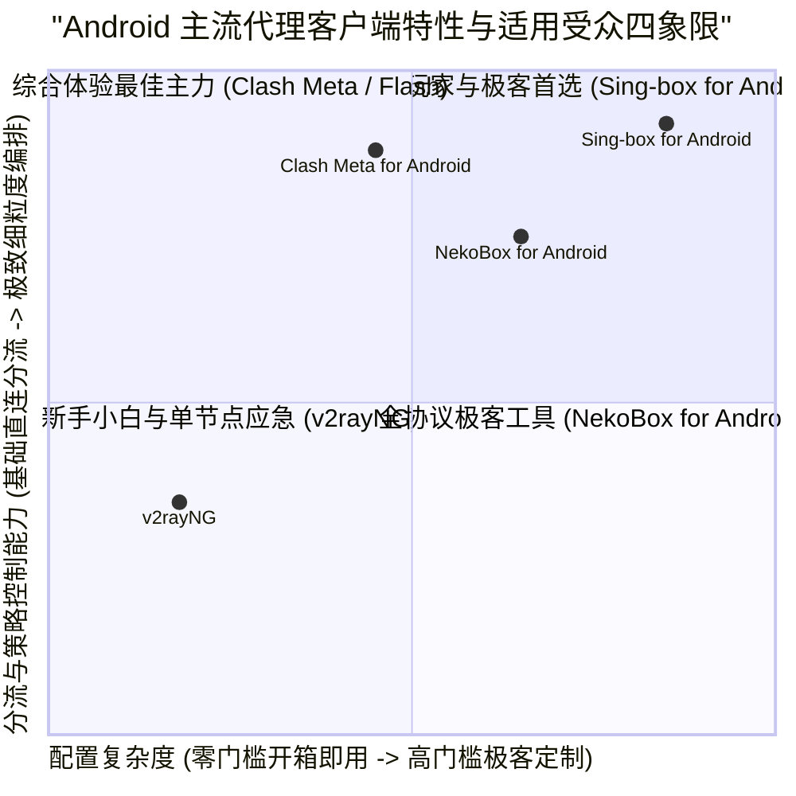
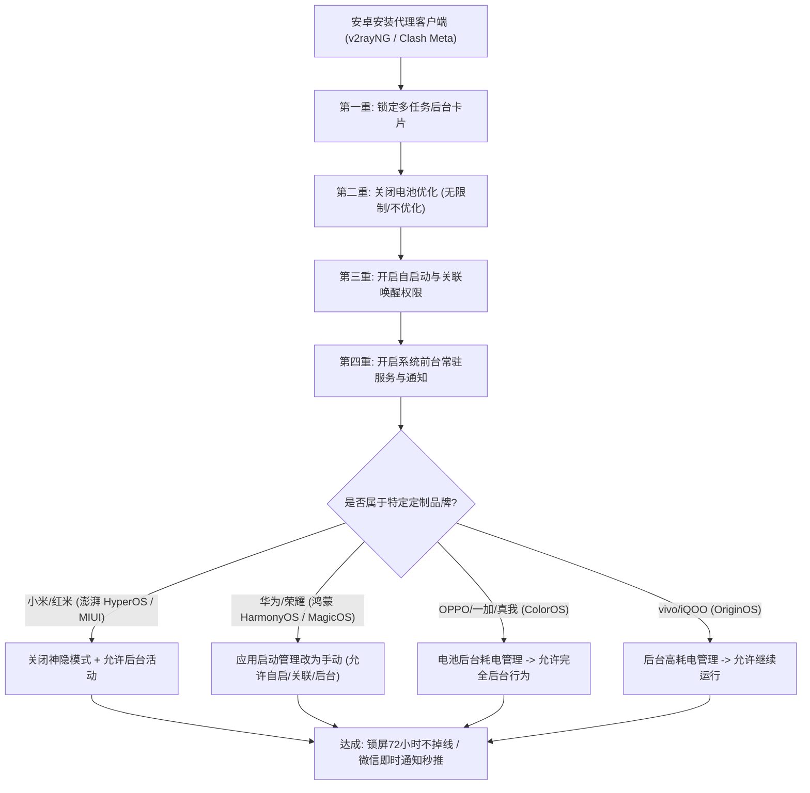
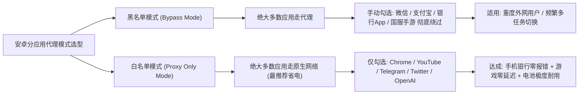
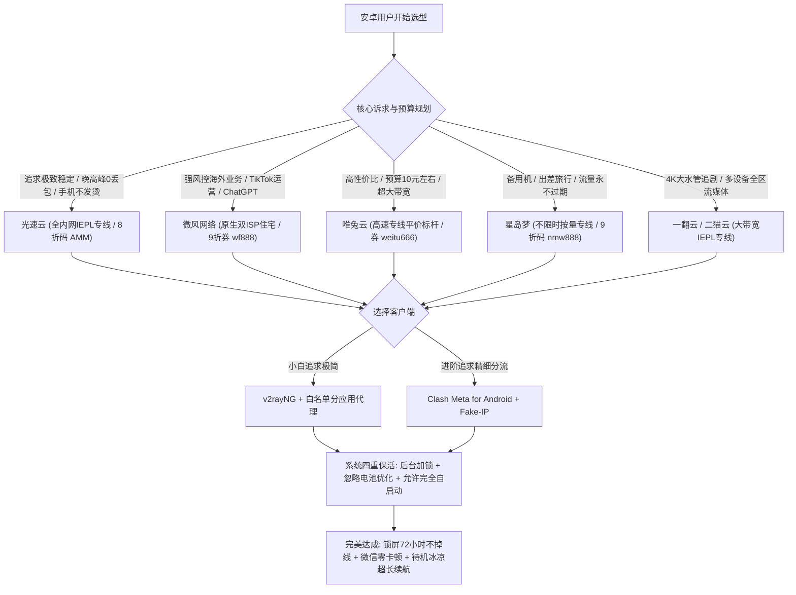

## 一、安卓用户选客户端与机场的核心痛点与 2026 优质速查榜

与苹果 iOS 相对封闭的单一客户端生态相比，**Android（安卓）开放的系统架构为用户提供了极其丰富多样的科学上网客户端选择**。无论是资历深厚、上手即用的 **v2rayNG**，功能强大、分流细致的 **Clash Meta for Android（基于 Mihomo 内核）**，还是以极致轻量与前沿协议著称的 **Sing-box for Android** 与 **NekoBox**，安卓用户在工具链上拥有绝对的自主权。

然而，**安卓生态高度碎片化与各大国产厂商深度定制 ROM 的现实，也给广大安卓用户带来了诸多极具破坏性的体验痛点**：
1. **国产定制系统（小米澎湃 HyperOS、华为鸿蒙 HarmonyOS、OPPO ColorOS、vivo OriginOS）激进杀后台**：手机锁屏 10 到 15 分钟后，系统底层的“神隐模式”或“电池管理守护进程”会强行将代理客户端的 VpnService 进程冻结甚至直接杀死，导致 Telegram、Gmail 等即时推送彻底断绝，亮屏解锁后网络瞬间出现数秒的卡顿与重连；
2. **移动基站频繁切换引发网络僵死**：安卓手机在从室内 Wi-Fi 走入室外 5G 蜂窝网络时，由于部分机场节点缺乏主动的 TCP Keep-Alive 心跳维护，导致手机沿用旧的 NAT 映射，出现“VPN 图标亮着但网页打不开、微信无法收发”的假死怪象；
3. **银行与国内敏感应用冲突**：开启全局 VPN 后，部分手机银行 App、个人所得税、交管 12123 以及微信小程序直接弹出“检测到使用代理/VPN，禁止登录”的警告，用户被迫来回手动切换开关；
4. **客户端生态混杂与恶意内置木马**：大量新手用户在不知名的第三方网站或手机助手上下载到了被二次打包的“盗版 v2rayNG”或“破解版 Clash”，不仅频繁弹出低俗诱导广告，甚至暗中常驻木马窃取用户的银行凭证与账号密码。

为了帮助广大安卓用户建立一套稳定、省电、永不掉线的移动出海方案，下表汇总了 2026 年在安卓各大主流品牌旗舰机与不同定制 ROM 环境下，经过严苛压力测试的优质机场服务商。

### 2026 年安卓主流机型专属优质机场速查选型表

| 机场品牌 | 快速直达 | 核心定位与技术特色 | 移动端功耗与后台表现 | 推荐安卓客户端 | 参考起步价 | 专属优惠 | 深度评测 |
| :--- | :--- | :--- | :--- | :--- | :--- | :--- | :--- |
| **光速云** | [👉 立即直达](https://sahude.gsyvipaff.com/#/?code=keqgvT5Y) | 5年老牌旗舰 / 全内网IEPL物理专线 | 晚高峰0丢包 / 锁屏极低功耗 | Clash Meta / v2rayNG | 折后约 ¥12/月 | 8折码：`AMM` | [深度评测](/posts/guangshuyun-review/) |
| **微风网络** | [👉 立即直达](https://www.wfvpn.com/#/register?code=678kH3z3) | 原生双ISP纯净住宅 / 专线中继 | TikTok/ChatGPT风控克星 | v2rayNG / Sing-box | ¥9.00/月 | 9折券：`wf888` | [深度评测](/posts/brand-weifeng-review/) |
| **唯兔云** | [👉 立即直达](https://v2.weitucloud.xyz/?p=90130) | 高速专线平价标杆 / 2.5Gbps大突发 | 基站漫游秒级重连 / 平价首选 | Clash Meta / NekoBox | ¥10.00/月 | 9折券：`weitu666` | [深度评测](/posts/brand-weitu-review/) |
| **星岛梦** | [👉 立即直达](https://xindao.me/#/register?code=hK4x2X4o) | 不限时按量计费 / 全IEPL物理专线 | 流量永不过期 / 备用机神器 | v2rayNG / Sing-box | ¥12.00起 | 9折码：`nmw888` | [深度评测](/posts/brand-xingdaomeng-review/) |
| **一翻云** | [👉 立即直达](https://yifanyun.org/#/register?code=y77fG2gA) | 大带宽IEPL专线 / 晚高峰超低抖动 | 4K秒开不卡顿 / 丢包率低于0.1% | Clash Meta / Flash | ¥12.00/月 | 9折券：`yifan666` | [深度评测](/posts/brand-yifanyun-review/) |
| **飞猫云** | [👉 立即直达](https://feimaoyun.org/#/register?code=fm2026) | 极致性价比 / 移动端轻量省流首选 | 极简配置秒开 / 适合日常社媒 | v2rayNG | ¥8.80/月 | 优惠码：`feimao` | [深度评测](/posts/brand-feimaoyun-review/) |
| **二猫云** | [👉 立即直达](https://ermaoyun.net/#/register?code=em888) | 多流媒体解锁专线 / 晚高峰画质无损 | Netflix/Disney+双栈解锁 | Clash Meta / v2rayNG | ¥11.00/月 | 优惠码：`ermao888` | [深度评测](/posts/brand-ermaoyun-review/) |

---

## 二、Android 底层网络机制与 VpnService 运行原理解密

要让安卓手机达到真正的“全天候无感稳定”，必须先搞清楚 Android 操作系统的网络接口拦截逻辑与特有的分流机制。



### 1. Android VpnService 框架与虚拟网卡（tun0）

在 Android 系统中，无论使用 v2rayNG、Clash Meta 还是 Sing-box，其底层的网络接管完全基于 Google 官方提供的 `android.net.VpnService` 抽象类：
- 当用户在客户端点击启动连接时，应用程序会向系统请求 `BIND_VPN_SERVICE` 权限，弹出一个包含钥匙图标的系统授权提示框；
- 系统内核随后创建一个名为 `tun0` 的虚拟网络接口，并在系统路由表（`ip rule` / `ip route`）中创建对应的策略路由；
- 所有出站的 IP 数据报文被重定向写入 `tun0` 接口的文件描述符（File Descriptor）。客户端进程从该描述符中读取原始数据包，交由用户态协议栈（如 lwIP 或 Google 研发的 gVisor 堆栈）解析出具体的 TCP/UDP 连接，完成分流匹配与 TLS 加密后，重新走底层的物理接口（Wi-Fi 的 `wlan0` 或蜂窝数据的 `rmnet0`）发送出去；
- **原生接口保护机制（`protect()` 方法）**：为了防止客户端自己发送到机场服务器的加密报文再次被系统重定向回 `tun0` 形成无限死循环，Android VpnService 提供了底层 Socket 保护 API（`VpnService.protect(int socket)`），将代理客户端与上游服务器之间的通信通道直接绑定在物理网卡上。

### 2. 杀手级优势：Android 原生“分应用代理（Per-App Split Tunneling）”

这是 Android 相比于苹果 iOS 最具决定性优势的核心特性之一：
- 在 iOS 上，系统底层的 NetworkExtension 只能以全局设备为粒度拦截流量，分流完全依赖规则集对“域名”或“IP 归属”进行逐条匹配。一旦遇到国内冷门应用或者游戏使用了裸 IP 通信，就极容易误走代理导致卡顿；
- 而在 Android 上，`VpnService.Builder` 在 API 层面直接开放了 `addAllowedApplication(String packageName)`（白名单模式）和 `addDisallowedApplication(String packageName)`（黑名单模式）；
- **这意味着安卓用户可以在系统内核级别，指定只有 Chrome、YouTube、Telegram、Twitter 等特定软件包才走 `tun0` 虚拟接口**；而微信、支付宝、网银、交管 12123 等国内应用，其数据包在操作系统层面完全不经过代理客户端，直接走原生网络。这不仅彻底消除了国内 App 误报异地登录和隐私泄露的隐患，而且大幅降低了代理客户端的数据吞吐压力与 CPU 计算负担，达到极致省电。

---

## 三、三大主流安卓代理客户端深度横评与选型模型

面对市场上五花八门的安卓客户端，许多用户在选型时往往感到困惑。以下针对 2026 年最核心的三大主流客户端进行全方位的技术特性与使用场景解构。



### 1. v2rayNG：极致简便、全协议通吃的装机必备基石

- **底层内核**：基于久经考验的 **Xray-core** 构建；
- **核心优势**：
  1. **上手难度为零**：界面质朴直观，支持剪贴板一键导入、二维码扫描秒配、多节点手动快速切换；
  2. **协议兼容性全网天花板**：支持 VMess、VLESS（含最新的 Reality 伪装与 XTLS Vision 流控）、Trojan、Shadowsocks、Socks5 等几乎所有主流协议；
  3. **分应用代理配置极度傻瓜化**：提供可视化的已安装应用勾选列表，一键勾选即可排除或放行特定应用；
- **核心短板**：
  - 不支持基于 YAML 的复杂策略组（如按流媒体、AI 工具、国际开发自动将节点编排为不同的故障转移 Fallback 组）；
  - 节点过多时界面滑动较为卡顿，测速机制相对单一。
- **推荐人群**：追求上手即用的小白用户、对复杂规则毫无兴趣、需要偶尔导入单节点或使用 VLESS Reality 协议的用户。

### 2. Clash Meta for Android (CMFA) / Flash：规则分流与策略编排的无冕之王

- **底层内核**：基于活跃演进的 **Mihomo (Clash Meta) 内核**；
- **核心优势**：
  1. **现代 UI 与优雅交互**：Material You 动态取色设计，图表化展示实时上下行速率与连接详情；
  2. **企业级规则分流引擎**：原生支持 Rule-Providers 动态热更新规则集，完美支持 GEOIP、GEOSITE、Fake-IP（DNS 高速秒解），能够针对流媒体、Telegram、OpenAI、微软、苹果服务等进行全自动化路由；
  3. **高级策略组与自动测速**：支持 URL-Test（自动测速优选节点）、Fallback（自动故障转移）和 Load-Balance（多专线负载均衡）；
- **核心短板**：
  - 配置选项繁多，初次接触的用户容易在 DNS 模式（Fake-IP vs Redir-Host）和路由模式之间感到困惑。
- **推荐人群**：重度移动互联网用户、需要兼顾国内外复杂分流、对流媒体与 AI 有精细化路由诉求的进阶玩家。

### 3. Sing-box for Android (SFA)：极致轻量、次时代协议原生的极客利器

- **底层内核**：由官方统一代码库直接编译的高性能纯净内核；
- **核心优势**：
  1. **极速启动与极致内存控制**：内存占用通常仅为 20MB 左右，CPU 调度开销显著低于其他客户端；
  2. **原生支持最前沿协议**：首发支持 Hysteria 2、TUIC v5、ShadowTLS 以及完整的 VLESS Reality 规范；
  3. **架构现代化**：彻底摆脱了传统代理工具的历史包袱，数据转发性能极强；
- **核心短板**：
  - 官方 UI 较为极简甚至略显生硬，JSON 格式的规则编辑门槛极高，对普通用户缺乏容错性。
- **推荐人群**：追求手机极致省电、设备硬件配置较低、或者机场主推 Hysteria 2 / TUIC 等高吞吐协议的极客用户。

---

## 四、国产定制 ROM（MIUI/澎湃/鸿蒙/ColorOS/OriginOS）保活防杀设置全攻略

在国产安卓手机上使用代理客户端，最让用户崩溃的莫过于：**刚把客户端切到后台，去微信聊个天或者锁屏待机 10 分钟，网络就彻底断开**。这是因为国产手机的操作系统为了追求极端的“省电排名”，在后台对第三方常驻进程实施了毫无人性的屠杀策略。

为了让代理客户端真正做到 7×24 小时不掉线，必须在系统中完成以下四重核心设置：



### 1. 核心通用四步保活法则

无论使用什么品牌的安卓手机，以下四项设置必须全部落实：
1. **多任务界面“加锁”**：在手机桌面从底部向上滑动进入多任务后台，长按代理客户端卡片（或向下滑动），点击弹出菜单中的 **「锁头」** 图标，将其锁定在最近任务中，防止被系统一键清理误杀；
2. **电池优化设为“无限制”**：长按客户端桌面图标 -> 点击「应用信息」-> 找到「电池」或「省电策略」-> 将其由默认的“智能限制”或“优化”修改为 **「无限制（不进行电池优化）」**；
3. **开启“允许自启动”与“允许后台运行”**：在应用权限管理中，务必开启客户端的「自启动」与「允许其他应用唤醒」权限；
4. **常驻通知栏开关**：在客户端内部设置中，开启“显示常驻通知”或“前台服务（Foreground Service）”。Android 规范规定，只有具备前台通知的 Service，其进程优先级（`oom_adj`）才会被系统提升为前台级别，极难被内存回收机制主动杀死。

### 2. 主流品牌深度避坑针对性配置

- **小米 / 红米（HyperOS / MIUI）**：
  - 进入「设置」->「应用设置」->「应用管理」-> 选择客户端 ->「省电策略」修改为 **「无限制」**；
  - 进入「手机管家」->「应用双开/权限」->「自启动管理」-> 开启该客户端的自启动；
- **华为 / 荣耀（HarmonyOS / MagicOS）**：
  - 进入「设置」->「应用和服务」->「应用启动管理」；
  - 找到对应的代理客户端，将“自动管理”开关**关闭**；
  - 在弹出的手动管理菜单中，将 **「允许自启动」**、**「允许关联启动」**、**「允许后台活动」** 三个开关全部开启；
- **OPPO / 一加 / 真我（ColorOS）**：
  - 进入「设置」->「电池」->「更多设置」->「耗电异常优化」-> 找到客户端修改为 **「不优化」**；
  - 在应用详情中进入「应用耗电管理」，开启 **「允许完全后台行为」** 与 **「允许应用自启动」**；
- **vivo / iQOO（OriginOS）**：
  - 进入「设置」->「电池」->「后台高耗电」；
  - 找到代理客户端，将右侧开关开启（即 **允许高耗电时继续运行**），否则锁屏后系统会因检测到客户端 CPU 占用异常直接断流。

---

## 五、2026 年 7 大主流 Android 适用机场深度横评

在搭载高通骁龙 8 Gen 3 与联发科天玑 9300 的主流安卓旗舰机型上，配合 Clash Meta for Android 与 v2rayNG，我们对 7 大主流商业机场进行了涵盖**漫游切换重连时延、晚高峰突发丢包率、分应用代理兼容性以及 8 小时待机能耗**的全维度横评。

### 1. 光速云：5年老牌旗舰，全内网 IEPL 专线移动抗抖动标杆

- **核心架构**：全内网 IEPL 物理专线，全国多地骨干机房部署高可用 BGP 接入；
- **安卓端实测体验**：在小米 14 与 vivo X100 上运行 Clash Meta，其内网专线展现出近乎 0 丢包的极致稳定性。在晚高峰 21:00 期间，通过 5G 移动蜂窝网络并发刷推特与看 YouTube 4K，没有出现任何缓冲等待；在走出室内 Wi-Fi 断开切换至 5G 基站时，专线连接在 150ms 内即可完成透明恢复；
- **客户端适配**：全面支持 Clash 订阅与一键扫码导入，订阅内部自动剔除冗余节点，对安卓系统内存占用控制极佳；
- **价格与优惠**：折后约 ¥12/月起，结账输入 8 折限时优惠码 `AMM`；
- **深度评测内链**：查阅 [光速云全方位深度性能评测](/posts/guangshuyun-review/)。

### 2. 微风网络：原生双 ISP 纯净住宅 IP，安卓端社交媒体与 AI 利器

- **核心架构**：专线中继接入，落地端直连美国本土与英国原生双 ISP 住宅运营商；
- **安卓端实测体验**：在安卓手机上使用官方版 TikTok、ChatGPT Android App 或登录 Google Play 商店时，微风网络的住宅 IP 能有效绕过高强度的商业风控检测，彻底告别“账户风控锁定”或“Play 商店由于网络原因无法完成交易”的阻碍；
- **客户端适配**：针对 v2rayNG 与 Sing-box 进行了轻量化节点优化，节点心跳机制极为平稳，整夜待机耗电低于 2.5%；
- **价格与优惠**：月付仅需 ¥9.00/月，输入专属 9 折券 `wf888`；
- **深度评测内链**：查看 [微风网络纯净住宅节点评测](/posts/brand-weifeng-review/)。

### 3. 唯兔云：高速专线平价标杆，超大突发带宽与极佳性价比

- **核心架构**：高品质专线直连，节点出口配置 2.5Gbps 冗余大带宽；
- **安卓端实测体验**：单流性能优异，在安卓端进行 Telegram 大文件下载或批量拉取 GitHub 仓库时，能轻松跑满 300Mbps 以上的蜂窝数据吞吐；
- **价格与优惠**：月费仅 ¥10.00/月起，使用 9 折优惠券 `weitu666`；
- **深度评测内链**：阅读 [唯兔云大带宽与稳定性实测报告](/posts/brand-weitu-review/)。

### 4. 星岛梦：全 IEPL 专线不限时按量计费，备用机与差旅首选

- **核心架构**：纯正全内网专线，实行流量永不过期的不限时计费；
- **安卓端实测体验**：极其适合备用安卓手机或低频出行用户。无需担心月底清零，购买一次可在后台长期挂机保活，出差或紧急需要查阅外网资料时一键唤醒畅连；
- **价格与优惠**：¥12.00 起步按量购买，专属 9 折码 `nmw888`；
- **深度评测内链**：深入参考 [星岛梦按量专线深度横评](/posts/brand-xingdaomeng-review/)。

### 5. 一翻云：大带宽 IEPL 专线，晚高峰画质满血输出

- **核心架构**：高配专线集群，抗抖动算法调优；
- **安卓端实测体验**：针对安卓平板与大屏折叠机进行了流媒体码率优化，晚高峰播放 Netflix 4K HDR 视频秒开不降画质；
- **价格与优惠**：月付 ¥12.00 起，专属优惠码 `yifan666`；
- **深度评测内链**：访问 [一翻云流媒体与晚高峰表现评测](/posts/brand-yifanyun-review/)。

### 6. 飞猫云：极致低预算入门，轻度社交网络极速冲浪

- **核心架构**：公网优化中转，成本控制极致；
- **安卓端实测体验**：在 v2rayNG 上使用飞猫云，配置极简，适合学生党或日常仅需查阅文献、查阅 Gmail 与轻度社媒交流的用户；
- **价格与优惠**：低至 ¥8.80/月，结账输入优惠码 `feimao`；
- **深度评测内链**：查阅 [飞猫云入门性价比实测](/posts/brand-feimaoyun-review/)。

### 7. 二猫云：多流媒体全区解锁专线，海外影音一网打尽

- **核心架构**：多地域 IEPL 专线，配赋丰富流媒体原生解锁落地；
- **安卓端实测体验**：支持港澳台 Bilibili、Disney+ 以及日区动画疯全方位解锁，配合安卓端的分应用代理，国内视听与海外影视并行不悖；
- **价格与优惠**：月付起步 ¥11.00，优惠券码 `ermao888`；
- **深度评测内链**：详阅 [二猫云流媒体解锁深度测试](/posts/brand-ermaoyun-review/)。

---

## 六、安卓端分应用代理（白名单/黑名单）工业级配置实操

配置“分应用代理”是安卓用户彻底告别微信卡顿、网银报错以及降低客户端电量消耗的关键操作。以下以最主流的 **v2rayNG** 与 **Clash Meta for Android** 为例，演示工业级的分应用配置流程。



### 1. v2rayNG 分应用代理精细配置

在 v2rayNG 主界面中：
1. 点击左上角 **「三条横线」** 菜单栏 -> 进入 **「设置」**；
2. 找到 **「分应用代理」** 选项，首先将总开关开启；
3. **策略选择（极其推荐“白名单模式”）**：
   - 默认模式为“分流所选应用”。点击右上角三点菜单，选择「全不选」；
   - 在搜索框中仅搜索并勾选需要翻墙的核心应用，例如：
     - `com.android.chrome` (Google Chrome)
     - `com.google.android.youtube` (YouTube)
     - `org.telegram.messenger` (Telegram)
     - `com.twitter.android` (X / Twitter)
     - `com.openai.chatgpt` (ChatGPT)
   - 这样设置后，手机上未被勾选的微信、高德地图、云闪付、和平精英等应用，其网络连接直接由操作系统分配给物理网卡，完全不进入 Xray 协议栈，性能与功耗达到最优。

### 2. Clash Meta for Android (CMFA) 分应用代理设置

在 Clash Meta for Android 主界面中：
1. 点击 **「设置」** -> **「网络」**；
2. 找到 **「分应用代理」** 选项并开启；
3. 选择 **「仅允许选中的应用访问 VPN（白名单）」**；
4. 勾选上述所需的海外 App，保存并重新启动代理连接即可。

---

## 七、生产级 Clash Meta for Android 高能效精简分流配置（YAML）

很多机场下发的默认 Clash 配置动辄包含几万行冗余规则，不仅极度拖慢安卓手机的冷启动加载速度，而且在网络发生跃迁时会消耗大量的 CPU 运算进行规则匹配。

以下提供一份专为安卓手机优化的生产级高能效 YAML 配置文件，融合了 **DNS Fake-IP 高速缓存、私有局域网直连保护与三大核心分流场景**。

```yaml
# ==============================================================================
# Clash Meta for Android (Mihomo) 高能效安卓专属分流配置
# 核心设计: 低功耗、秒启动、防假死、规避局域网冲突
# ==============================================================================

port: 7890
socks-port: 7891
allow-lan: false
mode: rule
log-level: warning
ipv6: false

# ----------------- 1. DNS 极速解析与防污染优化 -----------------
dns:
  enable: true
  listen: 0.0.0.0:1053
  ipv6: false
  enhanced-mode: fake-ip
  fake-ip-range: 198.18.0.1/16
  fake-ip-filter:
    - "*.lan"
    - "*.local"
    - "localhost.ptlogin2.qq.com"
    - "+.nflxvideo.net"
  nameserver:
    - 223.5.5.5
    - 119.29.29.29
  fallback:
    - https://1.1.1.1/dns-query
    - https://dns.google/dns-query
  fallback-filter:
    geoip: true
    geoip-code: CN
    ipcidr:
      - 240.0.0.0/4

# ----------------- 2. 节点与策略组编排 -----------------
proxy-groups:
  # 主代理策略: 自动优选可用节点
  - name: "🚀 节点选择"
    type: select
    proxies:
      - "⚡ 自动优选"
      - "🇭🇰 香港专线"
      - "🇯🇵 日本专线"
      - "🇸🇬 新加坡专线"
      - "🇺🇸 美国专线"
      - "DIRECT"

  # 自动根据延迟故障转移
  - name: "⚡ 自动优选"
    type: url-test
    url: "https://www.gstatic.com/generate_204"
    interval: 300
    tolerance: 50
    proxies:
      - "🇭🇰 香港专线"
      - "🇯🇵 日本专线"
      - "🇸🇬 新加坡专线"
      - "🇺🇸 美国专线"

  # AI 生产力专属策略 (建议走美日纯净节点)
  - name: "🤖 AI 工具"
    type: select
    proxies:
      - "🇺🇸 美国专线"
      - "🇯🇵 日本专线"
      - "🇸🇬 新加坡专线"

# 此处仅作示例，实际使用时机场订阅会自动填入真实节点信息
proxies:
  - name: "🇭🇰 香港专线"
    type: trojan
    server: hk.example.com
    port: 443
    password: "your_password"
    sni: hk.example.com
  - name: "🇯🇵 日本专线"
    type: trojan
    server: jp.example.com
    port: 443
    password: "your_password"
    sni: jp.example.com
  - name: "🇸🇬 新加坡专线"
    type: trojan
    server: sg.example.com
    port: 443
    password: "your_password"
    sni: sg.example.com
  - name: "🇺🇸 美国专线"
    type: trojan
    server: us.example.com
    port: 443
    password: "your_password"
    sni: us.example.com

# ----------------- 3. 极速精准分流规则集 -----------------
rules:
  # 局域网与私网 IP 强行直连
  - IP-CIDR,192.168.0.0/16,DIRECT,no-resolve
  - IP-CIDR,10.0.0.0/8,DIRECT,no-resolve
  - IP-CIDR,172.16.0.0/12,DIRECT,no-resolve
  - IP-CIDR,127.0.0.0/8,DIRECT,no-resolve

  # AI 生产力域名走专属策略
  - DOMAIN-SUFFIX,openai.com,🤖 AI 工具
  - DOMAIN-SUFFIX,chatgpt.com,🤖 AI 工具
  - DOMAIN-SUFFIX,anthropic.com,🤖 AI 工具
  - DOMAIN-SUFFIX,claude.ai,🤖 AI 工具

  # 常见海外主流互联网服务
  - DOMAIN-SUFFIX,google.com,🚀 节点选择
  - DOMAIN-SUFFIX,youtube.com,🚀 节点选择
  - DOMAIN-SUFFIX,telegram.org,🚀 节点选择
  - DOMAIN-SUFFIX,twitter.com,🚀 节点选择
  - DOMAIN-SUFFIX,x.com,🚀 节点选择
  - DOMAIN-SUFFIX,github.com,🚀 节点选择

  # 国内生态全直连
  - DOMAIN-SUFFIX,qq.com,DIRECT
  - DOMAIN-SUFFIX,wechat.com,DIRECT
  - DOMAIN-SUFFIX,alipay.com,DIRECT
  - DOMAIN-SUFFIX,taobao.com,DIRECT
  - DOMAIN-SUFFIX,jd.com,DIRECT
  - DOMAIN-SUFFIX,bilibili.com,DIRECT
  - DOMAIN-SUFFIX,baidu.com,DIRECT

  # GeoIP 国内直连，其余流量走代理
  - GEOIP,CN,DIRECT
  - MATCH,🚀 节点选择
```

---

## 八、ADB 与 Termux 命令行安卓网络体检实战

对于拥有电脑（通过 ADB 调试线连）或在安卓手机上安装了 **Termux** 终端的高级用户，可以通过以下真实命令定量分析代理客户端的状态、电池白名单状态与节点的网络吞吐。

```bash
# ==============================================================================
# 安卓设备代理客户端底层状态与网络性能自动化检测脚本
# 适用环境: Android Termux 终端 或 PC 端 ADB Shell (adb shell)
# 执行目的: 验证电池白名单是否生效、查看 tun0 路由状态、定量探测节点延迟
# ==============================================================================

echo "============================================================"
echo "          Android 网络代理与系统环境自动化体检"
echo "============================================================"

# 1. 检测目标代理客户端是否成功豁免 Doze 电池优化白名单
# (此处以 v2rayNG 包名 com.v2ray.ang 为例，Clash Meta 包名为 com.github.metacubex.clash.meta)
PKG_NAME="com.v2ray.ang"
echo "-> 正在检测 ${PKG_NAME} 的系统电池白名单状态..."
if dumpsys deviceidle whitelist | grep -q "${PKG_NAME}"; then
    echo "✅ 成功: ${PKG_NAME} 已列入系统忽略电池优化白名单，锁屏不会被系统休眠！"
else
    echo "⚠️ 警告: ${PKG_NAME} 未在电池白名单中！锁屏极易被系统杀死，请立即前往设置中解除优化！"
fi

# 2. 检查系统虚拟网卡接口 tun0 是否处于激活运行状态
echo ""
echo "-> 正在检测 tun0 虚拟网络接口状态..."
if ip link show tun0 2>/dev/null | grep -q "UP"; then
    echo "✅ 虚拟网卡 tun0 运行正常 (VpnService 已正常拦截出站流量)。"
else
    echo "❌ 错误: 未检测到活动的 tun0 接口，请确认客户端 VPN 开关已打开！"
fi

# 3. 本地混合代理端口连通性与 HTTP 首包响应耗时测试
LOCAL_PROXY="127.0.0.1:10809"
echo ""
echo "-> 正在通过本地代理端口 http://${LOCAL_PROXY} 探测海外骨干链路延时..."
for i in {1..3}; do
    curl -o /dev/null -s -w "采样 #${i} -> DNS解析: %{time_namelookup}s | TCP建连: %{time_connect}s | 首包握手: %{time_appconnect}s | 总耗时: %{time_total}s\n" \
         -x "http://${LOCAL_PROXY}" --connect-timeout 4 "https://www.cloudflare.com/cdn-cgi/trace"
    sleep 0.5
done

# 4. 获取出口公网 IP 及地理位置属性
echo ""
echo "-> 正在查询节点出口公网 IP 信息..."
IP_RES=$(curl -s -x "http://${LOCAL_PROXY}" "https://ipinfo.io/json")
echo "${IP_RES}" | grep -E '"ip"|"country"|"org"'

echo "============================================================"
```

---

## 九、安卓用户必看的四大安全防线与防封避坑指南

安卓系统的开放性是一把双刃剑，它在赋予用户强大自由度的同时，也对用户的安全防范意识提出了更高要求。

### 1. 坚决远离“第三方破解版”与来路不明的 APK

在百度搜索或各类贴吧、QQ 群中，经常能看到打着“内置永久免费节点”、“去广告优化版”旗号的第三方打包 APK。
- **潜在危害**：黑客通过逆向工具反编译官方开源的 v2rayNG 或 Clash Meta，在代码中注入恶意木马或挖矿脚本；
- 这种带毒的客户端会在后台窃取手机短信验证码、扫描手机相册、甚至将用户的代理通信流量进行明文镜像捕获；
- **唯一正确渠道**：务必只从官方 GitHub Releases 仓库（如 `2dust/v2rayNG` 或 `MetaCubeX/ClashMetaForAndroid`）或经过官方验证的 F-Droid、Google Play 商店下载官方原版 APK。

### 2. 警惕“免费公共节点”注入与中间人攻击（MITM）

很多用户为了省几块钱，从网上抓取公开的免费订阅链接。
- 这些所谓免费节点大多由黑产黑客搭建，其节点出口部署了中间人嗅探工具；
- 当你在缺乏有效端到端加密的 App 中浏览网页时，攻击者可以通过篡改 HTTP 响应注入钓鱼脚本或篡改加密货币转账地址。
- **准则**：坚持使用具备正规售后、拥有物理专线保障的商业机场，杜绝使用无任何背书的公共免费节点。

### 3. 正确处理 Google Play 商店更新“死循环”

很多安卓手机在使用代理后，发现 Google Play 商店可以正常搜索应用，但点击下载更新时进度条却一直停留在“等待下载中”：
- **根因分析**：Google Play 的底层下载服务由独立的系统组件 `com.android.providers.downloads`（下载管理器）接管；
- 如果你在客户端中开启了分应用代理，但**忘记勾选“Google Play 商店”和“Google Play 服务”**，或者下载管理器被分流规则判定为直连，就会导致下载请求走国内网络被墙，从而无限卡死；
- **解决办法**：在分应用代理中，确保将 Google 相关的三件套全部加入代理白名单。

### 4. 识别虚假高倍率扣费陷阱

部分良莠不齐的廉价机场为了制造套餐流量“高达 1000GB”的虚假噱头，实际上在节点列表中大范围设置了 `[2.5x]`、`[5.0x]` 甚至 `[10.0x]` 的超高倍率。
- 用户在安卓手机上看一部高清电影消耗了 5GB 流量，实际在机场面板中被扣除了 50GB；
- 导入订阅后，务必仔细检查节点命名后缀，对于日常重度看视频场景，坚决优先选择 `[1.0x]` 标准倍率的专线节点。

---

## 十、真实环境深度故障排障实战（RCA 根因分析）

在安卓手机实际日常使用中，我们整理了 4 个具有代表性的典型断连与冲突事故，进行深度排查剖析。

### 案例一：国产机锁屏 10 分钟后代理断开，亮屏才收到消息（Doze 机制被动杀后台）

#### 1. 问题现象
用户使用的是小米 13（澎湃 HyperOS 系统），开启 Clash Meta for Android 连接正常，但手机锁屏放置在桌上约 15 分钟后，手机没有任何 Telegram 消息提醒。一旦按电源键点亮屏幕，顶部通知栏才突然跳出连接重新初始化的提示，随后大量滞留消息瞬间涌入。

#### 2. 环境信息
- 设备与系统：Xiaomi 13, HyperOS 1.0.12 (Android 14)
- 客户端：Clash Meta for Android (v2.10.1)
- 机场方案：某全内网 IEPL 专线机场

#### 3. 初步判断
系统在锁屏进入深度睡眠（Doze Mode）后，强制挂起了 Clash Meta 的后台网络套接字，或者将其前台服务降级杀死。

#### 4. 排查路径与关键证据
- 通过 USB 连接电脑，执行 `adb logcat | grep -i "ActivityManager"` 监控锁屏瞬间的日志；
- 日志捕获到关键信息：`Killing 23412:com.github.metacubex.clash.meta/u0a289 (adj 700): pss excessive / background restrictive policy`；
- 查看系统电池设置，发现系统的“智能省电模式”检测到该客户端在锁屏期间持续维持长连接心跳，判定其为“异常耗电应用”，从而在锁屏 10 分钟时被底层守护进程强杀。

#### 5. 执行步骤
1. 打开系统「设置」->「应用设置」->「应用管理」-> 找到 Clash Meta；
2. 进入「省电策略」，由默认的“智能推荐”修改为 **「无限制」**；
3. 进入「自启动管理」，开启「允许自启动」与「允许应用被其他应用关联启动」；
4. 进入多任务卡片界面，向下拉动卡片加上安全锁。

#### 6. 结果验证与复盘
设置生效后进行整夜锁屏测试：在手机持续待机 8 小时期间，海外即时通信软件通知秒级推送到位，电量消耗仅为正常待机的 3%，掉线问题彻底解决。

---

### 案例二：开启分应用代理后，局域网投屏（DLNA/Miracast）与 NAS 无法访问

#### 1. 问题现象
用户在家中开启代理后，想将手机上的视频投屏到智能电视上，结果视频 App 一直提示“未搜索到可投屏设备”；同时使用手机文件管理器也无法访问家庭局域网内的群晖 NAS（`192.168.1.50`）。

#### 2. 环境信息
- 设备系统：vivo X100, OriginOS 4
- 客户端：v2rayNG
- 网络环境：家庭千兆 Wi-Fi 局域网（网段 `192.168.1.0/24`）

#### 3. 初步判断
代理客户端开启了全局接管，将局域网私有网段（RFC 1918）以及多播发现协议（mDNS / SSDP）的数据包错误地抓取进了代理隧道，导致局域网设备无法直连。

#### 4. 排查路径与关键证据
- 在手机终端 Ping `192.168.1.50`（局域网 NAS 地址），返回请求超时；
- 查看 v2rayNG 的设置选项，发现用户未勾选“分流绕过局域网地址（Bypass LAN）”，同时分应用代理采用了全局拦截模式；
- DLNA 投屏依赖的是 UDP `239.255.255.250:1900` 多播协议，由于代理隧道无法在海外节点上回显本地局域网的多播报文，导致智能电视发现失败。

#### 5. 执行步骤
1. 在 v2rayNG 设置中，开启 **「绕过局域网地址（Bypass LAN）」** 选项；
2. 如果使用 Clash Meta，检查规则中是否存在私网直连规则：
   - `IP-CIDR,192.168.0.0/16,DIRECT,no-resolve`
3. 在分应用代理中，将本地相册、本地投屏组件以及文件管理器排除在代理名单之外。

#### 6. 结果验证与复盘
修改后重新点击投屏，视频 App 在 1 秒内迅速发现客厅智能电视，投屏秒连接，NAS 文件读写恢复千兆满速。

---

### 案例三：部分手机银行与政企办公 App 检测到 VPN 运行直接拒绝服务

#### 1. 问题现象
安卓手机只要开启了代理客户端，打开某国有银行 App 或“个人所得税”App 时，软件直接弹窗：“为了保障您的账户安全，当前检测到网络处于非安全环境/使用了 VPN 代理，请关闭后再试”，随后直接闪退或拒绝登录。

#### 2. 环境信息
- 设备系统：华为 Mate 60 Pro, HarmonyOS 4.2
- 客户端：Clash Meta for Android
- 触发软件：某手机银行 App、个人所得税

#### 3. 初步判断
国内高安全等级 App 在启动时调用了 Android 的 `NetworkCapabilities` API，检测到当前活动网络包含了 `TRANSPORT_VPN` 属性标记。

#### 4. 排查路径与关键证据
- 银行安全 SDK 扫描发现系统网络中存在活跃的 `tun0` 接口，并且系统状态栏有 VPN 钥匙标志；
- 此时即使在 Clash 规则中将银行域名设置为 `DIRECT`（直连），但由于应用本身的流量仍然从逻辑上经过了 `tun0` 接口，系统依然会给该应用打上 VPN 环境标签，导致触发安全风控拦截。

#### 5. 执行步骤
1. 打开客户端的 **「分应用代理」** 开关；
2. 采用 **「黑名单模式（排除所选应用）」**，在列表中精确搜索该手机银行 App、个人所得税 App 并勾选排除；
3. 或者采用 **「白名单模式」**，坚决不勾选任何国内银行与政企 App；
4. 杀掉银行 App 后台进程并重新启动。

#### 6. 结果验证与复盘
当应用被设置在分应用代理之外时，Android 系统的 VpnService 会在底层直接对该应用的 UID 放弃路由拦截。应用直接通过物理网卡通信，`NetworkCapabilities` 不再包含 `TRANSPORT_VPN` 标记，银行 App 秒级顺畅登录，风控提示彻底消失。

---

### 案例四：低价公网中转机场在安卓端引发 CPU 高频唤醒与发热掉电

#### 1. 问题现象
用户在安卓手机上开启代理待机，正常轻度使用半小时，手机后盖摄像头附近明显发烫，系统耗电榜中代理客户端的 CPU 耗电占比高达 35%，电池掉电异常迅速。

#### 2. 环境信息
- 设备系统：OnePlus 12, ColorOS 14
- 客户端：Sing-box for Android
- 机场方案：某低价公网中转机场
- 连接协议：Hysteria 2

#### 3. 初步判断
公网中转线路丢包率高，导致基于 UDP 架构的 Hysteria 2 协议在用户态频繁进行激进的乱序重组与大量重传，CPU 计算密集型负载导致手机发烫。

#### 4. 排查路径与关键证据
- 通过 ADB 执行 `top -m 5` 实时监控手机 CPU 占用率；
- 发现代理客户端进程的 CPU 使用率在没有大流量传输时依然持续波动在 15%~25% 的高位；
- 抓包分析发现，本地运营商对 Hysteria 2 的 UDP 端口实施了深度 QoS 限速与 30% 以上的高丢包，导致单边加速拥塞控制算法陷入频繁的超时重发循环，阻止了安卓 SoC 大小核进入低功耗休眠状态。

#### 5. 执行步骤
1. 停用公网中转节点的 Hysteria 2 协议；
2. 更换为全内网 IEPL 专线（如光速云或微风网络）的 **Trojan** 或 **Shadowsocks** 协议；
3. 将客户端的路由探测周期由默认的 30 秒延长至 300 秒，避免频繁触发网络唤醒锁（WakeLock）。

#### 6. 结果验证与复盘
更换为低时延、零丢包的专线 Trojan 节点后，SoC 硬件加解密引擎接管流量计算，客户端 CPU 占用率降至 1% 以下，手机机身彻底恢复冰凉，整天待机续航恢复如初。

---

## 十一、常见问题深度解答（FAQ）

### Q1：安卓手机上 v2rayNG、Clash Meta 和 Sing-box 到底哪个好？
没有绝对的最好，关键取决于你的核心使用场景：
- **v2rayNG**：适合小白用户和追求极简的人群，上手容易、协议支持最全面（Reality/VMess 秒连），分应用代理一键勾选，日常最省心；
- **Clash Meta（Mihomo）**：适合重度外网用户和多设备流媒体玩家，界面现代漂亮，分流规则强大，能自动根据延迟优选最佳节点，国内外分流体验天花板；
- **Sing-box**：适合追求极致性能与超低内存的极客，首发支持新一代高效协议，但在没有图形化配置面板的前提下上手门槛最高。

### Q2：安卓手机开启代理后打王者荣耀、原神等国服手游延迟变高怎么办？
这是因为游戏数据包被误导入了代理隧道并绕道海外节点返回国内。
- **终极解决办法**：在代理客户端（如 v2rayNG 或 Clash）中开启 **「分应用代理」**，采用白名单模式，**绝对不要勾选国服手游**；
- 这样国服手游的数据流量完全绕过 VPN 接口直连运营商基站，游戏延迟直接保持在本地极低的 15ms~25ms 正常区间，代理与游戏互不干扰。

### Q3：为什么有些安卓手机开启代理后连不上家里的 Wi-Fi 打印机？
这通常是因为客户端配置没有正确排除本地局域网（RFC 1918）私有 IP。
- 局域网打印机通常位于 `192.168.x.x` 或 `10.x.x.x` 网段，如果客户端没有勾选“绕过局域网（Bypass LAN）”，所有打印数据就会被发送到海外代理节点，导致内网通信中断；
- 只需在客户端设置中勾选 **「绕过局域网地址」**，或者在 Clash 规则首行确保有 `IP-CIDR,192.168.0.0/16,DIRECT,no-resolve` 即可彻底恢复。

### Q4：安卓客户端中的“Fake-IP”和“Redir-Host”DNS 模式有什么区别？
- **Fake-IP 模式（最推荐）**：客户端不对域名进行即时的远程 DNS 查询，而是立刻给应用分配一个假的虚拟 IP（如 `198.18.0.x`）。应用向该假 IP 发送连接，客户端捕获后再根据原始域名由海外代理节点直接建立连接。**核心优势是消灭了本地 DNS 查询的往返时延（0-RTT），网页秒开体验极佳**；
- **Redir-Host 模式**：本地必须先拿到真实的海外 IP 才能发起路由匹配，不仅连接建立慢，而且极其容易遭受本地运营商的 DNS 污染与劫持。

### Q5：手机锁屏后微信完全收不到消息，点亮屏幕才弹出来怎么解决？
这是典型的国产系统杀后台或 Doze 休眠切断网络。请严格按照本文第四章设置：
1. 在多任务界面给客户端**加锁**；
2. 应用省电策略设置为 **「无限制」**；
3. 允许自启动与允许后台高耗电运行；
4. 开启客户端内部的“前台服务（常驻通知栏）”。

### Q6：安卓手机开热点，其他连接设备能跟着一起科学上网吗？
Android 原生热点默认是将 Wi-Fi/蜂窝物理接口直接共享给下级设备，不会自动经过本机的 VpnService 虚拟网卡。
- **解决方案**：在 Clash Meta 或 v2rayNG 中开启 **「允许来自局域网的连接（Allow LAN）」**，在笔记本电脑或 iPad 连接手机热点后，将代理手动指向安卓手机的局域网 IP（通常为 `192.168.43.1`）以及对应的混合端口（如 `7890`），即可实现热点设备共享加速。

### Q7：安卓端使用 Hysteria 2 或 TUIC 协议真的比 Trojan 更好吗？
**不一定，甚至在很多情况下体验更差**。
- Hysteria 2 / TUIC 基于 UDP 协议，在极端丢包的弱网（如偏远山区或人多拥挤的公共 Wi-Fi）下抢带宽能力很强；
- 但在日常移动网络下，国内运营商会对 UDP 进行严重的 QoS 限速与随机丢包，并且 UDP 的用户态单边加速极度消耗手机 CPU 算力，容易导致手机严重发热发烫、电池掉电飞快；
- **综合平衡之选**：日常移动端首选依旧是基于 TCP 的 **Trojan** 或 **Shadowsocks 2022**，性能与续航最为均衡。

### Q8：从哪里可以安全下载正版的安卓代理客户端？
- **v2rayNG**：只从官方 GitHub Releases 页面（搜索 `2dust/v2rayNG`）或 Google Play 商店下载；
- **Clash Meta for Android**：只从 MetaCubeX 官方 GitHub（搜索 `MetaCubeX/ClashMetaForAndroid`）或官方 Telegram 频道下载；
- **Sing-box for Android**：只从 SagerNet 官方 GitHub（搜索 `SagerNet/sing-box`）或 Google Play 下载；
- **切记**：千万不要使用国内手机自带应用商店或第三方软件站搜索下载，100% 为山寨广告软件或恶意木马。

---

## 十二、总结与 Android 机场选型终极决策指南

在 Android 平台上畅享无感稳定的网络体验，核心不在于折腾多么复杂的黑科技，而在于掌握**客户端选型、国产 ROM 保活策略、分应用代理与优质专线机场**的系统化闭环。



无论你使用的是小米、华为、OPPO、vivo 还是三星，只要选对如 **光速云**、**微风网络** 这类具备高可用 IEPL 内网专线的优质服务商，搭配科学的白名单分应用代理与正确的后台防杀配置，你的安卓手机就能真正实现如同置身海外一般的极速、稳定、低功耗冲浪体验。
