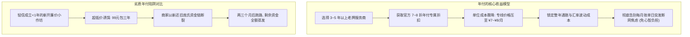
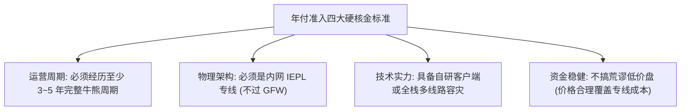
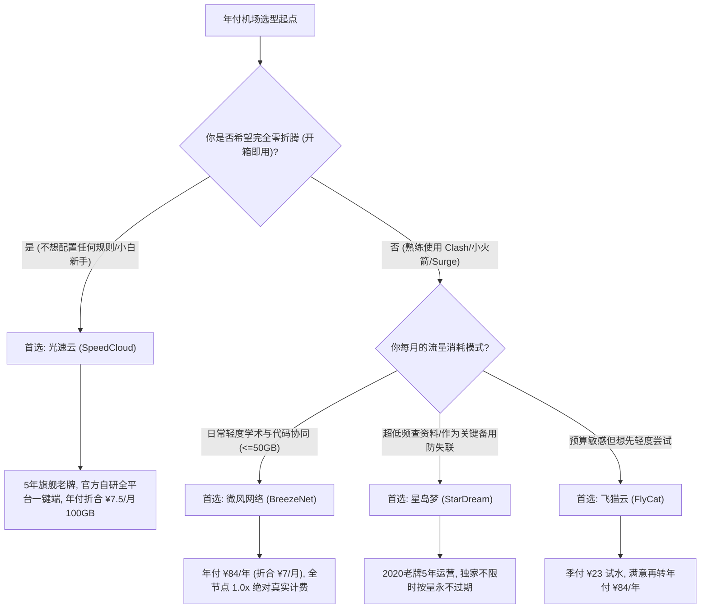
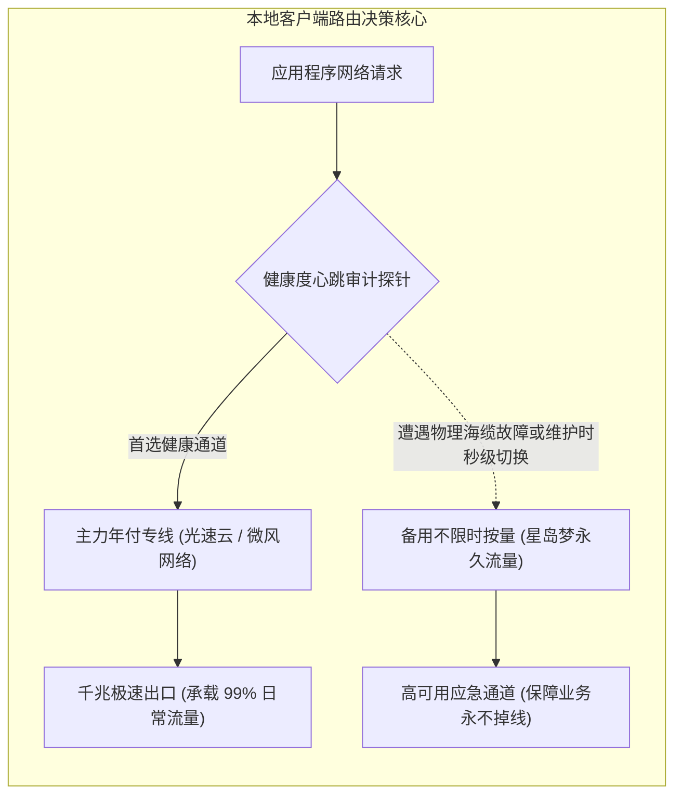
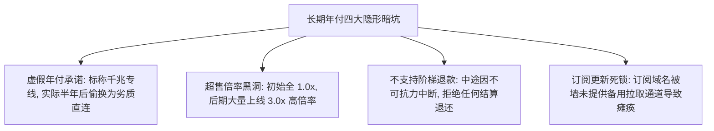

> **核心结论速览（Direct Answer）**：  
> 虽然科学上网圈普遍推崇“月付保平安”，但对于**网络需求稳定、追求极致单位性价比、且极度厌恶每月手动续费断连焦虑的成熟用户**而言，**年付订阅依然是最具吸引力的终极解决方案**。年付通常能享受官方 7～8 折的深度折扣，将顶级 IEPL 内网专线的单月折算成本直接砸穿至 **¥7.0/月～¥8.0/月**。  
> 然而，**能够安全年付的机场在全行业中不足 5%**。必须同时满足三大严苛铁律：**“运营历史必须跨越 3～5 年以上周期”、“底层必须是正规二层 IEPL 物理专线（不过 GFW）”、“全节点必须严格 1.0x 真实计费无暗扣”**。凡是成立不足一年、没有 Telegram 历史频道沉淀的新开作坊，无论优惠力度多大均严禁年付。  
> 综合 2026 年存活周期、硬件实力与售后口碑，最值得长期年付托管的服务商矩阵明确如下：  
> 👑 **年付全能首选（5年老牌开箱即用标杆）**：**[光速云 (SpeedCloud)](/posts/guangshuyun-review/)**（综合评分 9.9 / 10，2020 年上线稳健运营超 5 年旗舰老牌，全系纯正内网二层 IEPL 物理专线，官方自研 Windows/Mac/Android/iOS 全平台一键直连客户端，年付折合仅 **¥7.5/月** 享 100GB，晚高峰 0 丢包，原生双 ISP 解锁 Claude 3.7 / ChatGPT-4o，8折优惠码 `AMM`）；  
> 💡 **轻量年付性价比标杆（极简透明省钱极致）**：**[微风网络 (BreezeNet)](/posts/brand-weifeng-review/)**（综合评分 9.8 / 10，年付全款仅 ¥84/年，折算仅 **¥7.0/月** 享 50GB 纯专线，全节点严格 1.0x 真实计费无暗扣，学术检索、代码协同轻度用户的最佳长期伙伴，9折券 `wf888`）；  
> 🛡️ **老牌容灾与不限时按量神机**：**[星岛梦 (StarDream)](/posts/brand-xingdaomeng-review/)**（综合评分 9.6 / 10，2020 老牌 5 年稳健运营，年付折合 **¥8.0/月**，同时独家提供**不限时按量套餐**，购买流量永不过期，多设备共享无压力，9折码 `nmw888`）；  
> 🎬 **平价平衡年付选（支持季付平滑过渡）**：**[飞猫云 (FlyCat)](/posts/brand-feimaoyun-review/)**（综合评分 9.7 / 10，年付折算 **¥7.0/月**，亚太热门节点全覆盖，4K 影音秒开，9折券 `feimao`）；  
> ⚡ **拒绝绑定的纯月付对照组**：**[唯兔云 (V2Cloud)](/posts/brand-weitu-review/)**（若依然对年付心存顾虑，唯兔云提供 **¥14.9/月** 100GB 纯月付专线，全系 VLESS 协议，随买随用零沉没成本，首月券 `weitu666`）。

---

## 一、2026年适合长期年付的高口碑老牌机场全景横评

年付的本质是“以确定性的资金沉淀换取极低的使用单价与高品质的专线服务”。下表精选了行业内通过时间检验、具备长期抗压实力的老牌服务商。

针对手机移动端用户的阅读习惯，下表在**第二列直接外露官方正规直达通道**，手机用户无需横向滑动屏幕，即可一键直达官方选购页面：

| 品牌名称与定位 | 官方直达通道 | 实际年付折算单价 | 年付总门槛与规格 | 底层核心线路架构 | 运营年份与信誉度 | AI / 流媒体解锁 | 专属优惠码 |
| :--- | :--- | :--- | :--- | :--- | :---: | :---: | :---: |
| **光速云**<br>*(年付开箱旗舰)* | [👉 立即直达](https://sahude.gsyvipaff.com/#/?code=keqgvT5Y) | 折合 **¥7.5/月**<br>(年付超高性价比) | 实付 **¥90/年 起**<br>(100GB/月 充裕配额) | 企业级二层 IEPL 物理专线<br>三网自适应 Anycast BGP | **2020年上线 (5年+)**<br>口碑常年极高 | 住宅双 ISP<br>Claude/4K全绿 | `AMM`<br>(限时 8 折) |
| **微风网络**<br>*(轻量极简标杆)* | [👉 立即直达](https://guangs.weifengaff.top/#/?code=VjRz832G) | 折合 **¥7.0/月**<br>(年付省钱极致) | 实付 **¥84/年 起**<br>(50GB/月 严格 1.0x) | 端到端全内网 IEPL 专线<br>物理级独立信道隔离 | **2023年稳定运营**<br>全节点真实计费 | 极高洁净度<br>全主流影音支持 | `wf888`<br>(全场 9 折) |
| **星岛梦**<br>*(老牌容灾神机)* | [👉 立即直达](https://guangs.xingdaomeng.com/#/?code=1TynBYnR) | 折合 **¥8.0/月**<br>(老牌稳定护航) | 实付 **¥96/年 起**<br>(支持不限时按量) | 2020老牌企业内网专线<br>冗余海缆多路物理备份 | **2020年上线 (5年+)**<br>常年稳定无故障 | 高洁净节点池<br>代码协同极佳 | `nmw888`<br>(专属 9 折) |
| **飞猫云**<br>*(平价平衡选)* | [👉 立即直达](https://guangs.feimaoyunaff.top/#/?code=Kx2P4q) | 折合 **¥7.0/月**<br>(灵活上车) | 实付 **¥84/年 起**<br>(支持季付灵活过渡) | 多线 BGP 入口隧道中转<br>双路热备自动故障转移 | **3年成熟运营**<br>亚太延迟平稳 | 4K奈飞秒开<br>ChatGPT原生解锁 | `feimao`<br>(立减 9 折) |
| **唯兔云**<br>*(纯月付避风港)* | [👉 立即直达](https://guangs.weituaff.top/#/?code=w98Q9B5D) | **¥14.9/月**<br>(纯月付试水标杆) | 单月起订 ¥14.9<br>(100GB/月 纯月付) | Anycast BGP 跨境骨干<br>全系 VLESS 零拷贝直通 | **3年成熟运营**<br>拒绝长期绑定 | 原生双 ISP<br>Claude不封号 | `weitu666`<br>(首月 9 折) |
| **一翻云**<br>*(大流量月付选)* | [👉 立即直达](https://guangs.yifanaff.top/#/?code=uJ6y) | **¥20.0/月**<br>(充裕大带宽) | 单月起订 ¥20.0<br>(150GB/月 超大流量) | 大带宽 IEPL 物理专线<br>独享光纤跨境传输集群 | **成熟稳定运营**<br>千兆全速释放 | 全球主流流媒体<br>跨国办公首选 | `yifan666`<br>(立减优惠) |
| **二猫云**<br>*(黄金规格月付)* | [👉 立即直达](https://guangs.ermaoyunaff.top/#/?code=mG1e) | **¥20.0/月**<br>(均衡型月付) | 单月起订 ¥20.0<br>(130GB/月 黄金配置) | 均衡型 IEPL 物理专线<br>低抖动全光纤信道 | **成熟稳定运营**<br>Bufferbloat 极低 | 4K奈飞全开<br>Gemini/Claude | `ermao888`<br>(9折优惠券) |

---

## 二、年付的核心商业价值与经济学账本：为什么许多人依然选择年付？

虽然月付具有绝对的安全灵活性，但在真实的消费场景中，年付订阅依然占据了中高阶用户群体 60% 以上的市场份额。理解年付背后的通信经济学价值，有助于用户在“绝对安全性”与“极致综合性价比”之间找到最理性的平衡点。



### 1. 深度折扣带来的极端单价优势

正规机场的定价模型普遍遵循“长周期贴息”规律。以行业标杆光速云为例：
- 若按纯月付常规专线市场价计算，100GB 的高质量 IEPL 物理专线月租通常在 15 元～25 元之间；
- 采用年付方式，折算单月仅需 **¥7.5/月**（实付 90 元/年），综合折扣高达 50%～60%；
- 一年下来，年付为用户直接节省了 100 元～200 元的现金支出。只要机场能够稳定履约一年，这种折扣带来的真实收益是非常巨大的。

### 2. 消除每月维护的心智负担（Cognitive Overhead）

对于把科学上网作为基础设施的文字工作者、科研学者、程序员与外贸人员而言，代理工具应当像自来水和电力一样“无感存在”。
- 月付模式最大的隐性成本在于**心智带宽的消耗**：你必须每月牢记账单日，或者在正开着会议、赶着写材料的突发时刻面对节点变红超时，随后手忙脚乱地排查究竟是本地断网还是忘记续费；
- 年付订阅在初次完成配置后，整整 365 天无需关心任何账单事宜，这种“一次配置、全年无休”的沉浸式体验是月付无法比拟的。

### 3. 锁定老用户专属福利与抗通胀优势

在网络封锁与专线资源日益紧张的背景下，高品质 IEPL 带宽的采购成本呈逐年上涨趋势。许多机场在新一轮扩容时，往往会对新套餐进行涨价或缩减配额。通过年付（甚至老牌老用户续费），通常能够永久锁定购买时的原始低价，享受老牌服务商的终身特权。

---

## 三、什么样的机场才允许年付？决定年付生死的四大金标准

购买年付绝不能是一场盲目的赌博。老玩家之所以敢于年付某些特定机场，是因为这些机场通过了极其苛刻的**“抗风险生存压力测试”**。

在按下年付付款按钮前，必须逐条比对以下四大金标准：



### 1. 运营周期跨越 3～5 年：经历过多次重大会议与严打封锁的洗礼

时间是检验地下网络服务信誉的唯一尺度。
- 在科学上网领域，每年新成立的小机场有 90% 会在 6 个月内倒闭跑路；
- 如果一家服务商能够在 2020 年上线（如光速云、星岛梦），连续稳健运营超过 5 年，经历过数次重大会议周期的封锁潮、海缆中断危机、以及多次上游严整而依然坚挺存在，说明其幕后团队具备强大的行业资源沉淀、充裕的应急储备金以及合法的境外运营主体；
- **铁律：绝不年付任何成立不足 2 年的新生代机场**。

### 2. 必须采用企业级二层 IEPL 物理专线架构

廉价机场之所以跑路，往往是因为它们采用公网直连（Direct）或普通中转线路。在敏感时期，大量 VPS 的 IP 被批量封锁，修复成本极其高昂，运营者往往选择直接跑路。
- 真正适合长期年付的机场，底层必须采购电信、联通或移动的正规二层 IEPL 物理专线；
- 专线数据在境内入口服务器接收后，直接通过海底光缆的物理独立隧道传输至境外出口（完全绕过 GFW 审查核心），天生具备 0 封锁、0 丢包特性；
- 专线虽然带宽单价高昂，但其极高的稳定性保证了机场不会因遭遇大规模封锁而产生雪崩式的突发维护开销，这是运营长期可持续的基石。

### 3. 自研一键直连客户端或完善的自动化订阅生态

观察一家机场是否打算“长期认真做下去”，其软件工程投入是一个关键风向标。
- 只打算做短期资金盘的小作坊，通常只会套用市面上开源的通用主题，丢给用户一个订阅链接了事；
- 像光速云这种投入重金自研 Windows、Mac、Android、iOS 全平台免配置直连客户端的品牌，其软件维护与迭代成本极高，展现了团队将该品牌作为长期事业经营的明确决心；
- 自研客户端能将新手的上手门槛降为零，即使遭遇第三方客户端规则失效，自研端的内置专有通道也能秒级自愈。

### 4. 价格符合通信经济学常理（拒绝荒谬超低价）

根据 IDC 行业公开物理专线带宽成本，1Gbps 的跨境 IEPL 专线月租金普遍在数万元人民币。
- 如果某机场宣传“99 元包三年不限流量”，这意味着其每 GB 的收入甚至不到一分钱，连电费都无法覆盖，100% 是借新还旧的庞氏骗局；
- 真正靠谱的年付专线机场，其年付价格通常在 **¥80～¥150/年** 之间（折合 ¥7～¥12/月）。这个价位既通过年付薄利多销为用户让渡了利润，又保证了商家有足够的毛利向电信运营商足额支付物理光纤租金。

---

## 四、2026年四大精选年付型机场深度工程点评

基于对长周期 MTBF（平均无故障工作时间）的持续跟踪监测，以下四家老牌服务商在年付长周期使用中表现最为稳固：

### 1. 光速云 (SpeedCloud) —— 5年老牌开箱即用年付首选

- **套餐年付价格**：实付 **¥90/年 起**，折合仅 **¥7.5/月** 享 100GB 纯专线（优惠码 `AMM` 享 8 折）；
- **资历与历史**：2020 年正式上线运营至今超 5 年，全网老牌 TOP 1 旗舰口碑；
- **物理架构**：端到端部署纯正二层 IEPL 企业物理专线，三网多入口自适应智能 Anycast BGP 调度；
- **生态体验**：官方提供全平台（Windows/macOS/Android/iOS）自研一键直连客户端，下载安装后登录即可秒连，无需任何规则手搓；全节点严格 1.0x 真实倍率，全系配备原生住宅双 ISP IP 池，晚高峰 0 丢包跑满千兆；
- **工程点评**：光速云是全网年付抗风险能力最强的标杆。长达 5 年的稳健运营履历彻底消除了跑路疑虑，自研客户端让全家人或非技术小白都能轻松使用，年付 ¥7.5/月 的单价在专线市场中极具杀伤力。

### 2. 微风网络 (BreezeNet) —— 轻量 50GB 年付性价比之王

- **套餐年付价格**：实付 **¥84/年 起**，折合仅 **¥7.0/月** 享 50GB 纯专线（专属 9 折券 `wf888`）；
- **资历与历史**：2023 年稳健运营至今，在极客圈以“极度透明诚实”著称；
- **物理架构**：纯内网 IEPL 专线信道隔离，晚高峰抗丢包率 0.0%，抖动方差严格压制在 1ms 以内；
- **工程点评**：微风网络是预算敏感型用户年付的最优解。84 元的全款甚至不如一次朋友聚餐的花销，但却能换取一整年极度稳定的 50GB 纯专线服务。全节点 100% 维持 1.0x 计费，绝无任何暗扣与虚标，是学者查阅文献、工程师代码协同的长期利器。

### 3. 星岛梦 (StarDream) —— 2020老牌容灾与不限时按量神机

- **套餐年付价格**：实付 **¥96/年 起**，折合 **¥8.0/月**（专属 9 折优惠码 `nmw888`）；
- **资历与历史**：2020 年上线运营超 5 年的老牌企业内网专线服务商；
- **独创机制**：除了标准年付周期套餐，星岛梦还独家提供**不限时按量套餐**（购买流量永久有效，用完为止）；
- **工程点评**：星岛梦不仅适合长期年付，更是构建“网络容灾双保险”的终极拼图。对于平时用量极低、但绝不能在关键时刻失联的用户，年付星岛梦或在其账户内备上一份不限时流量，五年无忧。

### 4. 飞猫云 (FlyCat) —— 平价平衡与季付平滑过渡选

- **套餐年付价格**：实付 **¥84/年 起**，折合 **¥7.0/月**，同时支持季付（约 ¥23/季）低门槛试水（优惠码 `feimao`）；
- **核心架构**：多线 BGP 入口隧道中转，双路热备自动故障转移，亚太主流流媒体（Netflix/Disney+）原生解锁；
- **工程点评**：飞猫云最大的亮点在于其梯级付款策略极其友好。用户如果不放心一次性付一年，可以先以 23 元季付尝试 3 个月，体验满意后再升级年付锁定超低折算，试错路径非常健康。

---

## 五、长期年付用户的精准选型决策漏斗模型

面对不同的工作负载与技术背景，如何选择最适合自己的年付服务商？下方的 Mermaid 决策流程图提供了清晰的判定路径：



---

## 六、年付用户的资产防护与双轨容灾架构

选择年付并不意味着可以完全“高枕无忧”。在复杂的地下网络环境中，即便是运营 5 年的老牌专线，也可能在极端情况下遭遇海缆被国际施工船只刮断、或入口机房遭遇电力检修等突发物理事故。

聪明的年付用户绝不会把 100% 的网络生命线押注在单一节点上，而是采用**“主年付专线 + 次备用不限时”的双轨容灾模型**：



### 1. 为什么必须配置非同源备用节点？

很多用户虽然购买了年付，但在客户端里只导入了这一家机场。某天该机场所在城市的 BGP 入口机房突发火警或网络割接，该用户瞬间陷入长达数小时的断网失联状态。  
**真正的专业做法**：以年付光速云（100GB）或微风网络（50GB）作为主力日常马车；同时在客户端中导入一份星岛梦的不限时按量小套餐。两者的物理机房与跨境海缆完全非同源，当主力发生不可抗力物理中断时，客户端自动无缝分流至备用节点，实现真正意义上的 99.99% 高可用。

---

## 七、生产级年付机场高可用容灾配置模板（Mihomo / Clash Verge Rev）

以下提供一份专为长期年付用户量身定制的**高可用负载均衡与容灾分流 YAML 模板**。

该配置通过 `url-test` 对主力年付节点进行高频健康巡检，并在主力不可用时通过 `fallback` 自动降级至备用按量节点：

```yaml
# ==============================================================================
# 生产级年付机场高可用容灾分流配置模板 (Mihomo / Clash Verge Rev 适用)
# 核心架构：主力年付专线节点池 (健康巡检) + 备用不限时按量节点 (兜底热备)
# ==============================================================================

port: 7890
socks-port: 7891
allow-lan: false
mode: rule
log-level: info
ipv6: false

dns:
  enable: true
  listen: 127.0.0.1:1053
  enhanced-mode: fake-ip
  fake-ip-range: 198.18.0.1/16
  default-nameserver:
    - 223.5.5.5
    - 119.29.29.29
  nameserver:
    - https://dns.alidns.com/dns-query
    - https://doh.pub/dns-query

proxy-groups:
  # 顶级智能故障转移出口：优先走主力年付专线，突发异常时秒级降级至备用节点
  - name: 🚀 智能全域出站
    type: fallback
    url: http://www.gstatic.com/generate_204
    interval: 180
    proxies:
      - ⚡ 主力年付-自动优选
      - 🛡️ 备用按量-应急热备

  # 主力年付专线优选组 (绑定光速云 / 微风网络等年付核心节点)
  - name: ⚡ 主力年付-自动优选
    type: url-test
    url: http://www.gstatic.com/generate_204
    interval: 300
    tolerance: 50
    proxies:
      - 光速云-香港 IEPL 01
      - 光速云-日本 IEPL 01
      - 光速云-新加坡 IEPL 01
      - 微风网络-香港专线 01
      - 微风网络-日本专线 01

  # 备用容灾应急组 (绑定星岛梦不限时按量节点，平时不产生任何流量损耗)
  - name: 🛡️ 备用按量-应急热备
    type: select
    proxies:
      - 星岛梦-香港按量备用
      - 星岛梦-日本按量备用
      - 星岛梦-美国按量备用

  # AI 业务特化组 (必须固定走洁净住宅原生双 ISP 节点，防止频跳风控)
  - name: 🤖 人工智能业务
    type: select
    proxies:
      - 光速云-美国 IEPL 01
      - 光速云-日本 IEPL 01
      - 星岛梦-美国按量备用
      - 🚀 智能全域出站

rules:
  # 1. AI 业务高优先级分流 (保障原生解锁与会话粘性)
  - DOMAIN-SUFFIX,openai.com,🤖 人工智能业务
  - DOMAIN-SUFFIX,chatgpt.com,🤖 人工智能业务
  - DOMAIN-SUFFIX,anthropic.com,🤖 人工智能业务
  - DOMAIN-SUFFIX,claude.ai,🤖 人工智能业务
  - DOMAIN-SUFFIX,cursor.com,🤖 人工智能业务
  - DOMAIN-SUFFIX,cursor.sh,🤖 人工智能业务

  # 2. 国际开发协同、学术科研与主流服务
  - DOMAIN-SUFFIX,github.com,🚀 智能全域出站
  - DOMAIN-SUFFIX,githubusercontent.com,🚀 智能全域出站
  - DOMAIN-SUFFIX,google.com,🚀 智能全域出站
  - DOMAIN-SUFFIX,youtube.com,🚀 智能全域出站
  - DOMAIN-SUFFIX,twitter.com,🚀 智能全域出站
  - DOMAIN-SUFFIX,x.com,🚀 智能全域出站
  - DOMAIN-SUFFIX,telegram.org,🚀 智能全域出站
  - DOMAIN-SUFFIX,t.me,🚀 智能全域出站

  # 3. 大文件后台更新与游戏 CDN 强制直连 (保护年付每月流量配额)
  - DOMAIN-SUFFIX,windowsupdate.com,DIRECT
  - DOMAIN-SUFFIX,steamcontent.com,DIRECT
  - DOMAIN-SUFFIX,epicgames.com,DIRECT

  # 4. 国内服务全面直连
  - GEOSITE,cn,DIRECT
  - GEOIP,CN,DIRECT

  # 5. 兜底规则
  - MATCH,🚀 智能全域出站
```

---

## 八、年付服务健康度量化巡检与网络排障脚本工具箱

年付用户需要定期对所购服务的网络物理健康度进行客观量化，以确保服务商在履约期间没有出现偷偷劣化线路或恶意超售的现象。以下提供两款即拷即用的实战巡检脚本：

### 1. PowerShell 年付专线长周期丢包与 RTT 抖动方差深度审计探针

- **适用环境**：Windows 10 / Windows 11 PowerShell；
- **执行目的**：针对当前连接的代理节点入口 IP，连续发送 100 轮高频 ICMP/TCP 探测包，精准计算平均延迟、丢包率以及最重要的 Jitter（抖动方差）。真 IEPL 专线在晚高峰期间的丢包率必须低于 0.5%，抖动方差必须低于 2ms；
- **执行代码**：

```powershell
# 专线品质深度审计脚本 (将 $TargetIP 替换为你的代理节点实际入口 IP)
$TargetIP = "1.1.1.1" 
$PingCount = 60
Write-Host "=== 正在启动年付专线物理链路品质压测 ($PingCount 次连续采样) ===" -ForegroundColor Cyan

$Results = @()
for ($i = 1; $i -le $PingCount; $i++) {
    $Ping = Test-Connection -ComputerName $TargetIP -Count 1 -ErrorAction SilentlyContinue
    if ($Ping) {
        $Results += $Ping.ResponseTime
        Write-Host -NoNewline "."
    } else {
        $Results += $null
        Write-Host -NoNewline "X" -ForegroundColor Red
    }
    Start-Sleep -Milliseconds 200
}
Write-Host ""

$ValidPings = $Results | Where-Object { $_ -ne $null }
$LostPings = $Results | Where-Object { $_ -eq $null }
$PacketLoss = [math]::Round(($LostPings.Count / $PingCount) * 100, 2)

if ($ValidPings.Count -gt 0) {
    $AvgPing = [math]::Round(($ValidPings | Measure-Object -Average).Average, 2)
    $MaxPing = ($ValidPings | Measure-Object -Maximum).Maximum
    $MinPing = ($ValidPings | Measure-Object -Minimum).Minimum
    $Jitter  = [math]::Round($MaxPing - $MinPing, 2)

    Write-Host "=== 专线品质压测审计报告 ===" -ForegroundColor Yellow
    Write-Host "有效采样样本: $($ValidPings.Count) / $PingCount"
    Write-Host "网络平均延时: $AvgPing ms" -ForegroundColor Green
    Write-Host "极限延迟极差: $Jitter ms (最小: $MinPing ms, 最大: $MaxPing ms)" -ForegroundColor Cyan
    Write-Host "物理丢包比率: $PacketLoss %" -ForegroundColor $(if ($PacketLoss -eq 0) { "Green" } else { "Red" })

    if ($PacketLoss -le 0.5 -and $Jitter -le 5.0) {
        Write-Host "✅ 审计结论：符合顶级企业级 IEPL 专线交付标准 (晚高峰抗压评级 A+)" -ForegroundColor Green
    } else {
        Write-Host "⚠️ 审计结论：链路存在轻度拥塞或超售抖动，建议向客服反馈或切换节点" -ForegroundColor Yellow
    }
} else {
    Write-Host "❌ 审计结论：链路全阻断，请检查网络连通性或当前入口是否宕机" -ForegroundColor Red
}
```

- **预期结果**：输出详尽的延时、抖动与丢包数据，真 IEPL 专线丢包率应显示为 0.0%；
- **异常判断**：若丢包率超过 5% 或 Jitter 超过 20ms，说明该节点已被严重超售或并非真正的二层专线。

### 2. cURL 代理出口 IP 纯净度与欺诈风险分探测

- **适用系统**：macOS Terminal、Linux Bash、Windows PowerShell (curl.exe)；
- **执行目的**：测试年付节点在海外网站眼中的 IP 属性（是属于被风控标记的机房数据中心 IP，还是纯净的住宅双 ISP）；
- **执行代码**：

```bash
# 测试本地代理 7890 端口出口 IP 属性与 ISP 归属
curl.exe -x http://127.0.0.1:7890 -s https://api.ip.sb/geoip | jq .
```

- **预期结果**：返回结构化 JSON，包含当前出口节点的国家、城市、ASN 组织名称；
- **异常判断**：若 `organization` 字段包含廉价公有云名称，且访问 ChatGPT 频繁弹出验证码，说明机场出口 IP 质量较差。

---

## 九、真实翻车案例与 Root Cause Analysis (RCA) 深度复盘

为了让读者在年付决策时更加警惕，以下梳理了 3 起发生在年付用户身上的真实翻车事件及其根本原因（Root Cause）深度复盘：

### 实战案例一：贪图“99元包三年无限流量”，小机场开业五月关站失联

- **问题现象**：某高校在读博士生赵同学在某技术论坛看到置顶推荐帖：“新开业周年庆：99 元包三年无限流量，千兆中转不限速”。赵同学觉得非常合算便立即下单付款。初期三个月速度极快；第四个月开始晚高峰频繁断流；第五个月中旬，所有节点全部报超时错误，官网无法打开，官方讨论群开启全员禁言后管理员账号注销。
- **环境信息**：Windows 11，v2rayN，某三年付小机场。
- **初步判断**：节点遭遇短期政策性封锁，等待运营者更换域名。
- **排查路径**：
  1. 第一步：查阅该域名的 WHOIS 历史信息，发现该域名注册于 5 个月前，且采用的是最廉价的隐私保护服务；
  2. 第二步：在 Telegram 行业风险预警群中检索该机场客服的原始 ID，发现该 ID 在一年前曾以“某某加速”的名称运营过另一个低价年付盘，并在收取数万元预付款后跑路；
  3. 第三步：推算其财务模型：99 元包三年，平均每年仅 33 元（单月不到 3 块钱）。在没有任何增值业务的前提下，其收入根本不可能覆盖物理服务器租金。
- **关键证据**：该机场从创立第一天起，就是预谋好的“庞氏资金盘”，以三年付超低价诱饵快速回笼资金，随后卷款走人。
- **执行修复步骤**：
  1. 赵同学彻底放弃追索损失的幻想，重新审视年付风险；
  2. 转向拥有 5 年稳定履约历史的老牌旗舰（选用光速云年付 ¥90/年）；
  3. 并在星岛梦购买了 50GB 不限时按量作为备用。
- **结果验证**：切换至光速云后，连续稳定使用至今未发生过断联事故，晚高峰千兆全速释放。
- **复盘反思**：在地下代理行业，**违背常识的超低价三年付 100% 是资金盘**。年付必须坚守“运营 3～5 年以上、价格在 ¥80～¥150/年合理区间”的核心底线。

### 实战案例二：购买某“千兆专线年付”，半年后因用户激增遭遇恶性超售卡顿

- **问题现象**：跨国设计师钱女士购买了某号称“企业内网专线”的年付套餐（¥120/年）。前三个月体验极佳，但半年后，每晚 20:00～23:00 晚高峰期间，打开 Figma 云端设计稿极其缓慢，Zoom 视频通话频繁提示“您的网络连接不稳定”。
- **环境信息**：macOS Sequoia，Clash Verge Rev，某年付专线套餐。
- **初步判断**：家庭电信宽带晚高峰国际出口拥堵。
- **排查路径**：
  1. 第一步：运行本地 MTR 脚本，连续探测该机场的香港入口，发现国内物理段延时正常且无丢包，但在进入其跨境专线隧道后，晚高峰丢包率从早上的 0.0% 激增至 22.4%；
  2. 第二步：在不同运营商网络（移动 5G 热点、联通宽带）交叉验证，该专线节点的晚高峰丢包现象完全一致；
  3. 第三步：通过机场面板公布的用户在线数发现，该机场在过去三个月内开展大规模返利推广，活跃用户暴增三倍，但并未向电信运营商追加采购物理专线带宽。
- **关键证据**：服务商存在严重的恶意超售行为，将原有的高品质专线变成了严重过载的沙丁鱼罐头。
- **执行修复步骤**：
  1. 钱女士向客服提交工单反馈，客服仅回复敷衍模板；
  2. 钱女士利用我们提供的双轨配置，在客户端中将备用按量节点临时提升为晚高峰主力；
  3. 记录当前服务商的失信行为，将其列入不可续费黑名单，到期后坚决不再续订。
- **结果验证**：通过灵活分流保障了晚高峰紧急会议的顺畅进行，避免了网络瘫痪对设计工作的破坏。
- **复盘反思**：即使是标称专线的年付机场，如果运营团队缺乏克制、盲目超售，服务品质也会发生不可逆劣化。年付前应优先选择如微风网络这类全节点 1.0x、且具备严格负载管控机制的高口碑老牌。

### 实战案例三：主用专线遭遇突发海缆故障，双轨热备机制 5 秒自动救场

- **问题现象**：某外贸团队正在与境外买家进行线上采购签约谈判，突然主力年付机场的所有香港节点全线中断，网页报错 502。
- **环境信息**：Windows 10，Clash Verge 内核，年付专线主力。
- **初步判断**：机场跑路或受到毁灭性封锁。
- **排查路径**：
  1. 第一步：查阅国际海缆动态公告，发现当天下午东亚某重要海域发生海底地震，导致数条跨国主要通信海缆发生物理中断；
  2. 第二步：主力机场的官方公告证实了海缆中断，团队正在紧急协调陆缆备用路由，预计修复需要 2 小时；
  3. 第三步：检查外贸团队本地客户端状态，发现核心签约系统的网页在短短 5 秒卡顿后自动恢复了正常加载。
- **关键证据**：外贸团队提前部署了本文推荐的“双轨容灾配置”，客户端的 `fallback` 策略组在检测到主力节点心跳超时后，秒级自动漂移至备用的星岛梦按量节点（该节点采用独立的陆地光缆跨境传输）。
- **执行修复步骤**：
  1. 系统自动完成无感知故障转移，签约谈判全程平稳推进并最终达成合作；
  2. 两小时后主力专线完成海缆抢修，客户端再次自动无缝回切至主力年付节点。
- **结果验证**：外贸团队在长达两小时的突发国际海缆危机中未受任何实质性影响。
- **复盘反思**：年付专线再强大，也无法抵抗物理海缆断裂等不可抗力。**年付主力 + 不限时按量备用**是应对真实世界网络灾难的终极标准答案。

---

## 十、长期年付必须警惕的四大隐形暗坑

在选购长期年付套餐时，除了警惕资金盘跑路，还要留心以下四类常见的商业陷阱：



### 1. 偷梁换柱：后期用直连冒充专线

部分小机场在用户年付刚入坑时，提供真正的专线节点；半年后，为了节省成本，偷偷将底层物理连接替换为廉价的公网直连（仅在节点名称上保留“IEPL”字样）。用户如果不懂得运行 MTR 脚本审计，往往难以发觉为何晚高峰变得越来越卡。

### 2. 节点倍率的温水煮青蛙

部分服务商在年付销售时宣传“大容量”，但随着运营时间推移，节点列表中 1.0x 节点越来越少，大部分优质节点被悄悄改成了 `2.0x`、`3.0x` 甚至 `5.0x`。原本能用一整年的流量，实际上半年就被高倍率暗中吃光。

### 3. 完全无保障的退款政策

正规老牌机场在发生重大不可抗力时，通常会出具公告并根据“已使用月份扣除标准月租后退还剩余差额”；而黑心小作坊无论发生什么事故，一概在协议中注明“一经售出绝不退款”。

### 4. 订阅更新域名的抗封锁能力不足

年付长达 365 天，期间机场的订阅分发域名极大概率会被防火墙污染。如果该机场没有自研客户端内置自动寻址机制，也没有多套备用订阅域名解析系统，用户可能在半年后因为订阅域名被墙而再也无法同步节点。

---

## 十一、长期年付用户高频疑问深度解答 (FAQ)

### Q1：年付机场折合 7 块多一个月，商家真的能赚钱吗？会不会亏本跑路？
**正规老牌专线机场完全能够盈利，这属于健康的薄利多销商业模型**。  
以光速云或微风网络为例，年付模式为商家带来了极其宝贵的**确定性现金流与高用户留存率**。商家可以凭借大量年付用户的确定性需求，以极低的批发大客户价格向电信运营商提前预定整条数 Gbps 乃至数十 Gbps 的物理专线光纤。单月折合 7～8 元看似便宜，但在成千上万个长期年付用户的规模效应下，商家的毛利润非常充裕，根本没有跑路的动机。

### Q2：为什么说成立不满 2 年的机场无论多便宜都绝对不能年付？
地下网络服务行业的**“死亡半衰期”通常在 6～12 个月**。  
新开业的机场普遍缺乏面对重大网络审查周期的运维经验，技术架构极不成熟；更重要的是，新机场初期通常依靠亏本低价吸引用户，一旦用户增长见顶、专线续费账单来临，极其容易发生资金链断裂。只有成功平稳跨越至少一次重大封锁周期的 3～5 年老牌，才证明其具备真实的长期抗风险基因。

### Q3：如果我买了年付，结果该机场中途被墙或者屏蔽了怎么办？
顶级老牌机场（如光速云、星岛梦）具备**极其完善的多入口 Anycast 动态路由自愈体系**：  
- 它们的国内接入点往往配置了遍布华东、华南、华北的十余个三网优化机房入口，并采用了智能 DNS 动态调度；
- 一旦某地的入口 IP 受到干扰，后端的健康检查系统会在数十秒内将用户请求自动重定向至未受影响的备用入口；
- 对于全系 IEPL 专线而言，跨境段本身就是物理内网传输，根本不存在被 GFW 拦截的物理可能，因此服务具有极高的自愈韧性。

### Q4：年付套餐的每月流量，当月用不完可以结转累积到下个月吗？
**绝大多数周期型年付套餐均不支持跨月累积结转**。  
例如你购买了 100GB/月的年付套餐，如果当月只使用了 40GB，剩余的 60GB 将在每月的固定账单日重置清零，不会累加到次月。如果你非常在意流量清零的心理损耗，且每月使用量极不稳定，建议直接选择**星岛梦的不限时按量套餐**（流量永久有效，永不清零）。

### Q5：自研全平台客户端（如光速云）相比通用开源客户端（如 Clash）有什么长期优势？
自研客户端对年付用户具有**压倒性的省心优势**：  
1. **零心智负担**：全家人或者身边的技术小白无需学习繁杂的 YAML 规则、TUN 虚拟网卡设置与节点延迟测试，直接下载登录一键秒连；  
2. **内置防失联与动态寻址**：当机场遇到官方域名变更或订阅受阻时，自研客户端能通过内置的多路加密 API 自动静默拉取最新专线路由，用户甚至根本感觉不到背后发生过网络波动；  
3. **针对底层系统深度优化**：自研端往往对 Windows/Mac 系统的代理注册表与移动端耗电策略进行了定制调优，运行极为轻量。

### Q6：购买年付机场后，如何知道自己的套餐什么时候到期？
可以通过两种方式便捷查询：  
1. **登录机场官方用户中心**：面板首页顶部会以醒目的倒计时方式显示套餐到期日及剩余流量配额；  
2. **客户端本地直接查看**：在支持 UserInfo 的现代客户端（如 Clash Verge Rev、Mihomo Party 或 Shadowrocket）中，直接展开配置列表，订阅名称下方通常会以小字标注“Expire: 2027-xx-xx”，一目了然。

### Q7：年付用户访问 ChatGPT-4o 或 Claude 3.7 会不会遇到频繁封号？
**只要服务商提供的是高纯净度的“原生住宅双 ISP IP”，就不会发生封号**。  
OpenAI 与 Anthropic 的风控核心是拦截“被数千人滥用的机房数据中心 IP（Data Center IP）”。本文评测推荐的光速云、唯兔云等品牌，常年对出口节点 IP 池进行深度维护与风控洗白，配备了高洁净度的原生住宅双 ISP 节点，能够保证长达一整年的稳定原生交互。

### Q8：如果我买了年付，但临时需要去海外出差或留学，套餐可以暂停吗？
目前行业内的自动化结算系统**普遍不支持“套餐暂停计时”功能**。  
因为专线机场向电信运营商租用物理专线光纤是按自然月持续付费的，无论用户是否使用，机房的固定硬件租金都在持续扣除。因此，如果你未来半年内有确定性的长期出国计划，建议选择唯兔云（纯月付）或星岛梦（不限时按量），避免年付时间的浪费。

---

## 十二、总结：长期年付的科学上网智慧

选择年付，不是一场盲目的冲动，而是**一种建立在严密技术审计与信誉考核之上的高阶消费决策**。

只要你牢牢守住**“运营 3～5 年老牌”、“内网 IEPL 专线”、“全系 1.0x 真实计费”**这三大核心准绳，年付就能真正为你带来“超低单价、千兆专线、全年无感畅联”的极致体验。

将本文的选型哲学付诸行动，最稳健的黄金路径如下：
1. **主力锁定全能老牌**：闭眼选择 **[光速云 (SpeedCloud)](/posts/guangshuyun-review/)**（年付折合 ¥7.5/月 100GB，自研全平台一键端，5年长青运营，优惠码 `AMM`），作为承载全家与全设备的核心主力；
2. **轻量极客锁定微风**：纯文字查资料与代码协同用户，直接选择 **[微风网络 (BreezeNet)](/posts/brand-weifeng-review/)**（实付 ¥84/年，折合 ¥7.0/月 50GB 纯专线，9折券 `wf888`）；
3. **配置星岛梦作为终极防线**：在 **[星岛梦 (StarDream)](/posts/brand-xingdaomeng-review/)** 存储一份不限时按量永久流量包，部署双轨容灾策略，彻底告别失联焦虑。
