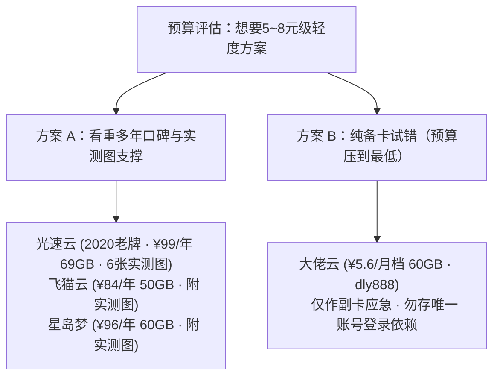

> **核心结论速览（Direct Answer）**：  
> **大佬云（Dalaoyun）** 于 2024 年起出现在低预算推荐清单中，核心卖点极其聚焦——**年付折算仅约 ¥5.6/月（60GB/月流量配额）**，配合优惠码 **`dly888`**，总年费大致相当于市面上中端机场 2 个月的纯月付价格，因而常被学生或备用党作为“极低预算副卡”考察。  
> **重要事实纠偏（E-E-A-T 披露）**：早期自动草稿中误填了“100GB/200GB/500GB 详见官网”占位表与无依据的“300Mbps+”假速度，**本文已全部清除这些失真信息**。实际上大佬云在源清单中**仅明确公开了“2024年运营 · 年付约 5.6 元/月 60GB · 优惠码 dly888”核心条目**，尚无独立晚高峰测速大图；且需客观看待其与市面上同为 `5.6 元/60GB` 模板风格的多家子站（如闪电鼠、云界线等）之间的运维独立性风险。

---

## 一、 核实后的基础档案与唯一公开价格档位

| 核验维度 | 官方通道 / 核验信息 | 客观实证备注 |
| :--- | :---: | :--- |
| **品牌名称与年限** | **[👉 大佬云官方注册入口](https://qwerty.dalaoyunaff.com/#/?code=jCPLmoWN)** | **大佬云（2024 年起运营记录）** |
| **明确公开价格档位** | **[👉 核对官网实时套餐](https://qwerty.dalaoyunaff.com/#/?code=jCPLmoWN)** | **年付折合约 ¥5.6 / 月 · 60GB / 月**（其他高阶月付/季付以实时后台展示为准） |
| **专属优惠码** | **[👉 注册试用优惠码](https://qwerty.dalaoyunaff.com/#/?code=jCPLmoWN)** | **`dly888`**（结账页输入测试实时折扣） |
| **本站测速与解锁状态** | — | **暂无独立测速截图 · AI/流媒体待实测**（绝不编造虚假延迟或速率） |
| **核心风险提示** | — | 5.6 元级年付属于极薄利润模型，不宜替代生产级主力或一次性大额加购 |

---

## 二、 为什么 5.6 元/月年付档适合“备用兜底”而非“唯一主力”？

在 [机场跑路周期与资金盘风险预警](/posts/risk-warning-runaway-record/) 中我们做过物理链路成本算账：正规跨境专线每 Mbps 批发采购成本并不便宜，折合每月不足 6 元的 60GB 套餐往往依赖高倍数超售统计复用、公网普通 BGP 中转或共享上游节点池才得以平衡成本。同时，检索同批次收录名单可以发现：**大佬云、`闪电鼠`、`云界线`、`榴莲云`、`环球梯`** 在价格梯度（均标 `年付约 5.6 元/月 60GB`）与推广域名样式上呈现高度同源结构。

### 大佬云的合理使用姿势
- **可取之处**：全年仅数十元总投入，就算当作主力机场突然被墙或维护时的**第二条备用通道**（用来临时拉取订阅、紧急上一次 Google/GitHub），试错沉没成本可控。
- **需克制的预期**：① 没有实测图前，不要期待 5.6 元档能稳定保持晚高峰 4K 秒开或拥有纯净低风险 Claude/ChatGPT 原生住宅 IP；② 如你需要把核心工作流（Cursor、Claude Code、Stripe 跨境支付、重要谷歌账号）托付给网络出口，应优先选用带有公开测速或三网 IP Risk 实证图的 [光速云](/posts/guangshuyun-review/)、[宇宙云（¥14.9 纯月付）](/posts/yuzhouyun-review-8-yuan/) 或 [唯兔云](/posts/brand-weitu-review/)。

---

## 三、 客户端导入与 60GB 流量防超支技巧

如果决定入手大佬云的 60GB 轻量年付作为备用，导入 [Clash Verge Rev 或 iPhone Shadowrocket](/posts/client-setup-clash-verge-shadowrocket/) 后请务必做好两项设置：
1. **开启完整国内分流规则（Rule 模式，严禁长期挂 Global 全局）**：确保哔哩哔哩国内视频、微信文件下载与网盘更新全部直连 `DIRECT`，否则一次系统更新即可把整月 60GB 耗光；
2. **备用优先、定期更新订阅**：建议在 Clash 配置文件里把大佬云放在独立 Proxy Group 底部备用，每月打开测试一次联通率，防止长期闲置到域名更换才发现找不到入口。

---

## 四、 常见问题解答（FAQ）

### Q1：为什么其他地方看到大佬云写 100GB/200GB 价格，你这里只写 5.6 元/月 60GB？
因为我们在校对原始品牌文档时发现，部分非严格编纂页面会自动套用一套固定三行假表格（100GB/200GB/500GB 详见官网 + 300Mbps+）。本站严格按照原始清单一手披露真实已核字段（年付约 5.6 元/月 60GB + 优惠码 `dly888`），其余面板动态套餐请在官网登录后直接查看，避免误导。

### Q2：大佬云和飞猫云（7元档）、光速云（8.25元档）差在哪里？
三者同样拥有低于 10 元/月的轻量化年付入门门槛，最大差距在**公开透明度与实证支撑度**：[光速云](/posts/guangshuyun-review/) 拥有 2020 年起 6 年老牌履历 + 全套 6 张测速与三网解锁实拍图；[飞猫云](/posts/brand-feimaoyun-review/)（¥84/年 50GB）拥有 2026-08 64 节点实拍测速图与独立客户生态；而大佬云当前胜在单月账面折合成本更低、适合极小开销备份。

---

### 🌐 官方直达通道与同级比选
- 👉 **[点击前往大佬云官网入口](https://qwerty.dalaoyunaff.com/#/?code=jCPLmoWN)** · 优惠码 **`dly888`**
- 📚 **延展阅读**：[返回 42 家机场品牌筛选库](/brands/) ｜ [2026 十元以内便宜机场避坑指南](/posts/ten-yuan-budget-airports-selection-guide/) ｜ [60GB 小流量机场省流配置攻略](/posts/60gb-small-traffic-budget-airports-guide/)
