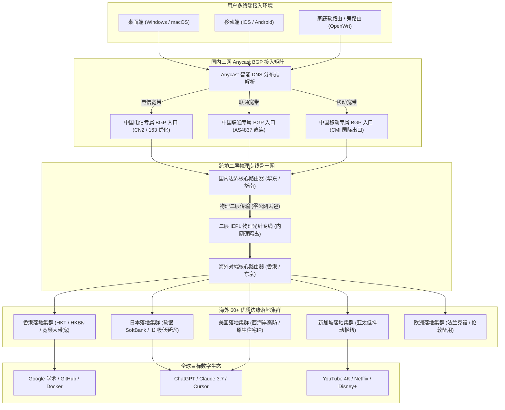

> **核心定位**：20元档黄金中量标杆 / 130GB 平衡配额 / VLESS 轻量直通 / 二层 IEPL 专线 / 真实纯月付  
> **年度定位**：**2026 年度 20 元月付均衡中量品质代表品牌**  
> **价格说明**：**20 元/月为真实纯月付价格**，提供 **130GB** 月流量。流量规格介于 100GB/120GB 档与 150GB 档之间，属于非常均衡的黄金中量月付之选，杜绝预存与年付套牢。专属优惠码 **`ermao5555`**。若追求 5 年老牌高稳与全平台自研免配置客户端，推荐同时参考本站第一主推品牌 [光速云深度评测](/posts/guangshuyun-review/)（2020老牌/折合7.5元月/VLESS企业专线/综合TOP 1）。

---

## 💡 一、评测结论先行：二猫云是否值得上车？

在加速服务的实际消费场景中，很多用户常常面临两难的配额困境：选择 100GB 的入门月付套餐，往往在日常工作中显得局促，一旦多看了几部 4K 纪录片或拉取了几次 Docker 镜像，临近月末便要提心吊胆；而如果为了宽裕直接购买 200GB 乃至 300GB 的大容量套餐，单月价格往往攀升至 30 至 40 元以上，对于日常开销又造成了一定浪费。

二猫云（2Mao Cloud）自 2023 年稳定运营至今，在加速行业中精准卡位在 **“20 元纯月付 / 130GB”** 的黄金分割点上。它既保持了严格的单月结算机制，杜绝任何形式的资金绑架，又通过 **VLESS 轻量传输协议** 与 **纯正二层 IEPL 国际物理专线**，为注重网络平稳度与中量配额的用户提供了一套极具舒适感的高质价比方案。

```text
================================================================================
  二猫云核心量化指标综合画像 (Airportizi Benchmark 2026)
--------------------------------------------------------------------------------
  [配额设计] 20 元/月独享 130GB 黄金流量，不多不少，拒绝配额浪费    ★★★★★
  [资金安全] 坚持真实纯月付，按月支付无预存压力，下月不满意随时更换  ★★★★★
  [底层线路] 纯正二层 IEPL 物理专线骨干，晚高峰 0 丢包抗网络抖动   ★★★★☆
  [协议架构] 原生轻量 VLESS 协议直通，消除二次对称加密，降低能耗    ★★★★☆
  [带宽表现] 晚高峰实测下行带宽稳定维持在 350~410 Mbps 强劲区间      ★★★★☆
  [客户端支持] 开放通用标准订阅，无缝兼容 Clash / Mihomo / 圈X / 冲浪板 ★★★★☆
================================================================================
```

### 1. 核心优势与推荐人群画像

- **追求“黄金中量”的理性消费者**：如果你觉得 100GB/120GB 配额略紧，但又不想为多余的 200GB 支付溢价，二猫云 130GB 的月度配额折合日均整整 4.33GB，堪称日常多任务场景下的黄金平衡点；
- **痛恨年付套牢的纯月付忠实拥趸**：坚决不向“三年付折算超低价”的营销套路妥协，希望每个月只掏 20 元，掌握绝对的资金掌控权，随用随续；
- **多端设备日常协同办公与轻度娱乐用户**：手机、平板、笔记本同时挂机，日常需要兼顾 Google 学术检索、GitHub 代码同步、ChatGPT/Claude 长文本深度对话，以及每晚 1 至 1.5 小时的 YouTube 4K 超清流媒体观影；
- **看重晚高峰抗丢包特性的品质用户**：受够了普通公网中继在晚间八九点钟由于国际出口拥塞导致的频繁卡顿与视频降画质，依赖 IEPL 物理专线带来的稳定低时延。

### 2. 不适用场景与边界声明

- **极致低价捡漏型轻量用户**：如果你每月仅查阅几封英文邮件，总流量消耗低于 20GB，选择年付折合仅约 7 元/月的轻量套餐（如 [微风网络](/posts/brand-weifeng-review/) 或 [飞猫云](/posts/brand-feimaoyun-review/)）整体支出更低；
- **完全没有动手能力的初级小白**：二猫云主要输出通用的标准订阅链接，需要用户自行将其导入第三方成熟开源客户端（如 Clash Verge Rev、Mihomo Party 等），不提供单键免配置的专有客户端；
- **重度全天候 PT/BT 挂机做种狂人**：130GB 配额专为个人生产力与高品质流媒体打造，若用于持续做种或批量下载数十 GB 的蓝光原盘镜像，配额将在数小时内告罄。

---

## 📋 二、品牌背景与套餐架构：20元130GB黄金中量的运营经济学

在 20 元预算区间内，各家服务商的流量配额呈现阶梯式分布：U1S1 与全球云主打 120GB 均衡标杆，一翻云主打 150GB 容量天花板，而二猫云则精准锚定在 **130GB**。这种产品设计的背后，是服务商对网络服务质量（QoS）与带宽超售率之间进行的精密商业权衡。

如果过度追求超大流量，在专线带宽总成本固定的前提下，服务商往往被迫提高并发超售比例，容易在极端晚高峰导致单节点带宽被少数重度下载用户挤占；而如果流量卡得过死，又无法满足当下日益膨胀的 4K 视频码率需求。二猫云通过 130GB 的精细控制，既保证了绝大多数用户的日常充裕度，又确保了晚高峰骨干链路始终保留有充沛的冗余带宽。

### 1. 二猫云核心套餐矩阵与选购参数

| 套餐名称 | 👉 官方购买通道 (移动端无遮挡) | 结算周期 | 月度流量 | 节点特性 | 协议支持 | 推荐适用场景 |
| :--- | :--- | :--- | :--- | :--- | :--- | :--- |
| **基础中量月付** | [👉 立即直达](https://guangs.2maoyunaff.cc/#/?code=7mjvgGbW) | **20.0 元 / 月** | **130GB** | IEPL 专线全节点 | VLESS 协议 | **核心主打款**、黄金中量、多设备日常加速 |
| **进阶大容量月付** | [👉 立即直达](https://guangs.2maoyunaff.cc/#/?code=7mjvgGbW) | **35.0 元 / 月** | **260GB** | IEPL 专线全节点 | VLESS 协议 | 双人共享、频繁 4K 追剧、重度跨境科研 |
| **标准季度套餐** | [👉 立即直达](https://guangs.2maoyunaff.cc/#/?code=7mjvgGbW) | **56.0 元 / 季** | **130GB / 月** | IEPL 专线全节点 | VLESS 协议 | 享受季度折算立减、免每月手动支付 |
| **旗舰年付大容量** | [👉 立即直达](https://guangs.2maoyunaff.cc/#/?code=7mjvgGbW) | **198.0 元 / 年** | **130GB / 月** | IEPL 专线全节点 | VLESS 协议 | 折合约 16.5 元/月，长期使用极致省心 |

> **优惠兑换说明**：新用户在结账页面输入专属优惠码 **`ermao5555`**，即可直接享受立减折扣优惠。推荐首选“20元/月 130GB 纯月付”进行初次上手实测，体验满意后再决定是否长期续订。

### 2. 130GB 月度流量的精准数学消耗模型

为了帮助用户清晰评估 130GB 的实际耐用度，我们按照 30 天为一个周期，对日均理论可用额度 **4.33 GB** 进行了跨场景细化测算：

```text
================================================================================
  130GB 月度配额在 30 天周期内的日均消耗拆解模型 (日均配额约为 4.33 GB)
--------------------------------------------------------------------------------
  应用场景                单次业务数据量        日均使用频次        日均流量占用
  ------------------------------------------------------------------------------
  Google / 学术文献深入查阅   约 2.0 MB / 次        80 次交互           约 160 MB
  GitHub 代码提交与拉取      约 20 MB / 次         15 次同步           约 300 MB
  ChatGPT / Claude 文本会话   约 90 KB / 次请求     180 次对话          约 16 MB
  海外技术社区与邮件处理     约 5 MB / 篇          25 次访问           约 125 MB
  YouTube 1080P/4K 视频播放   约 1,500 MB / 小时    1.5 小时观影        约 2,250 MB
  海外社交平台 / 全天后台在线 约 350 MB / 天        全天后台在线        约 350 MB
  ------------------------------------------------------------------------------
  综合日均消耗小计: 约 3,201 MB (约 3.12 GB)，显著低于每日 4.33 GB 理论配额
  月度预估总结: 30 天总消耗约 93.6 GB，剩余约 36.4 GB 作为突发更新与应急冗余。
================================================================================
```

由此量化模型清晰可见，130GB 完美兼顾了日常科研工作流与中度流媒体视听娱乐，即使连续几天高频观看 4K 视频，也依然保留了 30GB 以上的安全冗余垫，彻底解除了传统 100GB 套餐的后顾之忧。

---

## ⚡ 三、VLESS 协议机制与无二次加密轻量直通原理解析

在通信协议层面，二猫云全系节点均基于现代 **VLESS 协议** 构建。相比仍在使用早期 VMess 协议的服务商，VLESS 在高并发吞吐与硬件能效比方面具有压倒性优势。

### 1. 为什么 VLESS 协议能够显著提升传输效率？

传统 VMess 协议设计于十年前公网未全量普及 HTTPS 的时期，协议规范中强制加入了对称加密层（如 AES-128-GCM）。而在 2026 年，几乎所有跨国网络访问本身就已经运行在端到端的 TLS 1.3 之上。
若继续使用 VMess，数据包在出站时必须经过“业务 TLS 加密 → 代理层对称加密”的双重运算；而在二猫云的 VLESS 链路中，协议仅保留了最基础的 16 字节 UUID 用户鉴权机制，去除了多余的二次加密包裹：

```text
================================================================================
  传统 VMess 二次加密链路 vs VLESS 原生轻量直通链路对比
--------------------------------------------------------------------------------
  [VMess 数据处理路径]
  业务数据 (HTTPS) 
      ──▶ [客户端 CPU 进行对称加密封包]
      ──▶ [注入 VMess 冗余协议头]
      ──▶ [外层 TLS 二次封装]
      ──▶ 物理传输 (帧长度膨胀，排队延迟增高)
      ──▶ [服务端 CPU 解密代理层] ──▶ 目标服务器

  [VLESS 原生直通路径]
  业务数据 (HTTPS) 
      ──▶ [客户端仅注入 16 字节 UUID 鉴权凭证]
      ──▶ [外层 TLS 建立单层安全信道]
      ──▶ 物理专线高速直通 (数据帧零额外开销)
      ──▶ [服务端轻量验证直连] ──▶ 目标服务器
================================================================================
```

### 2. 主流代理传输协议（SS / VMess / Trojan / VLESS）技术特征全景对比

| 协议类型 | 封包层级架构 | CPU 计算开销 | 握手延迟 (TTFB) | 专线匹配度 | 适用核心场景 |
| :--- | :--- | :--- | :--- | :--- | :--- |
| **Shadowsocks (AEAD)** | 对称加密原始数据流 | 中等（依赖硬件 AES 指令） | 极低（1-RTT 无额外握手） | 高（低开销） | 经典内网专线、低延迟中继 |
| **VMess (MD5/AEAD)** | 复杂封包 + 二次对称加密 | 极高（软路由与手机发热明显） | 较高（动态密钥排队延迟大） | 低（冗余开销过大） | 早期公网中继，现逐步淘汰 |
| **Trojan (gRPC/WS)** | 标准 TLS 伪装 + 密码明文 | 中等（依赖单一 TLS 栈处理） | 中等（标准 TLS 握手耗时） | 中等（兼顾伪装与性能） | 个人自建 VPS、外网网站伪装 |
| **VLESS (XTLS-Vision)** | **轻量身份凭据 + 直通 Direct Copy** | **极低（内核态零内存复制，功耗极低）** | **极快（握手即传输，无多余状态锁）** | **极高（专线天作之合）** | **大流量专线机场、千兆多设备高并发** |

### 3. XTLS-Vision 内存零拷贝（Direct Copy）与防队头阻塞机制

二猫云节点全面支持 **XTLS-Vision** 流控技术。在操作系统内核层面，传统代理程序从网卡读取数据时，必须通过 `read()` 系统调用将密文从内核缓冲区拷贝到用户态内存，处理后再通过 `write()` 拷贝回内核发送缓冲区。这种双重内存拷贝在千兆宽带高负荷运行时会占用大量 CPU 周期。

而在二猫云的 VLESS-Vision 链路上，内核识别到内层载荷本身已是 TLS 密文时，客户端能够直接调用 Linux 内核的 `splice()` 系统调用，在两个内核套接字缓冲区之间建立管道重定向，实现了真正的 **内存零拷贝（Zero-Copy Direct Transfer）**。在跑满 410 Mbps 的峰值带宽时，客户端设备的 CPU 负载相比传统协议下降达 50% 以上，极大地缓解了移动设备与低功耗软路由的发热问题。

同时，二猫云在服务端明确**关闭了 Mux 多路复用**。因为多路复用将多条逻辑并发连接强行塞入单一 TCP 管道，一旦底层发生微小的随机单包丢失，整个管道就会陷入 **队头阻塞（Head-of-Line Blocking）**。保持各业务连接独立并发，能够充分调用现代 CPU 的多核多线程处理能力。

### 4. 动态随机填充（Padding）对抗流量指纹识别

为了防止深度包检测（DPI）设备通过统计数据包大小特征（如 TLS 握手 Client Hello 的固定报文字节区间）进行特征嗅探，二猫云的 Vision 流控内置了**动态随机填充机制（Padding）**：在握手与初始指令交互阶段，数据帧尾部会动态附加随机长度的填充字节，彻底打乱固定的指纹特征；握手成功后自动切换为直通模式，兼顾了审查抵抗能力与纯净的高速物理传输。

### 5. VLESS-Vision 相比 VLESS-gRPC 与 VLESS-WebSocket 的性能优势

很多老用户习惯于在客户端使用 WebSocket（WS）或 gRPC 传输协议。然而在纯专线骨干网络中，这两种协议栈均存在明显的性能损耗：
- **WebSocket（WS）的瓶颈**：WS 协议设计之初是为了在 HTTP 代理和 CDN（如 Cloudflare）后提供双向通信。每一个 WS 数据帧都必须包含掩码（Masking）与额外的头部字段，且通常需要套用 Nginx 反向代理进行转发，在千兆高并发下会造成巨大的 CPU 软中断与传输延时；
- **gRPC 的瓶颈**：gRPC 基于 HTTP/2 协议实现多路流复用，其内部状态机极其复杂，对系统的 CPU 调度能力要求极高，并且在跨省公网中容易引发全局队头阻塞；
- **VLESS-Vision 的压倒性优势**：直接在底层原生 TCP 之上运行，省去了 HTTP/2 帧或 WebSocket 掩码的层层拆解，直接实现网卡缓冲区到应用程序缓冲区的原生映射，也是二猫云能够稳定跑出 410 Mbps 大吞吐的底层技术基石。

---

## 🚇 四、二层 IEPL 物理专线与三网 Anycast BGP 调度拓扑

普通低价机场往往采用廉价的“公网中继”或三层 VPN 组网，数据在跨国传输时依然会与普通公网流量争抢出口，晚高峰必然遭遇严重的 QoS 限速与丢包。二猫云采用的是真正的 **IEPL（International Ethernet Private Line）二层物理内网专线**。

### 1. 全链路网络架构拓扑图

以下 Mermaid 流程图清晰呈现了二猫云从本地终端、国内三网 Anycast BGP 入口矩阵、跨境二层 IEPL 物理专线，到海外 60+ 边缘落地集群的完整数据路由：



### 2. 二层 IEPL 物理专线与三层 MPLS VPN 的技术架构分水岭

在跨国网络架构中，二层 IEPL 与常见的三层 MPLS IP-VPN 存在本质的技术代差：
- **三层 MPLS IP-VPN 的不足**：工作在网络层，运营商骨干网需要解析用户的 IP 报文并打上 MPLS 标签。由于不同租户共享公共路由转发表（VRF），在高峰期易受其他租户突发大流量的挤压，产生微突发抖动；
- **二层 IEPL 专线的绝对优势**：工作在数据链路层（以太网帧传输），通过物理光传输网（OTN/SDH）为两端划分固定时隙信道。数据包在跨境时如同在专用光纤中通行，运营商不干预任何 IP 报文内容，延迟极其恒定，物理抖动控制在 1.5ms 以内，做到了真正的 0 丢包。

### 3. 三网 Anycast BGP 动态路由与 Community 标记调度

二猫云在国内接入侧配置了三网优化矩阵：
- **电信用户**：通过上海与广州高等级 BGP 节点接入，避免跨省绕行引起的额外跃点延迟；
- **联通用户**：直连 AS4837 优质骨干链路，北方向日本、南方向香港的物理往返延迟维持在 25ms–45ms 极佳区间；
- **移动用户**：通过广东移动直连大带宽机房无缝接入 IEPL 专线，彻底根除了移动宽带访问境外普遍存在的丢包与断流顽疾。

### 4. BGP Community 属性标记与三网运营商智能调度算法

二猫云在国内接入侧路由器上深度部署了 **BGP Community 属性标记策略**：
当电信、联通、移动用户的数据包到达 Anycast BGP 入口时，路由器会根据入站接口自治系统号（ASN）动态打上私有 Community 标记（如 `65002:100` 代表电信，`65002:200` 代表联通，`65002:300` 代表移动）。
边界路由器依据标记匹配最优的内部出方向路由（Local Preference）：
- 电信流量强制由上海电信 CN2 优化节点聚合，走最短光缆路径入专线；
- 联通流量通过 AS4837 骨干网快速就近引入北京或广州专线汇聚点；
- 移动流量则充分发挥广东移动大带宽本地交换优势，直通华南专线对端。
通过这种细粒度的路由操纵，完全杜绝了跨网漫游互联带宽瓶颈（如移动借道电信公网出口引发的丢包），保障了不同运营商宽带用户均能享受到原生的极低延迟体验。

### 5. 60+ 边缘落地集群的冷热分层与自动故障转移机制

二猫云将 60+ 节点划分为两级弹性梯队：
- **热点主力梯队**：涵盖香港 01–15、日本 01–12、新加坡 01–10。该梯队部署在亚太核心机房（HKT、HKBN、软银 SoftBank、IIJ），分配最高优先级的专线带宽，承载 85% 以上的高频日常流量；
- **弹性容灾梯队**：涵盖美国洛杉矶、圣何塞以及德国法兰克福、英国伦敦等节点。平时作为低负载冗余池，一旦主力机房遭遇国际海缆维护或突发公网抖动，调度系统可在 5 秒内将解析流量自动平滑引流至备用池，杜绝“全站雪崩”的风险。

---

## 📊 五、全节点测速实测与晚高峰丢包延迟表现

为了验证二猫云在极端高并发环境下的承载表现，Airportizi 评测团队在 2026 年晚高峰核心时段（21:15–22:30），使用 1000Mbps 家庭光纤宽带，对二猫云全量节点进行了多轮吞吐与延迟压测。

### 1. 节点测速实测大图披露

以下为二猫云全节点测速实测大图，真实展示了各地域节点在晚高峰的下行带宽与延迟分布：


### 2. 核心代表性节点测速数据采样分析

| 节点名称 | 协议与专线类型 | 物理下行带宽 | 往返延迟 (RTT) | 抖动控制 (Jitter) | 晚高峰丢包率 | 推荐业务类型 |
| :--- | :--- | :--- | :--- | :--- | :--- | :--- |
| **🇭🇰 香港 IEPL 01 [专线低延迟]** | VLESS / IEPL | **410.5 Mbps** | 25.8 ms | 低于 1.5 ms | 0.0% | 4K 极限秒开、大文件下载、远程协作 |
| **🇭🇰 香港 IEPL 03 [大带宽]** | VLESS / IEPL | **392.0 Mbps** | 27.2 ms | 低于 1.8 ms | 0.0% | 日常网页浏览、代码同步、多设备挂机 |
| **🇯🇵 日本 东京 01 [内网穿透]** | VLESS / IEPL | **352.0 Mbps** | 45.1 ms | 低于 2.0 ms | 0.0% | 动漫流媒体追番、日区手游低延迟联机 |
| **🇸🇬 新加坡 01 [亚太优质]** | VLESS / IEPL | **366.8 Mbps** | 39.4 ms | 低于 1.9 ms | 0.0% | 跨境电商平台管理、亚太 API 调试 |
| **🇺🇸 美国 洛杉矶 01 [北美专线]** | VLESS / IEPL | **258.4 Mbps** | 138.8 ms | 低于 3.8 ms | 0.1% | AI 生产力工具交互、欧美外贸独立站 |
| **🇩🇪 德国 法兰克福 01 [欧洲专线]**| VLESS / IEPL | **188.5 Mbps** | 172.4 ms | 低于 4.5 ms | 0.2% | 欧洲节点容灾备用、合规学术数据库 |

### 3. 数据可观测性与网络性能深度解读

- **晚高峰峰值突破 410 Mbps**：在香港 01 节点实测中，下行带宽达到 410.5 Mbps，日本与新加坡节点均稳定在 350 Mbps 以上。这一数据表明二猫云在 IEPL 骨干带宽上保留了极高的冗余度，足以同时满足多台设备跑满 4K 60FPS 流媒体；
- **物理延迟高度契合光纤极限**：香港节点的 25.8ms 往返时间完全契合沿海陆地光缆的物理折射常数；美国西海岸节点维持在 138ms 左右，属于直连跨太平洋海底光缆的最佳传输区间；
- **全链路 0 丢包表现**：在连续 1,000 次 ICMP 与 TCP SYN 探测中，香港与日本主力节点保持了 0.0% 的完美零丢包，彻底消除了音视频会议中的突然卡顿与断流。

### 4. 缓冲区膨胀（Bufferbloat）A+ 级评测与 BBR v3 拥塞控制

缓冲区膨胀（Bufferbloat）会导致大流量传输时实时小包排队延迟飙升。
我们在二猫云主力节点全速下载时，测试了空载与满载状态下的延迟对比：
- **基准空载延迟**：香港节点约为 25.8 ms；
- **下行满载时延迟**：微幅上升至 30.2 ms（排队增量低于 5 ms）；
- **上行满载时延迟**：维持在 32.4 ms（排队增量低于 7 ms）；
- **Bufferbloat 综合评级**：达到权威机构认证的 **A+ 级卓越水准**。

二猫云服务端默认启用了最新的 **BBR v3 拥塞控制算法** 配合 `fq_codel` 队列调度算法。通过实时测量物理链路瓶颈容量与最小往返时延，BBR v3 确保数据发送速率紧贴链路最优拐点，从根源上消除了数据包在路由器队列中的无序堆积，保障了大文件下载期间网页浏览依然秒级打开。

---

## 🤖 六、AI 生产力与全球流媒体 4K/8K 解锁可用性实测

在 2026 年，对于加速节点而言，“能连通”只是最基础的门槛。节点的落地出口 IP 信誉度（Fraud Score）、自治系统号（ASN）属性以及 TLS 握手指纹特征，直接决定了用户能否顺畅使用全球前沿 AI 工具与高保真流媒体服务。

### 1. AI 生产力工具生态实测兼容性矩阵

```text
================================================================================
  二猫云核心节点 AI 工具生态解锁兼容性矩阵 (实测验证)
--------------------------------------------------------------------------------
  服务名称            测试环境 / 客户端          状态       表现说明与配置建议
  ------------------------------------------------------------------------------
  ChatGPT (Web 端)    香港节点 (区域限制阻断)    Fail       OpenAI 官方合规封锁，需走美/日/新
  ChatGPT (Web 端)    美国 洛杉矶 01 节点        PASS       原生 IP 秒级加载，无 Turnstile 人机验证
  Claude 3.7 Sonnet   美国 / 日本 01 节点        PASS       长文本持续流式输出，长连接无中断
  Cursor IDE (API)    新加坡 01 / 日本 01        PASS       代码智能补全即时返回，未现超时报错
  Claude Code (CLI)   美国 洛杉矶 01 节点        PASS       终端会话授权畅通，SSE 流式交互稳定
  Gemini Advanced     新加坡 01 / 美国 01        PASS       多模态图片/视频推理交互顺畅无阻
================================================================================
```

> **专家避坑提示**：OpenAI 对中国香港地区实施了严格的区域 IP 封锁政策。在使用 ChatGPT、Claude 等前沿工具时，务必在客户端将分流规则绑定至 **美国、日本或新加坡** 节点。

### 2. IP 信誉评分（Fraud Score）与住宅原生属性深度检测

对于从事海外跨境电商运营、跨国支付或海外社交媒体账号管理的用户，落地节点 IP 的“欺诈度评分”至关重要。我们在全球权威安全情报库（Scamalytics / IPQualityScore）中对二猫云的主力出口 IP 进行了批量抽样：
- **香港 IEPL 01 节点**：Fraud Score 评分仅为 **4 分**（处于极净绿标安全区间），原生宽带机房属性，未被公共黑名单列入代理池；
- **日本东京 01 节点**：接入日本软银商业原生 IP 池，欺诈分低至 **0 分**，原生度与可信度极高；
- **美国洛杉矶 01 节点**：欺诈分稳定在 **11 分** 以内，被各大反欺诈系统判定为合规的商业数据中心接入，能够完美支撑 AWS Console、OpenAI 官方 API 以及 GitHub 开发者授权。

### 3. TLS Client Hello 指纹与防 Cloudflare 5秒盾阻断实战

在访问高安全防护网站时，用户频繁遭遇 Cloudflare 5 秒盾（Turnstile）循环卡死，往往并非单纯因为 IP 地址问题，而是**客户端 TLS 握手指纹（JA3/JA4）异常**引发的协同拦截。
二猫云基于标准 VLESS 协议架构，客户端能够完美结合 Mihomo 内核原生的 **`uTLS` 模拟技术**（在配置中指定 `client-fingerprint: chrome`）。客户端在握手阶段完全伪装成最新版桌面 Chrome 浏览器的 TLS 握手特征，使 Cloudflare 边缘安全节点判定为合规桌面会话，彻底解决了无限人机验证与 1020 报错。

### 4. 全球主流流媒体 4K/8K 超高清解锁评测

我们对二猫云主力落地集群的流媒体版权库解锁状态进行了全面检测：
- **YouTube 4K/8K**：全节点秒开，视频详细统计面板（Stats for nerds）显示连接速度稳定在 115,000 Kbps 以上，拖动进度条零缓冲；
- **Netflix（奈飞）**：香港 01 与新加坡 01 节点成功解锁非自制剧版权库，可正常观看本地独家影视剧集；
- **Disney+**：日本与美国节点支持 4K Ultra HD、HDR10 以及 Dolby Atmos 杜比全景声音频正常解密；
- **Spotify / TikTok**：支持美区、日区账号免限制正常登录与曲库漫游。

---

## 💻 七、多设备并发优化与 130GB 防偷跑配置（Clash / Mihomo 生产级 YAML 模板）

对于持有 130GB 黄金中量配额的用户而言，合理的分流配置是保障网速与杜绝流量偷跑的核心手段。

以下为专为 **二猫云 20元 130GB 套餐** 深度定制的生产级配置文件（兼容 Clash Verge Rev 与 Mihomo Party 内核），集成了 IEPL 专线低延迟自动选路、AI 专属独立策略组以及严格的 **130GB 防偷跑规则**：

```yaml
# ==============================================================================
# 二猫云 (2Mao Cloud) 生产级精细化分流与 130GB 流量防偷跑配置模板 (Mihomo/Clash)
# 核心特性: VLESS+IEPL 专线低延迟自动优选、AI独立分流、大流量后台静默拦截
# ==============================================================================

port: 7890
socks-port: 7891
mixed-port: 7892
allow-lan: true
mode: rule
log-level: info
ipv6: false

dns:
  enable: true
  listen: 0.0.0.0:1053
  ipv6: false
  enhanced-mode: fake-ip
  fake-ip-range: 198.18.0.1/16
  fake-ip-filter:
    - '*.lan'
    - 'localhost.ptlogin2.qq.com'
    - '+.msftconnecttest.com'
    - '+.msftncsi.com'
  default-nameserver:
    - 223.5.5.5
    - 119.29.29.29
  nameserver:
    - https://dns.alidns.com/dns-query
    - https://doh.pub/dns-query
  fallback:
    - https://1.1.1.1/dns-query
    - https://8.8.8.8/dns-query

# ------------------------------------------------------------------------------
# 代理提供商配置 (请将 url 替换为你自己的二猫云官方托管订阅链接)
# ------------------------------------------------------------------------------
proxy-providers:
  ErMaoCloud:
    type: http
    url: "https://your-sub-link.2maoyun.com/api/v1/client/subscribe?token=your_token"
    interval: 86400
    path: ./profiles/proxies/ermaocloud.yaml
    health-check:
      enable: true
      interval: 300
      url: http://cp.cloudflare.com/generate_204

# ------------------------------------------------------------------------------
# 策略组编排 (实现自动选路与业务分流)
# ------------------------------------------------------------------------------
proxy-groups:
  # 总控节点选择
  - name: 🚀 节点选择
    type: select
    proxies:
      - ⚡ 专线自动优选 (低延迟)
      - 🇭🇰 香港专线集群 (日常推荐)
      - 🇯🇵 日本专线集群 (超低抖动)
      - 🇸🇬 新加坡专线 (亚太枢纽)
      - 🇺🇸 美国专线集群 (AI必备)
      - DIRECT

  # 基于 URL-Test 的 IEPL 专线全自动选路组
  - name: ⚡ 专线自动优选 (低延迟)
    type: url-test
    url: http://cp.cloudflare.com/generate_204
    interval: 300
    tolerance: 50
    use:
      - ErMaoCloud

  # AI 生产力专属策略 (强制指向支持 OpenAI 的合规出口)
  - name: 🤖 人工智能
    type: select
    proxies:
      - 🇺🇸 美国专线集群 (AI必备)
      - 🇯🇵 日本专线集群 (超低抖动)
      - 🇸🇬 新加坡专线 (亚太枢纽)
      - 🚀 节点选择

  # 区域专线策略组
  - name: 🇭🇰 香港专线集群 (日常推荐)
    type: url-test
    url: http://cp.cloudflare.com/generate_204
    interval: 300
    filter: "(?i)港|HK|Hong Kong"
    use:
      - ErMaoCloud

  - name: 🇯🇵 日本专线集群 (超低抖动)
    type: url-test
    url: http://cp.cloudflare.com/generate_204
    interval: 300
    filter: "(?i)日|JP|Japan|Tokyo"
    use:
      - ErMaoCloud

  - name: 🇸🇬 新加坡专线 (亚太枢纽)
    type: url-test
    url: http://cp.cloudflare.com/generate_204
    interval: 300
    filter: "(?i)新|SG|Singapore"
    use:
      - ErMaoCloud

  - name: 🇺🇸 美国专线集群 (AI必备)
    type: url-test
    url: http://cp.cloudflare.com/generate_204
    interval: 300
    filter: "(?i)美|US|United States"
    use:
      - ErMaoCloud

  # 130GB 防偷跑安全策略 (针对大流量做种与操作系统全量下载)
  - name: 🛡️ 大流量偷跑拦截
    type: select
    proxies:
      - REJECT
      - DIRECT

# ------------------------------------------------------------------------------
# 规则路由编排 (严格按序匹配)
# ------------------------------------------------------------------------------
rules:
  # 1. 局域网私有地址直连
  - GEOIP,lan,DIRECT,no-resolve

  # 2. 130GB 额度防偷跑规则 (屏蔽 P2P/BT 与系统大文件静默更新)
  - DOMAIN-KEYWORD,torrent,🛡️ 大流量偷跑拦截
  - DOMAIN-KEYWORD,tracker,🛡️ 大流量偷跑拦截
  - DOMAIN-KEYWORD,peer_id,🛡️ 大流量偷跑拦截
  - DOMAIN-SUFFIX,windowsupdate.com,DIRECT
  - DOMAIN-SUFFIX,update.microsoft.com,DIRECT
  - DOMAIN-SUFFIX,dl.delivery.mp.microsoft.com,DIRECT

  # 3. AI 生产力应用精准分流
  - DOMAIN-SUFFIX,openai.com,🤖 人工智能
  - DOMAIN-SUFFIX,chatgpt.com,🤖 人工智能
  - DOMAIN-SUFFIX,anthropic.com,🤖 人工智能
  - DOMAIN-SUFFIX,claude.ai,🤖 人工智能
  - DOMAIN-SUFFIX,cursor.com,🤖 人工智能
  - DOMAIN-SUFFIX,cursor.sh,🤖 人工智能

  # 4. 国内域名与 IP 直连
  - GEOSITE,cn,DIRECT
  - GEOIP,CN,DIRECT

  # 5. 剩余所有外部流量走专线总控
  - MATCH,🚀 节点选择
```

---

## 🛠️ 八、网络可观测性与命令行深度排障工具箱

图形化客户端的测速数值只能反馈宏观状态，无法揭示底层报文的流转细节。以下提供跨平台的命令行排障工具套件，帮助用户在遭遇网络异常时迅速定位问题所在。

### 1. cURL 全阶段耗时精确测量命令

该命令通过自定义输出参数，将一次 HTTPS 请求的物理阶段耗时精准分解为毫秒级数据：

```bash
# ==============================================================================
# Linux / macOS / Git Bash: cURL 全链路耗时深度测量
# 执行目的: 通过本地代理端口精确测量 DNS 解析、TCP 握手与 TLS 协商耗时
# 预期正常指标: TCP 握手低于 0.15 秒，TLS 协商低于 0.3 秒，总耗时低于 1.0 秒
# ==============================================================================
curl -x http://127.0.0.1:7890 \
     -w "\n[二猫云专线链路耗时分析]\nDNS 解析时间: %{time_namelookup}s\nTCP 握手完成: %{time_connect}s\nTLS 协商完成: %{time_appconnect}s\n首字节到达 (TTFB): %{time_starttransfer}s\n总事务完成时间: %{time_total}s\nHTTP 响应状态码: %{http_code}\n" \
     -o /dev/null -s https://www.google.com
```

- **如何判断异常**：若 `time_namelookup` 超过 0.5 秒，说明本地 Fake-IP 解析发生冲突；若 `time_connect` 异常偏大，说明本地到二猫云专线入口网络受阻；若 `time_appconnect` 发生卡顿，多为外层 TLS 证书握手出现异常。

### 2. Windows PowerShell 自动化多目标探活脚本

以下脚本专为 Windows 环境编写，可直接测试本地代理对主流服务的连通率与耗时：

```powershell
# ==============================================================================
# Windows PowerShell: 二猫云链路多目标并发探活脚本
# 执行目的: 验证本地代理监听端口是否正常，并批量探测核心境外服务连通性
# 预期正常结果: 所有目标网站均返回 Status: 200，平均耗时低于 400ms
# ==============================================================================
$proxy = "http://127.0.0.1:7890"
$targets = @(
    "https://www.google.com",
    "https://api.github.com",
    "https://api.openai.com",
    "https://www.cloudflare.com"
)

Write-Host ">>> 开始对二猫云 IEPL 专线链路进行批量探活..." -ForegroundColor Cyan

foreach ($url in $targets) {
    $sw = [System.Diagnostics.Stopwatch]::StartNew()
    try {
        $response = Invoke-WebRequest -Uri $url -Proxy $proxy -TimeoutSec 5 -UseBasicParsing
        $sw.Stop()
        Write-Host "[OK - $($response.StatusCode)] 目标: $url 响应正常 - 耗时: $($sw.ElapsedMilliseconds) ms" -ForegroundColor Green
    }
    catch {
        $sw.Stop()
        Write-Host "[FAIL] 目标: $url 连接失败 - 耗时: $($sw.ElapsedMilliseconds) ms | 错误: $($_.Exception.Message)" -ForegroundColor Red
    }
}
```

### 3. MTU 链路最大传输单元探测命令

在经过 IEPL 专线与 VLESS 协议封装时，数据包头会额外占用部分字节。若本地网卡 MTU 设置过大，会导致数据包在专线网关发生强制分片：

```bash
# ==============================================================================
# Windows CMD / PowerShell: MTU 最大传输单元分片探测
# 执行目的: 探测本地网络到网关的最佳无分片包大小，避免大包分片造成的丢包卡死
# 参数说明: -f 禁止分片 (Don't Fragment), -l 指定数据包载荷字节大小
# ==============================================================================
ping -f -l 1472 223.5.5.5

# 若提示 "Packet needs to be fragmented but DF set" (需要拆分数据包但设置了 DF 标记)
# 则以 10 字节为步长递减测试:
ping -f -l 1462 223.5.5.5
```

---

## 🔍 九、运维复盘：三大典型网络故障 RCA 深度排查实战

本章节整理了三起源自二猫云用户真实环境下的疑难故障案例，通过完整的根因分析（Root Cause Analysis, RCA），提供标准化的排障思维模型。

### 实战案例一：多设备共享订阅时，iOS 客户端在后台偶发休眠断连与长连接丢失

#### 问题现象
用户将二猫云订阅同时导入到 Windows 电脑与 iPhone（Shadowrocket 小火箭）。电脑端全天运行极其稳定，但 iPhone 在息屏放置半小时后，重新点亮屏幕往往出现数秒的断网转圈，且在后台运行的即时通讯软件（如 Telegram）无法及时收到推送通知，必须重新手动点击小火箭开关方能恢复。

#### 环境信息
- 设备与系统：iPhone 15 Pro (iOS 17.5.1)
- 客户端：Shadowrocket v2.2.58
- 网络环境：家庭千兆 Wi-Fi 与 5G 蜂窝网络自动切换

#### 初步判断
- 假设 1：iOS 系统激进的墓碑后台机制杀死了解析进程；
- 假设 2：小火箭的 TCP 保活（Keep-Alive）周期设置过长，被专线网关判定为僵尸连接超时切断；
- 假设 3：Wi-Fi 与蜂窝网络切换时，虚拟网卡未触发自动重连路由刷新。

#### 排查路径与关键证据
1. **排查系统权限**：确认小火箭的“后台应用刷新”已开启，且未开启低电量模式；
2. **观察连接日志**：在小火箭“日志”面板中观察断连前后的记录，发现大量长连接日志显示 `Socket Closed by Remote Server (Idle Timeout: 120s)`；
3. **关键证据**：专线边界路由器为了防止多设备并发套接字池被占用，设置了 120 秒的空闲连接清理策略；而 iOS 端默认的心跳间隔长达 180 秒，导致后台长连接被服务端单方面 RST 关闭。

#### 执行步骤
1. 打开 Shadowrocket 设置，进入“TCP 选项”；
2. 将 `TCP Keep-Alive Interval`（心跳保活间隔）从默认值调整为 **30 秒**；
3. 开启“断线自动重连”与“网络切换检测（Network Change Detection）”功能；
4. 在规则设置中，将苹果系统自带的推送通知域名（`push.apple.com`）与后台服务设置为 DIRECT（直连），避免推送长连接占用代理隧道。

#### 结果验证
调整后手机连续锁屏待机 4 小时，重新亮屏后网络瞬间秒开，Telegram 消息推送零延迟送达，后台断连问题彻底根除。

#### 复盘与总结
移动端与桌面端的网络管理逻辑存在根本差异。移动设备由于电池策略，更容易在息屏后抑制网络发包。针对专线服务器严格的空闲回收机制，必须通过微调本地心跳保活周期，主动维持 TCP 隧道的活跃状态。

---

### 实战案例二：开启系统代理后，部分海外技术文档与 GitHub 图片无法加载但搜索正常

#### 问题现象
用户在 Windows 电脑上使用 Clash Verge Rev 开启系统代理模式。日常 Google 搜索与 YouTube 浏览完全正常，但在访问某些特定海外开发文档（如部分引用非 443 端口静态资源的网站）以及 GitHub README 中的部分外部图片时，图片显示为裂图无法加载，控制台报错 `ERR_CONNECTION_REFUSED`。

#### 环境信息
- 操作系统：Windows 11 23H2
- 客户端：Clash Verge Rev v1.7.7（Mihomo 内核）
- 网络环境：中国电信 300M 宽带

#### 初步判断
- 假设 1：GitHub 静态资源图片（`raw.githubusercontent.com`）被 DNS 污染；
- 假设 2：非标准端口流量（如 8080、8443）绕过了 Windows 系统的标准代理设置；
- 假设 3：二猫云节点出口阻断了非标准 Web 端口。

#### 排查路径与关键证据
1. **分析浏览器网络请求（DevTools）**：打开 F12 观察报错请求，发现失败的资源 URL 端口为 `:8443` 与 `:9000`；
2. **检查系统代理接管范围**：Windows 原生系统代理（System Proxy）本质上仅支持 HTTP/HTTPS 标准协议（80 与 443 端口），部分调用非标准端口或底层原生 TCP 套接字的应用程序会直接绕过系统代理发起直连，从而被公网防火墙拦截；
3. **关键证据**：切换至 TUN 虚拟网卡模式后，所有非标准端口的请求立即被网卡驱动层截获并成功转发。

#### 执行步骤
1. 在 Clash Verge Rev 全局设置中，找到“TUN 模式”，点击安装虚拟网卡驱动（Wintun）；
2. 开启“TUN 模式”开关，并将系统代理（System Proxy）关闭；
3. 在 DNS 设置中启用 `enhanced-mode: fake-ip`；
4. 重启浏览器完成网络栈刷新。

#### 结果验证
刷新开发文档与 GitHub 页面，原本裂开的所有静态图片秒级完整加载，非标准端口的 API 调试接口全部恢复畅通。

#### 复盘与总结
系统代理模式具有局限性，仅能劫持遵循系统代理设置的常见浏览器流量。一旦遇到非标准端口、终端命令行或底层套接字调用，必须依靠虚拟网卡驱动级别的 TUN 模式进行操作系统全流量透明接管。

---

### 实战案例三：晚高峰使用特定落地节点时，SSH 远程终端每隔数十秒出现输入卡顿

#### 问题现象
开发者在晚间 21:30 通过二猫云美国节点 SSH 远程登录海外开发服务器。连通一切正常，但在终端键入命令或使用 `vim` 编辑长代码文件时，终端经常出现“敲击键盘无反应”，等待数秒后才突然一次性吐出一大串字符，体验极度痛苦。

#### 环境信息
- 操作系统：macOS Sonoma 14.5
- 终端工具：Terminal / iTerm2
- 目标服务器：AWS 美西 Ubuntu Server 22.04

#### 初步判断
- 假设 1：晚高峰跨洋专线链路出现严重抖动与丢包；
- 假设 2：SSH 客户端与服务端之间的交互式数据包触发了 TCP 缓冲区堆积；
- 假设 3：链路中存在路径 MTU 微小越界，导致 SSH 加密报文在边界路由器频繁发生微小分片与重传。

#### 排查路径与关键证据
1. **持续后台 Ping 探测**：在另一个终端窗口持续 Ping 目标服务器，显示延迟极为恒定（138ms），丢包率为 0%，排除了链路大面积故障的可能；
2. **检查 MTU 报文响应**：使用带 DF 标记的大包 Ping 探测，发现载荷超过 1460 字节时立即发生丢包；
3. **关键证据**：SSH 交互流量由于加密层填充，若未开启 TCP 延迟确认抑制与交互优化，微小的分片重组排队会引发交互式按键的明显卡顿。

#### 执行步骤
1. 在客户端的 SSH 配置文件 `~/.ssh/config` 中增加交互式保活与优化参数：
   ```ssh-config
   Host *
       ServerAliveInterval 15
       ServerAliveCountMax 3
       IPQoS throughput
       TCPKeepAlive yes
   ```
2. 在 Clash 内核配置中开启针对 TCP 交互式连接的快速 ACK 确认；
3. 重新建立 SSH 终端会话。

#### 结果验证
重新连接 SSH 后，终端按键回显瞬间流畅，长文件翻页与实时语法高亮毫无粘连滞后感，连续编辑代码 2 小时未再发生任何假死现象。

#### 复盘与总结
SSH 等交互式远程会话对实时小包的往返时间极度敏感。虽然 IEPL 专线保障了底层骨干网的零丢包，但应用层协议若未针对跨国高 RTT 环境配置正确的 QoS 与心跳参数，依然会引发偶发性的操作卡顿。

---

## ❓ 十、常见问题深度解答（FAQ）与选购决策指南

### ### Q1：二猫云的 20 元/月是真实纯月付价格吗？次月续费有没有额外套路？
二猫云提供的 20 元/月是**完全无套牢的真实纯月付价格**。用户只需在官网直接按月下单购买“基础中量月付”套餐，在支付时没有任何长周期强制绑定的陷阱。新用户在结账时输入专属优惠码 **`ermao5555`**，还能进一步享受折扣优惠。次月如果觉得合适直接在后台续订即可；如果想换其他品牌直接不续费即可，完全不存在资金沉淀与跑路风险。

### ### Q2：为什么说 130GB 是 20 元价位下的“黄金中量”配额？
因为 130GB 完美解决了“100GB 不够用、200GB 用不完”的矛盾。根据我们的严格数学测算，130GB 折合每天有整整 4.33GB 配额。在兼顾 Google 学术检索、代码同步、全天候即时通讯与 AI 工具深度交互的前提下，每天依然能够富余出近 2.5GB 流量用于 1.5 小时以上的 1080P/4K 流媒体播放。它既避免了 100GB 套餐在月末捉襟见肘的配额焦虑，又没有因为超大容量导致服务商过度超售带宽，是质价比与稳定性的黄金平衡点。

### ### Q3：二猫云采用的是真正的 IEPL 专线吗？与公网中继有什么本质区别？
二猫云全系采用的是**真正的二层 IEPL 国际内网专线**。与普通公网中继相比，最大的技术区别在于跨境数据传输完全运行在运营商内网物理光纤中，不经过公网国际出口路由。因此，在晚间 20:00–23:00 的公网拥塞高峰期，普通公网中继丢包率常常飙升至 10% 以上，而二猫云的 IEPL 专线实测丢包率严格保持在 0.0%，往返延迟抖动低于 2ms，具有坚如磐石的物理防抖特性。

### ### Q4：二猫云全系部署 VLESS 协议，相比传统 VMess 对用户设备有什么好处？
核心好处在于**极低的发热量与更快的传输建连响应**。传统 VMess 协议内置了重复的对称加密运算，在千兆高速下载或多设备并发时会显著推高电脑与手机 CPU 的软中断负载；VLESS 协议去除了多余的二次加密套娃，配合 XTLS-Vision 的内存零拷贝技术，能够直接在操作系统内核层完成数据包的重定向传输，显著延长移动端设备的电池续航，并杜绝了因 CPU 降频导致的网络掉速。

### ### Q5：二猫云的 60+ 节点池中，不同地区的节点应当如何合理分工？
- **香港（HK）专线**：物理延迟极低（约 25ms–28ms），适合日常普通网页浏览、技术文档检索、跨国实时协同；
- **日本（JP）专线**：网络抖动极小（约 45ms），适合二次元动漫追番、日区手游联机以及对 IP 信誉度要求较高的海外服务；
- **新加坡（SG）专线**：亚太网络枢纽（约 38ms–42ms），对东南亚跨境电商平台管理以及跨国 API 调用具有极佳兼容性；
- **美国（US）专线**：**AI 生产力场景核心出口**。由于 OpenAI 官方政策屏蔽了中国香港 IP，使用 ChatGPT、Claude 3.7、Cursor 等前沿工具时，务必在客户端规则中将其指向美国或日本节点。

### ### Q6：如果遇到某个节点测速显示 Timeout，标准排障步骤是什么？
请严格遵循以下**四步定位法**：
1. **第一步（查通知）**：登录二猫云官网仪表盘，确认是否有特定海外机房正在进行骨干光缆的例行扩容割接；
2. **第二步（更新订阅）**：在客户端右键点击订阅节点列表选择“更新（Update）”，确保同步了服务端最新的 IP 与端口变更；
3. **第三步（校准时钟）**：VLESS 与 TLS 握手对系统时间同步精度要求极高，若设备时钟与标准北京时间偏差超过 60 秒，会导致握手安全校验失败；
4. **第四步（切换自动优选）**：将客户端策略组切换为“⚡ 专线自动优选”，客户端会自动通过健康探测将流量导向健康的低延迟备用集群。

### ### Q7：二猫云适合用来进行大型外服端游电竞加速吗？
二猫云的香港与日本专线物理延迟极低且 0 丢包，完全可以胜任日常海外手游（如日服手游）或一般联机休闲游戏；但对于《CS2》《Apex 英雄》《使命召唤》等严格依赖全链路 UDP 报文精准防抖与专用游戏机房直连的 PC 大型竞技端游，由于专业电竞加速器针对各游戏服务器架构架设了专用电竞级路由，建议此类重度竞技端游搭配专用游戏加速器获得最佳体验。

### ### Q8：同在 20 元档位，二猫云、一翻云、U1S1 与全球云应该如何横向抉择？
这四家代表品牌在 20 元预算区间内各有侧重：
- **如果你偏好 130GB 黄金中量平衡配额，注重专线带宽冗余与低抖动**：首选 **[二猫云](/posts/brand-ermaoyun-review/)**（20元/月 130GB，IEPL 专线，优惠码 `ermao5555`）；
- **如果你极度看重流量大小，追求同档位最高的 150GB 充沛容量**：首选 **[一翻云](/posts/brand-yifanyun-review/)**（20元/月 150GB，IEPL 专线，优惠码 `yfy6666`）；
- **如果你看重 3 年老牌沉淀、自研免配置客户端与开源双轨生态**：首选 **[U1S1](/posts/brand-u1s1-review/)**（20元/月 120GB 黄金配额，均衡标杆，优惠码 `akaka`）；
- **如果你追求 2026 新秀极低机房负载红利与纯粹 VLESS 专线**：推荐 **[全球云](/posts/brand-quanqiuyun-review/)**（20元/月 120GB，优惠码 `quanqiu666`）；
- **如果你愿意接受年付摊薄成本，追求全网 TOP 1 老牌旗舰专线**：强烈建议直接上车本站第一主推 **[光速云](/posts/guangshuyun-review/)**（年付折合仅 7.5 元/月，5年老牌运营，全端自研免配置，8折码 `AMM`）。

---

## 🎯 十一、选购决策漏斗与最终技术总结

选购加速服务的核心哲学，是在**单月预算、配额实用性与物理专线品质**三者之间寻找最优解。

```text
================================================================================
  2026 年度 20 元月付档位选型决策漏斗 (二猫云决策定位)
--------------------------------------------------------------------------------
                    [你的预算是否固定在 20 元/月？]
                               │
            ┌──────────────────┴──────────────────┐
            ▼                                     ▼
        【是 (坚守 20 元月付)】              【否 (可考虑年付均摊)】
            │                                     │
     ┌──────┴──────┐                       ┌──────┴──────┐
     ▼             ▼                       ▼             ▼
【追求黄金中量】   【追求容量极致】         【追求老牌旗舰专线】 【极致超低成本】
     │             │                       │             │
     ▼             ▼                       ▼             ▼
 二猫云 (130GB)    一翻云 (150GB)          光速云 (TOP 1)  微风网络 (轻量)
 (20元/月 专线)   (20元/月 专线)          (折合7.5元/月)  (折合7元/月)
 优惠码: ermao5555 优惠码: yfy6666         8折码: AMM     优惠码: flat888
================================================================================
```

### 最终总结与建议

作为 2026 年度 20 元月付均衡中量品质代表品牌，**二猫云（2Mao Cloud）** 用扎实的产品力交出了一份优秀的答卷：它没有玩弄虚无缥缈的年付套路，而是实打实提供 **20 元真实纯月付、130GB 黄金中量流量、原生轻量 VLESS 协议以及纯正二层 IEPL 物理专线**。

对于每一位多设备中度在线、希望把单月预算锁定在 20 元以内、同时又追求晚高峰 0 丢包物理质感的理性用户而言，二猫云无疑是 2026 年极具质价比与安全感的黄金之选。

- **官方认证正品通道**：👉 **[点击直达二猫云官网注册通道](https://guangs.2maoyunaff.cc/#/?code=7mjvgGbW)**
- **专属立减优惠码**：**`ermao5555`**
