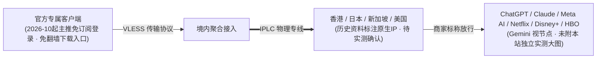

> **核心结论速览（Direct Answer）**：  
> 经过对渠道入口与套餐字段的逐项比对，本站品牌库中的 **Firefly** 与 **萤火虫** 同属于注册域名 `vip02.fireflyaff.com`、共享新用户 8 折码 **`firefly`**、且所有月付级套餐均以 `Firefly Lite / Plus / Blaze / Nova` 命名——为杜绝站内内容互搏与重复收录，现已正式**合并为唯一规范档案（旧 `/posts/brand-yinghuochong-review/` 永久 301 指向本页）**。  
> Firefly（萤火虫）主打 **IPLC 专线 + VLESS 协议** 与 **原生 IP 节点定位**，资费覆盖从 **¥96/年（60GB/月，折合约 8 元/月）**、**¥25/月 Lite（150GB/月）** 至 **1000GB Nova** 及多档长周期折算（最高约 64 折），另设 **¥100 / 100GB 不限时包**。需特别留意：2026 年 10 月起资料标示其逐步推行**官方专属客户端、免翻墙直连登录**，对于高度依赖第三方 Clash/Shadowrocket 订阅导入的用户，下单前应先确认现行客户端兼容性。截至目前暂无本站独立测速大图，下文仅作严谨档案归集，不编造 Mbps 数值。

---

## 一、 品牌合并档案与商家核心参数总览

| 核心维度 | 官方通道 / 数据记录 | 规范化详情与口径说明 |
| :--- | :---: | :--- |
| **合并后唯一品牌名** | **[👉 Firefly 官方直达入口](https://vip02.fireflyaff.com/#/?code=2n7VURre)** | **Firefly（萤火虫机场）** · 已合并原“萤火虫”冗余条目 |
| **专属新用户优惠码** | **[👉 领码注册试用](https://vip02.fireflyaff.com/#/?code=2n7VURre)** | **`firefly`**（历史资料标注新用户 8 折，不同长周期折算另有差异） |
| **线路与协议传称** | — | **IPLC 专线 + VLESS 协议** · 历史资料提及“8年团队、不限速不限设备” |
| **周期折扣规律（历史）** | — | 季付 9 折 / 半年付 85 折 / 年付 8 折 / 两年付 7 折 / 三年付 6 折 |
| **支付方式（历史）** | — | 支付宝 / USDT（部分记录标明暂不支持微信直付） |
| **客户端使用门槛** | — | 2026 年 10 月起倾向**官方专属客户端下载登录**（减少订阅折腾，亦影响第三方导入） |
| **本站实测大图状态** | — | **商家标称 · 待补充测速大图**（绝不套用虚构 300Mbps+ 表格） |

---

## 二、 完整 6 大系列多周期官方资费矩阵（合并去重全表）

下表将 Firefly 官网常见年付入门、四级标准月/长周期套餐及一次性流量包完整列出（未计新户码 `firefly` 折扣前标价）：

| 套餐系列 | 流量规格 | 月付 | 季付 | 半年付 | 年付 | 两年付 / 三年付（历史备录） |
| :--- | :---: | :---: | :---: | :---: | :---: | :---: |
| **Firefly 年付版** | **60GB / 月** | — | — | — | **¥96**（约¥8/月） | — |
| **Firefly Lite** | **150GB / 月** | **¥25** | ¥67 | ¥127 | ¥240 | ¥420（2年） / ¥540（3年） |
| **Firefly Plus** | **300GB / 月** | **¥45** | ¥121 | ¥229 | ¥432 | ¥756（2年） / ¥972（3年） |
| **Firefly Blaze** | **600GB / 月** | **¥85** | ¥229 | ¥433 | ¥816 | ¥1428（2年） / ¥1836（3年） |
| **Firefly Nova** | **1000GB / 月** | **¥150** | ¥400 | ¥750 | ¥1360 | ¥2399（2年） / ¥3119（3年） |
| **Firefly 不限时** | **100GB 总额** | **一次性付费 ¥100（流量永久有效）** | — | — | — | 适合低频备用兜底 |

> 💡 **理性账本提醒**：尽管两年付/三年付在单月账面上能折出较低均价，但在跨境网络服务领域，预付超过 1 年期资金的时间与政策不确定性风险极高。任何时候首次测试某一家服务商，**均建议先选 ¥25 月付 `Lite` 或 ¥100 不限时 / ¥96 年付小包小额切入**，避免直接锁死大额长周期预付款。

---

## 三、 架构传称特征与客观局限边界

- **关于 AI 与流媒体解锁口径**：品牌官方及历史档案宣称原生 IP 覆盖香港、新加坡、日本与美国，可支持 ChatGPT、Claude、Meta AI 与主流 4K 流媒体（Gemini 标记“视节点而定”）。由于本站尚未拿到 Firefly 节点的 `MiaoKo` / `SC` 三网实测截图，**尚不能验证 OpenAI 是网页端全解还是仅 App 放行、亦无法验证 Gemini 放行率**。对这两项有刚需且希望“看图再买单”的读者，可直接参照已披露 4 张 AI/三网实测图的 [光速云深度评测](/posts/guangshuyun-review/)。

---

## 四、 常见问题解答（FAQ）

### Q1：以前网站上的“萤火虫机场”和 Firefly 是两家不同的服务商吗？
不是。两者使用完全相同的返利域名（`vip02.fireflyaff.com`）、同样的 8 折码（`firefly`）、同样命名的 `Firefly Lite / Plus / Blaze / Nova` 与 ¥96 年付/¥100 不限时套餐。Station 团队已在全站合并两份页面并将旧链接永久 301 重定向至本页，避免老用户重复阅读混淆。

### Q2：Firefly 还支持 Clash Verge Rev 或 iOS Shadowrocket（小火箭）导入订阅吗？
2026 年 10 月起的最新资料说明 Firefly 主推自家免配置的专属客户端（登录账号即可连线）。如果你必须在路由器（OpenWrt/OpenClash）或 Clash Verge 中导入通用 YAML 订阅，务必先注册查看用户面板是否依然保留第三方订阅提取入口，或直接筛选 [品牌库中明确支持第三方订阅的 39+ 家机场](/brands/)。

### Q3：结账优惠码 `firefly` 可以用来打折 ¥96 年付版吗？
按行业通常配置，新用户通用折扣码主要面向常规月付至年付 `Lite/Plus/Blaze/Nova` 系列，特价年付小包或一次性不限时包往往不参与折上折，结算前请留意价格栏实时计算。

---

### 🌐 官方正版入口与横向推荐
- 👉 **[点击前往 Firefly（萤火虫）官网入口](https://vip02.fireflyaff.com/#/?code=2n7VURre)** · 注册试输新用户 8 折码 **`firefly`**
- 📚 **延展阅读**：[返回 42 家机场品牌过滤库](/brands/) ｜ [2026 专线 IEPL 机场横评指南](/posts/iepl-airports-dedicated-lines-guide-2026/) ｜ [机场风险与长周期避坑预警](/posts/risk-warning-runaway-record/)
