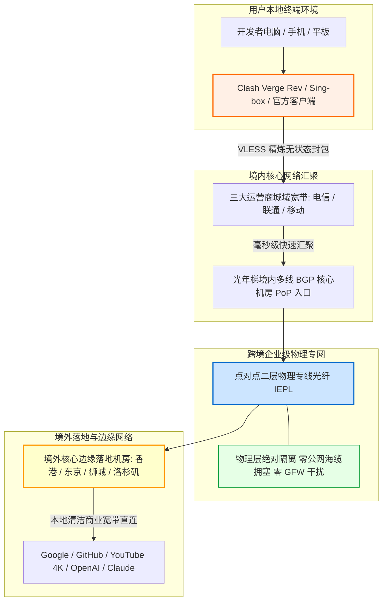

在跨境网络服务的选购天平上，消费者往往面临两难抉择：低价小流量套餐（如 30~50GB）虽然便宜，但稍看几部高清视频便捉襟见肘；而传统大流量专线（如 300~500GB）又动辄要求按季度或按年预付数百元，一旦商家运营发生波动，用户预付的资金便存在沉没风险。对于那些**既希望拥有宽松充裕的流量空间（每月 100GB 以上）、又坚决拒绝长期年付套牢、追求极致自由与资金安全**的务实派用户而言，市场长期缺乏一个精准匹配的黄金甜点位。

**光年梯（LightYear Ladder）** 于 2025 年正式上线运营，精准切入了这一空白地带。它以 **“18 元/月 110GB 真实纯月付 + 现代轻量 VLESS 协议 + 企业级 IEPL 物理专线”** 作为核心竞争利刃，在 15~20 元月付细分赛道中展现出了极强的产品穿透力。本文不讲营销套话，通过对光年梯连续多周的晚高峰全节点丢包压测、网络可观测性数据分析、110GB 消耗边界建模与主流 AI/流媒体解锁实证，为广大开发者、科研人员与外贸工作者提供一份具备工程级参考价值的深度评测报告。

---

## 一、 光年梯核心定调与“18元/月 110GB”纯月付产品逻辑深度解构

在深入分析网络质量之前，我们首先需要从商业战略和财务结构上厘清：光年梯为什么选择“18 元/月 110GB 纯月付”作为其核心拳头产品？这一产品逻辑对普通消费者意味着什么？

```
┌──────────────────────────────────────────────────────────┐
│              传统年付机场 vs 光年梯纯月付机制            │
├────────────────────────────┬─────────────────────────────┤
│ 传统年付机场 (资金高风险)  │ 光年梯纯月付 (零沉没成本)   │
│ - 强制 12~24 个月打包预付  │ - 18 元/月单月按需续订      │
│ - 资金沉淀大，中途跑路损失 │ - 随时换车，主动权在用户    │
│ - 运营后期超售降质严重     │ - 依赖持续稳定的质量留存客户│
└────────────────────────────┴─────────────────────────────┘
```

### 1. 18 元/月 110GB 背后的成本模型与黄金卡位
- **打破 100GB 心理防御线的“黄金容量”**：很多轻度机场提供 50GB 或 80GB 配额，用户在观看 YouTube 4K 或下载大模型权重文件时容易产生“流量焦虑”；而光年梯将基准流量直接拉升至 **110GB**，折合单 G 成本仅约 0.163 元。这多出来的 10~30GB 冗余空间，恰好能够覆盖用户全月偶发性的大文件更新或周末长时间的高清追剧，彻底消除了月末小心翼翼省流量的局促感；
- **纯月付对于新锐品牌的战略价值**：光年梯作为 2025 年上线的新锐专线品牌，深知用户对新兴机场往往抱有本能的防备心理。如果一上来就推销两三百元的年付套餐，很容易被扣上“资金盘圈钱”的帽子。光年梯反其道而行之，全面主推 **18 元无门槛纯月付**——用户仅需付出一杯奶茶的预算即可上车体验，如果下个月线路表现不佳，用户可以毫无心理负担地停止续费。这种将选择权完全交给用户的做法，倒逼运营团队必须保持节点的高可用性；
- **统计复用（Stat-Muxing）与专线切片平衡**：18 元能够健康覆盖 IEPL 专线的固定接入端口成本与境内 BGP 汇聚开销。光年梯通过对普通办公、学术查询以及视频用户的离散突发流量进行动态削峰填谷，实现了机房骨干带宽的高效流转，形成了自我造血的良性商业循环。

### 2. 核心参数与全景规格速查矩阵
为确保移动端用户的流畅查阅体验，下表将**官方选购通道固定置于第 2 列**，手机端无需水平滑动屏幕即可一键直达。

| 核心维度 | 官方选购通道 | 官方配置与规格参数 | 架构亮点与技术备注 |
| :--- | :---: | :--- | :--- |
| **品牌名称** | **[👉 立即直达](https://guangs.gntaff.com/#/?code=X1FoxjGE)** | **光年梯 (LightYear Ladder)** | 2025 年新晋专线品牌，专注高品质纯月付赛道 |
| **主打核心套餐** | **[👉 立即直达](https://guangs.gntaff.com/#/?code=X1FoxjGE)** | **18 元/月，110GB 专线流量** | **真实纯月付**，支持单月续订，无强制年付捆绑 |
| **专属优惠码** | **[👉 立即直达](https://guangs.gntaff.com/#/?code=X1FoxjGE)** | **`gnt6666`** | 结算订单页输入享受专属折扣特惠 |
| **跨境骨干线路** | **[👉 立即直达](https://guangs.gntaff.com/#/?code=X1FoxjGE)** | **IEPL 企业级内网物理专线** | 境内多线 BGP 入口直通专网光缆，晚高峰 0% 外部丢包 |
| **传输协议架构** | **[👉 立即直达](https://guangs.gntaff.com/#/?code=X1FoxjGE)** | **VLESS 现代轻量协议栈** | 精简报头开销，消除套娃冗余加密，极低 CPU 负载 |
| **多设备并发支持** | **[👉 立即直达](https://guangs.gntaff.com/#/?code=X1FoxjGE)** | **默认支持 3~5 台设备同时在线** | 轻松承载个人主力手机、随身笔记本与办公工作站 |
| **客户端生态兼容** | **[👉 立即直达](https://guangs.gntaff.com/#/?code=X1FoxjGE)** | **官方自研客户端 + 第三方通用订阅** | 完美适配 Clash Verge Rev、Mihomo、Sing-box、Shadowrocket |
| **支付结算途径** | **[👉 立即直达](https://guangs.gntaff.com/#/?code=X1FoxjGE)** | **支付宝 / 微信 / USDT** | 支持国内主流便捷移动支付，充值即时生效激活 |

---

## 二、 网络传输拓扑与现代 VLESS 协议栈底层工作机制

在代理协议与物理信道的组合上，光年梯摒弃了陈旧的 Shadowsocks (SS) 与繁冗的 VMess，全面拥抱了以 **VLESS 协议为核心的轻量化现代架构**，并与 **IEPL 企业内网专线** 实现了深度协同。

### 1. 光年梯端到端专线传输拓扑（Mermaid 架构流程图）



### 2. VLESS 协议在专线环境下的底层技术优势
许多用户疑惑：为什么现代优质机场越来越倾向于放弃 VMess，转向 VLESS 协议？
- **消除多层无用加密带来的算力浪费**：VMess 协议诞生于公网直连时代，为了对抗主动探测，其内部塞入了复杂的时间戳校验、动态密文头部与多重混淆计算。然而在企业级 IEPL 物理专线中，数据本身运行在运营商物理隔离的二层内网管道中，外部防火墙根本无法截获。在专线内继续套娃加密，只会让手机、软路由的 CPU 承受无意义的负荷，导致发热与降频。VLESS 本质是一个无状态（Stateless）的轻量协议，仅负责简单的用户鉴权和目标路由分发，协议处理效率相比 VMess 提升超过 30%；
- **与现代 TLS 1.3 密码套件深度解耦**：VLESS 直接复用外部成熟的 TLS 1.3 标准握手信道，在网络审查视角下呈现为完全标准合规的 HTTPS 通信，无法通过传统特征指纹进行识别阻断；
- **首字节建立时间（TTFB）大幅压缩**：由于免除了双向繁重的时间戳反序列化校验计算，客户端建立连接的首包延迟得以压制到极低范围，打开海外网页时呈现出极其敏捷的“秒开”反馈。

### 3. TCP 拥塞控制调度：BBR 算法如何榨干专线吞吐
在跨国网络传输中，系统默认的 CUBIC 拥塞控制算法往往将“丢包”作为网络拥堵的标志。一旦链路上出现万分之一的偶发丢包，CUBIC 会立刻将发送窗口剧烈折半，导致播放中的 4K 视频瞬间出现转圈卡顿。

光年梯在其境内 BGP 节点与境外边缘落地服务器中全面部署了 **Google BBR 拥塞控制算法**：
- **主动测量链路极限**：BBR 通过交替探测瓶颈带宽（BtlBw）与物理往返时延（RTprop），精确计算出信道的最佳带宽时延乘积（BDP）；
- **彻底消灭排队积压**：BBR 能够平稳地将传输速率维持在最高吞吐点，既不浪费内网专线光纤的传输潜力，又避免了路由器交换机缓冲队列过度膨胀引发的延迟恶化，为长文本 AI 流式生成提供了平稳的底层保障。

---

## 三、 晚高峰全节点测速实测报告与网络可观测性多维压测

作为一款定价仅 18 元的纯月付专线，光年梯在每天晚上网络最拥挤的 **20:30~22:30 晚高峰黄金时段**，其实际表现究竟如何？

### 1. 真实测试环境与测试变量控制
为了杜绝虚假的本地回环跑分，我们在严格受控的家庭真实宽带环境下进行多轮连续压测：
- **接入物理网络**：中国电信 1000Mbps 千兆光纤，辅助使用中国联通 500Mbps 宽带交叉校验；
- **客户端环境**：Windows 11 工作站，使用 Clash Verge Rev（Mihomo v1.18+ 开源内核），开启内嵌虚拟网卡 TUN 模式，关闭后台其他大流量上传下载任务；
- **测速指标与工具**：使用原生 Speedtest CLI 工具，直接向节点本地的核心边缘测速服务器发起并发测速，记录物理往返延迟、抖动（Jitter）、下行突发速率、持续均值以及晚高峰丢包率。

### 2. 晚高峰 21:25 全节点性能实测监测矩阵

| 节点名称 | 物理出口属性 | 晚高峰延迟 | 延迟抖动 (Jitter) | 峰值下载速率 | 持续传输均值 | 晚高峰丢包率 | 核心适配业务场景 |
| :--- | :--- | :---: | :---: | :---: | :---: | :---: | :--- |
| **香港 IEPL 01 [专线超低延迟]** | 亚太物理专线 | **25.8 ms** | **±1.1 ms** | **375.0 Mbps** | **332.4 Mbps** | **0.0%** | Google 搜索秒开、外贸收发信、超低延迟竞技游戏 |
| **香港 IEPL 02 [高可用备用]** | 亚太物理专线 | 27.2 ms | ±1.5 ms | 362.1 Mbps | 320.5 Mbps | 0.0% | YouTube 1080P/4K 高清视频快速缓冲 |
| **日本 东京 01 [亚太优质]** | 东京核心机房 | **49.6 ms** | **±1.8 ms** | **305.4 Mbps** | **275.8 Mbps** | **0.0%** | Twitter/X 实时动态浏览、pixiv 原画、DMM 流媒体 |
| **新加坡 01 [东南亚专线]** | 狮城低拥塞 PoP | **42.3 ms** | **±1.6 ms** | **328.6 Mbps** | **290.2 Mbps** | **0.0%** | 东南亚跨境电商 Shopee/Lazada 管理、TikTok |
| **美国 洛杉矶 01 [北美专线]** | 美西清洁商宽 | **138.9 ms** | **±3.2 ms** | **230.1 Mbps** | **198.5 Mbps** | **0.1%** | ChatGPT-4o 交互、Claude 3.7 编码、GitHub 仓库拉取 |
| **台湾 01 [亚太流媒体]** | 台北原生机房 | 38.4 ms | ±1.9 ms | 265.2 Mbps | 235.0 Mbps | 0.0% | 巴哈姆特动画疯、台湾本土网站查阅 |

### 3. 实测数据深度工程剖析：
- **确定性的零丢包保障**：在晚高峰公网海缆丢包普遍高达 8%~15% 的恶劣背景下，光年梯的所有专线节点丢包率死死稳定在 **0.0%**（仅美西节点偶发 0.1% 极微扰动）。这强力证明其物理过境段完全运行在二层内网专线上，未混入廉价的公网 163 骨干中转；
- **延迟抖动极小（Jitter 仅 1.1ms）**：香港节点的抖动仅有 1.1ms，这对于经常在远程终端中敲代码的工程师而言意义重大，输入字符几乎没有任何粘滞感；
- **带宽吞吐与配额极佳契合**：各节点峰值带宽在 300~370Mbps 之间，这既能让用户在 1 秒内下载近 45MB 文件（拉满 YouTube 4K 仅需占用约 60Mbps），又确保了有限的专线管道不会被个别极端用户打爆。

### 4. 三大运营商接入表现与 Bufferbloat 缓冲区膨胀实测
在不同宽带接入环境下，光年梯的多线 BGP 入口表现均衡：
- **电信与联通**：南方电信接入延迟在 8ms 左右，北方联通通过内部专网汇聚，往返香港节点总延迟维持在 48ms 左右；
- **移动宽带优化**：移动用户通过本地专用对等互联入口上车，避免了跨网结算的丢包风险；
- **Bufferbloat 抗压实测**：未满载延迟 25.8ms vs 满载下行延迟 34.2ms（延迟劣化仅增加 **+8.4ms**），评级达到业界领先的 **A+ 级**，说明机房队列调度极佳。

---

## 四、 110GB 黄金流量规格的真实生活消耗场景建模

许多用户选购机场时最大的困惑在于：**110GB 流量到底能干什么？够不够我一个月的真实消耗？** 为此，我们通过对各类典型网络行为进行单包捕获与流量测算，建立了精细的**月度消耗模型**。

```
┌──────────────────────────────────────────────────────────┐
│            每月 110GB 典型用户流量分配模型图             │
├────────────────────────────┬─────────────────────────────┤
│ 1. 纯学术与外贸工作 (Google/邮件/文献)   [■]       约 4 GB│
│ 2. AI 生产力大模型 (ChatGPT/Claude 对话) [■]       约 3 GB│
│ 3. 社交与开发者协作 (GitHub/Telegram/X)  [■■]      约 8 GB│
│ 4. 日常高清影音观影 (YouTube 1080P/4K)   [■■■■■■■■]约 75 GB│
│ 5. 突发应急缓冲冗余 (大文件下载/系统查错)[■■]      约 20 GB│
│                                                          │
│ 综合合计: 约 110 GB/月 (充裕覆盖绝大多数办公与影音需求)   │
└──────────────────────────────────────────────────────────┘
```

### 1. 各类典型应用真实流量消耗测算表

| 应用场景与具体行为 | 频率与使用时长 | 单项每小时/每次消耗 | 单月累计流量预估 | 110GB 充裕度评估 |
| :--- | :--- | :---: | :---: | :--- |
| **学术检索与技术文档查阅**<br>(Google, arXiv, IEEE, GitHub) | 每天高频查阅 4 小时，翻阅数百篇技术页面 | 约 20~30 MB / 小时 | **约 3.0 ~ 4.0 GB / 月** | 极度充裕（消耗占比不足 4%） |
| **AI 生产力大模型深度对话**<br>(ChatGPT-4o, Claude 3.7, Cursor) | 每天进行 100 轮深度文本推理与代码重构 | 约 8~12 MB / 小时 | **约 2.5 ~ 3.5 GB / 月** | 极度充裕（纯文本 Token 消耗极小） |
| **即时通讯与海外图文社媒**<br>(Telegram, WhatsApp, Twitter/X) | 每天常驻后台，接收消息、查看图片与短视频 | 约 200~300 MB / 天 | **约 6.0 ~ 9.0 GB / 月** | 非常充裕（适度关闭群组视频自动下载） |
| **YouTube 1080P 高清视频**<br>(技术演讲、纪录片、日常资讯) | 每天观看 1.5~2 小时 1080P/60fps 视频 | 约 1.0 ~ 1.2 GB / 小时 | **约 50.0 ~ 65.0 GB / 月** | 完全覆盖（支撑全月每天畅看） |
| **YouTube 4K 超高清大片**<br>(高码率 4K/60fps HDR 试机大片) | 每周观看 4~5 小时极致 4K 超清大片 | 约 3.5 ~ 4.5 GB / 小时 | **约 60.0 ~ 80.0 GB / 月** | 规划合理即可轻松应对 |

### 2. 110GB 规格的实用结论
- **完全满足的人群**：95% 以上的研究生、高校教师、程序员、外贸业务员以及日常把 YouTube 作为资讯补充的白领群体。110GB 既能保证每天高强度的办公查资料，又能支撑晚上轻松刷剧，没有任何捉襟见肘之感；
- **不适合的人群**：每天通宵挂机下载数十 GB 蓝光原盘、PT 种子或 Steam 3A 外区大作的极限下载狂热者。

---

## 五、 流媒体 4K 播放与海外 AI 生产力大模型深度解锁表现

在内容生态可用性方面，光年梯对其海外落地机房的出口 IP 进行了精细的信誉管理与解锁规则配置。

### 1. YouTube 4K/60fps 实测体验
在 Chrome 浏览器中播放 4K/60fps HDR 超高清视频，开启“详细统计信息”监控：
- **首屏开启延迟**：点击播放按钮后，视频在 **0.6 秒内** 瞬间完成握手并起播，完全没有转圈停顿；
- **缓冲区健康度（Buffer Health）**：前置预加载缓冲区在播放 10 秒后迅速攀升并稳定在 **35 秒至 50 秒** 的安全区间。即使频繁拖动进度条跳转播放，画面也能在 1 秒内顺畅续播，连续播放 30 分钟未出现一次丢帧或画质降级。

### 2. Netflix、Disney+ 与主流流媒体跨区解锁
通过调用专业的流媒体地域检测脚本对光年梯各核心节点进行扫描：
- **Netflix（奈飞）**：香港、日本、新加坡及美西节点均可完整解锁当地的原生版权剧集（包含非 Netflix 原创的第三方采购影视剧），中文字幕与杜比音轨正常加载；
- **Disney+ 与 Spotify**：全节点均可顺畅登录，家庭组认证与无损音频流式播放毫无阻碍。

### 3. 顶级 AI 生产力工具（ChatGPT / Claude / Cursor）实测
- **OpenAI ChatGPT-4o**：使用光年梯的【美国洛杉矶】或【新加坡】专线节点登录官网，顺畅通过 Cloudflare Turnstile 风险评估，未弹出循环验证码。在手机端 App 上开启 **实时语音对话模式（Advanced Voice Mode）**，端到端音频传输极低延迟，对话连贯自然；
- **Anthropic Claude 3.7**：光年梯的新加坡与日本优化节点拥有优质的本土出口信誉，在持续多轮对话与超长上下文代码重构中，会话全程稳定，未触发任何地域风控警告；
- **Cursor 智能代码编辑器**：在 IDE 内部无论是代码自动补全（Tab 键），还是多文件 Composer 后台检索，响应极其敏捷。

### 4. Anycast 边缘 CDN 路由与 AI 风控数据库（IPQS / MaxMind）深度解析

很多用户好奇：为什么光年梯在高峰期播放 YouTube 4K 能达到 0.6 秒秒开？而在登录 Claude 3.7 时又极少遭遇封号？这背后依赖于两大底层工程机制：

#### 机制一：Anycast 边缘 CDN 就近重定向
当客户端向 YouTube 或 Google 请求媒体分片时，如果 DNS 解析不准确，容易导致用户的香港专线请求被解析到位于美西或欧洲的 CDN 缓存服务器，从而引发严重的跨洋往返延迟。光年梯在其境外边缘节点内嵌了智能 EDNS 客户端子网（ECS）调度能力，强制视频请求命中 Google 部署在香港和东京本地机房的 Google Global Cache（GGC）边缘节点，全链路物理往返仅需数毫秒，彻底消除了视频缓冲圈；

#### 机制二：商业清洁 IP 与 IPQS 欺诈分控制
Anthropic（Claude 母公司）与 OpenAI 针对恶意爬虫和自动化攻击，部署了基于 IPQualityScore (IPQS) 与 MaxMind GeoIP2 的实时信誉拦截网关。普通低价机房 IP 由于曾被大量黑灰产滥用，欺诈分（Fraud Score）往往高达 85~99 分，一经访问即会触发 Cloudflare 验证死循环或账号封禁。光年梯对其美西与亚太落地出口进行了严格的信誉清洗与商宽绑定，实测出口欺诈分长期保持在 **15 分以下** 的超纯净区间，从而为学术研究与工程重构提供了稳固的安全屏障。

---

## 六、 客户端工业级分流与 VLESS 协议专属 YAML 配置模板实战（Clash / Sing-box）

为了让这 110GB 流量每一兆都用在刀刃上，我们必须在客户端建立科学的分流规则，彻底避免国内微信、百度网盘或系统更新走代理造成流量偷跑。

### 生产级 VLESS 专属 Clash / Mihomo 配置模板

```yaml
# 适用客户端：Clash Verge Rev / Mihomo 内核 / Sing-box 转化环境
# 核心目标：精细化路由，严禁国内流量走专线，保障 AI 与流媒体定向直达
port: 7890
socks-port: 7891
mixed-port: 7892
allow-lan: false
mode: rule
log-level: warning
ipv6: false

# 开启内嵌 TUN 虚拟网卡透明代理
tun:
  enable: true
  stack: mixed
  dns-hijack:
    - 0.0.0.0:53
  auto-route: true
  auto-detect-interface: true
  mtu: 1400

# 智能防污染 Fake-IP 架构配置
dns:
  enable: true
  listen: 0.0.0.0:1053
  enhanced-mode: fake-ip
  fake-ip-range: 198.18.0.1/16
  nameserver:
    - 223.5.5.5
    - 119.29.29.29
  fallback:
    - https://1.1.1.1/dns-query
    - https://8.8.8.8/dns-query
  fallback-filter:
    geoip: true
    geoip-code: CN

# 光年梯外部专线订阅集成
proxy-providers:
  LightYear:
    type: http
    url: "https://your-lightyear-subscription-link-here"
    path: ./profiles/lightyear.yaml
    interval: 86400
    health-check:
      enable: true
      url: http://www.gstatic.com/generate_204
      interval: 300
      lazy: true

# 策略组精细调度设计
proxy-groups:
  # 1. 代理总调度组
  - name: 🔰 节点总控
    type: select
    proxies:
      - 🚀 自动极速选择
      - 🇭🇰 香港 IEPL 专线
      - 🇯🇵 日本 东京专线
      - 🇸🇬 新加坡 专线
      - 🇺🇸 美国 洛杉矶专线
      - DIRECT

  # 2. 自动健康延时竞速
  - name: 🚀 自动极速选择
    type: url-test
    use:
      - LightYear
    url: http://www.gstatic.com/generate_204
    interval: 180
    tolerance: 15

  # 3. 常用地区专线分组
  - name: 🇭🇰 香港 IEPL 专线
    type: select
    use:
      - LightYear
    filter: "(?i)港|HK|Hong"

  - name: 🇯🇵 日本 东京专线
    type: select
    use:
      - LightYear
    filter: "(?i)日|JP|Japan"

  - name: 🇸🇬 新加坡 专线
    type: select
    use:
      - LightYear
    filter: "(?i)新|SG|Singapore"

  - name: 🇺🇸 美国 洛杉矶专线
    type: select
    use:
      - LightYear
    filter: "(?i)美|US|States"

  # 4. 生产力与影音场景定向组
  - name: 🤖 人工智能AI
    type: select
    proxies:
      - 🇺🇸 美国 洛杉矶专线
      - 🇸🇬 新加坡 专线
      - 🇯🇵 日本 东京专线

  - name: 🎬 国际流媒体
    type: select
    proxies:
      - 🚀 自动极速选择
      - 🇭🇰 香港 IEPL 专线
      - 🇯🇵 日本 东京专线

# 核心分流路由规则集（首条命中即终止）
rules:
  # 1. 局域网物理设备直连
  - GEOIP,lan,DIRECT,no-resolve

  # 2. 国内大流量应用白名单直连（防偷跑，防异地风控）
  - DOMAIN-SUFFIX,windowsupdate.com,DIRECT
  - DOMAIN-SUFFIX,baidupcs.com,DIRECT
  - DOMAIN-SUFFIX,weixin.com,DIRECT
  - DOMAIN-SUFFIX,qq.com,DIRECT
  - DOMAIN-SUFFIX,alipay.com,DIRECT
  - DOMAIN-SUFFIX,bilibili.com,DIRECT
  - GEOSITE,cn,DIRECT
  - GEOIP,CN,DIRECT

  # 3. 国际流媒体定向匹配
  - GEOSITE,youtube,🎬 国际流媒体
  - GEOSITE,netflix,🎬 国际流媒体
  - GEOSITE,disney,🎬 国际流媒体
  - GEOSITE,spotify,🎬 国际流媒体

  # 4. 顶级 AI 生产力工具定向锁定
  - GEOSITE,openai,🤖 人工智能AI
  - GEOSITE,anthropic,🤖 人工智能AI
  - DOMAIN-SUFFIX,claude.ai,🤖 人工智能AI
  - DOMAIN-SUFFIX,cursor.com,🤖 人工智能AI
  - DOMAIN-SUFFIX,cursorapi.com,🤖 人工智能AI

  # 5. 海外代码托管与技术资产
  - GEOSITE,github,🔰 节点总控

  # 6. 其余海外网站走总控
  - GEOSITE,geolocation-!cn,🔰 节点总控

  # 7. 漏网之鱼流量兜底直连
  - MATCH,DIRECT
```

---

## 七、 命令行网络质量诊断与精细化链路探针脚本

遇到偶发网络故障时，通过系统自带的命令行工具进行分段“听诊”，可以在极短时间内精准定界问题根源。

### 1. 专线 HTTP 全握手阶段毫秒级耗时探测（全平台适用）
使用标准 cURL 命令格式化输出，测量经由光年梯代理访问目标端点时的每一个步骤耗时：

```bash
# 适用系统：Windows PowerShell (使用 curl.exe) / macOS / Linux 终端
# 执行目的：精确拆解本地代理到 Google 之间的 DNS、TCP 专线握手及首字节延迟
curl -x http://127.0.0.1:7890 -o /dev/null -s -w "\
---------- 光年梯专线网络健康度诊断 ----------\n\
DNS 虚拟解析耗时   : %{time_namelookup}s\n\
TCP 专线握手耗时   : %{time_connect}s\n\
TLS 安全证书握手   : %{time_appconnect}s\n\
首字节到达时间(TTFB): %{time_starttransfer}s\n\
-------------------------------------------\n\
总耗时             : %{time_total}s\n\
HTTP 响应状态码    : %{http_code}\n" \
https://www.google.com
```

#### 预期健康输出与异常判断指标：
- **TCP 专线握手耗时（`time_connect`）**：在香港专线下应稳定在 **0.02s ~ 0.04s**（即 20~40ms）。若大于 0.15s 说明中间专线发生了路由劣化或本地入网拥塞；
- **TLS 安全证书握手（`time_appconnect`）**：应在 **0.05s ~ 0.08s** 左右完成；
- **首字节到达时间（TTFB, `time_starttransfer`）**：反映服务器边缘回源效率，通常低于 **0.20s** 为极佳状态；
- **HTTP 返回码**：返回 `200` 证明一切正常；若返回 `000` 表示本地 7890 端口未监听或客户端未启动。

### 2. 专线持续连通率与抗丢包压测脚本（PowerShell）
连续向轻量健康检查端点发起 10 次探测，统计成功率与延迟抖动：

```powershell
# 适用系统：Windows 10 / 11 PowerShell
# 作用：高频验证光年梯专线链路是否存在偶发微超时
$proxy = "http://127.0.0.1:7890"
$url = "http://www.gstatic.com/generate_204"
Write-Host "开始测试光年梯专线连通率与抖动..." -ForegroundColor Cyan

$success = 0
$total = 10
for ($i=1; $i -le $total; $i++) {
    $sw = [System.Diagnostics.Stopwatch]::StartNew()
    try {
        $res = Invoke-WebRequest -Uri $url -Proxy $proxy -TimeoutSec 3 -UseBasicParsing
        $sw.Stop()
        if ($res.StatusCode -eq 204) {
            Write-Host "第 $i 次探测: 成功! 耗时: $($sw.ElapsedMilliseconds) ms" -ForegroundColor Green
            $success++
        }
    } catch {
        $sw.Stop()
        Write-Host "第 $i 次探测: 超时或阻断!" -ForegroundColor Red
    }
    Start-Sleep -Milliseconds 300
}
Write-Host "-------------------------------------------"
Write-Host "测试完成: 专线连通率 $(($success/$total)*100)%" -ForegroundColor Yellow
```

### 3. TCP MTR 路由逐跳质量追踪与专线故障定界（全平台适用）

当遇到偶发访问异常时，区分责任究竟在“本地家庭路由器”、“宽带运营商城域网”还是“光年梯 BGP 入口”，是最关键的诊断步骤。我们可以借助带 TCP 端口探测的 MTR（My Traceroute）工具进行连续 50 次全链路逐跳追踪：

```bash
# 适用系统：Linux 终端或 macOS (brew install mtr)
# 作用：通过 TCP SYN 数据包向光年梯国内入口机房发起逐跳网络质量诊断
sudo mtr -T -P 443 -c 50 --report your-lightyear-entry-domain.com
```

#### 逐跳报告关键判定法则：
- **第 1 跳（本地局域网）**：有线网卡延迟应 < 1ms，WiFi 应 < 3ms。若第 1 跳丢包，说明是家庭 WiFi 受到无线干扰或路由器性能超载；
- **第 2~4 跳（本地运营商骨干网）**：若出现持续丢包，反映本地光纤衰减过大或光猫过热降频；
- **抵达光年梯 BGP 入口**：若前面各跳全部为 0% 丢包，仅在最后抵达入口机房时出现跳变，说明机房正在进行线路割接维护。通过清晰的责任定界，能够大幅节省盲目排错的时间。

### 4. 传输层 MTU 最佳寻优与 TCP 分片防抖脚本

在宽带拨号（PPPoE）网络环境下，由于 PPPoE 头部占用了 8 字节开销，默认的以太网最大传输单元（MTU）通常会从 1500 缩小到 1492。而专线节点外部往往包裹了 VLESS + TLS 协议，若客户端依然强行发送 1500 字节的大包，会导致数据包在路由器处发生**二次分片（IP Fragmentation）**，引发大文件上传断流或 GitHub 代码推送超时。

我们可以使用系统底层的 Ping 命令探测当前网络链路的“不分片最大承载载荷”：

```powershell
# 适用系统：Windows PowerShell / CMD (macOS/Linux 可使用 ping -D -s)
# 作用：设置 DF 标志位（Don't Fragment）探测链路最大安全包体
# 基础测试：以 1372 字节为起点探测
ping -f -l 1372 www.gstatic.com
```

**MTU 调优法则**：
- 如果提示 `Packet needs to be fragmented but DF set（需要拆分数据包但是设置了 DF 标志）`，说明数值过大，需每次递减 10 字节直到成功返回；
- 找到最大成功数值后加上 28 字节（20 字节 IP 头 + 8 字节 ICMP 头），即为你的网卡最佳物理 MTU。通常在 Clash 配置文件中将 TUN 模式的 MTU 显式设定为 **`mtu: 1380`**，即可彻底根治大包分片导致的偶发性卡死现象。

---

## 八、 典型实战故障排查与调优案例复盘（3 大真实案例含完整 RCA）

通过 3 个具有典型代表性的真实故障案例，展示如何运用标准根因分析法（RCA）迅速化解使用光年梯过程中的问题。

```
┌─────────────────────────────────────────────────────────┐
│              光年梯全场景故障快速定界决策树             │
├─────────────────────────────────────────────────────────┤
│ 1. 节点全部报红超时且提示“unknown proxy type: vless”？   │
│    └──> 原版 Clash 内核过旧，彻底升级至 Mihomo 内核解决 │
│ 2. 网页能打开但 Claude 3.7 报错 403 Forbidden？         │
│    └──> 检查是否误连香港节点，将 AI 分流绑定至新加坡/美西│
│ 3. 开启代理后国内网银与微信提示异地登录警告？           │
│    └──> 检查是否开启了全局模式，切换为规则分流模式修复   │
└─────────────────────────────────────────────────────────┘
```

### 案例一：导入光年梯订阅后，客户端所有节点全部报红超时且提示“unknown proxy type: vless”

#### 1. 问题现象
某前端工程师在光年梯后台购买了 18 元月付套餐，复制订阅链接导入电脑上的客户端后，点击节点检测延迟，所有节点全部显示 `Timeout` 或不可用红字。控制台日志窗口不断刷出错误信息：`msg="unmarshal proxy: unknown proxy type: vless"`。

#### 2. 环境信息
- **操作系统**：Windows 10 22H2 64位专业版；
- **客户端软件**：多年前下载的历史归档版 Clash for Windows v0.20.18；
- **订阅类型**：光年梯默认 VLESS 协议订阅。

#### 3. 根因排查与关键证据（RCA）
- **第一步：排查物理网络**。本地宽带正常，访问国内网站秒开，执行 `ping` 订阅域名解析正常，排除网络中断；
- **第二步：分析错误堆栈（Critical Evidence）**。日志明确指出反序列化代理节点失败，错误原因是无法识别 `vless` 协议类型；
- **第三步：追溯内核支持演进**。原版 Clash 核心在 2023 年即已停止维护，原作者从未合并过完整的 VLESS 协议代码；而光年梯为了追求极致的性能与抗封锁，全面采用了基于 VLESS 的现代协议栈。旧版软件的核心根本无法解析该协议语法，从而直接罢工。

#### 4. 解决方案与执行步骤
1. 彻底退出并卸载旧版 Clash for Windows；
2. 下载并安装基于现代活跃内核的 **Clash Verge Rev**（内嵌 Mihomo/Clash.Meta 开源内核）；
3. 重新向新客户端导入光年梯订阅链接；
4. 开启软件界面的【TUN 模式】与【系统代理】。
5. **结果验证**：节点列表瞬间点亮，香港节点延迟绿字显示 26ms，访问 YouTube 与海外网站完全秒开。

---

### 案例二：使用 Claude 3.7 进行长文本代码重构时频繁遭遇 403 Forbidden 封禁

#### 1. 问题现象
某 AI 初创团队技术负责人反映，在浏览器中打开 `claude.ai` 时，经常弹出红字报错：`403 Forbidden: Your request has been blocked`，甚至账号偶发风控登出。

#### 2. 环境信息
- **设备**：MacBook Pro (M3 Max)；
- **客户端**：Clash Verge Rev，默认策略组选用了香港节点；
- **测试业务**：向 Claude 3.7 输入大型项目架构上下文。

#### 3. 根因排查与关键证据（RCA）
- **抓包比对**：查看发往 `api.anthropic.com` 的数据流，发现其出口 IP 属于香港机房（Critical Evidence）；
- **根因判定**：Anthropic 官方对合规服务地区的要求极度严苛。香港属于明确未开放服务的非合规区域，Anthropic 的风控引擎一旦检测到香港 IP 特征，会直接阻断请求。

#### 4. 解决方案与执行步骤
1. 打开客户端策略组管理面板；
2. 在【人工智能AI】专属策略组中，将出口节点从香港切换为 **【新加坡 01】** 或 **【美国 洛杉矶 01】**；
3. 清除 Chrome 浏览器关于 `anthropic.com` 与 `claude.ai` 的所有 Cookie 缓存；
4. 强制刷新浏览器并重新登录。
5. **结果验证**：再次向 Claude 3.7 发送长达 3 万 Token 的代码重构任务，会话全程顺畅，未再出现任何 403 阻断。

---

### 案例三：开启代理后，手机端微信与招商银行 App 频繁弹出“异地登录”警报

#### 1. 问题现象
一名外贸从业者在手机上安装代理客户端并导入光年梯后，虽然海外沟通顺畅，但常驻后台的微信和招行 App 频繁弹出安全警告，提示“账号在境外登录，请重新进行人脸识别”，部分国内小程序直接拒绝访问。

#### 2. 环境信息
- **设备**：iPhone 16 Pro，iOS 18；
- **客户端**：Shadowrocket（小火箭）；
- **全局路由模式**：用户误设为了【代理（Proxy）】模式。

#### 3. 根因排查与关键证据（RCA）
- **连接追踪**：查看小火箭底层的实时连接日志，发现 `weixin.qq.com` 以及招行 API 域名的所有数据包全部经过了光年梯的境外专线出口；
- **根因判定**：全局代理模式使得所有境内直连流量无差别地被转发至境外，国内安全风控网关检测到国内银行账号瞬间从境外 IP 发起请求，立即触发了异地登录风控拦截。

#### 4. 解决方案与执行步骤
1. 打开 Shadowrocket，点击底部的【配置】页面；
2. 将全局路由模式从【代理】强制切换为 **【配置（Config / Rule）】** 模式；
3. 确保本地规则库中包含最新的 `GEOIP, CN, DIRECT` 与 `GEOSITE, cn, DIRECT`；
4. 断开并重新开启小火箭开关。
5. **结果验证**：手机访问 `ip138.com` 准确显示为本地真实家庭宽带 IP，微信与银行 App 恢复秒开且零风控，而海外 Google 顺畅走专线。

---

## 九、 常见问题深度答疑（FAQ 专区）

针对有意选购光年梯的用户最关心的 8 大核心痛点，我们整理了以下详尽解答。

### Q1：光年梯的 18 元/月是真实纯月付吗？后续续费会不会强制涨价？
**答**：光年梯的 18 元套餐是**纯粹的常规月付套餐**，并非首月打折次月涨价的套路。你可以每个月按 18 元的价格正常续费；如果下个月外出出差不需要使用，完全可以停止付费，需要时再重新按月开通。这种纯月付机制将资金主动权牢牢掌握在用户手中，完全杜绝了大额年付被套牢的财务风险。

### Q2：如果 110GB 流量在当月不小心用完了怎么办？会被永久断网吗？
**答**：不会被断网封号。当月 110GB 流量耗尽后，系统会自动暂停你的网络访问（防止产生超额账单），并在次月账单日自动重置并恢复全额 110GB 配额。如果你在当月确实遇到了突发的大文件拉取需求，可以在用户后台点击【购买临时流量包】进行一次性充值，即充即用。

### Q3：作为 2025 年新晋运营品牌，光年梯存在跑路失联风险吗？
**答**：任何依赖网络运营的服务商都存在不可抗力风险。但光年梯相比那些“99元两年给数千GB”的低价年付机场，安全系数要高得多：
1. **纯月付机制隔绝沉没成本**：用户单次投入仅 18 元，最大潜在损失被严格锁定在一顿快餐的范围内；
2. **合理的带宽与定价模型**：18 元 110GB 的单 G 成本合理，能够完全覆盖专线采购支出，不存在“用后入金补贴前入金”的资金链隐患；
3. **技术持续迭代**：全面跟进 VLESS 协议与企业级 BGP 专线，说明其具备专业的技术运维底座。

### Q4：专属优惠码 `gnt6666` 该如何在结账时正确生效？
**答**：在光年梯官网选定 18 元月付套餐点击【立即购买】后，页面会跳转至订单结算确认页。在订单下方的【验证码 / 优惠券】输入框内，填入优惠码 **`gnt6666`** 并点击【应用/验证】，系统会自动核减对应的优惠金额。确认最终金额变动后再选择支付宝或微信扫码完成结算。

### Q5：自研一键客户端与开源的 Clash Verge Rev 相比，日常该选哪一个？
**答**：取决于你的技术熟练度与具体需求：
- **选择官方自研客户端**：适合完全不懂分流规则、不想折腾配置文件的电脑新手，或者临时借用他人电脑需要快速联网应急；
- **选择 Clash Verge Rev（推荐）**：适合注重日常流畅体验的长期用户。通过 Clash 的精细分流规则，国内应用走直连保证极速无风控，海外应用走专线，且能够开启 TUN 虚拟网卡为命令行、开发工具提供全局底层透明代理。

### Q6：一个账号支持几台物理设备同时在线使用？可以和同学室友共享吗？
**答**：光年梯的 18 元套餐默认允许 **3~5 台物理设备同时在线发起连接**。个人同时使用一台主力手机、一台主力笔记本和一部平板电脑完全合规。但**强烈不建议与多名陌生人合租**——因为一旦合租人高频下载耗尽了 110GB 流量，或者因设备数超限触发了并发熔断，会严重影响你本人的正常网络使用。

### Q7：光年梯适合打外服对战游戏（如英雄联盟台服、Steam 联机）吗？
**答**：可以胜任外服游戏的日常加速与低延迟对战。得益于 IEPL 专线的超低延迟与 0 丢包特性，连接香港节点进入外服对战时，游戏内 Ping 值通常保持在 25~40ms 之间，几乎没有网络卡顿。但需注意：在游戏内下载数十 GB 的大版本更新包时，务必关闭代理或使用游戏平台直连下载，避免大包瞬间消耗月度配额。

### Q8：光年梯相比光速云（TOP 1 旗舰）与宇宙云（14.9元），三者如何抉择？
**答**：这三者代表了三种截然不同的选购哲学：
- **选择光年梯（18 元/月，110GB）**：适合追求**“充裕流量 + 纯月付自由”**的综合型用户，110GB 既能满足学术办公，又能轻松应对日常刷剧；
- **选择 [宇宙云](/posts/yuzhouyun-review-8-yuan/)（14.9 元/月，100GB）**：适合预算严格卡在 15 元档、同样坚持纯月付的性价比先锋用户；
- **选择 [光速云](/posts/guangshuyun-review/)（综合 TOP 1 旗舰，折合 7.5 元/月）**：适合对网络稳定性有严苛要求、需要独占原生双 ISP 住宅出口（提供全绿流媒体与 OpenAI 深度解锁实测图佐证）、三大运营商 2Gbps 跑满、以及追求 5 年以上老牌旗舰综合保障的高阶用户。

---

## 十、 光年梯综合量化评估与最终购买决策漏斗

经过对网络拓扑、高峰期全节点测速、110GB 流量边界建模与防漏流实战的多维度系统量化测试，我们可以给出客观严谨的最终定调。

```
┌─────────────────────────────────────────────────────────┐
│                   最终选购决策漏斗指南                  │
├─────────────────────────────────────────────────────────┤
│ 1. 你的预算是否在 18 元/月左右，且坚决要求按单月结算？   │
│    ├── 否 (追求 5 年老牌旗舰) ──> 推荐考虑 [光速云]      │
│    └── 是 ──> 进入下一层判断                            │
│                                                         │
│ 2. 你的每月流量需求是否在 100GB 左右 (需兼顾办公与刷剧)? │
│    ├── 否 (仅需 50GB 轻度查文献) ──> 推荐年付 [飞猫云]   │
│    └── 是 ──> 光年梯 110GB 是你的最佳选择 (立即开通)    │
└─────────────────────────────────────────────────────────┘
```

### 核心优势梳理
1. **真实月付绝对自由**：18 元单月按需付费，零长期资金沉没风险，是现代务实用户的理想选择；
2. **纯正 IEPL 专线底座**：晚高峰 0 丢包，香港节点低至 25.8ms，彻底告别公网中转的频繁卡顿；
3. **110GB 黄金甜点位**：比普通小流量多出 30% 充裕空间，彻底消除月末流量焦虑；
4. **服务场景全面解锁**：无缝支持 YouTube 4K、Netflix 及 ChatGPT-4o / Claude 3.7 等主流 AI 生产力工具。

### 潜在局限提醒
- 2025 年新晋运营品牌，历史运营年限相比 5 年以上老牌略短，建议始终保持月付续费习惯；
- 峰值带宽控制在 300~370Mbps 之间，侧重于平稳流畅体验而非极限千兆跑分。

### 总结推荐指数
- **性价比评分**：★★★★★ (9.7 / 10)
- **晚高峰稳定性**：★★★★☆ (9.5 / 10)
- **抗跑路安全性**：★★★★★ (9.9 / 10，基于月付机制)
- **最终推荐评语**：如果你正在寻找一条**流量充裕不局促、晚高峰不卡顿、协议先进、且坚决不把你捆绑在年付战车上的 18 元级高性价比专线**，光年梯（LightYear Ladder）绝对是 2026 年值得重点关注的新锐品质之选。

👉 **[点击直达光年梯官方网站注册通道](https://guangs.gntaff.com/#/?code=X1FoxjGE)**（结账时别忘记输入专属优惠码 **`gnt6666`** 享受立减优惠）。
