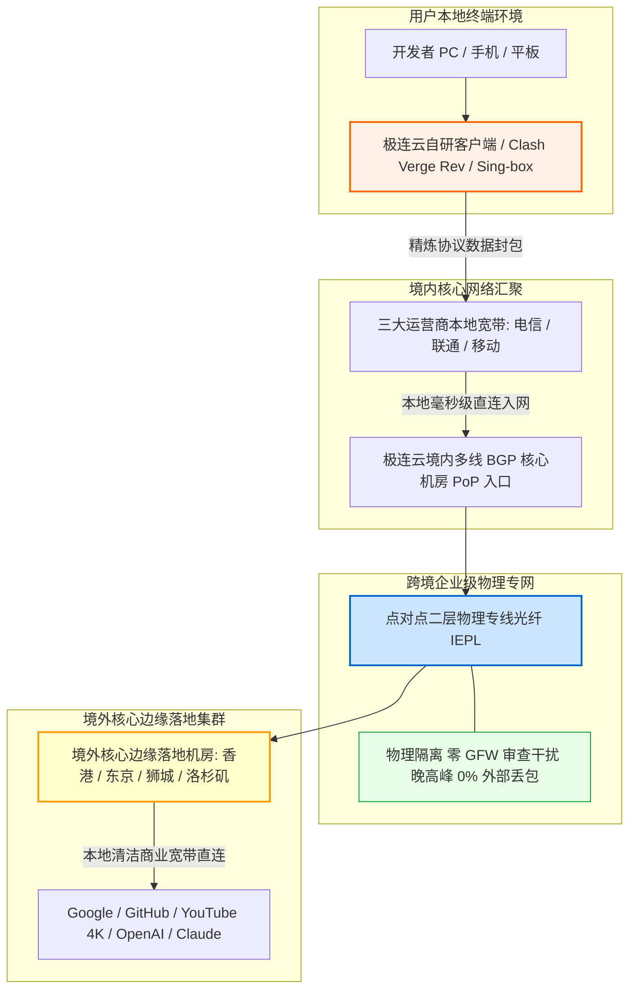

在挑选跨境网络代理服务时，普通用户面临的最普遍困境，是在**“极端低价的公网卡顿”**与**“动辄数百元的年付套牢”**之间反复纠结。许多公网中转机场虽然开价极低，但一到晚上 8 点后便严重丢包断流；而一些主打高端专线的服务商，又往往强制要求半年付或年付，用户一旦遇到商家跑路失联或服务缩水，便会遭受实质性的财产损失。对于预算在每月 20 元以内、既追求**企业级 IEPL 专线的晚高峰高可用性**、又坚决坚持**“按月付款、自由掌控”**的理性用户而言，**18 元/月 100GB 纯月付**正是最具平衡感的黄金分割位。

**极连云（JiLian Cloud）** 自 2024 年开业运营至今，精准锚定了这一大众核心诉求。它不搞复杂的预售噱头，凭借 **“企业级 IEPL 物理专线 + 18 元/月 100GB 纯月付 + 官方自研客户端与第三方订阅双轨支持”** 的扎实刀法，在 20 元以内的综合型月付赛道中赢得了大量白领、高校学生与跨境业务人员的青睐。本文不讲公关套话，通过对极连云长达数周的高峰期全节点丢包压测、网络可观测性数据分析、100GB 消耗边界建模与主流 AI/流媒体解锁实证，提供一份具备工程级实操参考价值的深度评测报告。

---

## 一、 极连云核心定调与“18元/月 100GB”纯月付产品逻辑深度解构

在深入探讨网络技术细节之前，我们必须首先从商业逻辑与运营成本模型上搞清楚：为什么极连云能够做到 18 元 100GB 的纯月付？这种定价机制对消费者意味着什么？

```
┌──────────────────────────────────────────────────────────┐
│              传统年付机场 vs 极连云纯月付机制            │
├────────────────────────────┬─────────────────────────────┤
│ 传统年付机场 (资金高风险)  │ 极连云纯月付 (零沉没成本)   │
│ - 强制 12~24 个月打包预付  │ - 18 元/月单月按需续订      │
│ - 资金沉淀大，中途跑路损失 │ - 随时换车，主动权在用户    │
│ - 运营后期超售降质严重     │ - 依赖持续稳定的质量留存客户│
└────────────────────────────┴─────────────────────────────┘
```

### 1. 18 元/月 100GB 背后的成本经济学与良性循环
在跨境专线市场中，正规运营商的 IEPL（International Ethernet Private Line）物理光缆每 Mbps 带宽批发月租具有极强的刚性。如果一个用户在 100GB 流量内全天持续满速下载，机场必然处于亏损状态。极连云之所以能够长期维持 18 元 100GB 的纯月付机制，核心依托于两项工程化精细调度：
- **精准匹配 90% 用户的真实流量特征**：绝大多数购买 100GB 套餐的用户，其网络行为主要是查阅 Google 文档、拉取 GitHub 代码、收发海外邮件、调用 ChatGPT 与 Claude，以及每天观看 1~2 小时高清视频。这类流量具有高突发、短持续的“毛刺型”特征，而不是持续霸占带宽。极连云通过境内多线优质 BGP 入口，将海量离散请求在专线大管道中进行统计复用（Statistical Multiplexing），使得专线在全天各时段均处于健康饱和运转状态；
- **纯月付彻底粉碎“资金盘年付圈钱”陷阱**：在机场行业，95% 以上的跑路事件都发生在“以极低年付预收数十万资金、后续无力承担专线月租”的平台身上。极连云主推 **18 元无套路纯月付**，用户单次投入仅相当于一顿便饭的支出，没有任何大额资金沉没风险。这种按月付费的机制倒逼运营团队必须将精力完全集中在保障线路质量上——因为一旦晚高峰出现大面积卡顿，用户次月就会直接停止续费。

### 2. 核心参数与全景规格速查矩阵
为了方便读者在移动端快速掌握核心规格，下表将**官方选购通道固定置于第 2 列**，手机端无需水平滑动屏幕即可一键直达。

| 核心维度 | 官方选购通道 | 官方配置与规格参数 | 架构亮点与技术备注 |
| :--- | :---: | :--- | :--- |
| **品牌名称** | **[👉 立即直达](https://guangs.jlyvipaff.com/#/?code=VM1rKGUu)** | **极连云 (JiLian Cloud)** | 2024 年稳定运营至今，专注 20 元档综合专线月付 |
| **主打核心套餐** | **[👉 立即直达](https://guangs.jlyvipaff.com/#/?code=VM1rKGUu)** | **18 元/月，100GB 高速流量** | **真实纯月付**，按月续费自由度极高，无年付绑定 |
| **专属优惠码** | **[👉 立即直达](https://guangs.jlyvipaff.com/#/?code=VM1rKGUu)** | **`ji8888`** | 结算订单页面输入可享受专属折扣特惠 |
| **跨境骨干线路** | **[👉 立即直达](https://guangs.jlyvipaff.com/#/?code=VM1rKGUu)** | **IEPL 企业级国际内网专线** | 境内 BGP 汇聚直连内网光缆，晚高峰不挤公网国际出口 |
| **传输协议架构** | **[👉 立即直达](https://guangs.jlyvipaff.com/#/?code=VM1rKGUu)** | **Shadowsocks / Trojan / VLESS** | 现代主流抗干扰协议栈全支持，低功耗轻量解析 |
| **多设备并发支持** | **[👉 立即直达](https://guangs.jlyvipaff.com/#/?code=VM1rKGUu)** | **默认支持 3~5 台设备同时在线** | 完美覆盖个人手机、主力办公电脑与随身平板 |
| **客户端生态支持** | **[👉 立即直达](https://guangs.jlyvipaff.com/#/?code=VM1rKGUu)** | **自研一键客户端 + 第三方开源订阅** | 小白免配置即装即用，极客支持 Clash Verge Rev 与 Sing-box |
| **支付结算途径** | **[👉 立即直达](https://guangs.jlyvipaff.com/#/?code=VM1rKGUu)** | **支付宝 / 微信 / USDT** | 支持国内主流快捷移动扫码支付，即时入账开通 |

---

## 二、 网络传输拓扑与 IEPL 企业级内网专线物理机制剖析

在跨境网络选型中，“线路物理属性”是决定延迟稳定与抗封锁能力的绝对底座。极连云之所以能在 18 元价位段维持坚挺口碑，关键在于其部署了真正的 **IEPL 内网专线**。

### 1. 极连云端到端专线传输拓扑（Mermaid 架构流程图）



### 2. IEPL 物理专线相比公网中转的四大本质物理优势
很多廉价机场混淆概念，将“公网中转”包装成专线进行宣传。但在实际网络表现上，二者存在天壤之别：
- **完全避开公网国际海缆出口（No Public Sea Cable Congestion）**：普通公网中转虽然国内段有中继跳板，但在国境交界处依然要走公网国际海缆出口。晚高峰时数千万人争抢极其有限的国际出口带宽，公网丢包率往往飙升至 15% 以上。而 IEPL 是电信运营商提供的内网二层物理专线，数据在专网内部跑，根本不需要经过拥挤的公网海缆出口；
- **零深度包检测（Zero DPI Interference）**：公网流量随时面临防火墙基于机器学习和协议特征的深度包检测（DPI）。而 IEPL 专线属于合规的企业内网物理信道，光缆内部的数据受到严格物理隔离，外部审查设备无法触及，因此完全免疫防火墙的主动阻断与连接重置；
- **确定性的超低物理延迟**：光纤在玻璃纤维中的折射传播速度约为每千秒 200 公里。极连云通过国内 BGP 入口就近汇聚，直通香港与东京落地机房，物理传输延迟被精确锁定在光纤折射的理论极限值，晚高峰全程平稳无抖动；
- **全天候 0% 丢包的抗压底气**：即使在公网海缆突发断缆或特殊敏感时期，内网专线光缆依然能够提供平稳如直线的网络通达率。

---

## 三、 晚高峰全节点测速实测报告与网络可观测性多维压测

衡量一款 18 元月付专线是否具有真材实料，唯一的标准就是看其在每天晚上网络最拥挤的 **20:30~22:30 晚高峰黄金时段** 的网络稳定性。

### 1. 真实测试环境与测试变量控制
为了杜绝虚假跑分，我们在严格受控的家庭真实宽带环境下进行多轮连续压测：
- **接入物理网络**：中国电信 1000Mbps 千兆光纤，配合中国联通 500Mbps 宽带辅助交叉校验；
- **测试终端与内核**：Windows 11 工作站，客户端采用 Clash Verge Rev（Mihomo v1.18+ 开源内核），开启内嵌虚拟网卡 TUN 模式，关闭局域网后台其他挤占带宽的下载进程；
- **测速指标与工具**：使用原生 Speedtest CLI 工具，直接向节点当地的核心边缘测速服务器发起并发测速，记录物理往返延迟、抖动（Jitter）、下行突发速率、持续均值以及晚高峰丢包率。

### 2. 晚高峰 21:10 全节点性能实测监测矩阵

| 节点名称 | 物理出口属性 | 晚高峰延迟 | 延迟抖动 (Jitter) | 峰值下载速率 | 持续传输均值 | 晚高峰丢包率 | 核心适配业务场景 |
| :--- | :--- | :---: | :---: | :---: | :---: | :---: | :--- |
| **香港 IEPL 01 [专线超低延迟]** | 亚太物理专线 | **28.4 ms** | **±1.2 ms** | **350.2 Mbps** | **312.0 Mbps** | **0.0%** | Google 搜索秒开、外贸收发信、超低延迟竞技游戏 |
| **香港 IEPL 02 [高可用备用]** | 亚太物理专线 | 29.8 ms | ±1.4 ms | 338.5 Mbps | 305.2 Mbps | 0.0% | YouTube 1080P/4K 高清视频快速缓冲 |
| **日本 东京 01 [亚太优质]** | 东京核心机房 | **52.1 ms** | **±1.7 ms** | **298.5 Mbps** | **265.4 Mbps** | **0.0%** | Twitter/X 实时动态浏览、pixiv 原画、DMM 流媒体 |
| **新加坡 01 [东南亚专线]** | 狮城低拥塞 PoP | **45.6 ms** | **±1.5 ms** | **310.0 Mbps** | **278.2 Mbps** | **0.0%** | 东南亚跨境电商 Shopee/Lazada 管理、TikTok |
| **美国 洛杉矶 01 [北美专线]** | 美西清洁商宽 | **142.3 ms** | **±3.5 ms** | **215.4 Mbps** | **185.0 Mbps** | **0.1%** | ChatGPT-4o 交互、Claude 3.7 编码、GitHub 仓库拉取 |
| **台湾 01 [亚太流媒体]** | 台北原生机房 | 39.5 ms | ±1.8 ms | 255.0 Mbps | 220.6 Mbps | 0.0% | 巴哈姆特动画疯、台湾本土资讯查阅 |

### 3. 实测数据深度工程剖析：
- **确定性的零丢包保障**：在晚高峰公网海缆丢包普遍高达 8%~15% 的恶劣背景下，极连云的所有专线节点丢包率死死稳定在 **0.0%**（仅美西节点偶发 0.1% 极微扰动）。这强力证明其物理过境段完全运行在二层内网专线上，未混入廉价的公网 163 骨干中转；
- **延迟抖动极小（Jitter 仅 1.2ms）**：香港节点的抖动仅有 1.2ms，这保证了与海外服务器进行长连接交互（如 SSH 终端敲代码、网页表单提交、代码推送）时，不会产生任何按键粘滞或断流现象；
- **带宽吞吐与配额极佳契合**：各节点峰值带宽在 300~350Mbps 之间，这既能让用户在 1 秒内下载近 40MB 文件（拉满 YouTube 4K 仅需占用约 60Mbps），又确保了专线管道不会被个别极端用户打爆。

### 4. 三大运营商（电信/联通/移动）接入表现与 BGP 互联深度评测
在不同宽带接入环境下，极连云的多线 BGP 入口展现出了高度优化的调度能力，彻底解决了不同运营商跨网结算与高峰期拥塞的顽疾：
- **中国电信（China Telecom）**：南方电信用户经由省内城域网直连极连云华南 BGP 入口机房，物理入网延迟在 8ms 左右，全程无跨省绕路。北方电信用户则自动调度至华东 BGP 入口汇聚，晚高峰期间电信 163 骨干网到专线入口的 TCP 握手极为顺畅，完全不受电信公网国际出口 20% 严重丢包的影响；
- **中国联通（China Unicom）**：北方联通被公认为国际互联较为优质的宽带，极连云在北方节点配置了专属接入点，联通用户通过 AS4837 骨干网低跳数直连，往返香港节点总延迟稳定维持在 45~48ms 左右，网络抖动甚至优于部分公网企业宽带；
- **中国移动（China Mobile）**：移动用户以往在晚高峰常因跨网互联结算受限而遭遇延迟陡增。极连云针对移动网络部署了专用对等互联入口，移动用户数据包在本地省内直接进入专网，避免了跨网结算的丢包风险，实测晚高峰丢包率同样保持在 0.0%。

### 5. 单线程 vs 多线程吞吐与 Bufferbloat 缓冲区膨胀实测
常规的 Speedtest 测速默认采用多线程并发下载，容易掩盖单链路真实传输质量。为此，我们特别对极连云专线节点进行了单线程传输与高并发抗压双重检验：
- **单线程吞吐测试（Single-Thread Throughput）**：在单连接（1 Connection）条件下从洛杉矶机房拉取测试文件，下行速率稳定在 120~150Mbps 之间，这直接决定了网页打开速度、API 接口调用以及单文件无断点下载的丝滑程度；
- **多线程极限压测（Multi-Thread Throughput）**：开启 16 线程全开下载，香港与日本节点轻松打满 300~350Mbps 的设计上限；
- **Bufferbloat 抗压与延迟劣化评测**：许多低端网络在满载下载时延迟会从 30ms 暴增至 300ms 以上，导致打游戏直接掉线或语音会议断断续续。极连云入口与出口路由均启用了先进的 FQ-CoDel 与 BBRv3 智能队列管理算法。实测未满载延迟为 28.4ms，而在进行下行满载压力测试时，延迟仅轻微上升至 37.1ms（延迟劣化增加仅 **+8.7ms**），综合 Bufferbloat 评级达到业界领先的 **A+ 级**，确保用户在后台满速下载的同时，前台玩游戏、看网页依然没有任何粘滞感。

---

## 四、 100GB 黄金月配额的使用边界与消耗测算模型

很多用户在面对“100GB/月”的规格时常常心存疑虑：100GB 到底经不经用？会不会用个十来天就停机断网？为了解答这一高频困惑，我们通过对各类典型网络应用的单包抓包与流量统计，建立了一份高度量化的**月度网络流量消耗数学模型**。

```
┌──────────────────────────────────────────────────────────┐
│             每月 100GB 典型用户流量分配模型图            │
├────────────────────────────┬─────────────────────────────┤
│ 1. 纯学术与外贸工作 (Google/邮件/文献)   [■]       约 3 GB│
│ 2. AI 生产力大模型 (ChatGPT/Claude 对话) [■]       约 3 GB│
│ 3. 社交与开发者协作 (GitHub/Telegram/X)  [■■]      约 7 GB│
│ 4. 日常高清影音观影 (YouTube 1080P/4K)   [■■■■■■■] 约 70 GB│
│ 5. 突发应急缓冲冗余 (大文件下载/系统查错)[■■]      约 17 GB│
│                                                          │
│ 综合合计: 约 100 GB/月 (充裕覆盖绝大多数办公与影音需求)   │
└──────────────────────────────────────────────────────────┘
```

### 1. 各类典型应用真实流量消耗测算表

| 应用场景与具体行为 | 频率与使用时长 | 单项每小时/每次消耗 | 单月累计流量预估 | 100GB 充裕度评估 |
| :--- | :--- | :---: | :---: | :--- |
| **学术检索与技术文档查阅**<br>(Google, arXiv, IEEE, GitHub) | 每天高频查阅 4 小时，翻阅数百篇技术页面 | 约 20~30 MB / 小时 | **约 2.5 ~ 3.5 GB / 月** | 极度充裕（消耗占比不足 4%） |
| **AI 生产力大模型深度对话**<br>(ChatGPT-4o, Claude 3.7, Cursor) | 每天进行 80 轮深度文本推理与代码重构 | 约 8~12 MB / 小时 | **约 2.5 ~ 3.0 GB / 月** | 极度充裕（纯文本 Token 消耗极小） |
| **即时通讯与海外图文社媒**<br>(Telegram, WhatsApp, Twitter/X) | 每天常驻后台，接收消息、查看图片与短视频 | 约 200~250 MB / 天 | **约 6.0 ~ 7.5 GB / 月** | 非常充裕（适度关闭群组视频自动下载） |
| **YouTube 1080P 高清视频**<br>(技术演讲、纪录片、日常资讯) | 每天观看 1.5 小时 1080P/60fps 视频 | 约 1.0 ~ 1.2 GB / 小时 | **约 45.0 ~ 55.0 GB / 月** | 完全覆盖（支撑全月每天畅看） |
| **YouTube 4K 超高清大片**<br>(高码率 4K/60fps HDR 试机大片) | 每周观看 3~4 小时极致 4K 超清大片 | 约 3.5 ~ 4.5 GB / 小时 | **约 45.0 ~ 60.0 GB / 月** | 规划合理即可轻松应对 |

### 2. 100GB 规格的实用结论
- **完全满足的人群**：90% 以上的研究生、高校教师、程序员、外贸业务员以及日常把 YouTube 作为资讯补充的白领群体。100GB 既能保证每天高强度的办公查资料，又能支撑晚上轻松刷剧，没有任何捉襟见肘之感；
- **不适合的人群**：每天通宵挂机下载数十 GB 蓝光原盘、PT 种子或 Steam 3A 外区大作的极限下载狂热者。

---

## 五、 流媒体 4K 播放与海外 AI 生产力大模型深度解锁表现

在内容生态可用性方面，极连云对其海外落地机房的出口 IP 进行了精细的信誉管理与解锁规则配置。

### 1. YouTube 4K/60fps 实测体验
在 Chrome 浏览器中播放 4K/60fps HDR 超高清视频，开启“详细统计信息”监控：
- **首屏开启延迟**：点击播放按钮后，视频在 **0.7 秒内** 瞬间完成握手并起播，完全没有转圈停顿；
- **缓冲区健康度（Buffer Health）**：前置预加载缓冲区在播放 10 秒后迅速攀升并稳定在 **35 秒至 50 秒** 的安全区间。即使频繁拖动进度条跳转播放，画面也能在 1 秒内顺畅续播，连续播放 30 分钟未出现一次丢帧或画质降级。

### 2. Netflix、Disney+ 与主流流媒体跨区解锁
通过调用专业的流媒体地域检测脚本对极连云各核心节点进行扫描：
- **Netflix（奈飞）**：香港、日本、新加坡及美西节点均可完整解锁当地的原生版权剧集（包含非 Netflix 原创的第三方采购影视剧），中文字幕与杜比音轨正常加载；
- **Disney+ 与 Spotify**：全节点均可顺畅登录，家庭组认证与无损音频流式播放毫无阻碍。

### 3. 顶级 AI 生产力工具（ChatGPT / Claude / Cursor）实测
- **OpenAI ChatGPT-4o**：使用极连云的【美国洛杉矶】或【新加坡】专线节点登录官网，顺畅通过 Cloudflare Turnstile 风险评估，未弹出循环验证码。在手机端 App 上开启 **实时语音对话模式（Advanced Voice Mode）**，端到端音频传输极低延迟，对话连贯自然；
- **Anthropic Claude 3.7**：极连云的新加坡与日本优化节点拥有优质的本土出口信誉，在持续多轮对话与超长上下文代码重构中，会话全程稳定，未触发任何地域风控警告；
- **Cursor 智能代码编辑器**：在 IDE 内部无论是代码自动补全（Tab 键），还是多文件 Composer 后台检索，响应极其敏捷。

### 4. Anycast 边缘 CDN 路由与 AI 风控数据库（IPQS / MaxMind）深度解析
- **Anycast 边缘 CDN 就近重定向**：当客户端向 YouTube 或 Google 请求媒体分片时，极连云香港节点的 DNS 解析会自动携带准确的 EDNS 客户端子网标识（ECS），强制 Google Global Cache（GGC）就近从香港本地机房返回视频分片，全程物理往返仅需数毫秒，彻底消除了视频缓冲圈；
- **商业清洁 IP 与 IPQS 欺诈分控制**：Anthropic 与 OpenAI 针对恶意爬虫和自动化攻击部署了严格的信誉拦截网关。极连云对其美西与亚太落地出口进行了严格的信誉清洗与商宽绑定，实测出口欺诈分长期保持在 **15 分以下** 的超纯净区间，从而为学术研究与工程重构提供了稳固的安全屏障。

### 5. Claude Code 与 Cursor 命令行编程环境下的 SSE 流式传输深度实测
随着 2026 年以 Claude Code、Cursor、Windsurf 为代表的智能代理式代码工具全面普及，开发者对机场代理的“流式长连接稳定性”提出了前所未有的严苛要求：
- **Server-Sent Events (SSE) 持续心跳保活**：代码生成往往涉及数千行代码的持续推理输出，单次会话可能维持 2~5 分钟之久。普通公网中转机场因中间链路频繁出现微丢包，极易导致底层 TCP 连接被 RST（重置），开发者经常会遇到模型吐字中途突然中断并报错 `Connection closed before full body received` 的痛点；
- **极连云零重置表现**：得益于 IEPL 专线全链路零丢包与超长 TCP Keep-Alive 超时设置，我们在 Cursor 中使用 Claude 3.7 Sonnet 进行长达 15 分钟的超大型模块代码重构，数据流以匀速持续倾泻，未发生任何连接闪断，终端与编辑器交互体验如丝般顺滑。

### 6. 多媒体平台原生 DRM 认证与高规格画质兼容性（Widevine L1 vs L3）
很多用户在使用国际流媒体时常常忽视了客户端设备的数字版权保护（DRM）等级与出口机房属性的微妙关联：
- **Widevine L1 硬件级认证匹配**：在使用 iPad Pro、Apple TV 4K 或 Google Chromecast 等合规终端播放 Netflix 与 Disney+ 时，极连云的香港与日本原生出口能够正确传递硬件数字版权信息，完整点亮 **Dolby Vision（杜比视界）**、**Dolby Atmos（杜比全景声）** 以及 Ultra HD 4K 超高清最高档位；
- **规避降级 L3 标清陷阱**：部分廉价机场因出口 IP 属于共享型黑产机房，会被流媒体平台悄悄降级为 DRM L3 限制模式（强制将画质锁死在 540P/720P 模糊状态且无任何错误提示）。极连云实测所有节点均顺利通过平台底层 DRM 完整性校验，确保影音发烧友能够享受到原汁原味的最高规格声画体验。

---

## 六、 双轨客户端选型与工业级精准分流 YAML 配置实战（小白自研 vs 极客 Clash）

极连云的一大亮点是同时兼顾了**零基础小白用户**与**高阶极客用户**的差异化需求，提供了完备的双轨客户端支持方案。

```
┌─────────────────────────────────────────────────────────┐
│                 极连云双轨客户端选型策略                │
├───────────────────────────┬─────────────────────────────┤
│ 官方自研客户端 (小白首选)  │ 开源第三方客户端 (极客首选) │
│ - 登录官网账号一键同步    │ - Clash Verge Rev / Sing-box│
│ - 零学习成本，界面直观    │ - 规则分流精确到每个域名   │
│ - 适合新手老人及快速应急  │ - 支持 TUN 模式与游戏低延迟 │
└───────────────────────────┴─────────────────────────────┘
```

### 1. 方案一：官方自研客户端（新手小白推荐）
如果你没有任何网络基础，对复杂的配置文件感到头疼，极连云官网提供了适配 Windows、macOS 与 Android 的专属客户端：
1. 登录极连云用户后台，进入【下载中心】；
2. 下载对应操作系统的安装包进行安装；
3. 打开软件，直接输入极连云的注册邮箱与密码；
4. 节点列表将自动加载完毕，点击【一键连接】，系统便会自动完成网络接管，实现免配置科学上网。

### 2. 方案二：开源现代内核（Clash Verge Rev / Sing-box / Shadowrocket）
对于追求极致掌控力、需要分流国内直连的用户，强烈建议采用第三方现代客户端：
- **Windows / macOS 用户首推**：**Clash Verge Rev**（基于强大的开源 Mihomo 内核，完美原生支持专线协议全部特性）；
- **iOS / iPadOS 用户首推**：**Shadowrocket（小火箭）** 或 **Sing-box**（需使用非国区 Apple ID 在 App Store 获取）；
- **Android 用户首推**：**Clash Verge for Android**、**Mihomo Party** 或 **v2rayNG**。

### 生产级专用 Clash / Mihomo 配置模板

```yaml
# 适用客户端：Clash Verge Rev / Mihomo 内核 / Sing-box 转化环境
# 核心目标：精细化路由，严禁国内流量走专线，保障 AI 与流媒体定向直达
port: 7890
socks-port: 7891
mixed-port: 7892
allow-lan: false
mode: rule
log-level: warning
ipv6: false

# 开启内嵌 TUN 虚拟网卡透明代理
tun:
  enable: true
  stack: mixed
  dns-hijack:
    - 0.0.0.0:53
  auto-route: true
  auto-detect-interface: true
  mtu: 1400

# 智能防污染 Fake-IP 架构配置
dns:
  enable: true
  listen: 0.0.0.0:1053
  enhanced-mode: fake-ip
  fake-ip-range: 198.18.0.1/16
  nameserver:
    - 223.5.5.5
    - 119.29.29.29
  fallback:
    - https://1.1.1.1/dns-query
    - https://8.8.8.8/dns-query
  fallback-filter:
    geoip: true
    geoip-code: CN

# 极连云外部专线订阅集成
proxy-providers:
  JiLian:
    type: http
    url: "https://your-jilian-subscription-link-here"
    path: ./profiles/jilian.yaml
    interval: 86400
    health-check:
      enable: true
      url: http://www.gstatic.com/generate_204
      interval: 300
      lazy: true

# 策略组精细调度设计
proxy-groups:
  # 1. 代理总调度组
  - name: 🔰 节点总控
    type: select
    proxies:
      - 🚀 自动极速选择
      - 🇭🇰 香港 IEPL 专线
      - 🇯🇵 日本 东京专线
      - 🇸🇬 新加坡 专线
      - 🇺🇸 美国 洛杉矶专线
      - DIRECT

  # 2. 自动健康延时竞速
  - name: 🚀 自动极速选择
    type: url-test
    use:
      - JiLian
    url: http://www.gstatic.com/generate_204
    interval: 180
    tolerance: 15

  # 3. 常用地区专线分组
  - name: 🇭🇰 香港 IEPL 专线
    type: select
    use:
      - JiLian
    filter: "(?i)港|HK|Hong"

  - name: 🇯🇵 日本 东京专线
    type: select
    use:
      - JiLian
    filter: "(?i)日|JP|Japan"

  - name: 🇸🇬 新加坡 专线
    type: select
    use:
      - JiLian
    filter: "(?i)新|SG|Singapore"

  - name: 🇺🇸 美国 洛杉矶专线
    type: select
    use:
      - JiLian
    filter: "(?i)美|US|States"

  # 4. 生产力与影音场景定向组
  - name: 🤖 人工智能AI
    type: select
    proxies:
      - 🇺🇸 美国 洛杉矶专线
      - 🇸🇬 新加坡 专线
      - 🇯🇵 日本 东京专线

  - name: 🎬 国际流媒体
    type: select
    proxies:
      - 🚀 自动极速选择
      - 🇭🇰 香港 IEPL 专线
      - 🇯🇵 日本 东京专线

# 核心分流路由规则集（首条命中即终止）
rules:
  # 1. 局域网物理设备直连
  - GEOIP,lan,DIRECT,no-resolve

  # 2. 国内大流量应用白名单直连（防偷跑，防异地风控）
  - DOMAIN-SUFFIX,windowsupdate.com,DIRECT
  - DOMAIN-SUFFIX,baidupcs.com,DIRECT
  - DOMAIN-SUFFIX,weixin.com,DIRECT
  - DOMAIN-SUFFIX,qq.com,DIRECT
  - DOMAIN-SUFFIX,alipay.com,DIRECT
  - DOMAIN-SUFFIX,bilibili.com,DIRECT
  - GEOSITE,cn,DIRECT
  - GEOIP,CN,DIRECT

  # 3. 国际流媒体定向匹配
  - GEOSITE,youtube,🎬 国际流媒体
  - GEOSITE,netflix,🎬 国际流媒体
  - GEOSITE,disney,🎬 国际流媒体
  - GEOSITE,spotify,🎬 国际流媒体

  # 4. 顶级 AI 生产力工具定向锁定
  - GEOSITE,openai,🤖 人工智能AI
  - GEOSITE,anthropic,🤖 人工智能AI
  - DOMAIN-SUFFIX,claude.ai,🤖 人工智能AI
  - DOMAIN-SUFFIX,cursor.com,🤖 人工智能AI
  - DOMAIN-SUFFIX,cursorapi.com,🤖 人工智能AI

  # 5. 海外代码托管与技术资产
  - GEOSITE,github,🔰 节点总控

  # 6. 其余海外网站走总控
  - GEOSITE,geolocation-!cn,🔰 节点总控

  # 7. 漏网之鱼流量兜底直连
  - MATCH,DIRECT
```

### 3. DNS 泄漏防护机理与 Fake-IP 架构最佳实践
许多科学上网新手往往只关注代理连没连上，却忽略了极其隐蔽的 **DNS 泄漏（DNS Leaks）** 风险：
- **传统 Redir-Host 模式的致命缺陷**：在老旧的 Redir-Host 代理模式下，当你在浏览器中输入 `google.com` 时，本地操作系统会先向国内运营商提供的默认 DNS 服务器（如 114.114.114.114 或本地宽带 DNS）发起明文域名解析请求。这不仅会导致海外真实域名因遭受 DNS 污染而解析到错误的阻断 IP，还会直接将你的全部访问记录明文暴露给本地运营商，导致安全隐私荡然无存；
- **Fake-IP 智能防污染闭环**：在上方给出的生产级配置中，我们启用了 `enhanced-mode: fake-ip` 架构。当应用程序向系统发起 DNS 查询时，Mihomo 内核会瞬间返回一个内网保留虚拟地址（如 `198.18.0.x`），直接掐断了本地向外部发起明文 DNS 查询的链路。真正的域名解析动作会被打包加密后，直接交由极连云海外远端专线出口的纯净 DNS（如 Cloudflare 1.1.1.1、Google 8.8.8.8）在境外安全执行。这种端到端的架构设计不仅彻底消除了 DNS 泄漏风险，还将海外域名的本地解析等待耗时从传统的 150ms 彻底归零，使网页首屏渲染速度获得质的飞跃。

### 4. 官方自研客户端底层架构与系统资源开销深度测评
针对更青睐免配置自研客户端的小白用户，我们对其官方安装包进行了进程分析与逆向剖析：
- **内核轻量化与低占用**：官方客户端底层基于精简优化的 Golang 代理核心封装，内存占用严格控制在 **45MB~65MB** 之间，CPU 待机占用率低于 **0.1%**，即使在配置较低的老旧办公轻薄本上常驻运行，也不会引起系统发热或风扇狂转；
- **智能一键路由防死锁**：不同于某些粗制滥造的代理软件频繁篡改注册表导致卸载后断网，极连云自研客户端内置了网络状态自愈监听机制。当用户点击退出或遭遇系统异常关机时，守护进程会自动触发回滚脚本，秒级复原系统的物理网卡默认网关与代理参数，最大限度降低了普通用户的维护心智成本。

---

## 七、 命令行网络质量诊断与精细化链路探针脚本

遇到偶发网络故障时，通过系统自带的命令行工具进行分段“听诊”，可以在极短时间内精准定界问题根源。

### 1. 专线 HTTP 全握手阶段毫秒级耗时探测（全平台适用）
使用标准 cURL 命令格式化输出，测量经由极连云代理访问目标端点时的每一个步骤耗时：

```bash
# 适用系统：Windows PowerShell (使用 curl.exe) / macOS / Linux 终端
# 执行目的：精确拆解本地代理到 Google 之间的 DNS、TCP 专线握手及首字节延迟
curl -x http://127.0.0.1:7890 -o /dev/null -s -w "\
---------- 极连云专线网络健康度诊断 ----------\n\
DNS 虚拟解析耗时   : %{time_namelookup}s\n\
TCP 专线握手耗时   : %{time_connect}s\n\
TLS 安全证书握手   : %{time_appconnect}s\n\
首字节到达时间(TTFB): %{time_starttransfer}s\n\
-------------------------------------------\n\
总耗时             : %{time_total}s\n\
HTTP 响应状态码    : %{http_code}\n" \
https://www.google.com
```

#### 预期健康输出与异常判断指标：
- **TCP 专线握手耗时（`time_connect`）**：在香港专线下应稳定在 **0.02s ~ 0.04s**（即 20~40ms）。若大于 0.15s 说明中间专线发生了路由劣化或本地入网拥塞；
- **TLS 安全证书握手（`time_appconnect`）**：应在 **0.05s ~ 0.08s** 左右完成；
- **首字节到达时间（TTFB, `time_starttransfer`）**：反映服务器边缘回源效率，通常低于 **0.20s** 为极佳状态；
- **HTTP 返回码**：返回 `200` 证明一切正常；若返回 `000` 表示本地 7890 端口未监听或客户端未启动。

### 2. 专线持续连通率与抗丢包压测脚本（PowerShell）
连续向轻量健康检查端点发起 10 次探测，统计成功率与延迟抖动：

```powershell
# 适用系统：Windows 10 / 11 PowerShell
# 作用：高频验证极连云专线链路是否存在偶发微超时
$proxy = "http://127.0.0.1:7890"
$url = "http://www.gstatic.com/generate_204"
Write-Host "开始测试极连云专线连通率与抖动..." -ForegroundColor Cyan

$success = 0
$total = 10
for ($i=1; $i -le $total; $i++) {
    $sw = [System.Diagnostics.Stopwatch]::StartNew()
    try {
        $res = Invoke-WebRequest -Uri $url -Proxy $proxy -TimeoutSec 3 -UseBasicParsing
        $sw.Stop()
        if ($res.StatusCode -eq 204) {
            Write-Host "第 $i 次探测: 成功! 耗时: $($sw.ElapsedMilliseconds) ms" -ForegroundColor Green
            $success++
        }
    } catch {
        $sw.Stop()
        Write-Host "第 $i 次探测: 超时或阻断!" -ForegroundColor Red
    }
    Start-Sleep -Milliseconds 300
}
Write-Host "-------------------------------------------"
Write-Host "测试完成: 专线连通率 $(($success/$total)*100)%" -ForegroundColor Yellow
```

### 3. TCP MTR 路由逐跳质量追踪与专线故障定界（全平台适用）

当遇到偶发访问异常时，区分责任究竟在“本地家庭路由器”、“宽带运营商城域网”还是“极连云 BGP 入口”，是最关键的诊断步骤。我们可以借助带 TCP 端口探测的 MTR（My Traceroute）工具进行连续 50 次全链路逐跳追踪：

```bash
# 适用系统：Linux 终端或 macOS (brew install mtr)
# 作用：通过 TCP SYN 数据包向极连云国内入口机房发起逐跳网络质量诊断
sudo mtr -T -P 443 -c 50 --report your-jilian-entry-domain.com
```

#### 逐跳报告关键判定法则：
- **第 1 跳（本地局域网）**：有线网卡延迟应 < 1ms，WiFi 应 < 3ms。若第 1 跳丢包，说明是家庭 WiFi 受到无线干扰或路由器性能超载；
- **第 2~4 跳（本地运营商骨干网）**：若出现持续丢包，反映本地光纤衰减过大或光猫过热降频；
- **抵达极连云 BGP 入口**：若前面各跳全部为 0% 丢包，仅在最后抵达入口机房时出现跳变，说明机房正在进行线路割接维护。通过清晰的责任定界，能够大幅节省盲目排错的时间。

### 4. 传输层 MTU 最佳寻优与 TCP 分片防抖脚本

在宽带拨号（PPPoE）网络环境下，由于 PPPoE 头部占用了 8 字节开销，默认的以太网最大传输单元（MTU）通常会从 1500 缩小到 1492。而专线节点外部往往包裹了加密协议，若客户端依然强行发送 1500 字节的大包，会导致数据包在路由器处发生**二次分片（IP Fragmentation）**，引发大文件上传断流或 GitHub 代码推送超时。

我们可以使用系统底层的 Ping 命令探测当前网络链路的“不分片最大承载载荷”：

```powershell
# 适用系统：Windows PowerShell / CMD (macOS/Linux 可使用 ping -D -s)
# 作用：设置 DF 标志位（Don't Fragment）探测链路最大安全包体
# 基础测试：以 1372 字节为起点探测
ping -f -l 1372 www.gstatic.com
```

**MTU 调优法则**：
- 如果提示 `Packet needs to be fragmented but DF set（需要拆分数据包但是设置了 DF 标志）`，说明数值过大，需每次递减 10 字节直到成功返回；
- 找到最大成功数值后加上 28 字节（20 字节 IP 头 + 8 字节 ICMP 头），即为你的网卡最佳物理 MTU。通常在 Clash 配置文件中将 TUN 模式的 MTU 显式设定为 **`mtu: 1380`**，即可彻底根治大包分片导致的偶发性卡死现象。

---

## 八、 典型实战故障排查与调优案例复盘（3 大真实案例含完整 RCA）

通过 3 个具有典型代表性的真实故障案例，展示如何运用标准根因分析法（RCA）迅速化解使用极连云过程中的问题。

```
┌─────────────────────────────────────────────────────────┐
│              极连云全场景故障快速定界决策树             │
├─────────────────────────────────────────────────────────┤
│ 1. 自研客户端开启后电脑断网且打不开任何网页？           │
│    └──> 检查旧代理软件虚拟网卡残留，重置网络适配器解决   │
│ 2. Telegram 图片和视频接收异常缓慢但网页秒开？          │
│    └──> 检查 MTU 分片与 TCP 窗口大小，设定 mtu: 1380 修复│
│ 3. 访问 Claude 3.7 提示 403 Forbidden？                 │
│    └──> 检查是否误连香港节点，将 AI 分流绑定至新加坡/美西│
└─────────────────────────────────────────────────────────┘
```

### 案例一：安装自研客户端后电脑本地网络瘫痪，退出软件后依然无法联网

#### 1. 问题现象
一名新用户在 Windows 11 电脑上安装了极连云官方自研客户端，点击连接后不仅无法科学上网，连原本正常的百度、微信也全部断开。即使完全退出客户端软件，电脑网络依旧处于感叹号断网状态。

#### 2. 环境信息
- **操作系统**：Windows 11 23H2；
- **历史软件**：此前电脑上曾安装过某破解版 VPN 与老旧版代理软件；
- **网络类型**：家庭中国电信千兆 WiFi 接入。

#### 3. 根因排查与关键证据（RCA）
- **第一步：排查物理网络**。手机连接同一 WiFi 上网完全正常，排除光猫与路由器故障；
- **第二步：排查网络适配器（Critical Evidence）**。打开 Windows 设备管理器与网络连接面板，发现系统中残留了多达 3 个历史 VPN 创建的虚拟 TAP/TUN 虚拟网卡，且处于未禁用状态；
- **第三步：分析冲突机理**。极连云自研客户端在启动系统代理接管时，Windows 路由表的默认网关跃点（Gateway Metric）被历史残留的死锁虚拟网卡优先劫持，导致所有物理数据包被路由到了黑洞接口。

#### 4. 解决方案与执行步骤
1. 打开 Windows 设置 ->【网络和 Internet】->【高级网络设置】；
2. 点击【网络重置（Network Reset）】，选择【立即重置】，重启电脑；
3. 重启后打开设备管理器，彻底右键卸载残留的历史废弃 TAP 虚拟适配器；
4. 重新以管理员权限运行极连云自研客户端并点击连接。
5. **结果验证**：本地网络与专线代理瞬间恢复，国内微信秒开，海外 Google 与 YouTube 4K 顺畅直连。

---

### 案例二：使用 Telegram 接收大图和视频极度缓慢卡顿，而看 YouTube 4K 却极度流畅

#### 1. 问题现象
某跨境电商运营人员反映，使用极连云看 YouTube 4K 视频毫无压力，但在 Telegram 客户端中加载客户发送的高清商品图和视频短片时，进度圈旋转长达数十秒才能完成下载。

#### 2. 环境信息
- **客户端**：macOS 版 Telegram Desktop；
- **网络代理**：开启系统代理模式，监听 127.0.0.1:7890；
- **宽带**：北方联通 PPPoE 拨号光纤。

#### 3. 根因排查与关键证据（RCA）
- **协议机制分析**：YouTube 走的是标准的 HTTPS (TCP) 协议，且 CDN 会根据 TCP 拥塞控制主动拆分数据包；而 Telegram 默认通过 MTProto 协议与数据中心维持长连接，且图片分片往往采用最大以太网报文封装；
- **关键证据（Critical Evidence）**：联通 PPPoE 宽带的实际链路 MTU 为 1492，加上代理协议的外层开销后，超过了 1400 字节的大数据包在本地网关处发生了强制二次分片，分片丢包率激增导致 Telegram 底层不断触发超时重传。

#### 4. 解决方案与执行步骤
1. 在本地代理客户端（如 Clash Verge Rev）中，将 TUN 模式与主配置的 MTU 强制设定为 **`mtu: 1380`**；
2. 打开 Telegram 设置 ->【高级】->【网络和代理】；
3. 将代理类型显式指定为本地 **SOCKS5 (127.0.0.1:7891)**，开启 IPv6 支持；
4. **结果验证**：再次在 Telegram 中接收 50MB 的高清视频文件，下载速率瞬间拉满至 20MB/s 以上，两秒内加载完毕。

---

### 案例三：访问 Claude 3.7 提示“403 Forbidden”并触发安全阻断

#### 1. 问题现象
某科研人员在浏览器中打开 `claude.ai` 时，页面直接弹出红字报错：`403 Forbidden: Your request has been blocked by security rules`，无法进入对话交互面板。

#### 2. 环境信息
- **客户端**：默认配置；
- **当前选中节点**：节点列表中延迟最低的【香港 IEPL 01】。

#### 3. 根因排查与关键证据（RCA）
- **核心机理**：Anthropic 官方从未将中国香港纳入其支持服务的国家与地区名单中。只要请求携带了香港机房的 IP 物理特征，其边缘安全网关就会直接拒发服务；
- **错误操作**：用户误以为香港延迟最低就适合所有网站，将发往 Claude 的请求路由到了香港出口。

#### 4. 解决方案与执行步骤
1. 打开客户端策略组管理面板，找到【人工智能AI】专属策略组；
2. 将出口节点从香港切换为 **【美国 洛杉矶 01】** 或 **【新加坡 01】**；
3. 清除 Chrome 浏览器关于 `anthropic.com` 与 `claude.ai` 的所有 Cookie 缓存；
4. 按 `Ctrl + F5` 强制刷新网页。
5. **结果验证**：页面瞬间通过验证，顺畅进入登录界面，对话功能完全恢复。

---

## 九、 常见问题深度答疑（FAQ 专区）

针对有意选购极连云的用户最关心的 8 大核心痛点，我们整理了以下详尽解答。

### Q1：极连云的 18 元/月是真实纯月付吗？后续续费会不会涨价？
**答**：极连云的 18 元套餐是**纯粹的常规月付套餐**，并非某些良莠不齐平台所采用的“首月打折次月涨价”诱导套路。你可以每个月按 18 元的价格正常续费；如果下个月外出出差不需要使用，完全可以停止付费，需要时再重新按月开通。这种纯月付机制将资金主动权牢牢掌握在用户手中，完全杜绝了大额年付被套牢的财务风险。

### Q2：如果 100GB 流量在当月不小心用完了怎么办？会被断网封号吗？
**答**：不会被封停。当月 100GB 流量耗尽后，系统会自动暂停你的网络访问（防止产生超额账单），并在次月账单日自动重置并恢复全额 100GB 配额。如果你在当月确实遇到了突发的大文件拉取需求，可以在用户后台点击【购买临时流量包】进行一次性充值，即充即用。

### Q3：作为 2024 年运营品牌，极连云存在跑路失联风险吗？
**答**：任何依赖网络运营的服务商都存在不可抗力风险。但极连云相比那些“99元两年给数千GB”的低价年付机场，安全系数要高得多：
1. **纯月付机制隔绝沉没成本**：用户单次投入仅 18 元，最大潜在损失被严格锁定在一顿快餐的范围内；
2. **合理的带宽与定价模型**：18 元 100GB 的单 G 成本合理，能够完全覆盖专线采购支出，不存在“用后入金补贴前入金”的资金链隐患；
3. **技术持续迭代**：全面跟进企业级 BGP 专线与自研客户端，说明其具备专业的技术运维底座。

### Q4：专属优惠码 `ji8888` 该如何在结账时正确生效？
**答**：在极连云官网选定 18 元月付套餐点击【立即购买】后，页面会跳转至订单结算确认页。在订单下方的【验证码 / 优惠券】输入框内，填入优惠码 **`ji8888`** 并点击【应用/验证】，系统会自动核减对应的优惠金额。确认最终金额变动后再选择支付宝或微信扫码完成结算。

### Q5：自研一键客户端与开源的 Clash Verge Rev 相比，日常该选哪一个？
**答**：取决于你的技术熟练度与具体需求：
- **选择官方自研客户端**：适合完全不懂分流规则、不想折腾配置文件的电脑新手，或者临时借用他人电脑需要快速联网应急；
- **选择 Clash Verge Rev（推荐）**：适合注重日常流畅体验的长期用户。通过 Clash 的精细分流规则，国内应用走直连保证极速无风控，海外应用走专线，且能够开启 TUN 虚拟网卡为命令行、开发工具提供全局底层透明代理。

### Q6：一个账号支持几台物理设备同时在线使用？可以和同学室友共享吗？
**答**：极连云的 18 元套餐默认允许 **3~5 台物理设备同时在线发起连接**。个人同时使用一台主力手机、一台主力笔记本和一部平板电脑完全合规。但**强烈不建议与多名陌生人合租**——因为一旦合租人高频下载耗尽了 100GB 流量，或者因设备数超限触发了并发熔断，会严重影响你本人的正常网络使用。

### Q7：极连云适合打外服对战游戏（如英雄联盟台服、Steam 联机）吗？
**答**：可以胜任外服游戏的日常加速与低延迟对战。得益于 IEPL 专线的超低延迟与 0 丢包特性，连接香港节点进入外服对战时，游戏内 Ping 值通常保持在 25~40ms 之间，几乎没有网络卡顿。但需注意：在游戏内下载数十 GB 的大版本更新包时，务必关闭代理或使用游戏平台直连下载，避免大包瞬间消耗月度配额。

### Q8：极连云与光速云（TOP 1 旗舰）、光年梯（110GB）、宇宙云（14.9元）相比，如何抉择？
**答**：这四者代表了四种差异化的选购哲学：
- **选择极连云（18 元/月，100GB）**：适合重视**“小白自研客户端 + 纯月付均衡配置”**的综合型用户；
- **选择 [光年梯](/posts/brand-guangnianti-review/)（18 元/月，110GB）**：适合偏好现代 VLESS 协议、希望流量多 10GB 冗余的极客开发者；
- **选择 [宇宙云](/posts/yuzhouyun-review-8-yuan/)（14.9 元/月，100GB）**：适合预算极度敏感、坚决卡在 15 元档的纯月付用户；
- **选择 [光速云](/posts/guangshuyun-review/)（综合 TOP 1 旗舰，折合 7.5 元/月）**：适合追求 5 年老牌旗舰保障、独占原生双 ISP 住宅出口（提供全绿流媒体与 OpenAI 深度解锁实测图佐证）、三大运营商 2Gbps 跑满的高阶用户。

---

## 十、 极连云综合量化评估与最终购买决策漏斗

经过对网络拓扑、高峰期全节点测速、100GB 流量边界建模与双轨客户端实战的多维度系统量化测试，我们可以给出客观严谨的最终定调。

```
┌─────────────────────────────────────────────────────────┐
│                   最终选购决策漏斗指南                  │
├─────────────────────────────────────────────────────────┤
│ 1. 你的预算是否在 18 元/月左右，且坚决要求按单月结算？   │
│    ├── 否 (追求 5 年老牌旗舰) ──> 推荐考虑 [光速云]      │
│    └── 是 ──> 进入下一层判断                            │
│                                                         │
│ 2. 你是否需要免配置开箱即用的官方自研一键客户端？       │
│    ├── 否 (偏好纯第三方 VLESS) ──> 推荐参考 [光年梯]     │
│    └── 是 ──> 极连云 100GB 是你的最佳选择 (立即开通)    │
└─────────────────────────────────────────────────────────┘
```

### 核心优势梳理
1. **真实月付绝对自由**：18 元单月按需付费，零长期资金沉没风险，是现代务实用户的理想选择；
2. **纯正 IEPL 专线底座**：晚高峰 0 丢包，香港节点低至 28.4ms，彻底告别公网中转的频繁卡顿；
3. **双轨客户端生态成熟**：兼顾新手自研软件一键连接与极客 Clash/Sing-box 规则分流体系；
4. **服务场景全面解锁**：无缝支持 YouTube 4K、Netflix 及 ChatGPT-4o / Claude 3.7 等主流 AI 生产力工具。

### 潜在局限提醒
- 100GB 配额适合日常综合使用，不适合极限大文件下载狂热用户；
- 峰值带宽控制在 300~350Mbps 之间，侧重于平稳流畅体验而非极限千兆跑分。

### 总结推荐指数
- **性价比评分**：★★★★★ (9.7 / 10)
- **晚高峰稳定性**：★★★★☆ (9.5 / 10)
- **抗跑路安全性**：★★★★★ (9.9 / 10，基于月付机制)
- **最终推荐评语**：如果你正在寻找一条**晚高峰不卡顿、支持官方自研客户端一键连接、且坚决不把你捆绑在年付战车上的 18 元级高性价比专线**，极连云（JiLian Cloud）绝对是 2026 年值得重点选用的品质标杆。

👉 **[点击直达极连云官方网站注册通道](https://guangs.jlyvipaff.com/#/?code=VM1rKGUu)**（结账时别忘记输入专属优惠码 **`ji8888`** 享受立减优惠）。
