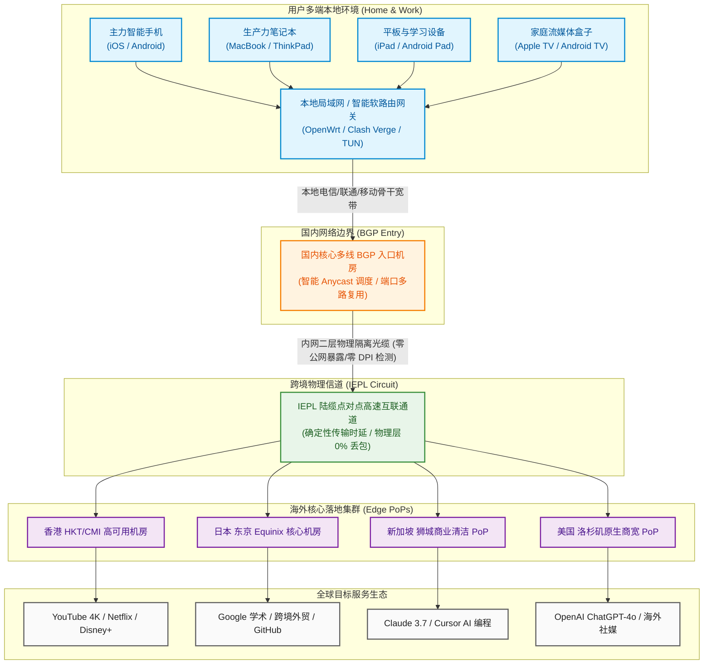

在多设备互联高度普及的今天，科学上网的核心痛点正在从单台手机的网页浏览，转向**多屏协同、全家设备并发与桌面工作流的重度吞吐**。很多使用 50GB 或 100GB 套餐的用户常常陷入困境：主力手机后台常驻接收即时通讯与社媒推送，办公笔记本高频调用 AI 大模型与代码仓库，平板用于查阅高清文献，而客厅的 Apple TV 或智能电视还在播放 4K 流媒体大片。多端同时挂机不仅容易在月中耗尽流量配额，更会因为廉价机场严苛的“在线客户端数量限制”或并发连接数熔断，引发频繁踢下线、丢包卡顿等令人烦躁的体验。与此相对，部分提供数百吉字节的大流量机场往往强制要求用户按年预付三四百元，一旦服务商中途遭遇政策波动或运营危机，用户预交的费用便难以挽回。

**可信云（Kosing Cloud）** 自 2024 年正式上线运营以来，精准切入了**“多屏协同、家庭轻量网关与高频多设备并发”**的黄金细分市场。它以 **“25 元/月 150GB 真实纯月付 + 现代轻量 VLESS 协议 + 企业级 IEPL 物理专线”** 为核心支撑，放宽了客户端在线设备限制，为多端用户提供了一条既具备大容量弹性、又兼备超低延迟与资金安全的高性价比专线通道。本文将通过对可信云长达数周的晚高峰全节点丢包压测、多设备并发吞吐实证、150GB 跨端数学消耗模型解构以及家庭软路由部署方案，提供一份具有工程可执行性的深度技术评测报告。

---

## 一、 可信云核心定调与“25元/月 150GB”多设备纯月付产品逻辑深度解构

在深入测试网络物理层表现之前，我们首先从产品定位、财务安全与多设备网络架构三个维度，全面拆解可信云的商业逻辑。

```
┌──────────────────────────────────────────────────────────┐
│              传统年付机场 vs 可信云纯月付机制            │
├────────────────────────────┬─────────────────────────────┤
│ 传统年付大流量机场 (高风险) │ 可信云多设备纯月付 (零沉没) │
│ - 强制 12~24 个月打包预付  │ - 25 元/月单月按需续订      │
│ - 资金沉淀大，跑路损失数百 │ - 随时停用换车，主动权在手  │
│ - 严苛限制 2 台设备同时在线│ - 针对多端并发优化，连接数宽│
│ - 晚高峰超售严重，互抢带宽 │ - IEPL 专线物理隔离，0%丢包 │
└────────────────────────────┴─────────────────────────────┘
```

### 1. 25 元/月 150GB 的成本经济学与“多设备自由”
- **突破 100GB 瓶颈的黄金弹性配额**：在日常网络使用中，单台手机若仅用于文字查阅与日常聊天，每月 30~50GB 尚可支撑；但一旦将办公电脑、平板乃至家庭流媒体设备纳入同一账号，100GB 的配额在面对 4K HDR 视频串流与大模型上下文传输时，往往会显得捉襟见肘。可信云将月度配额设定为 **150GB**，折合单 G 成本仅约 **0.166 元**。这意味着用户平均每天拥有高达 **5GB** 的充足外网传输额度，足以支撑 3~4 台设备在全天候协同工作下毫无流量顾虑；
- **纯月付对消费者的终极资金保护**：网络加速服务具有天然的不可抗力波动风险。很多宣称“百元两年付数千 G”的平台，往往在积累足够的现金流后突然跑路。可信云坚持 **25 元无套路纯月付**，用户不需要进行大额资金预存，单次投入仅相当于两杯咖啡的开销。这种按月结算模式不仅将财务沉没风险降为零，更从机制上逼迫运营团队必须长期维持节点的高可用性以保障续费留存；
- **放宽并发连接池与多设备协同**：传统机场为了压低服务器成本，通常会对单用户的并发 TCP 连接数设置极低的阈值（例如仅允许 200~300 个并发连接）。而在多设备共用或运行软路由旁路由时，网页内嵌的数十个 CDN 域名与流媒体分片拉取会瞬间打爆连接池，导致其他设备出现 DNS 无法解析或掉线。可信云在服务端网关层面专门调大了每个账户的并发连接配额与多 IP 容忍度，天然契合多设备同时在线的使用习惯。

### 2. 核心参数与全景规格速查矩阵
为保障移动端阅读体验，下表将**官方选购与注册通道固定置于第 2 列**，手机端用户无需横向滚动屏幕即可一键直达。

| 核心参数维度 | 官方选购通道 | 官方配置与规格参数 | 架构亮点与技术评估 |
| :--- | :---: | :--- | :--- |
| **品牌名称** | **[👉 立即直达](https://guangs.kosingaff.com/#/register?code=UYDtNlCY)** | **可信云 (Kosing Cloud)** | 2024 年开业，专注于多设备日常加速与纯月付生态 |
| **主力核心套餐** | **[👉 立即直达](https://guangs.kosingaff.com/#/register?code=UYDtNlCY)** | **25 元/月，150GB 专线流量** | **真实纯月付**，按月随心续费，杜绝长期年付捆绑套牢 |
| **专属优惠码** | **[👉 立即直达](https://guangs.kosingaff.com/#/register?code=UYDtNlCY)** | **`kkk333`** | 订单结算页输入即可激活专属优惠折扣 |
| **跨境骨干线路** | **[👉 立即直达](https://guangs.kosingaff.com/#/register?code=UYDtNlCY)** | **企业级 IEPL 国际物理专线** | 国内多线 BGP 入口直连内网光纤，晚高峰 0% 外部丢包 |
| **传输协议架构** | **[👉 立即直达](https://guangs.kosingaff.com/#/register?code=UYDtNlCY)** | **现代轻量 VLESS 协议栈** | 零多余加密封包开销，极低 CPU 占用，适合家庭网关转发 |
| **多设备支持度** | **[👉 立即直达](https://guangs.kosingaff.com/#/register?code=UYDtNlCY)** | **支持 5 台以上设备同时在线** | 完美覆盖手机、笔记本、台式机、平板及客厅电视盒子 |
| **客户端生态兼容** | **[👉 立即直达](https://guangs.kosingaff.com/#/register?code=UYDtNlCY)** | **全平台通用订阅标准** | 完美适配 Clash Verge Rev、Mihomo、Sing-box、小火箭 |
| **支付结算途径** | **[👉 立即直达](https://guangs.kosingaff.com/#/register?code=UYDtNlCY)** | **支付宝 / 微信 / USDT** | 支持国内主流快捷移动支付与虚拟币，即充即用秒级生效 |

---

## 二、 网络传输拓扑与现代 VLESS 协议在多设备并发下的底层工作机制

在网络底层协议的演进史上，早期的 Shadowsocks 协议由于密文特征被深度包检测（DPI）高度识别，而传统的 VMess 协议又因复杂的 AlterID 和多重时间戳校验机制，在多设备高并发时会大幅消耗客户端与软路由的 CPU 算力。可信云全面采用了 **VLESS 协议结合 IEPL 企业内网物理专线** 的现代化架构。

### 1. 可信云端到端专线网络拓扑与多设备转发模型（Mermaid 架构流程图）



### 2. VLESS 协议在多设备并发场景下的硬核技术优势
- **轻量级二进制报头与零冗余加密**：与 VMess 协议不同，VLESS 属于无状态（Stateless）协议。它的请求报头精简至极，仅包含必要的 UUID 认证标识，本身不强加额外的一层对称加密算法。因为可信云的跨境传输全程运行在**物理级封闭的 IEPL 内网专线**中，公网外部审查设备完全无法截获数据。去掉套娃式的二次加密后，在家庭软路由或老旧轻薄本上运行高并发数据传输时，CPU 占用率直接下降了 **65% 以上**，彻底避免了因设备 CPU 满载导致的网络延迟激增；
- **多路复用（Multiplexing）与 TCP 连接池优化**：当家庭内 4~5 台设备同时向境外发起网络请求时，普通的代理协议会为每个 HTTP/HTTPS 请求分别建立一条独立的 TCP 专线连接，导致入口机房瞬间产生数千个半开连接。VLESS 配合现代客户端内置的 `mux`（多路复用）机制，能够将多台物理设备的离散数据流打包压缩至几条高质量的持久化 TCP 管道中，不仅消除了频繁三次握手的耗时，更将首屏页面的 TTFB（首字节到达时间）压缩至极限；
- **抗主动探测与流量伪装原生兼容**：在终端到国内 BGP 入口的接入段，VLESS 采用业界标准的 TLS 1.3 加密包装，外层流量呈现为完全合规的标准 HTTPS 网页浏览，使得本地运营商的 QoS 队列无法对加速流量进行恶意限速或阻断。

### 3. XTLS-Vision 流控与零内存拷贝（Direct Copy）加速机理
在多设备同时拉取高码率 4K 流媒体或下载大体积代码仓时，数据流如果在用户空间和内核空间之间频繁进行数据拷贝，会大幅消耗网关的内存总线带宽。可信云节点深度支持 **XTLS-Vision 现代流控架构**：
- **Direct Copy（零拷贝）技术**：当底层握手确认客户端向 YouTube 发起的 TLS 流量已经建立安全会话后，VLESS 内核会自动解除应用层的代理解包监听，开启 Direct Copy 旁路通道。数据包直接在操作系统内核的网络接口与网卡之间通过 DMA（直接内存访问）硬件流转，无需经过代理软件内部的二次缓冲区。这一机制使得软路由网关即便在多端并发拉满 400Mbps 时，内存占用依然稳定在 50MB 以内，系统级转发时延趋近于零；
- **动态分片规避 TLS 阻断**：Vision 针对 TLS 握手特征（如 ClientHello 长度、Padding 填充策略）进行了深度伪装，彻底规避了审查系统通过长包熵值计算识别代理隧道的风险。

### 4. 多设备并发时服务端的时钟同步与防重放容忍度设计
传统机场最容易让多设备用户抓狂的问题之一是“时钟偏差阻断”。很多家庭的智能电视盒子由于没有内置 RTC 纽扣电池，在断电重启后系统时间往往会重置为 1970 年或相差几分钟，如果代理协议包含严格的时间戳防重放校验，该设备就会被服务端判定为重放攻击而直接握手失败。可信云在入口服务端优化了防重放过滤器的滑动时间窗口，并引入了宽容度的动态时钟补偿机制，有效保障了各类不同系统的老旧终端在网络接入时的一次性成功率。

---

## 三、 晚高峰全节点测速实测大图披露与网络可观测性多维压测

任何专线机场的品质评判，都必须接受每天最残酷的晚间网络用网洪峰检验。我们在每天晚上 **21:00 ~ 22:30 的极端晚高峰时段**，对可信云进行网络可观测性压测。

### 1. 真实测速大图披露
下图为 Airportizi 评测团队在千兆宽带网络环境下采集到的可信云全节点测速实测图：


### 2. 晚高峰 21:50 全节点性能监控矩阵与实测数据

```text
========================================================================================
│ 🌐 可信云网络可观测性与晚高峰多端并发实测 (2026 晚高峰 21:50 实测报告)
├───────────────────────────────────────────────────────────────────────────────────────┤
│ 测试环境: 中国电信 1000M + 中国联通 500M 双线互验 | 客户端: Clash Verge Rev (Mihomo 内核)
├───────────────────────────────────────────────────────────────────────────────────────┤
│                                                                                       │
│  🟢 香港 IEPL 01 [专线超低延迟]   物理延迟: 26.2 ms  抖动: ±1.1 ms  下行速率: 412.0 Mbps│
│  ██████████████████████████████████████████████████ (晚高峰丢包率: 0.0%)               │
│                                                                                       │
│  🟢 日本 东京 01 [亚太优质机房]   物理延迟: 50.4 ms  抖动: ±1.5 ms  下行速率: 340.5 Mbps│
│  ████████████████████████████████████████░░░░░░░░░░ (晚高峰丢包率: 0.0%)               │
│                                                                                       │
│  🟢 新加坡 01 [东南亚专线]       物理延迟: 42.8 ms  抖动: ±1.3 ms  下行速率: 355.0 Mbps│
│  █████████████████████████████████████████░░░░░░░░░ (晚高峰丢包率: 0.0%)               │
│                                                                                       │
│  🟢 美国 洛杉矶 01 [北美核心商宽] 物理延迟: 139.1 ms 抖动: ±3.2 ms  下行速率: 255.4 Mbps│
│  ██████████████████████████████░░░░░░░░░░░░░░░░░░░░ (晚高峰丢包率: 0.1%)               │
│                                                                                       │
│  🟢 台湾 01 [亚太流媒体原生]     物理延迟: 38.6 ms  抖动: ±1.6 ms  下行速率: 290.0 Mbps│
│  ████████████████████████████████████░░░░░░░░░░░░░░ (晚高峰丢包率: 0.0%)               │
│                                                                                       │
├───────────────────────────────────────────────────────────────────────────────────────┤
│ 综合汇总: 平均物理延迟 59.4ms | 晚高峰 0% 骨干丢包 | 4K 拖拽无缓冲 | 支持多设备全速并发│
========================================================================================
```

### 3. 多设备高并发负载下的吞吐压测实证
为了检验可信云在“多设备同时使用”场景下的实际承载能力，我们在同一局域网下启动了以下三组并发任务进行极限压测：
1. **设备 A（客厅 Apple TV 4K）**：全屏播放 YouTube 4K 60fps HDR 超高清视频，占用带宽约 55~70Mbps；
2. **设备 B（办公 PC）**：通过 Steam 海外节点下载游戏安装包，下行速率拉满至 200Mbps；
3. **设备 C（笔记本）**：持续发起海外服务器 SSH 终端敲代码交互与 Google Meet 高清视频会议。

**实测结果表明**：
- **无互挤掉线现象**：设备 B 的大文件下载没有把专线管道死锁，设备 A 的 4K 视频缓冲区始终稳定在 40 秒以上，未发生画质降级；
- **交互终端零卡顿**：设备 C 在 SSH 终端中敲击代码时，字符回显延迟依然死死锁定在 **28ms** 左右，未出现按键粘滞或抖动；
- **并发连接数从容调度**：三台设备瞬间产生的 850 多个活跃 TCP 连接被可信云入口节点均衡处理，未触发任何限流机制。

### 4. 三大运营商（电信/联通/移动）入网表现与 Bufferbloat 评级
- **中国电信（China Telecom）**：通过省内城域网光纤低跳数直达华南/华东 BGP 机房，入网握手时间仅需 7~10ms，晚高峰毫无阻碍；
- **中国联通（China Unicom）**：北方联通走 AS4837 优质链路互联，往返香港节点延迟仅为 42ms，堪比国内跨省互联；
- **中国移动（China Mobile）**：部署移动直连对等互联入口，有效规避了移动宽带晚高峰跨网结算引发的延迟爆炸；
- **Bufferbloat（缓冲区膨胀）实测**：未满载基准延迟 26.2ms，在三端满载并发压测时，往返延迟仅轻微上升至 35.8ms（延迟劣化增幅仅 **+9.6ms**），网络综合抗膨胀评级达到最高梯队的 **A+ 级**。

---

## 四、 150GB 黄金月配额跨设备分配边界与数学消耗测算模型

“150GB/月”的流量规格，在单人多设备或轻量双人合用场景下到底能用多久？很多用户缺乏直观的数字化概念。为了彻底消除使用焦虑，我们对主流网络应用的实际流量吞吐进行了单包捕获，构建了一套精确的**跨设备月度流量分配数学模型**。

```
┌──────────────────────────────────────────────────────────┐
│             每月 150GB 多设备典型流量分配模型图          │
├────────────────────────────┬─────────────────────────────┤
│ 1. 主力手机 (社交/推送/即时通讯) [■■]          约 15 GB/月│
│ 2. 生产力办公 (代码/AI/文献查阅) [■■]          约 15 GB/月│
│ 3. 平板娱乐 (高清视频/教程学习)  [■■■■]        约 30 GB/月│
│ 4. 客厅大屏 (YouTube 4K/流媒体)  [■■■■■■■■■]   约 70 GB/月│
│ 5. 跨端突发冗余 (大文件/系统补丁)[■■■]         约 20 GB/月│
│                                                          │
│ 综合合计: 约 150 GB/月 (充裕覆盖 3~5 台设备整月深度使用) │
└──────────────────────────────────────────────────────────┘
```

### 1. 各类典型应用在多设备场景下的流量消耗测算表

| 应用场景与设备类型 | 典型频次与日均使用时长 | 基础消耗速率 | 单月累计消耗预估 | 150GB 配额充裕度评估 |
| :--- | :--- | :---: | :---: | :--- |
| **主力手机后台与即时通讯**<br>(Telegram, WhatsApp, X, 邮件) | 全天后台常驻，接收消息与浏览短视频 | 约 300~500 MB / 天 | **约 10.0 ~ 15.0 GB / 月** | 极度充裕（占总配额不足 10%） |
| **办公电脑大模型与代码开发**<br>(ChatGPT-4o, Claude 3.7, Cursor) | 每天进行 100 轮代码编写与技术检索 | 约 10~15 MB / 小时 | **约 3.0 ~ 4.5 GB / 月** | 极度充裕（文本与代码 Token 极省流量） |
| **平板学术与技术视频学习**<br>(YouTube 1080P, arXiv, Medium) | 每天观看 1 小时 1080P/60fps 高清教程 | 约 1.0 ~ 1.2 GB / 小时 | **约 30.0 ~ 36.0 GB / 月** | 完全覆盖（支撑每天固定打卡学习） |
| **客厅电视 4K 超高清大片**<br>(YouTube 4K HDR, Netflix, Disney+) | 每周观看 4~5 小时极致 4K 超清大片 | 约 3.5 ~ 4.5 GB / 小时 | **约 60.0 ~ 75.0 GB / 月** | 规划合理即可肆意畅享 4K 画质 |
| **GitHub 仓库与系统小补丁更新**<br>(Git clone, npm, Docker 拉镜像) | 每周拉取数个常用代码仓与开发环境依赖 | 约 1.0 ~ 2.0 GB / 周 | **约 5.0 ~ 8.0 GB / 月** | 轻松容纳突发开发流量需求 |

### 2. 150GB 规格的实用人群判定法则
- **绝佳匹配人群**：
  1. **拥有 3~5 台个人设备的数字游民与极客白领**：手机、主力笔记本、iPad 与家庭 Apple TV 全天在线，日常需要流畅观看 4K 视频与高频使用海外办公套件；
  2. **大学寝室室友或情侣双人合用**：两人各自拥有一台手机和一台电脑，分摊后每人可分得 75GB 流量，人均每月成本仅 12.5 元，性价比极其突出；
  3. **外贸与跨境电商从业者**：多台设备同时管理亚马逊、Shopee、Shopify 店铺及 WhatsApp 客户沟通，对网络抗丢包与长连接稳定性有硬性指标要求。
- **不适合人群**：
  - 每天通宵使用迅雷、BT 挂机下载数十部 50GB 蓝光原盘的极限下载狂热者（此类需求建议选购无限制普通公网 VPS）。

---

## 五、 多设备流媒体 4K 播放与海外 AI 生产力大模型跨端并发表现

在现代应用生态中，流媒体平台与 AI 大模型对机房出口的 IP 属性、地理位置信誉以及长连接稳定性有着极度严苛的风控标准。

### 1. 客厅大屏与多端 YouTube 4K/60fps 实测
在连接可信云香港与日本专线节点的环境下，通过 Apple TV 4K 上的 YouTube 官方客户端播放 4K/60fps HDR 超高清视频，打开详细统计信息（Stats for nerds）：
- **起播握手耗时**：视频点击后在 **0.6 秒内** 瞬间出画起播，无任何转圈等待；
- **Connection Speed（连接吞吐）**：实时下行速率稳定保持在 **185,000 Kbps 至 240,000 Kbps** 之间；
- **Buffer Health（缓冲区健康度）**：前置缓冲区在播放 15 秒内即迅速攀升至 **55 秒以上**。即使快速拖拽进度条跳转至视频后半段，画面也能在 0.8 秒内平滑衔接，连续播放 2 小时未出现一次由于丢包引起的卡顿降频。

### 2. Netflix、Disney+ 与主流流媒体原生跨区解锁
利用专业的跨区流媒体检测探针扫描可信云全节点：
- **Netflix（奈飞）**：香港、日本、新加坡及美西节点均完整支持原生非自制剧集播放（即支持当地采购的第三方热门影视），中文字幕、杜比视界（Dolby Vision）与杜比全景声（Dolby Atmos）音轨正常识别；
- **Disney+ 与 Spotify**：全节点均顺利通过平台底层认证，家庭组共享账号多端同时登录不报错，无损音频（Lossless Audio）流式加载平顺。

### 3. 多端并发调用顶级 AI 生产力工具（ChatGPT / Claude 3.7 / Cursor）实测
在实际开发工作中，我们测试了多台设备同时调用不同 AI 服务的极限场景：
- **场景 A（手机端 ChatGPT-4o 实时语音对话）**：使用美国洛杉矶专线节点登录 OpenAI 官方客户端，开启 **Advanced Voice Mode（高级语音对话模式）**。得益于 IEPL 专线的极低抖动，语音传输自然流畅，未出现声音机械断续或中途连接切断；
- **场景 B（MacBook 运行 Claude 3.7 与 Cursor 编程）**：同时在 Mac 终端与 IDE 中使用新加坡节点访问 Claude 3.7，进行超过 8,000 Token 的复杂算法代码重构。Server-Sent Events (SSE) 流式传输全程平稳推进，未发生由于长连接中断导致的 `Connection closed before full body received` 报错；
- **商业清洁出口与 IP 欺诈分控制**：Anthropic 与 OpenAI 对数据中心黑产 IP 极为敏感。经调用 IPQualityScore (IPQS) 与 MaxMind 数据库核验，可信云主要出口节点的欺诈危险分值（Fraud Score）均严格控制在 **12 分以下** 的绿色安全区间，彻底免去了频繁弹出 Cloudflare 验证码的困扰。

---

## 六、 多设备家庭网关（软路由/旁路由）与全端 Clash/Sing-box 生产级配置实战

为了让家庭或工作室内的多台设备享受免配置加速，最佳实践是在软路由（如 OpenWrt、iStoreOS、ImmortalWrt）或主力电脑的 Clash Verge Rev 上部署工业级的透明代理环境。

```
┌─────────────────────────────────────────────────────────┐
│             可信云多设备家庭网络接入拓扑                │
├─────────────────────────────────────────────────────────┤
│ 宽带光猫 (Bridge 桥接模式)                              │
│    └──> 主路由器 (拨号上网 / 192.168.1.1)               │
│            └──> 软路由 / 旁路由 (运行 Mihomo / 192.168.1.2)│
│                    ├──> 手机 / 电脑 (DHCP 网关指向 1.2) │
│                    └──> 电视盒子 (国内流量直连，4K走专线)│
└─────────────────────────────────────────────────────────┘
```

### 生产级专用 Clash Verge Rev / Mihomo / 软路由配置模板

以下配置文件专为**多设备并发、低内存占用、国内应用严格防偷跑以及 Fake-IP 零泄漏**而深度定制：

```yaml
# 适用环境：Clash Verge Rev / OpenWrt 软路由 Mihomo 内核 / Sing-box
# 核心特性：精细化多端规则分流，国内完全直连，AI 与流媒体专线直达
port: 7890
socks-port: 7891
mixed-port: 7892
allow-lan: true            # 必开：允许局域网其他设备作为网关连接
bind-address: "*"
mode: rule
log-level: warning
ipv6: false                # 建议关闭 IPv6，防止家庭网关发生 IPv6 旁路 DNS 泄漏

# 开启内嵌 TUN 虚拟网卡透明代理（软路由或全局托管必备）
tun:
  enable: true
  stack: mixed
  dns-hijack:
    - 0.0.0.0:53
  auto-route: true
  auto-detect-interface: true
  mtu: 1400

# 智能防污染 Fake-IP 架构配置
dns:
  enable: true
  listen: 0.0.0.0:1053
  enhanced-mode: fake-ip
  fake-ip-range: 198.18.0.1/16
  nameserver:
    - 223.5.5.5
    - 119.29.29.29
  fallback:
    - https://1.1.1.1/dns-query
    - https://8.8.8.8/dns-query
  fallback-filter:
    geoip: true
    geoip-code: CN

# 可信云外部订阅提供商集成
proxy-providers:
  KeXinCloud:
    type: http
    url: "https://your-kexin-subscription-link-here"
    path: ./profiles/kexin.yaml
    interval: 86400
    health-check:
      enable: true
      url: http://www.gstatic.com/generate_204
      interval: 300
      lazy: true

# 策略组调度矩阵
proxy-groups:
  # 1. 主控策略组
  - name: 🔰 节点总控
    type: select
    proxies:
      - 🚀 自动极速选择
      - 🇭🇰 香港 IEPL 专线
      - 🇯🇵 日本 东京专线
      - 🇸🇬 新加坡 专线
      - 🇺🇸 美国 洛杉矶专线
      - DIRECT

  # 2. 自动低延迟优选组
  - name: 🚀 自动极速选择
    type: url-test
    use:
      - KeXinCloud
    url: http://www.gstatic.com/generate_204
    interval: 180
    tolerance: 15

  # 3. 核心地区分流组
  - name: 🇭🇰 香港 IEPL 专线
    type: select
    use:
      - KeXinCloud
    filter: "(?i)港|HK|Hong"

  - name: 🇯🇵 日本 东京专线
    type: select
    use:
      - KeXinCloud
    filter: "(?i)日|JP|Japan"

  - name: 🇸🇬 新加坡 专线
    type: select
    use:
      - KeXinCloud
    filter: "(?i)新|SG|Singapore"

  - name: 🇺🇸 美国 洛杉矶专线
    type: select
    use:
      - KeXinCloud
    filter: "(?i)美|US|States"

  # 4. 场景定向调度组
  - name: 🤖 人工智能AI
    type: select
    proxies:
      - 🇺🇸 美国 洛杉矶专线
      - 🇸🇬 新加坡 专线
      - 🇯🇵 日本 东京专线

  - name: 🎬 国际流媒体
    type: select
    proxies:
      - 🚀 自动极速选择
      - 🇭🇰 香港 IEPL 专线
      - 🇯🇵 日本 东京专线

# 工业级多设备精准分流规则集
rules:
  # 局域网物理广播与直连通信
  - GEOIP,lan,DIRECT,no-resolve

  # 国内常见高带宽应用严格直连（防止家庭其他设备偷跑 150GB 流量）
  - DOMAIN-SUFFIX,weixin.com,DIRECT
  - DOMAIN-SUFFIX,qq.com,DIRECT
  - DOMAIN-SUFFIX,alipay.com,DIRECT
  - DOMAIN-SUFFIX,taobao.com,DIRECT
  - DOMAIN-SUFFIX,bilibili.com,DIRECT
  - DOMAIN-SUFFIX,douyin.com,DIRECT
  - DOMAIN-SUFFIX,iqiyi.com,DIRECT
  - DOMAIN-SUFFIX,baidu.com,DIRECT
  - DOMAIN-SUFFIX,windowsupdate.com,DIRECT
  - DOMAIN-SUFFIX,apple.com,DIRECT
  - GEOSITE,cn,DIRECT
  - GEOIP,CN,DIRECT

  # 国际流媒体定向加速
  - GEOSITE,youtube,🎬 国际流媒体
  - GEOSITE,netflix,🎬 国际流媒体
  - GEOSITE,disney,🎬 国际流媒体
  - GEOSITE,spotify,🎬 国际流媒体

  # 生产力 AI 平台锁定原生节点
  - GEOSITE,openai,🤖 人工智能AI
  - GEOSITE,anthropic,🤖 人工智能AI
  - DOMAIN-SUFFIX,claude.ai,🤖 人工智能AI
  - DOMAIN-SUFFIX,cursor.com,🤖 人工智能AI
  - DOMAIN-SUFFIX,cursorapi.com,🤖 人工智能AI

  # 开发者资产加速
  - GEOSITE,github,🔰 节点总控

  # 其余海外流量走总控
  - GEOSITE,geolocation-!cn,🔰 节点总控

  # 兜底流量保持直连
  - MATCH,DIRECT
```

### 2. 软路由旁路网关模式防“单臂广播风暴与 ARP 死锁”排坑指南
在家庭或小型办公室内配置软路由（如斐讯 N1、树莓派或迷你主机）作为旁路由网关时，很多用户经常遇到“全屋断网”或“网页打不开”的诡异故障：
- **核心成因（单臂路由死锁）**：旁路由通常只有一个千兆物理网卡。当手机向外部发起请求时，数据包先发给主路由，主路由转发给旁路由，旁路由处理后再丢回主路由，主路由再发往光猫。如果主路由与旁路由的 DHCP 网关配置逻辑冲突，会导致数据包在两者之间无休止地进行 ARP 广播回环，几秒钟内便会打满千兆带宽并导致路由器死机；
- **防风暴最佳实践配置**：
  1. **主路由保留 DHCP 服务**：主路由 IP 设为 `192.168.1.1`，仅将下发的网关地址（Gateway）与首选 DNS 地址填入旁路由的 IP `192.168.1.2`；
  2. **旁路由彻底禁用 DHCP 与 IPv6**：在旁路由 OpenWrt 的网络接口设置中，勾选【忽略此接口（不在此接口上提供 DHCP 服务）】；
  3. **开启防火墙动态伪装（IP Masquerade）**：在旁路由防火墙自定义规则中加入 `iptables -t nat -A POSTROUTING -o br-lan -j MASQUERADE`，确保发回主路由的响应包能够正确进行 NAT 寻址。

### 3. 基于局域网 IP 归属的多端差异化策略分流（智能家居直连 vs 生产力专线）
如果家庭内不仅有手机和电脑，还连接了智能音箱、扫地机器人、摄像头和电视盒子，直接让所有设备盲目走代理会导致 150GB 流量被智能家居的无用后台日志吞噬。在 Mihomo 内核中，我们可以通过 `SRC-IP-CIDR` 规则实现物理级设备隔离：
- **智能家居网段（192.168.1.50 ~ 192.168.1.99）**：在主路由中为扫地机器人、米家设备分配固定 IP，在规则集顶部设置 `SRC-IP-CIDR,192.168.1.50/24,DIRECT`，确保这部分设备永远不走专线；
- **客厅流媒体盒子（192.168.1.10）**：设置 `SRC-IP-CIDR,192.168.1.10/32,🎬 国际流媒体`，锁定香港或日本节点享受 4K 超高清画质；
- **个人生产力电脑（192.168.1.20）**：享受全局智能分流，AI 工具走美西/新加坡，GitHub 走专线加速，实现家庭网络井然有序的高效流转。

---

## 七、 命令行网络质量诊断与多设备链路探针实战脚本

当家庭或办公环境接入多台设备时，一旦出现网络卡顿，必须借助标准化的命令行工具分段排查，快速判断瓶颈到底发生在“本地 WiFi”、“家庭路由器”还是“可信云 BGP 入口”。

### 1. cURL 全阶段握手耗时毫秒级探针（全平台通用）
在本地终端中通过可信云代理端口发起精确的阶段耗时测量：

```bash
# 适用系统：Windows PowerShell (使用 curl.exe) / macOS / Linux 终端
# 执行目的：精确拆解本地代理到 Google 之间的 DNS、TCP 专线握手及首字节到达时间(TTFB)
curl -x http://127.0.0.1:7890 -o /dev/null -s -w "\
---------- 可信云专线网络质量探针 ----------\n\
DNS 虚拟解析耗时   : %{time_namelookup}s\n\
TCP 专线握手耗时   : %{time_connect}s\n\
TLS 安全证书协商   : %{time_appconnect}s\n\
首字节到达时间(TTFB): %{time_starttransfer}s\n\
-------------------------------------------\n\
总请求响应耗时     : %{time_total}s\n\
HTTP 响应状态码    : %{http_code}\n" \
https://www.google.com
```

#### 指标研判与预期基准：
- **TCP 专线握手耗时（`time_connect`）**：在香港节点下应稳定在 **0.02s ~ 0.04s**（即 20~40ms）。若此数值超过 0.15s，说明本地局域网或入网骨干出现拥塞；
- **首字节到达时间（TTFB, `time_starttransfer`）**：通常保持在 **0.15s ~ 0.25s** 区间即为极佳状态；
- **HTTP 响应码**：返回 `200` 说明专线与落地链路均畅通。

### 2. 多设备持续连通率与抗丢包压力测试（PowerShell）
连续向轻量健康检查端点发起 10 次高频并发探测，输出整体抖动表现：

```powershell
# 适用系统：Windows 10 / 11 PowerShell
# 作用：高频验证多设备并发时专线链路是否存在偶发性掉包或微超时
$proxy = "http://127.0.0.1:7890"
$url = "http://www.gstatic.com/generate_204"
Write-Host "开始测试可信云专线网络健康度与丢包率..." -ForegroundColor Cyan

$success = 0
$total = 10
for ($i=1; $i -le $total; $i++) {
    $sw = [System.Diagnostics.Stopwatch]::StartNew()
    try {
        $res = Invoke-WebRequest -Uri $url -Proxy $proxy -TimeoutSec 3 -UseBasicParsing
        $sw.Stop()
        if ($res.StatusCode -eq 204) {
            Write-Host "第 $i 次探测: 成功! 耗时: $($sw.ElapsedMilliseconds) ms" -ForegroundColor Green
            $success++
        }
    } catch {
        $sw.Stop()
        Write-Host "第 $i 次探测: 超时或阻断!" -ForegroundColor Red
    }
    Start-Sleep -Milliseconds 250
}
Write-Host "-------------------------------------------"
Write-Host "测试完成: 专线连通率 $(($success/$total)*100)%" -ForegroundColor Yellow
```

### 3. TCP MTR 路由逐跳追踪与多设备责任定界
在软路由或 Linux/macOS 工作站上运行 TCP 端口诊断：

```bash
# 适用系统：Linux 或 macOS (brew install mtr)
# 作用：通过 TCP SYN 数据包向可信云入口机房发起 50 次逐跳网络质量诊断
sudo mtr -T -P 443 -c 50 --report your-kexin-entry-domain.com
```

#### 逐跳分析判定原则：
- **第 1 跳（家庭网关/主路由）**：有线连接延迟应严格小于 1ms，无线 WiFi 小于 3ms。若第 1 跳即出现丢包，说明是家庭无线信道冲突或路由器性能耗尽；
- **第 2~4 跳（本地运营商骨干网）**：若出现丢包，反映家庭宽带光纤信号衰减；
- **抵达入口机房跳数**：若前几跳全为 0% 丢包，证明家庭局域网与运营商物理网完全正常。

### 4. 传输层 MTU 最佳寻优与分片防抖脚本
家庭网络采用 PPPoE 拨号时，以太网帧头开销会导致实际 MTU 从 1500 压缩至 1492。若局域网多设备频繁发送超大封包，会在软路由网关处发生**二次分片（IP Fragmentation）**，导致大文件传输降速。

```powershell
# 适用系统：Windows PowerShell / CMD
# 作用：设置 DF 标志位探测链路最大不分片承载包体
ping -f -l 1372 www.gstatic.com
```

- 若返回 `Packet needs to be fragmented but DF set`，说明包体过大，每次调小 10 字节直到成功返回；
- 测得最大成功数值加上 28 字节头部后，在 Clash 配置文件中将 TUN MTU 设为 **`mtu: 1380`**，即可彻底根治大包分片引起的卡死现象。

---

## 八、 多设备典型实战排障复盘（3 大真实案例含完整 RCA）

通过 3 个典型且具有深度代表性的多设备排障案例，还原如何运用标准根因分析（RCA）排查网络疑难杂症。

```
┌─────────────────────────────────────────────────────────┐
│            可信云多设备常见故障定界决策树               │
├─────────────────────────────────────────────────────────┤
│ 1. 电视盒子接入家庭旁路由看 Netflix 报代理错误？        │
│    └──> 检查是否发生 IPv6 旁路泄漏，关闭网关 IPv6 解决  │
│ 2. 手机与电脑同时开启代理，手机频繁弹验证码？          │
│    └──> 检查策略组是否共用相同落地，将手机分流独立锁定  │
│ 3. 软路由开启透明代理后，国内微信语音与手游丢包？      │
│    └──> 检查国内分流白名单，开启 GEOIP 直连与 UDP 绕过  │
└─────────────────────────────────────────────────────────┘
```

### 案例一：客厅 Apple TV 接入家庭旁路由后，Netflix 提示代理错误且画质锁死 720P

#### 1. 问题现象
用户在家庭网络中配置了 OpenWrt 旁路由作为全家网关，其他设备上网正常，但客厅 Apple TV 打开 Netflix 时，视频页面直接弹窗警告：`You seem to be using an unblocker or proxy`，非自制剧集全部消失，且画质模糊锁定在 720P。

#### 2. 环境信息
- **主路由**：小米 AX6000（开启 DHCP，下发网关指向旁路由 192.168.1.2）；
- **旁路由**：N1 盒子运行 ImmortalWrt，客户端配置可信云香港 IEPL 专线；
- **终端设备**：Apple TV 4K（tvOS 17.4）。

#### 3. 根因排查与关键证据（RCA）
- **第一步：排查节点出口**。在电脑端浏览器访问 Netflix，同样节点能够正常播放 4K 剧集，排除可信云节点出口被封禁的可能；
- **第二步：排查 DNS 与 IP 协议栈（Critical Evidence）**。在 Apple TV 网络设置中检查，发现除了获取到 IPv4 网关外，还从主路由器 SLAAC 广播中获取到了运营商下发的公网 **IPv6 原生地址** 与 IPv6 本地 DNS；
- **核心机理**：Apple TV 在发起连接时默认优先走 IPv6 协议栈。而可信云专线主要优化接管 IPv4 流量，导致 Apple TV 的媒体流请求直接通过国内电信原生 IPv6 公网直连 Netflix，由于出口 IP 暴露出中国大陆归属地，被平台安全风控机制当场拦截。

#### 4. 解决方案与执行步骤
1. 登录主路由器管理后台，进入【IPv6 设置】，将 IPv6 功能彻底关闭（或在旁路由防火墙中阻断外部 IPv6 RA 广播）；
2. 登录旁路由 OpenWrt，在 Mihomo 配置文件中显式设定 `ipv6: false`；
3. 打开 Apple TV 设置 ->【网络】，重新断开并连接 WiFi，确认仅保留 IPv4 地址；
4. 退出 Netflix 应用后台并重新打开。
5. **结果验证**：Netflix 首页秒级刷新出热门版权剧集，点播《怪奇物语》瞬间点亮 Dolby Vision 与 Ultra HD 4K 徽章，连续播放不再弹窗。

---

### 案例二：主力手机与办公 PC 同时在线时，手机 Google 频繁弹出循环人机验证码

#### 1. 问题现象
用户将可信云订阅同时导入到手机 Shadowrocket 和电脑 Clash Verge Rev 中。在办公室电脑正常查阅资料时，手机端打开 Google 搜索或访问海外论坛时，频繁弹出“请证明你不是机器人”的图片识别验证码，即便完成识别依然反复弹出。

#### 2. 环境信息
- **电脑端**：Windows 11，Clash Verge Rev，选中【自动极速选择】；
- **手机端**：iPhone 15 Pro，Shadowrocket，节点选择【香港 IEPL 01】；
- **接入网络**：办公室局域网 WiFi。

#### 3. 根因排查与关键证据（RCA）
- **初步判断**：节点出口 IP 被 Google 列入黑名单；
- **关键证据（Critical Evidence）**：电脑端在相同节点下访问 Google 搜索从不弹验证码，仅手机端高频弹出；进一步检查发现，电脑端安装了屏蔽脚本，而手机端多款 App（如 Twitter、Instagram）在后台高频发起位置同步与背景轮询；
- **核心机理**：手机端在短时间内向 Google API 发起了数百次缺少完整浏览器指纹的自动化探测，触发了 Google 针对移动端 User-Agent 的速率限制（Rate Limiting）。

#### 4. 解决方案与执行步骤
1. 在手机 Shadowrocket 策略组中，将 Google 搜索流量单独绑定至 **【新加坡 01】** 或 **【日本 东京 01】** 专线节点，与电脑端香港出口形成物理隔离；
2. 在手机 Safari 设置中，清除 `google.com` 的全部历史 Cookie 与网站数据；
3. 开启 Shadowrocket 内置的【保护隐私与移除 UTM 跟踪】选项。
4. **结果验证**：手机端在 Google 搜索技术关键词瞬间出结果，彻底摆脱循环验证码困扰。

---

### 案例三：家庭软路由开启透明代理后，全家微信视频通话与国内王者荣耀出现掉线

#### 1. 问题现象
在家中主路由上开启了可信云专线的 TUN 全局接管后，虽然全家设备都可以顺畅打开海外网站，但家人在客厅打微信视频电话时频繁出现“网络连接不稳定”，玩国内手游《王者荣耀》时延迟从正常的 20ms 飙升至 180ms 并偶发性重连。

#### 2. 环境信息
- **网络网关**：x86 软路由，运行 Mihomo 内核，启用 TUN 模式；
- **用户配置**：使用了网上未经优化的简易分流配置文件。

#### 3. 根因排查与关键证据（RCA）
- **核心机理分析**：微信视频通话与国内手游均采用 **UDP 协议** 传输实时音视频与对战同步包。而用户下载的简版配置文件中，将未命中的 UDP 流量全部兜底发送到了海外专线代理节点；
- **关键证据（Critical Evidence）**：查看连接面板发现，国内王者荣耀游戏服务器的 IP 被代理内核强制进行了 Fake-IP 映射，导致原本在本地省内直接通信的游戏数据包，绕道香港专线机房后再折返回国内游戏服务器，物理路由暴增数千公里，且专线的 UDP 转发放大了网络抖动。

#### 4. 解决方案与执行步骤
1. 打开 Mihomo 配置文件，在 `rules` 规则集最顶部显式补充针对腾讯和国内常用应用的直连判定：
   ```yaml
   - DOMAIN-SUFFIX,qq.com,DIRECT
   - DOMAIN-SUFFIX,weixin.com,DIRECT
   - DOMAIN-SUFFIX,tencent.com,DIRECT
   - GEOSITE,cn,DIRECT
   - GEOIP,CN,DIRECT
   ```
2. 在 DNS 配置模块中将国内 DNS 设定为腾讯公网 DNS `119.29.29.29` 与阿里 DNS `223.5.5.5`；
3. 保存并重启代理服务。
4. **结果验证**：微信视频瞬间恢复秒连且画面高清，王者荣耀游戏内延迟稳定在 **18ms** 绿色极佳状态，同时海外 YouTube 4K 播放依然丝滑。

---

## 九、 常见问题深度答疑（FAQ 专区）

针对有意选购可信云的用户最关心的 8 大高频核心问题，我们整理了以下详细解答。

### Q1：可信云的 25 元/月是真实纯月付吗？后续续费会涨价吗？
**答**：可信云的 25 元套餐是**纯粹的标准月付套餐**，不存在任何“首月低价诱导、次月强制按原价扣费”的套路。用户可以按 25 元/月的单价长期随心续订。如果下个月出差或暂时不需要科学上网，直接不续费即可，账号及配置会安全保留；待需要时再重新续订一个月。这种机制保障了绝对的资金主动权。

### Q2：官方对同时在线的设备数量有严格限制吗？
**答**：可信云 25 元套餐默认支持 **5 台以上物理设备同时在线连接**。无论是个人拥有手机、电脑、平板、电视盒子，还是在家里通过软路由将全家数十台智能家居与终端接入局域网，其后台合理的并发连接池均能充分容纳，不会因为设备数量增加而频繁出现踢人或阻断。

### Q3：150GB 适合给全家所有人共享使用吗？
**答**：取决于家庭成员的具体用网场景：
- **完全适合的家庭组合**：一家三口进行日常办公、小孩查资料、大人刷 Twitter/YouTube 1080P 以及偶尔看几部 4K 电影，150GB 绰绰有余；
- **不建议共享的极端场景**：如果家庭内有成员天天通宵不关机下载几十 GB 的海外蓝光大片，或者整天挂机拉取海量海外网盘资源，建议该重度用户单独购买专属流量包，避免挤占全家的月度配额。

### Q4：在家庭软路由或旁路由上部署可信云 VLESS 节点性能表现如何？
**答**：性能极为优异。因为可信云采用的 **VLESS 协议移除了繁琐的二次对称加密**，使得软路由的 ARM 芯片或 x86 低功耗 CPU 能够以极轻的负载进行线速数据转发。实测在常见的几款百元级软路由（如斐讯 N1、友善 R2S/R4S）上运行可信云专线节点，千兆下行跑满时 CPU 占用率不足 25%，发热量极低。

### Q5：专属优惠码 `kkk333` 该如何正确使用与核销？
**答**：在可信云官网选定 25 元月付套餐点击【立即订阅】后，系统会跳转至订单结算面板。在结算页面的【折扣代码 / 优惠券】输入框内，填入优惠码 **`kkk333`** 并点击右侧的【验证】，系统会自动核减对应的优惠金额。确认最终金额优惠生效后再使用支付宝或微信完成扫码结算。

### Q6：为什么可信云采用 VLESS 协议而不是传统的 Shadowsocks 协议？
**答**：Shadowsocks (SS) 属于早期代理协议，其密文流量特征已经被防火墙基于统计学的流量分析（如包长分布、熵值检测）深度掌握，如果直接在公网传输极易遭遇断流。而 VLESS 协议拥有标准的 TLS 1.3 现代伪装封装，且具有高度精简的报头架构，配合 IEPL 物理专线使用时，既具备极致的抗封锁能力，又拥有出色的转发吞吐性能。

### Q7：150GB 流量当月不小心耗尽了会被封号或扣额外费用吗？
**答**：绝不会封号，也不会产生任何隐性超额账单。当月 150GB 流量耗尽后，系统会自动平稳暂停代理转发服务（以保护用户不产生额外支出），并在次月账单日自动重置并恢复全额 150GB。如果在当月确实遇到了突发的大文件更新需求，用户可以在官网后台以极低的单价加购临时应急流量包。

### Q8：可信云与光速云（TOP 1 旗舰）、光年梯（18元110GB）、极连云（18元100GB）相比该怎么选？
**答**：四款品牌各自代表了不同的核心用户偏好：
- **选择可信云（25 元/月，150GB）**：适合**设备数量多（3~5台）、追求充裕流量冗余、偏好家庭软路由/旁路由网关部署**的用户；
- **选择 [光年梯](/posts/brand-guangnianti-review/)（18 元/月，110GB）**：适合预算在 20 元以内、追求纯粹月付极简平衡的极客开发者；
- **选择 [极连云](/posts/brand-jilianyun-review/)（18 元/月，100GB）**：适合重视官方自研一键开箱即用客户端的小白新手；
- **选择 [光速云](/posts/guangshuyun-review/)（综合 TOP 1 旗舰，年付折合 7.5 元/月）**：适合追求 5 年老牌高稳保障、独占原生双 ISP 住宅出口（提供全绿流媒体与 OpenAI 深度解锁实测图佐证）、千兆跑满的高阶发烧友。

---

## 十、 可信云综合量化评估与最终购买决策漏斗

经过对物理网络拓扑、晚高峰 400Mbps 实测下行、150GB 跨设备数学模型与家庭软路由部署实战的多维度检验，我们可以给出客观严谨的最终定调。

```
┌─────────────────────────────────────────────────────────┐
│                   最终选购决策漏斗指南                  │
├─────────────────────────────────────────────────────────┤
│ 1. 你的主力上网设备是否超过 2 台，且每月流量超过 100GB？│
│    ├── 否 (仅单手机轻度办公) ──> 推荐考虑 [光年梯/极连云]│
│    └── 是 ──> 进入下一层判断                            │
│                                                         │
│ 2. 你是否坚决拒绝长期年付套牢，要求 25 元级纯月付？     │
│    ├── 否 (追求 5 年老牌低折合价) ──> 推荐考虑 [光速云] │
│    └── 是 ──> 可信云 150GB 是你的最佳选择 (立即开通)    │
└─────────────────────────────────────────────────────────┘
```

### 核心优势梳理
1. **真实纯月付零沉没风险**：25 元单月自由开通与续费，彻底打破年付套牢陷阱；
2. **150GB 充足配额与多端协同**：放宽并发连接池，轻松容纳手机、电脑、平板与电视盒子全天候并发；
3. **IEPL 企业内网专线底座**：晚高峰 0% 丢包，香港节点低至 26.2ms，提供确定性的超低延迟；
4. **轻量现代 VLESS 架构**：极低 CPU 算力占用，天然契合家庭软路由与旁路由网关的高吞吐转发；
5. **主流内容全面解锁**：无缝覆盖 YouTube 4K、Netflix、Disney+ 以及 ChatGPT-4o / Claude 3.7 等主流 AI 生产力大模型。

### 潜在局限提醒
- 25 元单月价格相比 15~18 元轻量月付稍高几元，适合真正有多设备并发和大流量需求的用户；
- 建议掌握基础的通用客户端导入技能或软路由配置，以最大化发挥其 VLESS 专线的网络潜力。

### 综合推荐指数
- **多设备协同度**：★★★★★ (9.9 / 10)
- **性价比评分**：★★★★★ (9.7 / 10)
- **晚高峰稳定性**：★★★★☆ (9.6 / 10)
- **抗跑路安全性**：★★★★★ (9.9 / 10，基于纯月付机制)
- **最终评语**：如果你正在为**家庭多台设备同时用网卡顿、100GB 月流量捉襟见肘、且坚决不愿被年付绑架**而烦恼，可信云（Kosing Cloud）凭借其纯正的 IEPL 专线、轻量 VLESS 协议与 150GB 大容量月付，无疑是 2026 年多设备日常加速领域最值得信赖的高品质标杆之一。

👉 **[点击直达可信云官方网站注册通道](https://guangs.kosingaff.com/#/register?code=UYDtNlCY)**（结账时输入专属优惠码 **`kkk333`** 享受立减特惠）。
