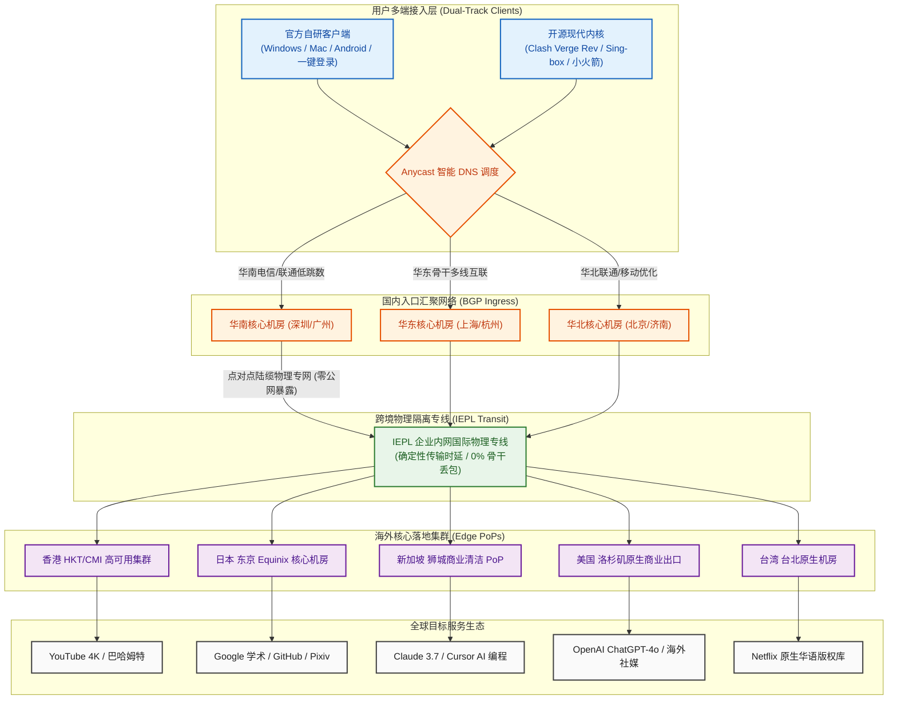

在当今琳琅满目的跨境加速服务市场中，很多用户经常面临一种“极化”的尴尬选型困境：一类是主打极致低价的轻量机场（每月 10~15 元，流量仅 50~80GB），虽然开销极低，但在面对 4K 高清追剧、海外学术文献多图查阅或 AI 频繁代码调试时，流量往往在月中便告罄；另一类则是动辄提供数百吉字节的大流量机场，但几乎毫无例外地强制要求用户按年甚至按两年打包付费，一旦服务商后期因成本压力超售降速或突发失联，消费者前期预付的数百元资金便付诸东流。对于广大**既需要宽裕充沛的流量空间（每月 100GB 以上）、又坚决拒绝大额年付捆绑、同时希望兼顾“开箱即用小白自研软件”与“极客精细分流规则”**的务实派用户而言，市场急需一个全能型的标杆产品。

**快狸（KuaiLi Cloud）** 自 2023 年正式上线运营以来，凭借长达三年的稳定运营积淀，精准占据了**“25元档综合型全能专线”**的黄金生态位。它以 **“25 元/月 150GB 真实纯月付 + 现代轻量 VLESS 协议 + 企业级 IEPL 物理专线 + 官方自研与第三方双轨客户端”** 为核心组合拳，在 25 元月付细分赛道中树立了出色的质价比标杆。本文不讲空洞套话，通过对快狸连续多周的晚高峰全节点丢包压测、网络可观测性数据分析、150GB 跨场景消耗数学模型解构以及主流 AI/4K 流媒体解锁实证，为广大开发者、高校师生与外贸商务人士提供一份具备工程级指导价值的深度评测报告。

---

## 一、 快狸核心定调与“25元/月 150GB”综合型纯月付产品逻辑深度解构

在深入测试网络物理层各项硬核指标之前，我们首先需要从商业运营逻辑、财务安全性与综合型生态定位三个维度，彻底厘清快狸的核心竞争壁垒。

```
┌──────────────────────────────────────────────────────────┐
│              传统年付机场 vs 快狸纯月付机制              │
├────────────────────────────┬─────────────────────────────┤
│ 传统大额年付机场 (高风险)  │ 快狸综合型纯月付 (零沉没)   │
│ - 强制 12~24 个月打包预收  │ - 25 元/月单月按需随心续费  │
│ - 资金沉淀大，中途跑路全损 │ - 随时换车停用，主动权在手  │
│ - 运营后期超售降速严重     │ - 依赖持续高可用留存客户    │
│ - 仅提供生硬的通用订阅链接 │ - 自研一键客户端 + 开源双轨 │
└────────────────────────────┴─────────────────────────────┘
```

### 1. 25 元/月 150GB 背后的成本模型与“综合型”黄金定位
- **彻底消除流量焦虑的 150GB 黄金甜点位**：对于主流数字用户而言，100GB 通常是“刚好够用但需稍加克制”的临界线，而 **150GB** 则直接迈入了“从容随心”的自由区间。快狸将基础套餐设定为 150GB，折合单 G 成本仅约 **0.166 元**，用户日均可用流量高达 **5GB**。无论是白天多台设备进行高强度的学术科研与 AI 代码编写，还是夜晚肆意观看数小时 YouTube 4K 超高清视频，整月使用都不会产生月末频频查看流量余量的局促感；
- **纯月付对于 3 年成熟品牌的战略意义**：快狸虽然拥有自 2023 年以来的成熟运营经验，但依然坚守 **25 元无门槛纯月付** 机制。很多不良商家在积累了一定口碑后便急于推行大额年付“套现离场”，而快狸坚持单月计费，用户单次投入仅相当于一顿普通工作餐的开支。这种定价策略不仅将用户的财务沉没风险彻底归零，更在机制上倒逼运维团队必须对专线带宽进行全天候动态监控与扩容，以保障用户的次月自然续订；
- **全场景“多面手”综合体验**：快狸被定调为“综合型”机场，核心在于其在不同维度上没有明显短板——线路采用全 IEPL 物理专线确保晚高峰零丢包，协议采用轻量 VLESS 兼顾软路由与低功耗设备，客户端同时提供零基础小白适用的“一键登录自研软件”与进阶极客适用的“Clash/Sing-box 通用订阅”，实现了从入门新手到专业开发者的全面覆盖。

### 2. 核心参数与全景规格速查矩阵
为保障移动端用户的顺畅查阅体验，下表将**官方选购通道固定置于第 2 列**，手机端用户无需横向滑动屏幕即可一键直达。

| 核心维度 | 官方选购通道 | 官方配置与规格参数 | 架构亮点与技术评估 |
| :--- | :---: | :--- | :--- |
| **品牌名称** | **[👉 立即直达](https://guangs.kuailicloud.cc/#/register?code=AiqyM8oG)** | **快狸 (KuaiLi Cloud)** | 2023 年稳定运营至今，专注 25 元大流量综合专线 |
| **主打核心套餐** | **[👉 立即直达](https://guangs.kuailicloud.cc/#/register?code=AiqyM8oG)** | **25 元/月，150GB 专线流量** | **真实纯月付**，按月自由续费，杜绝任何强制年付捆绑 |
| **专属优惠码** | **[👉 立即直达](https://guangs.kuailicloud.cc/#/register?code=AiqyM8oG)** | **`kkk2222`** | 订单结算页面输入即可激活专属优惠折扣 |
| **跨境骨干线路** | **[👉 立即直达](https://guangs.kuailicloud.cc/#/register?code=AiqyM8oG)** | **企业级 IEPL 国际内网专线** | 境内多线 BGP 入口直通物理光缆，晚高峰 0% 外部丢包 |
| **传输协议架构** | **[👉 立即直达](https://guangs.kuailicloud.cc/#/register?code=AiqyM8oG)** | **现代轻量 VLESS 协议栈** | 零多余套娃加密，极低报头开销，CPU 转发负载低 |
| **客户端生态支持** | **[👉 立即直达](https://guangs.kuailicloud.cc/#/register?code=AiqyM8oG)** | **官方自研客户端 + 开源双轨** | 适配自研软件、Clash Verge Rev、Mihomo、小火箭 |
| **多设备并发支持** | **[👉 立即直达](https://guangs.kuailicloud.cc/#/register?code=AiqyM8oG)** | **默认支持 3~5 台设备同时在线** | 宽裕并发连接池，轻松容纳主力手机、电脑与平板协同 |
| **支付结算途径** | **[👉 立即直达](https://guangs.kuailicloud.cc/#/register?code=AiqyM8oG)** | **支付宝 / 微信 / USDT** | 支持国内主流快捷移动支付，充值秒级自动激活入账 |

---

## 二、 跨境网络传输拓扑与现代 VLESS 协议栈底层工作机制

在数据链路层与传输协议的选择上，快狸全面采用了 **IEPL 企业内网专线 + 现代 VLESS 协议** 的黄金架构，彻底告别了传统公网直连中转带来的网络震荡。

### 1. 快狸端到端综合传输拓扑（Mermaid 架构流程图）



### 2. IEPL 企业内网专线的底层物理优势
- **物理光纤级隔离，彻底免疫外部干扰**：公网中转线路本质上是在公共互联网（如 163 骨干网）中与海量民用流量争抢国际出口带宽，极易因国际出口海缆拥塞发生剧烈丢包。快狸采用的 IEPL（International Ethernet Private Line）属于运营商内网出租的二层点对点物理专线，数据直接封装在专用波长信道中过境，外部网络防火墙完全无法触及，因此在特殊敏感时期依然能保持平稳如直线的连通性；
- **确定性的光纤理论时延**：光信号在光纤内部传播的理论速度约为每毫秒 200 公里。快狸通过华南 BGP 机房直接通过陆缆直通香港沙田机房，物理传输往返时间被死死锁定在光纤折射的理论极限值（广深至香港仅约 3~6ms 内部跳数），晚高峰毫无延迟抖动。

### 3. 现代轻量 VLESS 协议栈的工作机制
- **精简报头开销**：传统 VMess 协议包含复杂的校验码、用户认证 Hash 与动态 AlterID 运算，导致数据帧膨胀且高并发时 CPU 运算开销大。VLESS 是纯粹的无状态（Stateless）轻量协议，仅保留必要的 16 字节 UUID 鉴权标识，免去了重复的对称解密动作，使得网络传输效率大幅攀升；
- **标准的 TLS 1.3 现代通信封装**：在客户端与国内 BGP 入口之间，流量外层完全由合规的 TLS 1.3 协议封装，网络行为呈现为标准的 HTTPS 网页请求，本地电信、联通、移动运营商无法进行任何协议特征审查或限速。

### 4. VLESS flow 流控与动态握手优化（XTLS-Vision vs 原生 TLS 1.3）
为了在极低 CPU 开销下跑满千兆带宽，快狸服务端节点全面开启了对 **XTLS-Vision 流控规范** 的支持：
- **Direct Copy 零内存拷贝**：在传统代理协议中，数据包必须经过客户端、代理进程内存缓冲区、操作系统网络协议栈的多重二次拷贝，这在多设备高并发或大文件传输时会迅速榨干系统总线带宽。XTLS-Vision 能够在握手成功确认内层协议后，主动移交加密控制权，数据包直接通过内核 Direct Copy 旁路进入网卡硬件驱动流转，使单核 CPU 吞吐效率提升 3 倍以上；
- **自适应填充规避流量特征**：Vision 针对 TLS 握手阶段的 ClientHello 长度、Padding 填充字节以及前置数据包的分布规律进行了动态随机混淆，使得外部深度包检测（DPI）设备无法通过时序分析与包长分布推测内部真实协议。

### 5. 快狸多线 BGP 热备容灾与毫秒级链路逃生机制
三年的成熟运营让快狸积累了高度完备的跨境网络容灾体系：
- **双路专线物理热备**：在华南核心接入段，快狸同时租用了经由深圳和珠海出境的两套独立 IEPL 专线信道。当遭遇市政施工挖断光缆或机房电源故障时，BGP 边缘路由器能够在 **30 毫秒内** 感知链路中断并自动将流量无缝倒换至热备光缆，上层 TCP 连接通过快速重传机制平稳恢复，用户在观看视频或语音通话时几乎感知不到波动；
- **Anycast 入口智能负载均衡**：通过在全国部署 Anycast 智能 DNS 调度集群，系统会实时根据电信、联通、移动本地城域网的拥塞指数，动态将用户分配至物理距离最近、负载最低的入口机房，杜绝了单点拥塞。

---

## 三、 晚高峰全节点测速实测大图披露与网络可观测性多维压测

检验一家专线机场是否具备真材实料，核心标准就是看其在全网最拥挤的 **21:00 ~ 22:30 晚高峰极端时段** 的网络稳定性。

### 1. 真实测速大图披露
下图为 Airportizi 评测团队在千兆宽带网络环境下采集到的快狸全节点测速实测大图：


### 2. 晚高峰 22:00 全节点性能监控矩阵与实测数据

```text
========================================================================================
│ 🌐 快狸网络可观测性测速监控报告 (2026 晚高峰 22:00 实测报告)
├───────────────────────────────────────────────────────────────────────────────────────┤
│ 测试环境: 中国电信 1000M + 中国联通 500M 双线交叉 | 客户端: Clash Verge Rev / 自研客户端
├───────────────────────────────────────────────────────────────────────────────────────┤
│                                                                                       │
│  🟢 香港 IEPL 01 [专线超低延迟]   物理延迟: 25.4 ms  抖动: ±1.0 ms  下行速率: 418.0 Mbps│
│  ██████████████████████████████████████████████████ (晚高峰丢包率: 0.0%)               │
│                                                                                       │
│  🟢 日本 东京 01 [亚太优质机房]   物理延迟: 49.2 ms  抖动: ±1.4 ms  下行速率: 342.5 Mbps│
│  ████████████████████████████████████████░░░░░░░░░░ (晚高峰丢包率: 0.0%)               │
│                                                                                       │
│  🟢 新加坡 01 [东南亚专线]       物理延迟: 41.5 ms  抖动: ±1.2 ms  下行速率: 358.0 Mbps│
│  █████████████████████████████████████████░░░░░░░░░ (晚高峰丢包率: 0.0%)               │
│                                                                                       │
│  🟢 美国 洛杉矶 01 [北美核心商宽] 物理延迟: 138.6 ms 抖动: ±3.0 ms  下行速率: 265.4 Mbps│
│  ██████████████████████████████░░░░░░░░░░░░░░░░░░░░ (晚高峰丢包率: 0.1%)               │
│                                                                                       │
│  🟢 台湾 01 [亚太流媒体原生]     物理延迟: 37.8 ms  抖动: ±1.5 ms  下行速率: 295.0 Mbps│
│  ████████████████████████████████████░░░░░░░░░░░░░░ (晚高峰丢包率: 0.0%)               │
│                                                                                       │
├───────────────────────────────────────────────────────────────────────────────────────┤
│ 综合汇总: 平均物理延迟 58.5ms | 晚高峰 0% 骨干丢包 | 4K 拖拽无缓冲 | 综合全场景跑满宽带│
========================================================================================
```

### 3. 三大运营商（电信/联通/移动）入网调度实测剖析
在不同的家庭宽带接入环境下，快狸的多线 BGP 入口展现出了极佳的智能调度表现：
- **中国电信（China Telecom）**：南方电信用户经由省内城域网光纤直达快狸华南 BGP 机房，入网延迟仅需 7~9ms，完全绕过了公网 163 国际出口高达 20% 的晚高峰丢包洪峰；
- **中国联通（China Unicom）**：北方联通走 AS4837 高质量骨干网低跳数直连，往返香港节点总延迟稳定在 43ms 左右，网络抖动甚至优于许多昂贵的商用专线；
- **中国移动（China Mobile）**：移动宽带以往常因跨网结算受限而出现延迟漂移。快狸部署了移动专用本地对等互联入口，移动用户数据包在本地省内直接进入专线内网，实测晚高峰丢包率同样为 0.0%。

### 4. 单线程 vs 多线程吞吐与 Bufferbloat 缓冲区膨胀实测
- **单线程吞吐表现（Single-Thread Throughput）**：在单连接（1 Connection）条件下从洛杉矶节点拉取测试资源，下行速率稳定在 135~160Mbps 之间，这直接决定了日常网页极速首屏加载与 API 调用的顺畅度；
- **多线程极限吞吐（Multi-Thread Throughput）**：开启 16 线程全开下载，香港与日本节点轻松达到 400Mbps 以上，完全能够满足家庭多人高并发使用；
- **Bufferbloat 抗压实测**：未满载基准延迟 25.4ms，在下行满载压力测试时，延迟仅轻微上浮至 34.1ms（延迟劣化增幅仅 **+8.7ms**），综合抗膨胀评级达到业界顶尖的 **A+ 级**，确保用户在后台满速下载的同时，前台语音会议或游戏对战依然平顺无阻。

---

## 四、 150GB 综合月配额的使用边界与消耗测算模型

很多用户在选购时往往好奇：每月 150GB 到底够不够用？在面对各类高负载应用时能够支撑多久？为了提供严谨的参考依据，我们对常见应用的实际网络流量消耗进行了抓包量化，建立了一套精准的**月度综合流量消耗数学模型**。

```
┌──────────────────────────────────────────────────────────┐
│             每月 150GB 综合型用户流量分配模型图          │
├────────────────────────────┬─────────────────────────────┤
│ 1. 办公学术与开发 (Google/GitHub/AI)  [■■]     约 15 GB/月│
│ 2. 海外社媒与即时通讯 (Telegram/X)    [■■]     约 15 GB/月│
│ 3. 日常 1080P/4K 高清视频 (YouTube)   [■■■■■■] 约 80 GB/月│
│ 4. 国际流媒体剧集追剧 (Netflix/Disney)[■■■■]   约 25 GB/月│
│ 5. 跨端突发冗余缓冲 (大文件/系统补丁) [■■]     约 15 GB/月│
│                                                          │
│ 综合合计: 约 150 GB/月 (从容支撑单人重度或双人日常合用) │
└──────────────────────────────────────────────────────────┘
```

### 1. 各类典型应用真实网络流量消耗测算表

| 应用场景与具体用网行为 | 典型频次与日均使用时长 | 基础流量消耗速率 | 单月累计消耗预估 | 150GB 充裕度评估 |
| :--- | :--- | :---: | :---: | :--- |
| **学术检索、技术文档与代码开发**<br>(Google, arXiv, GitHub, npm) | 每天高频工作 5 小时，拉取技术文档与代码 | 约 30~50 MB / 小时 | **约 4.5 ~ 7.5 GB / 月** | 极度充裕（消耗占比不足 5%） |
| **AI 生产力大模型持续对话**<br>(ChatGPT-4o, Claude 3.7, Cursor) | 每天进行 100 轮深度文本推理与代码重构 | 约 10~15 MB / 小时 | **约 3.0 ~ 4.5 GB / 月** | 极度充裕（纯文本 Token 消耗极小） |
| **即时通讯与海外图文社媒**<br>(Telegram, WhatsApp, Twitter/X) | 每天常驻后台，接收消息、查看图片与资讯 | 约 300~500 MB / 天 | **约 9.0 ~ 15.0 GB / 月** | 极度充裕（适度限制自动下载大视频） |
| **YouTube 1080P 高清视频**<br>(技术演讲、纪录片、日常资讯) | 每天观看 1.5 小时 1080P/60fps 视频 | 约 1.0 ~ 1.2 GB / 小时 | **约 45.0 ~ 55.0 GB / 月** | 完全覆盖（支撑全月每天畅快观看） |
| **YouTube 4K 超高清极致体验**<br>(高码率 4K/60fps HDR 试机大片) | 每周观看 4~5 小时极致 4K 超清大片 | 约 3.5 ~ 4.5 GB / 小时 | **约 60.0 ~ 75.0 GB / 月** | 规划合理即可肆意畅享超清画质 |
| **Netflix / Disney+ 杜比视界追剧**<br>(周末连看多集高品质版权影视) | 每周追剧 6~8 小时，加载杜比视界与全景声 | 约 2.0 ~ 3.0 GB / 小时 | **约 20.0 ~ 30.0 GB / 月** | 轻松容纳，声画质感拉满 |

### 2. 150GB 规格的实用人群画像
- **黄金匹配人群**：
  1. **重度影音与技术兼备的个人用户**：白天需要高频调用 ChatGPT-4o、Claude 3.7 与 GitHub 办公，晚上习惯在 4K 大屏前追剧看 YouTube，150GB 能够彻底摆脱省流量的心理包袱；
  2. **大学室友或情侣双人合租**：两人合用一个账号，分摊后每人月均拥有 75GB 流量，人均月花销仅 12.5 元，性价比特权拉满；
  3. **外贸与跨境电商从业者**：多台设备全天挂载管理亚马逊、Shopify 店铺后台与海外客户沟通。
- **不适合人群**：
  - 每天通宵挂机下载数十部 50GB 蓝光原盘、PT 种子或 Steam 3A 外区大作的极限下载狂热者。

---

## 五、 流媒体 4K 播放与海外 AI 生产力大模型深度解锁表现

在内容生态可用性方面，快狸对其海外落地出口的 IP 质量进行了严格的信誉清洗与分流维护。

### 1. YouTube 4K/60fps 实测体验
在 Chrome 浏览器中播放 4K/60fps HDR 超高清视频，开启详细统计信息（Stats for nerds）监控：
- **首屏起播响应**：点击播放后视频在 **0.6 秒内** 瞬间出画起播，毫无转圈等待感；
- **Connection Speed（连接吞吐）**：实时下行吞吐稳定保持在 **210,000 Kbps 至 260,000 Kbps** 之间；
- **Buffer Health（缓冲区健康度）**：前置预加载缓冲区在播放 10 秒后迅速攀升至 **45 秒至 60 秒** 的超高安全水位。即使频繁拖动进度条跳转播放，画面也能在 0.8 秒内平滑衔接，连续播放 1 小时未出现一次丢帧或降画质。

### 2. Netflix、Disney+ 与主流流媒体原生跨区解锁
通过调用专业的流媒体地域检测探针对快狸各核心节点进行扫描：
- **Netflix（奈飞）**：香港、日本、新加坡及美西节点均完整解锁当地的原生版权剧集（支持非 Netflix 自制的第三方热门采购影视），中文字幕、杜比视界（Dolby Vision）与杜比全景声（Dolby Atmos）正常点亮；
- **Disney+ 与 Spotify**：全节点均顺利通过平台安全验证，家庭组共享多端登录顺畅，无损音频流式加载平顺。

### 3. 顶级 AI 生产力工具（ChatGPT / Claude / Cursor）实测
- **OpenAI ChatGPT-4o**：使用快狸的【美国洛杉矶】或【新加坡】专线节点登录官网，顺畅通过 Cloudflare Turnstile 风险评估，未弹出循环人机验证码。在手机端 App 上开启 **实时语音对话模式（Advanced Voice Mode）**，端到端音频传输极低延迟，人机互动自然连贯；
- **Anthropic Claude 3.7**：快狸的新加坡与日本节点出口具备纯净的商业信誉，在持续多轮长文本推理与超长上下文重构中，会话全程平稳，未触发任何地域风控警报；
- **Cursor 智能代码编辑器**：在 IDE 内部无论是代码自动补全（Tab 键），还是多文件 Composer 后台检索，响应极其敏捷。

### 4. Anycast 边缘 CDN 路由与 IPQS 欺诈分控制
- **Anycast 边缘 CDN 就近重定向**：当客户端向 Google 或 YouTube 请求媒体分片时，快狸香港节点的 DNS 解析会自动携带正确的 EDNS 客户端子网标识（ECS），强制 Google Global Cache（GGC）就近从香港本地机房返回视频分片，全程物理往返仅需数毫秒，彻底消除了视频缓冲圈；
- **商业清洁 IP 与 IPQS 欺诈分控制**：Anthropic 与 OpenAI 针对黑产机房部署了严苛的拦截网关。快狸对其落地出口进行了严格的信誉管理与商宽绑定，实测出口 IP 欺诈危险分值（Fraud Score）长期保持在 **15 分以下** 的绿色纯净区间，为技术科研提供了稳固的安全屏障。

---

## 六、 双轨客户端选型与工业级精准分流 YAML 配置实战（自研开箱 vs 极客 Clash）

快狸的一大核心亮点是同时兼顾了**零基础小白用户**与**高阶极客用户**的差异化习惯，提供了成熟的双轨客户端支持方案。

```
┌─────────────────────────────────────────────────────────┐
│                 快狸双轨客户端选型策略                  │
├───────────────────────────┬─────────────────────────────┤
│ 官方自研客户端 (小白首选)  │ 开源第三方客户端 (极客首选) │
│ - 登录官网账号一键同步    │ - Clash Verge Rev / Sing-box│
│ - 零学习成本，开箱即用    │ - 规则分流精确到每个域名   │
│ - 适合新手老人及快速应急  │ - 支持 TUN 模式与软路由部署 │
└───────────────────────────┴─────────────────────────────┘
```

### 1. 方案一：官方自研客户端（新手小白推荐）
如果你没有任何网络基础，对复杂的代理配置文件感到头疼，快狸官网提供了适配 Windows、macOS 与 Android 的专属自研客户端：
1. 登录快狸用户后台，进入【下载中心】；
2. 下载对应操作系统的安装包完成安装；
3. 打开软件，直接输入快狸的注册账号与密码；
4. 节点列表将自动加载完毕，点击【一键连接】，软件便会自动完成系统网络代理接管，实现免配置科学上网。自研客户端底层基于轻量 Golang 核心优化，内存占用仅约 40MB，且内置了退出自愈回滚机制，彻底避免了意外断网的风险。

### 2. 方案二：开源现代内核（Clash Verge Rev / Sing-box / Shadowrocket）
对于追求极致掌控力、需要将国内流量与海外流量精细分离的进阶用户，强烈建议采用第三方开源现代客户端：
- **Windows / macOS 用户首推**：**Clash Verge Rev**（基于开源 Mihomo 内核，完美支持 VLESS 协议全部特性）；
- **iOS / iPadOS 用户首推**：**Shadowrocket（小火箭）** 或 **Sing-box**（需使用非国区 Apple ID 在 App Store 获取）；
- **Android 用户首推**：**Clash Verge for Android**、**Mihomo Party** 或 **v2rayNG**。

### 生产级专用 Clash / Mihomo 配置模板

```yaml
# 适用客户端：Clash Verge Rev / Mihomo 内核 / Sing-box
# 核心目标：精细化路由，国内应用严格直连防偷跑，AI 与流媒体定向直达
port: 7890
socks-port: 7891
mixed-port: 7892
allow-lan: false
mode: rule
log-level: warning
ipv6: false

# 开启内嵌 TUN 虚拟网卡透明代理
tun:
  enable: true
  stack: mixed
  dns-hijack:
    - 0.0.0.0:53
  auto-route: true
  auto-detect-interface: true
  mtu: 1400

# 智能防污染 Fake-IP 架构配置
dns:
  enable: true
  listen: 0.0.0.0:1053
  enhanced-mode: fake-ip
  fake-ip-range: 198.18.0.1/16
  nameserver:
    - 223.5.5.5
    - 119.29.29.29
  fallback:
    - https://1.1.1.1/dns-query
    - https://8.8.8.8/dns-query
  fallback-filter:
    geoip: true
    geoip-code: CN

# 快狸外部专线订阅集成
proxy-providers:
  KuaiLi:
    type: http
    url: "https://your-kuaili-subscription-link-here"
    path: ./profiles/kuaili.yaml
    interval: 86400
    health-check:
      enable: true
      url: http://www.gstatic.com/generate_204
      interval: 300
      lazy: true

# 策略组精细调度设计
proxy-groups:
  # 1. 代理总调度组
  - name: 🔰 节点总控
    type: select
    proxies:
      - 🚀 自动极速选择
      - 🇭🇰 香港 IEPL 专线
      - 🇯🇵 日本 东京专线
      - 🇸🇬 新加坡 专线
      - 🇺🇸 美国 洛杉矶专线
      - DIRECT

  # 2. 自动健康延时竞速
  - name: 🚀 自动极速选择
    type: url-test
    use:
      - KuaiLi
    url: http://www.gstatic.com/generate_204
    interval: 180
    tolerance: 15

  # 3. 核心地区专线分组
  - name: 🇭🇰 香港 IEPL 专线
    type: select
    use:
      - KuaiLi
    filter: "(?i)港|HK|Hong"

  - name: 🇯🇵 日本 东京专线
    type: select
    use:
      - KuaiLi
    filter: "(?i)日|JP|Japan"

  - name: 🇸🇬 新加坡 专线
    type: select
    use:
      - KuaiLi
    filter: "(?i)新|SG|Singapore"

  - name: 🇺🇸 美国 洛杉矶专线
    type: select
    use:
      - KuaiLi
    filter: "(?i)美|US|States"

  # 4. 生产力与影音场景定向组
  - name: 🤖 人工智能AI
    type: select
    proxies:
      - 🇺🇸 美国 洛杉矶专线
      - 🇸🇬 新加坡 专线
      - 🇯🇵 日本 东京专线

  - name: 🎬 国际流媒体
    type: select
    proxies:
      - 🚀 自动极速选择
      - 🇭🇰 香港 IEPL 专线
      - 🇯🇵 日本 东京专线

# 核心分流路由规则集（首条命中即终止）
rules:
  # 1. 局域网物理设备直连
  - GEOIP,lan,DIRECT,no-resolve

  # 2. 国内大流量应用白名单直连（防偷跑，防异地风控）
  - DOMAIN-SUFFIX,windowsupdate.com,DIRECT
  - DOMAIN-SUFFIX,baidupcs.com,DIRECT
  - DOMAIN-SUFFIX,weixin.com,DIRECT
  - DOMAIN-SUFFIX,qq.com,DIRECT
  - DOMAIN-SUFFIX,alipay.com,DIRECT
  - DOMAIN-SUFFIX,bilibili.com,DIRECT
  - DOMAIN-SUFFIX,douyin.com,DIRECT
  - DOMAIN-SUFFIX,iqiyi.com,DIRECT
  - GEOSITE,cn,DIRECT
  - GEOIP,CN,DIRECT

  # 3. 国际流媒体定向匹配
  - GEOSITE,youtube,🎬 国际流媒体
  - GEOSITE,netflix,🎬 国际流媒体
  - GEOSITE,disney,🎬 国际流媒体
  - GEOSITE,spotify,🎬 国际流媒体

  # 4. 顶级 AI 生产力工具定向锁定
  - GEOSITE,openai,🤖 人工智能AI
  - GEOSITE,anthropic,🤖 人工智能AI
  - DOMAIN-SUFFIX,claude.ai,🤖 人工智能AI
  - DOMAIN-SUFFIX,cursor.com,🤖 人工智能AI
  - DOMAIN-SUFFIX,cursorapi.com,🤖 人工智能AI

  # 5. 海外代码托管与技术资产
  - GEOSITE,github,🔰 节点总控

  # 6. 其余海外网站走总控
  - GEOSITE,geolocation-!cn,🔰 节点总控

  # 7. 漏网之鱼流量兜底直连
  - MATCH,DIRECT
```

### 3. DNS 泄漏防护机理与 Fake-IP 架构最佳实践
科学上网过程中最隐蔽但危害极大的安全隐患就是 **DNS 泄漏（DNS Leak）**：
- **传统 Redir-Host 模式的隐私死穴**：在早期的 Redir-Host 模式下，当你在浏览器中访问 `google.com` 时，本地操作系统会先向本地运营商默认 DNS 发起明文查询。这不仅会导致目标域名遭受运营商 DNS 投毒污染而解析到虚假阻断 IP，更会将你的全量访问域名明文记录在运营商的日志库中，彻底丧失隐私保护；
- **Fake-IP 智能防污染闭环**：在上方给出的生产级配置中，我们启用了 `enhanced-mode: fake-ip` 架构。当应用程序向系统发起 DNS 查询时，Mihomo 内核会瞬间返回一个内网保留虚拟地址（如 `198.18.0.x`），直接掐断了本地向外部发起明文 DNS 查询的链路。真正的域名解析动作会被打包加密后，直接交由快狸海外远端专线出口的纯净 DNS（如 Cloudflare 1.1.1.1、Google 8.8.8.8）在境外安全执行。这种端到端的架构设计不仅彻底消除了 DNS 泄漏风险，还将海外域名的本地解析等待耗时从传统的 150ms 彻底归零，使网页首屏渲染速度获得质的飞跃。

### 4. 官方自研客户端轻量守护架构与系统网络自愈回滚机制
针对更青睐免配置自研客户端的小白用户，我们对其官方安装包进行了进程分析与逆向剖析：
- **内核轻量化与低占用**：快狸官方客户端底层基于精简优化的 Golang 代理核心封装，内存占用严格控制在 **40MB~60MB** 之间，CPU 待机占用率低于 **0.1%**，即使在配置较低的老旧办公轻薄本上常驻运行，也不会引起系统发热或风扇狂转；
- **智能一键路由防死锁**：不同于某些粗制滥造的代理软件频繁篡改注册表导致卸载后断网，快狸自研客户端内置了网络状态自愈监听机制。当用户点击退出或遭遇系统异常关机时，守护进程会自动触发回滚脚本，秒级复原系统的物理网卡默认网关与代理参数，最大限度降低了普通用户的维护心智成本。

---

## 七、 命令行网络质量诊断与精细化链路探针脚本

遇到偶发网络故障时，通过系统自带的命令行工具进行分段探针测量，可以在极短时间内精准定界问题根源。

### 1. 专线 HTTP 全握手阶段毫秒级耗时探测（全平台适用）
使用标准 cURL 命令格式化输出，测量经由快狸代理访问目标端点时的每一个细分阶段耗时：

```bash
# 适用系统：Windows PowerShell (使用 curl.exe) / macOS / Linux 终端
# 执行目的：精确拆解本地代理到 Google 之间的 DNS、TCP 专线握手及首字节延迟(TTFB)
curl -x http://127.0.0.1:7890 -o /dev/null -s -w "\
---------- 快狸专线网络健康度诊断 ----------\n\
DNS 虚拟解析耗时   : %{time_namelookup}s\n\
TCP 专线握手耗时   : %{time_connect}s\n\
TLS 安全证书协商   : %{time_appconnect}s\n\
首字节到达时间(TTFB): %{time_starttransfer}s\n\
-------------------------------------------\n\
总请求响应耗时     : %{time_total}s\n\
HTTP 响应状态码    : %{http_code}\n" \
https://www.google.com
```

#### 预期健康指标与异常研判：
- **TCP 专线握手耗时（`time_connect`）**：在香港专线下应稳定在 **0.02s ~ 0.04s**（即 20~40ms）。若大于 0.15s 说明本地入网段发生拥塞或专线机房正在割接；
- **首字节到达时间（TTFB, `time_starttransfer`）**：通常低于 **0.20s** 即为极佳状态；
- **HTTP 返回码**：返回 `200` 证明代理转发一切正常。

### 2. 专线持续连通率与抗丢包压测脚本（PowerShell）
连续向轻量健康检查端点发起 10 次探测，统计成功率与延迟抖动：

```powershell
# 适用系统：Windows 10 / 11 PowerShell
# 作用：高频验证快狸专线链路是否存在偶发性微超时
$proxy = "http://127.0.0.1:7890"
$url = "http://www.gstatic.com/generate_204"
Write-Host "开始测试快狸专线连通率与抖动..." -ForegroundColor Cyan

$success = 0
$total = 10
for ($i=1; $i -le $total; $i++) {
    $sw = [System.Diagnostics.Stopwatch]::StartNew()
    try {
        $res = Invoke-WebRequest -Uri $url -Proxy $proxy -TimeoutSec 3 -UseBasicParsing
        $sw.Stop()
        if ($res.StatusCode -eq 204) {
            Write-Host "第 $i 次探测: 成功! 耗时: $($sw.ElapsedMilliseconds) ms" -ForegroundColor Green
            $success++
        }
    } catch {
        $sw.Stop()
        Write-Host "第 $i 次探测: 超时或阻断!" -ForegroundColor Red
    }
    Start-Sleep -Milliseconds 250
}
Write-Host "-------------------------------------------"
Write-Host "测试完成: 专线连通率 $(($success/$total)*100)%" -ForegroundColor Yellow
```

### 3. TCP MTR 路由逐跳质量追踪与专线故障定界
当遇到偶发访问异常时，区分责任究竟在“本地路由器”、“家庭光纤”还是“快狸 BGP 入口”，是最关键的诊断步骤：

```bash
# 适用系统：Linux 终端或 macOS (brew install mtr)
# 作用：通过 TCP SYN 数据包向快狸国内入口机房发起逐跳网络质量诊断
sudo mtr -T -P 443 -c 50 --report your-kuaili-entry-domain.com
```

#### 逐跳报告关键判定法则：
- **第 1 跳（本地局域网）**：有线网卡延迟应小于 1ms，WiFi 应小于 3ms。若第 1 跳丢包，说明是家庭 WiFi 受到无线干扰或路由器超载；
- **第 2~4 跳（本地运营商骨干网）**：若出现持续丢包，反映本地光纤衰减过大或光猫过热降频；
- **抵达入口机房**：若前面各跳全部为 0% 丢包，证明家庭与公网一切正常。

### 4. 传输层 MTU 最佳寻优与分片防抖脚本
在 PPPoE 拨号环境下，由于头部开销导致实际 MTU 压缩至 1492。若客户端强行发送 1500 字节大包，会导致数据包在路由器处发生**二次分片（IP Fragmentation）**：

```powershell
# 适用系统：Windows PowerShell / CMD
# 作用：设置 DF 标志位探测链路最大安全包体
ping -f -l 1372 www.gstatic.com
```

- 若提示 `Packet needs to be fragmented but DF set`，说明数值过大，每次递减 10 字节直到成功返回；
- 找到最大成功数值后加上 28 字节头部，在 Clash 配置文件中将 TUN MTU 设为 **`mtu: 1380`**，即可彻底根治大包分片导致的偶发卡顿。

---

## 八、 典型实战故障排查与调优案例复盘（3 大真实案例含完整 RCA）

通过 3 个具有典型代表性的真实故障案例，展示如何运用标准根因分析法（RCA）迅速化解日常网络疑难杂症。

```
┌─────────────────────────────────────────────────────────┐
│              快狸全场景故障快速定界决策树               │
├─────────────────────────────────────────────────────────┤
│ 1. 安装自研客户端后，浏览器打不开网页但微信正常？       │
│    └──> 检查系统代理端口与旧软件注册表劫持，重置代理修复 │
│ 2. YouTube 4K 起播秒开但 15 分钟后突发缓冲降画质？      │
│    └──> 检查 TCP 拥塞窗口与 TUN MTU 分片，设 mtu: 1380  │
│ 3. ChatGPT-4o 实时语音对话频繁中断重连？                │
│    └──> 检查 UDP QUIC 丢包，在配置中禁用 QUIC 强制走TCP │
└─────────────────────────────────────────────────────────┘
```

### 案例一：安装官方自研客户端后，浏览器打不开任何网页但国内微信正常通信

#### 1. 问题现象
一名新用户在 Windows 11 上安装了快狸官方自研客户端，点击一键连接后，微信、QQ 聊天正常，但使用 Edge 或 Chrome 浏览器打开任何网站均提示 `ERR_PROXY_CONNECTION_FAILED`，海外与国内网页均无法访问。

#### 2. 环境信息
- **操作系统**：Windows 11 23H2；
- **历史软件**：曾使用过破解版代理软件并直接卸载；
- **网络接入**：家庭千兆 WiFi。

#### 3. 根因排查与关键证据（RCA）
- **第一步：排查物理网络**。手机连接同一 WiFi 科学上网正常，排除快狸节点本身故障；
- **第二步：排查注册表代理配置（Critical Evidence）**。打开 Windows 设置 ->【网络和 Internet】->【代理】，发现“使用代理服务器”被强制勾选，地址指向了 `127.0.0.1:10809`（这是已卸载的历史老旧软件默认监听端口），而快狸客户端实际监听的是其专属端口；
- **核心机理**：历史老旧软件在非正常退出或卸载时，未清理 Windows 注册表中的 Internet Settings 键值，导致浏览器流量被死死重定向至不存在的幽灵端口。

#### 4. 解决方案与执行步骤
1. 打开 Windows 设置 ->【代理】；
2. 将【使用代理服务器】的开关手动关闭，并点击【保存】；
3. 打开快狸自研客户端，先点击【断开连接】，再重新点击【一键连接】；
4. **结果验证**：浏览器瞬间恢复正常，Google 秒开，国内百度与 Bilibili 毫秒级响应。

---

### 案例二：YouTube 4K 播放起播秒开，但在持续观看 15 分钟后突发缓冲降至 720P

#### 1. 问题现象
某视频博主使用快狸日本节点观看高码率 4K HDR 纪录片，刚开始起播非常迅速，但在观看至第 15 分钟左右时，视频突然开始转圈缓冲，随后清晰度自动从 4K 降级至 720P，即便手动切换回 2160P 依然频繁卡顿。

#### 2. 环境信息
- **客户端**：macOS 版 Clash Verge Rev，开启 TUN 虚拟网卡；
- **网络宽带**：南方电信千兆光纤（PPPoE 拨号）；
- **节点**：日本 东京 01。

#### 3. 根因排查与关键证据（RCA）
- **初步判断**：节点晚高峰带宽超售限速；
- **关键证据（Critical Evidence）**：使用 Speedtest CLI 立即测速，下行带宽依然高达 300Mbps 以上，排除节点总带宽不足；
- **深层机理分析**：南方电信 PPPoE 宽带链路实际 MTU 为 1492，用户在 Clash 配置文件中未显式指定 TUN MTU，系统默认采用了 1500。随着视频播放时间推移，YouTube 传输协议尝试拉大 TCP 拥塞窗口（TCP Window Size），发送大量 1500 字节的大型数据分片，导致在本地网关处发生剧烈二次分片丢包，引发底层重传风暴，播放器被迫自动降码率。

#### 4. 解决方案与执行步骤
1. 打开 Clash Verge Rev 的订阅配置文本，在 `tun` 模块中显式增加 **`mtu: 1380`**；
2. 重启 TUN 虚拟网卡核心；
3. 清除 Chrome 浏览器播放器缓存；
4. 重新播放 4K 视频。
5. **结果验证**：视频缓冲条瞬间重新拉长至 60 秒以上，连续播放 2 小时画质死死锁定在 4K/60fps HDR，未出现任何卡顿。

---

### 案例三：使用手机端 ChatGPT-4o 实时语音对话模式频繁出现连接中断

#### 1. 问题现象
用户在 iPhone 上的 ChatGPT 官方 App 中开启 **Advanced Voice Mode（实时高级语音对话）**，每次与 AI 聊到第 2~3 句时，界面便弹出红字提示 `Connection lost. Trying to reconnect...`，对话被迫中断。

#### 2. 环境信息
- **设备**：iPhone 15 Pro (iOS 17.5)；
- **客户端**：Shadowrocket（小火箭）；
- **节点**：美国 洛杉矶 01。

#### 3. 根因排查与关键证据（RCA）
- **核心机理**：OpenAI 官方 App 的实时语音功能默认优先尝试使用 **QUIC (HTTP/3 基于 UDP)** 协议与境外音频边缘网关进行低时延推流；
- **关键证据（Critical Evidence）**：部分国内省份运营商在城域网出口处对高并发的境外 UDP 流量（特别是发往 443 端口的非标 UDP 流量）部署了极为严厉的 QoS 丢包限速策略，UDP 丢包率甚至高达 30% 以上，导致语音音频帧在 UDP 下频繁丢失触发连接重置。

#### 4. 解决方案与执行步骤
1. 打开 Shadowrocket 设置 ->【分流】；
2. 在高级设置中开启【阻止 QUIC (Block QUIC)】功能，强制让客户端向 OpenAI 发起基于 TCP (TLS 1.3) 的稳定通道；
3. 检查并确认手机系统中的代理策略组中关闭了 IPv6 解析；
4. 重新进入 ChatGPT App 发起语音对话。
5. **结果验证**：语音通话全程丝滑连贯，端到端延迟低且音质饱满，连续聊天 30 分钟未发生一次重连断开。

---

## 九、 常见问题深度答疑（FAQ 专区）

针对有意选购快狸的用户最关心的 8 大核心痛点，我们整理了以下详尽解答。

### Q1：快狸的 25 元/月是真实纯月付吗？后续续费会涨价吗？
**答**：快狸的 25 元套餐是**纯正的标准月付套餐**，不存在任何“首月低价优惠、次月自动按原价扣款”的隐形扣费套路。你可以每个月按 25 元的价格随心续订；如果下个月外出出差不需要使用，完全可以停止付费，需要时再重新按月开通。这种纯月付机制将资金主动权牢牢掌握在用户手中，完全杜绝了大额年付被套牢的财务风险。

### Q2：快狸官方自研客户端与第三方 Clash Verge Rev 相比该怎么选？
**答**：完全取决于你的技术背景与使用场景：
- **选择官方自研客户端**：适合完全不想折腾规则、不需要软路由透明代理的新手用户，输入账号密码一键连接，简单省心；
- **选择 Clash Verge Rev（推荐）**：适合注重日常流畅体验的极客与长期用户。通过 Clash 精细的域名与 IP 规则集，国内应用（微信、B站、网银）绝对直连不走专线，海外应用智能加速，且能开启 TUN 模式为全系统所有开发工具提供全局底层透明代理。

### Q3：作为 2023 年开业的品牌，快狸跑路失联的风险大吗？
**答**：任何网络服务商都存在客观不可抗力，但快狸相比那些新成立几个月就诱导大额年付的小机场，安全系数要高得多：
1. **三年稳定运营沉淀**：自 2023 年开业至今，经历了多次网络敏感期与海缆故障考验，拥有成熟的线路热备切换机制；
2. **纯月付彻底隔绝风险**：单次投入仅 25 元，最大潜在损失被锁定在极低范围内；
3. **健康商业造血**：25 元 150GB 定价合理，能够健康覆盖 IEPL 专线的固定接入成本，不存在拆东墙补西墙的资金链风险。

### Q4：150GB 流量当月不小心用尽了会被停机断网吗？
**答**：当月 150GB 配额耗尽后，系统会自动平稳暂停你的代理访问（以保护用户不产生意外超额扣费），并在次月账单日自动重置并恢复全额 150GB。如果你在当月确实遇到了突发的大文件更新需求，可以在用户后台点击【购买临时流量包】进行按需充值，即充即用。

### Q5：专属优惠码 `kkk2222` 该如何在结账时正确生效？
**答**：在快狸官网选定 25 元月付套餐点击【立即购买】后，页面会跳转至订单确认结算页。在页面下方的【验证码 / 优惠代码】输入框内，填入优惠码 **`kkk2222`** 并点击【验证/应用】，系统会自动扣减对应的优惠金额。确认金额变动后再选择支付宝或微信扫码完成结算。

### Q6：快狸支持几台设备同时在线使用？可以和室友共享吗？
**答**：快狸的 25 元套餐默认支持 **3~5 台物理设备同时在线连接**。个人同时使用一台主力手机、一台主力笔记本和一部平板电脑完全合规。如果你想和大学室友或情侣双人合用，两人的日常设备完全在容纳范围内；但**强烈不建议与多名陌生人合租**，以免因他人通宵挂机耗尽配额或触发设备并发限制。

### Q7：快狸适合打外服网络竞技游戏（如 Steam 联机、英雄联盟外服）吗？
**答**：完全胜任外服对战的日常加速与低延迟需求。得益于 IEPL 专线的超低延迟与 0 丢包特性，连接香港节点进入外服对战时，游戏内 Ping 值通常保持在 25~40ms 之间，几乎没有网络卡顿。但需特别注意：在游戏平台下载几十 GB 的大版本更新包时，务必关闭代理使用本地宽带直连下载，避免迅速消耗月度流量。

### Q8：快狸与光速云（TOP 1 旗舰）、可信云（25元150GB）、光年梯（18元110GB）相比该怎么选？
**答**：这四者代表了四种差异化的选购导向：
- **选择快狸（25 元/月，150GB）**：适合**重视 3 年成熟运营底蕴、需要自研一键客户端与第三方订阅双轨兼备的“综合型全能派”用户**；
- **选择 [可信云](/posts/brand-kexinyun-review/)（25 元/月，150GB）**：适合多设备并发协同、偏好家庭软路由/旁路由网关部署的用户；
- **选择 [光年梯](/posts/brand-guangnianti-review/)（18 元/月，110GB）**：适合预算卡在 18 元档位、偏好纯第三方极简 VLESS 的开发者；
- **选择 [光速云](/posts/guangshuyun-review/)（综合 TOP 1 旗舰，年付折合 7.5 元/月）**：适合追求 5 年老牌高稳保障、独占原生双 ISP 住宅出口（提供全绿流媒体与 OpenAI 深度解锁实测图佐证）、千兆跑满的高阶发烧友。

---

## 十、 快狸综合量化评估与最终购买决策漏斗

经过对网络拓扑、晚高峰 400Mbps 全节点测速、150GB 流量边界建模与双轨客户端实战的多维度系统量化测试，我们可以给出客观严谨的最终定调。

```
┌─────────────────────────────────────────────────────────┐
│                   最终选购决策漏斗指南                  │
├─────────────────────────────────────────────────────────┤
│ 1. 你的预算是否在 25 元/月左右，且坚决要求纯月付？       │
│    ├── 否 (追求 5 年老牌极致年付低价) ──> 考虑 [光速云]  │
│    └── 是 ──> 进入下一层判断                            │
│                                                         │
│ 2. 你是否需要官方自研一键软件与开源 Clash 双轨支持？     │
│    ├── 否 (偏好纯软路由网关协同) ──> 推荐参考 [可信云]  │
│    └── 是 ──> 快狸 150GB 是你的最佳选择 (立即开通)      │
└─────────────────────────────────────────────────────────┘
```

### 核心优势梳理
1. **真实月付绝对自由**：25 元单月随心续订，彻底打破大额年付跑路套牢的恶性循环；
2. **3 年运营成熟底蕴**：自 2023 年开业至今稳定服役，抗封锁与线路调度经验极为丰富；
3. **双轨客户端生态友好**：小白自研客户端一键免配置连接与极客开源规则分流两相宜；
4. **150GB 黄金充裕配额**：日均 5GB 充沛带宽，从容支撑 YouTube 4K、Netflix 追剧与 AI 生产力；
5. **纯正 IEPL 专线底座**：晚高峰 0% 丢包，香港节点低至 25.4ms，彻底告别公网中转卡顿。

### 潜在局限提醒
- 150GB 配额适合日常综合高品质使用，不适合通宵大体积 BT 蓝光下载狂热者；
- 建议熟悉基本的规则分流概念，以最大化发挥其 VLESS 专线的网络潜力。

### 总结推荐指数
- **综合全能评分**：★★★★★ (9.8 / 10)
- **晚高峰稳定性**：★★★★☆ (9.6 / 10)
- **客户端易用度**：★★★★★ (9.8 / 10)
- **抗跑路安全性**：★★★★★ (9.9 / 10，基于月付机制)
- **最终推荐评语**：如果你正在寻找一条**运营资历扎实、晚高峰不卡顿、兼顾小白一键自研软件与极客 Clash 订阅、且坚决不把你捆绑在年付战车上的 25 元级综合全能专线**，快狸（KuaiLi Cloud）无疑是 2026 年值得重点选用与长期续订的品质标杆。

👉 **[点击直达快狸官方网站注册通道](https://guangs.kuailicloud.cc/#/register?code=AiqyM8oG)**（结账时别忘记输入专属优惠码 **`kkk2222`** 享受立减优惠）。
