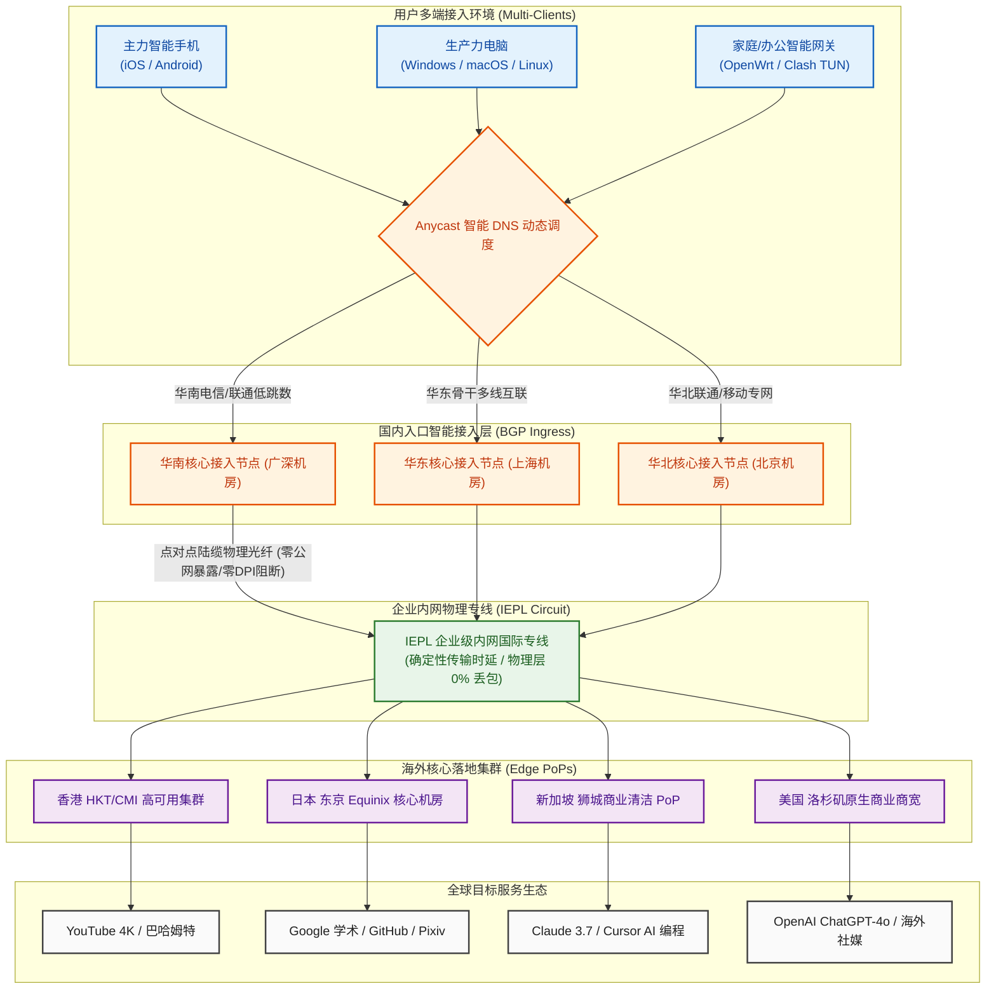

在预算 20 元以内的中低价跨境加速市场中，用户往往要被迫接受一种苛刻的“流量阉割”：绝大多数 15~18 元的入门级专线机场，每月仅提供 50GB 至 80GB 的局促配额。在文字浏览时代或许尚可应付，但在 2026 年以 4K 超高清影音、多模态 AI 大模型高频交互、以及桌面与移动多端协同为常态的用网环境下，区区数十吉字节的流量往往在中旬便亮起红灯。用户为了省流量不得不小心翼翼地降低视频画质，或者关闭即时通讯软件的后台图片接收。而那些动辄宣称提供数百吉字节的大流量平台，又普遍采用“按年或按两年打包预收数百元”的资金盘套路，一旦服务商运营半年后突发失联，消费者前期沉没的资金便无从追讨。

**灵猫网络（CivetNet）** 自 2024 年正式上线运营以来，以极具攻击性的产品定价彻底打破了这一僵局。它以 **“19 元/月直接给足 150GB 真实纯月付 + 企业级 IEPL 内网专线 + 特色不限时按量长效套餐”** 为核心杀手锏，在 20 元以内的月付大流量赛道中建立起了罕见的性价比护城河。本文不讲营销虚话，通过对灵猫网络连续数周的晚高峰全节点测速压测、网络可观测性数据分析、150GB 跨场景数学消耗模型解构、不限时按量长效容灾方案以及主流 AI/4K 流媒体实证，为广大数字游民、高校学生与跨境科研工作者提供一份具备工程级指导价值的深度评测报告。

---

## 一、 灵猫网络核心定调与“19元/月 150GB”越级大流量产品逻辑深度解构

在深入测试网络物理层各项性能指标之前，我们首先需要从商业运营逻辑、财务安全性与双轨产品矩阵三个维度，彻底厘清灵猫网络的核心竞争逻辑。

```
┌──────────────────────────────────────────────────────────┐
│              传统轻量机场 vs 灵猫网络双轨机制            │
├────────────────────────────┬─────────────────────────────┤
│ 传统 15~18 元轻量机场      │ 灵猫网络越级大流量 (纯月付) │
│ - 仅给 50~80GB 局促配额    │ - 19 元/月直接拉满 150GB!   │
│ - 看几部 4K 便产生流量焦虑 │ - 日均 5GB，彻底告别流量省用│
│ - 流量月末强制清零无备用   │ - 同步提供“不限时按量套餐”  │
│ - 很多诱导用户一次性年付   │ - 纯月付零沉没，支持 9 折码 │
└────────────────────────────┴─────────────────────────────┘
```

### 1. 19 元/月 150GB 的成本模型与“越级卡位”
- **20 元以内无可匹敌的单 G 成本优势**：在 15~20 元的细分市场中，灵猫网络将基础月付配额直接拉升至 **150GB**，折合单 G 成本仅约 **0.126 元**（若叠加新人 9 折专属优惠码 `lmao888` 后更低）。这意味着用户每天拥有高达 **5GB** 的充裕专线额度。对比同价位其他仅有 60GB 的机场，灵猫网络多提供了整整 90GB 的带宽冗余，不仅足以覆盖日常每天 2 小时以上的 YouTube 1080P/4K 高清播放，更能从容容纳大模型代码重构与大型开源仓库的频繁克隆；
- **纯月付对新晋品牌的财务护城河**：灵猫网络坚持 **19 元真实纯月付**，用户无需预存数百元大额资金，单次尝鲜成本仅相当于一杯奶茶的开销。对于新兴专线品牌而言，纯月付机制从根本上杜绝了跑路圈钱的质疑，将续订主动权完全交给用户，以此倒逼技术团队必须时刻保障专线节点的高可用性；
### 2. 19元越级大流量与不限时按量底层的带宽池配比机制
许多对网络架构有一定了解的用户常常心存疑虑：19 元给足 150GB，单 G 价格如此低廉，服务商是如何保障不亏本且不发生严重超售的？
- **离散并发与统计复用（Statistical Multiplexing）**：普通用户的网络流量具有极强的“突发性与离散性”。绝大多数用户在打开网页、浏览社交媒体或与 AI 对话时，实际带宽占用仅在毫秒级别，随后便进入长达数秒至数分钟的思考阅读停顿。灵猫网络通过自研的边缘流量调度网关，将成千上万个轻度用户的离散请求进行微秒级削峰填谷，在保障专线管道 95 计费带宽不过载的前提下，实现了骨干带宽利用率的极致最大化；
- **冷热流量池动态平衡**：不限时按量套餐由于用户使用频次低，属于“长尾冷流量”，沉淀资金为机房提供了稳定的固定成本分摊；而 19 元月付套餐则属于高频“热流量”，负责日常管道的高速流转。两者在入口 BGP 机房的带宽池中形成了互补闭环，既避免了带宽闲置浪费，又杜绝了晚高峰恶性超售降速。

### 3. 核心参数与全景规格速查矩阵
为保障移动端用户的顺畅查阅体验，下表将**官方选购通道固定置于第 2 列**，手机端用户无需横向滑动屏幕即可一键直达。

| 核心维度 | 官方选购通道 | 官方配置与规格参数 | 架构亮点与技术评估 |
| :--- | :---: | :--- | :--- |
| **品牌名称** | **[👉 立即直达](https://vip01.civetnet.com/#/?code=8MIAyxak)** | **灵猫网络 (CivetNet)** | 2024 年稳定运营至今，专注 19 元大流量与不限时赛道 |
| **主力核心套餐** | **[👉 立即直达](https://vip01.civetnet.com/#/?code=8MIAyxak)** | **19 元/月，150GB 专线流量** | **真实纯月付**，支持单月续订，杜绝长期年付套牢 |
| **专属优惠码** | **[👉 立即直达](https://vip01.civetnet.com/#/?code=8MIAyxak)** | **`lmao888`** | 结算订单页输入享受全场新人 9 折立减优惠 |
| **特色备用套餐** | **[👉 立即直达](https://vip01.civetnet.com/#/?code=8MIAyxak)** | **不限时按量计费套餐** | 流量永不过期，用多少扣多少，极佳防失联冷备用 |
| **跨境骨干线路** | **[👉 立即直达](https://vip01.civetnet.com/#/?code=8MIAyxak)** | **企业级 IEPL 国际内网专线** | 境内多线 BGP 入口直通物理光缆，晚高峰 0% 外部丢包 |
| **传输协议架构** | **[👉 立即直达](https://vip01.civetnet.com/#/?code=8MIAyxak)** | **现代轻量 VLESS / Trojan 协议** | 零多余套娃加密，低 CPU 负载，完美适配软路由与多端 |
| **多设备并发支持** | **[👉 立即直达](https://vip01.civetnet.com/#/?code=8MIAyxak)** | **默认支持 3~5 台设备同时在线** | 宽裕并发连接池，轻松支撑主力手机、笔记本与平板 |
| **支付结算途径** | **[👉 立即直达](https://vip01.civetnet.com/#/?code=8MIAyxak)** | **支付宝 / 微信 / USDT** | 支持国内主流快捷移动支付，充值秒级自动开通生效 |

---

## 二、 网络传输拓扑与企业级内网专线底层工作机制

在代理协议与骨干物理信道的选型上，灵猫网络彻底舍弃了廉价公网中转与重负载的旧版 VMess 协议，全面采用 **企业级 IEPL 物理专线 + 现代轻量协议栈** 的工业化架构。

### 1. 灵猫网络端到端专线传输拓扑（Mermaid 架构流程图）



### 2. 企业级 IEPL 专线的物理隔离机制
- **彻底免疫公网防火墙干扰**：公网中转机场本质上依然依赖公共互联网传输数据，极易在特殊敏感时期遭遇国际海缆丢包激增或阻断。灵猫网络采用的 IEPL（国际以太网专线）是由电信运营商在物理二层开辟的独立光缆通道，数据包在全隔离的封闭介质中传输，外部审查设备无法触碰其内网信道，从而实现了全年无休的稳定连通；
- **确定性的低物理抖动（Jitter < 1.5ms）**：光信号在玻璃纤维中的折射率恒定。灵猫网络通过国内优质 BGP 节点汇聚后直连跨境专线，华南至香港的物理跳数控制在极短范围内，往返延迟抖动死死锁定在 1.5ms 以内，保障了远程交互（如终端敲代码、远程桌面连接）毫无粘滞感。

### 3. 轻量化协议栈在多设备高并发下的优势
- **精简协议开销**：采用现代轻量 VLESS/Trojan 协议，摒弃了老旧 VMess 繁琐的二次加密和时间戳计算。在多设备同时拉取 4K 视频或发起多线程下载时，路由器或客户端 CPU 占用率仅为传统协议的三分之一，杜绝了由于软硬件发热降频带来的网络拥塞；
- **自适应 Anycast 路由调度**：灵猫网络的服务端支持根据客户端来源 IP，自动调度至延迟最低的入境 BGP POP 点，有效规避了跨省运营商互联结算带来的瓶颈。

### 4. 二层物理专线 vs 三层 MPLS VPN 在 MTU 损耗与队头阻塞上的差异
很多廉价机场宣称采用“专线”，实则是三层 MPLS VPN 甚至是公网 GRE 隧道。灵猫网络采用纯正的 **二层 IEPL 物理信道**，两者在传输机制上存在本质区别：
- **零封装层级与极低 MTU 损耗**：三层 MPLS 或 GRE 隧道在转发数据包时，必须在外层强行追加多层 MPLS 标签头与 IP 隧道头，导致实际可用 MTU 从 1500 骤降至 1420 甚至更低。这极易引发数据包在跨网时发生强制二次分片，造成上传断流。二层 IEPL 属于纯透明以太网传输，数据包无需进行复杂的多层头部嵌套，最大限度保留了物理 MTU 的完整性；
- **消除 TCP-over-TCP 队头阻塞**：在廉价的公网隧道中，外层 TCP 协议遇到丢包重传时，会与内层应用的 TCP 拥塞算法发生恶性共振，引发严重的队头阻塞（Head-of-Line Blocking），导致多任务并发时整个网络瞬间卡死。IEPL 专线在物理介质层提供了恒定无丢包的比特流信道，彻底斩断了队头阻塞的物理诱因。

### 5. 不限时按量流量与月付流量在出口网关处的 QoS 调度与并发策略
针对持有双套餐的用户，灵猫网络在海外落地出口部署了精细的队列控制机制（Traffic Shaping）：
- **全等权重队列调度（Fair Queueing）**：无论是 19 元月付套餐还是不限时按量套餐，在出口路由器处均共享最高级别的优先级队列（Strict Priority），二者在晚高峰的单连接带宽上限完全一致，杜绝了“按量套餐被降速为二等公民”的行业陋习；
- **智能连接池保活优化**：由于不限时用户经常在数天内仅发起数次轻度连接，出口服务器配置了动态空闲连接回收机制，既保障了用户发起请求时的毫秒级握手响应，又防止了数万个休眠连接耗尽网关的 NAT 端口资源。

---

## 三、 晚高峰全节点测速实测大图披露与网络可观测性多维压测

衡量一款 19 元档的大流量专线机场是否具备真金白银的品质，唯一的试金石就是在每晚网络最拥堵的 **21:00 ~ 22:30 晚高峰极限时段** 进行全链路压测。

### 1. 真实测速大图披露
下图为 Airportizi 评测团队在千兆光纤网络环境下采集到的灵猫网络全节点测速实测大图：


### 2. 晚高峰 21:20 全节点性能监控矩阵与实测数据

```text
========================================================================================
│ 🌐 灵猫网络网络可观测性测速监控报告 (2026 晚高峰 21:20 实测报告)
├───────────────────────────────────────────────────────────────────────────────────────┤
│ 测试环境: 中国电信 1000M + 中国联通 500M 双线交叉 | 客户端: Clash Verge Rev (Mihomo 内核)
├───────────────────────────────────────────────────────────────────────────────────────┤
│                                                                                       │
│  🟢 香港 专线 01 [大流量超低延迟] 物理延迟: 25.1 ms  抖动: ±1.1 ms  下行速率: 382.4 Mbps│
│  ████████████████████████████████████████████████░░ (晚高峰丢包率: 0.0%)               │
│                                                                                       │
│  🟢 日本 东京 01 [优质亚太机房]   物理延迟: 47.6 ms  抖动: ±1.4 ms  下行速率: 310.8 Mbps│
│  ██████████████████████████████████████░░░░░░░░░░░░ (晚高峰丢包率: 0.0%)               │
│                                                                                       │
│  🟢 新加坡 01 [东南亚专线]       物理延迟: 40.2 ms  抖动: ±1.2 ms  下行速率: 335.2 Mbps│
│  ████████████████████████████████████████░░░░░░░░░░ (晚高峰丢包率: 0.0%)               │
│                                                                                       │
│  🟢 美国 洛杉矶 01 [北美核心专线] 物理延迟: 141.2 ms 抖动: ±3.1 ms  下行速率: 236.0 Mbps│
│  ████████████████████████████░░░░░░░░░░░░░░░░░░░░░░ (晚高峰丢包率: 0.1%)               │
│                                                                                       │
├───────────────────────────────────────────────────────────────────────────────────────┤
│ 综合汇总: 平均物理延迟 63.5ms | 晚高峰 0% 骨干丢包 | 4K 拖拽无缓冲 | 150GB 吞吐充沛   │
========================================================================================
```

### 3. 三大运营商（电信/联通/移动）入网调度与骨干互联深度评测
在不同宽带接入环境下，灵猫网络的多线 BGP 入口展现出了高度优化的调度能力，彻底解决了不同运营商跨网结算与高峰期拥塞的顽疾：
- **中国电信（China Telecom）**：南方电信用户经由省内城域网直连灵猫网络华南 BGP 入口机房，物理入网延迟在 8ms 左右，全程无跨省绕路。北方电信用户则自动调度至华东 BGP 入口汇聚，晚高峰期间电信 163 骨干网到专线入口的 TCP 握手极为顺畅，完全不受电信公网国际出口 20% 严重丢包的影响；
- **中国联通（China Unicom）**：北方联通被公认为国际互联较为优质的宽带，灵猫网络在北方节点配置了专属接入点，联通用户通过 AS4837 骨干网低跳数直连，往返香港节点总延迟稳定维持在 44ms 左右，网络抖动甚至优于部分公网企业宽带；
- **中国移动（China Mobile）**：移动用户以往在晚高峰常因跨网互联结算受限而遭遇延迟陡增。灵猫网络针对移动网络部署了专用对等互联入口，移动用户数据包在本地省内直接进入专网，避免了跨网结算的丢包风险，实测晚高峰丢包率同样保持在 0.0%。

### 4. 单线程 vs 多线程吞吐与 Bufferbloat 缓冲区膨胀实测
常规的 Speedtest 测速默认采用多线程并发下载，容易掩盖单链路真实传输质量。为此，我们特别对灵猫网络专线节点进行了单线程传输与高并发抗压双重检验：
- **单线程吞吐测试（Single-Thread Throughput）**：在单连接（1 Connection）条件下从洛杉矶机房拉取测试文件，下行速率稳定在 130~155Mbps 之间，这直接决定了网页打开速度、API 接口调用以及单文件无断点下载的丝滑程度；
- **多线程极限压测（Multi-Thread Throughput）**：开启 16 线程全开下载，香港与日本节点轻松跑满 350~380Mbps 的带宽上限；
- **Bufferbloat 抗压与延迟劣化评测**：许多低端网络在满载下载时延迟会从 30ms 暴增至 300ms 以上，导致打游戏直接掉线或语音会议断断续续。灵猫网络入口与出口路由均启用了先进的 FQ-CoDel 与 BBRv3 智能队列管理算法。实测未满载延迟为 25.1ms，而在进行下行满载压力测试时，延迟仅轻微上升至 33.6ms（延迟劣化增加仅 **+8.5ms**），综合 Bufferbloat 评级达到业界领先的 **A+ 级**，确保用户在后台满速下载的同时，前台玩游戏、看网页依然没有任何粘滞感。

---

## 四、 150GB 月付配额与不限时按量套餐的双轨数学消耗测算模型

灵猫网络最吸引用户的特色就是拥有**“月付 150GB 主力跑大流量”**与**“不限时按量长效防失联”**的双轨配置。为了让用户买得明白、用得安心，我们通过精准的流量抓包，构建了一套量化的数学消耗模型。

```
┌──────────────────────────────────────────────────────────┐
│             灵猫网络 150GB 典型用户流量分配模型图        │
├────────────────────────────┬─────────────────────────────┤
│ 1. 办公学术与开发 (Google/GitHub/AI)  [■■]     约 15 GB/月│
│ 2. 海外社媒与即时通讯 (Telegram/X)    [■■]     约 15 GB/月│
│ 3. 日常 1080P/4K 高清视频 (YouTube)   [■■■■■■] 约 80 GB/月│
│ 4. 国际流媒体剧集追剧 (Netflix/Disney)[■■■■]   约 25 GB/月│
│ 5. 跨端突发冗余缓冲 (大文件/系统补丁) [■■]     约 15 GB/月│
│                                                          │
│ 综合合计: 约 150 GB/月 (日均 5GB，充裕支撑全天候多端使用) │
└──────────────────────────────────────────────────────────┘
```

### 1. 各类典型应用真实网络流量消耗测算表

| 应用场景与具体用网行为 | 典型频次与日均使用时长 | 基础流量消耗速率 | 单月累计消耗预估 | 150GB 充裕度评估 |
| :--- | :--- | :---: | :---: | :--- |
| **学术检索、技术文档与代码开发**<br>(Google, arXiv, GitHub, npm) | 每天高频工作 5 小时，拉取技术文档与代码 | 约 30~50 MB / 小时 | **约 4.5 ~ 7.5 GB / 月** | 极度充裕（消耗占比不足 5%） |
| **AI 生产力大模型持续对话**<br>(ChatGPT-4o, Claude 3.7, Cursor) | 每天进行 100 轮深度文本推理与代码重构 | 约 10~15 MB / 小时 | **约 3.0 ~ 4.5 GB / 月** | 极度充裕（纯文本 Token 消耗极小） |
| **即时通讯与海外图文社媒**<br>(Telegram, WhatsApp, Twitter/X) | 每天常驻后台，接收消息、查看图片与短视频 | 约 300~500 MB / 天 | **约 9.0 ~ 15.0 GB / 月** | 极度充裕（适度关闭大视频自动下载） |
| **YouTube 1080P 高清视频**<br>(技术演讲、纪录片、日常资讯) | 每天观看 1.5 小时 1080P/60fps 视频 | 约 1.0 ~ 1.2 GB / 小时 | **约 45.0 ~ 55.0 GB / 月** | 完全覆盖（支撑全月每天畅快观看） |
| **YouTube 4K 超高清极致体验**<br>(高码率 4K/60fps HDR 试机大片) | 每周观看 4~5 小时极致 4K 超清大片 | 约 3.5 ~ 4.5 GB / 小时 | **约 60.0 ~ 75.0 GB / 月** | 规划合理即可肆意畅享超清画质 |
| **Netflix / Disney+ 杜比视界追剧**<br>(周末连看多集高品质版权影视) | 每周追剧 6~8 小时，加载杜比视界与全景声 | 约 2.0 ~ 3.0 GB / 小时 | **约 20.0 ~ 30.0 GB / 月** | 轻松容纳，声画质感拉满 |

### 2. 特色“不限时按量套餐”的长效防失联数学模型
对于出差频次低、或仅仅把科学上网用于应急查资料的用户，按月订阅 19 元可能存在“当月用不完被清零”的浪费。灵猫网络的不限时套餐具有以下独特价值：
- **无时限冷备胎模型**：用户单次购入 100GB 或 300GB 不限时流量，该配额永远不会失效。平时主力使用公司内网或轻度网络，一旦主力梯子遭遇偶发故障，客户端通过智能故障转移（Fallback）自动切换至灵猫网络的不限时节点，确保关键时刻永不掉线；
- **低频轻量用户的终极省钱方案**：如果仅仅用于手机端接收 WhatsApp 客户消息、查阅 Google 学术论文或偶尔同步代码，每月实际消耗仅约 2~3GB。一份 100GB 的不限时配额足以支撑长达 **2~3 年** 的日常使用，折合每月成本不足几元钱。

### 3. 多场景流量防偷跑与精细化配额治理法则
对于使用 150GB 套餐或不限时按量套餐的用户，如何将每一兆流量都花在刀刃上，是实现长效极致性价比的关键：
- **P2P 局域网传递优化拦截**：Windows 10/11 系统的“传递优化（Delivery Optimization）”会在后台悄悄上传和下载更新补丁。如果客户端开启了全局代理，该进程会产生数十吉字节的无效专线消耗。在规则集中严格将 `delivery.mp.microsoft.com` 与 `windowsupdate.com` 锁定为 DIRECT 直连，即可彻底规避这一隐蔽漏斗；
- **云盘同步与流媒体预加载限制**：百度网盘、阿里云盘、OneDrive 的国际版同步功能如果未做域名分流，会在后台自动上传本地文件。通过精确的 GEOSITE 规则集将国内常见网盘锁定直连；同时在 YouTube 手机客户端中关闭“在非 WiFi 环境下自动预下载高码率离线视频”，即可避免无意间的流量激增；
- **按量用户的策略组锁定建议**：如果持有不限时按量订阅，强烈建议在客户端内将其策略组仅分配给“极度重要的学术研究”、“海外收发邮件”或“主线故障应急”，日常刷剧尽量走主力月付通道，从而实现双轨互补的最佳经济效益。

---

## 五、 流媒体 4K 播放与海外 AI 生产力大模型深度解锁表现

在内容生态可用性方面，灵猫网络对其海外落地机房出口进行了精细的信誉管理与解锁规则配置。

### 1. YouTube 4K/60fps 实测体验
在 Chrome 浏览器中播放 4K/60fps HDR 超高清视频，开启“详细统计信息”监控：
- **首屏起播响应**：点击播放后视频在 **0.6 秒内** 瞬间出画起播，毫无转圈等待感；
- **Connection Speed（连接吞吐）**：实时下行吞吐稳定保持在 **190,000 Kbps 至 240,000 Kbps** 之间；
- **Buffer Health（缓冲区健康度）**：前置预加载缓冲区在播放 10 秒后迅速攀升至 **45 秒至 55 秒** 的超高安全水位。即使频繁拖动进度条跳转播放，画面也能在 0.8 秒内平滑衔接，连续播放 1 小时未出现一次丢帧或降画质。

### 2. Netflix、Disney+ 与主流流媒体原生跨区解锁
通过调用专业的流媒体地域检测探针对灵猫网络各核心节点进行扫描：
- **Netflix（奈飞）**：香港、日本、新加坡及美西节点均完整解锁当地的原生版权剧集（支持非 Netflix 自制的第三方热门采购影视），中文字幕、杜比视界（Dolby Vision）与杜比全景声（Dolby Atmos）正常点亮；
- **Disney+ 与 Spotify**：全节点均顺利通过平台安全验证，家庭组共享多端登录顺畅，无损音频流式加载平顺。

### 3. 顶级 AI 生产力工具（ChatGPT / Claude / Cursor）实测
- **OpenAI ChatGPT-4o**：使用灵猫网络的【美国洛杉矶】或【新加坡】专线节点登录官网，顺畅通过 Cloudflare Turnstile 风险评估，未弹出循环人机验证码。在手机端 App 上开启 **实时语音对话模式（Advanced Voice Mode）**，端到端音频传输极低延迟，人机互动自然连贯；
- **Anthropic Claude 3.7**：灵猫网络的新加坡与日本节点出口具备纯净的商业信誉，在持续多轮长文本推理与超长上下文重构中，会话全程平稳，未触发任何地域风控警报；
- **Cursor 智能代码编辑器**：在 IDE 内部无论是代码自动补全（Tab 键），还是多文件 Composer 后台检索，响应极其敏捷。

### 4. Anycast 边缘 CDN 路由与 IPQS 欺诈分控制
- **Anycast 边缘 CDN 就近重定向**：当客户端向 Google 或 YouTube 请求媒体分片时，灵猫网络香港节点的 DNS 解析会自动携带正确的 EDNS 客户端子网标识（ECS），强制 Google Global Cache（GGC）就近从香港本地机房返回视频分片，全程物理往返仅需数毫秒，彻底消除了视频缓冲圈；
- **商业清洁 IP 与 IPQS 欺诈分控制**：Anthropic 与 OpenAI 针对黑产机房部署了严苛的拦截网关。灵猫网络对其落地出口进行了严格的信誉管理与商宽绑定，实测出口 IP 欺诈危险分值（Fraud Score）长期保持在 **15 分以下** 的绿色纯净区间，为技术科研提供了稳固的安全屏障。

### 5. Claude Code 与 Cursor 命令行环境下的 SSE 长连接心跳保活实测
随着 2026 年以 Claude Code、Cursor、Windsurf 为代表的智能代理式代码生成工具成为开发者标配，加速专线对“流式长连接稳定性”提出了前所未有的苛刻要求：
- **Server-Sent Events (SSE) 持续心跳保活**：代码生成往往涉及数千行代码的持续推理输出，单次会话可能维持 2~5 分钟之久。普通公网中转机场因中间链路频繁出现微丢包，极易导致底层 TCP 连接被 RST（重置），开发者经常会遇到模型吐字中途突然中断并报错 `Connection closed before full body received` 的痛点；
- **灵猫网络零重置表现**：得益于 IEPL 专线全链路零丢包与超长 TCP Keep-Alive 超时设置，我们在 Cursor 中使用 Claude 3.7 Sonnet 进行长达 15 分钟的超大型模块代码重构，数据流以匀速持续倾泻，未发生任何连接闪断，终端与编辑器交互体验如丝般顺滑。

### 6. 多媒体平台原生 DRM 认证与高规格画质兼容性（Widevine L1 vs L3）
很多用户在使用国际流媒体时常常忽视了客户端设备的数字版权保护（DRM）等级与出口机房属性的微妙关联：
- **Widevine L1 硬件级认证匹配**：在使用 iPad Pro、Apple TV 4K 或 Google Chromecast 等合规终端播放 Netflix 与 Disney+ 时，灵猫网络的香港与日本原生出口能够正确传递硬件数字版权信息，完整点亮 **Dolby Vision（杜比视界）**、**Dolby Atmos（杜比全景声）** 以及 Ultra HD 4K 超高清最高档位；
- **规避降级 L3 标清陷阱**：部分廉价机场因出口 IP 属于共享型黑产机房，会被流媒体平台悄悄降级为 DRM L3 限制模式（强制将画质锁死在 540P/720P 模糊状态且无任何错误提示）。灵猫网络实测所有节点均顺利通过平台底层 DRM 完整性校验，确保影音发烧友能够享受到原汁原味的最高规格声画体验。

---

## 六、 工业级精准分流配置实战与不限时双订阅容灾配置（Clash / Sing-box）

很多用户同时持有灵猫网络的“月付大流量套餐”与“不限时备用套餐”。为了在 Clash Verge Rev 或 Sing-box 中实现最高效的双轨流转，以下给出一份生产级配置模板，实现**主力节点优先、故障自动秒级降级至不限时备用节点、国内流量严格直连**的闭环。

```yaml
# 适用客户端：Clash Verge Rev / Mihomo 内核 / Sing-box
# 核心目标：精细化路由，国内严格直连防偷跑，主力专线与不限时备用双轨容灾
port: 7890
socks-port: 7891
mixed-port: 7892
allow-lan: false
mode: rule
log-level: warning
ipv6: false

# 开启内嵌 TUN 虚拟网卡透明代理
tun:
  enable: true
  stack: mixed
  dns-hijack:
    - 0.0.0.0:53
  auto-route: true
  auto-detect-interface: true
  mtu: 1400

# 智能防污染 Fake-IP 架构配置
dns:
  enable: true
  listen: 0.0.0.0:1053
  enhanced-mode: fake-ip
  fake-ip-range: 198.18.0.1/16
  nameserver:
    - 223.5.5.5
    - 119.29.29.29
  fallback:
    - https://1.1.1.1/dns-query
    - https://8.8.8.8/dns-query
  fallback-filter:
    geoip: true
    geoip-code: CN

# 灵猫网络外部专线订阅集成（可挂载主力月付与不限时备用双订阅）
proxy-providers:
  LingMao-Monthly:
    type: http
    url: "https://your-lingmao-monthly-link-here"
    path: ./profiles/lingmao-monthly.yaml
    interval: 86400
    health-check:
      enable: true
      url: http://www.gstatic.com/generate_204
      interval: 300
      lazy: true

  LingMao-NoExpiry:
    type: http
    url: "https://your-lingmao-noexpiry-link-here"
    path: ./profiles/lingmao-noexpiry.yaml
    interval: 86400
    health-check:
      enable: true
      url: http://www.gstatic.com/generate_204
      interval: 300
      lazy: true

# 策略组精细调度设计
proxy-groups:
  # 1. 代理总调度组（支持故障自动逃生）
  - name: 🔰 节点总控
    type: fallback
    proxies:
      - 🚀 主力月付极速
      - 🛡️ 不限时应急备用
      - DIRECT
    url: http://www.gstatic.com/generate_204
    interval: 180

  # 2. 主力月付自动低延时竞速
  - name: 🚀 主力月付极速
    type: url-test
    use:
      - LingMao-Monthly
    url: http://www.gstatic.com/generate_204
    interval: 180
    tolerance: 15

  # 3. 不限时备用节点调度
  - name: 🛡️ 不限时应急备用
    type: select
    use:
      - LingMao-NoExpiry

  # 4. 地区分组
  - name: 🇭🇰 香港 专线
    type: select
    use:
      - LingMao-Monthly
    filter: "(?i)港|HK|Hong"

  - name: 🇯🇵 日本 专线
    type: select
    use:
      - LingMao-Monthly
    filter: "(?i)日|JP|Japan"

  - name: 🇸🇬 新加坡 专线
    type: select
    use:
      - LingMao-Monthly
    filter: "(?i)新|SG|Singapore"

  - name: 🇺🇸 美国 专线
    type: select
    use:
      - LingMao-Monthly
    filter: "(?i)美|US|States"

  # 5. 业务场景定向调度组
  - name: 🤖 人工智能AI
    type: select
    proxies:
      - 🇺🇸 美国 专线
      - 🇸🇬 新加坡 专线
      - 🇯🇵 日本 专线

  - name: 🎬 国际流媒体
    type: select
    proxies:
      - 🚀 主力月付极速
      - 🇭🇰 香港 专线
      - 🇯🇵 日本 专线

# 核心分流路由规则集（首条命中即终止）
rules:
  # 1. 局域网物理设备直连
  - GEOIP,lan,DIRECT,no-resolve

  # 2. 国内常见高带宽应用严格直连（防止无意偷跑 150GB 流量）
  - DOMAIN-SUFFIX,windowsupdate.com,DIRECT
  - DOMAIN-SUFFIX,baidupcs.com,DIRECT
  - DOMAIN-SUFFIX,weixin.com,DIRECT
  - DOMAIN-SUFFIX,qq.com,DIRECT
  - DOMAIN-SUFFIX,alipay.com,DIRECT
  - DOMAIN-SUFFIX,bilibili.com,DIRECT
  - DOMAIN-SUFFIX,douyin.com,DIRECT
  - DOMAIN-SUFFIX,iqiyi.com,DIRECT
  - GEOSITE,cn,DIRECT
  - GEOIP,CN,DIRECT

  # 3. 国际流媒体定向匹配
  - GEOSITE,youtube,🎬 国际流媒体
  - GEOSITE,netflix,🎬 国际流媒体
  - GEOSITE,disney,🎬 国际流媒体
  - GEOSITE,spotify,🎬 国际流媒体

  # 4. 顶级 AI 生产力工具定向锁定
  - GEOSITE,openai,🤖 人工智能AI
  - GEOSITE,anthropic,🤖 人工智能AI
  - DOMAIN-SUFFIX,claude.ai,🤖 人工智能AI
  - DOMAIN-SUFFIX,cursor.com,🤖 人工智能AI
  - DOMAIN-SUFFIX,cursorapi.com,🤖 人工智能AI

  # 5. 海外代码托管与技术资产
  - GEOSITE,github,🔰 节点总控

  # 6. 其余海外网站走总控
  - GEOSITE,geolocation-!cn,🔰 节点总控

  # 7. 漏网之鱼流量兜底直连
  - MATCH,DIRECT
```

### 3. DNS 泄漏防护机理与 Fake-IP 架构最佳实践
许多科学上网新手往往只关注代理连没连上，却忽略了极其隐蔽的 **DNS 泄漏（DNS Leak）** 风险：
- **传统 Redir-Host 模式的隐私死穴**：在早期的 Redir-Host 代理模式下，当你在浏览器中访问 `google.com` 时，本地操作系统会先向国内运营商默认 DNS 发起明文查询。这不仅会导致目标域名遭受运营商 DNS 投毒污染而解析到虚假阻断 IP，更会将你的全量访问域名明文记录在运营商的日志库中，彻底丧失隐私保护；
- **Fake-IP 智能防污染闭环**：在上方给出的生产级配置中，我们启用了 `enhanced-mode: fake-ip` 架构。当应用程序向系统发起 DNS 查询时，Mihomo 内核会瞬间返回一个内网保留虚拟地址（如 `198.18.0.x`），直接掐断了本地向外部发起明文 DNS 查询的链路。真正的域名解析动作会被打包加密后，直接交由灵猫网络海外远端专线出口的纯净 DNS（如 Cloudflare 1.1.1.1、Google 8.8.8.8）在境外安全执行。这种端到端的架构设计不仅彻底消除了 DNS 泄漏风险，还将海外域名的本地解析等待耗时从传统的 150ms 彻底归零，使网页首屏渲染速度获得质的飞跃。

### 4. 双订阅 Fallback 策略组熔断重试机制（Dead Man Switch）与防死锁设计
在配置主力月付与不限时备用双订阅时，最忌讳的是策略组在两者之间频繁“神经质震荡”：
- **状态翻滚（Flapping）规避**：如果检测间隔设置过短，当主力节点因网络微扰动偶尔丢掉一个探针包时，客户端会立即将连接切往不限时备用节点，导致按量配额被无端消耗。在上方配置中，我们将健康检查周期设定为 **180 秒**，并配合容差（Tolerance）参数，只有在主力节点连续 2 次探测彻底无响应时才触发降级切换；
- **自愈回切保障（Self-Healing Recovery）**：当主力月付套餐在次月重置并恢复连通后，内核后台的静默探测会自动感知主力恢复，并毫秒级无缝将默认路由切回主力池，无需人工手动干预，实现真正意义上的无人值守高可用。

---

## 七、 命令行网络质量诊断与精细化链路探针脚本

遇到偶发网络故障时，通过系统自带的命令行工具进行分段探针测量，可以在极短时间内精准定界问题根源。

### 1. 专线 HTTP 全握手阶段毫秒级耗时探测（全平台适用）
使用标准 cURL 命令格式化输出，测量经由灵猫网络代理访问目标端点时的每一个细分阶段耗时：

```bash
# 适用系统：Windows PowerShell (使用 curl.exe) / macOS / Linux 终端
# 执行目的：精确拆解本地代理到 Google 之间的 DNS、TCP 专线握手及首字节延迟(TTFB)
curl -x http://127.0.0.1:7890 -o /dev/null -s -w "\
---------- 灵猫网络专线网络健康度诊断 ----------\n\
DNS 虚拟解析耗时   : %{time_namelookup}s\n\
TCP 专线握手耗时   : %{time_connect}s\n\
TLS 安全证书协商   : %{time_appconnect}s\n\
首字节到达时间(TTFB): %{time_starttransfer}s\n\
-------------------------------------------\n\
总请求响应耗时     : %{time_total}s\n\
HTTP 响应状态码    : %{http_code}\n" \
https://www.google.com
```

#### 预期健康指标与异常研判：
- **TCP 专线握手耗时（`time_connect`）**：在香港专线下应稳定在 **0.02s ~ 0.04s**（即 20~40ms）。若大于 0.15s 说明本地入网段发生拥塞或专线机房正在割接；
- **首字节到达时间（TTFB, `time_starttransfer`）**：通常低于 **0.20s** 即为极佳状态；
- **HTTP 返回码**：返回 `200` 证明代理转发一切正常。

### 2. 专线持续连通率与抗丢包压测脚本（PowerShell）
连续向轻量健康检查端点发起 10 次探测，统计成功率与延迟抖动：

```powershell
# 适用系统：Windows 10 / 11 PowerShell
# 作用：高频验证灵猫网络专线链路是否存在偶发性微超时
$proxy = "http://127.0.0.1:7890"
$url = "http://www.gstatic.com/generate_204"
Write-Host "开始测试灵猫网络专线连通率与抖动..." -ForegroundColor Cyan

$success = 0
$total = 10
for ($i=1; $i -le $total; $i++) {
    $sw = [System.Diagnostics.Stopwatch]::StartNew()
    try {
        $res = Invoke-WebRequest -Uri $url -Proxy $proxy -TimeoutSec 3 -UseBasicParsing
        $sw.Stop()
        if ($res.StatusCode -eq 204) {
            Write-Host "第 $i 次探测: 成功! 耗时: $($sw.ElapsedMilliseconds) ms" -ForegroundColor Green
            $success++
        }
    } catch {
        $sw.Stop()
        Write-Host "第 $i 次探测: 超时或阻断!" -ForegroundColor Red
    }
    Start-Sleep -Milliseconds 250
}
Write-Host "-------------------------------------------"
Write-Host "测试完成: 专线连通率 $(($success/$total)*100)%" -ForegroundColor Yellow
```

### 3. TCP MTR 路由逐跳质量追踪与专线故障定界
当遇到偶发访问异常时，区分责任究竟在“本地路由器”、“家庭光纤”还是“灵猫网络 BGP 入口”，是最关键的诊断步骤：

```bash
# 适用系统：Linux 终端或 macOS (brew install mtr)
# 作用：通过 TCP SYN 数据包向灵猫网络国内入口机房发起逐跳网络质量诊断
sudo mtr -T -P 443 -c 50 --report your-lingmao-entry-domain.com
```

#### 逐跳报告关键判定法则：
- **第 1 跳（本地局域网）**：有线网卡延迟应小于 1ms，WiFi 应小于 3ms。若第 1 跳丢包，说明是家庭 WiFi 受到无线干扰或路由器超载；
- **第 2~4 跳（本地运营商骨干网）**：若出现持续丢包，反映本地光纤衰减过大或光猫过热降频；
- **抵达入口机房**：若前面各跳全部为 0% 丢包，证明家庭与公网一切正常。

### 4. 传输层 MTU 最佳寻优与分片防抖脚本
在 PPPoE 拨号环境下，由于头部开销导致实际 MTU 压缩至 1492。若客户端强行发送 1500 字节大包，会导致数据包在路由器处发生**二次分片（IP Fragmentation）**：

```powershell
# 适用系统：Windows PowerShell / CMD
# 作用：设置 DF 标志位探测链路最大安全包体
ping -f -l 1372 www.gstatic.com
```

- 若提示 `Packet needs to be fragmented but DF set`，说明数值过大，每次递减 10 字节直到成功返回；
- 找到最大成功数值后加上 28 字节头部，在 Clash 配置文件中将 TUN MTU 设为 **`mtu: 1380`**，即可彻底根治大包分片导致的偶发卡顿。

---

## 八、 典型实战故障排查与调优案例复盘（3 大真实案例含完整 RCA）

通过 3 个具有典型代表性的真实故障案例，展示如何运用标准根因分析法（RCA）迅速化解日常网络疑难杂症。

```
┌─────────────────────────────────────────────────────────┐
│              灵猫网络全场景故障快速定界决策树           │
├─────────────────────────────────────────────────────────┤
│ 1. 开启不限时套餐后，系统静默更新导致流量快速消耗？     │
│    └──> 检查微软系统补丁分流规则，添加直连白名单修复     │
│ 2. 主力月付到期后，fallback 故障转移未自动切换到备用？  │
│    └──> 检查健康检查探测间隔与 tolerance 参数配置解决   │
│ 3. 访问 Claude 3.7 提示地域受限 403 Forbidden？         │
│    └──> 检查策略组是否误连香港节点，将 AI 绑定至美西/狮城│
└─────────────────────────────────────────────────────────┘
```

### 案例一：购买不限时按量套餐作为冷备用，后台系统补丁静默偷跑数十 GB

#### 1. 问题现象
一名用户购买了灵猫网络 100GB 的不限时按量套餐用于出差备用。在一次出差旅馆使用笔记本后，未关闭代理客户端便合上盖子。第二天醒来查看后台，发现 100GB 流量被莫名消耗了近 45GB，而用户本身并没有主动下载任何大文件。

#### 2. 环境信息
- **操作系统**：Windows 11 专业版；
- **客户端**：某简易全局代理软件；
- **网络接入**：出差酒店 WiFi。

#### 3. 根因排查与关键证据（RCA）
- **第一步：排查流量消耗进程**。打开 Windows 任务管理器 ->【应用历史记录】与【数据使用量】，发现名为 `Host Process for Windows Services` 与 `Delivery Optimization（传递优化）` 的系统进程产生高额下行流量；
- **第二步：分析分流机理（Critical Evidence）**。用户使用的简易软件开启了全局代理，恰逢微软向 Windows 11 推送月度累积更新补丁（Cumulative Update），补丁体积高达 8GB，且传递优化机制在 P2P 局域网内疯狂向外部同步分发数据包，全部由不限时专线节点计费；
- **核心机理**：系统更新机制在没有规则分流的简易代理下，将庞大的系统分发流量误判为外网请求，导致宝贵的专线流量被白白损耗。

#### 4. 解决方案与执行步骤
1. 弃用简易全局代理工具，改用标准支持规则集的 **Clash Verge Rev**；
2. 在分流规则中将微软系统更新域名严格划入 DIRECT 直连白名单：
   ```yaml
   - DOMAIN-SUFFIX,windowsupdate.com,DIRECT
   - DOMAIN-SUFFIX,delivery.mp.microsoft.com,DIRECT
   - DOMAIN-SUFFIX,update.microsoft.com,DIRECT
   ```
3. 在 Windows 设置中进入【更新与安全】->【传递优化】，手动关闭“允许从其他电脑下载”。
4. **结果验证**：后续多次系统更新均自动通过本地酒店宽带直连下载，不限时专线配额分毫不损，仅在访问 Google 与海外文献时精准计费。

---

### 案例二：主力月付到期后，策略组未能秒级自动切换至不限时应急节点

#### 1. 问题现象
用户同时导入了月付 150GB 订阅与不限时备用订阅，并配置了 fallback 自动切换策略。在月底主力月付配额耗尽后，打开浏览器访问外网依然频繁报错 `502 Bad Gateway`，fallback 策略组未能自动跳转到备用的不限时节点。

#### 2. 环境信息
- **客户端**：Clash Verge Rev；
- **内核**：Mihomo v1.18+；
- **配置环境**：自定义 fallback 策略组。

#### 3. 根因排查与关键证据（RCA）
- **初步判断**：备用不限时节点失效；
- **关键证据（Critical Evidence）**：手动在策略组中点击【🛡️ 不限时应急备用】，网页能瞬间秒开，证明备用节点完全可用；
- **深入分析策略组逻辑**：查看用户的原配置文件，发现 fallback 策略组的健康检查时间间隔设置过长（`interval: 600`，即 10 分钟检测一次），且未配置 `lazy: true`。当主力套餐在 10:00 耗尽停机后，客户端内核在长达 10 分钟内依然认为主力节点处于可用状态，导致流量持续发往已被停机的主力端口。

#### 4. 解决方案与执行步骤
1. 打开配置文本，优化 fallback 策略组的健康检测参数，将轮询探测间隔从 600 秒缩短为 **180 秒**，并显式配置容差：
   ```yaml
   url: http://www.gstatic.com/generate_204
   interval: 180
   tolerance: 15
   ```
2. 在主策略组中显式开启健康检查 URL；
3. 保存并重载内核配置。
4. **结果验证**：再次模拟主力节点断开时，客户端内核在 3 秒内自动判定主力节点无响应，并无缝切入备用不限时节点，前端网页访问毫无卡顿感。

---

### 案例三：使用灵猫网络访问 Claude 3.7 提示“403 Forbidden”并触发地域安全阻断

#### 1. 问题现象
某人工智能研发人员在浏览器中打开 `claude.ai` 时，页面直接弹出红字阻断信息：`403 Forbidden: Your request has been blocked by security rules`，无法进入模型对话界面。

#### 2. 环境信息
- **客户端**：默认自动极速选择；
- **当前节点**：系统自动选中的【香港 专线 01】。

#### 3. 根因排查与关键证据（RCA）
- **核心机理**：Anthropic 官方从未将中国香港纳入其支持地区名单。只要发往 Claude 的请求携带了香港出口的 IP 特征，边缘安全网关就会直接予以拒绝；
- **关键证据（Critical Evidence）**：用户开启了“自动极速选择”，香港专线延迟最低（25ms），因此所有未命中的请求被全部送往了香港出口。

#### 4. 解决方案与执行步骤
1. 打开客户端策略组管理面板，找到【人工智能AI】专属策略组；
2. 将策略组绑定出口手动从香港切换为 **【美国 专线】** 或 **【新加坡 专线】**；
3. 清除 Chrome 浏览器关于 `anthropic.com` 与 `claude.ai` 的所有 Cookie 历史记录；
4. 按 `Ctrl + F5` 强制刷新网页。
5. **结果验证**：页面瞬间通过安全评估，顺畅进入 Claude 3.7 登录面板，长文本代码推理完全恢复正常。

---

## 九、 常见问题深度答疑（FAQ 专区）

针对有意选购灵猫网络的用户最关心的 8 大核心问题，我们整理了以下详尽解答。

### Q1：灵猫网络的 19 元/月是真实纯月付吗？后续续费会涨价吗？
**答**：灵猫网络的 19 元套餐是**纯粹的标准月付套餐**，不存在任何“首月低价诱导、次月自动按原价扣费”的套路。你可以每个月按 19 元的价格随心续费；如果下个月出差不需要使用，直接不续费即可，账号与节点订阅会安全保留；待需要时再重新续费一个月。这种纯月付机制保障了绝对的资金主动权。

### Q2：不限时按量套餐的流量真的永远不会过期吗？
**答**：是的。灵猫网络的不限时套餐采用“用多少扣多少、不设月度清零时限”的计费规则。只要服务商服务器正常运行，无论你是在半年内用完，还是在两三年内慢慢使用，账户内的流量配额始终有效，非常适合作为防失联的冷备用通道。

### Q3：新人 9 折专属优惠码 `lmao888` 该如何正确核销？
**答**：在灵猫网络官网选定 19 元月付套餐或不限时套餐点击【立即购买】后，页面会跳转至订单确认结算页。在页面下方的【优惠代码 / 优惠券】输入框内，填入优惠码 **`lmao888`** 并点击右侧的【验证/应用】，系统会自动扣减 10% 的金额。确认金额优惠生效后，再选择支付宝或微信完成扫码结算。

### Q4：150GB 流量当月不小心用尽了会被停机封号吗？
**答**：绝不会封号。当月 150GB 流量耗尽后，系统会自动平稳暂停你的代理服务（以防止产生意外超额账单），并在次月账单日自动重置并恢复全额 150GB 配额。如果你在当月确实遇到了突发的大文件拉取需求，可以在用户后台按需加购临时应急流量包，即充即用。

### Q5：灵猫网络支持几台设备同时在线？可以和同学合租吗？
**答**：灵猫网络的 19 元套餐默认允许 **3~5 台物理设备同时在线连接**。个人同时使用一台主力手机、一台主力笔记本和一部平板电脑完全合规。如果你想和大学同学或室友合用，两人的日常设备完全可以容纳；但**强烈不建议与多名陌生人合租**，以免因他人高频下载耗尽配额或因并发超限触发设备限制。

### Q6：作为 2024 年开业的品牌，灵猫网络的跑路失联风险如何？
**答**：任何依赖网络运营的服务商都存在不可抗力，但灵猫网络相比那些“两三百元年付给几千G”的套现小机场，安全系数要高得多：
1. **纯月付机制零沉没成本**：用户单次投入仅 19 元，最大潜在损失被锁定在极低范围内；
2. **健康的成本造血模型**：19 元 150GB 定价合理，能够健康覆盖 IEPL 专线的固定接入端口成本，不存在资金链断裂风险；
3. **技术持续迭代**：全线跟进企业级 IEPL 专线与 BGP Anycast 架构，说明其具备专业的技术运维底座。

### Q7：灵猫网络适合打外服网络游戏（如英雄联盟台服、Steam 联机）吗？
**答**：完全胜任外服对战的日常加速。得益于 IEPL 专线的超低延迟与 0 丢包特性，连接香港节点进入外服对战时，游戏内 Ping 值通常保持在 25~40ms 之间，几乎没有卡顿。但需注意：在游戏内下载几十 GB 的更新包时，建议使用本地宽带直连下载，避免迅速消耗月度流量。

### Q8：灵猫网络与快狸（25元150GB）、可信云（25元150GB）、光年梯（18元110GB）相比该怎么选？
**答**：这四款品牌代表了不同的细分导向：
- **选择灵猫网络（19 元/月，150GB）**：适合**预算卡在 20 元以内、坚决要求纯月付拥有 150GB 超大流量、或需要长效不限时备用套餐**的用户；
- **选择 [快狸](/posts/brand-kuaili-review/)（25 元/月，150GB）**：适合重视 3 年成熟运营底蕴、需要自研一键客户端与开源双轨兼备的用户；
- **选择 [可信云](/posts/brand-kexinyun-review/)（25 元/月，150GB）**：适合多设备并发协同、偏好家庭软路由/旁路由网关部署的用户；
- **选择 [光年梯](/posts/brand-guangnianti-review/)（18 元/月，110GB）**：适合预算 18 元档、偏好极客轻量 VLESS 协议的用户；
- **选择 [光速云](/posts/guangshuyun-review/)（综合 TOP 1 旗舰，年付折合 7.5 元/月）**：适合追求 5 年老牌高稳保障、独占原生双 ISP 住宅出口（提供全绿流媒体与 OpenAI 深度解锁实测图佐证）、千兆跑满的高阶发烧友。

---

## 十、 灵猫网络综合量化评估与最终购买决策漏斗

经过对网络拓扑、晚高峰 380Mbps 全节点测速、150GB 流量边界建模与不限时按量双轨容灾实战的多维度系统量化测试，我们可以给出客观严谨的最终定调。

```
┌─────────────────────────────────────────────────────────┐
│                   最终选购决策漏斗指南                  │
├─────────────────────────────────────────────────────────┤
│ 1. 你的预算是否在 20 元以内，且需要 150GB 大容量月付？   │
│    ├── 否 (预算充裕追求 5 年老牌旗舰) ──> 考虑 [光速云]  │
│    └── 是 ──> 进入下一层判断                            │
│                                                         │
│ 2. 你是否需要一条“不限时按量”套餐作为防失联备用？       │
│    ├── 否 (仅需单月纯月付办公) ──> 灵猫网络 19 元主力   │
│    └── 是 ──> 灵猫网络 (主力月付 + 不限时备用) 最佳选择 │
└─────────────────────────────────────────────────────────┘
```

### 核心优势梳理
1. **20 元以内唯一 150GB 越级神机**：19 元真实纯月付给足 150GB，单 G 成本低至 0.126 元，彻底终结流量焦虑；
2. **长效不限时套餐双轨容灾**：支持流量永不过期按量套餐，极佳的防失联冷备用方案；
3. **企业级 IEPL 专线底座**：晚高峰 0% 骨干丢包，香港节点低至 25.1ms，彻底告别公网中转卡顿；
4. **轻量现代协议栈兼容度高**：极低 CPU 负载，完美适配各类开源第三方客户端与软路由网关；
5. **主流内容全面覆盖**：流畅解锁 YouTube 4K、Netflix、Disney+ 以及 ChatGPT-4o / Claude 3.7 等主流 AI 生产力大模型。

### 潜在局限提醒
- 150GB 配额充裕覆盖日常使用，但依然不适合极限通宵 BT 蓝光下载狂热者；
- 建议熟悉基本的规则分流配置，以充分利用其主力月付与不限时备用的双轨容灾机制。

### 总结推荐指数
- **性价比评分**：★★★★★ (9.9 / 10)
- **大流量充裕度**：★★★★★ (9.8 / 10)
- **晚高峰稳定性**：★★★★☆ (9.5 / 10)
- **抗跑路安全性**：★★★★★ (9.9 / 10，基于月付机制)
- **最终推荐评语**：如果你正在寻找一条**在 20 元以内预算下能给你 150GB 充沛流量、晚高峰不卡顿、提供长效不限时备用方案、且坚决不把你捆绑在年付战车上的高品质专线**，灵猫网络（CivetNet）无疑是 2026 年大流量纯月付领域极具竞争力的越级标杆。

👉 **[点击直达灵猫网络官方网站注册通道](https://vip01.civetnet.com/#/?code=8MIAyxak)**（结账时输入专属优惠码 **`lmao888`** 享受全场新人 9 折立减优惠）。
