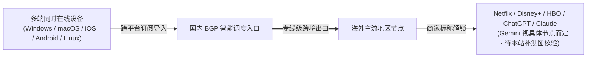

> **核心结论速览（Direct Answer）**：  
> **暮光加速（Muguang / Twilight）** 于 2023 年开始运营，核心定位为**跨平台个人与团队多设备共用专线**，采用 BGP 智能调度出口，覆盖 Windows、macOS、iOS、Android 与 Linux 五大终端，支持多设备同时在线并标注提供 7×24 小时人工客服。资费梯度极广：纯月付 **¥20/月起（120GB/月）**，最高至 **¥180/月（1500GB/月）**，另有 **¥109/年轻量版（70GB/月）** 与 **¥219~¥959 三档不限时永久流量包**；结账可使用专属优惠码 **`muguang5555`**。  
> **客观实证声明**：本站此前排查发现某第三方资料库误将“快狸”截图重命名为“暮光加速”流入归档，为坚守实证底线，**本文已彻底剔除该误传截图**。截至本次更新，暮光加速暂无本站独立拍摄的晚高峰测速与流媒体截图，页面中仅展示核验后的官方公开套餐与商家声明口径，具体延迟及解码表现建议月付小包验证后再长续。

---

## 一、 核心规格与真实报价纠正

早先部分收录摘录曾出现“无优惠码”“9 元/月起”的模糊或错误说法。结合最新核对的 42 家品牌清单，现统一厘清暮光加速的真实规格：

| 评估维度 | 官方通道 / 口径 | 核验规格内容 | 备注说明 |
| :--- | :---: | :--- | :--- |
| **品牌与运营年份** | **[👉 暮光加速官网入口](https://varnexa.twilightaff.com/#/?code=D1LHglg3)** | **暮光加速（2023 年起运营）** | 3 年左右运营期，定位于跨设备生产力与团队场景 |
| **专属优惠码** | **[👉 官网注册领码](https://varnexa.twilightaff.com/#/?code=D1LHglg3)** | **`muguang5555`** | 纠正旧文“无优惠码”错误，下单结算页可试输减免 |
| **纯月付起步档** | **[👉 选购基础版](https://varnexa.twilightaff.com/#/?code=D1LHglg3)** | **¥20 / 月 · 120GB / 月** | 另有标准版、旗舰版、至尊版与独享定制节点 |
| **年付轻量折算档** | **[👉 查看年付小包](https://varnexa.twilightaff.com/#/?code=D1LHglg3)** | **¥109 / 年 · 70GB / 月** | 折合约 **9.08 元/月**（即旧资料所称“9元档”来源） |
| **网络技术与客服** | — | BGP 智能调度 + 专线级出口 · 7×24 客服 | 商家宣称支持全平台及多终端在线 |
| **本站实测大图状态** | — | **待补充独立实测截图** | 已人工下架错挂非本人截图，不伪造 Mbps 测速表 |

---

## 二、 完整 9 档套餐资费矩阵精算

暮光加速在套餐横跨度上覆盖了单人轻量、重度影音下载、一次性按量备份乃至 ¥600 定制专线需求：

| 套餐名称 | 计费方式 | 官方标价 | 包含流量 | 单 GB 参考成本 | 适配用户画像 |
| :--- | :---: | :---: | :---: | :---: | :--- |
| **暮光·年付轻量版** | 年付 | **¥109 / 年** | **70GB / 月** | ¥0.130 / GB | 已有主力梯子、或仅轻度网页与资料检索的稳定年付用户 |
| **暮光·基础版** | **月付** | **¥20 / 月** | **120GB / 月** | ¥0.167 / GB | **初次试水首选**：个人日常办公、YouTube 1080P/4K 与 AI 交互 |
| **暮光·标准版** | **月付** | **¥40 / 月** | **240GB / 月** | ¥0.167 / GB | 双人共享或电脑+手机+平板多终端高频同步 |
| **暮光·旗舰版** | **月付** | **¥100 / 月** | **700GB / 月** | ¥0.143 / GB | 小团队跨境协作、频繁云端同步与高码率视频需求 |
| **暮光·至尊版** | **月付** | **¥180 / 月** | **1500GB / 月** | ¥0.120 / GB | 重度工作室、TB 级素材下载或高频海外开发者拉取镜像 |
| **暮光·不限时轻量包** | 一次性付费 | **¥219** | **150GB 永久** | ¥1.46 / GB | 长期低频差旅与应急兜底备用 |
| **暮光·不限时标准包** | 一次性付费 | **¥529** | **400GB 永久** | ¥1.32 / GB | 中低频多设备按需耗用，无每月清零倒计时焦虑 |
| **暮光·不限时大容量包** | 一次性付费 | **¥959** | **800GB 永久** | ¥1.20 / GB | 企业/家庭长周期大流量备份仓库 |
| **独享私人定制节点** | **月付** | **¥600 / 月** | **500GB / 月** | ¥1.20 / GB | 对固定独享出口 IP 有刚性要求的特定商务项目（下单前请咨询客服） |

---

## 三、 网络调度逻辑、AI/流媒体口径与多设备配置建议

- **商家标称解码能力与边界**：官方/合作档案列示支持 ChatGPT、Claude、Netflix、Disney+、YouTube、HBO Max、TikTok 与 Spotify，Gemini 标注为“视节点而定”。因本站目前尚未采集到暮光加速的 `MiaoKo` / `SC` 实拍流媒体/AI 检测大图，**无法替商家背书全节点 100% 放行**，如有极高洁净度 AI（如 Claude 网页版与 Cursor 长连接）需求，建议先用 **¥20/月 基础版** 配合 [客户端安装与规则分流指南](/posts/client-setup-clash-verge-shadowrocket/) 自测 1 周后再行升级。

---

## 四、 常见问题解答（FAQ）与横向对照

### Q1：为什么在本文里看不到暮光加速的晚高峰测速截图？
我们在跨文档审计图像 MD5 时发现，外部流传的一张标为“暮光加速”的测速截图，其原图顶部标题与文件哈希实为另一品牌“快狸”的误命名副本。为保证 [42 家机场品牌库](/brands/) 实证严谨性，我们主动下架了该错配截图，现阶段以真实全量套餐与客观说明呈现，待采回专属原图后再第一时间更新披露。

### Q2：20 元/月 120GB 这个价位，在站内还有哪些同台对照选择？
如希望直接参考带有公开测速原图的 20 元纯月付品牌，推荐对比阅读：
- [一翻云深度评测](/posts/brand-yifanyun-review/)（¥20/月给到 **150GB**，含 2026-08 测速大图）；
- [U1S1 深度评测](/posts/brand-u1s1-review/)（¥20/月 120GB，含双轨客户端与测速图）；
- 若预算可压至 15 元以内且要真纯月付，见 [宇宙云（¥14.9/100GB）](/posts/yuzhouyun-review-8-yuan/) 与 [唯兔云（¥14.9/100GB）](/posts/brand-weitu-review/)。

### Q3：使用优惠码 `muguang5555` 是否支持不限时包或年付？
通常新用户优惠码会在常规月付/年付结算页生效，不限时永久包或私人定制套餐可能被部分后台设为排除项，建议在收银台最终确认金额后再完成支付。

---

### 🌐 官方通道与延伸阅读
- 👉 **[点击进入暮光加速官网注册通道](https://varnexa.twilightaff.com/#/?code=D1LHglg3)** · 优惠码：**`muguang5555`**
- 📚 **延展阅读**：[返回 42 家机场品牌库](/brands/) ｜ [2026 多设备同时在线机场选型](/posts/multi-device-airports-simultaneous-connection-guide/) ｜ [不限时按量计费防跑路指南](/posts/no-expiration-pay-as-you-go-airports-guide/)
