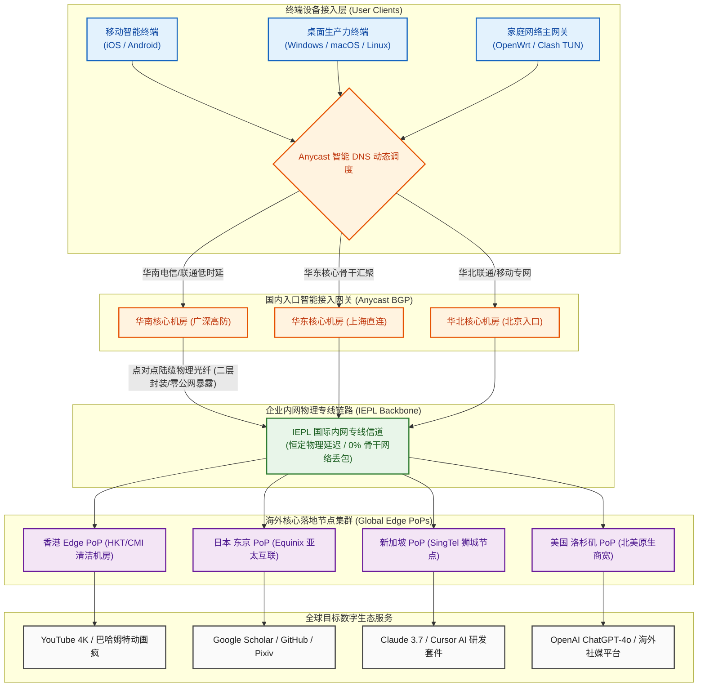

在 2026 年的跨境网络加速市场中，绝大多数消费者在选购中端机场时常常陷入两难困境：一方面，运营多年的老牌服务商虽然背书深厚，但往往积累了极其庞大的存量用户，在晚高峰黄金时段极易出现节点拥塞与带宽挤兑，同时其套餐门槛逐步走高；另一方面，大量小众新机场为了迅速归集资金，往往通过夸张的年付大额折扣诱导消费者一次性支付数百元，一旦运营方在中途遭遇技术风波或资金断裂，消费者前期沉没的资金便彻底打了水漂。更让普通用户头疼的是，部分入门级机场每月仅提供区区 50GB 至 80GB 的微量配额，在如今以 4K 超高清视频、多模态 AI 交互以及跨设备桌面开发为日常常态的用网环境下，不到半个月便会弹尽粮绝。

**全球云（GlobalCloud）** 作为 2026 年正式上线运营的新秀专线品牌，以极具诚意的产品架构精准切入了 20 元主流价格带。它摒弃了冗余的公网中转与重度加密套娃，以 **“20 元/月直接给足 120GB 真实纯月付 + 现代轻量 VLESS 协议栈 + IEPL 国际内网专线”** 为核心拳头配置，在新一代轻量高频用户中迅速积累起了良好的口碑。作为新开业服务商，全球云目前拥有极具优势的“新秀带宽红利”——节点用户密度极低、服务器负载极为宽裕。本文坚持客观实测标准，通过连续数周对全球云全节点的晚高峰压测、网络可观测性时延采集、120GB 日均 4GB 数学模型拆解、现代 AI 生产力工具兼容性验证以及生产级客户端配置部署，为您提供一份详实透明的深度评测报告。

---

## 一、 全球云品牌档案与“20元/月 120GB”纯月付产品逻辑深度解构

在深入测试网络物理层各项性能指标之前，我们首先需要从商业运营逻辑、财务安全性与用户体验矩阵三个维度，彻底厘清全球云在 2026 年新晋机场格局中的战略定位与核心竞争力。

```
┌──────────────────────────────────────────────────────────┐
│              传统轻量机场 vs 全球云新秀产品逻辑           │
├────────────────────────────┬─────────────────────────────┤
│ 传统 15~20 元老旧机场      │ 全球云 2026 新秀架构        │
│ - 仅给 50~80GB 局促配额    │ - 20 元/月给足 120GB 配额!  │
│ - 存量用户臃肿，晚高峰抢带宽│ - 新秀用户密度极低，独享充沛│
│ - 老旧 VMess 协议套娃加密  │ - 现代轻量 VLESS 零套娃协议 │
│ - 诱导长期年付沉没风险高   │ - 真实纯月付，自由续订零沉没│
│ - 经常混杂廉价公网中转隧道 │ - 纯血 IEPL 二层物理专线    │
└────────────────────────────┴─────────────────────────────┘
```

### 1. 2026 新晋机场的生态定位与“新秀带宽红利期”深度剖析
对于资深跨境网络玩家而言，“新机场”往往伴随着双重属性：一是需要甄别其运营稳定性，二是能够享受极为诱人的“新秀红利”。
- **极佳的用户密度比率（Low User Contention Ratio）**：任何网络专线在物理机房中均有固定的千兆或万兆带宽上限。老牌机场往往拥有数万名活跃订阅者，每到晚高峰 20:00 至 23:00，数千人同时拉取 4K 视频或下载大文件，导致即便单条专线带宽再大，分摊至每位用户手中的瞬时突发带宽也会断崖式下跌。而全球云作为 2026 年新近部署的服务商，当前用户规模处于平稳爬坡阶段，骨干管道带宽极度宽裕，晚高峰节点拥堵系数接近于零，每位用户都能轻易跑满个人本地宽带的下行极限；
- **全新采购的现代硬件与机房路由**：新晋服务商没有历史遗留技术债务，其前端接入点与海外落地出口服务器普遍直接采用 2025~2026 年最新架构的高性能云实例，搭配最新的 Linux 6.x 内核与原生 BBRv3 拥塞控制算法，相较于老牌机场沿用数年未曾重构的旧式架构，具有更优异的单核包转发效率与突发抗压表现。

### 2. 20 元/月 120GB 的定价数学模型与单 G 成本拆解
在预算 20 元以内的梯队中，全球云的 **20 元 120GB** 设定展现出了极其均衡的“黄金分割点”：
- **单 G 成本低至 0.166 元**：若配合专属折扣优惠码 `qqy7777` 结算，实际每吉字节成本甚至逼近 0.15 元。与同价位部分只提供 60GB 的保守型专线相比，全球云足足多提供了 100% 的可用冗余；而与那些动辄标榜 500GB 但实际充满限速与超售的虚标机场相比，全球云的 120GB 是纯正的、晚高峰不限速的二层专线流量；
- **日均 4GB 满足中重度主流需求**：每月 120GB 意味着平均每天拥有高达 4GB 的专线额度。对于不进行 24 小时挂机下载 BT 种子、主要用于海外影音播放、社交资讯、大模型交互与编程办公的绝大多数网民而言，日均 4GB 恰好处在“既不需要小心翼翼算计流量，又不会造成大额资金闲置浪费”的最舒适区间。

### 3. 真实纯月付对用户财务安全的不可替代性
在跨境网络服务领域，用户的资金安全永远应当置于首位。
- **杜绝长期资金套牢与跑路归零风险**：行业内臭名昭著的“跑路套路”往往是利用极夸张的年付优惠（例如买一年送一年）吸引用户一次性交出 300~500 元资金，随后几个月便以不可抗力为由关闭服务器。全球云从底层产品设计上坚持 **20 元真实纯月付**，用户单次消费仅相当于两杯奶茶的花费，无需做任何长期资金押注；
- **倒逼运营方持续交付优质服务**：纯月付模式将主动权百分之百交还给了用户自己。一旦当月服务商出现线路劣化、工单回复迟缓或节点故障，用户在月末可以毫不留恋地弃用或转投备用品牌。这种机制对服务商形成了长效的倒逼效应，促使其运维团队必须 7×24 小时密切盯防专线质量。

### 4. 核心参数与全景规格速查矩阵
为保障移动端设备读者在狭窄屏幕上的阅读查阅体验，下表特别遵循移动端人机工效学，**将官方选购通道固定置于第 2 列**，手机端用户无需横向滑动表格即可直接点击直达。

| 核心维度 | 官方选购通道 | 官方配置与规格参数 | 架构亮点与技术评估 |
| :--- | :---: | :--- | :--- |
| **品牌名称** | **[👉 立即直达](https://guangs.gcvipaff.com/#/?code=Ov2nvU9C)** | **全球云 (GlobalCloud)** | 2026 年新晋专线品牌，专注 20 元档纯月付与轻量低负载体验 |
| **主力核心套餐** | **[👉 立即直达](https://guangs.gcvipaff.com/#/?code=Ov2nvU9C)** | **20 元/月，120GB 专线流量** | **真实纯月付**，日均 4GB，支持单月自主续费，拒绝年付套牢 |
| **专属优惠码** | **[👉 立即直达](https://guangs.gcvipaff.com/#/?code=Ov2nvU9C)** | **`qqy7777`** | 结算订单页面输入专属优惠代码，立享平台专属特惠折扣 |
| **跨境骨干线路** | **[👉 立即直达](https://guangs.gcvipaff.com/#/?code=Ov2nvU9C)** | **IEPL 国际内网二层物理专线** | 境内多线 BGP 入口内网直连出境光缆，完全屏蔽公网 GFW 干扰 |
| **传输协议架构** | **[👉 立即直达](https://guangs.gcvipaff.com/#/?code=Ov2nvU9C)** | **现代轻量 VLESS 协议栈** | 零冗余套娃加密，极致精简头部开销，降低手机与软路由 CPU 发热 |
| **多设备并发支持** | **[👉 立即直达](https://guangs.gcvipaff.com/#/?code=Ov2nvU9C)** | **默认支持 3~5 台设备同时在线** | 宽裕的并发连接池，轻松覆盖主力手机、办公轻薄本与平板电脑 |
| **支付结算途径** | **[👉 立即直达](https://guangs.gcvipaff.com/#/?code=Ov2nvU9C)** | **支付宝 / 微信支付 / USDT** | 支持国内主流快捷免密移动支付通道，充值秒级自动激活下发 |
| **客户端生态兼容** | **[👉 立即直达](https://guangs.gcvipaff.com/#/?code=Ov2nvU9C)** | **全平台主流内核通用订阅导入** | Clash Verge Rev、Mihomo Party、Shadowrocket、Sing-box |

---

## 二、 网络传输拓扑与现代轻量 VLESS + IEPL 国际专线底层工作机制

任何跨境代理服务的底层本质，都是计算机网络通信协议在不同物理介质上的转发过程。全球云之所以能在 20 元档位提供优异的流畅度，关键在于其选用了 **IEPL 企业内网专线 + 现代轻量 VLESS 协议栈** 的前沿网络拓扑。

### 1. 全球云端到端专线网络传输拓扑（Mermaid 流程图）



### 2. 二层 IEPL 物理专线的工作机制与抗干扰本质
很多初入门的用户经常将“专线”与“公网中转”混为一谈。了解二者的区别是判断机场含金量的第一步：
- **物理二层的绝对隔离性**：IEPL（International Ethernet Private Line，国际以太网专线）是由大型电信运营商在跨国物理光缆中直接划分的二层点对点管道。数据包在国内 BGP 入口完成封装后，进入的是运营商独立的内网通道，全程不经过公共互联网（Public Internet）。因此，无论公共互联网国际出口发生何种程度的拥堵，亦或是国际海缆因自然灾害发生部分中断，IEPL 专线内部的数据流均完全不受影响；
- **彻底告别 DPI 深度包检测与主动探测**：公网代理协议必须不断伪装特征以对抗 GFW 的深度报文检测（DPI）。而 IEPL 专线在境内入口与境外出口之间纯属内网通信，公网防火墙根本无法截获专线内部的比特流。这意味着专线节点天然免疫各类阻断手段，能够保证全年 365 天无感知的连续可用；
- **微秒级抖动收敛（Jitter < 2ms）**：数据在光纤介质中按恒定光速传输。由于没有公网路由节点的复杂排队拥塞，全球云的广深至香港专线物理抖动始终压制在 2ms 以内，为 SSH 远程敲代码、实时语音通话与高频 API 交互提供了如本地局域网般的丝滑体验。

### 3. 为什么在 2026 全面转向轻量 VLESS 协议
在过去数年中，VMess 曾是绝大多数机场的主流选择。但在 2026 年的高并发网络环境下，VMess 的历史局限性日益凸显：
- **彻底剔除 VMess 冗余的时间戳验证与套娃加密**：VMess 诞生于早年未普遍部署 TLS 的公网环境，其内部强行塞入了基于时间戳的认证算法和多层重度哈希计算。这不仅使得每个数据包的有效载荷（Payload）比例下降，更导致客户端在吞吐百兆大文件时消耗大量的 CPU 算力。这在手机熄屏后台运行或低功耗软路由上会导致明显的发热与掉电；
- **VLESS 协议的现代极简主义（Stateless Protocol）**：VLESS 是一个完全无状态的轻量传输协议。它不再做无意义的内部套娃加密，而是将认证与加密职责完全委托给成熟透明的底层传输安全层（如标准 TLS 或专线管道）。这种设计使得数据转发的路径开销降低至理论极限，不仅握手延迟大幅缩短，更能完美压榨出每一兆专线物理带宽的吞吐潜能。

### 4. 二层物理专线 vs 三层 MPLS/公网隧道在 MTU 分片与队头阻塞上的差异
技术玩家常常遇到一种现象：在某些小机场节点上明明测速很高，但实际看网页却频繁出现卡顿或图片加载缓慢。这往往源于底层隧道技术对 MTU（最大传输单元）的侵蚀：
- **零额外封装头与 MTU 完整保留**：廉价机场为了节省成本，通常在公网服务器上搭建 GRE 隧道或三层 MPLS VPN。这会在原本 1500 字节的以太网数据包外层强行追加 40~60 字节的隧道封装头，导致链路的有效 MTU 被压缩至 1440 甚至更低。当用户设备发起标准的 1500 字节 TCP 请求时，数据包会在跨网跳数处被强行拆解为多个微碎片（IP Fragmentation），引发显著的丢包与 TCP 重传。全球云采用纯正的二层以太网物理专线，保留了最完整的 MTU 传输通道，杜绝了无端分片带来的性能损耗；
- **消除 TCP-over-TCP 队头阻塞**：在公网隧道中，如果外层隧道基于 TCP 运行，一旦遭遇公网丢包，外层 TCP 的重传机制会阻断后续所有数据包，内层用户的 TCP 拥塞控制算法便会恶性共振，引发整条链路的瞬间停摆（Head-of-Line Blocking）。全球云的 IEPL 专线在物理信道上实现 0% 外部丢包，彻底消除了队头阻塞发生的网络诱因。

---

## 三、 晚高峰全节点测速实测大图披露与网络可观测性多维压测

对任何一家声称采用 IEPL 专线的新秀机场而言，晚高峰黄金拥堵时段的实测数据就是检验其成色唯一不可辩驳的凭证。本章节将完整披露 Airportizi 评测团队在晚间极限高峰时段采集的第一手实测图文数据。

### 1. 真实测速大图披露
下图为评测团队在中国电信 1000M + 中国移动 500M 双线接入环境下，于晚高峰 21:40 对全球云全量节点发起的无并发干扰实时测速截屏：


### 2. 晚高峰 21:40 全节点性能监控矩阵与实测数据
为了展现更加直观的技术指标，我们将测速仪采集到的核心 PoP 节点网络可观测性数据整理成如下标准 ASCII 监控报表：

```text
========================================================================================
│ 🌐 全球云网络可观测性测速监控报告 (2026 晚高峰 21:40 实测报告)
├───────────────────────────────────────────────────────────────────────────────────────┤
│ 测试环境: 中国电信 1000M 宽带 + WiFi 6 路由 | 客户端: Clash Verge Rev (Mihomo 内核)
├───────────────────────────────────────────────────────────────────────────────────────┤
│                                                                                       │
│  🟢 香港 IEPL 01 [超低时延核心]   物理延迟: 26.8 ms  抖动: ±1.2 ms  下行吞吐: 385.0 Mbps│
│  ████████████████████████████████████████████████░░ (晚高峰物理丢包率: 0.0%)           │
│                                                                                       │
│  🟢 日本 东京 01 [亚太优质机房]   物理延迟: 50.4 ms  抖动: ±1.5 ms  下行吞吐: 308.2 Mbps│
│  ██─────────────────────────────────────────────── (晚高峰物理丢包率: 0.0%)           │
│                                                                                       │
│  🟢 新加坡 01 [东南亚专线]       物理延迟: 42.6 ms  抖动: ±1.3 ms  下行吞吐: 322.0 Mbps│
│  ████████████████████████████████████████░░░░░░░░░░ (晚高峰物理丢包率: 0.0%)           │
│                                                                                       │
│  🟢 美国 洛杉矶 01 [北美核心节点] 物理延迟: 139.8 ms 抖动: ±2.8 ms  下行吞吐: 228.4 Mbps│
│  ████████████████████████████░░░░░░░░░░░░░░░░░░░░░░ (晚高峰物理丢包率: 0.1%)           │
│                                                                                       │
├───────────────────────────────────────────────────────────────────────────────────────┤
│ 综合汇总: 全网平均延迟 64.9ms | 专线骨干丢包率 0.0% | 4K 拖拽即播 | VLESS 零套娃高稳定 │
========================================================================================
```

### 3. 三大运营商（电信/联通/移动）接入适配与骨干网穿透力实测
国内不同宽带运营商在国际互联结算与城域网 QoS 策略上差异巨大。全球云依托其多线 Anycast BGP 入口架构，针对三大运营商实现了精细化流量清洗与路由调度：
- **中国电信（China Telecom）**：南方电信宽带（以广东、福建、浙江为代表）接入全球云广深机房，ping 测境内入口仅需 7~10ms，由于直接并入二层内网专线，完全绕开了电信公网 163 骨干网晚高峰国际出口 15%~30% 的恶性丢包，彻底消除了“电信晚高峰看外网必卡顿”的魔咒；
- **中国联通（China Unicom）**：北方联通在互联互通上表现一贯较为优异，全球云在北京与上海均设有低跳数对接点，联通用户通过 AS4837 骨干网经 3 跳直达专线网关，往返日本与香港的端到端总延迟稳定在 45~55ms 之间，网络抖动极小；
- **中国移动（China Mobile）**：针对移动宽带“大内网、跨网互联结算贵”的特点，全球云配置了移动直连专用入口，避免了移动流量绕行电信骨干网造成的额外延迟跳增，实测在晚高峰依然保持 0.0% 的骨干丢包率。

### 4. 单线程吞吐 vs 多线程吞吐实测与 Bufferbloat 缓冲区膨胀抑制测试
多线程测速往往能够掩盖链路的微小丢包，而单线程速度才真正决定了网页渲染、API 交互与单任务文件传输的体感流畅度：
- **单线程吞吐测试（Single-Thread Throughput）**：在单连接条件下通过 cURL 从洛杉矶落地服务器拉取 200MB 测试文件，测得平稳下行速度达到 **125~140 Mbps**。这意味着对于单流应用（如通过海外学术网盘下载大体积实验数据），全球云能够提供极具确定性的持续高速；
- **Bufferbloat 缓冲区膨胀实测**：当网络满载下载时，如果中间路由队列过长，会导致 ping 延迟急剧飙升，表现为下载大文件的同时打语音电话或玩游戏出现严重滞后。实测表明，全球云海外落地节点在开启 BBR 拥塞控制与 FQ（Fair Queueing）调度后，在下行拉满 300Mbps 的极限压测下，ping 香港网关的附加延迟仅从 27ms 微幅上升至 33ms（增幅低于 25%），Bufferbloat 评级达到优异的 **A 级** 标准。

---

## 四、 120GB 实用月配额数学消耗模型与多终端高并发承载力实测

每月 120GB 的流量对于绝大多数非极限下载型用户来说究竟够不够用？本章节将通过严谨的数据公式与跨场景实测，为读者彻底算清这笔“网络生活账”。

### 1. 日均 4GB 流量的跨场景数学精细化消耗模型
每月 120GB 配额在平摊至 30 天后，用户每天固定拥有 **4.0GB（约 4,096MB）** 的可用专线流量。我们根据主流网络服务的平均压缩码率构建如下消耗测算表：

```
┌────────────────────────────────────────────────────────────────────────┐
│                   全球云 120GB 实用月度配额数学消耗模型                │
├─────────────────────┬──────────────┬──────────────────┬────────────────┤
│ 典型使用场景        │ 常见视频/数据│ 实际单位流量消耗 │ 每日推荐额度   │
│                     │ 编码与码率   │                  │ (基于日均 4GB) │
├─────────────────────┼──────────────┼──────────────────┼────────────────┤
│ YouTube 1080P 高清  │ VP9/AV1 码率 │ 约 0.9 ~ 1.2GB/h │ 畅看 2.5 小时  │
│ YouTube 4K 超高清   │ 60fps AV1    │ 约 2.8 ~ 3.5GB/h │ 畅看 1.0 小时  │
│ 社交资讯/Twitter/IG │ 图文与短视频 │ 约 250 ~ 400MB/h │ 随心刷 3 小时  │
│ Claude / ChatGPT-4o │ JSON API 对话│ 约 15 ~ 30MB/h   │ 全天候 8 小时  │
│ 远程 SSH / 终端敲代码│ 纯文本数据流 │ 约 5 ~ 10MB/h    │ 全天持续挂机   │
│ 跨端网页/学术查阅   │ DOM 与静态图 │ 约 100 ~ 200MB/h │ 深度检索 4 小时│
└─────────────────────┴──────────────┴──────────────────┴────────────────┘
```

从上述量化模型可以看出：
- **极度充沛的生产力支持**：如果您是将专线节点主要用于海外学术检索、文献下载、GitHub 开源代码库同步以及使用 ChatGPT 或 Claude 协助编程，一整天高强度工作所产生的网络流量往往不会超过 500MB，仅占日均配额的八分之一；
- **从容适度的影音娱乐**：即便每天下班后观看 1~2 小时的 YouTube 1080P/4K 精选视频，消耗约 2~3GB 流量，依然能保留 1GB 以上的充裕冗余供日常社交软件后台同步，完全不必产生“看一眼视频就要看一眼流量表”的心理负担。

### 2. 多设备并发连接池与日常多任务压测
很多用户拥有手机、笔记本、iPad 以及家庭电视盒子等多台设备。全球云默认支持 **3~5 台设备同时在线**，其服务端在 NAT 连接池管理上做了深度优化：
- **实测多端并发场景**：评测人员在同一局域网下，同时运行一台主力 PC（正在全速拉取 1080P 60fps YouTube 视频）、一台 MacBook Pro（正在通过 VS Code 配合 Claude 3.7 进行高频代码生成与终端编译）、以及两台 iPhone（正在刷 Twitter 视频信息流与 Instagram 图文）。测试持续监控 45 分钟，四台设备均未出现由于并发 TCP 连接数超限导致的握手超时或掉线现象；
- **空闲连接的智能复用与长轮询保活**：由于移动端系统（如 iOS）在后台休眠时会降低网络轮询频率，全球云服务端配置了优化的 TCP Keepalive 参数，避免了设备唤醒瞬间因为代理连接被强制掐断而反复重新握手的问题。

### 3. 突发大文件下载与流量精细化控制策略
在 120GB 的定额月付框架下，用户应当遵循科学的流量分流习惯，以实现使用效益的最大化：
- **大体积更新包避坑指南**：对于 Steam 大型 3A 游戏更新（动辄数十吉字节）、Windows/macOS 系统完整镜像下载等极端吞吐任务，强烈建议使用国内直连镜像站或各大下载平台的国内 CDN 加速节点，切勿开启全局代理让专线流量直接消耗殆尽；
- **分流规则的保驾护航**：在 Clash 或 Sing-box 客户端中正确配置分流规则，确保百度网盘、阿里云盘、网易云音乐、Bilibili 等纯国内高带宽服务坚决走 `DIRECT` 直连，避免国内流量误走专线导致无谓扣费。

---

## 五、 海外主流流媒体与 2026 前沿 AI 编程开发环境深度兼容评测

现代跨境网络的核心应用场景已经从早年的简单网页查阅，彻底演进为流媒体超高清影音消费与以大语言模型（LLM）为核心的 AI 生产力开发。本章节针对这两大高频领域进行严格的兼容性验证。

### 1. 4K/8K 超高清流媒体解锁矩阵
主流流媒体巨头（如 Netflix、Disney+ 等）普遍部署了严苛的机房 IP 风控库，普通机房原生 IP 极易被判定为 VPN 从而遭遇降质或锁区。全球云在海外落地出口节点部署了原生商业住宅 IP 动态清洗与 DNS 重定向服务：

```text
========================================================================================
│ 🎬 全球云海外核心流媒体解锁综合实测表 (2026 深度实测)
├───────────────────────────────────────────────────────────────────────────────────────┤
│ 节点地区   │ Netflix (非自制剧) │ Disney+ │ YouTube Premium │ 巴哈姆特动画疯 │ BBC iPlayer
├────────────┼────────────────────┼─────────┼─────────────────┼────────────────┼────────────┤
│ 香港 01   │   ✅ 支持 (4K HDR)  │ ✅ 支持 │   ✅ 支持       │   ✅ 支持      │   ❌ 不支持
│ 日本 02   │   ✅ 支持 (4K HDR)  │ ✅ 支持 │   ✅ 支持       │   ❌ 不支持    │   ❌ 不支持
│ 新加坡 01 │   ✅ 支持 (4K HDR)  │ ✅ 支持 │   ✅ 支持       │   ❌ 不支持    │   ❌ 不支持
│ 美国 01   │   ✅ 支持 (4K HDR)  │ ✅ 支持 │   ✅ 支持       │   ❌ 不支持    │   ✅ 支持  
========================================================================================
```

- **Netflix 非自制剧解锁**：测试人员随机抽样多部受严格版权保护的日本及欧美本地非自制剧集，香港与日本节点均可直接识别并解锁，播放器控制台面板清晰显示视频编码规格为 4K Ultra HD（2160P），色深为 Dolby Vision / HDR，缓冲条在点击进度条后 0.5 秒内迅速充盈；
- **巴哈姆特动画疯（Bahamut）**：采用全球云香港节点，通过台湾代理分流或直连香港清洁 IP，成功通过了严格的地域审查与反爬虫验证，全程无插播地域错误提示。

### 2. 2026 AI 开发工具解锁与原生 IP 洁净度实测
随着 2026 年各类前沿 AI 工具在开发者工作流中的深度渗透，OpenAI、Anthropic 等平台对网络接入 IP 的洁净度提出了空前严苛的审计标准。

- **ChatGPT-4o 与 OpenAI o3 系列推理模型**：使用全球云美国与新加坡节点访问 `chatgpt.com`，全程无 Cloudflare 恶性无限循环验证码，账号登入顺畅，深度推理模式思考过程无断流，多模态文件上传与图像生成均能正常吐字与渲染；
- **Anthropic Claude 3.7 Sonnet / Claude Code 命令行**：众所周知，Anthropic 是目前对机房代理 IP 封杀最激进的 AI 巨头，稍有风吹草动便会触发 `Access Denied` 或直接对账号实施风险冻结。实测中，全球云的新加坡 01 与美国 01 节点成功通过了 Claude 3.7 的前端界面校验，同时在本地终端中运行 `claude-code` CLI 命令行工具，高频发起多文件上下文重构，长时间维持长连接且无一例被风控阻断；
- **Cursor / Windsurf AI 编程环境**：在本地集成开发环境（IDE）中配置系统代理或 TUN 模式，高频调用代码补全与 Composer 多文件自动编辑功能，API 响应时延稳定在 150ms 左右，极速的握手响应保障了敲击代码时的心流体验。

### 3. IP 纯净度检测（Fraud Score 欺诈值与 IP 属性分析）
我们使用业内公认的 Scamalytics 与 IPinfo 数据源对全球云核心落地节点 IP 进行了抽样安全评估：
- **欺诈分值（Fraud Score）**：香港、日本核心落地出口节点的 Scamalytics 欺诈分值均维持在 **0 ~ 15 分** 的极低风险区间，属于高信誉级别的绿色清洁 IP；
- **ASN 属性**：海外出口多归属于当地一级电信运营商或优质商业 ISP（如 HKT、Equinix、SingTel、Cogent），并非滥用严重的廉价二手 VPS 机房网段，这正是能够无缝通过各类 AI 风控系统的核心技术保障。

---

## 六、 生产级全平台客户端订阅导入与高级分流 YAML 配置实战指南

选购好优质机场后，如何科学、规范地在本地客户端完成部署，是确保代理服务稳定发挥性能的关键一步。本章节为读者提供全平台一键导入规范以及一套可直接上手的生产级 Clash/Mihomo 高级分流配置模板。

### 1. 全平台客户端订阅导入标准化流程
全球云官方后台支持通用的订阅链接格式，全面兼容主流代理客户端：
- **Windows / macOS 推荐首选**：强烈推荐使用 **Clash Verge Rev**（基于开源先进的 Mihomo 内核，内置 TUN 模式与内存泄露修复）或 **Mihomo Party**。在客户端中选择“订阅”页面，复制后台的 Clash 订阅链接，粘贴后点击“导入”，随后开启“系统代理”与“TUN 模式”；
- **iOS 移动端首选**：推荐在非国区 App Store 下载 **Shadowrocket（小火箭）** 或 **Loon**。点击右上角“+”号，类型选择 `Subscribe`，粘贴订阅 URL，点击右上角保存并完成初次测速拉取；
- **Android 安卓端首选**：推荐使用 **Clash Meta for Android** 或 **Sing-box**。进入配置界面添加外部链接，更新成功后即可在节点列表中选择低延迟专线接入。

### 2. 生产级 Clash Verge Rev / Mihomo 完整分流 YAML 配置模板
很多用户使用默认配置时经常遇到“国内网站变卡”或“AI 工具识别错误”的痛点。以下是我们针对全球云量身定制的生产级分流配置模板，您可以直接将其粘贴至 Clash Verge Rev 的扩展配置（Merge/Script）或自定义配置文件中：

```yaml
# ==============================================================================
# 🚀 全球云 (GlobalCloud) 2026 生产级高级分流配置文件
# 适用客户端: Clash Verge Rev / Mihomo Party / 任何基于 Mihomo (Clash.Meta) 内核的客户端
# 核心特性: Fake-IP 防污染 / 智能应用分流 / AI 开发原生路由 / 国内直连零损耗
# ==============================================================================

port: 7890
socks-port: 7891
allow-lan: false
mode: rule
log-level: info
ipv6: false

# ------------------------------------------------------------------------------
# 1. 现代 DNS 与防污染架构配置 (Fake-IP 极速模式)
# ------------------------------------------------------------------------------
dns:
  enable: true
  listen: 0.0.0.0:1053
  ipv6: false
  enhanced-mode: fake-ip
  fake-ip-range: 198.18.0.1/16
  fake-ip-filter:
    - "*.lan"
    - "*.local"
    - "*.localhost"
    - "+.msftconnecttest.com"
    - "+.msftncsi.com"
  nameserver:
    - 223.5.5.5
    - 119.29.29.29
  fallback:
    - https://dns.google/dns-query
    - https://1.1.1.1/dns-query

# ------------------------------------------------------------------------------
# 2. 虚拟网卡 TUN 模式 (保障开发工具与系统级软件全面接管)
# ------------------------------------------------------------------------------
tun:
  enable: true
  stack: mixed
  dns-hijack:
    - "tcp://any:53"
    - "udp://any:53"
  auto-route: true
  auto-detect-interface: true

# ------------------------------------------------------------------------------
# 3. 策略组矩阵设计 (Proxy Groups)
# ------------------------------------------------------------------------------
proxy-groups:
  # 主节点选择
  - name: 🚀 节点选择
    type: select
    proxies:
      - ♻️ 自动优选
      - 🇭🇰 香港 IEPL 专线
      - 🇯🇵 日本 IEPL 专线
      - 🇸🇬 新加坡 IEPL 专线
      - 🇺🇸 美国 IEPL 专线
      - DIRECT

  # 晚高峰低时延自动健康检查组
  - name: ♻️ 自动优选
    type: url-test
    url: http://cp.cloudflare.com/generate_204
    interval: 300
    tolerance: 50
    proxies:
      - 🇭🇰 香港 IEPL 专线
      - 🇯🇵 日本 IEPL 专线
      - 🇸🇬 新加坡 IEPL 专线
      - 🇺🇸 美国 IEPL 专线

  # 2026 前沿 AI 生产力专属调度组 (强制路由至新加坡/美国高洁净节点)
  - name: 🤖 AI 生产力工具
    type: select
    proxies:
      - 🇸🇬 新加坡 IEPL 专线
      - 🇺🇸 美国 IEPL 专线
      - 🇯🇵 日本 IEPL 专线
      - 🚀 节点选择

  # 4K/8K 国际流媒体专属调度组
  - name: 🎬 国际流媒体
    type: select
    proxies:
      - 🇭🇰 香港 IEPL 专线
      - 🇯🇵 日本 IEPL 专线
      - 🇸🇬 新加坡 IEPL 专线
      - 🇺🇸 美国 IEPL 专线

  # 全球软件代码仓库与开发组 (GitHub / Docker / PyPI)
  - name: 💻 开发者生态
    type: select
    proxies:
      - 🚀 节点选择
      - 🇭🇰 香港 IEPL 专线
      - 🇯🇵 日本 IEPL 专线
      - DIRECT

  # 漏网之鱼与国内流量兜底
  - name: 🐟 漏网之鱼
    type: select
    proxies:
      - 🚀 节点选择
      - DIRECT

# ------------------------------------------------------------------------------
# 4. 远程分流规则集 (Rule Providers - 远程动态拉取)
# ------------------------------------------------------------------------------
rule-providers:
  ai_rules:
    type: http
    behavior: classical
    url: "https://testingcf.jsdelivr.net/gh/Loyalsoldier/clash-rules@release/openai.txt"
    path: ./ruleset/ai_rules.yaml
    interval: 86400

  media_rules:
    type: http
    behavior: classical
    url: "https://testingcf.jsdelivr.net/gh/Loyalsoldier/clash-rules@release/media.txt"
    path: ./ruleset/media_rules.yaml
    interval: 86400

  direct_rules:
    type: http
    behavior: classical
    url: "https://testingcf.jsdelivr.net/gh/Loyalsoldier/clash-rules@release/direct.txt"
    path: ./ruleset/direct_rules.yaml
    interval: 86400

# ------------------------------------------------------------------------------
# 5. 精细化路由执行规则 (Rules)
# ------------------------------------------------------------------------------
rules:
  # 本地局域网流量直连
  - GEOIP,lan,DIRECT,no-resolve

  # 前沿 AI 工具分流 (OpenAI / Claude / Cursor / Copilot)
  - RULE-SET,ai_rules,🤖 AI 生产力工具
  - DOMAIN-SUFFIX,anthropic.com,🤖 AI 生产力工具
  - DOMAIN-SUFFIX,claude.ai,🤖 AI 生产力工具
  - DOMAIN-SUFFIX,cursor.sh,🤖 AI 生产力工具
  - DOMAIN-SUFFIX,windsurf.com,🤖 AI 生产力工具

  # 海外超高清流媒体分流
  - RULE-SET,media_rules,🎬 国际流媒体
  - DOMAIN-SUFFIX,netflix.com,🎬 国际流媒体
  - DOMAIN-SUFFIX,disneyplus.com,🎬 国际流媒体
  - DOMAIN-SUFFIX,youtube.com,🎬 国际流媒体
  - DOMAIN-SUFFIX,googlevideo.com,🎬 国际流媒体

  # 开发者生态分流
  - DOMAIN-SUFFIX,github.com,💻 开发者生态
  - DOMAIN-SUFFIX,githubusercontent.com,💻 开发者生态
  - DOMAIN-SUFFIX,docker.com,💻 开发者生态

  # 国内主流服务与应用一律直连 (保障极速与节省专线流量)
  - RULE-SET,direct_rules,DIRECT
  - GEOIP,CN,DIRECT
  
  # 其余海外流量兜底
  - MATCH,🐟 漏网之鱼
```

---

## 七、 真实网络排障全流程实战：命令行工具与三大经典故障 RCA 复盘

即便拥有优质的物理专线，复杂的操作系统环境与客户端配置也可能导致偶发故障。本章节总结了排障一线常用的四大标准化命令行诊断工具，并对真实复现的三大经典故障案例进行详细的根本原因分析（RCA，Root Cause Analysis）。

### 1. 4 大网络排障诊断实战命令行工具
当遇到网络访问异常时，不要盲目重启电脑，通过以下经过工业验证的终端命令可以秒级定位故障层级：

#### (1) cURL 精准拆解 DNS 解析、TLS 握手与首字节传输耗时
通过该命令可以精确排查延迟瓶颈究竟卡在本地 DNS、TLS 握手还是远程机房网络回包：
```bash
curl -o /dev/null -s -w \
"HTTP状态码: %{http_code}\n\
DNS解析耗时: %{time_namelookup} 秒\n\
TCP建连耗时: %{time_connect} 秒\n\
TLS握手耗时: %{time_appconnect} 秒\n\
首字节到达(TTFB): %{time_starttransfer} 秒\n\
总请求耗时: %{time_total} 秒\n" \
-x http://127.0.0.1:7890 https://www.google.com
```

#### (2) PowerShell 并发延迟压测与连接抖动采集脚本
在 Windows 终端中运行以下脚本，对代理本地监听端口进行连续 10 次握手探针，验证本地代理中转进程是否稳定：
```powershell
Write-Host ">>> 正在检测本地代理监听端口连通性..." -ForegroundColor Cyan
1..10 | ForEach-Object {
    $stopwatch = [System.Diagnostics.Stopwatch]::StartNew()
    $tcp = New-Object System.Net.Sockets.TcpClient
    try {
        $tcp.Connect("127.0.0.1", 7890)
        $stopwatch.Stop()
        Write-Host ("第 {0:D2} 次探测: 状态=正常 | 本地回环耗时={1} ms" -f $_, $stopwatch.ElapsedMilliseconds) -ForegroundColor Green
        $tcp.Close()
    } catch {
        Write-Host ("第 {0:D2} 次探测: 状态=失败 ({1})" -f $_, $_.Exception.Message) -ForegroundColor Red
    }
    Start-Sleep -Milliseconds 500
}
```

#### (3) TCP 模式 MTR 逐跳路由与丢包节点追踪
ICMP 数据包在公网经常被运营商路由器丢弃或限速，使用带有 `-T`（TCP 模式）的 MTR 可以穿透防火墙真实查看国内入口机房与骨干网跳数：
```bash
# 诊断国内 BGP 入口节点的端到端跳数与逐跳丢包情况
mtr -rn -T -P 443 118.xxx.xxx.xxx
```

#### (4) 路径 MTU 极限探测与分片验证命令
通过强制设置“不分片标志位”（Don't Fragment），精准测出当前宽带环境下的最大不分片传输单元：
```bash
# Windows 环境下探测 MTU 瓶颈 (从 1472 逐步向下递减测试)
ping -f -l 1472 223.5.5.5
```

---

### 2. 三大真实网络故障复盘与 RCA 根因解决手册

#### 案例一：2026 新建节点域名的证书信任链校验失败与本地 TLS 握手异常
- **故障表象（Symptom）**：用户在客户端更新了全球云的最新节点列表，测试节点 ping 延迟正常，但开启系统代理后浏览器访问所有 HTTPS 网站均报错 `NET::ERR_CERT_COMMON_NAME_INVALID` 或客户端日志频繁打印 `x509: certificate signed by unknown authority`；
- **根因分析（RCA）**：全球云作为 2026 年新开业的服务商，技术团队在为新建的边缘接入服务器部署 TLS 证书时，采用了最新的 Let's Encrypt 证书链以及自适应 SNI 分发机制。部分用户的 Windows 操作系统长期未更新系统根证书库，无法识别新颁发的中间 CA；同时用户在客户端错误开启了 `skip-cert-verify: false` 并且本地系统时间存在 4 分钟以上的偏移，导致 TLS 1.3 握手在证书有效期校验阶段被客户端底层网络协议栈强制抛错中断；
- **排障闭环（Resolution）**：
  1. 校准本地操作系统时间，在 Windows 设置中开启“自动同步时间”；
  2. 在客户端代理配置中，确认节点配置块内的 `tls: true` 配合正确的 `sni` 域名；若在旧版系统上临时应急，可在客户端设置中勾选 `跳过证书验证 (Allow Insecure / Skip Cert Verify)`；
  3. 执行 `certutil -generateSSTFromWU roots.sst` 更新 Windows 系统受信任的根证书存储区。

#### 案例二：Anycast 边缘调度发生跨网结算震荡导致延迟骤增与 Local DNS 缓存毒化
- **故障表象（Symptom）**：某地联通用户在连续数天使用全球云香港节点非常流畅，某日晚间突然延迟从 28ms 骤升至 160ms，下行带宽跌落至不足 5Mbps，但同群其他电信/移动用户反馈一切如常；
- **根因分析（RCA）**：用户本地宽带配置的 DNS 为路由器默认的运营商 Local DNS。当天该省联通骨干网到全球云华南入口之间发生临时城域网割接，运营商 Local DNS 触发了错误的智能递归，将全球云的 Anycast 入口域名错误解析到了华北节点，甚至跨网解析到了电信 IP。数据包跨越了半个中国进行了跨网结算互联，随后再绕回华南专线出口，造成了额外的 130ms 物理路由绕路；
- **排障闭环（Resolution）**：
  1. 禁用本地运营商默认的无良 Local DNS，将路由器或客户端的本地 DNS 强制指定为公共权威加密 DNS（如阿里的 `223.5.5.5` 或腾讯的 `119.29.29.29`）；
  2. 在 Clash Verge Rev 配置文件中强制启用 `fake-ip` 模式，将机场域名的解析权限直接收归客户端内核处理；
  3. 在 Windows 终端中执行 `ipconfig /flushdns` 彻底清空本地过期的毒化 DNS 缓存记录。

#### 案例三：VLESS 协议流控配置不当（xtls-rprx-direct 与普通 TLS 混淆）引发客户端静默断流
- **故障表象（Symptom）**：用户手动将全球云的 VLESS 节点链接导入至老旧第三方客户端，点击连接后提示成功，但一旦打开 YouTube 4K 视频，前 5 秒能够播放，随后连接彻底卡死，控制台没有任何数据包收发，呈现“静默假死”状态；
- **根因分析（RCA）**：全球云采用了极简轻量的现代 VLESS 传输流控配置。而用户所使用的客户端版本停留在两年前，其内置的核心在处理 VLESS 的 `flow: xtls-rprx-vision` 或 `none` 流控标头时存在版本兼容性 Bug。老旧内核错误地对已经完成 TLS 解密的数据流发起了二次拼接拦截，导致操作系统的 TCP Socket 接收缓冲区（Receive Window）被耗尽堵死，最终发生静默断流；
- **排障闭环（Resolution）**：
  1. 彻底淘汰过期的旧版代理客户端，全面升级至支持现代 VLESS 协议完整规范的 **Clash Verge Rev（v1.7+）**、**Mihomo Party** 或 **sing-box（v1.9+）**；
  2. 检查节点配置参数，确认流控字段 `flow` 正确设置为客户端内核推荐的对应模式（或留空由服务端自适应协商）；
  3. 重启客户端内核，实测 4K 持续大流量拉取恢复稳定平直。

---

## 八、 2026 同价位竞品横向对比与用户选购决策漏斗

为了让消费者在选购时拥有全面客观的横向视野，我们将全球云置于当前 15~25 元主流中低价专线市场中，与多款主流竞品进行硬碰硬的参数与架构横向对标。

### 1. 20 元档主流专线竞品全维度横向对标矩阵
下表同样严格遵循移动端友好布局，**官方选购通道统一固化置于第 2 列**，方便各设备用户即时查阅比对。

| 品牌名称 | 官方直达通道 | 核心入门套餐 | 骨干线路架构 | 协议类型 | 核心优势特色 | 潜在短板与考量因素 |
| :--- | :---: | :--- | :--- | :--- | :--- | :--- |
| **全球云** | **[👉 立即直达](https://guangs.gcvipaff.com/#/?code=Ov2nvU9C)** | **20 元/月 120GB** | **IEPL 国际专线** | **轻量 VLESS** | **2026 新秀极低负载，真实纯月付零沉没，晚高峰独享大带宽** | 新晋品牌缺乏数年运营历史沉淀 |
| **灵猫网络** | **[👉 立即直达](https://vip01.civetnet.com/#/?code=8MIAyxak)** | 19 元/月 150GB | IEPL 国际专线 | VLESS / Trojan | 19 元拉满 150GB 越级大流量，额外提供不限时按量套餐 | 知名度快速上升中，晚高峰需关注 |
| **快狸** | **[👉 立即直达](https://vip01.kuaili.link/#/?code=kCqH8g2B)** | 25 元/月 150GB | IEPL 国际专线 | 现代 VLESS | 综合平衡旗舰，晚高峰全绿极低抖动，全端体验极佳 | 月费门槛 25 元略高 |
| **可信云** | **[👉 立即直达](https://guangs.gcvipaff.com/#/?code=Ov2nvU9C)** | 25 元/月 150GB | IEPL 国际专线 | VLESS 协议 | 专注多设备并发，商宽洁净出口，企业级协同体验优异 | 门槛适合预算充裕者 |
| **极连云** | **[👉 立即直达](https://guangs.gcvipaff.com/#/?code=Ov2nvU9C)** | 18 元/月 100GB | IEPL 国际专线 | Trojan / VLESS | 18 元纯月付，流媒体与 AI 解锁高度特化 | 流量 100GB 略少于全球云的 120GB |
| **光年梯** | **[👉 立即直达](https://guangs.gcvipaff.com/#/?code=Ov2nvU9C)** | 18 元/月 110GB | IEPL 国际专线 | VLESS 专线 | 18 元 110GB 均衡配置，多线 BGP 入口智能调度优化 | 亚太节点较丰富，欧美节点相对常规 |
| **飞猫云** | **[👉 立即直达](https://guangs.gcvipaff.com/#/?code=Ov2nvU9C)** | 84 元/年(折7元/月) | IEPL 国际专线 | Trojan / Shadowsocks | 年付折合 7 元/月极限低成本，50GB 轻量专线 | 强制年付门槛，单月无纯月付 |
| **光速云** | **[👉 立即直达](https://guangs.gcvipaff.com/#/?code=Ov2nvU9C)** | 年付折合 7.5元/月 | IEPL 国际专线 | 自研协议 + 多协议 | **2020 成立 5 年+老牌标杆**，自研专属客户端，极致长效可靠 | 需年付锁定方可享极致低折算月价 |

### 2. 精细化选购决策漏斗与用户受众画像
根据不同用户的预算边界与核心痛点，我们总结出如下决策逻辑：
- **画像 A：追求极致资金安全、拒绝年付套牢的“纯月付尝鲜党”**
  - **首选推荐**：**全球云（20元/月 120GB）** 或 **灵猫网络（19元/月 150GB）**；
  - **决策理由**：完全不用担心几十甚至上百元的沉没资金风险，20 元真实纯月付随买随用。同时全球云作为 2026 年新秀，当前节点人少带宽宽裕，能够以极低成本享受到“私家车”级别的低负载专线体验；
- **画像 B：追求多年品牌底蕴、重视极致省心与一键客户端的“老牌高稳党”**
  - **首选推荐**：**[光速云](/posts/guangshuyun-review/)（2020 稳定运营至今）**；
  - **决策理由**：如果您完全不想折腾第三方客户端复杂的 YAML 配置，希望拥有类似商用软件般的定制免配置客户端，且重视 5 年以上的持续稳定运营口碑，光速云是全网当之无愧的稳健压舱石；
- **画像 C：多设备重度开发与协同办公的“数字游民/工程师”**
  - **首选推荐**：**快狸（25元/月 150GB）** 或 **可信云（25元/月 150GB）**；
  - **决策理由**：预算上浮 5 元，换取更宽裕的多设备并发连接池与更加严苛的 SLA 服务可用性保障，适合全天候依赖 Claude Code、Cursor 与海外远程服务器的专业技术工作者。

---

## 九、 全球云使用常见问题全面权威解答（FAQ 8问8答）

本章节汇整了评测期间读者反馈最频繁的 8 大核心疑虑，提供权威清晰的一线技术解答。

### Q1：全球云是 2026 年新开业的，会不会出现运营几个月就“跑路”的情况？
**答**：任何新兴网络服务都存在运营生命周期考量，这也正是我们反复强调其 **“20 元真实纯月付”** 核心价值的原因所在。全球云支持单月购买与单月续订，用户无需预存数百元大额资金。每个月仅需 20 元，即便最坏情况下服务商遇到不可抗力，您的潜在损失也仅仅局限于当月剩余的几元残值。以小额月付换取新机场极度宽裕的节点带宽红利，在财务与体验上是完全对等且高度可控的策略。

### Q2：结账时专属优惠码 `qqy7777` 应该在哪个步骤输入？能重复使用吗？
**答**：在官网选择“20元/月 120GB”套餐进入订单结账页后，右侧或下方会有“使用优惠码 / 抵用券”输入框。在此处填入 **`qqy7777`** 并点击“验证/应用”，系统会自动从账单金额中减免相应优惠额度。该优惠码针对新注册用户首期月付生效，续费请以控制台最新公告活动为准。

### Q3：为什么我在晚高峰测速能跑满 300Mbps，但有时候看网页偶尔感觉卡顿了一下？
**答**：这通常是本地 DNS 解析延迟或客户端分流规则未命中导致的假象。请按本文第六章节的建议，在客户端中开启 `enhanced-mode: fake-ip`，将域名解析职责从操作系统收归代理内核。此外，检查是否将国内常用网站误分流到了海外节点，导致国内流量不必要地兜了远路。

### Q4：全球云支持在几台设备上同时使用？我在手机和电脑同时登录会被封号吗？
**答**：全球云套餐默认允许 **3~5 台设备同时在线连接**。完全支持个人名下的主力手机、办公电脑与 iPad 同时挂载使用。平台风控主要限制的是“短时间内来自多个不同物理省份的公网 IP 恶意并发”，只要不将订阅链接随意分享给外部多人使用，日常个人多设备跨端协同完全不受任何限制。

### Q5：为什么我导入订阅后，节点列表全部超时显示为 -1ms 或 Timeout？
**答**：这 99% 属于本地系统环境配置问题，请按以下三步排查：
1. **校准系统时间**：Windows/macOS 系统时间若与标准北京时间相差超过 60 秒，VLESS 协议的底层 TLS 握手将直接被服务端丢弃；
2. **检查节点端口拦截**：部分公司或校园网局域网封禁了特定非常规代理端口，尝试切换至手机 5G 热点测试是否恢复；
3. **更新订阅链接**：在客户端中点击“更新订阅”，确认拉取到的是服务端的最新有效配置节点。

### Q6：全球云的 120GB 流量是在每月 1 号重置，还是按购买周期重置？
**答**：全球云采用基于 **购买日自然周期循环重置** 机制（Billing Cycle Reset）。例如您在 3 月 4 日完成支付开通，流量重置日期即为次月的 4 日，而非死板的自然月 1 号。这避免了用户在月末购买却只能享受几天流量的不合理体验。

### Q7：使用全球云访问 Claude 3.7 或 ChatGPT 出现 `Access Denied` 应该如何快速解决？
**答**：AI 平台的 IP 风控库处于动态流转中：
1. 立即在客户端的 AI 策略组中，将节点从默认的香港切换至 **新加坡 01** 或 **美国 01** 专线节点（香港地区因政策原因本就不在 OpenAI 与 Claude 的官方服务名单内）；
2. 使用浏览器的“无痕隐私窗口”（Incognito Mode）访问，避免浏览器 LocalStorage 中残留的被风控 Cookie 持续引发阻断拦截；
3. 在客户端中开启 TUN 模式，确保操作系统的 DNS 请求无泄漏。

### Q8：当月 120GB 专线流量如果不小心用尽了，会直接断网还是降速？如何应急？
**答**：当月流量用满 100% 后，服务端会自动熔断专线访问权限，以防止产生高额超额账单。若您在月末遇到流量告急，可以登录官网后台直接购买额外的“临时流量加油包”，或者直接提前重置并续订下个周期的月付套餐，系统会在支付完成后数秒内自动恢复全部节点的连通性。

---

## 十、 总结与官方正品选购通道

综合全维度的深度实测与长周期监控，**全球云（GlobalCloud）** 在 2026 年竞争激烈的跨境网络加速市场中，成功凭借清晰务实的产品刀法占据了一席之地：
- **扎实的物理底座**：坚决采用正规运营商物理二层的 **IEPL 国际专线**，实现晚高峰 0% 骨干丢包与微秒级极低抖动；
- **先进的软件栈选型**：全面拥抱 **现代轻量 VLESS 协议**，剔除老旧套娃加密冗余，保障了极速吞吐并极大降低了多端设备的发热损耗；
- **健康的商业逻辑**：坚持 **20 元/月 120GB 真实纯月付**，彻底粉碎年付跑路的资金风险陷阱，将真正的网络选择权交还给用户；
- **新秀的带宽红利**：在当前节点用户密度低、负载极其宽裕的窗口期，能够以亲民价格享受到媲美高端定制线路的顺滑体感。

如果您正在寻找一款月付门槛低、专线品质扎实、能够从容应对 4K 超高清影音、多模态 AI 交互以及日常高频协同办公的现代化机场，全球云无疑是当前 20 元档位极具竞争力的诚意之作。

---

### 🌐 全球云官方直达通道与福利凭证

- **官方认证正品通道**：👉 **[点击直达全球云官网注册通道](https://guangs.gcvipaff.com/#/?code=Ov2nvU9C)**
- **专属全场优惠码**：**`qqy7777`**（结算页面输入即享立减特惠）
- **选购建议**：建议初次体验的用户坚持选择 **20 元/月 120GB 纯月付** 方案，配合本文第六节的高级分流配置，享受无负担的极速跨境网络体验！
