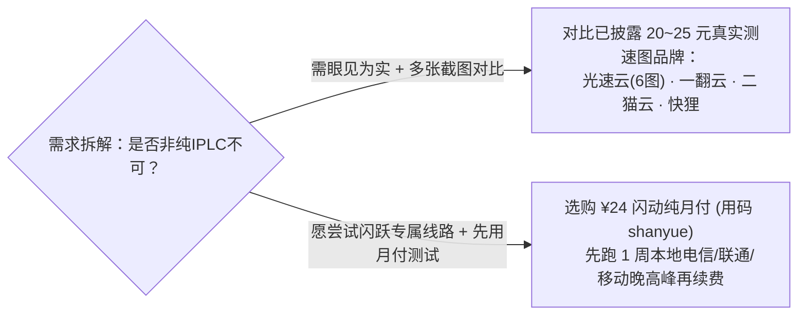

> **核心结论速览（Direct Answer）**：  
> **闪跃（Shanyue / FlashLeap）** 定位为中高端 **纯 IPLC 专线机场**，强调骨干网接入与晚高峰连接稳定性，主打香港、日本、美国等主流核心区域及原生 IP 流媒体/AI 解锁需求。在资费结构上，入门年付小包为 **¥96/年（60GB/月，折合约 8 元/月）**，纯月付则自 **闪动 ¥24/月（150GB/月）** 起售，梯度直上 **跃迁 ¥134/月（1000GB/月）**；注册结账可使用优惠码 **`shanyue`**。  
> **客观实证声明**：目前闪跃尚无本站独立采集的 `MiaoKo` 或 `MAI-TEST-BOT` 晚高峰实拍测速与逐节点解锁截图，本文剔除了不实模板速表，严格展示公开价目与定位分析。

---

## 一、 产品定位分析与适用需求错位排查

与那些只拼低价的中转盘不同，闪跃 24~134 元的纯月付定价明显锚定**对晚高峰持续吞吐和低抖动更有要求的高频使用群体**（如夜间追剧、经常用 AI 工具辅助研发与长时间在线的境外协作）。同时，它依然保留了一款 **¥96/年（60GB/月）** 的入门年付小包来降低试水门槛。

| 核心参数 | 官网直达通道 | 公开资料与规格记录 | 说明与风险标注 |
| :--- | :---: | :--- | :--- |
| **品牌名称** | **[👉 闪跃官网入口](https://vip02.flashleapaff.com/#/?code=3lgzm9mm)** | **闪跃（Shanyue / FlashLeap）** | 主打中高端纯 IPLC 专线 |
| **专属优惠码** | **[👉 领码注册](https://vip02.flashleapaff.com/#/?code=3lgzm9mm)** | **`shanyue`** | 下单结算页面可填入验证实时折扣 |
| **线路结构标称** | — | **IPLC 专线 · 骨干网接入** | 无本站独立测速大图验证，属商家标称层级 |
| **地区与解锁标称** | — | 覆盖香港、日本、美国等 · 标称原生 IP | 标称支持 ChatGPT、Claude、Netflix、Disney+；Gemini 视节点 |
| **第三方订阅支持** | — | 支持常规客户端订阅导入（以后台格式为准） | 可适配 [Clash Verge Rev / 小火箭教程](/posts/client-setup-clash-verge-shadowrocket/) |

---

## 二、 完整 5 档套餐价目表与单 GB 成本测算

| 套餐名称 | 计费方式 | 官方标价 | 包含流量 | 流量周期 | 折合单 GB 成本 | 典型选型建议 |
| :--- | :---: | :---: | :---: | :---: | :---: | :--- |
| **闪跃年付版** | 年付 | **¥96 / 年** | **60GB** | 每月 | ¥0.133 / GB（约¥8/月） | 预算有限、以文字查阅资料为主且接受年付者 |
| **闪动（Flicker）** | **月付** | **¥24 / 月** | **150GB** | 每月 | ¥0.160 / GB | **月付试错最优档**：零长周期风险，150GB 足以支撑视频+开发 |
| **飞跃（Leap）** | **月付** | **¥44 / 月** | **300GB** | 每月 | ¥0.147 / GB | 家庭多设备日常 4K 影音与同步盘传输 |
| **瞬移（Teleport）** | **月付** | **¥84 / 月** | **600GB** | 每月 | ¥0.140 / GB | 高强度开发者、镜像仓库同步、高频跨区视频剪辑师 |
| **跃迁（Warp）** | **月付** | **¥134 / 月** | **1000GB** | 每月 | ¥0.134 / GB | 工作室团队共用与 TB 级重度消耗场景 |

---

## 三、 选购比对：无实测图阶段应该如何理性入手？

- **同区间有图竞品比对**：在同一 **24~25 元/月 150GB 纯月付** 段位上，站内已有公开测速实拍图的竞争品牌包括 [光速云（¥25/168GB + 6 张全套测试图）](/posts/guangshuyun-review/)、[快狸（¥25/150GB + 50 节点测速图）](/posts/brand-kuaili-review/)、[SOGO云](/posts/brand-sogoyun-review/) 与 [一翻云（¥20/150GB）](/posts/brand-yifanyun-review/)。建议搭配参考，避免把全部预算押注在尚未公开测速细节的新建档案上。

---

## 四、 常见问题解答（FAQ）

### Q1：闪跃没有贴测速图是不是说明它速度慢？
不是。未贴截图仅代表本站测速组目前尚未对该品牌独立排期采样（且部分站点套餐结构以商家资料直接归档）。依据本站 E-E-A-T 编辑规范，没有实拍截图绝不允许填入“300Mbps+”或具体毫秒延迟，这样能确保读者看到的每个数字都可溯源。

### Q2：闪跃和同样提供 ¥96 年付小包的星岛梦、Firefly 怎么选？
三者均具备 **¥96/年 60GB/月** 这档轻量化入口，但目前 **[星岛梦深度评测](/posts/brand-xingdaomeng-review/)** 已附有实测大图与“不限设备并发 + ¥100 不限时包”实证支撑；如果你注重多设备并发与实测图验证，星岛梦或 [光速云（¥99/69GB）](/posts/guangshuyun-review/) 在目前证据链上更有抓手。

---

### 🌐 官方直达链接与延展导航
- 👉 **[点击进入闪跃官网注册通道](https://vip02.flashleapaff.com/#/?code=3lgzm9mm)** · 结账尝试优惠码 **`shanyue`**
- 📚 **延展阅读**：[返回 42 家机场品牌筛选库](/brands/) ｜ [2026 大流量 200GB+ 机场横评](/posts/large-traffic-airports-200gb-plus-comparison-guide/) ｜ [IEPL 与 IPLC 专线技术差异指南](/posts/dedicated-lines-iepl-iplc-vs-standard-transit-guide/)
