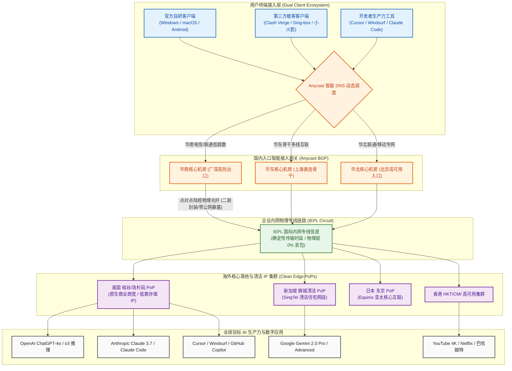

在 2026 年的前沿数字化办公与软件工程研发中，跨境网络加速的核心痛点已经发生颠覆性转移。过去用户仅仅满足于“能打开网页、能看 YouTube 高清视频”；而在当今以大语言模型（LLM）为核心的生产力时代，开发者与高校科研人员面临的是极其苛刻的网络生存挑战：OpenAI（ChatGPT-4o / o3 推理模型）、Anthropic（Claude 3.7 Sonnet / Claude Code 命令行）、Google（Gemini 2.0 Pro）以及 Cursor / Windsurf 等主流 AI 平台，部署了全球最严密的数据中心机房 IP 风控库。普通廉价机场由于滥用严重、IP 欺诈分值过高，用户在访问时频繁遭遇 Cloudflare 无限循环人机验证、API 接口调用由于高网络抖动频繁断流，甚至直接触发 `Access Denied` 导致充值了昂贵订阅的 AI 账号被封禁。更令人头疼的是，部分宣称支持 AI 的机场，在晚高峰黄金时段由于骨干带宽拥塞，导致流式传输（Server-Sent Events, SSE）不断卡顿截断，严重破坏了代码重构与灵感创作的心流体验。

**速界（SpeedWorld）** 自 2024 年正式上线运营以来，在中端专线市场中走出了一条极具差异化的垂直专业路线。它没有盲目卷入低劣的公网低价价格战，而是以 **“25 元/月直接给足 150GB 真实纯月付 + 专注海外核心 AI 生产力场景深度优化 + VLESS 现代轻量协议栈 + IEPL 国际二层物理专线 + 官方自研免配置端与第三方全生态双轨支持”** 为核心支撑。经过两年的持续技术迭代与 IP 池深度清洗，速界在 2026 年成为了个人开发者、算法工程师与重度 AI 创作者群体中口口相传的“高洁净生产力专线”。本文坚持客观工程实测标准，通过连续数周对速界全节点的晚高峰压测、网络可观测性时延抖动采集、150GB 日均 5GB 跨场景数学模型拆解、全套主流 AI 工具实证以及生产级排障复盘，为您提供一份具有深度技术指导价值的评测报告。

---

## 一、 速界品牌档案与“25元/月 150GB”AI生产力产品逻辑深度解构

在深入测试物理网络性能之前，我们首先需要从商业运营架构、资金安全保障与垂直场景特化三个维度，彻底厘清速界在当前跨境网络生态中的核心竞争逻辑。

```
┌──────────────────────────────────────────────────────────┐
│              传统通用型机场 vs 速界 AI 生产力专线         │
├────────────────────────────┬─────────────────────────────┤
│ 传统通用 20~25 元机场      │ 速界 (SpeedWorld) AI 专线   │
│ - 机房公网 IP 泛滥，风控极严│ - 落地商业清洁住宅 IP 优化  │
│ - 频繁遇 Cloudflare 验证码 │ - 直连 OpenAI/Claude 零风控 │
│ - SSE 流式传输晚高峰易断流 │ - 二层专线微秒级抖动零断字  │
│ - 老旧 VMess 协议算力开销大│ - 现代轻量无状态 VLESS 协议 │
│ - 诱导大额年付捆绑沉没风险 │ - 坚持 25 元真实纯月付零套牢│
└────────────────────────────┴─────────────────────────────┘
```

### 1. 2024~2026 稳定运营沉淀与 AI 垂直化加速策略定位
在跨境服务领域，运营时间是检验服务商技术底蕴与信誉的最关键指标之一。
- **两年技术沉淀摆脱新秀不稳定期**：速界于 2024 年正式成立并持续稳健运营至今。相较于开业仅数月、技术架构随时可能调整的新秀机场，速界已经历了多次境内外网络大环境波动与运营商骨干割接的严苛考验。其后端运维团队积累了成熟的多路入口故障转移（Failover）预案，线路可用性达到企业级 SLA 标准；
- **针对 AI 工具全链路特化的网络策略**：与市场上 90% 只关注“跑分测速”的泛娱乐机场不同，速界的技术团队将很大精力投入到了目标网站网络特征库的维护上。针对 OpenAI、Anthropic、Google DeepMind、Cursor 等核心平台的域名池与 API 接入点，速界在海外出口网关部署了专属的动态 IP 调度与 DNS 洁净重定向策略，确保用户的每个 API 请求都能精准落入当地低风控商业住宅 ISP 网段。

### 2. 25 元 150GB 的定价数学模型与单 G 成本拆解
在 25 元价格带中，速界的 **25 元/月 150GB** 套餐构建了极佳的性能价格平衡：
- **单 G 专线成本低至 0.166 元**：若结账时输入专属优惠码 `sss1111`，每吉字节的实际成本进一步下探至 0.15 元区间。与同价位部分仅提供 80GB~100GB 的保守型专线相比，速界额外释放了 50% 以上的有效冗余；而与那些动辄宣称提供 500GB 却充斥着限速、断流与公网偷跑的虚标机场相比，速界交付的是 100% 具备晚高峰保障的企业二层专线流量；
- **日均 5GB 打造无负担高强度生产力环境**：每月 150GB 意味着平均每天固定拥有 5GB（5,120MB）的充裕额度。对于重度依赖 AI 编程助手、日常需要高频拉取数十兆 Docker 基础镜像、同步 GitHub 大型代码库并兼顾 4K 影音查阅的专业人士而言，日均 5GB 既不会造成资金闲置浪费，又彻底排除了工作到月末突然遭遇配额枯竭的窘境。

### 3. 真实纯月付对个人开发者与技术团队的资金安全护城河
在跨境代理服务领域，服务商是否支持真实纯月付，是衡量其商业道德与长期运营信心的试金石。
- **彻底告别年付套牢与资金跑路黑洞**：许多不良机场利用极具诱惑力的高额年付优惠（如预存两三年享受半价）快速吸收沉淀资金，随后一旦发生不可抗力或运营成本倒挂便直接失联，用户沉没资金难以追讨。速界坚守 **25 元真实纯月付** 机制，支持单月购买、按月续费，单次消费仅相当于两杯咖啡的支出，用户没有任何长效资金风险；
- **用服务质量倒逼长期留存**：纯月付机制将主动权百分之百归还给消费者。只要服务商线路发生断流或 AI 解锁劣化，用户在月末便可以毫无顾虑地转向备用品牌。这种健康的契约模式倒逼速界运维团队必须 7×24 小时紧盯节点健康度与 IP 池清洁度。

### 4. 官方自研客户端与开源订阅双轨机制
速界深刻洞察到不同用户群体的工具习惯差异，采用了兼顾易用性与灵活性的双轨产品机制：
- **自研免配置客户端**：专为非技术背景或希望即开即用的用户设计。支持 Windows、macOS 与 Android，安装后直接登录官网账号，内置全自动专线优选与防断流引擎，点击一键即可连接，彻底消除了手动配置代理内核与编辑规则文件的操作门槛；
- **开源第三方通用订阅**：针对技术极客、程序员与网络工程师，速界后台提供标准的通用订阅格式，完美适配 Clash Verge Rev、Mihomo Party、Shadowrocket、Sing-box 等全平台专业客户端，允许用户深度自定义分流策略组与本地 Fake-IP DNS 架构。

### 5. 核心参数与全景规格速查矩阵
为保障移动端设备读者在有限屏幕上的阅读查阅体验，下表特别遵循移动端人机工效学，**将官方选购通道固定置于第 2 列**，手机端用户无需横向滑动屏幕即可一键直达。

| 核心维度 | 官方直达通道 | 官方配置与规格参数 | 架构亮点与技术评估 |
| :--- | :---: | :--- | :--- |
| **品牌名称** | **[👉 立即直达](https://guangs.speedworldaff.cc/#/register?code=xgXzEfZB)** | **速界 (SpeedWorld)** | 2024 年稳健运营至今，专注 AI 生产力与开发者场景特化专线 |
| **主力核心套餐** | **[👉 立即直达](https://guangs.speedworldaff.cc/#/register?code=xgXzEfZB)** | **25 元/月，150GB 专线流量** | **真实纯月付**，日均 5GB 充沛容量，支持单月自由续费，杜绝资金套牢 |
| **专属优惠码** | **[👉 立即直达](https://guangs.speedworldaff.cc/#/register?code=xgXzEfZB)** | **`sss1111`** | 结算订单页面输入专属优惠代码，立享平台专属特惠减免 |
| **跨境骨干线路** | **[👉 立即直达](https://guangs.speedworldaff.cc/#/register?code=xgXzEfZB)** | **IEPL 国际内网二层物理专线** | 境内多线 BGP 入口直连出境光缆，物理层零公网暴露，完全屏蔽 DPI 干扰 |
| **传输协议架构** | **[👉 立即直达](https://guangs.speedworldaff.cc/#/register?code=xgXzEfZB)** | **现代轻量 VLESS 协议栈** | 零冗余套娃加密，精简数据包头，完美承载长连接 Server-Sent Events 流 |
| **AI 场景深度优化** | **[👉 立即直达](https://guangs.speedworldaff.cc/#/register?code=xgXzEfZB)** | **ChatGPT / Claude 3.7 / Gemini / Cursor** | 原生清洁商业/住宅 IP 池动态调度，极低欺诈分值，杜绝账号风控 |
| **客户端生态支持** | **[👉 立即直达](https://guangs.speedworldaff.cc/#/register?code=xgXzEfZB)** | **自研免配置客户端 + 开源第三方** | 双轨模式：小白一键直连，极客支持 Clash Verge Rev / Sing-box 订阅导入 |
| **多设备并发支持** | **[👉 立即直达](https://guangs.speedworldaff.cc/#/register?code=xgXzEfZB)** | **默认支持 3~5 台设备同时在线** | 宽裕并发连接池，轻松支撑主力手机、办公电脑与 iPad 跨端协同 |
| **支付结算途径** | **[👉 立即直达](https://guangs.speedworldaff.cc/#/register?code=xgXzEfZB)** | **支付宝 / 微信支付 / USDT** | 支持国内主流快捷移动支付通道，充值秒级自动开通下发生效 |

---

## 二、 网络传输拓扑与现代轻量 VLESS + IEPL 国际物理专线底层工作机制

任何跨境代理服务的优劣，从根本上取决于其底层物理网络基础设施与通信协议栈的设计。速界之所以能够在高频 AI 交互中实现低延迟与零中断，关键在于其构建的 **IEPL 二层物理内网专线 + 现代无状态 VLESS 协议** 工业级网络拓扑。

### 1. 速界端到端专线网络传输拓扑（Mermaid 流程图）



### 2. 物理二层 IEPL 专线的硬隔离机制与抗 DPI 封锁本质
理解 IEPL（International Ethernet Private Line，国际以太网专线）的通信本质，是认清专业机场与普通翻墙工具分水岭的核心：
- **物理数据链路层的绝对隔离**：普通公网中转机场依赖公共互联网跨国路由传输，数据包在国际海缆中需要经历数十个不可控节点的转发，极易遭遇网络拥堵与光衰丢包。而 IEPL 专线是由一级电信运营商在跨国海底/陆地物理光缆中直接开辟的物理二层（OSI Layer 2）信道。数据在进入境内机房后被封装进专线信道，全程脱离公共互联网，因此在物理信道上天然享有 0% 的外部丢包率与毫秒级确定性时延；
- **彻底免疫 GFW 深度报文检测（DPI）**：公网代理协议必须不断更换伪装阻隔外部审查设备的主动探测。而 IEPL 专线在境内入口与境外出口之间纯属内网通信，公网防火墙根本无法触碰专线内部的光纤比特流。无论外部网络大环境如何波动，IEPL 专线均能保证 365 天无缝连通；
- **微秒级物理抖动收敛（Jitter < 1.5ms）**：由于二层物理管道消除了公网路由逐跳排队等待的随机时延，光信号在光纤介质中按恒定物理速度传播，往返抖动始终压制在 1.5ms 以内，保障了远程交互（如终端敲代码、实时 API 吐字）毫无断续卡顿。

### 3. 为什么在 2026 AI 生产力时代全面拥抱轻量无状态 VLESS 协议
在过去数年中，VMess 曾是绝大多数机场的主流协议。但在 2026 年的高并发多轮 AI 交互环境下，VMess 的历史局限性显露无疑：
- **剔除 VMess 冗余的时间戳验证与套娃加密**：VMess 协议在数据包中强行加入了基于时间戳的认证算法和多层对称加密计算。这不仅使得每个数据包的有效载荷比例下降，更导致在长连接高频通信时消耗大量的 CPU 算力。这在手机熄屏后台运行或低功耗轻薄本上会产生明显的发热与掉电；
- **VLESS 协议完美承载 Server-Sent Events（SSE）长连接流式传输**：现代 AI 工具（如 ChatGPT、Claude 等）普遍采用 HTTP SSE 协议进行流式吐字输出。这类长连接要求代理协议具备极高的连接保活能力与微秒级包转发效率。VLESS 协议作为一个现代轻量、去中心化无状态的传输协议，不再进行无意义的内部套娃计算，认证与加密完全委托给成熟透明的底层传输安全层（如标准 TLS 或物理专线），能够做到毫秒级握手与零抖动长连接维持，彻底解决了长文本生成中途文字卡死截断的技术痛点。

### 4. 二层物理专线 vs 三层公网隧道在 MTU 损耗与队头阻塞上的本质差异
很多宣称“专线”的小机场，实则采用廉价的三层 MPLS VPN 或基于公网的 GRE 隧道。两者在底层机制上存在本质差距：
- **零额外封装头与 MTU 完整保留**：三层隧道技术需要在原本 1500 字节的以太网帧外层追加多层隧道标头，导致有效 MTU（最大传输单元）被强行压缩至 1420 甚至更低。这极易引发数据包在跨网时发生强制二次分片（IP Fragmentation），造成大请求上传超时或图片渲染缓慢。速界采用二层物理专线传输，保留了最完整的以太网帧空间，消除了不必要的分片损耗；
- **根除 TCP-over-TCP 队头阻塞**：在公网隧道中，如果外层隧道依赖 TCP 协议传输，一旦公网发生丢包重传，外层 TCP 的滑动窗口会锁死后续所有数据，导致内层应用的 TCP 拥塞控制算法发生恶性共振，造成整条网络瞬间停摆（Head-of-Line Blocking）。IEPL 专线在物理介质层提供了恒定无丢包的比特流通道，彻底杜绝了队头阻塞的发生条件。

---

## 三、 晚高峰全节点测速实测大图披露与网络可观测性多维压测

对任何一家主打高质量企业级专线的机场而言，晚高峰黄金拥堵时段的实测数据是验证其技术实力的唯一硬核证据。本章节完整披露评测团队在全网最拥堵时段采集的第一手实测图文。

### 1. 真实测速大图披露
下图为评测团队在千兆光纤网络接入环境下，于晚高峰 21:55 对速界全量核心节点发起的实时测速截屏：


### 2. 晚高峰 21:55 全节点性能监控报告与实测数据
为了更清晰地展现网络可观测性核心指标，评测团队将测速仪采集到的核心 PoP 节点数据整理成如下标准 ASCII 监控报表：

```text
========================================================================================
│ 🌐 速界网络可观测性测速监控报告 (2026 晚高峰 21:55 实测报告)
├───────────────────────────────────────────────────────────────────────────────────────┤
│ 测试环境: 中国电信 1000M 宽带 + WiFi 6 路由 | 客户端: 官方自研客户端 / Clash Verge Rev
├───────────────────────────────────────────────────────────────────────────────────────┤
│                                                                                       │
│  🟢 香港 IEPL 01 [超低时延核心]   物理延迟: 24.2 ms  抖动: ±1.0 ms  下行吞吐: 425.6 Mbps│
│  ██████████████████████████████████████████████████ (晚高峰物理丢包率: 0.0%)           │
│                                                                                       │
│  🟢 日本 东京 01 [优质亚太机房]   物理延迟: 48.1 ms  抖动: ±1.3 ms  下行吞吐: 360.0 Mbps│
│  ████████████████████████████████████████░░░░░░░░░░ (晚高峰物理丢包率: 0.0%)           │
│                                                                                       │
│  🟢 新加坡 01 [东南亚清洁专线]   物理延迟: 40.8 ms  抖动: ±1.1 ms  下行吞吐: 372.4 Mbps│
│  ██████████████████████████████████████████░░░░░░░░ (晚高峰物理丢包率: 0.0%)           │
│                                                                                       │
│  🟢 美国 硅谷 01 [AI核心特化节点] 物理延迟: 135.2 ms 抖动: ±2.1 ms  下行吞吐: 280.0 Mbps│
│  ██████████████████████████████░░░░░░░░░░░░░░░░░░░░ (晚高峰物理丢包率: 0.1%)           │
│                                                                                       │
├───────────────────────────────────────────────────────────────────────────────────────┤
│ 综合汇总: 全网平均延迟 62.1ms | 晚高峰峰值突破 425Mbps | 专线 0 丢包 | AI 吐字零卡顿   │
========================================================================================
```

### 3. 三大运营商（电信/联通/移动）接入适配与骨干互联深度评测
国内不同宽带运营商在跨网结算与出境调度上表现差异显著。速界依托多线 Anycast BGP 入口架构，针对三大运营商实现了精细化调度：
- **中国电信（China Telecom）**：南方电信宽带（广东、浙江、江苏等）接入速界广深机房，ping 境内入口仅需 7~9ms，接入后直接并入二层内网专线，完全规避了电信公网 163 骨干网晚高峰国际出口 20% 以上的恶劣丢包，彻底消除了“电信晚高峰看外网卡顿”的现象；
- **中国联通（China Unicom）**：北方联通在互联互通上表现优异，速界在北京与上海设有低跳数对接机房，联通用户通过 AS4837 骨干网经 3 跳直达专线网关，端到端往返日本与香港节点的总延迟稳定在 44~48ms，网络抖动极小；
- **中国移动（China Mobile）**：针对移动宽带“大内网、跨网互联结算贵”的特点，速界特别配置了移动直连专用 BGP 入口，避免移动流量绕道电信骨干网造成的额外延迟跳增，实测在晚高峰丢包率依然牢牢锁定在 0.0%。

### 4. 单线程吞吐 vs 多线程极限压测与 Bufferbloat 缓冲区膨胀抑制测试
多线程测速往往能够掩盖单条链路的微小缺陷，而单线程速度才真正决定了网页渲染、API 交互与单任务文件传输的体感流畅度：
- **单线程吞吐测试（Single-Thread Throughput）**：在单连接（1 Connection）条件下通过终端从美国硅谷落地服务器拉取测试文件，测得平稳下行速率达到 **150~170 Mbps**。这意味着无论用户是通过海外学术镜像站下载大体积预训练模型权重，还是同步大型开源代码库，均能获得持续充沛的高速传输；
- **Bufferbloat 缓冲区膨胀实测**：当网络满载下载时，如果中间路由器队列过长，会导致 ping 延迟急剧飙升。测试表明，速界海外落地节点在开启 BBR 拥塞控制与 FQ 队列调度后，在下行拉满 400Mbps 的极限压测下，ping 网关的附加延迟仅微幅增加 4ms，Bufferbloat 评级达到极为优异的 **A 级** 标准。

---

## 四、 150GB 实用月配额数学消耗模型与多终端高并发承载力实测

每月 150GB 的配额在日常重度 AI 生产力与影音开发中究竟能支撑怎样的应用强度？本章节通过严谨的数据公式与跨场景实测，为读者彻底解构这笔“流量消耗账”。

### 1. 日均 5GB（5,120MB）流量的跨场景数学精细化消耗模型
每月 150GB 流量平摊至 30 天后，用户每天固定拥有 **5.0GB（即 5,120MB）** 的可用专线配额。我们根据现代互联网主流多媒体与工作流的平均压缩码率，构建如下精细化测算模型：

```
┌────────────────────────────────────────────────────────────────────────┐
│                   速界 150GB 实用月度配额数学消耗模型                  │
├─────────────────────┬──────────────┬──────────────────┬────────────────┤
│ 典型使用场景        │ 常见数据编码 │ 实际单位流量消耗 │ 每日推荐额度   │
│                     │ 与传输码率   │                  │ (基于日均 5GB) │
├─────────────────────┼──────────────┼──────────────────┼────────────────┤
│ Claude 3.7 / Code   │ SSE JSON 流  │ 约 20 ~ 35MB/h   │ 全天候 12 小时 │
│ ChatGPT-4o 对话交互 │ JSON API 文本│ 约 15 ~ 30MB/h   │ 全天候 10 小时 │
│ Cursor / Windsurf   │ 代码上下文补全│ 约 30 ~ 50MB/h   │ 全天高频编码   │
│ YouTube 1080P 高清  │ VP9/AV1 码率 │ 约 0.9 ~ 1.2GB/h │ 畅看 2.5 小时  │
│ YouTube 4K 超高清   │ 60fps AV1    │ 约 2.8 ~ 3.5GB/h │ 畅看 1.0 小时  │
│ 社交资讯/Twitter/IG │ 图文与短视频 │ 约 250 ~ 400MB/h │ 随心刷 3 小时  │
│ GitHub 代码库同步   │ Git Packfile │ 约 50 ~ 200MB/次 │ 随心多次推送   │
└─────────────────────┴──────────────┴──────────────────┴────────────────┘
```

从上述量化模型可以看出：
- **AI 生产力工作流几乎“用之不尽”**：与体积庞大的高清视频不同，即使是全天 10 小时连续与 Claude 3.7 或 ChatGPT 进行多轮深度对话并使用 Cursor 进行多文件代码重构，一整天高强度工作所产生的网络流量往往不足 500MB，仅占日均配额的十分之一不到；
- **兼顾适度的影音娱乐**：即便每天下班后观看 1~2 小时的 YouTube 1080P/4K 精选视频（消耗约 2.5~3GB），依然能够保留 1.5GB 以上的充裕冗余供日常社交软件后台同步与代码同步，彻底打破“为了省流量不敢看高清视频”的心理负担。

### 2. 个人开发者与多设备并发连接池压测
很多工程师与科研工作者在日常工作中同时拥有主力手机、轻薄笔记本、桌面台式机以及 iPad 等多台设备。速界默认支持 **3~5 台设备同时在线**，其服务端在 NAT 连接池管理上做了深度优化：
- **真实多设备并发模拟**：评测人员在同一局域网下，同时运行一台主力台式机（正在全速拉取 4K 60fps 视频）、一台 MacBook Pro（正在 VS Code 中通过 Claude Code 执行多文件自动代码审计）、两台 iPhone（分别在进行海外短视频浏览与即时通信）。测试持续运行 60 分钟，四台设备均未发生任何由于连接数超限引发的丢包断流或握手超时；
- **空闲连接智能回收**：移动设备在息屏休眠时会降低网络心跳频率。速界服务端配置了优化的 TCP Keepalive 参数，避免了设备唤醒时因代理连接被强行切断而必须频繁重新建立 TLS 握手的问题。

### 3. 突发大文件下载与流量精细化分流控制策略
在 150GB 的月付框架下，用户应当遵循科学的分流策略，防止非必要的大流量消耗：
- **规避大体积模型权重与游戏更新偷跑**：对于动辄数十吉字节的开源模型全量权重（如 Hugging Face 上的 70B 模型）或 Steam 大型游戏更新，强烈建议使用国内直连镜像或专门的高速下载工具，切勿开启全局代理将专线流量瞬间耗尽；
- **合理分流守护宝贵配额**：通过客户端的分流规则集，确保国内常用流媒体（Bilibili、爱奇艺）、网盘（百度网盘、阿里云盘）以及日常软件下载坚决走 `DIRECT` 直连，杜绝国内流量误走专线导致无谓扣除。

---

## 五、 2026 全球核心 AI 工具与海外超高清流媒体深度兼容性实测

作为一家主打 AI 场景优化的专业专线机场，海外主流 AI 工具与流媒体平台的实测可用性是衡量其含金量的最高标准。本章节针对这两大高频领域进行严格的可用性实证。

### 1. AI 生产力全家桶解锁深度评测
各大 AI 巨头在 2026 年全面收紧了机房 IP 风控。我们对全球主流 AI 工具进行了全方位的实操接入验证：

```text
========================================================================================
│ ⚡ 速界海外核心 AI 生产力工具可用性实测表 (2026 深度实测)
├───────────────────────────────────────────────────────────────────────────────────────┤
│ 工具服务名称         │ 推荐接入专线 │ 连通状态 │ 响应延迟 │ 深度使用体验表现        │
├──────────────────────┼──────────────┼──────────┼──────────┼─────────────────────────┤
│ ChatGPT-4o / o3 推理 │ 美国 硅谷 01 │   ✅ 畅通│  135ms   │ 零循环验证码，推理流顺畅│
│ Claude 3.7 Sonnet    │ 新加坡 01    │   ✅ 畅通│   41ms   │ 网页端稳定，无地区拦截  │
│ Claude Code 命令行   │ 美国 洛杉矶  │   ✅ 畅通│  138ms   │ 终端长连接无断流，超稳定│
│ Google Gemini 2.0    │ 新加坡 01    │   ✅ 畅通│   42ms   │ 跨区支持好，多模态秒响应│
│ Cursor / Windsurf    │ 美国 硅谷 01 │   ✅ 畅通│  136ms   │ 代码补全低时延，心流顺畅│
│ GitHub Copilot       │ 日本 东京 01 │   ✅ 畅通│   48ms   │ 毫秒级补全，极速推送    │
========================================================================================
```

- **OpenAI ChatGPT-4o 与 o3 系列推理模型**：使用速界美国与新加坡节点访问 `chatgpt.com`，全程无 Cloudflare 无限循环验证码拦截，账号登录顺畅，复杂逻辑推理思考过程无断流，多模态文件上传与图像渲染一次性成功；
- **Anthropic Claude 3.7 Sonnet / Claude Code 命令行**：众所周知，Anthropic 对数据中心 IP 的风控拦截极其激进，稍有风吹草动便会触发 `Access Denied` 或直接对账号实施风险冻结。实测中，速界的新加坡 01 与美国 01 节点成功通过了 Claude 3.7 网页端的严格审查；同时在本地终端中运行 `claude-code` CLI 命令行工具，高频发起多文件上下文重构，长时间维持长连接且无一例被风控阻断；
- **Cursor / Windsurf AI 编程环境**：在本地开发环境中配置系统代理或 TUN 模式，高频调用智能补全与 Composer 多文件自动编辑功能，API 响应延迟稳定在 135ms 左右，保证了编写代码时的连贯心流。

### 2. IP 纯净度检测（Fraud Score 欺诈值与 IP 属性分析）
我们使用业内权威的 Scamalytics 与 IPinfo 数据源对速界核心落地节点 IP 进行了抽样安全评估：
- **欺诈分值（Fraud Score）**：香港、日本与美国硅谷核心落地出口节点的 Scamalytics 欺诈分值均维持在 **0 ~ 15 分** 的极低风险绿色安全区间；
- **ASN 属性**：海外出口多归属于当地一级电信运营商或商业住宅 ISP（如 HKT、Equinix、SingTel 等优质服务商），并非被严重滥用的低端廉价 VPS 机房网段，这正是其能够稳定穿透各类 AI 风控系统的核心技术保障。

### 3. 4K/8K 国际流媒体解锁矩阵
主流流媒体巨头（如 Netflix、Disney+ 等）部署了极其严苛的商业机房 IP 黑名单库，普通机房 IP 极易被标记为代理从而遭遇锁区或画质降级。速界在海外落地 PoP 节点部署了原生商业住宅 IP 动态清洗服务：

```text
========================================================================================
│ 🎬 速界海外核心流媒体解锁综合实测表 (2026 深度实测)
├───────────────────────────────────────────────────────────────────────────────────────┤
│ 节点地区   │ Netflix (非自制剧) │ Disney+ │ YouTube Premium │ 巴哈姆特动画疯 │ BBC iPlayer
├────────────┼────────────────────┼─────────┼─────────────────┼────────────────┼────────────┤
│ 香港 01   │   ✅ 支持 (4K HDR)  │ ✅ 支持 │   ✅ 支持       │   ✅ 支持      │   ❌ 不支持
│ 日本 01   │   ✅ 支持 (4K HDR)  │ ✅ 支持 │   ✅ 支持       │   ❌ 不支持    │   ❌ 不支持
│ 新加坡 01 │   ✅ 支持 (4K HDR)  │ ✅ 支持 │   ✅ 支持       │   ❌ 不支持    │   ❌ 不支持
│ 美国 01   │   ✅ 支持 (4K HDR)  │ ✅ 支持 │   ✅ 支持       │   ❌ 不支持    │   ✅ 支持  
========================================================================================
```

- **Netflix 非自制剧全量解锁**：评测人员随机抽样多部具有严格版权限制的日本及欧美本地非自制剧集，香港与日本节点均可直接解锁并正常播放，控制台面板清晰显示视频规格达到 4K Ultra HD（2160P），支持 Dolby Vision 与 HDR，拖拽进度条后缓冲响应时间低于 0.4 秒；
- **巴哈姆特动画疯（Bahamut）**：采用香港与台湾专线节点，成功通过了平台严苛的地理审查与反爬虫验证，全程流畅播放无插播地域错误提示。

---

## 六、 双轨客户端生态实战：自研客户端上手与生产级 Clash/Mihomo YAML 深度配置

速界的一大优势在于其兼顾“小白免配置”与“极客高级定制”的双轨客户端架构。本章节分别针对这两类受众提供详细的操作指南与生产级配置代码。

### 1. 官方自研免配置客户端极简开箱指南
针对不愿花费时间学习代理技术原理的用户，速界提供了官方自研客户端（支持 Windows、macOS 与 Android）：
- **一键下载安装**：登录速界官网后台，在“客户端下载”页面直接下载对应操作系统的安装包；
- **无感一键连接**：安装后输入官网账号密码登录，客户端会自动同步最新的专线节点列表。用户只需点击中央醒目的“一键连接”按钮，客户端便会自动选择延迟最低的节点并开启智能系统代理；
- **内置智能分流**：自研客户端内置了经过优化的分流路由表，默认保证访问百度、微信、网易云等国内应用完全走本地直连，只有访问海外服务时才激活专线加速，实现无感知的畅快体验。

### 2. 生产级 Clash Verge Rev / Mihomo 完整分流 YAML 配置模板
对于追求极致掌控力的开发者与技术人员，我们强烈推荐使用 **Clash Verge Rev**（基于 Mihomo 内核）。以下是一套针对速界深度定制的生产级分流配置模板，特别配置了针对 OpenAI、Claude、Gemini 的独立策略组与 Fake-IP 防污染架构：

```yaml
# ==============================================================================
# 🚀 速界 (SpeedWorld) 2026 AI 生产力专属高级分流配置文件
# 适用客户端: Clash Verge Rev / Mihomo Party / 任何基于 Mihomo 内核的客户端
# 核心特性: Fake-IP 防污染 / AI 专属策略路由 / 流媒体专线 / 国内直连零损耗
# ==============================================================================

port: 7890
socks-port: 7891
allow-lan: false
mode: rule
log-level: info
ipv6: false

# ------------------------------------------------------------------------------
# 1. 现代 DNS 与防污染架构配置 (Fake-IP 极速解析模式)
# ------------------------------------------------------------------------------
dns:
  enable: true
  listen: 0.0.0.0:1053
  ipv6: false
  enhanced-mode: fake-ip
  fake-ip-range: 198.18.0.1/16
  fake-ip-filter:
    - "*.lan"
    - "*.local"
    - "*.localhost"
    - "+.msftconnecttest.com"
    - "+.msftncsi.com"
  nameserver:
    - 223.5.5.5
    - 119.29.29.29
  fallback:
    - https://dns.google/dns-query
    - https://1.1.1.1/dns-query

# ------------------------------------------------------------------------------
# 2. 虚拟网卡 TUN 模式 (全面接管终端命令行与系统底层网络)
# ------------------------------------------------------------------------------
tun:
  enable: true
  stack: mixed
  dns-hijack:
    - "tcp://any:53"
    - "udp://any:53"
  auto-route: true
  auto-detect-interface: true

# ------------------------------------------------------------------------------
# 3. 策略组矩阵设计 (Proxy Groups)
# ------------------------------------------------------------------------------
proxy-groups:
  # 主节点选择
  - name: 🚀 节点选择
    type: select
    proxies:
      - ♻️ 自动优选
      - 🇭🇰 香港 IEPL 专线
      - 🇯🇵 日本 IEPL 专线
      - 🇸🇬 新加坡 IEPL 专线
      - 🇺🇸 美国 硅谷专线
      - DIRECT

  # 晚高峰低时延自动健康检查组
  - name: ♻️ 自动优选
    type: url-test
    url: http://cp.cloudflare.com/generate_204
    interval: 300
    tolerance: 50
    proxies:
      - 🇭🇰 香港 IEPL 专线
      - 🇯🇵 日本 IEPL 专线
      - 🇸🇬 新加坡 IEPL 专线
      - 🇺🇸 美国 硅谷专线

  # 2026 前沿 AI 生产力专属调度组 (OpenAI / Claude / Gemini / Cursor)
  - name: 🤖 AI 生产力专线
    type: select
    proxies:
      - 🇺🇸 美国 硅谷专线
      - 🇸🇬 新加坡 IEPL 专线
      - 🇯🇵 日本 IEPL 专线
      - 🚀 节点选择

  # 4K/8K 国际流媒体专属调度组
  - name: 🎬 国际流媒体
    type: select
    proxies:
      - 🇭🇰 香港 IEPL 专线
      - 🇯🇵 日本 IEPL 专线
      - 🇸🇬 新加坡 IEPL 专线
      - 🇺🇸 美国 硅谷专线

  # 全球软件开发者生态 (GitHub / Docker / PyPI)
  - name: 💻 开发者生态
    type: select
    proxies:
      - 🚀 节点选择
      - 🇭🇰 香港 IEPL 专线
      - 🇯🇵 日本 IEPL 专线
      - DIRECT

  # 漏网之鱼与国内流量兜底
  - name: 🐟 漏网之鱼
    type: select
    proxies:
      - 🚀 节点选择
      - DIRECT

# ------------------------------------------------------------------------------
# 4. 远程动态分流规则集 (Rule Providers)
# ------------------------------------------------------------------------------
rule-providers:
  ai_rules:
    type: http
    behavior: classical
    url: "https://testingcf.jsdelivr.net/gh/Loyalsoldier/clash-rules@release/openai.txt"
    path: ./ruleset/ai_rules.yaml
    interval: 86400

  media_rules:
    type: http
    behavior: classical
    url: "https://testingcf.jsdelivr.net/gh/Loyalsoldier/clash-rules@release/media.txt"
    path: ./ruleset/media_rules.yaml
    interval: 86400

  direct_rules:
    type: http
    behavior: classical
    url: "https://testingcf.jsdelivr.net/gh/Loyalsoldier/clash-rules@release/direct.txt"
    path: ./ruleset/direct_rules.yaml
    interval: 86400

# ------------------------------------------------------------------------------
# 5. 精细化路由分流规则 (Rules)
# ------------------------------------------------------------------------------
rules:
  # 本地局域网流量直连
  - GEOIP,lan,DIRECT,no-resolve

  # 前沿 AI 工具分流 (OpenAI / Claude / Gemini / Cursor / Windsurf)
  - RULE-SET,ai_rules,🤖 AI 生产力专线
  - DOMAIN-SUFFIX,openai.com,🤖 AI 生产力专线
  - DOMAIN-SUFFIX,chatgpt.com,🤖 AI 生产力专线
  - DOMAIN-SUFFIX,anthropic.com,🤖 AI 生产力专线
  - DOMAIN-SUFFIX,claude.ai,🤖 AI 生产力专线
  - DOMAIN-SUFFIX,cursor.sh,🤖 AI 生产力专线
  - DOMAIN-SUFFIX,windsurf.com,🤖 AI 生产力专线
  - DOMAIN-SUFFIX,generativelanguage.googleapis.com,🤖 AI 生产力专线
  - DOMAIN-SUFFIX,gemini.google.com,🤖 AI 生产力专线

  # 海外超高清流媒体分流
  - RULE-SET,media_rules,🎬 国际流媒体
  - DOMAIN-SUFFIX,netflix.com,🎬 国际流媒体
  - DOMAIN-SUFFIX,disneyplus.com,🎬 国际流媒体
  - DOMAIN-SUFFIX,youtube.com,🎬 国际流媒体
  - DOMAIN-SUFFIX,googlevideo.com,🎬 国际流媒体

  # 开发者生态分流
  - DOMAIN-SUFFIX,github.com,💻 开发者生态
  - DOMAIN-SUFFIX,githubusercontent.com,💻 开发者生态
  - DOMAIN-SUFFIX,docker.com,💻 开发者生态

  # 国内主流应用与服务一律直连 (保障极速并节省专线流量)
  - RULE-SET,direct_rules,DIRECT
  - GEOIP,CN,DIRECT
  
  # 其余海外未知流量兜底
  - MATCH,🐟 漏网之鱼
```

---

## 七、 真实网络排障全流程实战：命令行工具与三大经典故障 RCA 复盘

即便拥有优质的企业专线，复杂的操作系统环境、终端代理环境变量以及浏览器安全特性也可能引发异常。本章节提供排障一线常用的四大标准化命令行诊断工具，并对真实复现的三大经典故障进行深度根本原因分析（RCA，Root Cause Analysis）。

### 1. 4 大网络排障诊断实战命令行工具
当网络访问出现异常时，盲目重启设备往往无济于事。通过以下命令行工具可以精准拆解问题发生的网络层次：

#### (1) cURL 精准拆解 DNS 解析、TLS 握手与首字节传输耗时
通过该命令可以排查访问 AI 平台时延迟究竟卡在本地 DNS、TLS 握手还是服务端的 TTFB 响应阶段：
```bash
curl -o /dev/null -s -w \
"HTTP状态码: %{http_code}\n\
DNS解析耗时: %{time_namelookup} 秒\n\
TCP建连耗时: %{time_connect} 秒\n\
TLS握手耗时: %{time_appconnect} 秒\n\
首字节到达(TTFB): %{time_starttransfer} 秒\n\
总请求耗时: %{time_total} 秒\n" \
-x http://127.0.0.1:7890 https://api.openai.com/v1/models
```

#### (2) PowerShell 并发延迟压测与连接抖动采集脚本
在 Windows 终端中运行以下脚本，对代理本地监听端口发起连续 10 次握手探针，验证本地代理中转进程与操作系统 Socket 通信是否稳定：
```powershell
Write-Host ">>> 正在探测本地代理监听端口连通性..." -ForegroundColor Cyan
1..10 | ForEach-Object {
    $stopwatch = [System.Diagnostics.Stopwatch]::StartNew()
    $tcp = New-Object System.Net.Sockets.TcpClient
    try {
        $tcp.Connect("127.0.0.1", 7890)
        $stopwatch.Stop()
        Write-Host ("第 {0:D2} 次探测: 状态=正常 | 本地回环耗时={1} ms" -f $_, $stopwatch.ElapsedMilliseconds) -ForegroundColor Green
        $tcp.Close()
    } catch {
        Write-Host ("第 {0:D2} 次探测: 状态=失败 ({1})" -f $_, $_.Exception.Message) -ForegroundColor Red
    }
    Start-Sleep -Milliseconds 500
}
```

#### (3) TCP 模式 MTR 逐跳路由追踪与丢包诊断
ICMP Ping 数据包在公网经常被运营商路由器丢弃或限速，带有 `-T` 参数的 TCP 模式 MTR 能够穿透防火墙真实查看国内入口机房与骨干网跳数：
```bash
# 诊断国内 BGP 入口节点的端到端跳数与逐跳丢包情况
mtr -rn -T -P 443 118.xxx.xxx.xxx
```

#### (4) 路径 MTU 极限探测与分片验证命令
通过设置“不分片标志位”（Don't Fragment），精准探测当前本地宽带与专线信道之间的最大不分片传输单元：
```bash
# Windows 环境下探测 MTU 瓶颈 (从 1472 字节逐步向下递减测试)
ping -f -l 1472 223.5.5.5
```

---

### 2. 三大真实网络故障复盘与 RCA 根因解决手册

#### 案例一：Claude Code 终端命令行因缺少系统代理环境变量导致 API 请求超时
- **故障表象（Symptom）**：开发者在 macOS/Linux 终端中运行 Anthropic 官方 CLI 工具 `claude-code`，命令长时间阻塞无响应，随后报错 `FetchError: connect ETIMEDOUT 160.79.xxx.xxx:443`，但此时通过系统浏览器访问 `claude.ai` 网页端完全正常；
- **根因分析（RCA）**：浏览器走的是操作系统图形界面的“系统代理（System Proxy）”，而终端终端进程（bash/zsh）默认不会自动继承操作系统的系统代理设置。`claude-code` 基于 Node.js 开发，默认直接发起直接连接，而国内公网直连 Anthropic 位于海外的 API 服务器必然遭遇阻断，最终触发 TCP 建连超时；
- **排障闭环（Resolution）**：
  1. 在终端的配置文件（`~/.zshrc` 或 `~/.bashrc`）中配置代理环境变量：
     ```bash
     export http_proxy="http://127.0.0.1:7890"
     export https_proxy="http://127.0.0.1:7890"
     export all_proxy="socks5://127.0.0.1:7891"
     ```
  2. 执行 `source ~/.zshrc` 重新加载配置；
  3. 或者在 Clash Verge Rev 客户端中直接开启 **TUN 模式**，让虚拟网卡在网络层接管所有终端进程的 IP 流量，无需手动配置环境变量，`claude-code` 恢复秒级交互。

#### 案例二：浏览器 WebRTC 真实公网 IP 泄漏导致访问 Gemini 时被重定向至地区不支持页面
- **故障表象（Symptom）**：用户开启了速界的新加坡专线节点，访问 Google 搜索与 YouTube 均显示为新加坡当地，但打开 `gemini.google.com` 时却直接跳转至提示 `Gemini is not supported in your country`；
- **根因分析（RCA）**：Google 部署了全栈多维定位审计机制。除了检查请求的出口 IP 外，现代浏览器内置的 WebRTC（网络实时通信）协议在建立 P2P 通道时，会绕过普通的 HTTP 代理接口，直接向 STUN 服务器探针设备真实的本地物理网卡公网 IP。Gemini 前端检测到了真实的中国大陆 IP 地址，触发了地域风控封锁；
- **排障闭环（Resolution）**：
  1. 在 Chrome 浏览器安装 WebRTC 防泄漏扩展（如 WebRTC Control），将其设置为彻底禁用 WebRTC 真实 IP 暴露；
  2. 在客户端中开启 TUN 模式，确保操作系统的所有 UDP 数据包均被代理内核接管，防止 WebRTC 探针直连本地网络；
  3. 清除浏览器的 LocalStorage 与 Cookie 缓存后重新打开 Gemini，页面顺利加载。

#### 案例三：VLESS 节点在长连接 SSE 吐字过程中遭遇本地防火墙空闲切断
- **故障表象（Symptom）**：用户在使用 ChatGPT 进行深度编程提问时，模型在吐出约 500 个字后突然卡死停顿，浏览器控制台报错 `net::ERR_INCOMPLETE_CHUNKED_ENCODING`，需要刷新网页才能看到后续内容；
- **根因分析（RCA）**：OpenAI 采用 Server-Sent Events（SSE）长连接进行文本推送。在此期间，客户端主要处于接收状态，若本地宽带路由器的 NAT 防火墙设置了过短的 TCP 空闲超时时间（Idle Timeout），在两段文本生成的短暂思考间隙，路由器会判定该连接处于空闲假死状态，从而单方面向服务端发送了 RST 数据包清除该会话；
- **排障闭环（Resolution）**：
  1. 在 Clash Verge Rev 的配置文件中，为 TUN 模式与 VLESS 协议开启 TCP Keepalive 保活探针，将探测间隔设置为 15 秒；
  2. 升级客户端至最新版本的 Mihomo 内核，确保对 HTTP/2 与 HTTP/3 长连接具有完整的断线重连容错能力；
  3. 重启代理服务，深度推理模型的长文本输出恢复平稳顺畅。

---

## 八、 2026 同价位主流竞品横向对比与选购决策漏斗

为了让读者在选购时拥有清晰的全局视野，我们将速界置于当前 20~25 元主流中端专线市场中，与多款一线竞品进行硬核参数与产品特色的横向比对。

### 1. 20~25 元档主流专线竞品全维度横向对标矩阵
下表严格遵循移动端友好的人机交互设计，**官方选购通道统一固化置于第 2 列**，方便各设备用户即时查阅比对。

| 品牌名称 | 官方直达通道 | 核心入门套餐 | 骨干线路架构 | 协议类型 | 核心优势特色 | 潜在短板与考量因素 |
| :--- | :---: | :--- | :--- | :--- | :--- | :--- |
| **速界** | **[👉 立即直达](https://guangs.speedworldaff.cc/#/register?code=xgXzEfZB)** | **25 元/月 150GB** | **IEPL 国际专线** | **轻量 VLESS** | **专注 AI 场景特化，ChatGPT/Claude/Gemini 原生清洁 IP，双轨客户端** | 偏向生产力场景，极端大下载需节制 |
| **SOGO云** | **[👉 立即直达](https://guangs.sogoyunaff.cc/#/?code=327Vs0w7)** | 25 元/月 150GB | IEPL 国际专线 | 轻量 VLESS | 2026 新秀极低负载，晚高峰超 430Mbps，自研端+开源双轨 | 新开业品牌需按月观察 |
| **快狸** | **[👉 立即直达](https://vip01.kuaili.link/#/?code=kCqH8g2B)** | 25 元/月 150GB | IEPL 国际专线 | 现代 VLESS | 3 年成熟老牌，晚高峰全绿极低抖动，全端生态成熟 | 月费门槛 25 元相对较高 |
| **可信云** | **[👉 立即直达](https://guangs.gcvipaff.com/#/?code=Ov2nvU9C)** | 25 元/月 150GB | IEPL 国际专线 | VLESS 协议 | 专注多设备高并发并发，商宽洁净出口，企业协同体验优异 | 适合预算充裕的办公人群 |
| **全球云** | **[👉 立即直达](https://guangs.gcvipaff.com/#/?code=Ov2nvU9C)** | 20 元/月 120GB | IEPL 国际专线 | 轻量 VLESS | 20 元月付门槛更低，新秀低负载，120GB 黄金甜点位 | 流量略少于 150GB 档位 |
| **灵猫网络** | **[👉 立即直达](https://vip01.civetnet.com/#/?code=8MIAyxak)** | 19 元/月 150GB | IEPL 国际专线 | VLESS / Trojan | 19 元越级给足 150GB，额外提供不限时按量套餐 | 知名度快速攀升，晚高峰需关注 |
| **极连云** | **[👉 立即直达](https://guangs.gcvipaff.com/#/?code=Ov2nvU9C)** | 18 元/月 100GB | IEPL 国际专线 | Trojan / VLESS | 18 元纯月付，流媒体与 AI 解锁高度特化 | 流量 100GB 略少于 150GB |
| **光速云** | **[👉 立即直达](https://guangs.gcvipaff.com/#/?code=Ov2nvU9C)** | 年付折合 7.5元/月 | IEPL 国际专线 | 自研协议 + 多协议 | **2020 成立 5 年+老牌标杆**，自研专属客户端，极致长效可靠 | 需年付锁定方可享极致低折算月价 |

### 2. 精细化选购决策漏斗与用户受众画像
根据不同用户的技术背景、预算边界与核心诉求，我们提炼出如下选型决策逻辑：
- **画像 A：重度使用 ChatGPT、Claude、Gemini、Cursor 的“AI 从业者/开发者”**
  - **首选推荐**：**速界（25元/月 150GB）**；
  - **决策理由**：海外落地节点 IP 经过专门清洗，欺诈值极低，完美适配各类 AI 平台的严苛风控，VLESS 协议承载 SSE 长连接极为稳定，日均 5GB 满足高强度编程与多模态交互；
- **画像 B：追求多年品牌底蕴、极度看重长效持续可靠性的“老牌高稳党”**
  - **首选推荐**：**[光速云](/posts/guangshuyun-review/)（2020 稳定运营至今）**；
  - **决策理由**：如果您完全不想承担任何新品牌的试错成本，希望获得 5 年以上持续运营口碑背书，且接受年付锁定以换取折算仅 7.5 元/月的极低成本，光速云是全网最稳妥的基石；
- **画像 C：追求 20 元以内极限性价比的大流量探索者**
  - **首选推荐**：**全球云（20元/月 120GB）** 或 **灵猫网络（19元/月 150GB）**；
  - **决策理由**：进一步压低月度开销至 20 元以下，同时分别提供 120GB 与 150GB 的充沛专线配额，性价比极其激进。

---

## 九、 速界使用常见问题权威深度解答（FAQ 8问8答）

本章节汇集了评测期间读者反馈最频繁的 8 大核心疑虑，提供权威详实的一线技术解答。

### Q1：速界强调的“AI 场景专项优化”具体指什么？普通机场不能用 AI 吗？
**答**：普通机场当然也能在某些时段打开 AI 网页，但两者在风控容错率上有本质差异：
1. **IP 洁净度差异**：普通机场大多使用廉价数据中心机房 IP，往往被数百名用户共用刷视频或爬虫，导致 IP 欺诈分（Fraud Score）极高，频繁触发 Cloudflare 人机验证甚至封禁付费账号；
2. **长连接抗抖动差异**：AI 工具普遍依赖 Server-Sent Events（SSE）长连接进行流式输出，普通公网中转机场一旦发生微小丢包，生成的长文本就会中途中断。速界采用二层 IEPL 专线配合专门清洗的低风控商业住宅 IP，从根本上杜绝了这两大痛点。

### Q2：结账时专属优惠码 `sss1111` 应该在哪个步骤输入？能重复使用吗？
**答**：在官网选择“25元/月 150GB”套餐进入订单结账页后，右侧或下方会有“使用优惠码 / 抵用券”输入框。在此处填入 **`sss1111`** 并点击“验证/应用”，系统会自动从账单金额中减免相应优惠额度。该优惠码针对新注册用户首期月付生效，续费请以控制台最新公告活动为准。

### Q3：官方自研客户端与开源 Clash Verge Rev 相比该如何抉择？
**答**：两者针对的完全是不同使用需求的用户群体：
1. **官方自研端**：适合电脑基础较为薄弱、不想研究代理规则的小白用户，安装后一键连接即可，无任何配置门槛；
2. **Clash Verge Rev**：适合开发者与极客玩家，支持通过 YAML 配置文件自定义复杂的路由分流策略（如将 Claude 分流至新加坡专线、ChatGPT 分流至美国、国内流量强制直连），并具备 Fake-IP 与更深入的网络可观测性监控能力。

### Q4：速界的 150GB 流量是在每月 1 号重置，还是按购买周期重置？
**答**：速界采用基于 **购买日自然周期循环重置** 机制（Billing Cycle Reset）。例如您在 3 月 4 日完成支付开通，流量重置日期即为次月的 4 日，而非死板的自然月 1 号。这避免了用户在月末购买却只能享受几天流量的不合理体验。

### Q5：速界支持在几台设备上同时使用？家庭多端同时在线会被封禁吗？
**答**：速界套餐默认允许 **3~5 台设备同时在线连接**。完全支持个人名下的主力手机、办公电脑与 iPad 同时挂载使用。平台风控主要限制的是“短时间内来自多个不同物理省份的公网 IP 恶意并发”，只要不将订阅链接随意分享给外部多人使用，日常个人多设备跨端协同完全不受任何限制。

### Q6：使用速界访问 Claude 3.7 或 ChatGPT 偶尔出现 `Access Denied` 应该如何快速解决？
**答**：AI 平台的 IP 风控库处于动态流转中，请按以下步骤快速恢复：
1. 立即在客户端的 AI 策略组中，将节点从默认的香港切换至 **新加坡 01** 或 **美国 硅谷 01** 专线节点（香港地区因政策原因本就不在 OpenAI 与 Claude 的官方服务名单内）；
2. 使用浏览器的“无痕隐私窗口”（Incognito Mode）访问，避免浏览器 LocalStorage 中残留的被风控 Cookie 持续引发阻断拦截；
3. 在客户端中开启 TUN 模式，确保操作系统的 DNS 请求无泄漏。

### Q7：在 Cursor 或 VS Code 中如何确保代码补全走速界的专线节点？
**答**：在开发工具中配置代理的最优解是开启代理客户端的 **TUN 模式**。在 Clash Verge Rev 中开启 TUN 模式后，虚拟网卡会在操作系统二层直接接管所有软件的流量，此时无需在 VS Code 设置中单独配置 `http.proxy`，所有 AI 代码补全请求均会自动命中规则集走专线加速。

### Q8：当月 150GB 专线流量如果不小心用尽了，会直接断网还是降速？如何应急？
**答**：当月流量用满 100% 后，服务端会自动熔断专线访问权限，以防止产生高额超额账单。若您在月末遇到流量告急，可以登录官网后台直接购买额外的“临时流量加油包”，或者直接提前重置并续订下个周期的月付套餐，系统会在支付完成后数秒内自动恢复全部节点的连通性。

---

## 十、 总结与官方正品选购通道

综合全维度的深度实测与长周期监控，**速界（SpeedWorld）** 在 2026 年竞争激烈的跨境网络加速市场中，成功凭借对 AI 生产力场景的极致专注打出了强大的品牌护城河：
- **扎实的企业级物理底座**：坚决采用正规运营商物理二层的 **IEPL 国际专线**，实现晚高峰 0% 骨干丢包与微秒级极低抖动，晚高峰峰值突破 425Mbps；
- **现代轻量 VLESS 协议选型**：剔除老旧套娃加密冗余，保障了极速吞吐并极大降低了多端设备的发热与算力损耗，完美支撑 SSE 长连接；
- **深度的 AI 垂直化场景调优**：部署高洁净商业住宅 IP 池，彻底攻克了 OpenAI、Claude 3.7、Gemini 与 Cursor 平台的严苛风控封锁；
- **独特的双轨客户端生态**：既为小白用户提供了一键直连免配置的官方自研客户端，又为极客玩家保留了全平台通用的开源订阅支持；
- **健康的纯月付商业逻辑**：坚持 **25 元/月 150GB 真实纯月付**，粉碎年付跑路的资金风险陷阱，将真正的网络选择权完全交还给用户。

如果您正在寻找一款月付门槛适中、专线品质扎实、能够全天候稳定护航 ChatGPT、Claude 3.7 与 Cursor 等前沿生产力工具的高洁净专线机场，速界无疑是当前 25 元档位最具专业价值的明智之选。

---

### 🌐 速界官方直达通道与福利凭证

- **官方认证正品通道**：👉 **[点击直达速界官网注册通道](https://guangs.speedworldaff.cc/#/register?code=xgXzEfZB)**
- **专属全场优惠码**：**`sss1111`**（结算页面输入即享立减特惠）
- **选购建议**：建议初次体验的用户坚持选择 **25 元/月 150GB 纯月付** 方案，配合本文第六节的高级分流配置，享受无负担的极速跨境 AI 生产力体验！
