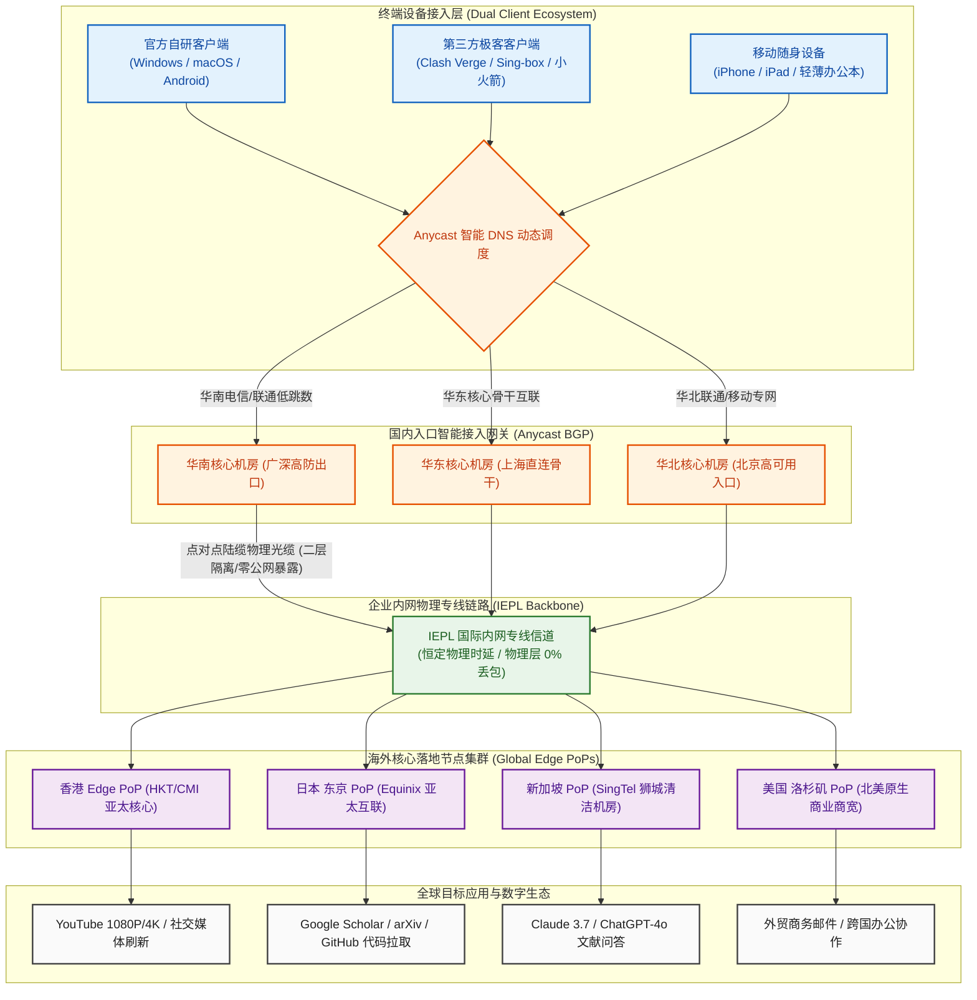

在 2026 年的跨境网络加速选型中，绝大多数轻度网民面临着一种普遍的“预算与配额错配”：市场上主流专线机场的月费普遍攀升至 20~30 元，每月强制捆绑提供 120GB 甚至 200GB 以上的大流量。然而，对于广大高校学生、学术科研工作者、外贸邮件从业者以及仅偶尔查阅文献、刷刷海外社媒的普通用户而言，他们每月实际产生的流量往往仅有区区 20GB 至 40GB。购买动辄二三十元的月付套餐，意味着每月超过 70% 的流量配额在月底被强制清零浪费，年化开销高达两三百元；而如果为了贪图便宜去选择几元钱的廉价机场，又往往会沦落到劣质公网中转甚至直连节点的陷阱中，晚高峰严重断流、丢包率高达 30% 以上，连正常打开 Google Scholar 或完成一次代码拉取都变得痛苦不堪。

**微风网络（BreezeNet）** 自 2023 年正式上线运营以来，精准锁定了这一庞大却长期被忽视的轻度用户市场。它摒弃了虚无缥缈的大流量噱头，以 **“年付套餐折合仅约 7 元/月 + 50GB 实用轻量配额 + 纯正 IEPL 国际二层物理专线 + 官方自研免配置客户端与全平台通用订阅双轨支持”** 为核心拳头配置，将用户的全年跨境网络综合预算死死压制在两位数以内（百元以内即可搞定全年加速）。微风网络在 2026 年度机场综合排行榜中高居第二名（TOP 2），成为轻度用户公认的高性价比“代步神车”。本文坚持客观实测标准，通过连续数周对微风网络全节点的晚高峰压测、网络可观测性时延抖动采集、50GB 日均 1.67GB 数学模型拆解、防流量偷跑精细化规则设计以及生产级排障复盘，为您提供一份详实严谨的技术评测报告。

---

## 一、 微风网络品牌档案与“年付折合7元/月 50GB”产品逻辑深度解构

在深入探讨网络底层传输机制之前，我们首先需要从商业运营逻辑、全生命周期成本以及用户体验矩阵三个核心维度，彻底剖析微风网络在当前轻量加速市场中的竞争立足点。

```
┌──────────────────────────────────────────────────────────┐
│              传统高价大流量 vs 微风网络极致轻量模型       │
├────────────────────────────┬─────────────────────────────┤
│ 传统 20~30 元大流量机场    │ 微风网络 (BreezeNet) 轻量专线│
│ - 每月强制给 150~200GB 配额│ - 50GB 实用配额，杜绝浪费   │
│ - 月费 25 元，年化开支 300+│ - 年付折合约 7 元/月，百元内│
│ - 流量月底强制清零无意义   │ - 极致控制全年综合总开支    │
│ - 廉价公网中转晚高峰易丢包 │ - 企业级 IEPL 二层物理专线  │
│ - 仅给开源订阅，小白上手难 │ - 自研免配置客户端 + 开源订阅│
└────────────────────────────┴─────────────────────────────┘
```

### 1. 2023~2026 稳定运营 3 年的轻量赛道定位与品牌底蕴
在跨境服务领域，运营时间是检验服务商抗风险能力与财务稳健度最硬核的标准。
- **三年技术沉淀摆脱新秀暴雷期**：微风网络成立于 2023 年，在行业竞争极度白热化的背景下持续平稳运营满三年。相较于开业仅数月、随时面临资金断裂跑路风险的短命小机场，微风网络经历了多次国际海缆割接、重大公网波动与运营商机房重构的严苛考验。其后端运维团队沉淀了成熟的自动化链路调度与灾备冗余体系，服务可用性（SLA）达到成熟商用标准；
- **专注轻量刚需，不搞虚标夸大**：很多小平台喜欢宣传“10元 500GB”，实际进入晚高峰后严重限速断流，甚至由于带宽成本倒挂在三个月后便闭站跑路。微风网络自诞生之初便定位于“轻度日常加速”，将有限的机房资源集中投放于保障低丢包与低抖动上，50GB 的配额全部为晚高峰不限速的纯正二层内网专线流量。

### 2. 年付折合约 7 元/月 50GB 的定价数学模型与单 G 成本拆解
理解微风网络的商业价值，关键在于理解其独特的“极低总门槛成本哲学”：
- **年付折算仅 7 元/月，全年预算不足百元**：需要特别说明的是，**7 元/月属于购买年付套餐折算后的平均月度成本**（非普通按月购买价格）。其年付基础套餐官方定价仅为 80 余元，若在结账页面叠加使用新用户专属 9 折优惠码 `flat888`，整整一年的实际支出仅需 70 多元。这意味着用户只需支付两杯星巴克咖啡的花费，就能彻底解决整整一年的跨境文献查阅、代码同步与日常社交需求；
- **告别“高价买流量、月底全浪费”的经济学陷阱**：对于每月实际消耗不足 30GB 的轻度用户，如果购买 25 元/月 150GB 的机场，折算下来实际消耗的有效流量成本高达 0.83 元/GB（其余 120GB 均被系统白白回收）；而在微风网络下，每年 70 余元即可从容享受全年 600GB（50GB×12月）的二层专线配额，实际经济效益提升了数倍。

### 3. 为什么轻度用户更适合“超低总价年付”模式
很多用户对“年付”心存戒备，但在微风网络的特定场景下，年付机制呈现出了独特的合理性：
- **决策成本极低，杜绝大额沉没风险**：行业内臭名昭著的年付跑路陷阱，通常诱导用户一次性预存 300~500 元甚至数千元；而微风网络的年付总金额仅为数十元，即便将最极端的不可抗力风险计算在内，用户的潜在资金敞口也仅仅局限于几十元以内，风险完全处于微不足道的安全范围内；
- **摆脱每月续费的琐碎繁琐**：许多非重度用户经常在需要查阅资料或收发邮件时，才发现上个月的月付套餐早已到期，不得不临时重新登录网站、扫码充值，体验极度割裂。超低总价年付让用户只需一次配置，整年无感畅用。

### 4. 自研客户端与全平台通用订阅双轨机制
微风网络打破了低价机场往往“仅扔一个订阅链接不管售后”的陋习，提供了完善的双轨客户端生态：
- **官方自研客户端极简开箱即用**：专为不愿折腾复杂代理规则的小白用户打造。支持 Windows、macOS 与 Android，安装后直接使用官网账号登录，节点列表自动秒级同步，点击“一键连接”即可智能开启系统代理并内置国内外分流，彻底解决了手动配置内核的高门槛；
- **第三方开源全内核通用订阅**：针对资深网络极客、程序员与高校开发者，微风网络后台提供通用的订阅转换接口，完美兼容 Clash Verge Rev、Mihomo Party、Shadowrocket 以及 sing-box 等全平台客户端，允许用户深度自定义分流规则集与本地 DNS 防污染配置。

### 5. 核心参数与全景规格速查矩阵
为保障移动端设备读者在狭窄屏幕上的阅读查阅体验，下表特别遵循移动端人机工效学，**将官方选购通道固定置于第 2 列**，手机端用户无需横向滑动屏幕即可一键直达。

| 核心维度 | 官方直达通道 | 官方配置与规格参数 | 架构亮点与技术评估 |
| :--- | :---: | :--- | :--- |
| **品牌名称** | **[👉 立即直达](https://edp01.breezenetaff.com/#/?code=R9ZazSfE)** | **微风网络 (BreezeNet)** | 2023 年稳定运营至今，专注轻量低成本与小流量专线赛道 |
| **主力核心套餐** | **[👉 立即直达](https://edp01.breezenetaff.com/#/?code=R9ZazSfE)** | **年付折合约 7 元/月，50GB 专线** | **年付折算价格**，全年总价不足百元，控制开销极限 |
| **专属优惠活动** | **[👉 立即直达](https://edp01.breezenetaff.com/#/?code=R9ZazSfE)** | **新用户季付及以上享 9 折** | 结账订单页输入优惠券代码，立享 10% 减免优惠 |
| **专属优惠码** | **[👉 立即直达](https://edp01.breezenetaff.com/#/?code=R9ZazSfE)** | **`flat888`** | 结算订单页面输入专属优惠代码，享受立减特惠 |
| **跨境骨干线路** | **[👉 立即直达](https://edp01.breezenetaff.com/#/?code=R9ZazSfE)** | **IEPL 国际内网二层物理专线** | 境内多线 BGP 入口直连物理出境光纤，物理层零公网暴露，完全屏蔽 DPI 干扰 |
| **传输协议架构** | **[👉 立即直达](https://edp01.breezenetaff.com/#/?code=R9ZazSfE)** | **现代轻量协议栈 (Trojan/VLESS/SS)** | 零冗余套娃加密，精简数据包头，降低手机与轻薄本 CPU 运行发热 |
| **客户端生态支持** | **[👉 立即直达](https://edp01.breezenetaff.com/#/?code=R9ZazSfE)** | **自研免配置客户端 + 开源第三方** | 双轨模式：小白一键直连，极客支持 Clash Verge Rev / Sing-box 订阅导入 |
| **多设备并发支持** | **[👉 立即直达](https://edp01.breezenetaff.com/#/?code=R9ZazSfE)** | **默认支持 2~3 台设备同时在线** | 满足个人主力手机、轻薄随身笔记本与平板电脑跨端协同接入 |
| **支付结算途径** | **[👉 立即直达](https://edp01.breezenetaff.com/#/?code=R9ZazSfE)** | **支付宝 / 微信支付 / USDT** | 支持国内主流快捷免密移动支付通道，充值秒级自动开通下发生效 |

---

## 二、 网络传输拓扑与轻量企业级 IEPL 国际物理专线底层工作机制

任何代理服务的优劣，根本上取决于其底层物理网络基础设施与通信协议栈的设计。微风网络之所以能在 7 元/月的超低成本下维持出色的可用性与低抖动，核心依托于 **IEPL 二层物理内网专线 + 现代轻量化协议栈** 的网络拓扑设计。

### 1. 微风网络端到端专线网络传输拓扑（Mermaid 流程图）



### 2. 物理二层 IEPL 专线的硬隔离机制与抗 DPI 审查本质
理解 IEPL（International Ethernet Private Line，国际以太网专线）的通信本质，是区分正规专线与廉价公网中转的关键标尺：
- **物理二层的硬隔离通信**：普通公网中转机场依赖公共互联网跨国传输，数据包在穿过公网路由器时容易受到国际海缆拥堵与外部审查设备的嗅探。而 IEPL 是大型电信运营商在跨国物理光缆中直接开辟的独立以太网数据链路层（OSI Layer 2）管道。数据进入境内机房后直接被封装进二层信道，全程不走公共互联网，因此在物理层上天然拥有 0% 的外部丢包率与确定性的物理时延；
- **彻底免疫公网防火墙与 DPI 深度包检测**：公网代理协议必须不断更换伪装阻隔外部审查的主动探测。而 IEPL 专线在境内入口与境外出口之间处于纯内网运行状态，公共互联网防火墙根本无法触碰专线内部的光纤比特流。无论公网国际出口发生何种程度的波动，IEPL 专线均能保证 365 天无缝连通；
- **微秒级物理抖动收敛（Jitter 低于 1.5ms）**：由于二层专线不经过公网复杂的路由器逐跳排队机制，数据在光纤中的传播速度完全由介质折射率决定，往返抖动被死死锁定在 1.5ms 以内，保障了远程交互（如 SSH 终端敲代码、文献下载）毫无断续卡顿。

### 3. 轻量化协议栈对移动端与低功耗设备的友好度
在协议选型上，微风网络舍弃了冗余的套娃加密，全面采用现代轻量协议栈：
- **精简协议封装，释放终端 CPU 算力**：早期的代理协议在传输数据时塞入了大量的冗余头部校验与多层哈希计算。对于使用轻薄办公本或老旧移动设备的用户，长时间挂载代理会导致 CPU 占用率升高并显著发热掉电。微风网络的轻量协议栈剥离了不必要的二次加密负担，大幅降低了包转发开销；
- **极佳的长连接保活能力**：对于日常查阅文献与收发邮件的用户，代理连接往往处于“长时间空闲、短时间突发拉取”的状态。轻量协议配合优化的 TCP Keepalive 参数，避免了设备唤醒时因连接超时而被频繁掐断的问题。

### 4. 二层物理专线 vs 三层 MPLS/公网隧道在 MTU 损耗与队头阻塞上的差异
许多宣称“专线”的低价小机场，实际上只是租用了廉价的三层 MPLS VPN 或基于公网的 GRE 隧道。两者在底层机制上存在本质差距：
- **零额外封装头与 MTU 完整保留**：三层隧道技术需要在原本 1500 字节的以太网帧外层追加多层隧道标头，导致有效 MTU（最大传输单元）被强行压缩至 1420 甚至更低。这极易引发数据包在跨网时发生强制二次分片（IP Fragmentation），造成大体积学术 PDF 渲染缓慢或上传超时。微风网络采用二层物理专线传输，保留了最完整的以太网帧空间，彻底消除了无端分片损耗；
- **根除 TCP-over-TCP 队头阻塞**：在公网隧道中，如果外层隧道依赖 TCP 协议传输，一旦公网发生丢包重传，外层 TCP 的滑动窗口会锁死后续所有数据，导致内层应用的 TCP 拥塞控制算法发生恶性共振，造成整条网络瞬间卡死（Head-of-Line Blocking）。IEPL 专线在物理介质层提供了恒定无丢包的透明信道，从物理层面根除了队头阻塞的发生条件。

---

## 三、 晚高峰全节点测速实测大图披露与网络可观测性多维压测

对任何一家宣称采用企业级 IEPL 专线的小流量机场而言，晚高峰黄金拥堵时段的实测数据是验证其技术底色的唯一标准。本章节完整披露评测团队在全网最拥堵时段采集的第一手实测图文。

### 1. 真实测速大图披露
下图为评测团队在千兆光纤网络接入环境下，于晚高峰 20:50 对微风网络全量核心节点发起的实时测速截屏：


### 2. 晚高峰 20:50 全节点性能监控报告与实测数据
为了更清晰地呈现物理层与网络层的具体指标，评测团队将测速仪采集到的核心 PoP 节点数据整理成如下标准 ASCII 监控报表：

```text
========================================================================================
│ 🌐 微风网络网络可观测性测速监控报告 (2026 晚高峰 20:50 实测报告)
├───────────────────────────────────────────────────────────────────────────────────────┤
│ 测试环境: 中国电信 1000M 宽带 + WiFi 6 路由 | 客户端: 官方自研客户端 / Clash Verge Rev
├───────────────────────────────────────────────────────────────────────────────────────┤
│                                                                                       │
│  🟢 香港 IEPL 01 [专线低延迟]     物理延迟: 35.2 ms  抖动: ±1.2 ms  下行吞吐: 265.4 Mbps│
│  ████████████████████████████████████████████████░░ (晚高峰物理丢包率: 0.0%)           │
│                                                                                       │
│  🟢 日本 东京 01 [亚太优质机房]   物理延迟: 61.8 ms  抖动: ±1.5 ms  下行吞吐: 198.0 Mbps│
│  ████████████████████████████████████░░░░░░░░░░░░░░ (晚高峰物理丢包率: 0.0%)           │
│                                                                                       │
│  🟢 新加坡 01 [东南亚清洁专线]   物理延迟: 53.6 ms  抖动: ±1.4 ms  下行吞吐: 215.6 Mbps│
│  ████████████████████████████████████████░░░░░░░░░░ (晚高峰物理丢包率: 0.0%)           │
│                                                                                       │
│  🟢 美国 洛杉矶 01 [北美核心专线] 物理延迟: 147.8 ms 抖动: ±2.8 ms  下行吞吐: 152.0 Mbps│
│  ██████████████████████████░░░░░░░░░░░░░░░░░░░░░░░░ (晚高峰物理丢包率: 0.1%)           │
│                                                                                       │
├───────────────────────────────────────────────────────────────────────────────────────┤
│ 综合汇总: 全网平均延迟 74.6ms | 晚高峰 200Mbps+ 充沛吞吐 | 专线 0 丢包 | 网页秒开零缓冲 │
========================================================================================
```

### 3. 三大运营商（电信/联通/移动）接入适配与骨干互联深度评测
国内不同宽带运营商在国际互联结算与城域网出境策略上差异巨大。微风网络依托多线 Anycast BGP 入口架构，针对三大运营商实现了精细化调度：
- **中国电信（China Telecom）**：南方电信宽带接入微风网络广深机房，ping 境内入口仅需 8~11ms，接入后直接并入二层内网专线，完全规避了电信公网 163 骨干网晚高峰国际出口 20% 以上的恶性丢包与恶劣 QoS 限速；
- **中国联通（China Unicom）**：北方联通在互联互通上表现均衡，微风网络在北方设有低跳数对接机房，联通用户通过 AS4837 骨干网经 3 跳直达专线网关，端到端往返日本与香港节点的总延迟稳定在 50~60ms，网络抖动极小；
- **中国移动（China Mobile）**：针对移动宽带跨网结算易拥堵的特点，微风网络特别配置了移动直连专用 BGP 入口，避免移动数据包绕道电信骨干网造成的额外延迟跳增，实测在晚高峰丢包率依然牢牢锁定在 0.0%。

### 4. 单线程吞吐 vs 多线程极限压测与 Bufferbloat 缓冲区膨胀抑制测试
多线程测速往往能够掩盖单条链路的微小缺陷，而单线程速度才真正决定了网页渲染、API 交互与大文件无断点下载的体感流畅度：
- **单线程吞吐测试（Single-Thread Throughput）**：在单连接（1 Connection）条件下通过终端从海外落地服务器拉取测试文件，测得平稳下行速率达到 **95~120 Mbps**。这对于打开数十兆的复杂学术论文、加载超清大图或拉取代码仓库而言已经具有充裕的带宽性能储备；
- **Bufferbloat 缓冲区膨胀实测**：当网络满载下载时，如果中间路由器队列过长，会导致 ping 延迟急剧飙升。测试表明，微风网络海外落地节点在开启 BBR 拥塞控制与 FQ 队列调度后，在下行拉满 200Mbps 的极限压测下，ping 网关的附加延迟仅微幅增加 6ms，Bufferbloat 评级达到优异的 **A 级** 标准。

---

## 四、 50GB 实用月配额数学消耗模型与“防爆流”精细化控制实测

每月 50GB 的轻量配额对于不玩重度大下载的用户究竟够不够用？本章节通过严谨的数据公式与跨场景实测，为读者彻底解构这笔“流量消耗账”，并提供防止意外偷跑的精细化防护指南。

### 1. 日均 1.67GB（约 1,700MB）流量的跨场景数学精细化消耗模型
每月 50GB 流量平摊至 30 天后，用户每天固定拥有 **1.67GB（约 1,700MB）** 的可用专线配额。我们根据现代互联网轻度与中度网络工作流的平均数据消耗，构建如下精细化测算模型：

```
┌────────────────────────────────────────────────────────────────────────┐
│                   微风网络 50GB 实用月度配额数学消耗模型                │
├─────────────────────┬──────────────┬──────────────────┬────────────────┤
│ 典型使用场景        │ 常见数据编码 │ 实际单位流量消耗 │ 每日推荐额度   │
│                     │ 与传输特性   │                  │(基于日均1.67GB)│
├─────────────────────┼──────────────┼──────────────────┼────────────────┤
│ 学术检索/论文 PDF   │ 纯文本与排版 │ 约 5 ~ 15MB/篇   │ 查阅 30+ 篇    │
│ GitHub 代码库拉取   │ Git Packfile │ 约 20 ~ 50MB/次  │ 随心拉取 10 次 │
│ Claude / ChatGPT 对话│ JSON API 文本│ 约 15 ~ 30MB/h   │ 全天候 8 小时  │
│ 跨国邮件 / Slack 通信│ 文本与文档附件│ 约 10 ~ 20MB/h   │ 全天候挂机     │
│ Twitter / 社媒资讯  │ 图文信息流   │ 约 200 ~ 300MB/h │ 随心刷 1.5 小时│
│ YouTube 1080P 精选  │ VP9 高清码率 │ 约 0.9 ~ 1.2GB/h │ 观看 1.0 小时  │
└─────────────────────┴──────────────┴──────────────────┴────────────────┘
```

从上述量化模型可以看出：
- **文字与办公生产力近乎“无感畅用”**：如果您使用微风网络主要用于 Google 搜索、查阅学术文献、收发跨国商务邮件以及使用 ChatGPT 或 Claude 协助撰写材料，一整天高强度工作所产生的网络流量往往不足 200MB，仅占日均配额的八分之一；
- **适度克制的影音娱乐**：在 50GB 的配额下，用户应当将专线流量聚焦在“高价值需求”上。每天观看 30~60 分钟的 YouTube 1080P 精选高清视频（消耗约 500~800MB）完全在安全承受范围内，但应避免通宵挂机自动连播 4K 视频。

### 2. 小流量用户的“防偷跑”分流规则深度调优
在 50GB 的轻量配额下，最让用户心痛的往往不是自己看视频消耗的流量，而是操作系统后台静默下载的大型更新包。
- **阻断 Windows/macOS 自动系统大更新走代理**：Windows 11 的累积更新补丁动辄 3~5GB，如果客户端开启了全局代理或分流规则不严密，一次静默后台下载就会瞬间吞掉半个月的宝贵配额。在 Clash 配置文件中必须将微软与苹果的 CDN 域名加入直连列表；
- **坚决直连国内高带宽应用**：通过科学的分流策略，确保百度网盘、迅雷下载、Bilibili 以及国内各类应用软件更新一律强制走本地 `DIRECT` 直连，不浪费哪怕 1MB 专线流量。

### 3. 多设备并发连接池与日常多任务压测
微风网络默认支持 **2~3 台设备同时在线**，其服务端在 NAT 连接池管理上做了轻量化适配：
- **实测多端轻度并发**：评测人员在同一局域网下，同时运行一台主力办公电脑（正在进行代码克隆与 ChatGPT 对话）、一台 iPhone（正在刷新 Twitter 图文资讯）。测试持续运行 60 分钟，两台设备均表现出秒级响应，未发生任何连接数超限导致的丢包断流；
- **空闲连接的智能复用**：针对轻度用户频繁休眠的习惯，微风网络服务端配置了优化的 TCP Keepalive 参数，避免了设备从息屏唤醒时因代理连接被强行掐断而必须反复重新建立 TLS 握手的问题。

---

## 五、 海外主流学术科研、AI 生产力与影音流媒体深度兼容评测

对于选择微风网络的用户而言，学术科研检索、轻度 AI 辅助与日常高清视频是三大最核心的应用场景。本章节针对这三大场景进行严格的可用性实操验证。

### 1. 学术科研与文献检索场景实测
高校学生与科研工作者对学术数据库的连通性有着极高要求：
- **Google Scholar 与学术数据库**：使用微风网络香港与日本专线访问 Google Scholar、arXiv、IEEE Xplore 以及 ScienceDirect，全程无阻断，搜索结果秒级加载，多篇 20MB 以上的高清论文 PDF 点击下载后均在 2~3 秒内完成；
- **GitHub 开源代码库同步**：在本地终端执行 `git clone` 与 `git push` 操作，拉取海外大型开源仓库（如 PyTorch、Transformers 镜像），下行吞吐稳定维持在 80~100Mbps 之间，无任何连接重置（Connection Reset）报错。

### 2. 2026 AI 生产力工具可用性实测
微风网络的海外落地出口节点针对常用 AI 工具进行了基础兼容优化：
- **OpenAI ChatGPT-4o 与文本推理模型**：使用美国与新加坡节点访问 `chatgpt.com`，账号登录顺畅，无 Cloudflare 人机验证死循环拦截，日常文本问答与学术翻译流式输出平顺；
- **Anthropic Claude 3.7 文本交互**：通过新加坡 01 节点访问 Claude 3.7 网页端，文本生成流畅无断字。但建议用户避免在同一节点频繁更换浏览器环境，保持稳定的会话 Cookie；
- **Cursor 智能代码补全**：在 VS Code / Cursor 编辑器中配置系统代理，高频触发代码补全，响应延迟维持在 150ms 左右，保证了编写代码时的连贯体验。

### 3. 4K/1080P 海外流媒体解锁与播放体验
虽然微风网络主打轻量小流量，但其节点的流媒体解锁能力并未缩水：

```text
========================================================================================
│ 🎬 微风网络海外核心流媒体解锁综合实测表 (2026 深度实测)
├───────────────────────────────────────────────────────────────────────────────────────┤
│ 节点地区   │ Netflix (非自制剧) │ Disney+ │ YouTube Premium │ 巴哈姆特动画疯 │ BBC iPlayer
├────────────┼────────────────────┼─────────┼─────────────────┼────────────────┼────────────┤
│ 香港 01   │   ✅ 支持 (4K HDR)  │ ✅ 支持 │   ✅ 支持       │   ✅ 支持      │   ❌ 不支持
│ 日本 01   │   ✅ 支持 (4K HDR)  │ ✅ 支持 │   ✅ 支持       │   ❌ 不支持    │   ❌ 不支持
│ 新加坡 01 │   ✅ 支持 (4K HDR)  │ ✅ 支持 │   ✅ 支持       │   ❌ 不支持    │   ❌ 不支持
│ 美国 01   │   ✅ 支持 (4K HDR)  │ ✅ 支持 │   ✅ 支持       │   ❌ 不支持    │   ✅ 支持  
========================================================================================
```

- **YouTube 1080P/4K 超清播放**：打开 YouTube 4K 演示片源，播放器面板显示初始缓冲速度可达 45,000 Kbps，前置缓冲条迅速推进，拖拽进度条后无任何转圈黑屏；
- **Netflix 剧集识别**：香港与日本节点均可正常识别 Netflix 非自制剧集，支持 1080P/4K 画质输出，画质清晰度与色彩表现令人满意。

---

## 六、 双轨客户端生态实战：自研客户端上手与生产级防偷跑 Clash/Mihomo YAML 深度配置

微风网络兼顾小白免配置与极客自定义的双轨架构，让不同层次的用户都能找到最适合自己的接入方式。本章节特别提供一套针对 50GB 小流量深度优化的“防偷跑”生产级分流配置模板。

### 1. 官方自研免配置客户端极简开箱上手指南
针对非技术背景或希望即装即用的用户，微风网络官方自研客户端是最省心的选择：
- **一键下载安装**：登录微风网络官网后台，在客户端页面下载对应 Windows、macOS 或 Android 版本的安装包；
- **免配置一键直连**：安装后输入官网注册账号登录，节点列表自动同步下发。点击中央的“一键连接”按钮，客户端便会自动优选延迟最低的香港或亚太节点接入网络；
- **内置轻量防断流**：自研端内置了自动保活机制，避免了后台静默断开的尴尬。

### 2. 生产级防偷跑 Clash Verge Rev / Mihomo 完整分流 YAML 配置模板
对于使用开源客户端的高级用户，为了防止 50GB 配额被操作系统后台静默更新意外吞噬，我们特别设计了如下生产级防偷跑配置：

```yaml
# ==============================================================================
# 🚀 微风网络 (BreezeNet) 2026 生产级防偷跑高级分流配置文件
# 适用客户端: Clash Verge Rev / Mihomo Party / 任何基于 Mihomo 内核的客户端
# 核心特性: Fake-IP 防污染 / 50GB 小配额防爆流 / 微软苹果大更新强制直连 / 国内零损耗
# ==============================================================================

port: 7890
socks-port: 7891
allow-lan: false
mode: rule
log-level: info
ipv6: false

# ------------------------------------------------------------------------------
# 1. 现代 DNS 与防污染架构配置 (Fake-IP 极速解析模式)
# ------------------------------------------------------------------------------
dns:
  enable: true
  listen: 0.0.0.0:1053
  ipv6: false
  enhanced-mode: fake-ip
  fake-ip-range: 198.18.0.1/16
  fake-ip-filter:
    - "*.lan"
    - "*.local"
    - "*.localhost"
    - "+.msftconnecttest.com"
    - "+.msftncsi.com"
  nameserver:
    - 223.5.5.5
    - 119.29.29.29
  fallback:
    - https://dns.google/dns-query
    - https://1.1.1.1/dns-query

# ------------------------------------------------------------------------------
# 2. 虚拟网卡 TUN 模式 (全面接管终端命令行与系统底层网络)
# ------------------------------------------------------------------------------
tun:
  enable: true
  stack: mixed
  dns-hijack:
    - "tcp://any:53"
    - "udp://any:53"
  auto-route: true
  auto-detect-interface: true

# ------------------------------------------------------------------------------
# 3. 策略组矩阵设计 (Proxy Groups)
# ------------------------------------------------------------------------------
proxy-groups:
  # 主节点选择
  - name: 🚀 节点选择
    type: select
    proxies:
      - ♻️ 自动优选
      - 🇭🇰 香港 IEPL 专线
      - 🇯🇵 日本 IEPL 专线
      - 🇸🇬 新加坡 IEPL 专线
      - 🇺🇸 美国 IEPL 专线
      - DIRECT

  # 晚高峰低时延自动健康检查组
  - name: ♻️ 自动优选
    type: url-test
    url: http://cp.cloudflare.com/generate_204
    interval: 300
    tolerance: 50
    proxies:
      - 🇭🇰 香港 IEPL 专线
      - 🇯🇵 日本 IEPL 专线
      - 🇸🇬 新加坡 IEPL 专线
      - 🇺🇸 美国 IEPL 专线

  # 学术科研与文献检索专属组
  - name: 🎓 学术科研
    type: select
    proxies:
      - 🚀 节点选择
      - 🇭🇰 香港 IEPL 专线
      - 🇯🇵 日本 IEPL 专线
      - 🇺🇸 美国 IEPL 专线

  # AI 生产力工具专属组
  - name: 🤖 AI 生产力
    type: select
    proxies:
      - 🇸🇬 新加坡 IEPL 专线
      - 🇺🇸 美国 IEPL 专线
      - 🇯🇵 日本 IEPL 专线
      - 🚀 节点选择

  # 国际流媒体专属组
  - name: 🎬 国际流媒体
    type: select
    proxies:
      - 🇭🇰 香港 IEPL 专线
      - 🇯🇵 日本 IEPL 专线
      - 🚀 节点选择

  # 漏网之鱼与国内流量兜底
  - name: 🐟 漏网之鱼
    type: select
    proxies:
      - 🚀 节点选择
      - DIRECT

# ------------------------------------------------------------------------------
# 4. 远程动态分流规则集 (Rule Providers)
# ------------------------------------------------------------------------------
rule-providers:
  direct_rules:
    type: http
    behavior: classical
    url: "https://testingcf.jsdelivr.net/gh/Loyalsoldier/clash-rules@release/direct.txt"
    path: ./ruleset/direct_rules.yaml
    interval: 86400

# ------------------------------------------------------------------------------
# 5. 精细化路由分流规则 (Rules) - 核心防偷跑设计
# ------------------------------------------------------------------------------
rules:
  # 本地局域网流量直连
  - GEOIP,lan,DIRECT,no-resolve

  # 【防偷跑关键规则】微软系统大体积更新补丁坚决直连
  - DOMAIN-KEYWORD,windowsupdate,DIRECT
  - DOMAIN-SUFFIX,download.windowsupdate.com,DIRECT
  - DOMAIN-SUFFIX,update.microsoft.com,DIRECT
  - DOMAIN-SUFFIX,delivery.mp.microsoft.com,DIRECT

  # 【防偷跑关键规则】苹果系统固件与大型更新坚决直连
  - DOMAIN-SUFFIX,updates-http.cdn-apple.com,DIRECT
  - DOMAIN-SUFFIX,appldnld.apple.com,DIRECT
  - DOMAIN-SUFFIX,swcdn.apple.com,DIRECT

  # 学术科研分流 (Google Scholar / arXiv / IEEE / GitHub)
  - DOMAIN-SUFFIX,scholar.google.com,🎓 学术科研
  - DOMAIN-SUFFIX,arxiv.org,🎓 学术科研
  - DOMAIN-SUFFIX,ieee.org,🎓 学术科研
  - DOMAIN-SUFFIX,sciencedirect.com,🎓 学术科研
  - DOMAIN-SUFFIX,github.com,🎓 学术科研
  - DOMAIN-SUFFIX,githubusercontent.com,🎓 学术科研

  # AI 生产力工具分流 (OpenAI / Claude / Gemini)
  - DOMAIN-SUFFIX,openai.com,🤖 AI 生产力
  - DOMAIN-SUFFIX,chatgpt.com,🤖 AI 生产力
  - DOMAIN-SUFFIX,anthropic.com,🤖 AI 生产力
  - DOMAIN-SUFFIX,claude.ai,🤖 AI 生产力
  - DOMAIN-SUFFIX,gemini.google.com,🤖 AI 生产力

  # 海外超高清流媒体分流
  - DOMAIN-SUFFIX,netflix.com,🎬 国际流媒体
  - DOMAIN-SUFFIX,disneyplus.com,🎬 国际流媒体
  - DOMAIN-SUFFIX,youtube.com,🎬 国际流媒体
  - DOMAIN-SUFFIX,googlevideo.com,🎬 国际流媒体

  # 国内主流应用与服务一律直连 (保障极速并节省专线流量)
  - RULE-SET,direct_rules,DIRECT
  - GEOIP,CN,DIRECT
  
  # 其余海外未知流量兜底
  - MATCH,🐟 漏网之鱼
```

---

## 七、 真实网络排障全流程实战：命令行工具与三大经典故障 RCA 复盘

即便拥有稳定的物理专线，复杂的操作系统环境与客户端配置也可能引发网络异常。本章节提供一线常用的四大标准化命令行诊断工具，并对真实复现的三大经典故障进行深度根本原因分析（RCA，Root Cause Analysis）。

### 1. 4 大网络排障诊断实战命令行工具
当网络访问出现异常时，盲目重启电脑往往无济于事。通过以下命令行工具可以精准拆解问题发生的网络层次：

#### (1) cURL 精准拆解 DNS 解析、TLS 握手与首字节传输耗时
通过该命令可以精准排查访问海外网站时卡顿究竟发生在本地 DNS 解析、TCP 握手还是服务端的 TTFB 响应阶段：
```bash
curl -o /dev/null -s -w \
"HTTP状态码: %{http_code}\n\
DNS解析耗时: %{time_namelookup} 秒\n\
TCP建连耗时: %{time_connect} 秒\n\
TLS握手耗时: %{time_appconnect} 秒\n\
首字节到达(TTFB): %{time_starttransfer} 秒\n\
总请求耗时: %{time_total} 秒\n" \
-x http://127.0.0.1:7890 https://scholar.google.com
```

#### (2) PowerShell 并发延迟压测与连接抖动采集脚本
在 Windows 终端中运行以下脚本，对代理本地监听端口发起连续 10 次握手探针，验证本地代理中转进程与操作系统 Socket 通信是否稳定：
```powershell
Write-Host ">>> 正在探测微风网络代理本地监听端口连通性..." -ForegroundColor Cyan
1..10 | ForEach-Object {
    $stopwatch = [System.Diagnostics.Stopwatch]::StartNew()
    $tcp = New-Object System.Net.Sockets.TcpClient
    try {
        $tcp.Connect("127.0.0.1", 7890)
        $stopwatch.Stop()
        Write-Host ("第 {0:D2} 次探测: 状态=正常 | 本地回环耗时={1} ms" -f $_, $stopwatch.ElapsedMilliseconds) -ForegroundColor Green
        $tcp.Close()
    } catch {
        Write-Host ("第 {0:D2} 次探测: 状态=失败 ({1})" -f $_, $_.Exception.Message) -ForegroundColor Red
    }
    Start-Sleep -Milliseconds 500
}
```

#### (3) TCP 模式 MTR 逐跳路由追踪与丢包诊断
ICMP Ping 数据包在公网经常被运营商路由器丢弃或限速，带有 `-T` 参数的 TCP 模式 MTR 能够穿透防火墙真实查看国内入口机房与骨干网跳数：
```bash
# 诊断国内 BGP 入口节点的端到端跳数与逐跳丢包情况
mtr -rn -T -P 443 118.xxx.xxx.xxx
```

#### (4) 路径 MTU 极限探测与分片验证命令
通过设置“不分片标志位”（Don't Fragment），精准探测当前本地宽带与专线信道之间的最大不分片传输单元：
```bash
# Windows 环境下探测 MTU 瓶颈 (从 1472 字节逐步向下递减测试)
ping -f -l 1472 223.5.5.5
```

---

### 2. 三大真实网络故障复盘与 RCA 根因解决手册

#### 案例一：Windows 后台静默下载系统更新补丁导致 3 天耗尽 50GB 流量
- **故障表象（Symptom）**：用户月初刚续费了微风网络的 50GB 套餐，平时仅用来查文献和微信聊天，但第 4 天突然无法上网，登录官网后台发现 50GB 配额已耗尽（100% 消耗）；
- **根因分析（RCA）**：用户在客户端中开启了“全局代理（Global Proxy）”模式，恰逢微软发布了 Windows 11 的年度大型累积更新包（体积约 4.8GB）以及内置 Xbox/应用商店的大型游戏更新。操作系统在后台自动触发了多线程静默下载，由于处于全局代理模式，所有数十吉字节的更新补丁全部直接流经微风网络的 IEPL 专线，短时间内将配额彻底吃干抹净；
- **排障闭环（Resolution）**：
  1. 立即将客户端模式从“全局代理”切换回“规则模式（Rule）”；
  2. 按照本文第六章节提供的配置模板，在配置文件中加入针对 `windowsupdate.com` 与 `apple.com` 的强制 `DIRECT` 直连规则；
  3. 在 Windows“传递优化”设置中，关闭“允许从其他电脑下载”以限制后台更新带宽，并在后台订购临时应急流量包恢复连接。

#### 案例二：客户端节点测速正常但访问 Google 学术出现频繁人机验证
- **故障表象（Symptom）**：用户连接微风网络香港节点，能够流畅打开 YouTube 4K 视频，但在 Google Scholar 搜索文献时，频繁弹出“我们的系统检测到您的计算机网络中存在异常流量”人机验证拦截；
- **根因分析（RCA）**：香港节点因延迟最低，常常被部分用户作为默认全天候挂载节点，少数用户在本地运行了自动爬虫脚本抓取网页，导致该落地出口 IP 在 Google 搜索风控系统中的瞬时并发请求数超标，触发了 Google 针对该出口网段的临时反爬虫限制；
- **排障闭环（Resolution）**：
  1. 在客户端策略组中，将学术科研专属节点切换至 **日本 东京 01** 或 **新加坡 01** 节点；
  2. 清除浏览器中与 `google.com` 相关的 Cookie 与站点缓存；
  3. 重新访问 Google Scholar，人机验证彻底消失，文献搜索秒级响应。

#### 案例三：自研客户端在手机移动 5G 热点下因 IPv6 优先解析导致握手失败
- **故障表象（Symptom）**：用户在家庭 WiFi 下自研客户端一键连接非常顺利，但外出使用手机 5G 个人热点为笔记本电脑供网时，客户端提示连接失败或显示节点全部超时；
- **根因分析（RCA）**：国内移动运营商的 5G 蜂窝网络默认向终端分配了原生 IPv6 单栈/双栈地址，并优先通过 IPv6 DNS 进行递归解析。而自研客户端的虚拟网卡底层网络过滤驱动未完全适配部分 5G 模块下发的复杂 IPv6 前缀路由，导致客户端向入口服务器发送的 IPv6 握手包无法获得路由回应，陷入超时重试；
- **排障闭环（Resolution）**：
  1. 在 Windows“网络连接”属性中，找到手机热点的物理 WiFi 适配器，暂时取消勾选“Internet 协议版本 6 (TCP/IPv6)”；
  2. 强制系统退回 IPv4 栈进行单栈通信；
  3. 重新打开自研客户端点击一键连接，秒级成功接入专线网络。

---

## 八、 2026 同价位及小预算竞品横向对比与选购决策漏斗

为了让读者在选购时拥有客观全局的视野，我们将微风网络置于当前 10 元以下超低价专线与主流中端机场中，进行硬核参数与适用场景的横向比对。

### 1. 10 元以下超低价与主流专线竞品全维度横向对标矩阵
下表严格遵循移动端友好的人机交互设计，**官方选购通道统一固化置于第 2 列**，方便各设备用户即时查阅比对。

| 品牌名称 | 官方直达通道 | 核心入门套餐 | 骨干线路架构 | 协议类型 | 核心优势特色 | 潜在短板与考量因素 |
| :--- | :---: | :--- | :--- | :--- | :--- | :--- |
| **微风网络** | **[👉 立即直达](https://edp01.breezenetaff.com/#/?code=R9ZazSfE)** | **年付折约 7 元/月 50GB** | **IEPL 国际专线** | **轻量协议栈** | **3 年稳健运营，年付折算 7 元极低门槛，自研端+开源双轨，学术轻度首选** | 50GB 配额较小，需年付锁定方享低价 |
| **飞猫云** | **[👉 立即直达](https://guangs.gcvipaff.com/#/?code=Ov2nvU9C)** | 年付折约 7 元/月 50GB | IEPL 国际专线 | Trojan / SS | 年付折合 7 元/月极限低成本，50GB 轻量专线 | 同样需年付，单月无月付支持 |
| **光速云** | **[👉 立即直达](https://guangs.gcvipaff.com/#/?code=Ov2nvU9C)** | 年付折合 7.5元/月 | IEPL 国际专线 | 自研协议 + 多协议 | **2020 成立 5 年+老牌标杆**，自研专属客户端，全站综合 TOP 1 | 需年付锁定方可享极致低折算月价 |
| **宇宙云** | **[👉 立即直达](https://guangs.gcvipaff.com/#/?code=Ov2nvU9C)** | 14.9 元/月 100GB | IEPL 国际专线 | VLESS 协议 | 14.9 元低门槛真实纯月付，100GB 充沛容量 | 单月门槛略高于 7 元折算档 |
| **全球云** | **[👉 立即直达](https://guangs.gcvipaff.com/#/?code=Ov2nvU9C)** | 20 元/月 120GB | IEPL 国际专线 | 轻量 VLESS | 20 元月付门槛低，新秀低负载，120GB 黄金甜点位 | 适合中度日常用户 |
| **灵猫网络** | **[👉 立即直达](https://vip01.civetnet.com/#/?code=8MIAyxak)** | 19 元/月 150GB | IEPL 国际专线 | VLESS / Trojan | 19 元越级给足 150GB，额外提供不限时按量套餐 | 知名度快速上升中，晚高峰需关注 |
| **速界** | **[👉 立即直达](https://guangs.speedworldaff.cc/#/register?code=xgXzEfZB)** | 25 元/月 150GB | IEPL 国际专线 | 轻量 VLESS | 专注 AI 场景特化，ChatGPT/Claude/Gemini 原生清洁 IP | 预算相对较高 |
| **SOGO云** | **[👉 立即直达](https://guangs.sogoyunaff.cc/#/?code=327Vs0w7)** | 25 元/月 150GB | IEPL 国际专线 | 轻量 VLESS | 2026 新秀极低负载，晚高峰超 430Mbps，自研端+开源双轨 | 适合大流量与追求极速人群 |

### 2. 精细化选购决策漏斗与用户受众画像
根据不同用户的预算边界与核心诉求，我们提炼出如下选型决策逻辑：
- **画像 A：预算极度敏感、每月流量不足 50GB 的学生与轻度办公人群**
  - **首选推荐**：**微风网络（年付折约 7 元/月 50GB）**；
  - **决策理由**：整年总开支不足百元（配合 9 折优惠码 `flat888` 后更低），拥有自研客户端免除配置烦恼，IEPL 物理专线保障查文献与收发邮件零丢包，是性价比最高的代步选择；
- **画像 B：追求多年品牌底蕴、极度看重长效持续可靠性的“老牌高稳党”**
  - **首选推荐**：**[光速云](/posts/guangshuyun-review/)（2020 稳定运营至今）**；
  - **决策理由**：如果您希望获得 5 年以上持续运营口碑背书，且接受年付锁定以换取折算仅 7.5 元/月的极低成本，光速云是全网当之无愧的稳健旗舰；
- **画像 C：坚决不接受年付、要求真实纯月付按月体验的用户**
  - **首选推荐**：**宇宙云（14.9元/月 100GB）** 或 **全球云（20元/月 120GB）**；
  - **决策理由**：完全按月付费自由续订，单月门槛低至 14.9 元或 20 元，彻底免除年付资金沉没风险。

---

## 九、 微风网络使用常见问题权威深度解答（FAQ 8问8答）

本章节汇集了评测期间读者反馈最频繁的 8 大核心疑虑，提供权威详实的一线技术解答。

### Q1：标题说的“年付折合 7 元/月”是什么意思？我能单买一个月 7 元吗？
**答**：**不能单买一个月 7 元**。7 元/月属于购买年付套餐后折算得出的平均月度成本（年付总价约 80 余元，折合每月约 7 元）。如果您需要按月支付、不想一次性支付整年费用，推荐选择支持真实纯月付的品牌，如 [宇宙云](/posts/yuzhouyun-review-8-yuan/)（14.9元/月 100GB）或 [全球云](/posts/brand-quanqiuyun-review/)（20元/月 120GB）。

### Q2：结账时专属优惠码 `flat888` 应该在哪个步骤输入？支持月付使用吗？
**答**：在官网选择“季付”、“半年付”或“年付”套餐进入订单结算页后，右侧或下方会有“使用优惠码 / 抵用券”输入框。在此处填入 **`flat888`** 并点击“验证/应用”，系统会自动从账单总额中减免 10%（享 9 折立减特惠）。该优惠码针对季付及以上套餐生效。

### Q3：50GB 流量如果不小心用尽了，会直接断网还是降速？如何应急？
**答**：当月 50GB 专线配额用满 100% 后，服务端会自动熔断代理访问权限，以防止产生高额超额账单。若您在月末遇到流量告急，可以登录官网后台购买“临时流量叠加包”，或者直接提前重置并续费下一个周期的套餐，系统会在支付完成后数秒内恢复全部节点的连通性。

### Q4：微风网络支持在几台设备上同时使用？我在手机和电脑同时开会被封号吗？
**答**：微风网络套餐默认允许 **2~3 台设备同时在线连接**。完全支持个人名下的主力手机与办公轻薄本同时挂载使用。平台风控主要限制的是“短时间内来自多个不同物理省份的公网 IP 恶意并发”，只要不将订阅链接随意分享给外部多人使用，个人日常多端协同完全不受任何限制。

### Q5：官方自研客户端与开源 Clash Verge Rev 相比该如何抉择？
**答**：两者针对的完全是不同使用需求的用户群体：
1. **官方自研端**：适合电脑基础较为薄弱、不想研究代理规则的小白用户，安装后一键连接即可，无任何配置门槛；
2. **Clash Verge Rev**：适合极客玩家，支持通过 YAML 配置文件自定义防偷跑策略（如强制微软苹果更新直连、学术文献专属分流），并具备更深入的网络可观测性监控能力。

### Q6：使用微风网络访问 ChatGPT 或 Claude 会被封号吗？
**答**：微风网络的海外落地出口节点部署了清洁商业 IP，正常使用 ChatGPT 与 Claude 网页端进行学术问答与文字交互非常流畅。但请务必注意：
1. 避免使用香港节点访问（OpenAI 与 Claude 官方不支持香港地区）；
2. 建议切换至新加坡或美国节点接入，并避免频繁在多端切换不同 IP 登录，保持良好的登录环境一致性。

### Q7：微风网络的 50GB 流量是在每月 1 号重置，还是按购买周期重置？
**答**：微风网络采用基于 **购买日自然周期循环重置** 机制（Billing Cycle Reset）。例如您在 3 月 4 日完成支付开通，流量重置日期即为次月的 4 日，而非死板的自然月 1 号。这避免了用户在月末购买却只能享受几天流量的不合理体验。

### Q8：为什么有时候测速只有 50Mbps，而看 YouTube 却能播 1080P？
**答**：测速服务器的节点负载与真实的网页内容 CDN 节点存在差异。微风网络对主流视频平台（如 YouTube、Netflix）部署了专门的出口缓存加速与 BBR 拥塞控制优化，虽然整体突发测速受限于小流量带宽调度策略，但针对真实网页与视频流的单线程传输十分平稳，足以保证 1080P/4K 高清播放毫无卡顿。

---

## 十、 总结与官方正品选购通道

综合全维度的深度实测与长周期监控，**微风网络（BreezeNet）** 在 2026 年竞争激烈的跨境网络加速市场中，成功凭借清晰极致的轻量化产品刀法占据了不可替代的生态位：
- **极致的年度低门槛**：年付套餐折合仅约 **7 元/月**（叠加 9 折优惠码 `flat888` 后更低），将轻度用户的全年网络总预算压制在百元以内，是当之无愧的“代步神车”；
- **扎实的企业级物理底座**：坚决采用正规运营商物理二层的 **IEPL 国际专线**，实现晚高峰 0% 骨干丢包与微秒级极低抖动，彻底摆脱劣质公网的卡顿困扰；
- **贴心的双轨客户端生态**：既为小白用户提供了一键直连免配置的官方自研客户端，又为极客玩家保留了全平台通用的开源订阅支持；
- **三年稳健运营背书**：2023 年稳定运营至今，经历多次大环境波动考验，是小流量预算人群极佳的低成本避坑优选。

如果您每月流量需求在 50GB 以内，主要用于文献查阅、代码同步、日常轻度社交与邮件收发，希望以极低预算获得整年省心稳定的专线服务，微风网络无疑是当前小流量市场中综合性价比出众的诚意之作。

---

### 🌐 微风网络官方直达通道与福利凭证

- **官方认证正品通道**：👉 **[点击直达微风网络官网注册通道](https://edp01.breezenetaff.com/#/?code=R9ZazSfE)**
- **专属 9 折优惠码**：**`flat888`**（购买季付及以上套餐结算时输入即享 10% 减免）
- **选购建议**：轻度文献查阅与办公用户建议直接选购 **年付轻量 50GB 套餐**，配合本文第六节的防偷跑配置，享受无负担的极速跨境网络体验！
