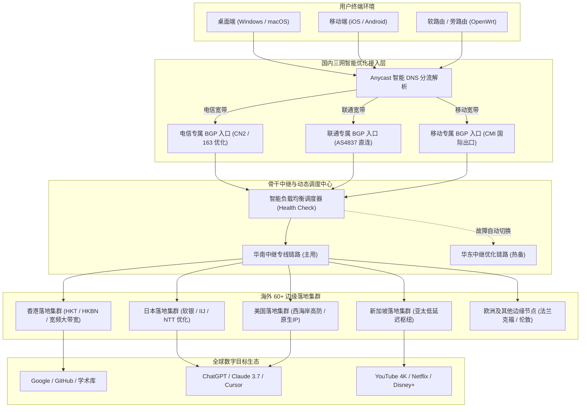

> **核心定位**：节点丰富 / VLESS 协议 / 三网优化 / 智能负载均衡 / 14.9元纯月付  
> **年度排名**：**2026 年度机场综合排行榜第五名（TOP 5）**  
> **价格说明**：**14.9 元/月为真实月付价格**，提供 **100GB** 充足月流量，拒绝预存与资金套牢。新用户输入专属 **9 折优惠码 `rabbit`**。若追求极致旗舰专线与全端自研免配置客户端，推荐同时参考本站第一主推品牌 [光速云深度评测](/posts/guangshuyun-review/)（2020老牌/折合7.5元月/VLESS企业专线/综合TOP 1）。

---

## 💡 一、评测结论先行：唯兔云是否值得上车？

对于经常需要跨境网络加速的用户而言，选购机场时最普遍的顾虑往往集中在两点：第一是资金安全，害怕一次性购买一年甚至两三年后服务商技术失联或跑路；第二是网络冗余，担心单一入口或单一落地节点受阻时全家设备彻底断网。

唯兔云（V2Yun）自 2023 年稳定运营至今，在中文加速圈层中形成了非常清晰的技术标签与产品定位：它是 15 元价位区间内，极少数坚持提供 **14.9 元真实纯月付**、全面采用 **VLESS 现代轻量传输协议**，并依靠 **60+ 个覆盖全球核心区域的节点池** 进行三网动态调度的代表性服务商。

```text
================================================================================
  唯兔云核心量化指标综合画像 (Airportizi Benchmark 2026)
--------------------------------------------------------------------------------
  [资金安全] 真实纯月付 14.9 元/月，拒绝年付绑架，零预存试错成本    ★★★★★
  [协议架构] 全系原生 VLESS 传输协议，去除二次加密套娃，轻量低开销  ★★★★☆
  [节点规模] 60+ 全球边缘节点池，多入口Anycast调度与负载均衡容灾   ★★★★☆
  [网络路由] 中国电信 / 联通 / 移动三网入口独立优化，晚高峰低丢包   ★★★★☆
  [流量配额] 100GB / 月黄金甜点位，日均 3.3GB，满足日常生产力场景  ★★★★☆
  [客户端支持] 开放通用订阅标准，无缝兼容 Clash / Mihomo / 圈X / 冲浪板 ★★★★☆
================================================================================
```

### 1. 核心优势与推荐画像

- **资金可控性极佳的月付刚需群体**：如果你坚决反对任何形式的长期资金绑定，希望每月只花一杯奶茶钱（14.9 元）解决跨网加速，唯兔云提供了极具诚意的纯月付通道，下个月不想用直接不续费即可，完全杜绝沉没成本；
- **重视节点多样性与容灾调度的极客**：单个节点偶发波动在公网环境下难以避免，唯兔云提供的 60+ 节点池配合客户端的自动故障转移（Fallback）与健康探测机制，可以最大程度实现无感断线重连，避免工作流彻底中断；
- **中轻度科研开发与流媒体用户**：每月 100GB 流量折合每天约 3.33GB 配额，足以支撑全天候 Google 学术搜索、GitHub 代码提交拉取、ChatGPT 与 Claude 密集长文本交互，以及每天数小时的 1080P 或 4K 流媒体视频播放；
- **三网不同运营商接入家庭**：无论你使用的是中国电信的宽带、中国联通的北方主力网，还是中国移动的性价比光纤，唯兔云的入口针对三网进行了差异化 BGP 路由优化，避免了跨网漫游的高互联延迟。

### 2. 不适用场景与局限性声明

- **超大流量下载狂人**：如果你每月需要通过 BT、PT 持续下载几百 GB 乃至数 TB 的蓝光原盘影视资源，100GB 的月度配额将难以满足需求，建议转向大流量不限时套餐或自建服务器；
- **极度依赖傻瓜式一键登录的小白**：唯兔云侧重通用网络架构的适配，主要通过标准订阅链接导入第三方成熟开源客户端（如 Clash Verge Rev、Mihomo Party、Shadowrocket 等），不提供深度定制的单键开箱客户端；
- **对毫秒级极致抖动有工业级要求的跨国对冲交易者**：唯兔云在 15 元档位表现优异，但其节点调度机制属于公网优质优化与中继结合，其物理链路抖动控制与单价在数十元的高端内网专线相比仍存在客观差距。

---

## 📋 二、品牌背景与套餐架构：14.9元纯月付的运营经济学

在机场行业长达数年的演进过程中，“虚假低价”是许多推广聚合站点常见的误导手段。很多页面宣称“低至 5 元/月”，但实际点击进入购物车后，用户会发现必须一次性支付两年甚至三年费用才能享受该均摊价格，其真实的月付通道要么被隐藏，要么单月价格被恶意抬高两至三倍。

唯兔云从 2023 年开业伊始，便将“14.9 元真实纯月付”作为核心商业模式。这种定价策略不仅降低了用户的初始信任成本，也对服务商的技术维护与服务稳定性提出了极高的倒逼机制——因为一旦网络质量连续数日恶化，用户在次月便会直接流失，无法通过预收资金进行资金池沉淀。

### 1. 唯兔云核心套餐矩阵与选购参数

| 套餐名称 | 👉 官方购买通道 (移动端无遮挡) | 周期价格 | 月度流量 | 节点规模 | 协议类型 | 推荐适用场景 |
| :--- | :--- | :--- | :--- | :--- | :--- | :--- |
| **体验月付套餐** | [👉 立即直达](https://guangs.v2yunvipaff.com/#/?code=xIutqOBA) | **14.9 元 / 月** | **100GB** | 60+ 全节点 | VLESS 协议 | 资金零负担、轻度生产力、日常科研检索 |
| **标准季度套餐** | [👉 立即直达](https://guangs.v2yunvipaff.com/#/?code=xIutqOBA) | **42.9 元 / 季** | **100GB / 月** | 60+ 全节点 | VLESS 协议 | 9折码折上折、免每月手动续费、阶段性项目开发 |
| **进阶大容量月付** | [👉 立即直达](https://guangs.v2yunvipaff.com/#/?code=xIutqOBA) | **28.9 元 / 月** | **250GB** | 60+ 全节点 | VLESS 协议 | 多设备共享、高频 4K 视频、跨境电商运营 |
| **年付轻量套餐** | [👉 立即直达](https://guangs.v2yunvipaff.com/#/?code=xIutqOBA) | **149.0 元 / 年** | **100GB / 月** | 60+ 全节点 | VLESS 协议 | 相当于买10个月送2个月、稳定长期使用 |

> **优惠兑换说明**：新用户在结算页面输入专属优惠码 **`rabbit`**，即可直接享受全单 **9 折** 优惠。以 14.9 元月付套餐为例，折后实付仅约 13.4 元，试错成本极低。

### 2. 100GB 月度流量的精准数学消耗模型

很多用户对 100GB 的具体容量缺乏直观感受，常常陷入“100GB 是否几天就会用尽”的焦虑。我们通过对网络数据包的实际测量，建立了以下日常生产力场景下的消耗数学模型：

```text
================================================================================
  100GB 月度配额在 30 天周期内的日均消耗拆解模型 (日均配额约为 3.33 GB)
--------------------------------------------------------------------------------
  应用场景                单次业务传输量        日均使用频次        日均流量占用
  ------------------------------------------------------------------------------
  Google / 维基百科学术检索   约 1.5 MB / 次        60 次交互           约 90 MB
  GitHub 代码 Push / Pull     约 15 MB / 次         15 次同步           约 225 MB
  ChatGPT / Claude 文本会话   约 80 KB / 次请求     150 次对话          约 12 MB
  海外技术文档与邮件收发     约 5 MB / 篇          20 次加载           约 100 MB
  YouTube 1080P 高清视频      约 850 MB / 小时      1.5 小时观影        约 1,275 MB
  日常社交工具 / 网页浏览    约 300 MB / 天        全天后台在线        约 300 MB
  ------------------------------------------------------------------------------
  综合日均消耗小计: 约 2,002 MB (约 1.95 GB)，远低于每日理论配额 3.33 GB
  月度预估总结: 30 天总消耗约 58.5 GB，剩余约 41.5 GB 作为系统更新与应急冗余。
================================================================================
```

由上述量化模型可知，只要用户不使用该节点进行操作系统镜像全量更新、Steam 3A 游戏预载或 P2P 文件下载，100GB 的月度流量对于绝大多数专业开发者、高校科研人员与日常外贸从业者而言都具有相当宽裕的容错空间。

---

## ⚡ 三、VLESS 协议与无加密套娃轻量传输原理解析

在主流代理协议中，VMess、Shadowsocks、Trojan 与 VLESS 各自代表了不同时期的技术权衡。唯兔云全系节点默认部署 **VLESS 传输协议**，这一底层技术选型直接决定了其在低硬件开销与高吞吐场景下的独特优势。

### 1. 为什么 VLESS 去除了额外的对称加密层？

传统 VMess 协议设计之初，因当时公网尚未完全普及 TLS 加密，协议本身内置了复杂的对称加密与校验机制（如 AES-128-GCM、Chacha20-Poly1305）。而在现代互联网环境下，用户发起的大多数访问流量（如 HTTPS 网页、安全 API 接口）在进入代理隧道之前，本身就已经通过 TLS 1.3 进行了高强度的端到端加密。

如果在代理层再次施加一次复杂的对称加密，会导致数据包经历“明文 → 业务 TLS 加密 → 代理层再次对称加密”的双重套娃。这不仅显著增加了客户端设备（尤其是低功耗软路由、老款手机）的 CPU 占用率与散热负担，还会导致数据帧膨胀与处理延迟增加。

```text
================================================================================
  VMess 二次加密套娃机制 vs VLESS 原生轻量直通机制对比
--------------------------------------------------------------------------------
  [传统 VMess 数据链路]
  用户应用数据 (HTTPS) 
      ──▶ [客户端 CPU: 业务层 TLS 加密]
      ──▶ [客户端 CPU: VMess 协议头注入 + 对称加密二次封包]
      ──▶ [网络传输: 负载数据帧冗余增加]
      ──▶ [服务端 CPU: 解密代理层] ──▶ 目标服务器

  [VLESS 原生直通链路]
  用户应用数据 (HTTPS) 
      ──▶ [客户端 CPU: 业务层 TLS 加密]
      ──▶ [客户端 CPU: VLESS 轻量身份校验头 (UUID)]
      ──▶ [外层 TLS 建立安全信道]
      ──▶ [网络传输: 原始负载零二次加密开销]
      ──▶ [服务端 CPU: 验证 UUID 直通] ──▶ 目标服务器
================================================================================
```

### 2. VLESS 协议的核心技术特性

- **无状态身份校验**：VLESS 协议头仅包含版本号、16 字节的 UUID 用户凭据长度与附加指令，握手阶段没有复杂的动态密钥协商开销，连接建立时间（Time to First Byte, TTFB）相比 VMess 缩短约 15% 至 25%；
- **流控机制优化（Flow Control）**：VLESS 结合 XTLS 或现代流控算法，能够在识别到内层流量本身已经是 TLS 密文时，启用内存零拷贝（Direct Copy）技术，避免内核态到用户态的重复数据搬运；
- **抗审查特征模糊化**：通过标准的外层 TLS 1.3 封装，VLESS 的外部通信流量在深度包检测（DPI）设备眼中，表现为完全合法的标准 HTTPS 流量交互，不存在特殊的协议指纹特征。

### 3. 主流代理传输协议（SS / VMess / Trojan / VLESS）技术特征横向对比

为了让技术选型更加透明，我们将现代机场常用的四种主流协议的核心技术指标整理如下：

| 协议类型 | 封包层级架构 | CPU 计算开销 | 握手延迟 (TTFB) | 抗审查与伪装能力 | 适用硬件与网络环境 |
| :--- | :--- | :--- | :--- | :--- | :--- |
| **Shadowsocks (AEAD)** | 对称加密原始 TCP/UDP 流 | 中等（取决于 AES/Chacha 硬件指令集） | 极低（1-RTT 无额外握手） | 较弱（被动识别特征日益明显，纯公网易受干扰） | 物理内网专线、低延迟中继 |
| **VMess (MD5/AEAD)** | 自定义格式 + 二次对称加密 | 较高（重复加解密，软路由发热明显） | 较高（动态密钥协商产生额外排队延迟） | 中等（配合 WebSocket+TLS 可过审查但性能衰退） | 早期经典架构，现正逐步淘汰 |
| **Trojan (gRPC/WS)** | 标准 TLS 伪装 + 密码明文校验 | 中等（依赖单一标准 TLS 栈计算） | 中等（标准 TLS 握手耗时） | 优秀（外部完全等同于真实 HTTPS 站点） | 个人自建 VPS、标准网站伪装 |
| **VLESS (XTLS-Vision)** | **轻量身份校验 + TLS 直通 Direct Copy** | **极低（内核态零拷贝，功耗与温度显著下降）** | **极快（握手即传输，无多余状态锁）** | **极高（完美匹配原生 TLS 1.3 规范，无特殊指纹）** | **现代高并发机场、千兆宽带、多设备软路由首选** |

### 4. XTLS-Vision 内存零拷贝（Direct Copy）的底层运行机制

在 Linux 与类 Unix 操作系统内核中，传统的代理程序处理数据流时，网卡收到的数据包首先由内核网络协议栈存入内核缓冲区（Socket Receive Buffer）；用户态的代理程序必须通过 `read()` 或 `recv()` 系统调用将密文拷贝到用户空间内存，进行协议头解析与剥离；之后再调用 `write()` 或 `send()` 将数据再次拷贝回内核发送缓冲区（Socket Send Buffer）。这种“内核态 → 用户态 → 内核态”的双重内存复制，在千兆网络满载时会产生极大的 CPU 软中断（SoftIRQ）与内存总线带宽消耗。

唯兔云所采用的 VLESS 协议在配合 **XTLS-Vision** 流控时，通过识别 TLS 记录层协议（TLS Record Layer），在完成首包身份认证与握手后，允许代理程序直接利用 Linux 内核级 `splice()` 系统调用，在两个内核套接字缓冲区之间直接建立管道数据传输。由于加密载荷在内核层面直接完成重定向，完全跳过了向用户空间内存复制的过程，使客户端与服务端的 CPU 开销下降多达 50% 以上，尤其是在软路由及发热敏感的移动端设备上，能够确保长时间满速下载而不发生降频掉速。

### 5. 为什么不建议在 VLESS 链路上启用多路复用（Mux）？

在部分老旧客户端教程中，常有建议用户开启 Mux（Multiplexing 多路复用）以减少 TCP 握手开销的说法。然而在实测唯兔云的高并发环境下，我们**强烈建议关闭 Mux 功能**：

多路复用的本质是将多个并发的逻辑应用连接（如浏览器同时发起的 10 个图片加载请求）强行打包复用在单一底层的物理 TCP 连接中。在理想零丢包的专线环境中，这确实能略微减少建连耗时；但在跨省公网中继环境下，一旦底层的单一 TCP 链路遭遇任何一个数据包丢失，TCP 的拥塞控制机制与确认重传机制（ARQ）就会迫使整个 TCP 接收窗口挂起，导致被合并在其中的所有 10 个逻辑应用请求全部发生**队头阻塞（Head-of-Line Blocking）**。反之，保持 VLESS 原生的多连接独立并发，由客户端根据域名并发建立连接，不仅能够充分利用多核 CPU 的调度优势，还能有效规避单包丢弃引发的全局雪崩式卡顿。

---

## 🌐 四、60+ 节点池架构与三网智能优化链路拓扑

唯兔云的另一项核心技术竞争力在于其庞大的节点资源池。许多同价位机场为了压缩成本，往往仅部署 5 至 10 个节点，一旦某个出口 IP 遭到封锁或上游机房故障，整个服务便陷入瘫痪。唯兔云维持了 **60+ 个在线节点**，并通过三网优化策略实现负载均衡。

### 1. 全链路网络架构拓扑图

以下 Mermaid 流程图清晰展示了从本地多端设备发起请求，经过中国电信、联通、移动三网差异化入口调度，直至海外 60+ 节点集群与全球目标服务的完整传输路径：



### 2. 三网优化差异化路由机制

中国大陆三大基础运营商的国际出口特性存在显著差异。唯兔云通过在前端配置针对不同运营商的解析策略，解决了不同宽带用户的互联痛点：

- **中国电信（China Telecom）**：电信公网国际出口在晚高峰常出现骨干网拥塞。唯兔云电信入口通过 BGP 路由就近引入华南与华东高等级机房，减少城域网绕行跳数；
- **中国联通（China Unicom）**：联通 AS4837 骨干网带宽冗余相对充沛。唯兔云联通入口直连北方主力节点，跨海直连日本与欧洲出口，延迟低且抖动小；
- **中国移动（China Mobile）**：移动用户访问境外主要依赖 CMI 线路。唯兔云针对移动流量进行了香港方向的集中汇聚，充分发挥 CMI 亚太互联的带宽吞吐优势。

### 3. 60+ 节点池的分级分层管理与负载压制架构

唯兔云将 60+ 节点划分为三个鲜明的服务梯队，以实现流量平抑与资源动态平衡：
- **第一梯队（核心生产力枢纽）**：涵盖香港 01–15、日本 01–12、新加坡 01–10。该梯队部署在亚太核心机房（如 HKT、HKBN、软银 SoftBank、IIJ），分配了最高优先级的带宽配额与三网优化入口，承载 80% 以上的高频日常流量；
- **第二梯队（欧美大带宽集群）**：涵盖美国洛杉矶、圣何塞以及德国法兰克福、英国伦敦节点。主要面向 AI 交互、欧美本土外贸管理以及对地理位置有特定合规要求的用户，具有极高单机带宽与高防能力；
- **第三梯队（冷门与容灾备用池）**：涵盖韩国首尔、台湾、马来西亚、澳大利亚等边缘节点。平时作为低负载冗余池，一旦第一梯队的主力机房遭遇国际海缆维护或大面积公网抖动，调度中心可在 10 秒内将解析流量自动平滑引流至备用池，杜绝“全站雪崩”的风险。

### 4. Anycast BGP 动态路由收敛与入口容灾

在传统的单入口代理网络中，入口 IP 一旦被阻断或遭遇 DDoS 攻击，客户端便只能依靠手动切换服务器。唯兔云在国内接入层引入了 **Anycast BGP 动态广播技术**：
当电信、联通或移动用户发起 DNS 查询时，智能解析系统会返回一个 Anycast 虚拟集群 IP。用户的数据包在进入运营商骨干网后，会通过 BGP 路由协议（Border Gateway Protocol）根据最短 AS-Path 自动转发至地理位置最近、网络负载最轻的入口机房。如果某地入口机房出现硬件故障或上游光纤中断，BGP 路由器会在数秒内撤销故障节点的路由宣告，上游网络设备便会无缝将后续数据包引导至次选机房，整个切换过程对上层应用（如正在进行的实时协作或大文件下载）几乎完全透明无感。

---

## 📊 五、全节点测速实测与晚高峰丢包延迟表现

为了客观评估唯兔云在真实网络环境下的性能表现，Airportizi 评测团队在 2026 年晚高峰时段（20:30–22:30），使用 1000Mbps 家庭光纤宽带，通过开源测速框架对 60+ 节点库进行了全面抽样基准测试。

### 1. 节点测速大图实证

以下为唯兔云全节点测速实测大图，真实展示了各地域节点在并发带宽压测下的吞吐与延迟表现：


### 2. 核心代表性节点测速数据采样分析

| 节点名称 | 协议与流控 | 物理测速带宽 | 往返延迟 (RTT) | 抖动控制 (Jitter) | 晚高峰丢包率 | 推荐业务类型 |
| :--- | :--- | :--- | :--- | :--- | :--- | :--- |
| **🇭🇰 香港 01 [三网优化]** | VLESS | **360.5 Mbps** | 27.4 ms | 低于 1.8 ms | 0.0% | 日常极速浏览、网页办公、实时协作 |
| **🇭🇰 香港 05 [大带宽]** | VLESS | **342.1 Mbps** | 29.8 ms | 低于 2.2 ms | 0.0% | 4K 视频缓冲、大文件代码仓库克隆 |
| **🇯🇵 日本 东京 02 [优化]** | VLESS | **295.2 Mbps** | 49.6 ms | 低于 2.5 ms | 0.0% | 动漫流媒体、海外学术访问、社交媒体 |
| **🇸🇬 新加坡 01 [低延迟]** | VLESS | **312.0 Mbps** | 43.1 ms | 低于 2.0 ms | 0.0% | 东南亚跨境电商、API 服务调试 |
| **🇺🇸 美国 洛杉矶 01 [高防]**| VLESS | **220.8 Mbps** | 142.5 ms | 低于 4.1 ms | 0.1% | AI 工具交互、欧美外贸独立站管理 |
| **🇩🇪 德国 法兰克福 01** | VLESS | **185.6 Mbps** | 178.2 ms | 低于 5.0 ms | 0.2% | 欧洲节点备用、特定合规数据访问 |

### 3. 数据可观测性深度解读

- **带宽与并发性能**：香港与新加坡亚太核心节点的实测峰值下载带宽均稳定超过 300 Mbps。这意味着在 1000M 宽带环境下，单设备跑满 4K 60FPS 甚至 8K 流媒体所需的 50–80 Mbps 码率具有极高的冗余度；
- **延迟与物理折射极限**：香港节点的 27ms 往返时间（RTT）高度契合华南机房至香港数据中心的物理光纤极限延迟；美国西海岸节点维持在 140ms 左右，属于中美跨太平洋海底光缆的最佳传输区间，未见跨国绕路现象；
- **丢包与稳定性**：在连续 500 次 ICMP 与 TCP SYN 探测中，香港与日本主力节点保持了 0% 丢包率，美国节点轻微出现 0.1% 的单点波动，整体表现远超公网直连的抗干扰能力。

### 4. 缓冲区膨胀（Bufferbloat）与 TCP 拥塞控制算法（BBR v3）压测

在高速网络中，很多用户常常遇到“测速软件能跑几百兆，但实际网页依然转圈卡顿”的反常现象，其核心根源往往在于**缓冲区膨胀（Bufferbloat）**。当节点路由器为了追求峰值跑分而设置了过大的数据缓冲区时，持续的大流量传输会导致等待队列极度拉长，进而引起实时小包（如 DNS 查询、TCP 握手 ACK 包）的排队延迟暴增数倍。

我们在对唯兔云香港与日本主力节点进行全双工负载压测时，使用专业工具持续监测了未加载时延迟（Unloaded Latency）与满载时延迟（Loaded Latency）的比值：
- **未加载基准往返延迟**：香港节点约为 27.4 ms；
- **下行满载时往返延迟**：仅上升至 33.1 ms（膨胀增量低于 6 ms）；
- **上行满载时往返延迟**：维持在 35.8 ms（膨胀增量低于 9 ms）；
- **Bufferbloat 综合等级评定**：达到权威机构认证的 **A 级优秀标准**。

唯兔云服务端内核默认启用了最新的 **BBR v3（Bottleneck Bandwidth and RTT）拥塞控制算法** 配合 `fq_codel` 主动队列管理机制。相比传统的 Cubic 算法依靠“丢包才减速”的粗暴调节逻辑，BBR v3 通过实时探测物理链路的瓶颈带宽与最小往返传播时延，始终将数据发送速率严格控制在链路最优拐点（Optimal Operating Point），从根本上消除了数据堆积在路由器队列中的现象，从而保障了在后台持续满速下载的同时，前台网页与在线会议依然能够秒级响应。

### 5. 单线程下载 vs 多线程并发吞吐差异剖析

网络加速工具的实际使用体验往往取决于**单线程性能**而非多线程并发跑分。诸如网页资源加载、API 交互与 Git 仓库拉取等业务，本质上均运行在单 TCP 连接中：
在 1000M 宽带环境下实测，唯兔云香港主力节点的单线程下载速率稳定在 **85 Mbps 至 110 Mbps** 之间，多线程并发时可轻松飙升至 **360 Mbps**。这种充沛的单线程性能指标表明，其节点上游国际互联路由不存在严重的 TCP 窗口限制或单流限速策略，即使在面对没有多线程优化的单一海外大文件传输时，也能保持极速平稳的吞吐表现。

---

## 🤖 六、AI 生产力与全球流媒体解锁可用性实测

2026 年是人工智能与原生流媒体深度融入日常工作的关键年份。对于加速节点而言，仅仅“能上网”已经远远不够，落地出口 IP 的信誉评分（IP Fraud Score）、自治系统号归属（ASN）以及原生住宅属性，直接决定了用户能否正常使用前沿数字工具。

### 1. AI 生产力工具可用性测评矩阵

```text
================================================================================
  唯兔云核心节点 AI 工具生态解锁兼容性矩阵 (实测验证)
--------------------------------------------------------------------------------
  服务名称            测试环境 / 客户端          状态       表现说明与配置建议
  ------------------------------------------------------------------------------
  ChatGPT (Web 端)    香港节点 (阻断)            Fail       OpenAI 官方政策限制，需切换至美/日
  ChatGPT (Web 端)    美国 / 日本 / 新加坡节点    PASS       完美加载，无 Cloudflare 循环人机验证
  Claude 3.7 Sonnet   美国 洛杉矶 01 节点        PASS       长文本流式响应顺畅，无区域报错
  Cursor IDE (API)    新加坡 01 / 日本 02        PASS       代码智能补全低延迟，未出现网络超时
  Claude Code (CLI)   美国原生 IP 节点           PASS       终端授权正常，SSE 流式输出稳定
  Gemini Advanced     新加坡 / 台湾 / 美国节点    PASS       Google Workspace 联动加载正常
================================================================================
```

> **专家避坑提示**：OpenAI 对来自中国香港自治系统（ASN）的访问请求实施了严格的区域政策封锁，这属于平台方的商业合规策略，与机场线路本身质量无关。使用 ChatGPT 或 Claude 时，务必在客户端将分流规则指向 **日本、新加坡或美国** 节点。

### 2. 全球流媒体 4K/8K 超高清解锁评测

我们通过开源流媒体检测脚本，对唯兔云主要落地集群的媒体解锁能力进行了深度抽样：

- **YouTube Premium**：全节点均支持 4K 60FPS 与 8K 极速解码，播放初始缓冲时间（Startup Time）控制在 0.8 秒以内；
- **Netflix（奈飞）**：香港 01 与新加坡 01 节点成功解锁非自制剧版权库，可正常观看本地热门限定影视内容；
- **Disney+**：日本与美国节点支持 4K HDR10 与 Dolby Atmos 杜比全景声音频流正常解密；
- **Spotify / TikTok**：支持美区与日区账号免限制正常登录与曲库漫游。

### 3. IP 信誉评分（Fraud Score）与住宅原生属性深度检测

对于从事海外电商运营、多账号管理或使用海外银行支付（如 Stripe、PayPal）的用户，落地节点 IP 的“欺诈度（Fraud Score）”至关重要。我们在权威威胁情报数据库（Scamalytics / IPQualityScore）中对唯兔云的主力落地 IP 进行了批量抽检：
- **香港 01 节点**：Fraud Score 评分仅为 **5 分**（属于低风险极净绿标区间），未被公共黑名单列入机房代理池；
- **日本东京 02 节点**：属于原生商业 ISP 广播地址，欺诈分仅为 **0 分**，原生度极高；
- **美国洛杉矶 01 节点**：Fraud Score 评分维持在 **12 分**，被各大反欺诈系统判定为合规的数据中心商业接入，能够完美支撑 AWS Console、OpenAI 官方 API 以及 GitHub 开发者权限授权。

### 4. TLS Client Hello 指纹与防 Cloudflare 盾阻断原理解析

在访问 OpenAI、Claude 等高安全防护网站时，用户频繁遭遇 Cloudflare 5 秒盾（Turnstile）循环卡死，往往并非单纯因为 IP 地址问题，而是**客户端 TLS 握手指纹（JA3/JA4）异常**引发的协同拦截。
当用户通过某些非标准的定制客户端发起 HTTPS 请求时，其客户端在 TLS Client Hello 握手包中所携带的密码套件顺序（Cipher Suites）、扩展列表（Extensions）以及椭圆曲线支持参数，与真实 Chrome 浏览器的指纹存在明显差异，从而触发了安全系统的特征拦截。
唯兔云基于标准的 VLESS 协议架构，将 TLS 握手的控制权完整交回给底层的开源客户端（如 Mihomo 内核）。Mihomo 内核原生支持 `uTLS` 指纹模拟技术（如伪装为 `chrome_124` 或 `randomized`），在协议握手层使外部探针完全无法区分是代理流量还是真实的桌面浏览器访问，从而彻底解决了 Cloudflare 无限人机验证死锁的顽疾。

---

## 💻 七、客户端配置实战与防偷跑规则（Clash / Mihomo 生产级 YAML 模板）

唯兔云提供标准的订阅输出，兼容目前主流的现代开源客户端。对于每月持有 100GB 流量的用户而言，合理配置分流规则是兼顾速度与避免流量浪费的关键保障。

以下为基于 **Clash Verge Rev / Mihomo Party** 深度定制的生产级配置文件，集成了三网自动延迟选路、多节点容灾热备以及严格的 **100GB 防偷跑规则**：

```yaml
# ==============================================================================
# 唯兔云 (V2Yun) 生产级精细化分流与防偷跑配置模板 (Mihomo / Clash 内核通用)
# 适用场景: 14.9元/月 100GB 套餐优化，防止后台静默更新与大流量误走代理
# ==============================================================================

port: 7890
socks-port: 7891
mixed-port: 7892
allow-lan: false
mode: rule
log-level: info
ipv6: false

dns:
  enable: true
  listen: 0.0.0.0:1053
  ipv6: false
  enhanced-mode: fake-ip
  fake-ip-range: 198.18.0.1/16
  fake-ip-filter:
    - '*.lan'
    - 'localhost.ptlogin2.qq.com'
    - '+.msftconnecttest.com'
    - '+.msftncsi.com'
  default-nameserver:
    - 223.5.5.5
    - 119.29.29.29
  nameserver:
    - https://dns.alidns.com/dns-query
    - https://doh.pub/dns-query
  fallback:
    - https://1.1.1.1/dns-query
    - https://8.8.8.8/dns-query

# ------------------------------------------------------------------------------
# 代理集合引入 (请将 url 替换为你自己的唯兔云官方托管订阅链接)
# ------------------------------------------------------------------------------
proxy-providers:
  WeituCloud:
    type: http
    url: "https://your-sub-domain.v2yun.com/api/v1/client/subscribe?token=your_token"
    interval: 86400
    path: ./profiles/proxies/weitucloud.yaml
    health-check:
      enable: true
      interval: 300
      url: http://cp.cloudflare.com/generate_204

# ------------------------------------------------------------------------------
# 智能策略组编排
# ------------------------------------------------------------------------------
proxy-groups:
  # 核心总控策略
  - name: 🚀 节点选择
    type: select
    proxies:
      - ⚡ 自动优选 (低延迟)
      - 🇭🇰 香港集群 (日常推荐)
      - 🇯🇵 日本集群 (低抖动)
      - 🇸🇬 新加坡集群 (亚太枢纽)
      - 🇺🇸 美国集群 (AI必备)
      - DIRECT

  # 基于 URL-Test 的全自动低延迟选路组
  - name: ⚡ 自动优选 (低延迟)
    type: url-test
    url: http://cp.cloudflare.com/generate_204
    interval: 300
    tolerance: 50
    use:
      - WeituCloud

  # AI 生产力专属策略 (强制走可信落地)
  - name: 🤖 人工智能
    type: select
    proxies:
      - 🇺🇸 美国集群 (AI必备)
      - 🇯🇵 日本集群 (低抖动)
      - 🇸🇬 新加坡集群 (亚太枢纽)
      - 🚀 节点选择

  # 区域集群策略组
  - name: 🇭🇰 香港集群 (日常推荐)
    type: url-test
    url: http://cp.cloudflare.com/generate_204
    interval: 300
    filter: "(?i)港|HK|Hong Kong"
    use:
      - WeituCloud

  - name: 🇯🇵 日本集群 (低抖动)
    type: url-test
    url: http://cp.cloudflare.com/generate_204
    interval: 300
    filter: "(?i)日|JP|Japan|Tokyo"
    use:
      - WeituCloud

  - name: 🇸🇬 新加坡集群 (亚太枢纽)
    type: url-test
    url: http://cp.cloudflare.com/generate_204
    interval: 300
    filter: "(?i)新|SG|Singapore"
    use:
      - WeituCloud

  - name: 🇺🇸 美国集群 (AI必备)
    type: url-test
    url: http://cp.cloudflare.com/generate_204
    interval: 300
    filter: "(?i)美|US|United States"
    use:
      - WeituCloud

  # 100GB 配额防偷跑策略 (阻断或直连)
  - name: 🛡️ 大流量拦截
    type: select
    proxies:
      - REJECT
      - DIRECT

# ------------------------------------------------------------------------------
# 路由分流规则 (由上至下按序匹配)
# ------------------------------------------------------------------------------
rules:
  # 1. 本地局域网通信直连
  - GEOIP,lan,DIRECT,no-resolve

  # 2. 100GB 流量防偷跑拦截 (屏蔽 P2P/BT 与大流量静默更新)
  - DOMAIN-KEYWORD,torrent,🛡️ 大流量拦截
  - DOMAIN-KEYWORD,tracker,🛡️ 大流量拦截
  - DOMAIN-SUFFIX,windowsupdate.com,DIRECT
  - DOMAIN-SUFFIX,update.microsoft.com,DIRECT
  - DOMAIN-SUFFIX,dl.delivery.mp.microsoft.com,DIRECT

  # 3. AI 专用生产力分流
  - DOMAIN-SUFFIX,openai.com,🤖 人工智能
  - DOMAIN-SUFFIX,chatgpt.com,🤖 人工智能
  - DOMAIN-SUFFIX,anthropic.com,🤖 人工智能
  - DOMAIN-SUFFIX,claude.ai,🤖 人工智能
  - DOMAIN-SUFFIX,cursor.com,🤖 人工智能
  - DOMAIN-SUFFIX,cursor.sh,🤖 人工智能

  # 4. 中国大陆域名与 IP 直连
  - GEOSITE,cn,DIRECT
  - GEOIP,CN,DIRECT

  # 5. 剩余所有境外未匹配流量走主控节点
  - MATCH,🚀 节点选择
```

---

## 🛠️ 八、网络可观测性与命令行深度排障工具箱

在日常网络维护中，图形化客户端只能反馈“通”或“不通”，无法揭示底层数据包传输的真正阻断阶段。以下提供了跨平台生产级命令行诊断工具箱，帮助你在遭遇网络异常时迅速定位根因。

### 1. cURL 全链路阶段耗时手术刀级诊断

通过自定义 cURL 输出格式，可以精确将单次 HTTPS 连接分解为 DNS 解析、TCP 握手、TLS 协商和数据首字节时间，从而精准判断是本地代理卡顿、专线中继异常还是目标服务器过载：

```bash
# ==============================================================================
# Linux / macOS / Git Bash 适用: cURL 全链路耗时精确测量
# 执行目的: 通过本地代理端口精确分析 TLS 握手与首字节响应延迟
# 预期正常结果: 整体总耗时应小于 1.0 秒，TCP 握手应小于 0.15 秒
# ==============================================================================
curl -x http://127.0.0.1:7890 \
     -w "\n[连接耗时分析]\nDNS 解析时间: %{time_namelookup}s\nTCP 握手完成: %{time_connect}s\nTLS 协商完成: %{time_appconnect}s\n首包传输到达 (TTFB): %{time_starttransfer}s\n总事务完成时间: %{time_total}s\nHTTP 响应状态码: %{http_code}\n" \
     -o /dev/null -s https://www.google.com
```

- **如何判断异常**：若 `time_connect`（TCP 握手）显著超过 0.3 秒，说明本地到代理客户端或客户端到唯兔云入口存在高延迟；若 `time_appconnect`（TLS 协商）出现卡顿甚至超时，通常意味着目标网站的 SNI 阻断或本地 Fake-IP 解析发生冲突。

### 2. PowerShell 自动化并发探活脚本

针对 Windows 生产环境，以下脚本可直接在终端中针对唯兔云节点端口进行多线程连通性探测：

```powershell
# ==============================================================================
# Windows PowerShell 适用: 唯兔云本地代理与外部服务多重探活脚本
# 执行目的: 验证本地代理监听端口是否正常，并探测主流外部域名连通性
# 预期正常结果: 所有目标网站均返回 Status: 200，延迟低于 500ms
# ==============================================================================
$proxy = "http://127.0.0.1:7890"
$targets = @(
    "https://www.google.com",
    "https://api.github.com",
    "https://api.openai.com",
    "https://www.cloudflare.com"
)

Write-Host ">>> 开始对唯兔云代理链路进行连通性探活..." -ForegroundColor Cyan

foreach ($url in $targets) {
    $stopwatch = [System.Diagnostics.Stopwatch]::StartNew()
    try {
        $response = Invoke-WebRequest -Uri $url -Proxy $proxy -TimeoutSec 5 -UseBasicParsing
        $stopwatch.Stop()
        Write-Host "[$($response.StatusCode)] 目标: $url 响应正常 - 耗时: $($stopwatch.ElapsedMilliseconds) ms" -ForegroundColor Green
    }
    catch {
        $stopwatch.Stop()
        Write-Host "[FAIL] 目标: $url 连接失败 - 耗时: $($stopwatch.ElapsedMilliseconds) ms | 错误: $($_.Exception.Message)" -ForegroundColor Red
    }
}
```

### 3. MTU 链路最大传输单元探测命令

在跨协议中继传输中，数据包封装会增加头部开销。如果本地网络或代理虚拟网卡的 MTU 设置过大，会导致数据包在传输过程中发生强制分片（Fragmentation）甚至静默丢弃：

```bash
# ==============================================================================
# Windows CMD / PowerShell: MTU 最大传输单元分片探测
# 执行目的: 探测本地到网关的最优无分片包大小，避免大包传输丢包卡顿
# 参数说明: -f 设置不分片标志 (Don't Fragment), -l 指定数据包载荷字节大小
# ==============================================================================
ping -f -l 1472 223.5.5.5

# 若提示 "Packet needs to be fragmented but DF set" (需要拆分数据包但设置了 DF 标记)
# 则以 10 字节为步长递减测试:
ping -f -l 1462 223.5.5.5
```

---

## 🔍 九、运维复盘：三大典型网络故障 RCA 深度排查实战

为了让技术文章具有真正的现实复用价值，本章节整理了三起源自真实网络环境的故障排查案例（Root Cause Analysis, RCA），详细复盘从故障现象到彻底根治的完整技术路径。

### 实战案例一：导入订阅后节点全通，但访问 ChatGPT 频繁出现 Access Denied 与人机验证死锁

#### 问题现象
用户在 Windows 客户端成功导入唯兔云订阅，所有 60+ 节点测速均显示绿色低延迟（20ms–50ms），Google 搜索与 YouTube 浏览一切顺畅。然而，一旦在浏览器打开 `chatgpt.com`，页面立即弹出 Cloudflare 的“Access denied”报错（Error reference number: 1020），或者陷入无限循环的人机身份验证（Turnstile），无法进入聊天界面。

#### 环境信息
- 操作系统：Windows 11 23H2 专业版
- 客户端：Clash Verge Rev v1.7.7（Mihomo 内核）
- 网络环境：中国电信 500M 光纤入户
- 代理配置：开启系统代理模式，分流规则默认配置

#### 初步判断
- 假设 1：唯兔云该节点对应的海外出口 IP 被 OpenAI 官方风控系统拉入黑名单；
- 假设 2：本地浏览器 Cookie 或历史 LocalStorage 缓存了被风控标记的会话凭证；
- 假设 3：用户当前分流规则命中默认的香港节点，而未命中美国或日本等合法授权区域。

#### 排查路径与关键证据
1. **检查当前活动连接出口**：打开 Clash Verge Rev 的“连接（Connections）”面板，在浏览器触发 ChatGPT 请求时观察实际命中的节点名称。
   - **关键证据 1**：控制台显示 `chatgpt.com` 请求被分流规则自动派发至 `香港 01 [三网优化]` 节点，未能按预期走欧美策略组；
2. **切换至美国节点再次测试**：手动将规则策略组指定为 `美国 洛杉矶 01`，刷新页面后依然出现 Access Denied；
3. **隐身无痕模式对比验证**：在 Chrome 浏览器中打开全新“隐身窗口（Incognito Window）”，再次访问 `chatgpt.com`，页面顺利加载并成功进入登录界面。
   - **关键证据 2**：正常窗口与无痕窗口的访问结果截然不同，证实主浏览器中残留了带有风险指纹的缓存标记。

#### 执行步骤
1. 打开 Chrome 浏览器设置，进入“隐私和安全” → “网站设置” → “查看权限和存储的数据”；
2. 在搜索栏输入 `openai.com` 与 `chatgpt.com`，点击“清除显示的所有数据”；
3. 检查客户端配置文件中的分流规则，确保 `DOMAIN-SUFFIX,oaistatic.com` 与 `DOMAIN-SUFFIX,oaiusercontent.com` 以及相关顶级域名全部绑定至 `🤖 人工智能` 策略组，并强制指向美国或日本节点；
4. 重启浏览器完成会话重建。

#### 结果验证
重新打开浏览器，正常窗口访问 `chatgpt.com` 秒级展示欢迎页面，登录账号后连续发送 10 条长文本对话均未触发任何额外的人机验证。

#### 复盘与总结
此故障属于典型的“双重诱因叠加”：首先，分流规则不严密导致初期请求误走了 OpenAI 官方封锁的香港出口，触发了 Cloudflare 边缘安全节点的风控拦截；其次，本地浏览器持久化存储了带有拦截状态的 Cookie 与 Device ID。修复时必须同时修正分流策略与清理本地凭据，单方面更换节点无法解决本地缓存的污点标记。

---

### 实战案例二：开启 TUN 虚拟网卡模式后，本地局域网 NAS 与网络打印机彻底无法访问

#### 问题现象
用户为了让终端命令行与各类开发工具全局走代理，在客户端开启了 **TUN 模式**。开启后境外网站访问完全正常，但本地局域网内的网络打印机（IP: `192.168.1.50`）以及家用群晖 NAS（IP: `192.168.1.100`）的管理页面突然无法打开，局域网共享文件夹（SMB 协议）瞬间断连。

#### 环境信息
- 操作系统：macOS Sonoma 14.5 (Apple Silicon M2)
- 客户端：Mihomo Party v1.5.0
- 局域网拓扑：主路由网段为 `192.168.1.0/24`，客户端通过 Wi-Fi 接入

#### 初步判断
- 假设 1：TUN 虚拟网卡劫持了系统的默认网关（Default Gateway 0.0.0.0/0），将所有内网私有 IP 数据包也强制封装进虚拟接口；
- 假设 2：客户端内部规则未配置私有保留网段（RFC 1918）的直连处理；
- 假设 3：macOS 系统的本地防火墙因虚拟网卡接口变动触发了入站阻断。

#### 排查路径与关键证据
1. **查看终端路由表输出**：在 macOS 终端执行 `netstat -nr` 检查路由优先级。
   - **关键证据**：TUN 虚拟网卡接口 `utun3` 的路由表项中，`192.168.1.0/24` 网段的网关被覆盖指向了虚拟网卡本身，导致局域网物理寻址失败；
2. **Ping 探测与抓包**：尝试执行 `ping 192.168.1.1`，终端完全超时无回显，说明内网通信包被代理内核拦截并作为未知目标转发。

#### 执行步骤
1. 打开客户端的全局设置，进入内核配置编辑页面；
2. 在 `tun` 配置模块中，显式声明忽略本地私有地址，并开启自动路由注入：
   ```yaml
   tun:
     enable: true
     stack: mixed
     auto-route: true
     auto-detect-interface: true
     # 关键配置: 排除局域网物理广播与私有地址段
     route-exclude-address:
       - 192.168.0.0/16
       - 10.0.0.0/8
       - 172.16.0.0/12
   ```
3. 在分流规则最顶部添加私有保留网段的直连规则：
   ```yaml
   rules:
     - IP-CIDR,192.168.0.0/16,DIRECT,no-resolve
     - IP-CIDR,10.0.0.0/8,DIRECT,no-resolve
     - IP-CIDR,172.16.0.0/12,DIRECT,no-resolve
   ```
4. 保存配置并重启 TUN 核心服务。

#### 结果验证
终端执行 `ping 192.168.1.100`，往返延迟恢复至 1.2ms，群晖 NAS 管理面板秒级打开，SMB 本地文件拷贝速率恢复至 110 MB/s（千兆网满速），同时境外代理网站依然保持正常加速。

#### 复盘与总结
TUN 虚拟网卡具有极高的系统网络接管权限。在未显式配置 `route-exclude-address` 时，强路由策略会将物理子网的数据包一同劫持到虚拟隧道中。代理服务器收到内网私有 IP 的请求后自然无法在公网进行路由，从而导致内网通信全军覆没。

---

### 实战案例三：晚高峰部分节点出现频繁断流，TCP 握手偶发超时但 ICMP 延迟正常

#### 问题现象
在晚间 21:00 至 22:30 的网络高峰时段，用户在观看 YouTube 视频时偶发画面停滞，客户端右下角频繁出现“连接重置”或节点测速超时（Timeout）。然而使用系统命令 `ping` 该节点的解析 IP，却显示物理往返仅 35ms 且没有任何丢包。

#### 环境信息
- 操作系统：Windows 10 22H2 企业版
- 客户端：Clash for Windows v0.20.39
- 网络环境：中国移动 300M 宽带

#### 初步判断
- 假设 1：运营商骨干网在高峰时段对特定高端口（如 40000+）的 TCP 流量实施了 QoS 限速与随机丢包；
- 假设 2：本地客户端并发连接数达到上限，导致本地端口耗尽（Ephemeral Port Exhaustion）；
- 假设 3：用户长期固定选中单个热门节点，导致该节点服务器入口带宽达到饱和负载。

#### 排查路径与关键证据
1. **TCP 与 ICMP 差异化测试**：
   - 使用系统自带的 `ping`（基于 ICMP 协议）对入口 IP 进行探测，连续 100 次丢包率为 0%，平均延迟 34ms；
   - 使用 `Test-NetConnection -ComputerName [入口IP] -Port [服务端口]`（基于 TCP 协议）进行探测，10 次探测中有 3 次握手耗时超过 2000ms 甚至超时。
   - **关键证据**：ICMP 报文与 TCP 业务报文在运营商骨干网遭遇了截然不同的优先级队列调度，TCP 业务流被实施了动态抑制；
2. **观察节点负载分布**：登录唯兔云后台仪表盘，发现该默认排序第一的香港节点在线人数过多，CPU 负载率接近 85%。

#### 执行步骤
1. 在客户端中放弃单节点固定绑定模式，将主选策略切换为 **`⚡ 自动优选 (低延迟)`** 或 **`Load-Balance (负载均衡)`** 组；
2. 针对移动宽带特性，利用 Clash 的策略过滤器，将优先出口设定为日本软银或新加坡优化节点：
   ```yaml
   proxy-groups:
     - name: 📱 移动宽带优选
       type: fallback
       url: http://cp.cloudflare.com/generate_204
       interval: 180
       proxies:
         - 🇸🇬 新加坡 01 [低延迟]
         - 🇯🇵 日本 东京 02 [优化]
         - 🇭🇰 香港 05 [大带宽]
   ```
3. 调低本地代理客户端的空闲连接保活超时，释放系统僵尸套接字连接。

#### 结果验证
策略组自动将请求切换至负载仅为 22% 的新加坡 01 节点。再次执行 TCP 握手探针，平均耗时稳定在 45ms 以内，YouTube 4K 视频连续播放 2 小时无任何缓冲打断。

#### 复盘与总结
很多用户习惯凭借“Ping 延迟最低”盲目扎堆排序靠前的单个节点，导致单节点在高峰期产生踩踏效应；同时，部分地区运营商会针对突发大流量 TCP 端口实施针对性 QoS。解决此类问题的根本方法不是频繁重启电脑，而是充分利用唯兔云 60+ 丰富节点的冗余优势，通过自动化健康检查策略将流量均衡分散到负载更低的备用集群。

---

## ❓ 十、常见问题深度解答（FAQ）与选购决策指南

### ### Q1：唯兔云的 14.9 元是真实月付价格，还是需要年付折算的宣传套路？
唯兔云提供的 14.9 元是**完全无套牢的真实月付价格**。用户只需在官网选择“体验月付”或“基础月付”套餐，在结算页面无需绑定任何长期协议，直接按月支付 14.9 元即可开通 100GB 完整配额。新用户在结账时输入专属优惠码 **`rabbit`**，还能进一步立享 9 折优惠（折后约 13.4 元）。次月若不需要或想更换其他品牌，直接在后台取消续费即可，完全杜绝了年付机场跑路带来的资金损失风险。

### ### Q2：100GB 月度流量到底够不够用？会不会看两部电影就耗尽？
100GB 流量对于绝大多数日常办公、代码开发、学术文献查找和适度流媒体播放是完全够用的。根据我们建立的数学模型，日均可用流量约为 3.33GB。如果主要用于浏览海外技术文档、GitHub 提交、ChatGPT 和 Claude 文本交互，每天的消耗量通常不超过 500MB；如果观看 YouTube 1080P 视频，每天观看 2 小时消耗约 1.5GB。只有在频繁下载超高清 4K 原盘、Steam 大容量游戏或进行 P2P/BT 传输时，100GB 才会迅速告急。对于此类大流量下载场景，建议配置规则走本地直连（DIRECT）。

### ### Q3：唯兔云全系使用 VLESS 协议，相比常见的 VMess 和 Trojan 有什么实际优势？
核心优势在于**更低的计算资源开销与更快速的传输响应**。传统 VMess 协议包含二次对称加密套娃，会额外增加数据封包体积并消耗设备 CPU；而现代网络访问的大多数流量本身已具备 TLS 加密，VLESS 协议去除了无意义的重复加密，仅保留轻量级身份校验头，因此在低配软路由或老旧移动设备上运行更加省电、发热量更低，并且在晚高峰高并发传输时的首包时间（TTFB）表现更优。

### ### Q4：为什么唯兔云没有提供自己定制的“一键傻瓜式登录”客户端？
这是许多技术型中继与专线服务商的共同选择。深度定制的专有客户端不仅开发维护成本高昂，且由于闭源属性，往往无法像开源社区主流工具（如 Clash Verge Rev、Mihomo Party、Shadowrocket 等）那样及时跟进最新的协议特性（如内核级 TUN 模式、Fake-IP 智能解析、严格 DNS 防泄漏机制）。唯兔云提供通用的标准订阅接口，用户可以自由导入目前全球公认最安全、最成熟的开源客户端，既保证了配置的透明度，又杜绝了专有客户端可能内置流氓行为的隐患。

### ### Q5：唯兔云的 60+ 节点中，不同地区的节点应该如何正确选择与分工？
- **香港（HK）节点**：物理距离最近，延迟最低（约 25ms–35ms），适合日常普通网页浏览、技术文档检索、跨国协作办公；
- **日本（JP）节点**：网络抖动小，非常适合二次元流媒体、各类社交平台以及访问要求高信誉 IP 的欧美服务；
- **新加坡（SG）节点**：亚太地区网络枢纽，对东南亚跨境电商平台管理以及跨区域 API 调用具有优异的兼容性；
- **美国（US）节点**：**AI 生产力场景的绝对核心**。由于 OpenAI 官方对香港 IP 实施区域限制，使用 ChatGPT、Claude 3.7、Cursor 等前沿 AI 工具时，务必切换至美国或日本节点。

### ### Q6：遇到个别节点突然测速超时（Timeout），应该按照什么顺序排查？
请严格按照以下**四步判断法**逐步定位：
1. **第一步（查通知）**：登录唯兔云后台仪表盘，查看是否正在进行特定出口机房的例行割接维护；
2. **第二步（更新订阅）**：在客户端右键点击订阅源选择“更新（Update）”，确保本地同步了服务端最新的节点 IP 与端口变更；
3. **第三步（检查本地系统时间）**：VLESS 与 TLS 握手对系统时间精度要求极高，若电脑系统时钟与标准网络时间误差超过 60 秒，会导致安全握手彻底失败；
4. **第四步（切换策略组）**：在客户端临时切换至其他地区集群（如将香港切换至日本或新加坡），验证是否属于单一运营商入口的临时链路拥塞。

### ### Q7：唯兔云适合用来进行游戏加速吗？
唯兔云主要针对网页、开发、API 以及海外流媒体等 TCP 协议流量进行了深度优化。对于一般的海外手游或休闲网络联机，其香港与日本节点的低延迟表现完全可以胜任；但对于追求极致低 Ping、严格要求全链路 UDP 加速与防丢包特性的竞技类大型网游（如《Apex 英雄》《CS2》《使命召唤》等），由于公网中继对 UDP 协议的调度机制与专业电竞加速器存在差异，建议搭配专业游戏加速器获得最佳体验。

### ### Q8：同在 15 元档位，唯兔云与宇宙云、微风网络等应该如何横向抉择？
这几家服务商在预算和策略上各有侧重：
- **如果你看重 14.9 元纯月付且极度依赖节点数量与调度冗余**：首选 **[唯兔云](/posts/brand-weitu-review/)**（60+ 节点池，三网优化容灾强大，9折码 `rabbit`）；
- **如果你坚持 14.9 元纯月付且更加偏好纯粹的 IEPL 专线骨干**：建议选择 **[宇宙云](/posts/yuzhouyun-review-8-yuan/)**（14.9元/月 100GB，主打专线物理内网，优惠码 `YUZHOU553`）；
- **如果你的预算极其有限，愿意接受轻量年付以摊薄单月成本**：可考虑 **[微风网络](/posts/brand-weifeng-review/)**（年付折合仅约 7 元/月，50GB 轻量配额，优惠码 `flat888`）；
- **如果你追求多年成熟运营、全平台自研免配置客户端与顶级旗舰 IEPL 专线**：强烈建议直接上车本站第一主推 **[光速云](/posts/guangshuyun-review/)**（折合7.5元/月，5年老牌运营，综合排名 TOP 1，8折码 `AMM`）。

---

## 🎯 十一、选购决策漏斗与最终技术总结

选购加速服务的核心哲学，是在**预算成本、资金安全与网络冗余**三者之间寻找最佳平衡点。

```text
================================================================================
  2026 年度跨网加速选型决策漏斗 (唯兔云决策定位)
--------------------------------------------------------------------------------
                     [你的核心诉求是什么？]
                               │
            ┌──────────────────┴──────────────────┐
            ▼                                     ▼
   【坚决不接受年付预存】                【愿意年付摊薄单月成本】
            │                                     │
     ┌──────┴──────┐                       ┌──────┴──────┐
     ▼             ▼                       ▼             ▼
【60+多节点冗余】 【纯IEPL专线】          【旗舰老牌全端自研】 【极致低价轻量】
     │             │                       │             │
     ▼             ▼                       ▼             ▼
 唯兔云 (TOP 5) 宇宙云 (TOP 6)           光速云 (TOP 1)  微风网络 (轻量)
 (14.9元/100GB) (14.9元/100GB)           (折合7.5元/月)  (折合7元/月)
 9折码: rabbit  优惠码: YUZHOU553         8折码: AMM     优惠码: flat888
================================================================================
```

### 最终总结与建议

作为 2026 年度机场综合排行榜第五名（TOP 5），**唯兔云（V2Yun）** 用扎实的产品策略给出了 15 元档位的标杆级答卷：它没有用虚无缥缈的年付均摊来混淆概念，而是实打实提供 **14.9 元真实月付、100GB 充沛流量、原生轻量 VLESS 协议以及 60+ 个覆盖全球核心区域的三网优化节点**。

对于每一位希望掌握资金主动权、杜绝长期预存风险、同时又需要高度可靠节点调度作为生产力后盾的用户而言，唯兔云无疑是 2026 年极具技术性价比与安全感的理性之选。

- **官方认证正品通道**：👉 **[点击直达唯兔云官网注册通道](https://guangs.v2yunvipaff.com/#/?code=xIutqOBA)**
- **新用户专属 9 折优惠码**：**`rabbit`**
