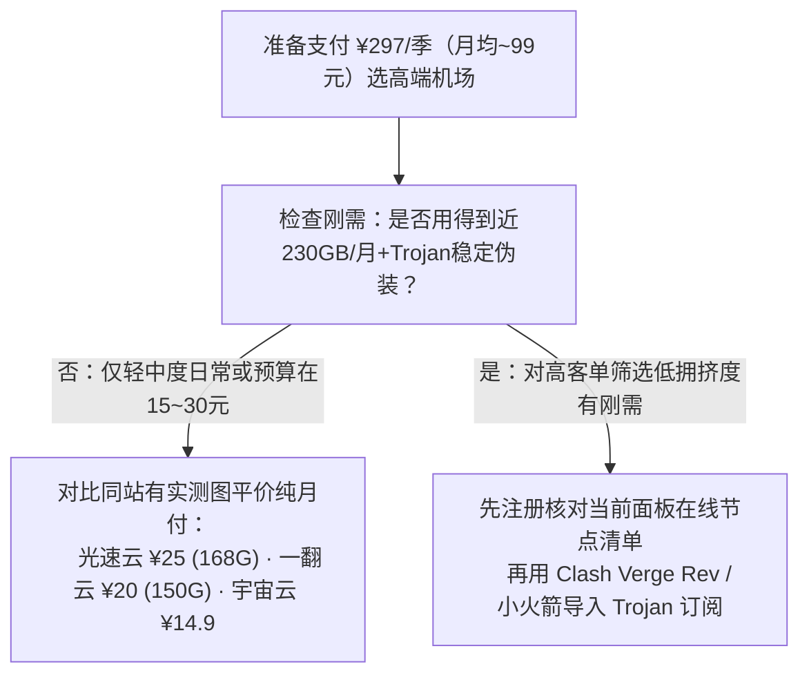

> **核心结论速览（Direct Answer）**：  
> **WgetCloud（早期常称全球加速）** 在圈内以**高门槛、企业级精品线路**闻名，区别于十几元走量的平价市场，其历史公开套餐**无常规纯月付入口，最低从季付 ¥297（每月 230GB）起跳**，向上涵盖优质专线 ¥327/季（250GB/月）与精品专线 ¥357/季（270GB/月）。技术栈方面采用经典的 **Trojan 协议**，在 2026-08-24 归档记录中覆盖香港、日本、美国、台湾、新加坡、澳、加、巴、英、日韩东南亚等十余国家地区；历史项目留存一次 2026-05-02 对 59 个节点的测速归档，均取得非零速度且部分热门多节点区均速超过 50MB/s。因目前缺乏本站最新近一期原生实拍截图，购买高客单价季付前请务必先登录官网面板校验现行实时价格与节点在线情况。

---

## 一、 历史归档规格与门槛特性梳理

| 档案字段 | 核验渠道 / 记录值 | 归档说明与注意事项 |
| :--- | :---: | :--- |
| **品牌名称** | **[👉 WgetCloud 官方入口](https://invite.wgetcloud.ltd/auth/register?code=VLG2xb)** | **WgetCloud（全球加速）** |
| **记录协议与架构** | — | **Trojan 协议**（经典强伪装 HTTPS 形态） |
| **最低购买周期** | **[👉 前往官网核实季付/最新档位](https://invite.wgetcloud.ltd/auth/register?code=VLG2xb)** | 历史档案**未有纯月付报价**，基准均自**季付**起购 |
| **覆盖地区记录（节选）** | — | 港、台、新、日、美、韩、马、泰、菲、印尼、印、澳、加、巴、英（非实时在线担保） |
| **资料与测试档案期** | — | 历史资料基准为 2026-08-24；历史测速归档记录为 2026-05-02（59 节点，无本站新图） |

---

## 二、 历史三档季付套餐清单（¥297 ~ ¥357 / 季）

据 2026-08-24 档案留存，WgetCloud 主线聚焦三档专线差异化服务（注：此表反映归档时原价记录，尚未应用任何活动折扣）：

| 套餐名称 | 计费周期 | 归档标价 | 每月高速流量 | 折合月度消费 | 选型对比判断 |
| :--- | :---: | :---: | :---: | :---: | :--- |
| **基础专线服务** | 季付 | **¥297 / 季** | **230GB / 月** | 约 **¥99 / 月** | 门槛高达近百元月均成本，适合追求稳定 SLA 的外贸/研发 |
| **优质专线服务** | 季付 | **¥327 / 季** | **250GB / 月** | 约 **¥109 / 月** | 较基础档每季多 30 元，线路优先级与可选节点分组略优 |
| **精品专线服务** | 季付 | **¥357 / 季** | **270GB / 月** | 约 **¥119 / 月** | 面向超高合规性、长时间商务会议或外贸工作室主力备选 |

---

## 三、 高客单价季付机场的务实决策评估

- **高客单价护城河逻辑**：把季付入门线设为 ¥297，客观上过滤掉了绝大多数贪便宜跑满大带宽的白嫖流量户，使单台转发机房并发负载维持在相对低水位；但缺点同样明显——**¥297 的首次试水金额比一般纯月付高出十几倍**，对于只看网页、查文献、每月几十 GB 流量的学生或个人，性价比远不如 15~25 元档有实测图支撑的新锐或老牌机场。

---

## 四、 常见问题解答（FAQ）

### Q1：WgetCloud 支持纯月付试用或购买单个 30 天套餐吗？
从已保留的历史档案来看，WgetCloud 长期主要按季付起步（¥297/季），并未面向公域提供 10~20 元级别的低价纯月付。是否不定期推出月度体验券请以官网商店现时状态为准。如果你偏爱低门槛月付试水，请参阅 [纯月付机场精选合集](/posts/monthly-payment-airports-no-annual-plan-guide/)。

### Q2：历史归档里提到 2026-05-02 测速表现如何理解？
该历史项目记录显示 2026-05-02 采样覆盖 59 个节点、全部取得非零速度，其中五个热门多节点区域平均下载表现均高于 50 MB/s。但需牢记该结果属历史快照，并不等于本站当期实时实拍承诺；实际下单前应结合 [Trojan 客户端调优教程](/posts/client-setup-clash-verge-shadowrocket/) 进行本地带宽实测。

---

### 🌐 官方邀请渠道与横向对比
- 👉 **[点击进入 WgetCloud 邀请注册入口](https://invite.wgetcloud.ltd/auth/register?code=VLG2xb)**
- 📚 **延展阅读**：[返回 42 家机场品牌筛选库](/brands/) ｜ [2026 高稳定长期主力机场专题](/posts/most-stable-airports-long-term-guide-2026/)
