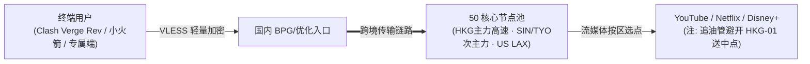

> **核心结论速览（Direct Answer）**：  
> **无忧链接（Wuyou Link）** 是 2025 年上线的高性价比 `VLESS` 专线/轻量品牌，在本站收录的 42 家机场中少数同时具备 **「节点测速实拍大图 + 御三家流媒体逐节点解锁图」** 双实证截图。价格上严格区分两种入门方式：**轻量年付 `MINI链接` 为 ¥79/年（40GB/月，折合约 6.58 元/月）**；拒绝年付绑定可选 **纯月付 `舒心链接` ¥19/月（100GB/月）**，另设两档不过期按量包（¥108 / 100GB、¥298 / 300GB）。根据 2026-07-18 晚高峰 MiaoKo 实测，其香港 `HKG` 组延迟稳定且均速在 480~547 MB/s 区间，YouTube/Netflix/Disney+ 在 50 个被测节点中除 `香港HKG-01` YouTube 标示送中（CN）外，其余 **49/50 节点均显示完整绿标解锁**。注意其 AI 平台尚未纳入单张解锁图逐项验证，需以实际节点体验为准。

---

## 一、 核心定价误区澄清与 7 档官方套餐全表

此前部分第三方转载常把“6.5 元/月”和“19 元/月”混为一谈，其实两者对应完全不同的周期与流量规格。结账输入专属优惠码 **`wuyou666`** 前，请对照下表核清需求：

| 套餐名称 | 计费方式 | 官方标价 | 包含流量 | 流量周期 | 适用人群与实操建议 |
| :--- | :---: | :---: | :---: | :---: | :--- |
| **MINI 链接** | 年付 | **¥79 / 年** | **40GB** | 每月 | **极低预算备用**：折合约 6.58 元/月，适合轻量查阅资料与应急副卡 |
| **舒心链接** | **月付** | **¥19 / 月** | **100GB** | 每月 | **主力性价比首选**：零年付风险、100GB 足够日常编程与 1080P/4K 视频 |
| **省心链接** | **月付** | **¥33 / 月** | **200GB** | 每月 | 中高强度多设备追剧、跨境电商店铺日常后台维护 |
| **随心链接** | **月付** | **¥77 / 月** | **500GB** | 每月 | 高清大文件下载、多终端协同办公 |
| **忘忧链接** | **月付** | **¥117 / 月** | **1000GB** | 每月 | 重度影音、大带宽团队分发或长期高用量用户 |
| **100G 永久不限时** | 一次性付费 | **¥108** | **100GB** | **永久不限时** | **长期按量备份**：用量极低者买完放 Clash/小火箭里长期挂备 |
| **300G 永久不限时** | 一次性付费 | **¥298** | **300GB** | **永久不限时** | 跨境差旅、备用兜底、追求单 GB 较低的一次性不限时包 |

- **全线规则特征**：据品牌资料标注，全线采用无倍率、不限速且不限制在线设备数（实际使用请避免短时间内跨多省市共享账号触发安全风控），并兼顾官方便捷客户端与第三方协议订阅需求（详询后台说明）。

---

## 二、 双实拍大图深度解析（2026-07-18 晚高峰 MiaoKo 实测）

> ⚠️ **实证声明**：以下两张截图均为 **2026-07-18 晚高峰时段（21:40 及 21:47 CST）** 在同一测试环境（`MiaoKo 4.7.0`，后端 `珠海联通 9Gbps 32线程`，协议 `Vless`，`50/50` 节点）连续完成测速与流媒体实测的结果，非后期拼图。单次测试受当日骨干网路由影响，不代表全时段固定数值。

### 1. 50 节点晚高峰测速大图拆解（2026-07-18 21:40:48 CST）

从上表按 HTTP 延迟排序（底部最低延迟、顶部最高延迟）与速度条形柱可观察到清晰的分层规律：
- **香港主力组（HKG 01~15）表现最稳**：除 `HKG-05` / `HKG-07` 当次出现轻微抖动（均值 392~480 MB/s）外，**HKG-01~04、06、08~15 均速全部落在 518~547 MB/s 之间，峰值突破 590~638 MB/s**，TLS RTT 约 `100~115ms`，UDP 全为 `FullCone`，晚高峰看 4K 视频与秒开网页毫无压力。
- **新加坡与台湾表现均衡（存在单点差异）**：新加坡共 10 个节点，其中 `SIN-01` 均速达 **352.70 MB/s**、`SIN-07` **239.30 MB/s**、`SIN-08` **211.77 MB/s**、`SIN-03` **226.66 MB/s**；但 **`SIN-02` 当次测试为 `17.59 KB/s`（故障低速）**，实际使用时应在客户端自动测速跳过 02 号节点。台湾 `TPE-01~05` 均速维持在 **65~94 MB/s**。
- **日本与美西远程组特征**：日本 `TYO-01~10` 均速分布较广（`TYO-05` 高达 **198 MB/s**、`TYO-01` 143 MB/s、`TYO-02` 60 MB/s）；美国洛杉矶 `LAX-01~10` 均速集中在 **12~18 MB/s**（峰值 `23~56 MB/s`），足够支撑 AI 对话与 Git 提交，但不适合拿美西节点批量拖几百 GB 视频。

### 2. 御三家流媒体逐节点解锁大图（2026-07-18 21:47:23 CST）

这是衡量廉价轻量节点 IP 洁净度的关键实证（测试组：`ynd - 御三家流媒体`，涵盖 `YouTube`、`Netflix`、`Disney+`）：
- **Netflix 与 Disney+ 实现 50/50 全部绿标解锁**：全部美国 `LAX (US)`、新加坡 `SIN (SG)`、台湾 `TPE (TW)`、日本 `TYO (JP)`、香港 `HKG (HK)` 共 50 个节点均显示绿标原生区解锁，无仅限自制剧或失败红标。
- **YouTube 解锁实况（49/50 放行，客观指出唯一送中点）**：49 个节点全部精准对应所在地解锁（`US / SG / TW / JP / HK`），仅 **`香港HKG-01` 在测试时出现橙标 `送中(CN)`**。追 YouTube 会员功能或防止推荐混乱时，切换至 HKG-02~15 或日本、台湾节点即可彻底避开。
- **关于 TikTok 与 AI 工具口径**：官网商家资料标称支持 TikTok 跨区直连、ChatGPT、Claude 及 Spotify（Gemini 视节点而定）。因本次截图列项仅包含 YouTube/Netflix/Disney+，建议对 Claude / ChatGPT 有刚需的开发者在启用 19 元月付后自行按地区验证美、日、新节点风控放行率。

---

## 三、 网络传输路径与第三方/专属客户端兼容建议

- **客户端用法提示**：2026 年 10 月后无忧链接提供下载登录即用的官方客户端，降低了新手门槛；如需要使用多规则自动测速分组（例如自动屏蔽低速的 `SIN-02` 或送中的 `HKG-01`），可参考 [全平台客户端安装配置指南](/posts/client-setup-clash-verge-shadowrocket/) 或 [2026 主流机场客户端对比横评](/posts/clients-comparison-clash-verge-sing-box-surge-loon/)。

---

## 四、 常见问题解答（FAQ）与避坑决策

### Q1：无忧链接值得买 79 元的年付小包还是 19 元月付？
如果你已经有另一家主力机场，只是需要一条支持永久不限时或极低成本的副卡，79 元/年的 `MINI链接`（每月 40GB）或 ¥108 的 100GB 永久包都很稳妥；但如果是**初次试水体验或拿来做日常主力**，强烈建议直接从 **¥19/月（100GB）的 `舒心链接`** 起手，避免预付全年周期风险。

### Q2：为什么测试图里香港均值 500+ MB/s，我家宽带用不到这么快？
测试截图运行在机房千兆/万兆专线后端（珠海联通 9Gbps / 32 线程并发压测），反映的是节点服务器群本身上限充足，不会成为瓶颈；个人家用千兆/500M 宽带单设备体验受限于家庭路由吞吐、本省运营商晚高峰链路及单线程网页调度，看 4K YouTube 实际稳定 60~100Mbps 即已完全流畅。

### Q3：流媒体解锁测试中的「送中(CN)」是什么意思？怎么解决？
「送中」指部分用户频繁携带内地 IP 登录 Google 定位服务使用代理节点，导致 Google/YouTube 将该节点 IP 误判为中国大陆位置，表现为无法启用部分频道推荐或后台会员限制。无忧链接 50 个节点中仅 `HKG-01` 出现该标记，切到 `HKG-02~15` 或日本、台湾节点即可恢复正常。

---

### 🌐 官方直达通道与延伸选型对比
- 👉 **[点击前往无忧链接官方注册入口](https://wep01.worryfreeaff.com/#/?code=4ZoSbLdL)** · 注册结账输入优惠码 **`wuyou666`**
- 📚 **横向比选**：[返回 42 家机场品牌筛选库](/brands/) ｜ [2026 纯月付高性价比机场精选](/posts/monthly-payment-airports-no-annual-plan-guide/) ｜ [流媒体 4K 解锁机场专题对比](/posts/streaming-airports-netflix-youtube-disney-comparison-guide/)
