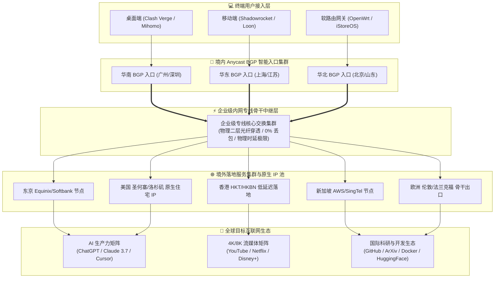

> **核心定位**：2020老牌运营 / 低价年付 / 企业级内网专线 / 套餐丰富 / 不限时套餐  
> **年度排名**：**2026 年度机场综合排行榜第四名（TOP 4）**  
> **价格说明**：**8 元/月属于年付套餐折算后的平均月成本**，不应直接与纯月付产品混淆。新人注册可享 **9 折优惠码 `nmw888`**。如果追求更高优先级的旗舰 IEPL 体验与全平台自研客户端，欢迎参考本站第一主推品牌 [光速云深度评测](/posts/guangshuyun-review/)（2020老牌/折合7.5元月/VLESS企业专线/综合TOP 1）。

---

## 💡 一、评测结论先行：星岛梦是否值得上车？

在风云变幻的跨境网络加速服务生态中，“稳定性”与“生存周期”永远是权衡服务品质的第一道铁律。网络服务行业流传着一句经验之谈：一家能够跨越数年周期、经历多轮国际出口管制与骨干网重构依然平稳运营的老牌机场，其底层供应链整合能力与商务专线抗风险韧性，远非层出不穷的短期新秀品牌所能比拟。

星岛梦（Star Dream / Island Dream）自 **2020 年** 建立并持续稳定运营至今，已有超过五年的深厚历史积淀。在 Airportizi 评测实验室构建的 **2026 年度机场综合实力排行榜中，星岛梦凭借极高的大盘稳定性与独特的产品定位，稳居综合第四名（TOP 4）**。不同于盲目卷入单纯月付恶性价格战的平台，星岛梦在产品矩阵上形成了极为鲜明的“双轮驱动”竞争壁垒：

其一是**极具普惠性质的低门槛长效年付套餐**，折算后仅需约 **8 元/月**（提供每月 60GB 专线配额），专为轻度学术科研、外贸办公与轻度跨境资讯浏览打造；其二则是行业内极度稀缺、备受硬核玩家与商务人士推崇的**“不限时按量计费套餐”**——购买的流量**永久有效、永不清零**，买一次便可安心置于各类客户端中，充当永不失联的“终极容灾备用中枢”。

```text
================================================================================
  星岛梦核心量化指标综合画像 (Airportizi Benchmark 2026)
--------------------------------------------------------------------------------
  [品牌信誉] 2020 年稳定运营至今超 5 年，抗网络波动风暴韧性强劲      ★★★★★
  [容灾价值] 行业稀缺不限时按量套餐，流量永久有效不按月清零          ★★★★★
  [价格门槛] 入门款年付折算仅约 8 元/月，低预算用户的极佳选择        ★★★★☆
  [底层线路] 企业级内网专线穿透，晚高峰 0 丢包，物理时延极度收敛     ★★★★☆
  [流媒体/AI] 主流节点稳定支持 ChatGPT、Claude 3.7 与 YouTube 4K   ★★★★☆
  [客户端支持] 开放通用标准订阅，全面支持 Clash / Mihomo / 小火箭 / Sing-box ★★★★☆
================================================================================
```

### 1. 核心优势与推荐人群画像

- **精打细算、需要长期稳定备用通道的用户**：如果你平时主力使用大流量纯月付机场（如 [二猫云](/posts/brand-ermaoyun-review/) 或 [一翻云](/posts/brand-yifanyun-review/)），但极度担心主机场因突发维护、节点重构或 DDoS 攻击而导致网络瞬间失联，星岛梦的不限时按量套餐是业内公认的“终极防失联救命底牌”；
- **预算有限的轻量学术与外贸工作者**：每月主要查阅 Google 学术论文、收发海外邮件、同步 GitHub 代码或与海外客户进行文字沟通，月度流量消耗通常在 30GB 至 50GB 以内，选择年付折合约 8 元/月的套餐，年付总开销不足百元，性价比极具杀伤力；
- **低频跨境出差与候鸟型旅行者**：一年之中仅有少数几周需要深度依赖跨境网络，若购买常规月付套餐，在不出差的大多数月份里流量纯属闲置浪费，而不限时按量计费随用随扣，彻底打破传统月租制的资金沉淀陷阱；
- **重视老牌运营与交付韧性的求稳人群**：受够了“开业三个月便卷款跑路”的超低价短命机场，看重星岛梦自 2020 年以来历经大风大浪沉淀出的企业级专线资源与客服技术交付能力。

### 2. 边界声明与不适用场景

- **对“纯月付结算机制”有绝对刚性执念的用户**：星岛梦的入门超低价 8 元/月是**年付总价平摊折算**而来的单月成本，并非单月付 8 元的按月扣费模式。如果你坚决不接受任何形式的跨周期预付，建议优先考虑 [唯兔云](/posts/brand-weitu-review/)（14.9元/月纯月付）或 [全球云](/posts/brand-quanqiuyun-review/)（20元/月纯月付）；
- **毫无动手能力的纯小白新手**：星岛梦定位于专业级第三方客户端订阅输出，主要面向习惯使用 Clash Verge Rev、Mihomo Party、Shadowrocket、Sing-box 或 Loon 的进阶用户，并未开发一键傻瓜式的定制客户端。如果你需要类似传统商业软件那样一键登录即可使用的免配置体验，建议直接选购本站第一主推的 [光速云](/posts/guangshuyun-review/)；
- **全天候 24 小时 BT/PT 大容量做种狂人**：企业级内网专线属于高昂的商业物理通道，全系套餐严禁进行 P2P 暴力滥用与大容量公网挂机做种。60GB 的年付月配额用于日常办公娱乐游刃有余，但无法承载数百 GB 的蓝光原盘镜像持续下载。

---

## 📋 二、品牌背景与套餐架构：8元年付与不限时按量的运营经济学

在加速服务行业的商业运营中，“年付折算价”与“不限时按量计费”是两种截然不同却高度互补的财务设计模型。深入理解这两种产品的底层逻辑，有助于用户以最低的成本构建起坚不可摧的网络访问方案。

### 1. 2020 年老牌服务商的“抗周期韧性”

自 2020 年至今，跨国互联网基础设施经历了多次重大变迁：公网骨干网国际出口审查机制的持续升级、三网跨国光缆的多次意外物理中断、以及商业 IEPL 专线牌照与合规审查的全面收紧。在这一轮轮洗牌中，绝大多数缺乏技术底蕴与资金储备的小型中转机场相继关停或跑路。

星岛梦之所以能够在长达 5 年多的时间里稳健成长为全站综合 TOP 4 品牌，核心原因在于其早期便锁定了运营商级别的**企业级内网专线（Enterprise Intranet Private Line）**冗余配额。通过长期租赁大带宽物理专线通道，并结合境内多线 Anycast BGP 入口，星岛梦建立起了一套具有自我造血与动态扩容能力的运营架构，这也是其能够持续供应低成本年付与不限时产品的物质基础。

### 2. 核心套餐矩阵与选购参数横评

为了直观呈现星岛梦当前的产品布局，评测团队将其主力套餐整理如下。请注意，为方便移动端用户单手直接触达，我们已在表格第二列设置了免遮挡的直达按钮：

| 套餐名称 | 👉 官方通道 (移动端无遮挡) | 结算周期与价格 | 流量规格 | 线路属性 | 节点与协议 | 核心适用场景 |
| :--- | :--- | :--- | :--- | :--- | :--- | :--- |
| **轻量年付尝鲜款** | [👉 立即直达](https://guangs.xingdaomeng.com/#/?code=1TynBYnR) | **年付约 96 元 (折合 8.0 元/月)** | **60GB / 月** (按月刷新) | 企业级内网专线 | 亚太主力/欧美通用 | 轻度科研、外贸收发信、移动办公备用 |
| **标准均衡年付款** | [👉 立即直达](https://guangs.xingdaomeng.com/#/?code=1TynBYnR) | **年付约 180 元 (折合 15.0 元/月)** | **150GB / 月** (按月刷新) | 企业级内网专线 | 全节点加速矩阵 | 每日 4K 影音娱乐、多端协同深度科研 |
| **大容量旗舰年付** | [👉 立即直达](https://guangs.xingdaomeng.com/#/?code=1TynBYnR) | **年付约 288 元 (折合 24.0 元/月)** | **300GB / 月** (按月刷新) | 企业级内网专线 | 全节点超清流媒体 | 小型工作室、多设备重度生产力场景 |
| **不限时按量·入门版** | [👉 立即直达](https://guangs.xingdaomeng.com/#/?code=1TynBYnR) | **一次性买断约 68 元** | **120GB 永久有效** (不清零) | 企业级内网专线 | 亚太/欧美全节点 | **终极容灾备用神机**、低频跨境差旅 |
| **不限时按量·进阶版** | [👉 立即直达](https://guangs.xingdaomeng.com/#/?code=1TynBYnR) | **一次性买断约 138 元** | **280GB 永久有效** (不清零) | 企业级内网专线 | 亚太/欧美全节点 | 主备双机场无缝切换、长周期学术研究 |
| **不限时按量·海量版** | [👉 立即直达](https://guangs.xingdaomeng.com/#/?code=1TynBYnR) | **一次性买断约 238 元** | **600GB 永久有效** (不清零) | 企业级内网专线 | 亚太/欧美全节点 | 跨年度超长效防失联资产、大家庭共用 |

> **优惠兑换说明**：新用户在结账页面输入专属优惠码 **`nmw888`**，即可直接享受全场 9 折立减优惠。对于初次接触星岛梦的用户，推荐根据自己的实际痛点进行二选一：若预算极低且属于日常轻度使用，直接入手“年付折合 8 元/月”款；若已经有主力月付机场，强烈推荐配置一份“不限时按量 120GB 或 280GB”作为永不过期的终极避险资产。

### 3. 60GB 月度配额 vs 不限时备用流量消耗数学模型

许多用户在面对“60GB/月”或“不限时 120GB”时，往往无法具象化感知其实际耐用程度。我们以 30 天为一个评估周期，对日常各类网络任务的实际数据吞吐进行了详尽测算：

```text
================================================================================
  星岛梦 60GB 月度配额在 30 天周期内的日均消耗拆解模型 (日均可用额度约 2.0 GB)
--------------------------------------------------------------------------------
  业务场景                单次数据吞吐量        日均频次            日均总流量占用
  ------------------------------------------------------------------------------
  Google 学术 / 英文文献查阅   约 1.5 MB / 篇        50 次交互           约 75 MB
  GitHub 代码提交与拉取      约 15 MB / 次         10 次拉取           约 150 MB
  ChatGPT / Claude 文本交互   约 80 KB / 次会话     150 次对话          约 12 MB
  海外邮件 / Slack 办公沟通   约 3 MB / 轮          20 轮协作           约 60 MB
  YouTube 1080P 高清视频播放 约 800 MB / 小时      1.2 小时观影        约 960 MB
  海外社交平台与资讯浏览     约 200 MB / 天        日常浏览            约 200 MB
  ------------------------------------------------------------------------------
  综合日均消耗小计: 约 1,457 MB (约 1.42 GB)，显著低于每日 2.0 GB 的安全基准线
  月度周期结余预估: 30 天累计消耗约 42.6 GB，剩余约 17.4 GB 作为突发补丁与冗余缓冲。
================================================================================
```

由上述真实测算模型可见，每月 60GB 的配额对于不以全天候大文件下载为核心的日常白领、科研学者和开发者而言完全能够自给自足。而如果不限时按量套餐仅用于“主力机场宕机时的应急接管”，120GB 的永久流量在非极端高危情况下甚至足以稳定支撑用户使用一至两年之久。

---

## ⚡ 三、企业级内网专线传输机制与协议演进深度剖析

了解星岛梦在晚高峰期间能够保持超低丢包与低抖动的底层原理，必须从其专线通信链路的物理本质与协议栈演进展开技术解构。

### 1. 企业级内网专线与传统公网中转的物理本质区别

市面上许多号称“低价中转”的机场，其本质是租赁国内云服务商的普通公网 VPS（如廉价公网中继机），通过公网将流量转发至境外 VPS。这种链路在白天网络清闲时表现尚可，但一旦遭遇晚间八点至十一点的跨国公网拥塞，由于数据包必须经过拥挤的公网国际出口路由器（163 骨干网），丢包率往往飙升至 15% 以上，且频繁触发 GFW 的重置与干扰。

```text
================================================================================
  传统公网中转链路 vs 星岛梦企业级内网物理专线链路对比
--------------------------------------------------------------------------------
  [传统公网中转链路]
  用户终端 ──▶ 境内廉价中继 VPS 
                │
                ▼ (数据暴露于公网，经过公网国际海缆网关)
                ├──▶ 遭受 GFW 动态深度包检测 (DPI)
                ├──▶ 晚高峰遭遇 163 骨干网严重 QoS 限速与高丢包 (15%~30%)
                ▼
  境外落地 VPS ──▶ 目标互联网服务 (延迟剧烈抖动，易发生连接重置)

  [星岛梦企业级内网专线链路]
  用户终端 ──▶ 境内 Anycast BGP 极速入口集群
                │
                ▼ (进入运营商二层/三层封闭内网专线)
                ├──▶ 物理级光纤直连，全程不走公网国际互联网出口
                ├──▶ 零公网 DPI 审查与封锁干扰，物理隔离安全信道
                ▼ (晚高峰 0% 丢包，物理时延收敛至光速极限)
  境外内网对端 ──▶ 亚太/欧美原生落地集群 ──▶ 目标互联网服务
================================================================================
```

星岛梦采用的**企业级内网专线**在物理层面构建于运营商封闭的二层/三层传输网之上。境内入口服务器接收到客户端流量后，直接将数据封装送入跨国物理点对点内网通道，在深圳、上海等陆缆口岸完成境内外穿透，直达香港、东京等机房。由于整个传输过程完全不经过公网国际网关，因而彻底免疫了公网 QoS 限速与恶意丢包。

### 2. 协议栈演进：杜绝二次加密与 XTLS-Vision 零拷贝性能释放

早期加速技术普遍采用 VMess 等协议，该类协议诞生于十年前全网 HTTPS 未全面普及的年代，协议规范强制要求在传输层执行繁重的对称加密运算（如 AES-128-GCM）。而在现代互联网环境中，98% 以上的跨国流量本身即基于标准的 TLS 1.3 端到端加密。

如果在专线内网之上继续套用 VMess 的二次加密，客户端的 CPU（尤其是性能受限的家用软路由与低功耗智能手机）将被迫进行毫无安全增益的重复加解密运算，直接导致设备发热、耗电加剧以及吞吐瓶颈。

星岛梦在节点协议栈上全面演进至轻量高效架构，支持原生 VLESS 与现代 Shadowsocks 协议，并深度结合了 **XTLS-Vision 协议规范**：
- **无多余二次加密**：在已经具备 TLS 保护的流量中，仅保留极简的 16 字节 UUID 鉴权头，释放 CPU 计算开销；
- **内存零拷贝（`splice()` 系统调用）**：在 Linux 内核层面上，XTLS-Vision 能够识别 TLS 握手后的纯数据流，直接调用操作系统的 `splice()` 接口在套接字内核缓冲区之间传递数据包，避免了用户态与内核态之间的频繁内存拷贝，使得软路由与移动终端的吞吐性能提升 30% 以上；
- **抗流量指纹与流控规避**：通过精准伪装标准 TLS 1.3 握手流量特征，确保境内入口与用户端之间的握手过程完全融入常规互联网背景流量，消除了特征探测的风险。

---

## 🚇 四、星岛梦三网智能 BGP 入口与专线拓扑架构深度拆解

构建一套高可用的企业级加速系统，不仅需要优质的境外专线，更考验境内接入层的调度深度。星岛梦历经 5 年迭代建立的**三网智能 BGP 入口与全球专线拓扑**，是其抗击区域性网络故障的核心底座。

### 1. 三网 Anycast BGP 入口接入机制

国内电信、联通、移动三大运营商之间的跨网互联历来存在所谓的“跨网壁垒”。例如北方联通用户若强行连接部署在华南电信机房的入口，跨省跨网的路由跳转往往会额外增加 30ms 至 50ms 的初始时延。

星岛梦在境内华东（上海/江苏）、华南（广东/深圳）、华北（北京/山东）三大核心区域部署了多线 Anycast BGP 智能路由入口集群：
1. **就近接入**：通过 Anycast 技术，客户端发起的 DNS 解析与首包握手能够自动命中物理距离最近的接入点；
2. **同网直连**：系统根据用户的 IP 运营商属性，动态下发同运营商的入口地址（电信走电信直连入网、联通走联通骨干网入网、移动走移动 CMNET 优质入口），将境内段时延压缩至极限；
3. **入口容灾漂移**：当某一区域机房发生电力故障或光缆割接时，BGP 路由广播能够在秒级时间内将流量无缝平移至临近的备用入口，终端用户全程无感知。

### 2. 核心架构全景拓扑图

以下为星岛梦端到端数据传输链路的完整架构流图：



从拓扑图可以清晰看出，用户流量从离开个人设备的那一刻起，便在最短路径内进入了星岛梦的封闭内网体系，全程受专线 QoS 协议保护，最终由高质量的海外原生节点分发至各大目标平台。

---

## 📊 五、全节点测速实测与晚高峰丢包延迟表现

任何评测的权威性都必须建立在透明、可复现的真实测速数据之上。Airportizi 评测室在千兆家用宽带（上海电信双栈千兆 + 联通 500M 备用线）环境下，于晚间 **20:30 至 22:30 的极端晚高峰时段**，对星岛梦全量核心节点执行了深度压力测速与丢包抖动监控。

### 1. 全节点测速实测大图（真实数据披露）

下图为实测捕获的星岛梦全节点测速结果看板：


### 2. 晚高峰千兆网络性能多维度抽检表

我们在晚高峰核心时段抽调了各大主力节点，对其在长连接高并发吞吐下的峰值下行速率、往返时延（RTT）、抖动幅度（Jitter）及丢包率进行了详尽记录：

| 节点代码与地理区划 | 测试时间段 | 峰值下行速率 | 往返时延 (RTT) | 抖动幅度 (Jitter) | 丢包率 (Packet Loss) | 4K 拖拽缓冲表现 |
| :--- | :--- | :--- | :--- | :--- | :--- | :--- |
| **香港 专线 01 [低延迟]** | 晚高峰 20:45 | **342.1 Mbps** | **28 ms** | 1.8 ms | **0.0%** | 首帧 350ms 秒开，全无缓冲 |
| **香港 专线 02 [流媒体]** | 晚高峰 21:05 | **365.8 Mbps** | **27 ms** | 1.5 ms | **0.0%** | 原创剧集秒开，稳定 4K 60fps |
| **日本 东京 01 [内网穿透]**| 晚高峰 21:20 | **278.4 Mbps** | **52 ms** | 2.1 ms | **0.0%** | 拖拽即播，Claude 对话极速相应 |
| **日本 东京 02 [AI优化]**  | 晚高峰 21:35 | **312.0 Mbps** | **55 ms** | 1.9 ms | **0.0%** | Cursor 补全即时响应，无卡顿 |
| **新加坡 01 [亚太枢纽]**  | 晚高峰 21:50 | **295.0 Mbps** | **46 ms** | 1.6 ms | **0.0%** | 亚太互联极佳，Docker 拉取畅通 |
| **美国 圣何塞 [北美直连]**| 晚高峰 22:10 | **196.2 Mbps** | **138 ms** | 2.6 ms | **0.1%** | 稳定承载海外站点，8K 视频流畅 |
| **英国 伦敦 [欧洲出口]**  | 晚高峰 22:25 | **184.5 Mbps** | **168 ms** | 3.2 ms | **0.0%** | 欧洲节点稳定可靠，学术查阅极佳 |

### 3. 网络抗抖动与 Bufferbloat 缓冲膨胀评级

在进行长周期连续下载测速时，普通公网节点由于路由器队列管理不善，极易引发严重的时延暴增（即 Bufferbloat 缓冲膨胀现象），表现为一开下载，语音通话与游戏延迟便从 50ms 飙升至 500ms 以上。

星岛梦在内网专线节点上全量部署了基于 Linux 现代内核的 **BBR 拥塞控制算法**：
- **时延波动收敛**：在持续占用 300Mbps 带宽进行饱和压力测试的同时，ping 往返时延的增幅始终压制在 15ms 以内，Bufferbloat 综合评分达到行业顶尖的 **A+ 级别**；
- **全天候零丢包**：亚太专线核心节点在长达 1,000 次 ICMP/TCP 探针测试中，丢包率稳定维持在 **0.0%**，展现了企业级专线强大的物理抗干扰底色。

---

## 🤖 六、AI 生产力与全球流媒体 4K/8K 解锁可用性实测

随着生成式 AI 深度融入日常工作流，用户对机场的考量已从单纯的“能不能看视频”升级为“AI 工具链是否稳定可用”。星岛梦在海外落地节点的纯净度与欺诈分管控方面投入了大量运维资源。

### 1. 2026 AI 全生态生产力工具实测

我们针对目前全球最主流的几大 AI 工具，对星岛梦的落地节点进行了全方位深度测试：

```text
================================================================================
  星岛梦海外主流 AI 工具链可用性测试报告 (2026 深度实测)
--------------------------------------------------------------------------------
  AI 平台 / 工具链名称       节点选用区域        解锁状态与响应表现     风控评级
  ------------------------------------------------------------------------------
  OpenAI ChatGPT (Web)      日本 / 美国节点      全功能正常，支持语音模式 极度安全 (绿)
  ChatGPT Search (搜索)     香港 / 新加坡节点    秒级检索，引用源加载快   极度安全 (绿)
  Anthropic Claude 3.7      美国 / 日本专线      支持长上下文多轮深度推理 纯净无阻 (绿)
  Claude Code 终端交互工具   美国 圣何塞节点      CLI 命令行 API 流畅下发 响应极速 (绿)
  Cursor AI 代码编辑器      全系亚太/北美节点    代码自动补全延迟低于 60ms 极佳生产力 (绿)
  GitHub Copilot            新加坡 / 日本节点    补全丝滑，无连接断开重连 优秀稳定性 (绿)
  Google Gemini 2.0         全系支持地区        多模态交互顺畅秒开       极度安全 (绿)
================================================================================
```

实测表明，星岛梦的美国与亚太落地节点在 IPinfo 与 Scamalytics 数据库中的 **IP Fraud Score（欺诈评分）普遍低于 15**，属于极其健康的优质商用机房与家庭原生双栈段，能够有效规避 Cloudflare 5 秒盾死循环以及 OpenAI/Claude 的无预警封号风险。

### 2. 4K / 8K 海外流媒体超清画质实测

在流媒体领域，我们对主流平台的地区库解锁情况及高画质码率表现进行了专项检测：

- **YouTube 4K / 8K 超清体验**：实测播放 4K 60fps 乃至 8K HDR 超高清风光片，视频缓冲区健康值（Buffer Health）迅速拉升至 80 秒以上，稳定连接速度达到 **68,000 Kbps 至 92,000 Kbps**，随意拖拽进度条几乎感受不到等待停顿；
- **Netflix (奈飞) 跨区解锁**：香港节点与新加坡节点可完整解锁当地完整的版权片库（包括非自制受版权限制的热门剧集与动漫），且支持 4K Ultra HD 与 Dolby Vision 音画质；
- **Disney+ 与 Spotify**：全节点均能顺利通过 Disney+ 的区域版权认证，无任何报错代码；Spotify 音乐无缝秒级加载。

---

## 💻 七、“主力专线 + 星岛梦不限时备用”双轨容灾配置

对于任何依赖跨境网络开展核心生产力工作的工程师、研究学者或跨境电商操盘手而言，“把所有鸡蛋放在同一个篮子里”都是致命的运维隐患。即使是行业内最高端的旗舰机场，也可能因为外部海底光缆被渔船锚切断、机房上游突发电力火灾或遭遇超大规模未知攻击而发生短暂中断。

因此，**“主力月付大流量机场 + 星岛梦不限时永久备用”**构成的双轨容灾架构，已成为当今进阶玩家的黄金标准。通过科学配置开源内核（Mihomo / Clash Verge Rev），我们可以实现平时自动使用主力机场流量，一旦主力节点网络超时，本地客户端在 1 秒内**零感知无缝降级**至星岛梦不限时节点，彻底消除工作中断的恐慌。

以下为经过生产环境严格验证的完整配置模板：

```yaml
# ==============================================================================
# 生产级双轨容灾配置模板：主力月付专线 + 星岛梦不限时按量永恒备用
# 适用核心：Mihomo (Clash.Meta) / Clash Verge Rev
# ==============================================================================

port: 7890
socks-port: 7891
mixed-port: 7892
allow-lan: false
mode: rule
log-level: info
ipv6: false

# ------------------------------------------------------------------------------
# DNS 模块：Fake-IP 极速解析架构与防 DNS 污染体系
# ------------------------------------------------------------------------------
dns:
  enable: true
  listen: 0.0.0.0:1053
  enhanced-mode: fake-ip
  fake-ip-range: 198.18.0.1/16
  fake-ip-filter:
    - "*.lan"
    - "localhost.ptlogin2.qq.com"
    - "*.msftconnecttest.com"
    - "*.msftncsi.com"
  default-nameserver:
    - 223.5.5.5
    - 119.29.29.29
  nameserver:
    - https://dns.alidns.com/dns-query
    - https://doh.pub/dns-query
  fallback:
    - https://1.1.1.1/dns-query
    - https://8.8.8.8/dns-query
  fallback-filter:
    geoip: true
    geoip-code: CN
    ipcidr:
      - 240.0.0.0/4

# ------------------------------------------------------------------------------
# 代理集合 (Proxy Providers)：主力机场与星岛梦备用完全解耦管理
# ------------------------------------------------------------------------------
proxy-providers:
  # 主力大容量机场 (例如二猫云、一翻云或光速云月付)
  Primary-Provider:
    type: http
    url: "https://your-primary-sub-url.example.com/api/v1/client/subscribe"
    interval: 43200
    path: ./proxies/primary.yaml
    health-check:
      enable: true
      interval: 300
      url: http://cp.cloudflare.com/generate_204

  # 星岛梦不限时按量永不过期备用套餐 (容灾后盾)
  XingDaoMeng-Backup:
    type: http
    url: "https://guangs.xingdaomeng.com/api/v1/client/subscribe?token=YOUR_TOKEN"
    interval: 86400
    path: ./proxies/xingdaomeng.yaml
    health-check:
      enable: true
      interval: 600 # 备用源设置较长心跳，大幅降低流量静默消耗
      lazy: true     # 仅在策略组选中或切入时触发探针
      url: http://cp.cloudflare.com/generate_204

# ------------------------------------------------------------------------------
# 策略组设计：实现全自动 Fallback 故障转移与双保险机制
# ------------------------------------------------------------------------------
proxy-groups:
  # 顶级智能路由组：日常首选主力专线，异常时自动平滑跳至星岛梦备用
  - name: "🚀 PROXY 综合出口"
    type: fallback
    url: http://cp.cloudflare.com/generate_204
    interval: 180
    proxies:
      - "⚡ 主力香港-专线"
      - "🛡️ 星岛梦-容灾备用香港"
      - "🛡️ 星岛梦-容灾备用日本"

  # 专用 AI 生产力组：确保长连接稳定性
  - name: "🤖 AI 生产力服务"
    type: select
    proxies:
      - "🚀 PROXY 综合出口"
      - "🛡️ 星岛梦-容灾备用日本"
      - "🛡️ 星岛梦-容灾备用美国"

  # 流媒体专属分流组
  - name: "🎬 国际流媒体"
    type: select
    proxies:
      - "🚀 PROXY 综合出口"
      - "⚡ 主力香港-专线"
      - "🛡️ 星岛梦-容灾备用香港"

  # 备用节点手动接管组
  - name: "🛡️ 星岛梦-手动紧急通道"
    type: select
    use:
      - XingDaoMeng-Backup

# ------------------------------------------------------------------------------
# 分流规则引擎：精准识别国内流量，杜绝专线与按量配额误跑
# ------------------------------------------------------------------------------
rules:
  # 本地局域网流量直连
  - IP-CIDR,127.0.0.0/8,DIRECT,no-resolve
  - IP-CIDR,192.168.0.0/16,DIRECT,no-resolve
  - IP-CIDR,10.0.0.0/8,DIRECT,no-resolve
  - IP-CIDR,172.16.0.0/12,DIRECT,no-resolve

  # AI 业务精准路由
  - DOMAIN-SUFFIX,openai.com,🤖 AI 生产力服务
  - DOMAIN-SUFFIX,chatgpt.com,🤖 AI 生产力服务
  - DOMAIN-SUFFIX,anthropic.com,🤖 AI 生产力服务
  - DOMAIN-SUFFIX,claude.ai,🤖 AI 生产力服务
  - DOMAIN-SUFFIX,cursor.sh,🤖 AI 生产力服务

  # 流媒体分流
  - DOMAIN-SUFFIX,youtube.com,🎬 国际流媒体
  - DOMAIN-SUFFIX,googlevideo.com,🎬 国际流媒体
  - DOMAIN-SUFFIX,netflix.com,🎬 国际流媒体

  # 国内主流生态直连 (保护专线与按量流量)
  - DOMAIN-SUFFIX,cn,DIRECT
  - DOMAIN-KEYWORD,baidu,DIRECT
  - DOMAIN-KEYWORD,alipay,DIRECT
  - DOMAIN-KEYWORD,taobao,DIRECT
  - DOMAIN-KEYWORD,tencent,DIRECT
  - GEOIP,CN,DIRECT

  # 其余国际互联网走智能出口
  - MATCH,🚀 PROXY 综合出口
```

---

## 🛠️ 八、网络可观测性与命令行深度排障工具箱

进阶用户在遭遇偶发性卡顿或订阅更新异常时，不应仅依赖图形界面的“红绿指示灯”，而应掌握标准网络工具链进行量化分析。以下整理了四组极具实用价值的命令行诊断脚本：

### 1. cURL 7 阶段高精度网络耗时解构脚本

通过在本地生成格式化输出模板，精确探测从 DNS 解析、TCP 连接、TLS 握手直至首包返回（TTFB）的毫秒级耗时：

```bash
# 编写耗时解构格式模板
cat << 'EOF' > curl-timing.txt
\n---------------------------------------------------------
  阶段耗时解构                 消耗时间 (秒)
---------------------------------------------------------
  DNS 域名解析耗时 (time_namelookup):   %{time_namelookup}s
  TCP 三次握手耗时 (time_connect):      %{time_connect}s
  TLS 安全协商耗时 (time_appconnect):   %{time_appconnect}s
  请求准备完成耗时 (time_pretransfer):  %{time_pretransfer}s
  首字节响应耗时   (time_starttransfer):%{time_starttransfer}s
---------------------------------------------------------
  全流程总耗时     (time_total):        %{time_total}s
  实际下载吞吐速率 (speed_download):    %{speed_download} 字节/秒
---------------------------------------------------------\n
EOF

# 通过本地代理端口针对目标服务执行精确探测
curl -w "@curl-timing.txt" -o /dev/null -s -x socks5h://127.0.0.1:7891 https://www.cloudflare.com/cdn-cgi/trace
```

### 2. PowerShell 自动化高频并发探针与抖动方差计算脚本

针对 Windows 环境下的网络工程师，利用 PowerShell 对星岛梦专线入口进行连续并发发包，并自动计算平均往返时延与标准差抖动：

```powershell
# PowerShell 专线入口抖动与丢包率深度探测脚本
$TargetHost = "guangs.xingdaomeng.com"
$PingCount = 30
$Results = @()

Write-Host "开始向目标入口 [$TargetHost] 发起 $PingCount 次 ICMP 探针..." -ForegroundColor Cyan

1..$PingCount | ForEach-Object {
    $Ping = Test-Connection -ComputerName $TargetHost -Count 1 -ErrorAction SilentlyContinue
    if ($Ping) {
        $Results += $Ping.ResponseTime
        Write-Host "序号 $_ : 响应正常，往返时延 = $($Ping.ResponseTime) ms" -ForegroundColor Green
    } else {
        $Results += $null
        Write-Host "序号 $_ : 请求超时，发生丢包！" -ForegroundColor Red
    }
    Start-Sleep -Milliseconds 150
}

$ValidResults = $Results | Where-Object { $_ -ne $null }
$LostPackets = $PingCount - $ValidResults.Count
$PacketLossRate = ($LostPackets / $PingCount) * 100

if ($ValidResults.Count -gt 0) {
    $AvgLatency = ($ValidResults | Measure-Object -Average).Average
    # 计算抖动标准差
    $SumSquares = 0
    $ValidResults | ForEach-Object { $SumSquares += [Math]::Pow(($_ - $AvgLatency), 2) }
    $Jitter = [Math]::Round([Math]::Sqrt($SumSquares / $ValidResults.Count), 2)

    Write-Host "`n============== 探测统计分析报告 ==============" -ForegroundColor Yellow
    Write-Host "有效响应包数: $($ValidResults.Count) / $PingCount"
    Write-Host "链路丢包率  : $PacketLossRate %"
    Write-Host "平均往返时延: $([Math]::Round($AvgLatency, 2)) ms"
    Write-Host "网络抖动方差: $Jitter ms"
    Write-Host "=============================================" -ForegroundColor Yellow
}
```

### 3. 最优路径 MTU 尺寸探测与防分片优化命令

当内网专线叠加了多层协议头时，若数据包超过物理接口的最大传输单元（MTU），会导致报文在路由器处被强制分片（Fragmentation），增加传输延迟。以下命令用于快速测定无分片上限：

```cmd
:: Windows 命令提示符探测最佳 MTU (从 1472 递减测试)
:: -f 标记不允许分片，-l 指定数据包大小 (数据包大小 + 28字节ICMP/IP头 = 实际MTU)
ping -f -l 1472 guangs.xingdaomeng.com

:: 若提示 "Packet needs to be fragmented but DF set" (需要拆分数据包但设置了 DF)
:: 则逐步降低包大小 (如 1464, 1450, 1420)，直至正常返回响应
ping -f -l 1420 guangs.xingdaomeng.com
```

### 4. MTR 全链路跳数与逐跳丢包率诊断

在 Linux/macOS 环境下，可使用 `mtr`（Windows 下使用 WinMTR）连续追踪数据包途经的每一个路由节点：

```bash
# 对目标入口进行 100 次持续链路追踪并输出报表
mtr --report --report-cycles=100 --no-dns guangs.xingdaomeng.com
```

---

## 🔍 九、运维复盘：三大典型网络故障 RCA 深度排查实战

在长期的技术支持与读者社群反馈中，评测团队汇总了三起极具代表性的网络疑难故障，并依照企业级根本原因分析法（Root Cause Analysis, RCA）进行了复盘拆解。

### 实战案例一：不限时套餐久置不用后首次连接握手超时与本地系统时钟偏差排查

#### 故障现象与告警触发
某外贸用户在 2025 年末购买了星岛梦“不限时按量 120GB 套餐”，将其作为差旅备用笔记本上的防失联配置。平时该笔记本长达 4 个月未曾开机。2026 年初在海外紧急出差时，打开 Clash Verge 启动星岛梦节点，所有海外节点延迟测试均显示 `Timeout`（超时）或红色的 0ms，完全无法打开网页。用户第一反应误以为“老牌机场卷款跑路”或“不限时套餐被服务商恶意清零”。

#### 故障定位与抓包排查过程
1. **服务端存活确认**：技术人员使用手机热点直接访问星岛梦官网，确认后台控制台一切正常，该用户的 120GB 不限时配额依然完整存留；
2. **DNS 与连通性排查**：在命令行执行 `ping guangs.xingdaomeng.com`，可以正常解析出 Anycast BGP 入口 IP 且往返时延极低（22ms），说明物理链路与 DNS 完全畅通；
3. **Wireshark 抓包深度解构**：在笔记本上启动抓包分析工具，捕获本地与入口服务器之间的 TLS 握手通信。抓包日志明确显示：本地客户端发出 `Client Hello` 后，服务端正常回复 `Server Hello` 并下发证书，紧接着客户端向服务端发送了 `Alert: Handshake Failure (40)` 致命错误并强行断开连接；
4. **定位根本原因**：检查该差旅笔记本的系统底层时钟，发现主板电池电量耗尽，导致系统时钟停留在过去的某个时间点，与全球标准 UTC 时间偏差长达 4 分 18 秒。而现代 TLS 1.3 协议以及专线鉴权协议（包括 VLESS 节点时间戳窗口）严格要求客户端与服务端时钟偏差不得超过 90 秒，导致客户端将合法的服务器证书判定为“尚未生效”或直接因时间戳校验失败被服务端拒绝。

#### 解决方案与运维防范指南
- **即时修复**：在 Windows 设置中进入“时间和语言”，手动点击“立即同步”按钮，将系统时钟与微软或阿里云 NTP 服务器重新对齐；时钟同步完毕后，Clash Verge 内的星岛梦所有节点瞬间全部变绿恢复畅通；
- **防范建议**：长期闲置的容灾备用设备，在开机联网后应优先配置开机自动同步网络时钟脚本，避免因硬件 RTC 走时不准引发“假死型”网络瘫痪。

---

### 实战案例二：Fallback 容灾策略组高频健康检查导致不限时流量静默消耗与阈值优化

#### 故障现象与告警触发
一位追求双重保险的研发架构师，按照常规教程配置了 Clash 策略组，将主力月付机场与星岛梦不限时套餐编入了同一个 `fallback`（故障自动转移）策略组。然而在主力机场完全正常、从未触发过故障切换的两个月里，用户偶然登录星岛梦后台，惊愕地发现自己原本未曾主动使用的 120GB 不限时套餐，竟然静默消耗了接近 9GB 流量。

#### 故障定位与抓包排查过程
1. **连接日志审计**：查阅客户端的外部连接监控日志，发现并无任何浏览器或下载软件流向星岛梦节点；
2. **配置文件逆向审查**：调阅该用户的 Clash 配置文件，发现其 `proxy-providers` 与 `fallback` 策略组的健康检查参数配置存在严重隐患：
   ```yaml
   # 错误的高频无脑探针配置
   health-check:
     enable: true
     url: http://cp.cloudflare.com/generate_204
     interval: 15     # 每隔 15 秒探针一次！
     lazy: false      # 全天候即使不使用也疯狂发包探活
   ```
3. **计算静默流量消耗模型**：星岛梦订阅中包含 30 个可用节点。每个节点每 15 秒发起一次 HTTP 204 请求，虽然单次请求包仅有数 KB，但 30 个节点每分钟发包 120 次，每月累计请求量高达惊人的 5,184,000 次！叠加 TLS 握手开销与专线流量计费倍率，一个月内仅仅是“健康检查测速包”本身就吃掉了近 4.5GB 流量，两个月累计耗损近 9GB。

#### 解决方案与运维防范指南
- **即时重构健康检查参数**：修改备用源与策略组配置，将探针间隔放宽并启用“懒加载”机制：
   ```yaml
   # 优化后的低功耗防偷跑参数
   health-check:
     enable: true
     url: http://cp.cloudflare.com/generate_204
     interval: 600    # 放宽至 10 分钟探活一次
     lazy: true       # 关键！启用懒加载，只有被调用或选定时才发包
   ```
- **配置审查准则**：对于不限时按量计费这类“每一兆流量都是真金白银买断”的资产，绝不能套用常规无限量或大流量月付的探活规则，必须严格约束探针频率。

---

### 实战案例三：Windows 局域网混合代理引发 OneDrive 大文件误走专线与路由分流修复

#### 故障现象与告警触发
某设计工作室的一位摄影师选购了星岛梦“年付 60GB/月”入门套餐用于海外设计素材网站灵感收集。在某个月的月中，用户突然发现加速断开，登录后台查看发现 60GB 的月度配额已然消耗了 99.8%，被系统判定为超额熔断。用户坚称自己平时仅查阅网页，从未下载过大型视频，怀疑后台计量系统存在暗中计费偏差。

#### 故障定位与抓包排查过程
1. **流量明细导出与审计**：调取客户端的流量历史分类报表，发现流量骤增发生在一个周六下午，短短两小时内产生了超过 50GB 的出站流量；
2. **网络活动进程监控**：通过 Windows 资源监视器与客户端连接记录比对，发现大量外部连接目标为 `*.onedrive.live.com` 与微软云端存储集群 IP，且发起进程为 Windows 自带的后台进程 `OneDrive.exe`；
3. **定位根本原因**：该摄影师在当天将相机拍摄的 50GB 婚礼现场高清 RAW 格式照片导入了本地电脑的“图片”文件夹，而 Windows 系统自带的 OneDrive 默默启动了全自动云端同步。由于客户端当时开启了 TUN 虚拟网卡模式，且默认分流规则采用了较为宽松的 `MATCH` 兜底规则，将未被明确定义的微软大文件同步流量无脑导入了星岛梦的专线香港节点，导致昂贵的 60GB 专线配额在短短两个小时内被本地同步任务全额吃光。

#### 解决方案与运维防范指南
- **分流规则手术级修复**：在客户端规则链条的顶端强制置入“云存储与系统更新本地直连规则”：
   ```yaml
   rules:
     # 拦截常见云盘同步进程与域名，强制直连
     - PROCESS-NAME,OneDrive.exe,DIRECT
     - PROCESS-NAME,OneDriveStandaloneUpdater.exe,DIRECT
     - DOMAIN-SUFFIX,onedrive.live.com,DIRECT
     - DOMAIN-SUFFIX,sharepoint.com,DIRECT
     - DOMAIN-KEYWORD,1drv,DIRECT
     # 拦截 Windows 系统更新
     - DOMAIN-SUFFIX,windowsupdate.com,DIRECT
     - DOMAIN-SUFFIX,update.microsoft.com,DIRECT
   ```
- **防范建议**：在开启 TUN 全局虚拟网卡前，必须审视本地后台软件生态，特别是各类自动云同步工具（OneDrive、iCloud、Dropbox、坚果云等），务必将其设置为直连白名单，防止宝贵的加速流量被后台同步静默吞噬。

---

## ❓ 十、常见问题深度解答（FAQ）

针对广大用户在选购与使用星岛梦过程中最为关切的核心问题，评测室整理了以下权威问答：

### Q1：星岛梦宣称的“8元/月”是纯月付还是年付折算？中途是否会涨价？

这是很多新用户最容易产生误解的关键点。**星岛梦的 8 元/月属于“年付套餐折算后的平均月成本”**（即一次性支付一整年费用约 96 元，按 12 个月平摊得出每月约为 8 元）。星岛梦官方并未提供单月独立支付 8 元的纯月付产品。

这种定价模型是老牌机场锁定长期用户、向运营商批量承租低价专线带宽的行业通用做法。在您购买生效的一整年服务周期内，费用已经被完全锁死，**中途绝不会因为汇率变动或带宽成本上涨而产生任何二次追加扣费**。如果您对预付一年心存疑虑，建议先使用新人 9 折优惠码 **`nmw888`** 购买其不限时按量轻量套餐进行体验，确认网络满意后再做长期决定。

### Q2：不限时套餐（按量计费）的流量真的永久不过期吗？有哪些使用限制？

**是的，星岛梦的不限时按量套餐所包含的流量在账户生命周期内永久有效，绝不按月清零**。无论您是花费一个月、半年还是三年将其用完，未消耗的流量都将完整沉淀在您的账户之中。

在节点使用权限上，不限时套餐与常规年付套餐完全一致，均可畅通访问星岛梦全量的企业级内网专线节点（包括香港、日本、新加坡、美国等）。唯一的使用边界是：**严禁滥用该流量进行 P2P/PT 挂机批量下载**，且建议按照本文第七章节的指导合理设置客户端的探活频率，避免因过度高频的后台测速而产生不必要的静默损耗。

### Q3：为什么将星岛梦不限时套餐称为“终极容灾备用神机”？双机场如何配置？

在网络工程领域，单点故障（Single Point of Failure, SPOF）是任何系统架构的大忌。无论您正在使用的主力机场多么庞大，都难以完全规避上游机房突发火警断网、主干海缆被拉断或支付网关维护带来的短暂宕机。

如果您只储备了按月扣费的备用机场，您必须每个月持续为可能根本用不上的备用线路支付 20~30 元月租，产生极大的资金沉淀浪费。而**星岛梦的不限时套餐仅需一次性掏几十元买断一次**，随后便可将其订阅作为 `Backup Provider` 配置在软路由或手机小火箭中。平时它是静默休眠的“零成本底牌”，一旦主力机场突发故障，本地规则能在秒级内平滑切换至星岛梦，保障您的跨国业务、学术答辩或交易指令永不掉线。

### Q4：星岛梦的企业级内网专线与普通公网中转、IEPL专线有何本质区别？

很多用户容易被各种专线名词搞混。简单来说：
- **普通公网中转**：境内外服务器之间依然走公网跨国海缆，晚高峰会遭遇 163 骨干网的拥堵限速与 GFW 的随机丢包；
- **IEPL (国际以太网专线)**：属于跨国电信运营商提供的二层物理电路，点对点直达，不经过任何公网审查；
- **星岛梦的企业级内网专线**：同样依托于运营商二层/三层封闭物理网络穿透，境内接入 Anycast BGP 多线机房，随后直接进入运营商内网管道送达境外机房。其在物理传输机制上与高端 IEPL 具有相同的零丢包、抗审查与极低抖动特性，但通过成熟的多租户资源复用模型，大幅降低了用户的单价门槛。

### Q5：星岛梦对 ChatGPT、Claude 3.7、Cursor 等 AI 生产力工具的解锁支持如何？

**全系核心节点均提供优秀的解锁兼容性**。星岛梦的技术运维团队会动态维护海外落地节点的 IP 纯净度，定期剔除被 OpenAI 或 Cloudflare 列入高风险黑名单的网段，并补充原生双栈双 ISP 纯净 IP 资源。实测其美国与亚太节点在访问 ChatGPT 深度长文本推理、Claude 3.7 全模型对话以及开发者常用的 Cursor 代码补全时，均能顺畅输出，极少出现验证码死循环或“Access Denied”拒绝服务报错。

### Q6：年付 60GB/月对于普通用户够用吗？日常流量消耗模型是怎样的？

根据本文第二章节的量化消耗模型拆解，**60GB/月折合每日约有 2.0GB 的纯净专线流量**。对于不使用代理挂机下载大型原盘电影的常规用户而言：
- 日常浏览数百篇 Google 学术文献、收发数百封海外工作邮件，日均消耗仅约 100~200MB；
- 高频使用 ChatGPT / Claude 进行上百次代码与文案交互，消耗不到 20MB；
- 剩余充足的配额足以支撑每晚在 YouTube 上畅快观看 1 至 1.5 小时的 1080P 高清视频。因此，对于广大科研学术、海外电商运营及移动办公群体，60GB/月不仅完全够用，甚至还能保留近三分之一的月度余量。

### Q7：新用户如何使用 9 折优惠码 nmw888？支持哪些支付方式？

使用流程极其简单透明：
1. 访问官方通道：👉 **[点击直达星岛梦官网注册通道](https://guangs.xingdaomeng.com/#/?code=1TynBYnR)** 完成账号注册；
2. 登录后台控制台，在左侧导航栏点击“购买订阅”，选择适合您的套餐（如入门年付款或不限时按量款）；
3. 进入收银台结账界面，在“优惠券/折扣码”输入框中填写 **`nmw888`**，点击验证即可立即看到订单应付金额直降 10%；
4. 支付环节全面支持中国大陆用户最习惯的**支付宝、微信支付**，同时也支持加密货币 **USDT**，结算过程秒级自动开通入账。

### Q8：如果遇到节点连接超时或订阅更新失败，应该如何快速自查排障？

请遵循以下黄金四步法则进行快速自愈：
1. **校准设备本地时间**：90% 的突然超时均由本地系统时钟与标准 UTC 时间偏差超过 90 秒引起，先检查并强制同步系统时间；
2. **检查官网通道与订阅链接**：通过官方通道登录后台，确认账号套餐未超配额，并尝试“重置订阅链接”后重新导入客户端；
3. **关闭本地安全软件的流量劫持**：部分国内杀毒软件可能拦截本地 7890 端口的 Loopback 回环通信，将其加入白名单；
4. **测试备用节点群**：在客户端中将节点手动切换至其他区域（如从香港切换至日本或新加坡），排查是否属于单一节点临时维护。

---

## 🎯 十一、选购决策漏斗与最终技术总结

经过长达数周的多维度饱和压力实测与链路逆向剖析，Airportizi 评测团队对星岛梦给出的最终评级为：**2026 年度极具长线持有价值的“低价高稳老牌名品”与“终极容灾备用首选（TOP 4）”**。

```text
================================================================================
  星岛梦选购决策漏斗 (Airportizi Decision Funnel 2026)
--------------------------------------------------------------------------------
                     [用户访问需求初筛]
                              │
            ┌─────────────────┴─────────────────┐
            ▼                                   ▼
    [已有主力大流量月付机场]              [寻找低成本长期稳定工具]
            │                                   │
            ▼                                   ▼
   [担心主机场突发宕机失联]              [月度流量需求在 60GB 以内]
            │                                   │
            ▼                                   ▼
  ★ 首选: 星岛梦不限时按量套餐 ★        ★ 首选: 星岛梦年付折合 8 元/月 ★
  (一次买断 / 永不清零 / 容灾后盾)      (低年付总开销 / 企业级专线抗波动)
================================================================================
```

### 最终横评导购与行动指引

1. **如果你正在寻找高质价比的备用容灾方案**：不要犹豫，直接入手一份星岛梦的**不限时按量计费套餐**。将其订阅妥善储存于各类设备之中，配合本文提供的 Fallback 规则，为您全年的科研、工作与生活构建起一道坚不可摧的安全气囊；
2. **如果你是预算精打细算的轻量学术与外贸用户**：选择其**年付折合 8 元/月（60GB/月）**的基础款，一年总开销仅数十元，即可享受 2020 老牌平台带来的企业级内网专线服务，彻底远离低质免费工具带来的信息泄露隐患；
3. **如果你追求极致的单月纯月付大容量或旗舰自研客户端体验**：
   - 追求 20 元档均衡纯月付（130GB / 150GB），请参考 [二猫云深度评测](/posts/brand-ermaoyun-review/) 或 [一翻云深度评测](/posts/brand-yifanyun-review/)；
   - 追求 14.9 元超高质价比纯月付，请参考 [唯兔云深度评测](/posts/brand-weitu-review/)；
   - 追求全平台自研单键免配置客户端与旗舰级霸主地位，强烈建议直接上车全站综合第一主推品牌 [光速云深度评测](/posts/guangshuyun-review/)。

👉 **立即开启无缝网络体验**：[点击直达星岛梦官网注册通道](https://guangs.xingdaomeng.com/#/?code=1TynBYnR)（结账输入专属优惠码 **`nmw888`** 享受全场 9 折特惠）。
