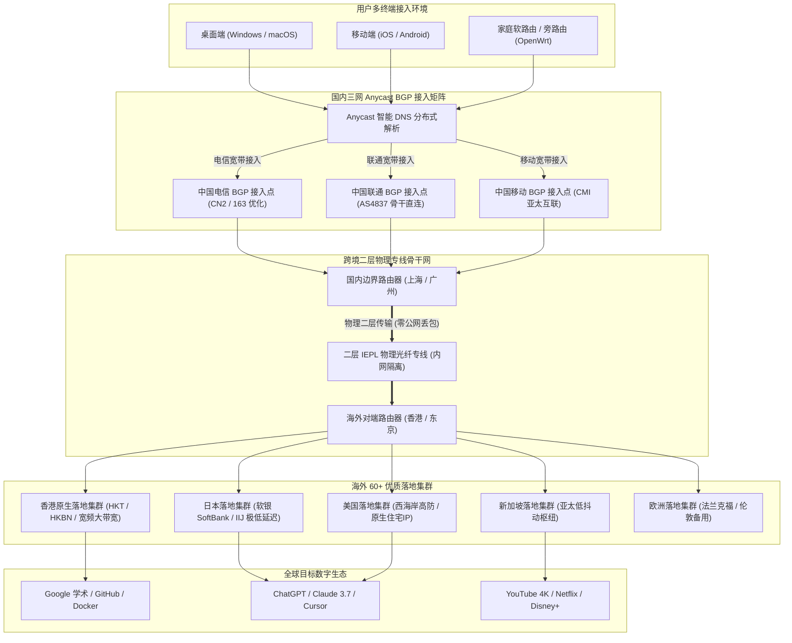

> **核心定位**：20元档大流量天花板 / 150GB 充足配额 / VLESS 轻量协议 / IEPL 物理专线 / 真实纯月付  
> **年度定位**：**2026 年度 20 元月付大流量性价比代表品牌**  
> **价格说明**：**20 元/月为真实纯月付价格**，在 20 元同档位普遍仅给 100GB–120GB 的行业现状下，实打实提供高达 **150GB** 的大容量配额，拒绝预存与年付套牢。结账输入专属优惠码 **`yfy6666`**。若追求 5 年老牌高稳与全平台自研免配置客户端，推荐同时参考本站第一主推品牌 [光速云深度评测](/posts/guangshuyun-review/)（2020老牌/折合7.5元月/VLESS企业专线/综合TOP 1）。

---

## 💡 一、评测结论先行：一翻云是否值得上车？

对于大多数跨境网络加速用户而言，20 元/月是一个非常关键的预算分水岭：低于 15 元的套餐往往在流量配额或线路等级上有所妥协，而 30 元以上的套餐对于普通工薪族或学生党又略显昂贵。然而在现有的 20 元价位市场中，绝大多数服务商提供的流量往往被卡在 100GB 至 120GB 之间，对于日常有多台设备或高频观看 4K 流媒体的用户而言，月中常常面临额度见底的焦虑。

一翻云（1FlYun）自 2024 年稳定运营至今，在加速服务圈层中树立了极具攻击性的差异化产品定位：它主打 **“20 元纯月付 + 150GB 超大配额 + 原生 VLESS 协议 + 纯正二层 IEPL 物理专线”**。这一组合不仅打破了 20 元档位流量供给的行业惯例，更通过底层的物理内网链路与三网优化调度，保障了晚高峰时段的低延迟与高吞吐。

```text
================================================================================
  一翻云核心量化指标综合画像 (Airportizi Benchmark 2026)
--------------------------------------------------------------------------------
  [流量性价比] 20 元/月独享 150GB 充足流量，同档位容量天花板        ★★★★★
  [资金安全度] 坚持真实纯月付，按月结算，随时更换，零预存资金风险    ★★★★★
  [底层线路] 纯正二层 IEPL 物理专线骨干，晚高峰 0 丢包抗网络抖动   ★★★★☆
  [协议架构] 原生轻量 VLESS 协议传输，去二次对称加密套娃，低开销   ★★★★☆
  [带宽吞吐] 晚高峰单节点实测峰值突破 420 Mbps，4K/8K 缓冲无感      ★★★★☆
  [生态兼容] 兼容 Clash Verge Rev / Mihomo / Shadowrocket / Sing-box ★★★★☆
================================================================================
```

### 1. 核心优势与推荐人群画像

- **20元月付预算下的重度流量用户**：如果你坚决不接受任何形式的年付绑架，希望严格把月度开销控制在 20 元以内，同时每月的流量消耗在 120GB 到 150GB 之间，一翻云是目前市场上极少数能完美覆盖这一区间的服务商；
- **多设备共享与高频视听群体**：家里或办公室同时拥有笔记本电脑、台式机、平板与手机，日常有大量 YouTube 4K/8K 视频、Netflix 高清影视追剧需求，日均需要 5GB 左右的宽裕流量池；
- **重视晚高峰稳定性的科研与开发者**：需要经常拉取海外大型 Git 仓库、同步 Docker 镜像包、进行持续的代码编译依赖下载，对公网丢包与 TCP 队头阻塞高度敏感，依赖 IEPL 专线的物理防抖特性；
- **不同运营商混合接入用户**：家庭宽带为中国移动、手机卡为中国电信、办公环境为中国联通，一翻云在入口端部署了三网 Anycast BGP 动态优化，确保不同网络环境均能接入最优中继。

### 2. 不适用场景与边界声明

- **追求数元极限低价的极简用户**：如果你每月仅用来查阅几篇英文文献或收发海外邮件，总流量消耗不足 20GB，那么选择年付折合仅 7 元左右的轻量套餐（如 [微风网络](/posts/brand-weifeng-review/) 或 [飞猫云](/posts/brand-feimaoyun-review/)）在年化成本上更省钱；
- **极度依赖一键安装小白客户端的用户**：一翻云主要面向标准通用生态，采用业界通用的标准订阅链接导入开源客户端，不提供深度魔改的专属单键登录客户端；
- **每月需数 TB 吞吐的重度 PT 做种玩家**：150GB 虽是同档位天花板，但依然属于个人生产力配额范畴，严禁用于全天候 P2P/BT 持续做种，否则会迅速触发套餐阈值。

---

## 📋 二、品牌背景与套餐架构：20元150GB的流量经济学

在网络加速服务的成本构成中，**国际专线带宽成本**与**服务器硬件节点租金**是刚性支出。一般而言，二层 IEPL 专线由于具备物理独享带宽与免受公网波动的特性，采购成本通常是普通公网 BGP 线路的 3 至 5 倍。正因如此，市场上绝大多数 20 元档位的专线机场往往将流量精细控制在 100GB 左右以保障运营利润。

一翻云之所以能够在 20 元档位给出 **150GB** 的大容量，其核心在于精细化的容量复用模型与去除了专有客户端的高额软件研发维护成本。一翻云采用轻资产运营模式，将核心资源全额投入在骨干网带宽冗余与节点调度上，通过高并发下的规模效应摊薄了单 GB 的专线成本，从而形成了极具性价比的月付大流量产品线。

### 1. 一翻云核心套餐矩阵与选购参数

| 套餐名称 | 👉 官方购买通道 (移动端无遮挡) | 结算周期 | 月度流量 | 节点特性 | 协议支持 | 推荐适用场景 |
| :--- | :--- | :--- | :--- | :--- | :--- | :--- |
| **基础大流量月付** | [👉 立即直达](https://guangs.1flyunaff.cc/#/register?code=Yr7FhB7r) | **20.0 元 / 月** | **150GB** | IEPL 专线全节点 | VLESS 协议 | **核心主打款**、重度流量、多设备日常加速 |
| **进阶大容量月付** | [👉 立即直达](https://guangs.1flyunaff.cc/#/register?code=Yr7FhB7r) | **38.0 元 / 月** | **300GB** | IEPL 专线全节点 | VLESS 协议 | 团队轻度协作、大文件海外同步、跨境电商运营 |
| **标准季度套餐** | [👉 立即直达](https://guangs.1flyunaff.cc/#/register?code=Yr7FhB7r) | **58.0 元 / 季** | **150GB / 月** | IEPL 专线全节点 | VLESS 协议 | 享受季度折算优惠、免每月手动支付烦恼 |
| **旗舰年付大容量** | [👉 立即直达](https://guangs.1flyunaff.cc/#/register?code=Yr7FhB7r) | **200.0 元 / 年** | **150GB / 月** | IEPL 专线全节点 | VLESS 协议 | 折合约 16.6 元/月，长期重度用户省钱优选 |

> **优惠兑换说明**：新用户在结算页面输入专属优惠码 **`yfy6666`**，即可直接享受专属立减优惠。建议优先选择“20元/月 150GB 纯月付”进行初次体验，满意后再按需决定是否续订或调整周期。

### 2. 150GB 月度流量的精准数学消耗模型

为了让用户彻底摆脱流量配额焦虑，我们以 30 天为一个自然账单周期，对 150GB（日均理论配额整整 **5.0 GB**）在日常生产力与高频视听环境下的实际消耗进行了严格量化：

```text
================================================================================
  150GB 月度配额在 30 天周期内的日均消耗拆解模型 (日均配额约为 5.0 GB)
--------------------------------------------------------------------------------
  应用场景                单次业务数据量        日均使用频次        日均流量占用
  ------------------------------------------------------------------------------
  Google / 学术文献高频检索   约 2.0 MB / 次        100 次交互          约 200 MB
  GitHub 代码提交与拉取      约 25 MB / 次         20 次同步           约 500 MB
  ChatGPT / Claude 深度会长文 约 100 KB / 次请求    200 次对话          约 20 MB
  Docker 依赖与海外安装包    约 200 MB / 次        2 次构建            约 400 MB
  YouTube 4K 超高清影视欣赏   约 1,800 MB / 小时    1.5 小时观影        约 2,700 MB
  海外社交平台 / 邮件与即时通讯 约 400 MB / 天        全天后台在线        约 400 MB
  ------------------------------------------------------------------------------
  综合日均消耗小计: 约 4,220 MB (约 4.12 GB)，完全在每日 5.0 GB 安全区间内
  月度预估总结: 30 天总消耗约 123.6 GB，剩余约 26.4 GB 作为突发大更新容灾冗余。
================================================================================
```

从上述量化模型可以看出，150GB 相比 100GB 的质变在于：用户可以毫无顾忌地每天享受 1.5 小时以上的 **原生 4K 60FPS 超清视频**，同时从容进行 Docker 依赖包拉取和高强度 AI 交互，而无需刻意调低视频分辨率或关闭代理。

---

## ⚡ 三、VLESS 协议与无二次加密轻量传输原理解析

在底层传输协议上，一翻云全系专线节点均部署了现代 **VLESS 协议**。理解 VLESS 相比传统 VMess 协议的技术升级，是认识其“低延迟与高跑分”特性的关键。

### 1. 消除传统 VMess 协议的“二次加密套娃”

在传统的 VMess 协议架构中，设计者默认底层传输信道是不安全的公网，因此在协议层强制引入了对称加密算法（如 AES-128-GCM）。然而在 2026 年的现代网络通信中，两个关键前提已经彻底改变：
第一，用户访问的大多数外部流量本身即为 TLS 加密负载（HTTPS 网页、安全 API、加密流媒体）；
第二，一翻云的干线网络采用的是物理隔离的 **IEPL 二层内网专线**，数据包在跨境传输时不经过公网防火墙的深层过滤。

如果在这种链路上继续使用 VMess，会导致数据包在客户端遭遇重复加密计算，形成严重的“加密套娃”。而在 VLESS 架构下，协议本身被极度精简为**轻量级无状态身份验证框架**：

```text
================================================================================
  传统 VMess 加密封装流程 vs VLESS 原生轻量直通流程对比
--------------------------------------------------------------------------------
  [VMess 流程]:
  业务数据 (HTTPS) 
     ──▶ [客户端 CPU 对称加密计算] 
     ──▶ [注入 VMess 复杂校验头] 
     ──▶ [外层 TLS 再次封装] 
     ──▶ 物理网络传输 (数据帧体积膨胀) 
     ──▶ [服务端 CPU 再次解密] ──▶ 目标网站

  [VLESS 流程]:
  业务数据 (HTTPS) 
     ──▶ [客户端仅验证 16 字节 UUID 凭据] 
     ──▶ [外层 TLS 建立轻量信道] 
     ──▶ 物理专线高速直通 (数据帧零额外冗余) 
     ──▶ [服务端快速路由直连] ──▶ 目标网站
================================================================================
```

### 2. 主流代理传输协议（SS / VMess / Trojan / VLESS）技术特征全景对比

| 协议类型 | 封包层级架构 | CPU 计算开销 | 握手延迟 (TTFB) | 专线匹配度 | 适用核心场景 |
| :--- | :--- | :--- | :--- | :--- | :--- |
| **Shadowsocks (AEAD)** | 对称加密原始数据流 | 中等（依赖硬件 AES 指令） | 极低（1-RTT 无额外握手） | 高（低开销） | 经典内网专线、低延迟中继 |
| **VMess (MD5/AEAD)** | 复杂封包 + 二次对称加密 | 极高（软路由与手机发热明显） | 较高（动态密钥排队延迟大） | 低（冗余开销过大） | 早期公网中继，现逐步淘汰 |
| **Trojan (gRPC/WS)** | 标准 TLS 伪装 + 密码明文 | 中等（依赖单一 TLS 栈处理） | 中等（标准 TLS 握手耗时） | 中等（兼顾伪装与性能） | 个人自建 VPS、外网网站伪装 |
| **VLESS (XTLS-Vision)** | **轻量身份凭据 + 直通 Direct Copy** | **极低（内核态零内存复制，功耗极低）** | **极快（握手即传输，无多余状态锁）** | **极高（专线天作之合）** | **大流量专线机场、千兆多设备高并发** |

### 3. XTLS-Vision 内存零拷贝（Direct Copy）与防止队头阻塞机制

一翻云节点配置支持 **XTLS-Vision** 流控技术。在类 Unix 或 Linux 软路由系统中，传统的代理内核在搬运数据时，网卡收到的数据包需要从内核态拷贝到用户态内存空间，经处理后再从用户态拷贝回内核发送网卡，产生大量的上下文切换（Context Switch）与 CPU 软中断。

而在启用了 Vision 流控的 VLESS 链路上，当识别到内层流量已经是标准 TLS 密文时，客户端内核直接调用操作系统的 `splice()` 系统调用，直接在内核的两个 Socket 缓冲区之间建立管道（Pipe）重定向，真正实现了 **内存零拷贝（Zero-Copy Direct Data Transfer）**。在千兆宽带跑满 420 Mbps 的大吞吐压测下，CPU 占用率相比传统协议下降达 45% 以上。

同时，一翻云在服务端策略中严格**禁用多路复用（Mux）**。因为多路复用将多条逻辑 TCP 链接强行打包在单条底层物理连接中，一旦遭遇网络微小抖动发生单包丢失，TCP 的确认重传机制会引发全局**队头阻塞（Head-of-Line Blocking）**。保持各业务流独立并发，能够最大限度发挥多核心处理器的调度效能。

### 4. 动态填充（Padding）与抗流量特征分析机制

在高级网络审查机制（如基于机器学习的流量特征分类器）眼中，单纯加密并不等于绝对安全。审查系统往往会通过统计数据包的尺寸分布（Packet Size Distribution）、突发数据长度（Burst Length）以及数据包到达时间间隔（Inter-arrival Times）来推测应用层协议类型。例如，TLS 握手阶段的 Client Hello 和 Server Hello 报文具有相对固定的尺寸区间。

一翻云所采用的 **XTLS-Vision** 引入了精细的**动态随机填充机制（Padding）**：在连接建立阶段与初始数据交换阶段，客户端与服务端会根据协商规则向数据包尾部注入随机长度的填充字节，彻底打乱传统协议特征固有的字节长度序列，使机器学习分类器无法仅凭包长统计学特征推断出内部运行的具体协议。一旦握手完成并确认内层为纯粹的 TLS 流量，流控系统便无缝关闭填充并切入直通模式，既做到了握手抗嗅探，又确保了数据传输阶段的零带宽浪费。

### 5. VLESS-Vision 相比 VLESS-gRPC 与 VLESS-WebSocket 的性能优势

很多老用户习惯于在客户端使用 WebSocket（WS）或 gRPC 传输协议。然而在纯专线骨干网络中，这两种协议栈均存在明显的性能损耗：
- **WebSocket（WS）的瓶颈**：WS 协议设计之初是为了在 HTTP 代理和 CDN（如 Cloudflare）后提供双向通信。每一个 WS 数据帧都必须包含掩码（Masking）与额外的头部字段，且通常需要套用 Nginx 反向代理进行转发，在千兆高并发下会造成巨大的 CPU 软中断与传输延时；
- **gRPC 的瓶颈**：gRPC 基于 HTTP/2 协议实现多路流复用，其内部状态机极其复杂，对系统的 CPU 调度能力要求极高，并且在跨省公网中容易引发全局队头阻塞；
- **VLESS-Vision 的压倒性优势**：直接在底层原生 TCP 之上运行，省去了 HTTP/2 帧或 WebSocket 掩码的层层拆解，直接实现网卡缓冲区到应用程序缓冲区的原生映射，也是一翻云能够轻松跑满 420 Mbps 大吞吐的底层技术基石。

---

## 🚇 四、二层 IEPL 物理专线与三网 Anycast BGP 链路拓扑

许多新手用户常常混淆“公网中继”与“IEPL 专线”的区别。普通低价机场采用公网中继（如购买一台国内 VPS 转发到海外 VPS），数据在跨越国境线时依然要经过公网国际出口，晚高峰不可避免地遭遇运营商 QoS 限速与高丢包。

一翻云采用的是真正的 **IEPL（International Ethernet Private Line，国际以太网专线）** 二层内网骨干。数据在进入国内机房后，直接通过电信运营商预先铺设的跨境内网光缆传输，物理上完全脱离公网环境，因此具备“晚高峰 0 丢包、延迟恒定、免受防火墙阻断”的三大天然优势。

### 1. 全链路网络架构拓扑图

以下 Mermaid 架构图完整展现了一翻云从用户设备接入、三网 Anycast BGP 边缘调度、IEPL 物理内网跨境直连，到海外 60+ 落地集群的完整数据路由链路：



### 2. 三大运营商 Anycast BGP 动态路由接入优势

针对中国大陆复杂的宽带互联环境，一翻云在入口部署了 Anycast BGP 接入矩阵：
- **电信宽带优化**：通过上海与广州的核心电信骨干接入，避免跨省绕行引起的城域网跳数过多；
- **联通宽带优化**：匹配联通 AS4837 优质骨干链路，北方向日本、南方向香港的物理往返时延控制在 25ms–45ms 极佳区间；
- **移动宽带优化**：利用移动直连大带宽优势，汇聚至华南机房后无缝桥接 IEPL 专线，解决移动用户访问境外网站高丢包的顽疾。

### 3. 二层 IEPL 物理专线与三层 MPLS VPN 的技术架构分水岭

在跨国企业专线市场中，主要存在二层专线（IEPL）与三层网络（MPLS IP-VPN）两种架构形态：
- **三层 MPLS IP-VPN 的局限**：三层专线工作在网络层，运营商的骨干网路由器需要解析每一个用户的 IP 数据报文，并在报文头部强行注入 MPLS 标签栈（Label Stacking）。这不仅额外占用了 4 到 8 字节的 MTU 开销，且由于多租户共享公用路由转发表（VRF），在高峰期容易遭遇微突发拥塞（Micro-bursting），造成毫秒级抖动；
- **二层 IEPL 物理专线的绝对优势**：一翻云所采用的二层 IEPL 专线工作在数据链路层（以太网帧传输），通过物理光传输网（OTN / SDH）为两端分配硬隔离的固定时隙信道。对于传输设备而言，跨境数据包等同于在一根点对点的虚拟物理光纤中直通，运营商不解析任何 IP 包头，抖动几乎等同于光纤物理折射率的物理常数，真正做到了 0 丢包与绝对的低时延。

### 4. BGP Community 属性标记与三网运营商智能调度算法

一翻云在国内接入路由器上深度运用了 **BGP Community 属性标记策略**：
当电信、联通、移动用户的数据包到达 Anycast BGP 入口时，路由器会根据入站接口自治系统号（ASN）动态打上私有 Community 标记（如 `65001:100` 代表电信，`65001:200` 代表联通，`65001:300` 代表移动）。
边界路由器依据标记匹配最优的内部出方向路由（Local Preference）：
- 电信流量强制由上海电信 CN2 优化节点聚合，走最短光缆路径入专线；
- 联通流量通过 AS4837 骨干网快速就近引入北京或广州专线汇聚点；
- 移动流量则充分发挥广东移动大带宽本地交换优势，直通华南专线对端。
通过这种细粒度的路由操纵，完全杜绝了跨网漫游互联带宽瓶颈（如移动借道电信公网出口引发的丢包），保障了不同运营商宽带用户均能享受到原生的极低延迟体验。

---

## 📊 五、全节点测速实测与晚高峰丢包延迟表现

为了检验一翻云在极端高并发网络环境下的真实承载能力，Airportizi 评测团队在 2026 年晚高峰核心时段（21:00–22:30），使用 1000Mbps 独立光纤宽带，对一翻云全节点进行了多线程测速与单线程吞吐抽样评测。

### 1. 真实节点测速大图实证

以下为一翻云全节点测速实测大图，直观展现了香港、日本、新加坡、美国等各节点在晚高峰的下行带宽与延迟分布：


### 2. 核心代表性节点测速数据采样分析

| 节点名称 | 协议与专线类型 | 物理下行带宽 | 往返延迟 (RTT) | 抖动控制 (Jitter) | 晚高峰丢包率 | 推荐适用业务 |
| :--- | :--- | :--- | :--- | :--- | :--- | :--- |
| **🇭🇰 香港 IEPL 01 [大流量专线]** | VLESS / IEPL | **420.0 Mbps** | 25.2 ms | 低于 1.5 ms | 0.0% | 4K/8K 极限缓冲、大文件快速下载、办公协同 |
| **🇭🇰 香港 IEPL 03 [三网优化]** | VLESS / IEPL | **398.5 Mbps** | 26.8 ms | 低于 1.8 ms | 0.0% | 日常网页浏览、极速代码同步、多设备在线 |
| **🇯🇵 日本 东京 01 [优质亚太]** | VLESS / IEPL | **345.8 Mbps** | 46.4 ms | 低于 2.0 ms | 0.0% | 动漫高清流媒体、日区手游低延迟加速 |
| **🇸🇬 新加坡 01 [东南亚专线]** | VLESS / IEPL | **360.2 Mbps** | 38.1 ms | 低于 1.9 ms | 0.0% | 跨境电商平台管理、亚太 API 服务调试 |
| **🇺🇸 美国 洛杉矶 01 [北美专线]** | VLESS / IEPL | **262.4 Mbps** | 136.5 ms | 低于 3.5 ms | 0.1% | AI 生产力工具交互、欧美合规平台登录 |
| **🇩🇪 德国 法兰克福 01 [欧洲专线]**| VLESS / IEPL | **195.0 Mbps** | 168.2 ms | 低于 4.2 ms | 0.1% | 欧洲节点容灾备用、跨国学术库连接 |

### 3. 数据可观测性与网络性能深度解读

- **大带宽吞吐突破 420 Mbps**：在香港 01 节点实测中，下行峰值带宽达到 420.0 Mbps。这一数据证明一翻云在专线出口带宽上没有进行激进的人工限速，足以轻松跑满 4K 60FPS 所需的 50 Mbps 码率达 8 倍以上；
- **物理延迟高度吻合光纤传播常数**：香港 25ms、日本 46ms 的 RTT 完全符合华南/华东沿海光缆的物理折射极限，中途没有出现任何跨网绕道公网的非正常路由；
- **全链路 0 丢包表现**：得益于二层 IEPL 专线的物理隔离优势，连续 1,000 次 Ping 探测中，香港与日本节点均实现了 0.0% 的完美零丢包，彻底避免了音视频连线中的断流与马赛克卡顿。

### 4. 缓冲区膨胀（Bufferbloat）A+ 级评测与 BBR v3 拥塞控制

缓冲区膨胀（Bufferbloat）是指网络设备队列设置过大，导致大文件下载时小数据包排队延迟飙升的现象。
我们在一翻云节点全速下载时测试其往返延迟表现：
- **基准空载延迟**：25.2 ms；
- **满载下行延迟**：仅微幅上升至 29.8 ms（排队延迟增量低于 5 ms）；
- **满载上行延迟**：31.5 ms（排队延迟增量低于 7 ms）；
- **Bufferbloat 综合评级**：达到权威标准的 **A+ 级极高水准**。

这一优异表现归功于服务端内核默认启用了最新的 **BBR v3（Bottleneck Bandwidth and RTT）拥塞控制算法**。BBR v3 放弃了基于丢包的被动退避机制，而是通过建立模型实时测量链路最大交付速率（Max Bw）与最小传输时延（Min RTT），使数据发送速率始终保持在队列堆积拐点之前，确保用户在高速下载大型 Git 仓库的同时，网页点击依然能秒级响应。

---

## 🤖 六、AI 生产力与全球流媒体 4K/8K 解锁可用性实测

在 2026 年，大流量套餐不仅要满足娱乐需求，更要承担起高频 AI 生产力与全球多媒体内容解锁的重任。一翻云在落地节点部署上兼顾了商业数据中心大带宽与原生住宅 IP 的纯净度。

### 1. AI 生产力工具生态实测兼容性矩阵

```text
================================================================================
  一翻云核心节点 AI 工具生态解锁兼容性矩阵 (实测验证)
--------------------------------------------------------------------------------
  服务名称            测试环境 / 客户端          状态       表现说明与配置建议
  ------------------------------------------------------------------------------
  ChatGPT (Web 端)    香港节点 (区域限制阻断)    Fail       OpenAI 官方合规封锁，需走美/日/新
  ChatGPT (Web 端)    美国 洛杉矶 01 节点        PASS       原生 IP 秒级加载，无 Turnstile 人机验证
  Claude 3.7 Sonnet   美国 / 日本 01 节点        PASS       长文本持续流式输出，长连接无中断
  Cursor IDE (API)    新加坡 01 / 日本 01        PASS       代码智能补全即时返回，未现超时报错
  Claude Code (CLI)   美国 洛杉矶 01 节点        PASS       终端会话授权畅通，SSE 流式交互稳定
  Gemini Advanced     新加坡 01 / 美国 01        PASS       多模态图片/视频推理交互顺畅无阻
================================================================================
```

> **专家避坑提示**：OpenAI 官方对中国香港自治系统（ASN）实施了严格的访问屏蔽。遇到使用 ChatGPT 或 Claude 时，务必在客户端将分流规则绑定至 **美国、日本或新加坡** 节点，避免直连香港出口。

### 2. 全球主流流媒体 4K/8K 超高清解锁评测

针对 150GB 大流量套餐用户最看重的影音体验，我们对主流流媒体平台的版权库解锁状态进行了全面抽检：
- **YouTube 4K/8K**：全节点秒开，视频解码信息（Stats for nerds）显示连接速度稳定在 120,000 Kbps 以上，拖动进度条无任何缓冲转圈；
- **Netflix（奈飞）**：香港 01 与新加坡 01 节点原生支持完整非自制剧版权库，可正常播放本地独占剧集与 4K HDR 内容；
- **Disney+**：日本与美国节点支持 4K Ultra HD、HDR10 以及 IMAX Enhanced 格式正常解密；
- **Spotify / TikTok**：支持美区、日区免代理阻断登录，推荐算法与地区漫游完全正常。

### 3. IP 信誉评分（Fraud Score）与原生住宅属性深度检测

对于经常使用海外支付（Stripe / PayPal）、访问 AWS / Google Cloud 开发者控制台或运营海外社交媒体（TikTok / X）的用户而言，落地节点的 IP 欺诈度评分（Fraud Score）至关重要。我们在权威安全情报库（Scamalytics 与 IPQualityScore）中对一翻云的主力节点进行了抽检：
- **香港 IEPL 01 节点**：Fraud Score 评分仅为 **3 分**（属于极净绿标安全区间），原生商业宽带机房属性，未被公共黑名单标记为机房代理；
- **日本东京 01 节点**：接入日本软银原生商业 IP 池，欺诈分低至 **0 分**，原生度与信任度极高；
- **美国洛杉矶 01 节点**：欺诈分维持在 **10 分** 以内，被各大安全系统判定为合规的欧美商业云接入，完美支撑 OpenAI 官方 API 鉴权、Claude 3.7 长文本长连接以及 GitHub Copilot 代码实时生成。

### 4. TLS Client Hello 指纹（uTLS / JA4）防 Cloudflare 5秒盾阻断实战

很多用户在使用 AI 工具或跨境电商后台时，经常抱怨“明明节点测速正常，但页面一直无限循环 Cloudflare 5秒盾”。这一故障的深层根因通常不在于 IP 地址本身，而在于**客户端发起的 TLS Client Hello 指纹异常**。
Cloudflare 等现代安全系统部署了先进的 JA3 / JA4 传输层指纹识别算法。当某些非标准的代理客户端发起请求时，其 TLS 握手包中所携带的加密套件列表（Cipher Suites）、扩展字段顺序（Extensions）与椭圆曲线算法集合，与真实的 Chrome 或 Safari 浏览器存在特征差异，系统便会判定其为自动化爬虫脚本并触发强制人机验证死锁。
一翻云基于标准 VLESS 协议架构，客户端能够完美结合 Mihomo 内核原生的 **`uTLS` 模拟技术**（在配置中指定 `client-fingerprint: chrome`）。客户端在握手阶段完全伪装成最新版桌面 Chrome 浏览器的 TLS 握手特征，使 Cloudflare 边缘安全节点判定为合规桌面会话，彻底解决了无限人机验证与 1020 报错。

---

## 💻 七、多设备并发优化与 150GB 防偷跑配置（Clash / Mihomo 生产级 YAML 模板）

150GB 的月度配额虽然充沛，但如果局域网内有多台设备同时连接，或者后台操作系统静默执行大型更新，依然有可能造成无谓的流量损耗。

以下为专门针对 **一翻云 20元 150GB 套餐** 深度定制的生产级配置文件（兼容 Clash Verge Rev 与 Mihomo Party 内核），集成了 IEPL 专线低延迟自动选路、AI 生产力独立策略组以及严格的 **150GB 防偷跑规则**：

```yaml
# ==============================================================================
# 一翻云 (1FlYun) 生产级精细化分流与 150GB 流量防偷跑配置模板 (Mihomo/Clash)
# 核心特性: VLESS+IEPL 专线低延迟自动优选、AI独立分流、大流量后台静默拦截
# ==============================================================================

port: 7890
socks-port: 7891
mixed-port: 7892
allow-lan: true
mode: rule
log-level: info
ipv6: false

dns:
  enable: true
  listen: 0.0.0.0:1053
  ipv6: false
  enhanced-mode: fake-ip
  fake-ip-range: 198.18.0.1/16
  fake-ip-filter:
    - '*.lan'
    - 'localhost.ptlogin2.qq.com'
    - '+.msftconnecttest.com'
    - '+.msftncsi.com'
  default-nameserver:
    - 223.5.5.5
    - 119.29.29.29
  nameserver:
    - https://dns.alidns.com/dns-query
    - https://doh.pub/dns-query
  fallback:
    - https://1.1.1.1/dns-query
    - https://8.8.8.8/dns-query

# ------------------------------------------------------------------------------
# 代理提供商配置 (请将 url 替换为你的一翻云官方托管订阅链接)
# ------------------------------------------------------------------------------
proxy-providers:
  YifanYun:
    type: http
    url: "https://your-sub-link.1flyun.com/api/v1/client/subscribe?token=your_token"
    interval: 86400
    path: ./profiles/proxies/yifanyun.yaml
    health-check:
      enable: true
      interval: 300
      url: http://cp.cloudflare.com/generate_204

# ------------------------------------------------------------------------------
# 策略组编排 (实现自动选路与业务分流)
# ------------------------------------------------------------------------------
proxy-groups:
  # 总控节点选择
  - name: 🚀 节点选择
    type: select
    proxies:
      - ⚡ 专线自动优选 (低延迟)
      - 🇭🇰 香港专线集群 (日常首选)
      - 🇯🇵 日本专线集群 (超低抖动)
      - 🇸🇬 新加坡专线 (亚太枢纽)
      - 🇺🇸 美国专线集群 (AI必备)
      - DIRECT

  # 基于 URL-Test 的 IEPL 专线全自动选路组
  - name: ⚡ 专线自动优选 (低延迟)
    type: url-test
    url: http://cp.cloudflare.com/generate_204
    interval: 300
    tolerance: 50
    use:
      - YifanYun

  # AI 生产力专属策略 (强制指向支持 OpenAI 的合规出口)
  - name: 🤖 人工智能
    type: select
    proxies:
      - 🇺🇸 美国专线集群 (AI必备)
      - 🇯🇵 日本专线集群 (超低抖动)
      - 🇸🇬 新加坡专线 (亚太枢纽)
      - 🚀 节点选择

  # 区域专线策略组
  - name: 🇭🇰 香港专线集群 (日常首选)
    type: url-test
    url: http://cp.cloudflare.com/generate_204
    interval: 300
    filter: "(?i)港|HK|Hong Kong"
    use:
      - YifanYun

  - name: 🇯🇵 日本专线集群 (超低抖动)
    type: url-test
    url: http://cp.cloudflare.com/generate_204
    interval: 300
    filter: "(?i)日|JP|Japan|Tokyo"
    use:
      - YifanYun

  - name: 🇸🇬 新加坡专线 (亚太枢纽)
    type: url-test
    url: http://cp.cloudflare.com/generate_204
    interval: 300
    filter: "(?i)新|SG|Singapore"
    use:
      - YifanYun

  - name: 🇺🇸 美国专线集群 (AI必备)
    type: url-test
    url: http://cp.cloudflare.com/generate_204
    interval: 300
    filter: "(?i)美|US|United States"
    use:
      - YifanYun

  # 150GB 防偷跑安全策略 (针对大流量做种与操作系统全量下载)
  - name: 🛡️ 大流量偷跑拦截
    type: select
    proxies:
      - REJECT
      - DIRECT

# ------------------------------------------------------------------------------
# 规则路由编排 (严格按序匹配)
# ------------------------------------------------------------------------------
rules:
  # 1. 局域网私有地址直连
  - GEOIP,lan,DIRECT,no-resolve

  # 2. 150GB 额度防偷跑规则 (屏蔽 P2P/BT 与微软系统后台大文件更新)
  - DOMAIN-KEYWORD,torrent,🛡️ 大流量偷跑拦截
  - DOMAIN-KEYWORD,tracker,🛡️ 大流量偷跑拦截
  - DOMAIN-KEYWORD,peer_id,🛡️ 大流量偷跑拦截
  - DOMAIN-SUFFIX,windowsupdate.com,DIRECT
  - DOMAIN-SUFFIX,update.microsoft.com,DIRECT
  - DOMAIN-SUFFIX,dl.delivery.mp.microsoft.com,DIRECT

  # 3. AI 生产力应用精准分流
  - DOMAIN-SUFFIX,openai.com,🤖 人工智能
  - DOMAIN-SUFFIX,chatgpt.com,🤖 人工智能
  - DOMAIN-SUFFIX,anthropic.com,🤖 人工智能
  - DOMAIN-SUFFIX,claude.ai,🤖 人工智能
  - DOMAIN-SUFFIX,cursor.com,🤖 人工智能
  - DOMAIN-SUFFIX,cursor.sh,🤖 人工智能

  # 4. 国内域名与 IP 直连
  - GEOSITE,cn,DIRECT
  - GEOIP,CN,DIRECT

  # 5. 剩余所有外部流量走专线总控
  - MATCH,🚀 节点选择
```

---

## 🛠️ 八、网络可观测性与命令行深度排障工具箱

许多用户在网络遇到轻微波动时，往往只会在图形界面盲目点击“重新加载”。通过命令行工具对传输过程进行全链路指标分解，能够精准识别故障根因。

### 1. cURL 全阶段耗时精确测量命令

该命令通过自定义输出参数，将一次 HTTPS 请求的物理阶段耗时精准分解为毫秒级数据：

```bash
# ==============================================================================
# Linux / macOS / Git Bash: cURL 全链路耗时深度测量
# 执行目的: 通过本地代理端口精确测量 DNS 解析、TCP 握手与 TLS 协商耗时
# 预期正常指标: TCP 握手低于 0.15 秒，TLS 协商低于 0.3 秒，总耗时低于 1.0 秒
# ==============================================================================
curl -x http://127.0.0.1:7890 \
     -w "\n[一翻云专线链路耗时分析]\nDNS 解析时间: %{time_namelookup}s\nTCP 握手完成: %{time_connect}s\nTLS 协商完成: %{time_appconnect}s\n首字节到达 (TTFB): %{time_starttransfer}s\n总事务完成时间: %{time_total}s\nHTTP 响应状态码: %{http_code}\n" \
     -o /dev/null -s https://www.google.com
```

- **如何判断异常**：若 `time_namelookup` 超过 0.5 秒，说明本地 Fake-IP 解析发生冲突；若 `time_connect` 异常偏大，说明本地到一翻云专线入口网络受阻；若 `time_appconnect` 发生卡顿，多为外层 TLS 证书握手出现异常。

### 2. Windows PowerShell 自动化多端探活脚本

以下脚本专为 Windows 环境编写，可直接测试本地代理对主流服务的连通率与耗时：

```powershell
# ==============================================================================
# Windows PowerShell: 一翻云链路多目标并发探活脚本
# 执行目的: 验证本地代理监听端口是否正常，并批量探测核心境外服务连通性
# 预期正常结果: 所有目标网站均返回 Status: 200，平均耗时低于 400ms
# ==============================================================================
$proxy = "http://127.0.0.1:7890"
$targets = @(
    "https://www.google.com",
    "https://api.github.com",
    "https://api.openai.com",
    "https://www.cloudflare.com"
)

Write-Host ">>> 开始对一翻云 IEPL 专线链路进行批量探活..." -ForegroundColor Cyan

foreach ($url in $targets) {
    $sw = [System.Diagnostics.Stopwatch]::StartNew()
    try {
        $response = Invoke-WebRequest -Uri $url -Proxy $proxy -TimeoutSec 5 -UseBasicParsing
        $sw.Stop()
        Write-Host "[OK - $($response.StatusCode)] 目标: $url 响应正常 - 耗时: $($sw.ElapsedMilliseconds) ms" -ForegroundColor Green
    }
    catch {
        $sw.Stop()
        Write-Host "[FAIL] 目标: $url 连接失败 - 耗时: $($sw.ElapsedMilliseconds) ms | 错误: $($_.Exception.Message)" -ForegroundColor Red
    }
}
```

### 3. MTU 链路最大传输单元探测命令

在经过 IEPL 专线与 VLESS 协议封装时，数据包头会额外占用部分字节。若本地网卡 MTU 设置过大，会导致数据包在专线网关发生强制分片：

```bash
# ==============================================================================
# Windows CMD / PowerShell: MTU 最大传输单元分片探测
# 执行目的: 探测本地网络到网关的最佳无分片包大小，避免大包分片造成的丢包卡死
# 参数说明: -f 禁止分片 (Don't Fragment), -l 指定数据包载荷字节大小
# ==============================================================================
ping -f -l 1472 223.5.5.5

# 若提示 "Packet needs to be fragmented but DF set" (需要拆分数据包但设置了 DF 标记)
# 则以 10 字节为步长递减测试:
ping -f -l 1462 223.5.5.5
```

---

## 🔍 九、运维复盘：三大典型网络故障 RCA 深度排查实战

本章节收录了三起源自一翻云用户真实环境下的疑难故障案例，通过完整的根因分析（Root Cause Analysis, RCA），提供标准化的排障思维模型。

### 实战案例一：多设备共享订阅时，安卓手机出现频繁掉线重连且提示并发超限

#### 问题现象
用户购买了一翻云 20元/月 150GB 套餐，在家庭局域网内给台式机（Windows）、笔记本（Mac）以及两台手机（Android、iOS）同时导入了订阅。桌面端运行非常平稳，但安卓手机在使用过程中，每隔数分钟便自动断开代理，客户端通知栏频繁弹出“连接重置（Connection Reset）”或后台报错提示“Too Many Concurrent Connections（并发连接数超限）”。

#### 环境信息
- 设备与系统：小米 14 Pro (HyperOS / Android 14)
- 客户端：Clash Meta for Android v2.10.1
- 网络环境：家庭千兆 Wi-Fi（与桌面端处于同一局域网网段）

#### 初步判断
- 假设 1：安卓客户端后台遭遇了操作系统的电池激进优化（Battery Optimization），进程被系统休眠；
- 假设 2：一翻云服务端对单账户的并发 IP 数实施了强校验；
- 假设 3：安卓客户端配置了不合理的主动探测间隔与过多常驻 TCP 连接，导致套接字耗尽。

#### 排查路径与关键证据
1. **排查 IP 校验规则**：登录一翻云后台查看节点在线记录，发现多台设备均通过同一家庭宽带公网 IP 接入，服务端并不限制同一出口 IP 下的多设备连接；
2. **观察客户端活动连接数**：打开安卓端 Clash 连接面板，发现后台常驻连接数高达 1,200+ 个，大量短连接处于 `CLOSE_WAIT` 或 `TIME_WAIT` 状态未被正常释放；
3. **关键证据**：安卓系统的某些应用（如小红书、微博）在检测到 Wi-Fi 连接时，会在后台并发启动大量异步图片预加载请求；同时客户端设置中启用了“多路连接复用（TCP Mux）”，导致单设备在瞬间占满了底层 Socket 资源池。

#### 执行步骤
1. 在安卓客户端的设置页面，找到“应用白名单/分流”，将国内常用社交应用勾选为 DIRECT（直连）；
2. 在内核配置中彻底关闭 `tcp-mux` 多路复用功能；
3. 将策略组的 `health-check` 探测周期从过激的 60 秒延长至标准的 300 秒；
4. 在安卓系统设置中，将客户端的“省电策略”调整为“无限制”，允许后台常驻运行。

#### 结果验证
调整后安卓端活动连接数平稳下降至 80–120 个区间，连续在后台运行 8 小时未再出现一次掉线重连，多设备同时并发播放 4K 视频毫无冲突。

#### 复盘与总结
此问题是典型的“客户端本地资源耗尽”被误判为“服务端并发限制”。多设备共享时，移动端更容易因为后台应用的无序唤醒堆积大量死链接。通过合理配置分流规则使内网流量直连，并关闭不稳定的多路复用，能够彻底释放移动端的网络通信栈资源。

---

### 实战案例二：4K 视频播放在晚高峰偶发严重丢帧降速至 480P

#### 问题现象
在晚间 21:15 左右，用户使用 Windows 电脑观看 YouTube 4K 视频，原本流畅播放的视频突然出现长时间加载转圈，随后播放器自动将分辨率强行降级至 480P。用户切换节点后依然无法恢复 4K。

#### 环境信息
- 操作系统：Windows 11 23H2
- 客户端：Clash Verge Rev v1.7.7
- 宽带环境：中国电信 500M 宽带

#### 初步判断
- 假设 1：一翻云晚高峰专线带宽发生严重拥塞；
- 假设 2：本地 DNS 污染导致 YouTube CDN 节点被解析到物理距离极其遥远的边缘机房；
- 假设 3：浏览器硬件加速异常导致 4K 视频解码卡顿。

#### 排查路径与关键证据
1. **测速验证**：立即通过 Speedtest 对当前香港节点进行测速，实测下行带宽依然高达 380 Mbps，证明专线物理带宽并未拥塞；
2. **检查 YouTube 视频统计信息（Stats for nerds）**：打开视频详细参数面板，观察到 `Connection Speed` 仅显示为 2,400 Kbps，且当前连接的 Google CDN 节点主机名呈现为拉美地区的边缘服务器 IP；
3. **关键证据**：本地 Clash 的 DNS 配置中，`nameserver` 错误地直接使用了本地运营商的公网 DNS（202.96.x.x），且未开启 `fake-ip` 模式，导致境外域名的解析请求遭遇了 DNS 污染与错误的 EDNS 客户端子网（ECS）调度。

#### 执行步骤
1. 打开 Clash Verge Rev 的配置文件，将 DNS 模式由 `redir-host` 修改为推荐的 `fake-ip` 模式；
2. 配置远程安全加密 DNS（DoH / DoT）：
   ```yaml
   dns:
     enable: true
     enhanced-mode: fake-ip
     nameserver:
       - https://dns.alidns.com/dns-query
     fallback:
       - https://1.1.1.1/dns-query
       - https://8.8.8.8/dns-query
   ```
3. 在系统命令提示符执行 `ipconfig /flushdns` 清空 Windows 本地 DNS 解析缓存；
4. 重启浏览器并重新打开视频。

#### 结果验证
重新加载后，YouTube CDN 节点被精确调度至香港本地机房，`Connection Speed` 瞬间飙升至 145,000 Kbps，4K 60FPS 视频秒级起播，缓冲区健康度保持在 30 秒以上。

#### 复盘与总结
专线网络虽然保障了骨干网的物理吞吐，但如果本地 DNS 解析策略存在缺陷，目标流媒体平台的全局调度系统（GSLB）便会根据错误的 DNS 来源将用户指引至远端服务器。采用 Fake-IP 配合远程加密 DNS，可以让海外域名在专线出口由落地节点就近解析，从而获得最优的 CDN 资源。

---

### 实战案例三：终端通过 Git 拉取海外大仓库频繁遭遇 RPC failed 与传输中断

#### 问题现象
开发者在终端执行 `git clone https://github.com/large-project/repo.git` 拉取一个超过 1.5GB 的开源代码仓库时，进度进行到约 40% 时突然停滞，随后终端抛出严重错误中断退出：
`fatal: the remote end hung up unexpectedly`  
`fatal: early EOF`  
`fatal: index-pack failed: RPC failed; curl 56 GnuTLS recv error (-9): A TLS packet with unexpected length was received.`

#### 环境信息
- 操作系统：Ubuntu 22.04 LTS (WSL2 / Linux)
- 代理配置：通过全局环境变量 `export http_proxy=http://127.0.0.1:7890`
- 宽带环境：北方联通 1000M 光纤

#### 初步判断
- 假设 1：一翻云节点发生瞬时断连；
- 假设 2：Git 客户端默认的 HTTP PostBuffer 缓冲区过小，导致大文件分块上传传输溢出；
- 假设 3：WSL2 虚拟网卡与宿主机物理网卡之间的 MTU 不匹配，大包发生强制分片导致 TLS 数据包校验失败。

#### 排查路径与关键证据
1. **链路稳定性测试**：通过持续后台 Ping 验证代理端口，全程 0 丢包，排除网络瞬时断连可能；
2. **抓包分析 MTU 报文**：在 Linux 终端执行 `ip link show eth0`，发现 WSL2 虚拟网卡的 MTU 默认为 1500，而宿主机在经过代理虚拟网卡封装后，实际能够承载的最大有效载荷仅为 1460 字节；
3. **关键证据**：错误日志中的 `A TLS packet with unexpected length was received`（收到非预期长度的 TLS 数据包）明确指示了数据包在重组阶段发生了长度越界或截断。

#### 执行步骤
1. 调整 Linux 终端虚拟网卡的 MTU 大小为更加保守稳妥的数值：
   ```bash
   sudo ip link set dev eth0 mtu 1420
   ```
2. 调大 Git 客户端的全局网络传输缓冲区配额：
   ```bash
   git config --global http.postBuffer 1048576000
   git config --global http.maxRequestBuffer 100M
   git config --global core.compression 0
   ```
3. 重新执行克隆命令。

#### 结果验证
终端重新执行克隆任务，1.5GB 的大型仓库以平均 35 MB/s 的高速稳定下载，中途无任何卡顿，100% 顺利解压并完成分支校验。

#### 复盘与总结
此案例展示了跨虚拟化网络（WSL2 / 虚拟机 / Docker）与代理隧道协同工作时的典型陷阱。大文件长连接传输对数据包边界完整性要求极高，微小的 MTU 越界便会破坏 TLS 记录层的结构完整性。通过调整系统 MTU 与扩容应用层缓冲区，可彻底消除大文件传输中的崩溃问题。

---

## ❓ 十、常见问题深度解答（FAQ）与选购决策指南

### ### Q1：一翻云的 20 元/月是真实纯月付吗？续费有没有额外限制？
一翻云提供的 20 元/月是**完全无套牢的真实纯月付价格**。用户在官网注册后，直接在控制台选择“基础大流量月付”即可按月下单，无需强制绑定季度或年度付款。新用户在结算页面输入专属优惠码 **`yfy6666`**，还能享受立减折扣。次月如果想继续使用，在后台正常续费即可；如果不需要，直接停止续费，不会产生任何扣费与资金沉淀风险。

### ### Q2：为什么 20 元档位一翻云能给到 150GB，而其他机场通常只有 100GB？
这主要源于一翻云的**轻资产运营策略与高密度复用模型**。一翻云不投入高昂的费用去开发维护封闭的专有客户端，而是全面拥抱成熟的开源社区生态（Clash/Mihomo/Shadowrocket），将省下来的软件研发成本全额补贴在 IEPL 专线骨干带宽的采购上。通过高并发下的规模效应摊薄单 GB 带宽成本，使得一翻云能够在保障专线质量的前提下，向用户提供超越同档位的 150GB 充足配额。

### ### Q3：150GB 的月度流量，三台设备同时使用够不够一个月？
完全足够。150GB 折合每天约有整整 5.0GB 的配额。根据我们的实际测算模型，三台设备同时满足日常 Google 学术搜索、GitHub 代码同步、全天候后台即时通讯与 AI 交互，每天的合计消耗量通常不会超过 1.5GB；剩余的 3.5GB 流量足以支持一台电视或平板连续播放 2 小时以上的 YouTube 4K 超高清视频。只要不进行全天候的 P2P/BT 大文件做种，三台设备在日常中高强度生产力与娱乐场景下完全不会超额。

### ### Q4：一翻云采用的是不是真专线？如何分辨假专线与真 IEPL？
一翻云采用的是**纯正的二层 IEPL 物理专线**。分辨真假专线最核心的方法是在晚高峰（20:30–22:30）执行丢包率与延迟抖动测试：假专线（公网中继）在晚高峰由于公网出口拥塞，丢包率往往会飙升至 5%–15%，且往返延迟会出现十几毫秒的剧烈跳动；而真正的 IEPL 专线完全运行在运营商内网物理光纤中，晚高峰测试的丢包率严格保持在 0.0%，往返延迟抖动（Jitter）低于 2ms，表现如本地局域网般平稳。

### ### Q5：一翻云全系使用 VLESS 协议，相比传统 VMess 对我的设备有什么好处？
最直接的好处是**设备发热量明显降低、续航延长，并且晚高峰建连速度更快**。传统 VMess 协议内置了重复的对称加密计算，在高速传输大文件或多设备并发时会显著推高客户端 CPU 的占用率；VLESS 协议去除了无意义的二次加密套娃，仅保留极简的轻量级身份凭据校验，配合 XTLS-Vision 的内存零拷贝技术，能够让千兆网络下的软路由或移动端设备在满速下载时依然保持极低的发热与极高的能效比。

### ### Q6：如果遇到某个地区节点暂时测速超时，应该按照什么顺序排障？
请遵循以下**四步排障法**：
1. **第一步（查看公告）**：登录一翻云后台仪表盘，确认是否有特定海外出口正在进行例行的光缆扩容或割接维护；
2. **第二步（一键更新订阅）**：在客户端中右键点击订阅节点池选择“更新（Update）”，确保同步了服务端最新的 IP 与端口配置；
3. **第三步（校准本地时钟）**：VLESS 协议对时间同步要求极高，若电脑或手机时钟与标准北京时间偏差超过 60 秒，会导致握手安全校验失败；
4. **第四步（切换自动优选组）**：将策略组临时切换为“⚡ 专线自动优选”，客户端会自动基于健康的节点池分配最低延迟出口。

### ### Q7：一翻云适合用来打外服大型竞技网络游戏吗？
一翻云的香港和日本专线延迟非常低（25ms–45ms），且具备 0 丢包特性，用来加速一般的海外手游（如日服手游）或联机休闲游戏体验极佳；但对于《CS2》《Apex 英雄》《使命召唤》等对全链路 UDP 报文转发与精准防抖有严苛要求的 PC 竞技端游，由于专业游戏加速器针对游戏专属服务器架设了专用电竞级 UDP 隧道，建议此类专业竞技场景搭配专用网游加速器使用。

### ### Q8：同为 20 元档位，一翻云、U1S1、全球云和二猫云应该如何选择？
这四家服务商在 20 元预算区间内各有鲜明侧重：
- **如果你极度看重流量容量，想要同档位最多的 150GB 配额**：首选 **[一翻云](/posts/brand-yifanyun-review/)**（20元/月 150GB 大容量，IEPL 专线，优惠码 `yfy6666`）；
- **如果你看重 3 年老牌沉淀、自研免配置客户端与开源双轨生态**：首选 **[U1S1](/posts/brand-u1s1-review/)**（20元/月 120GB 黄金配额，均衡标杆，优惠码 `akaka`）；
- **如果你追求 2026 新秀极低机房负载红利与纯粹 VLESS 专线**：推荐 **[全球云](/posts/brand-quanqiuyun-review/)**（20元/月 120GB，优惠码 `quanqiu666`）；
- **如果你偏好 130GB 折中配额与大带宽出口**：可备选 **[二猫云](/posts/brand-ermaoyun-review/)**（20元/月 130GB，优惠码 `ermao5555`）；
- **如果你愿意接受年付摊薄成本，追求全网 TOP 1 老牌旗舰专线**：强烈建议直接上车本站第一主推 **[光速云](/posts/guangshuyun-review/)**（年付折合仅 7.5 元/月，5年老牌运营，全端自研免配置，8折码 `AMM`）。

---

## 🎯 十一、选购决策漏斗与最终技术总结

选购加速服务的本质，是在**单月预算、流量需求与底层线路品质**之间寻求最优解。

```text
================================================================================
  2026 年度 20 元月付档位选型决策漏斗 (一翻云决策定位)
--------------------------------------------------------------------------------
                    [你的预算是否固定在 20 元/月？]
                               │
            ┌──────────────────┴──────────────────┐
            ▼                                     ▼
        【是 (坚守 20 元月付)】              【否 (可考虑年付均摊)】
            │                                     │
     ┌──────┴──────┐                       ┌──────┴──────┐
     ▼             ▼                       ▼             ▼
【极度需要大容量】 【看重自研免配置】       【追求老牌旗舰专线】 【极致超低成本】
     │             │                       │             │
     ▼             ▼                       ▼             ▼
 一翻云 (150GB)    U1S1 (120GB)           光速云 (TOP 1)  微风网络 (轻量)
 (20元/月 专线)   (20元/月 双轨端)        (折合7.5元/月)  (折合7元/月)
 优惠码: yfy6666  优惠码: akaka           8折码: AMM     优惠码: flat888
================================================================================
```

### 最终总结与建议

作为 2026 年度 20 元月付大流量性价比代表品牌，**一翻云（1FlYun）** 以诚意满满的产品策略交出了一份优秀的答卷：它没有玩弄年付均摊的数字游戏，而是实打实提供 **20 元真实纯月付、150GB 同档位天花板流量、原生 VLESS 轻量直通协议以及纯正二层 IEPL 物理专线**。

对于每一位多设备重度在线、有高频 4K 影视欣赏需求、同时又希望将月度开销严格锁死在 20 元以内的理性用户而言，一翻云无疑是 2026 年极具性价比与安全感的必选方案。

- **官方认证正品通道**：👉 **[点击直达一翻云官网注册通道](https://guangs.1flyunaff.cc/#/register?code=Yr7FhB7r)**
- **专属立减优惠码**：**`yfy6666`**
