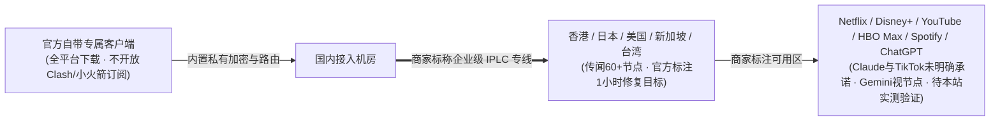

> **核心结论速览（Direct Answer）**：  
> **隐形人（Yinxingren）** 创立于 2024 年，定位为企业级 IPLC 直连路线。它与其他多数机场最大的结构差异在于：**官方完全不提供第三方订阅链接（不支持 Clash Verge Rev、Shadowrocket 小火箭、v2rayN、sing-box 或软路由 OpenClash 导入），所有设备只能下载官方自带专属客户端登录使用**。定价上，年付轻量包 `星耀风暴` 为 **¥109/年（80GB/月，约 ¥9.08/月）**，纯月付从 **¥24/月（144GB/月）** 起跳，最高至 ¥185/1.6TB 与三款一次性永久包；资料中记录优惠码 **`yxr888`**（早期版本亦见 `moon80`），且官方明确不提供免费试用。本文尚未附带本站实测大图，购买前请务必确认自身设备对“不支持 Clash”这一条件的接受度。

---

## 一、 购买前必看的硬性门槛：为什么“无第三方订阅”决定了你的适不适合

在查看隐形人高规格 IPLC 宣传之前，强烈建议先核对下面两项兼容边界：
1. **极客与软路由用户劝退线**：如果你习惯用 OpenWrt / iStoreOS 软路由（OpenClash、Nikki、HomeProxy）在路由器全局分流，或者习惯在 iOS 上用 Shadowrocket（小火箭）/ Surge 配规则组切换不同 AI 地区出口，**隐形人无法导入这些软件**——没有 Clash YAML，也没有 URI 订阅地址。
2. **小白与多端免折腾人群优势**：反过来，对不想折腾美区 Apple ID 买小火箭、也不想学习 GitHub 下载开源代理内核的纯白领或商务使用者，官方专属客户端“下载—登录—一键连接”反而大幅减少了订阅失效、DNS 污染与规则报错概率（常见同为一键式设计但仍兼顾参考的还有 [飞猫云](/posts/brand-feimaoyun-review/)）。

---

## 二、 官方 9 档完整资费表（区分月付 / 年付 / 不限时）

据整理核对的最新 42 家品牌数据库档案，隐形人产品线划分为常规周期月付、年付轻量包、一次性流量包及独享定制四类：

| 套餐名称 | 计费方式 | 官方标价 | 包含流量 | 流量周期 | 单 GB 折合成本 |
| :--- | :---: | :---: | :---: | :---: | :---: |
| **星耀风暴 365天不熄** | 年付 | **¥109 / 年** | **80GB** | 每月 | ¥0.114 / GB（约 ¥9.08/月） |
| **隐形人 白银纪元** | **月付** | **¥24 / 月** | **144GB** | 每月 | ¥0.167 / GB |
| **隐形人 黄金序列** | **月付** | **¥48 / 月** | **360GB** | 每月 | ¥0.133 / GB |
| **隐形人 铂金至臻** | **月付** | **¥105 / 月** | **750GB** | 每月 | ¥0.140 / GB |
| **隐形人 钻石穹顶** | **月付** | **¥185 / 月** | **1.6TB** | 每月 | ¥0.116 / GB |
| **王者定制版** | **月付** | **¥680 / 月** | **500GB** | 每月 | ¥1.360 / GB |
| **一次性小流量** | 一次性付费 | **¥229** | **160GB** | **不限时** | ¥1.431 / GB |
| **一次性标准流量包** | 一次性付费 | **¥549** | **420GB** | **不限时** | ¥1.307 / GB |
| **一次性精英流量包** | 一次性付费 | **¥1199** | **1.0TB** | **不限时** | ¥1.199 / GB |

- **优惠码与试用核实**：清单汇总栏标示优惠码 **`yxr888`**，历史正文部分亦提及 `moon80（8 折）`，建议结账时依次测试有效性与适用套餐（部分特价年付或一次性流量包可能不叠加优惠码）。官方未开放 0 元试用来回白嫖，首次建议从 **¥24 月付 `白银纪元`** 起试水。

---

## 三、 网络架构声明与实证数据留白说明

> ⚠️ **E-E-A-T 客观声明**：截至目前，隐形人暂未纳入本站 `MiaoKo` / `MAI-TEST-BOT` 独立测试池（且因其封闭订阅机制难以使用第三方标准订阅测速探针批量抓取）。本站**绝不套用通用 300Mbps+ 模板数字充数**，页面所涉“企业级 IPLC、晚高峰低抖动、ChatGPT 解锁”均属**商家宣称与渠道档案记录（`dataStatus: vendor`）**，请以个人网络实测体感为准。

---

## 四、 常见问题解答（FAQ）

### Q1：隐形人以后有可能支持 Clash 或 Shadowrocket 订阅吗？
就 2026 年的渠道定位来看，采用“仅专属客户端、拒绝暴露通用订阅 URI”的机场通常是出于防订阅爬虫抓取、防止机场节点域名被大面积特征封锁或控制并发权限的运营考量，短期内开放 Clash 订阅的可能性较低。依赖第三方分流工具的用户建议直接选择支持开源内核的 [光速云（6 张实测图）](/posts/guangshuyun-review/)、[二猫云](/posts/brand-ermaoyun-review/) 或 [宇宙云](/posts/yuzhouyun-review-8-yuan/)。

### Q2：不限速与设备数限制怎么计算？
官网说明“全节点不限速，在线设备数量以所购套餐档位而定”（不同价位支持设备数不同，下单前注意面板标注），切勿把同一账户大面积共享给多个异地设备以防停封。

### Q3：同样价格 24~25 元纯月付，有实测大图可对照的是哪几家？
在 [42 家机场品牌筛选库](/brands/) 中，20~25 元预算区间里已具备真实全节点测速截图的纯月付品牌包括：[一翻云（20 元 150GB）](/posts/brand-yifanyun-review/)、[二猫云（20 元 130GB）](/posts/brand-ermaoyun-review/)、[快狸（25 元 150GB）](/posts/brand-kuaili-review/) 与 [光速云（25 元 168GB）](/posts/guangshuyun-review/)，可横向比对选购。

---

### 🌐 官方入口与相关延展
- 👉 **[点击前往隐形人官方注册频道](https://yinxingren1.invisibleaff.com/#/?code=kcyEeoJT)** · 优惠码可尝试 **`yxr888`**
- 📚 **延展阅读**：[返回 42 家机场品牌实证数据库](/brands/) ｜ [主流开源代理客户端全平台比较](/posts/clients-comparison-clash-verge-sing-box-surge-loon/) ｜ [2026 不限时按量付费机场精选](/posts/no-expiration-pay-as-you-go-airports-guide/)
