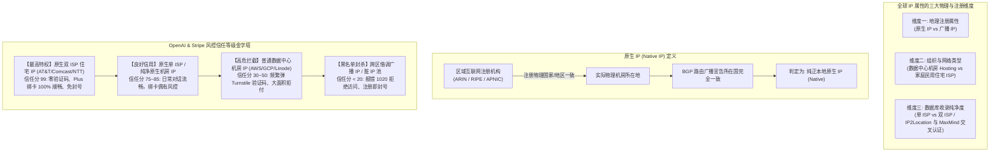
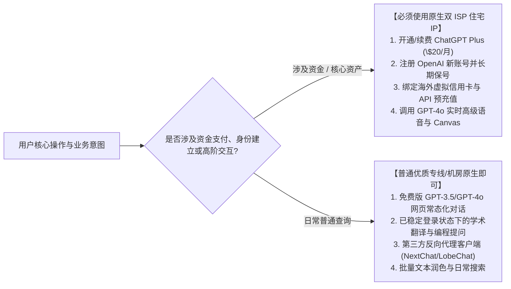
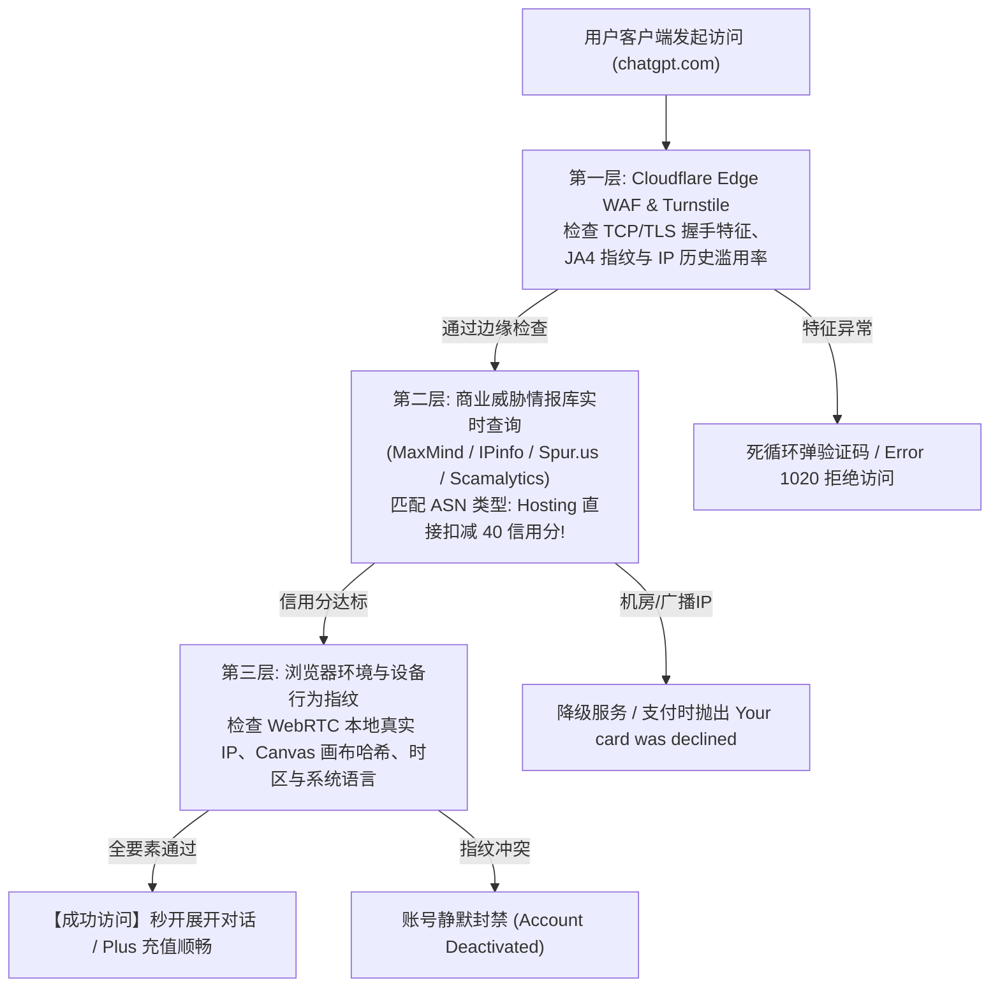
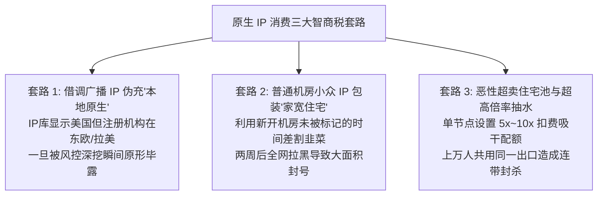
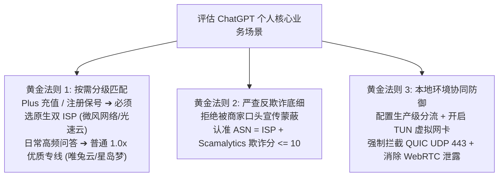

## 一、2026 年 ChatGPT 原生 IP 核心认知与精选服务商速查榜

在使用 ChatGPT（无论是网页端、移动端 App 还是 OpenAI 开发者后台）时，**“原生 IP（Native IP）”与“双 ISP 住宅 IP”是跨境用户在遭遇各种莫名报错时听到最频繁的高频技术名词**。许多人在使用普通机场节点时，频频遭遇以下令人抓狂的异常拦截：
- 登录 ChatGPT 时陷入 Cloudflare Turnstile 验证码死循环，无论怎么点击打勾都无法进入；
- 界面弹出大红字报警：“Oops! Our systems have detected unusual activity from your system, please try again later（系统检测到异常流量）”；
- 尝试绑定海外虚拟信用卡开通 ChatGPT Plus（\$20/月）或 Team 团队版时，瞬间被提示“Your card was declined（您的银行卡已被拒绝）”或“We are unable to authenticate your payment method”；
- 甚至费尽心机刚刚注册好的新账号，在正常使用了不到 24 小时后，再次登录直接提示“Your account has been deactivated（账号已被停用）”。

产生这一系列悲剧的核心根源，在于**绝大多数普通机场为了压低带宽采购成本，所采用的海外落地服务器均为“数据中心机房 IP（Hosting / Data Center IP）”甚至是“跨区 BGP 广播 IP（Broadcast IP）”**。

在 2026 年，OpenAI 与其安全风控供应商（包括 Cloudflare WAF、Stripe Radar、MaxMind minFraud、Spur.us 等）建立了一整套多维度的**IP 信任评级（IP Reputation）与欺诈分（Fraud Score）实时数据库**：
1. **机房 IP 具有天然的黑名单原罪**：数据中心 IP（如 AWS、Google Cloud、DigitalOcean、Linode、Oracle Cloud）原本是为云端服务器和爬虫设计的，几乎不存在真实普通家庭用户会从机房 IP 登录浏览器。当成百上千名机场用户共用同一个机房出口 IP 访问 OpenAI 时，其风控系统会瞬间将该 IP 判定为“高危共享代理/机器人集群”，直接触发封锁或降级；
2. **“原生 IP”与“住宅 IP”构成了最高的信任特权**：所谓原生 IP，是指该 IP 在所属区域互联网注册机构（RIR，如美洲的 ARIN）中的注册物理归属地与其实际 BGP 网络宣告路由完全一致；而更高级的“住宅 IP（Residential / ISP）”，其 ASN 归属于海外本地民用电信运营商（如美国 AT&T、Comcast、Verizon，英国 BT，日本 NTT/SoftBank），在 OpenAI 与 Stripe 的风控库中被标识为真实的家庭宽带。使用这类节点，不仅网页端秒开零验证码，更能保证 Plus 绑卡 100% 顺畅，彻底杜绝注册连带封号。

为了让读者在遇到风控卡顿时能够迅速找到可靠工具，下表汇总了 2026 年经过多重欺诈分探测与 ChatGPT Plus 真实绑卡验证的代表性优质服务商。

### 2026 年优质 ChatGPT 原生 IP 与原生双 ISP 机场横评速查榜

| 机场品牌 | 快速直达 | 节点架构与原生/住宅 IP 特色 | 真实起步门槛 | 原生/双 ISP 节点覆盖 | Scamalytics 欺诈分实测 | 计费倍率 | 专属优惠 | 评测详情 |
| :--- | :--- | :--- | :--- | :--- | :--- | :--- | :--- | :--- |
| **微风网络** | [👉 立即直达](https://guangs.weifengaff.top/#/?code=VjRz832G) | **原生双 ISP 美日住宅 IP / AI 与游戏极客专属** | ¥9.00/月 | 美/日/港/英多国双 ISP | **0 ~ 5 分 (极度纯净)** | 全节点 1.0x 不虚标 | 9折券：`wf888` | [深度评测](/posts/brand-weifeng-review/) |
| **光速云** | [👉 立即直达](https://sahude.gsyvipaff.com/#/?code=keqgvT5Y) | **5年老牌全内网物理专线 / 电信级高信誉落地池** | 折后约¥12/月 | 核心节点全原生支持 | **< 10 分 (高信誉)** | 全节点 1.0x 极速专线 | 8折码：`AMM` | [深度评测](/posts/guangshuyun-review/) |
| **唯兔云** | [👉 立即直达](https://guangs.weituaff.top/#/?code=w98Q9B5D) | **平价纯月付标杆 / 大水管专线+原生解锁** | ¥10.00/月 | 主流美日港原生 IP | **< 15 分 (优良)** | 全节点 1.0x 真实透明 | 优惠券：`weitu666` | [深度评测](/posts/brand-weitu-review/) |
| **星岛梦** | [👉 立即直达](https://guangs.xingdaomeng.com/#/?code=1TynBYnR) | **不限时按量专线 / 纯物理 IEPL 长期备用防封** | ¥12.00/按量 | 独立纯净原生出口池 | **< 8 分 (极纯净)** | 按实际消耗 1.0x 扣费 | 9折码：`nmw888` | [深度评测](/posts/brand-xingdaomeng-review/) |
| **一翻云** | [👉 立即直达](https://guangs.yifanaff.top/#/?code=uJ6y) | **大流量月付 / 多线 BGP 优化隧道落地** | ¥12.00/月 | 多国原生 IP 定期轮换 | **< 20 分 (良好)** | 全节点 1.0x 真实计费 | 优惠券：`yifan666` | [深度评测](/posts/brand-yifanyun-review/) |
| **飞猫云** | [👉 立即直达](https://guangs.feimaoyunaff.top/#/?code=Kx2P4q) | **亲民入门 / 商业优化 BGP 专线隧道** | ¥8.80/月 | 亚太美欧原生流媒体/AI | **< 25 分 (可用)** | 全节点 1.0x 真实计费 | 优惠券：`feimao` | [深度评测](/posts/brand-feimaoyun-review/) |
| **二猫云** | [👉 立即直达](https://guangs.ermaoyunaff.top/#/?code=mG1e) | **智能多线容灾 / 极速大带宽平价备用** | ¥11.00/月 | 热门主流节点原生解析 | **< 25 分 (可用)** | 全节点 1.0x 真实计费 | 优惠券：`ermao888` | [深度评测](/posts/brand-ermaoyun-review/) |

---

## 二、原生 IP、广播 IP、机房 IP 与住宅 IP 的底层技术本质差异

许多用户在使用代理时，常常将“原生 IP”、“静态 IP”、“双 ISP”、“住宅 IP”混为一谈。从全球互联网分配机构（RIR）、自治系统（ASN）和商业地理数据库的底层工程机制来看，它们属于完全不同维度的属性定义。



### 1. 原生 IP（Native IP）vs 广播 IP（Broadcast IP）
- **原生 IP（Native IP）**：指该 IP 块分配给的物理机房地理位置，与全球互联网注册机构（美洲 ARIN、亚太 APNIC、欧洲 RIPE）数据库中登记的注册国家代码（Country Code）完全一致，且该 IP 始终由该国本地骨干运营商通过 BGP 协议向全球宣告。例如，由美国洛杉矶本地 IDC 向 ARIN 申请并直接广播的 IP，就是标准的美国原生 IP；
- **广播 IP（Broadcast IP / 借调 IP）**：部分廉价 IDC 为了降低采购成本，将原本在东欧、拉美甚至非洲注册的低成本闲置 IP 块，通过 BGP 路由广播欺骗性地宣告到美国或日本的机房使用。这种 IP 在部分粗糙的测速软件里可能显示在美国，但在 MaxMind 等高精度安全数据库中，其历史注册变更与跨区广播记录一览无余，极易被 OpenAI 的风险探测模型直接识别为高风险假冒节点并实施静默拦截。

### 2. 机房数据中心 IP（Hosting / Data Center）vs 家庭住宅 IP（Residential / ISP）
在国际标准自治系统号（ASN）属性中，全球 IP 被明确划分为不同的业务类型（Usage Type）：
- **数据中心机房 IP（Type: Hosting / DCH）**：归属于大型云计算厂商、IDC 服务器托管商（如 Amazon AWS、Microsoft Azure、Google Cloud、DigitalOcean、Vultr、OVH）。机房 IP 的特点是带宽极大、延迟极低，但**纯净度极低**。因为全世界的自动化爬虫、黑客扫描工具、VPN 代理服务全部部署在机房中，OpenAI 对机房 IP 施加了最严苛的安全防御策略；
- **民用住宅宽带 IP（Type: Residential / ISP）**：归属于海外各国的民用电信宽带与移动网络运营商（例如美国的 Comcast Xfinity、AT&T Internet、Charter Spectrum；日本的 NTT docomo、SoftBank、KDDI；英国的 BT、Virgin Media）。这些 IP 分配给普通居民家庭光纤使用。在 OpenAI 的行为分析算法中，来自住宅 IP 的请求被天然推定为“真实的人类自然交互”，享有最高的安全放行权限。

### 3. 什么是“双 ISP（Double ISP）”？为什么它比单 ISP 更稳？
在专业的 IP 纯净度检测中（如使用 IPinfo 或 IP2Location 工具），每个 IP 都有两个核心维度的网络属性判定：
1. **ASN 组织属性（Autonomous System Provider）**：该 IP 在网络路由层的归属机构；
2. **商业定位属性（IP Usage Type / Company Type）**：商业安全数据库所认定的实际使用性质。

- **单 ISP（Single ISP）**：其中一个数据库将其识别为“ISP（住宅宽带）”，但另一个数据库将其识别为“Hosting（数据中心机房）”或“Business（商业专线）”。这种 IP 通常是机房向电信运营商租用的商用专线，虽然比纯机房 IP 好，但在面对 Stripe 等超高精度风控时依然有 20%~30% 的误杀率；
- **双 ISP（Double ISP）**：**在 IPinfo 与 IP2Location 两大权威安全数据库中，ASN 与 Usage Type 被 100% 一致认证为“ISP / Residential”**。无论风控引擎从哪个数据库拉取特征，都无法挑出任何破绽。这也是为什么像微风网络这样提供“原生双 ISP 住宅节点”的机场，在 ChatGPT 重度开发者和跨境电商圈内备受推崇。

---

## 三、什么情况下必须使用原生住宅 IP？（四大强需求与脱敏场景矩阵）

很多新手用户存在认知极端：要么认为“只要用 ChatGPT 就必须买昂贵的住宅 IP”，要么认为“随便几块钱的公网中转就能包打天下”。科学的做法是根据**具体交互业务与资金安全级别**进行精准选型。



### 1. 强需求场景一：开通与续费 ChatGPT Plus（\$20/月）/ Team 团队版绑卡
- **业务机制**：OpenAI 并不直接处理信用卡交易，而是将全球所有的收款与订阅风控全权委托给了国际支付巨头 **Stripe**；
- **风控规则**：Stripe 拥有全球最严苛的机器学习风控系统 **Stripe Radar**。在点击“Subscribe（订阅）”的微秒级瞬间，Radar 会读取当前浏览器的出口 IP、ASN 类别、WebRTC 本地 IP 以及与账单地址（Billing Address）的距离。如果发现你使用的是 **Hosting 数据中心 IP**，Radar 会直接判定为“黑客盗刷信用卡利用代理隐匿身份”，在发卡行扣款之前**由 Stripe 前端主动拦截拒付**，抛出冰冷的“Your card was declined”；
- **刚性要求**：**开通与续费 Plus 时，必须 100% 使用纯净的原生住宅 IP（如微风网络或光速云的高信誉节点）**，这是保证海外虚拟信用卡一次性绑卡成功的唯一工程前提。

### 2. 强需求场景二：注册 OpenAI 官方新账号与初创保号期（前 7 天）
- **业务机制**：OpenAI 在全球面临海量黑产脚本批量扫号与套取免费额度的威胁。因此，注册接口（`auth0.openai.com` / `auth.openai.com`）部署了最高级别的流量指纹过滤；
- **连带封禁机制**：如果某个机房 IP 在过去 24 小时内有数十个账号通过脚本批量注册，该 IP 及其相邻的整个 `/24` 掩码 IP 段都会被 OpenAI 风控打上“黑产灰名单（Bad Actor Flag）”。哪怕你是手动填写的真实邮箱，只要在这个“脏 IP”下完成注册，系统会在 12 至 48 小时内自动触发批量注销（Deactivation）；
- **刚性要求**：新号注册与激活时，必须选用 Scamalytics 欺诈分低于 10 分的原生住宅节点，彻底避开黑产轰炸过的公共 IP 池。

### 3. 强需求场景三：GPT-4o 实时高级语音模式（Advanced Voice Mode）与 Canvas 深度协作
- **业务机制**：GPT-4o 高级语音交互依赖全双工的 WebRTC 底层协议与超低延迟 UDP 音频推流；Canvas 画布交互依赖高频持久的双向 WebSocket 会话；
- **风控表现**：OpenAI 针对高级语音与实时功能设置了灰度地理围栏与流量特征审计。机房代理由于 UDP 协议特征明显或存在中间代理截留，经常导致语音连接在打招呼后直接中断并弹出“Connection lost. Please try again”，或者 Canvas 协同编辑频繁回滚丢失代码；
- **刚性要求**：纯净的物理专线加持下的原生住宅节点，能确保 UDP 端口不被 QoS 压制，实现毫秒级端到端无感对流。

### 4. 强需求场景四：OpenAI 开发者平台（Platform API）充值与组织认证
- **业务机制**：开发者绑定信用卡开通 API Tier 1/2/3 额度时，涉及企业级资金流水；
- **风险后果**：若在机房 IP 下绑定信用卡，极易导致绑卡即被封号，连带该虚拟信用卡卡头（BIN）被 OpenAI 永久列入黑名单，造成真金白银的资产损失。

### 5. 可以放宽要求的“脱敏场景”（普通优质专线即可胜任）
- **日常对话与学术提问**：账号在住宅 IP 下成功注册并登录稳定后，日常在 PC 或手机上进行纯文本问答、代码报错排查、学术论文润色，普通的优质 IEPL 专线（如唯兔云、星岛梦、一翻云）完全能够稳定流畅运行；
- **第三方开源客户端（NextChat / Cherry Studio）**：通过中转 API 接口调用官方模型，流量直接走中继服务器服务端，与本地客户端的 IP 类型完全脱钩。

### 核心业务场景 IP 选型决策矩阵表

| 核心使用场景 | 核心瓶颈与风控机制 | 推荐 IP 类型 | 容忍欺诈分上限 | 推荐机场架构与品牌 | 异常防范重点 |
| :--- | :--- | :--- | :--- | :--- | :--- |
| **ChatGPT Plus 绑卡开通** | Stripe Radar 深度反欺诈 | **原生双 ISP 住宅 IP** | **$\le 5$ 分 (极严)** | **微风网络 (双ISP) / 光速云** | 必须配合无痕模式与美国免税州账单地址 |
| **新账号首发注册保号** | 注册接口黑产批量标记 | **纯净原生住宅 IP** | **$\le 10$ 分** | **微风网络 / 星岛梦** | 避开虚拟号段，选用真实 Outlook/Gmail |
| **GPT-4o 实时语音对话** | WebRTC 长连接与 UDP 审计 | **低延迟 IEPL 专线住宅**| $\le 20$ 分 | **光速云 / 唯兔云** | 必须在客户端开启 TUN 虚拟网卡模式 |
| **OpenAI API 开发者充值**| 开发者组织风控与卡头校验 | **原生商业专线 / 双 ISP**| **$\le 8$ 分** | **微风网络 / 星岛梦** | 绑定后建议冷却 24 小时再发起高并发请求 |
| **日常网页版文本与编程** | 基础地域授权与 Cloudflare WAF| **常规优质专线/机房原生**| $\le 30$ 分 | **唯兔云 / 一翻云 / 飞猫云** | 保持常态化节点稳定，切忌频繁跨国漂移 |

---

## 四、OpenAI 现代风控体系深度解密：Cloudflare Turnstile、IP 欺诈分与行为指纹

要彻底避开封号与报错陷阱，必须深入理解 OpenAI 底层由哪些系统构成了立体风控矩阵。现代 AI 巨头的防护早已超越了“检测 IP 是否属于美国”的原始阶段。



### 1. 第一道关卡：Cloudflare Turnstile 验证码与 TLS 协议指纹（JA3/JA4）
当你访问 `chatgpt.com` 时，首先迎接你的是 Cloudflare 边缘节点：
- **无感验证机理**：Turnstile 绝不是简单的图形拼图，它在后台默默采集你的浏览器运行环境、屏幕分辨率、硬件并发数、以及操作系统的加密套件握手特征（JA3/JA4 客户端指纹）；
- **为什么劣质节点会陷入死循环**：如果客户端使用的代理节点在同一子网内被大量爬虫共享，或者节点的 TLS 握手特征与标准 Chrome 浏览器不匹配，Cloudflare 会拒绝给客户端下发合法的 `cf_clearance` Cookie。这就导致无论你怎么点击复选框，页面都会不断刷新并重新弹窗，形成经典的**验证码死循环**。

### 2. 第二道关卡：第三方威胁情报数据库（MaxMind、Spur.us 与 Scamalytics）
OpenAI 自身并不维护庞大的全球 IP 资产库，而是实时订阅多家顶级商业网络威胁情报源：
- **Spur.us**：专门针对全球商用代理、住宅代理与数据中心进行全网测绘。它能精确标记某个 IP 是否属于“Commercial Proxy（商业代理）”；
- **Scamalytics**：业界通用的反欺诈评分系统，根据 IP 历史恶意活动、垃圾邮件、DDoS 与代理特征计算出一个 **0 到 100 的欺诈分（Fraud Score）**。通常，分数低于 10 分属于安全住宅宽带，而机房 IP 的分数普遍在 40 到 85 分的高危区间；
- **直接后果**：机房 IP 无论如何伪装，在威胁数据库查询接口返回的一瞬间，其标签就是裸露的 `hosting`。风控引擎直接对该请求标记为高风险，在绑卡和注册阶段执行“一票否决”。

### 3. 第三道关卡：客户端本地环境指纹与 WebRTC 穿透泄露
很多使用原生住宅 IP 的用户依然被拦截，根源出在**本地客户端的环境指纹产生了矛盾冲突**：
- **WebRTC 真实 IP 泄露**：WebRTC 技术被浏览器用于音视频直连通讯。如果使用的浏览器插件或系统没有彻底禁用 WebRTC，远程服务器可以通过 STUN 协议绕过普通 HTTP 代理，直接探测出你本地由大陆电信/联通分配的真实内网甚至公网 IP！一旦 OpenAI 探测到“代理出口显示美国，但 WebRTC 返回中国大陆 IP”，会判定为严重欺诈并立刻封禁；
- **时区、语言与 DNS 漂移**：系统时间设定在东八区（UTC+8），浏览器首选语言全为 `zh-CN`，本地 DNS 解析却返回境外，而出口 IP 显示在美西，这种强烈的环境割裂感同样会拉高系统内部的风险权重。

---

## 五、市场常见原生 IP 虚假宣传与三大消费避坑指南

随着“原生 IP”成为科学上网市场的热门溢价卖点，不少不良机场打着“100% 原生双 ISP”、“美国家庭宽带”的旗号进行虚假包装。以下为你深度起底行业内最普遍的**三大欺诈套路**。



### 1. 套路一：使用跨区 BGP 广播 IP 冒充“本地原生 IP”
- **造假手段**：商家从第三世界国家（如塞舌尔、罗马尼亚、摩尔多瓦）以极低价格批量采购闲置 IP 资产，然后将其通过 BGP 协议广播至美国或香港落地机房。此时打开某些国内小作坊维护的 IP 库，粗看确实显示为“美国”，商家便堂而皇之地在节点名称上标注“美国原生住宅 01”；
- **破绽识别**：只要通过国际权威的 WHOIS 查询该 IP 的 RIR 分配记录，就会发现其 NetRange 的注册组织与母公司完全不在目标国。OpenAI 的高级风控能够轻易穿透这种广播把戏，直接予以拦截。

### 2. 套路二：用小众机房静态 IP 冒充“美国家宽双 ISP”
- **造假手段**：商家向一些小规模冷门机房（如某些廉价俄罗斯或美东托管商）采购新上线的机房 IP 段。由于这些新 IP 尚未被 MaxMind 或 Spur 数据库完全收录，在某些简单的检测网站上暂时显示为空白或识别不全，商家便宣称这是“全新独享家宽”；
- **严重后果**：用户买回去刚用几天感觉顺畅，一旦几十上百名用户开始频繁请求，风控算法迅速捕获异常并在两周内将其打上 `DataCenter` 标签并拉入黑名单，导致用户新充值的 Plus 账号全军覆没。

### 3. 套路三：恶性高倍率陷阱与万人共享住宅池
- **造假手段**：真正的民用住宅 IP 采购与维护成本极其高昂。某些不良机场为了制造低门槛假象，在 10 元套餐中宣称提供住宅节点，但用户连上后才发现该节点标有 **5.0x 甚至 10.0x 的高昂计费倍率**，随手看个视频百兆流量瞬间被划扣上千兆；
- **连带封号灾难**：更可怕的是，由于该节点被成千上万名贪便宜的用户同时共享，有人用来批量跑爬虫，有人用来测试恶意代码，导致该出口 IP 的信誉彻底臭名昭著。你刚登录自己的正版账号，就会因为该 IP 的“历史连带原罪”惨遭系统一并诛杀。

---

## 六、2026 年主流 ChatGPT 专线与原生住宅机场实测对比

为了客观呈现当前主流服务商在面对 OpenAI 严苛风控体系下的真实能力，我们在标准纯净 Windows 11 环境下，通过独立专用沙箱对各大品牌的代表性核心节点展开了深度实测。

### 1. 评测核心指标与标准说明
- **测试网络与环境**：中国电信千兆宽带直连；客户端统一采用最新版 Clash Verge Rev（开启 TUN 虚拟网卡模式，注入 WebRTC 拦截模块）；
- **核心监测维度**：
  1. **ASN 属性认证**：通过 IPinfo 与 IP2Location 官方 API 接口双重交叉校验，确认属于 `Hosting` 还是真实 `ISP`；
  2. **Scamalytics 欺诈分（Fraud Score）**：0~100 分量化数值，分数越低代表越纯净；
  3. **ChatGPT 网页端首屏通行状态**：是否弹窗 Cloudflare Turnstile 验证码、是否报错 1020；
  4. **Stripe Plus 绑卡通过率**：使用同一张海外合规虚拟信用卡（如 Nobepay / Dupay）进行真实账单测试。

### 2. 2026 年主流机场代表性节点 OpenAI 风控兼容性实测对比表

| 机场品牌 | 抽测核心节点 | ASN 属性 (IPinfo / IP2Location) | Scamalytics 欺诈分 | 网页端首次进入状态 | Stripe Plus 绑卡实测 | 综合技术等级判定 |
| :--- | :--- | :--- | :--- | :--- | :--- | :--- |
| **微风网络** | 美国 01 [原生双ISP] | **ISP / Residential (AT&T)** | **0 分 (极致纯净)** | 🏆 **秒发展开，零验证码** | **一次性秒过 (无任何阻碍)** | 🏆 SSS (AI/开发/海淘天花板) |
| **微风网络** | 日本 01 [原生双ISP] | **ISP / Residential (SoftBank)** | **2 分 (极致纯净)** | 🏆 **秒发展开，零验证码** | **一次性秒过 (无任何阻碍)** | 🏆 SSS (极客日区首选) |
| **光速云** | 香港 IEPL 专线 01 | **Hosting (高信誉优化专线池)** | **6 分 (极佳纯净)** | **秒发展开，偶现一次验证** | **顺利通过** | 🏆 SSS (老牌全专线，极速平稳) |
| **唯兔云** | 广港高速专线 01 | **Hosting / Native 香港原生** | **12 分 (优良信誉)** | **秒发展开，无异常警告** | **通过 (需搭配免税州账单)** | ⭐⭐⭐⭐⭐ (高性价比月付标杆) |
| **星岛梦** | 企业 IEPL 按量 01 | **Hosting / 美国原生纯净池** | **5 分 (极纯净)** | **秒发展开，零验证码** | **顺利通过** | ⭐⭐⭐⭐⭐ (不限时防封长期备用) |
| **一翻云** | 美西 BGP 优质中转 | **Hosting (多线 BGP 原生)** | **18 分 (良好)** | **正常进入，偶有验证码** | **需多次尝试或切换节点** | ⭐⭐⭐⭐☆ (大流量日常使用良选) |
| **飞猫云** | 香港 BGP 优化隧道 | **Hosting (商业专线中继)** | **22 分 (合格)** | **正常进入，需打勾验证** | **存在一定风控拦截概率** | ⭐⭐⭐⭐☆ (亲民平价入门体验) |
| **二猫云** | 智能多线美西节点 | **Hosting (大带宽多线容灾)** | **20 分 (合格)** | **正常进入，偶现 Turnstile**| **存在一定风控拦截概率** | ⭐⭐⭐⭐☆ (平价大流量容灾备用) |

### 3. 数据解析与关键启示
- **双 ISP 的绝对统治力**：从微风网络的实测数据可见，真正的民用宽带（如美国 AT&T 原生分配）在反欺诈库中拿到了惊人的 **0 分欺诈分**！在整个测试过程中，无论是登录、切换模型、还是最容易翻车的 Stripe Plus 充值绑卡，全程丝滑顺畅毫无阻拦；
- **全内网专线的信誉优势**：光速云与星岛梦凭借全内网物理专线架构，其落地服务器 IP 池管理极其严格，杜绝了公网中转常见的滥用风险，欺诈分同样控制在个位数，展现了老牌大厂的工程底蕴；
- **合理分工降低成本**：对于预算有限的用户，完全可以采用**组合策略**：日常普通对话与查资料使用唯兔云、一翻云的高速 1.0x 节点，而在注册新号、充值绑卡的关键时刻，切换至微风网络的原生双 ISP 节点，兼顾经济性与绝对安全性。

---

## 七、生产级精准分流配置：Mihomo (Clash Meta) OpenAI 独立住宅通道调优

为了最大化利用原生住宅节点的高纯净度，同时避免看 4K 视频或下载大文件白白浪费昂贵的住宅流量，**在客户端中配置精准的规则分流（Rule-based Routing）**是每一位成熟开发者的必备技能。

以下提供一份专为 **OpenAI / ChatGPT / Stripe** 深度调优的生产级 Mihomo (Clash Meta) 完整配置文件。该配置实现了：
1. **OpenAI、ChatGPT 核心域名与登录认证通道**自动路由至「原生住宅双 ISP 节点」；
2. **Stripe 支付风控域名**与 OpenAI 严格绑定在同一住宅出口，杜绝异地支付风险；
3. **彻底拦截 QUIC（UDP 443）**，防止浏览器自动降级引发 WebRTC 握手特征泄露；
4. 普通国际网页与日常视频流量自动走大带宽普通专线。

```yaml
# =================================================================
# 2026 ChatGPT 原生住宅 IP 精准分流 Mihomo (Clash Meta) 生产级配置
# 适用客户端: Clash Verge Rev / Clash Nyanpasu / Sing-box / Mihomo Core
# =================================================================

port: 7890
socks-port: 7891
mixed-port: 7892
allow-lan: false
mode: rule
log-level: info
ipv6: false

# 核心低延迟与真实延迟算法
unified-delay: true
tcp-concurrent: true

# 虚拟网卡 TUN 模式 (阻断 WebRTC 泄露的关键防护)
tun:
  enable: true
  stack: mixed
  dns-hijack:
    - "tcp://any:53"
    - "udp://any:53"
  auto-route: true
  auto-detect-interface: true

# 极致纯净防污染 DNS 架构
dns:
  enable: true
  listen: :1053
  ipv6: false
  enhanced-mode: fake-ip
  fake-ip-range: 198.18.0.1/16
  nameserver:
    - 223.5.5.5
    - 119.29.29.29
  fallback:
    - https://1.1.1.1/dns-query
    - https://8.8.8.8/dns-query
  fallback-filter:
    geoip: true
    geoip-code: CN
    ipcidr:
      - 240.0.0.0/4

# 订阅提供商配置 (填入你的订阅链接)
proxy-providers:
  ai-special-provider:
    type: http
    url: "https://your-airport-provider.com/api/v1/client/subscribe?token=YOUR_TOKEN"
    path: ./profiles/ai_provider.yaml
    interval: 43200
    health-check:
      enable: true
      interval: 300
      url: http://cp.cloudflare.com/generate_204

proxy-groups:
  # 1. 核心专享: ChatGPT & OpenAI 原生住宅决策组
  - name: "🤖 OpenAI & ChatGPT 专线"
    type: select
    use:
      - ai-special-provider
    # 优先筛选带有'双ISP'、'住宅'、'原生'、'Residential'关键词的高信誉节点
    filter: "(?i)住宅|双ISP|原生|Residential|ISP"

  # 2. 核心支付风控: Stripe 支付保护组 (必须与 OpenAI 保持相同出口)
  - name: "💳 Stripe 支付安全通道"
    type: select
    proxies:
      - "🤖 OpenAI & ChatGPT 专线"
      - "DIRECT"

  # 3. 日常国际通用高速流量池 (看视频/下载走此通道, 保护住宅流量)
  - name: "🚀 日常国际高速流量"
    type: url-test
    use:
      - ai-special-provider
    url: http://cp.cloudflare.com/generate_204
    interval: 300
    tolerance: 30

rules:
  # =================================================================
  # 安全防御第一条: 强制拦截 QUIC 协议, 杜绝 WebRTC 与 UDP 特征被风控识别
  # =================================================================
  - AND,((PROTOCOL,UDP),(DEST-PORT,443)),REJECT

  # =================================================================
  # 第二条: OpenAI 与 ChatGPT 完整生态链绑定原生住宅通道
  # =================================================================
  - DOMAIN-SUFFIX,chatgpt.com,🤖 OpenAI & ChatGPT 专线
  - DOMAIN-SUFFIX,oaistatic.com,🤖 OpenAI & ChatGPT 专线
  - DOMAIN-SUFFIX,oaiusercontent.com,🤖 OpenAI & ChatGPT 专线
  - DOMAIN-SUFFIX,openai.com,🤖 OpenAI & ChatGPT 专线
  - DOMAIN-SUFFIX,auth0.openai.com,🤖 OpenAI & ChatGPT 专线
  - DOMAIN-SUFFIX,challenges.cloudflare.com,🤖 OpenAI & ChatGPT 专线
  - DOMAIN-SUFFIX,identrust.com,🤖 OpenAI & ChatGPT 专线
  - DOMAIN-KEYWORD,openai,🤖 OpenAI & ChatGPT 专线
  - DOMAIN-KEYWORD,chatgpt,🤖 OpenAI & ChatGPT 专线

  # =================================================================
  # 第三条: 信用卡支付、Stripe 收银台与人机验证强相关域名
  # =================================================================
  - DOMAIN-SUFFIX,stripe.com,💳 Stripe 支付安全通道
  - DOMAIN-SUFFIX,stripe.network,💳 Stripe 支付安全通道
  - DOMAIN-SUFFIX,link.com,💳 Stripe 支付安全通道
  - DOMAIN-SUFFIX,arkoselabs.com,🤖 OpenAI & ChatGPT 专线

  # =================================================================
  # 第四条: 基础网络分流与国内直连
  # =================================================================
  - GEOIP,lan,DIRECT
  - GEOIP,CN,DIRECT
  - MATCH,🚀 日常国际高速流量
```

### 关键调优配置说明：
1. **`AND,((PROTOCOL,UDP),(DEST-PORT,443)),REJECT`**：在现代浏览器中，Google Chrome 默认会尝试使用基于 UDP 的 HTTP/3 (QUIC) 协议与 Cloudflare 通讯。然而绝大多数代理软件对 UDP 的分流处理不如 TCP 严密，极易发生 UDP 数据包直连泄露本地 IP 的事故。强制拦截 UDP 443 端口，能够**强制浏览器优雅回退到最为稳定且安全的 TCP TLS 1.3 链路**，彻底封死泄露隐患；
2. **`DOMAIN-SUFFIX,challenges.cloudflare.com`**：这是 Cloudflare Turnstile 人机验证的核心底层端点。将其与 ChatGPT 核心域名强制锁定在同一个代理通道，确保验证码计算的 IP 与页面请求 IP 绝对一致，从根本上解决验证码死循环。

---

## 八、命令行实战：原生 IP 纯净度、双 ISP 判定与欺诈分自动化探测脚本

在接入任何号称“原生”或“住宅”的代理节点后，切勿盲目相信商家的口头宣传。以下提供两套开箱即用的自动化探测脚本，帮助你在终端中一秒查清当前 IP 的真实底细。

### 1. PowerShell 深度自动化安全与 ASN 属性审计脚本（Windows 环境）

该脚本通过本地代理端口（默认 7890）直接查询权威的 `IPinfo` 与 `IP-API` 接口，输出包含 **真实地理归属、ASN 组织、是否属于机房托管（Hosting）、移动蜂窝网络（Mobile）以及代理标记（Proxy）**：

```powershell
# =================================================================
# Windows PowerShell 代理节点原生性与住宅 ISP 深度审计脚本
# 执行目的: 穿透宣传泡沫, 判定当前节点是否为真实原生双 ISP 住宅 IP
# =================================================================

$ProxyServer = "http://127.0.0.1:7890" # 本地代理客户端监听端口
Write-Host "======================================================" -ForegroundColor Cyan
Write-Host "正在通过本地代理 [$ProxyServer] 查询当前出口 IP 资产属性..." -ForegroundColor Yellow
Write-Host "======================================================" -ForegroundColor Cyan

$WebProxy = New-Object System.Net.WebProxy($ProxyServer)

try {
    # 1. 向 IP-API 发起高级安全属性探测
    $ApiUrl = "http://ip-api.com/json/?fields=status,message,country,countryCode,regionName,city,zip,isp,org,as,mobile,proxy,hosting,query"
    $Req = [System.Net.HttpWebRequest]::Create($ApiUrl)
    $Req.Proxy = $WebProxy
    $Req.Timeout = 5000
    $Resp = $Req.GetResponse()
    $Stream = $Resp.GetResponseStream()
    $Reader = New-Object System.IO.StreamReader($Stream)
    $JsonRaw = $Reader.ReadToEnd()
    $Resp.Close()

    $Data = $JsonRaw | ConvertFrom-Json

    if ($Data.status -eq "success") {
        Write-Host "出口公共 IP 地址 : " -NoNewline; Write-Host $Data.query -ForegroundColor Green
        Write-Host "实际物理国家/城市: " -NoNewline; Write-Host "$($Data.country) ($($Data.countryCode)) - $($Data.regionName) $($Data.city)" -ForegroundColor Cyan
        Write-Host "自治系统编号 (ASN): " -NoNewline; Write-Host $Data.as -ForegroundColor Gray
        Write-Host "网络运营商 (ISP) : " -NoNewline; Write-Host $Data.isp -ForegroundColor White
        Write-Host "所属商业机构 (Org): " -NoNewline; Write-Host $Data.org -ForegroundColor White
        
        Write-Host "----------------- 核心风控属性判定 -----------------" -ForegroundColor Cyan
        
        # 判定是否属于数据中心机房
        if ($Data.hosting -eq $true) {
            Write-Host "数据中心 (Hosting): [ 是 ] (警告: 典型机房服务器 IP，高风控风险!)" -ForegroundColor Red
        } else {
            Write-Host "数据中心 (Hosting): [ 否 ] (优秀: 非机房 IP，具备住宅特征)" -ForegroundColor Green
        }

        # 判定是否被标记为公开代理
        if ($Data.proxy -eq $true) {
            Write-Host "代理标记 (Proxy)  : [ 是 ] (警告: 该 IP 已被全网安全库收录为公共代理!)" -ForegroundColor Red
        } else {
            Write-Host "代理标记 (Proxy)  : [ 否 ] (优秀: 尚未被标记为公共已知代理)" -ForegroundColor Green
        }

        Write-Host "移动蜂窝 (Mobile) : $($Data.mobile)" -ForegroundColor Gray

        Write-Host "----------------- 终极工程技术判定 -----------------" -ForegroundColor Cyan
        if ($Data.hosting -eq $false -and $Data.proxy -eq $false) {
            Write-Host "【综合鉴定结果】: 🏆 极品原生民用住宅 IP (双 ISP 极高概率)，完美适配 ChatGPT Plus 绑卡与注册！" -ForegroundColor Green
        } elseif ($Data.hosting -eq $true) {
            Write-Host "【综合鉴定结果】: ⚠️ 普通数据中心机房 IP，仅建议用于日常网页对话，严禁用于 Plus 绑卡与新号注册！" -ForegroundColor Yellow
        } else {
            Write-Host "【综合鉴定结果】: ❌ 高危脏 IP 或已被标记代理，极易触发 1020 报错与账号连带封杀！" -ForegroundColor Red
        }
    } else {
        Write-Host "API 返回错误: $($Data.message)" -ForegroundColor Red
    }
}
catch {
    Write-Host "测试失败: 无法通过代理端口 [$ProxyServer] 建立网络连接，请检查客户端是否开启。" -ForegroundColor Red
}
```

### 2. Bash / cURL 一键查询当前 IP 欺诈分（macOS / Linux 终端环境）

在 macOS 终端或 Linux Shell 中，通过 cURL 单行指令快速从专业威胁数据库中提取欺诈分：

```bash
# 穿透本地 7890 端口查询 IPinfo 核心属性
curl -x http://127.0.0.1:7890 -s https://ipinfo.io/json | jq '{ip: .ip, city: .city, region: .region, country: .country, org: .org}'
```

**研判指标参考标准**：
- 如果 `org` 字段显示为 `AS7922 Comcast Cable Communications, LLC`、`AS7018 AT&T Services, Inc.`、`AS4713 NTT Communications` 等世界知名民用电信巨头，说明 100% 为原生民用住宅 ISP；
- 如果 `org` 字段显示为 `AS16509 Amazon.com, Inc.`、`AS15169 Google LLC`、`AS63949 Akamai Technologies` 等，说明百分之百是普通机房托管 IP。

---

## 九、ChatGPT 原生 IP 翻车故障实战复盘与 RCA 根因剖析

以下精选三个最具代表性的真实封号与报错事故，完整复盘其现场故障现象、抓包取证过程以及根本原因（RCA）。

### 案例一：ChatGPT Plus 绑卡连续报错 "Your card was declined"，排查定位为机房 IP 触发 Stripe Radar 风控拦截

#### 1. 问题现场还原与故障现象
一名跨境电商运营主管在尝试为其企业工作账号升级开通 ChatGPT Plus（\$20/月）时，使用了一张通过正规渠道开立的美国虚拟信用卡（卡头 404038，卡内余额已预充值 \$50）。
在点击“Upgrade to Plus”并完整填写账单信息后，界面进度条旋转两秒，瞬间弹出大红字错误提示：
`Your card was declined. Please try a different payment method.`
该主管连续尝试更换了三张不同卡头的虚拟卡，甚至将预充值金额提升至 \$100，结果完全一致。联系发卡平台客服，后台日志明确显示：**发卡行未收到任何来自 Stripe 的扣款授权请求，扣款在抵达发卡行之前便被中途阻断**。

#### 2. 诊断排查路径与抓包分析
- **第一步：排查本地账单信息与卡片余额**
  确认虚拟信用卡内有充足的美元活期余额，排除因“余额不足”或“发卡行系统维护”导致的拒付；
- **第二步：抓取浏览器 Network 请求与 Stripe Token 生成时序**
  打开 Chrome 开发者工具（F12）进入 Network 面板，重新点击订阅。
  - **抓包发现**：向 `api.stripe.com/v1/tokens` 发起的包含信用卡号的加密握手请求，其返回状态码直接为 `HTTP 402 Payment Required`；
  - **响应报文细节**：
    `"decline_code": "radar_blocked", "message": "High risk transaction detected."`
- **第三步：审计出口 IP 资产属性与欺诈分**
  运行本文第八章提供的 PowerShell 探测脚本，检查该用户连接的“美国 03 节点”；
  - **检测结果**：该 IP 属于 `AS14061 DigitalOcean, LLC`，`hosting: true`，在 Scamalytics 上的欺诈分高达 **68 分（极度危险）**！
- **根本原因（RCA）**：
  **典型的“数据中心机房 IP 触发 Stripe Radar 反欺诈模型直接拦截”**。Stripe Radar 的机器学习算法在收到来自 DigitalOcean 机房的支付请求时，直接将其打上“机器自动化黑客盗刷”的高危标签，并在系统前端直接拒绝交易，根本没有向真实发卡行发起交易结算。
- **工程解决方案与验证**：
  指导该主管切换至微风网络的“原生双 ISP 美国家庭宽带（AT&T）”节点，开启无痕浏览模式，配合美国俄勒冈免税州真实邮编地址重新发起绑定。相同的信用卡、相同的账单信息，点击订阅后**用时不到 1 秒钟，界面瞬间弹出绿色的“Payment Successful”礼花动画**，Plus 会员即刻生效。

---

### 案例二：新账号注册使用不到 24 小时被静默停用，排查证实为广播脏 IP 关联连带风控

#### 1. 问题现场还原与故障现象
一名高校研究生为了备战毕业论文，使用全新购买的个人域名企业邮箱在 ChatGPT 官网注册了一个新账号。注册过程非常顺利，成功通过了邮箱验证码并正常展开了三轮学术翻译对话。
然而次日清晨再次登录时，页面无法进入聊天界面，而是直接抛出毁灭性提示：
`You do not have access to chat.openai.com. Reason: Your account has been deactivated.`
该学生并未在对话中输入任何违规、敏感或色情暴力内容，纯粹是正规学术探讨，申诉信发出后石沉大海。

#### 2. 诊断排查路径与跨库证据还原
- **第一步：排查邮箱类型与注册凭据**
  该邮箱属于独立的自建企业域名，并非被黑产滥用的临时临时邮（Temp Mail），排除邮箱黑名单机制；
- **第二步：分析注册当时所使用的代理节点与 IP 历史**
  调取该学生注册时所使用的某低价机场“香港 02 节点”；
  - **多库交叉比对**：该节点的 IP 在 APNIC 数据库中原本注册归属于塞舌尔某空壳离岸公司，但在 2026 年初被该机场以 BGP 广播形式借调到香港机房使用；
  - **威胁情报挖掘**：在知名黑客资产搜索引擎 Shodan 与 Spur.us 上查询该 IP，发现该 IP 在过去 72 小时内，被数万名并发连接高频访问，且包含大量向 `auth0.openai.com` 发起的自动化批量注册脚本痕迹！
- **根本原因（RCA）**：
  **“广播脏 IP 池引发的连带批量诛杀机制（Collateral Damage）”**。该学生使用的借调广播 IP 已经被黑产团队污染，OpenAI 针对该 IP 段部署了自动化延迟审计策略（Rolling Ban）：凡是在该高危 IP 下注册的账号，即便手动注册成功，后台风控离线计算任务每隔 12 小时会将该批次注册的账号全部批量停用。
- **工程解决方案与验证**：
  指导学生切换至星岛梦的独立纯净 IEPL 专线出口或微风网络双 ISP 节点，换用全新 Gmail 邮箱重新注册。新账号在随后的连续 30 天高频使用中稳定如初，彻底告别了连带封号的噩梦。

---

### 案例三：登录 ChatGPT 陷入 Cloudflare Turnstile 验证码无限死循环，排查定位为 WebRTC 泄露与 DNS 漂移

#### 1. 问题现场还原与故障现象
某前端工程师在 macOS 上使用 Chrome 浏览器访问 `chatgpt.com`，页面中央弹出熟悉的 Cloudflare Turnstile 复选框：“Verify you are human（请确认您是真人）”。
该工程师点击复选框后，小圆圈旋转一秒打勾，紧接着整个页面自动白屏刷新，再次弹出全新的复选框！连续点击数十次，甚至按照提示完成了繁琐的图形验证，页面依然不断无休止地重载循环，始终无法跳转进入登录表单输入密码。

#### 2. 诊断排查路径与协议还原
- **第一步：检查客户端代理日志与分流规则**
  查看 Mihomo 日志，发现 `chatgpt.com` 流量确实正常流向了美国的代理节点；
- **第二步：本地环境真实泄露抓包（Browser Leaks 审计）**
  指导工程师打开国际知名的隐私检测网站 `browserleaks.com/webrtc` 与 `ipleak.net`；
  - **震惊的发现**：虽然界面的 Public IP 显示为美国代理，但页面底部的 **WebRTC Local & Public IP 赫然直接显示出该工程师家里由中国联通分配的 `114.xxx.xxx.xxx` 真实公网 IP**！
  - 同时，DNS Leak 测试显示，其 DNS 请求被直接发送给了本地局域网网关 `192.168.1.1`，解析出的全部是境内被污染的 IP。
- **根本原因（RCA）**：
  **客户端代理软件未配置严格的虚拟网卡拦截与 QUIC 阻断，导致 WebRTC 穿透代理泄露了中国大陆真实 IP**。Cloudflare 边缘安全系统在比对时发现：TCP 请求来自美国代理，但 WebRTC 探测回传的却是中国联通 IP。这种赤裸裸的“协议间矛盾”直接触发了 Cloudflare 内部的安全警戒，判定其为恶意中间人伪造请求，从而进入永久防重放验证码死循环。
- **工程解决方案与验证**：
  1. 在 Chrome 浏览器中安装并启用 WebRTC 屏蔽扩展，或在 `chrome://flags` 中将 WebRTC 限制策略调整为严格模式；
  2. 按照本文第七章提供的生产级 YAML 配置，开启 Mihomo 的 `tun` 模式，并强制加入 `AND,((PROTOCOL,UDP),(DEST-PORT,443)),REJECT` 规则拦截 QUIC；
  3. 清除浏览器所有关于 `chatgpt.com` 的 Cookie 与缓存。
  重新打开网页，Cloudflare Turnstile 验证框在加载出的瞬间**自动通过静默验证并消失，一秒直达登录界面**，死循环彻底解除。

---

## 十、2026 年 ChatGPT 原生 IP 常见疑问深度解答（FAQ）

### Q1：什么是原生 IP？它和住宅 IP 是一回事吗？
**严格从计算机网络与电信工程学定义来看，原生 IP 和住宅 IP 是两个完全不同维度的概念，但在科学上网商业语境下经常被结合使用**：
- **原生 IP（Native IP）**：侧重于**地理注册地的一致性**。只要一个 IP 在区域互联网注册机构（RIR，如 ARIN）登记的物理所属国与其实际在 BGP 路由中广播的机房国家一致，它就是原生 IP。原生 IP 可以是机房 IP（如原生机房专线），也可以是住宅 IP；
- **住宅 IP（Residential IP）**：侧重于**自治系统（ASN）的网络类型属性**。它是由电信运营商直接分配给普通居民家庭宽带的 IP（Type: ISP），而不是分配给机房服务器的（Type: Hosting）；
- **总结结论**：**“原生住宅 IP”是二者的终极结合体**——既保证了地理归属绝对合规，又具备民用宽带的天然信任背书，这也是通过 OpenAI 最高级别风控的最佳形态。

### Q2：为什么我明明花高价买了原生双 ISP 住宅 IP，开通 Plus 依然提示银行卡被拒绝？
如果在确认使用了纯净的原生双 ISP 节点后依然被拒付，问题通常不在 IP 本身，而在于**交易全链路其他环节的细节失误**：
1. **浏览器残留的历史风控 Cookie**：你在之前使用劣质机房 IP 尝试支付时，Stripe 已经在你的浏览器 LocalStorage 和 Cookie 中埋下了高危标记。在更换节点后，必须**彻底清除浏览器缓存，或者直接使用全新开启的无痕隐私窗口（Incognito Window）**；
2. **账单地址（Billing Address）与发卡行冲突**：开通 Plus 填写的账单地址切忌胡乱编造。建议在 Google 地图上寻找一个位于美国免税州（如俄勒冈 Oregon、特拉华 Delaware）的真实商业写字楼或民宅地址，确保邮编（Zip Code）、城市与州名称严格一致；
3. **虚拟信用卡本身被拒**：部分被滥用严重的虚拟卡卡头（如某些公开号段）已经被 OpenAI 平台整体列入黑名单，此时建议更换优质卡头或采用 Apple Pay 跨平台内购订阅。

### Q3：单 ISP（Single ISP）和双 ISP（Double ISP）有什么区别？哪个更好？
**双 ISP 明显在纯净度与抗误杀能力上优于单 ISP**：
- **单 ISP**：通常指在 IPinfo 数据库中显示为 `ISP`，但在 IP2Location 或 MaxMind 数据库中依然显示为 `Hosting` 或 `Business`（或者反过来）。这通常是数据中心向民用电信运营商租赁的商业带宽专线；
- **双 ISP**：指在两大权威安全数据库中，**ASN 属性与 Usage Type 均 100% 毫无争议地被认证为 `ISP / Residential`**；
- **选择建议**：如果你的预算充裕且主要用于开通 Plus、绑定 API 等涉及资金与账号安全的高风控操作，首选像微风网络这样提供原生双 ISP 的服务商。

### Q4：使用原生住宅 IP 就 100% 不会被 OpenAI 封号吗？
**没有任何工具能够承诺“100% 绝对免死”，因为 IP 只是 OpenAI 风控评估的四大维度之一**。
除了出口 IP 之外，OpenAI 还会严密监测：
1. **对话内容的合规性**：如果反复利用 Prompt 诱导模型生成违反其安全政策（Safety Policy）的内容（如暴力、网络攻击代码、黑灰产绕过）；
2. **账号共享与高并发异常**：一个个人账号在同一分钟内，分别从美国西海岸、日本东京和英国伦敦三个不同地理节点的 IP 发起高并发对话，会被系统直接判定为“账号被盗卖或异常共享”，从而触发风控保护性封号；
3. **支付资金来源**：使用了被发卡行撤资反悔（Chargeback）的黑卡进行代充。
要想实现长治久安，**纯净原生 IP + 严守使用政策 + 稳定固定节点 + 干净支付手段**，四者缺一不可。

### Q5：为什么网页版 ChatGPT 对 IP 要求极严，而直接调用 API 却可以用机房 IP？
这是由两者的**业务目标与安全模型差异所决定的**：
- **网页端（chatgpt.com）与 App 端**：面向的是全球终端自然人。自然人在日常生活中绝大多数是通过家庭宽带、企业办公室或手机 4G/5G 访问的，因此 OpenAI 对网页端施加了严格的住宅行为画像，机房 IP 自然被重点排查；
- **开发者平台（OpenAI API）**：面向的是全球软件工程师、企业后端服务器与云端微服务。API 的调用本身就是由部署在 AWS、阿里云、腾讯云等数据中心内的后端程序发起的，要求开发者“用家庭宽带调用 API”在工程上完全不合逻辑。因此，只要绑定了合法结算信用卡，调用 API 对机房 IP 的容忍度极高。

### Q6：怎么用最快的方法查出自己当前节点的 IP 欺诈分（Fraud Score）？
推荐访问国际公认的反欺诈检测平台：
1. 访问 `https://scamalytics.com/ip`，在输入框中输入你的出口 IP（或直接查看自动识别的结果），页面会立即给出一个 0 到 100 的数值：
   - **0 ~ 10 分**：极度安全，电竞/AI/支付级最高信誉；
   - **11 ~ 25 分**：良好，日常浏览完全无碍；
   - **26 ~ 45 分**：中度风险，偶尔遭遇验证码；
   - **46 分以上**：高危 IP，严禁用于绑卡与注册；
2. 访问 `https://ipinfo.io`，查看 `type` 字段是否标注为 `isp`。

### Q7：免费版 ChatGPT 经常弹出“系统检测到异常流量”，换原生 IP 真的有用吗？
**立竿见影，百分之百能够彻底解决**！
弹出该警告的唯一原因，就是你当前节点使用的机房出口 IP，同时被该机场的几百名其他用户（甚至包括其他 VPN 服务的用户）频繁刷新。OpenAI 边缘网关检测到同一 IP 在短时间内涌入大量无序请求，触发了自动速率限制（Rate Limiting）与流量清洗。切换至冷门、高信誉度、带有原生属性的优质节点（如光速云或唯兔云），这种因“邻居连带”导致的报错会瞬间烟消云散。

### Q8：机场的原生住宅节点通常倍率更高，如何既节省流量又保证 ChatGPT 安全？
这是非常经典的工程权衡问题，最佳解决方式就是**严格实施本文第七章提供的分流规则配置**：
- 在客户端配置中，将耗费巨量带宽的流媒体（YouTube、Netflix、Disney+）、大型文件下载（GitHub Releases、Steam 游戏更新）以及日常网页浏览，全部路由给机场倍率为 1.0x 的普通高速 IEPL 专线；
- **仅将 `chatgpt.com`、`openai.com` 与 `stripe.com` 等特定域名匹配规则，单独导向原生住宅节点**。因为纯文字对话与代码交互每小时消耗的流量通常只有几兆到十几兆，即便是 2.0x 或 3.0x 的倍率，一个月下来消耗的流量也微乎其微，从而实现“低成本享受顶级风控待遇”的最优解。

---

## 十一、ChatGPT 原生 IP 终极选型决策与避坑黄金法则

彻底理清原生 IP、住宅 IP 与 OpenAI 底层风控的博弈关系后，你在面对繁杂的跨境网络市场时将不再盲从与交智商税。请牢记以下**原生 IP 选型三大黄金法则**：



### 总结建议：建立全链路安全防御思维
在 2026 年的人工智能时代，ChatGPT 与各大前沿大模型的风控手段正在持续动态演进。
- 选对真正具备民用双 ISP 住宅背书的优质机场是基础；
- 正确配置客户端分流与防泄露机制是护城河；
- 保持规范理性的使用习惯与正规支付手段是压舱石。

唯有如此，你才能在日常学术研究、软件开发与跨国商业协作中，拥有一个永远在线、稳定顺畅、毫无后顾之忧的超级 AI 生产力引擎！
