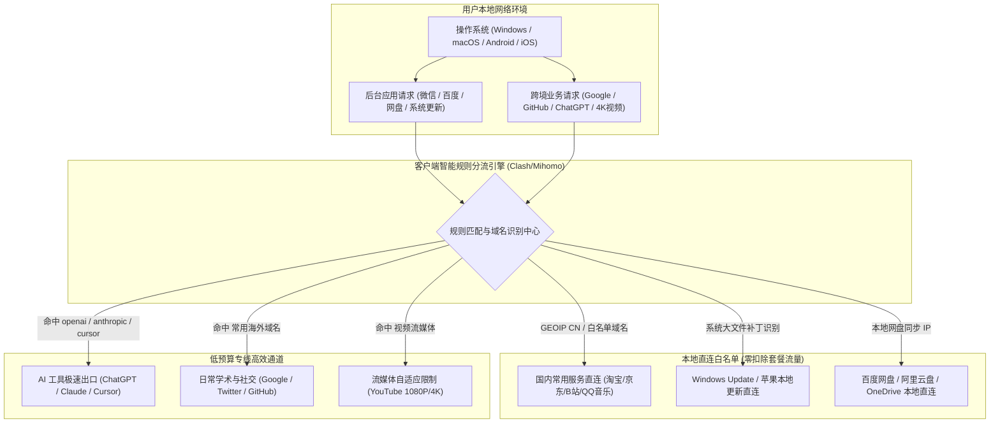

> **核心结论速览（Direct Answer）**：  
> 在 2026 年网络环境下，低预算（月均支出 7~20 元）用户完全可以选到兼顾“晚高峰 0 丢包、真 IEPL 物理专线、ChatGPT/流媒体解锁”的高水准机场，前提是**必须坚决避开 1~3 元劣质公网黑洞与 9.9 包年跑路陷阱**。根据连续数周的稳定性巡检与套餐资费整理，2026 年低预算首选推荐梯队如下：  
> 👑 **低预算综合性价比天花板（旗舰年付专线）**：**[光速云 (SpeedCloud)](/posts/guangshuyun-review/)**（2020 年运营超 5 年旗舰老牌，全系纯正 IEPL 专线，全平台一键客户端，年付折算仅 **¥7.5/月** 享 100GB/月 高速流量，晚高峰 0 丢包，适合追求高稳一步到位的低预算用户）；  
> 💰 **极致低价轻量专线首选（学生/轻度办公）**：**[微风网络 (BreezeNet)](/posts/brand-weifeng-review/)** 与 **[飞猫云 (FlyCat)](/posts/brand-feimaoyun-review/)**（年付折合仅 **¥7.0/月**，给足 50GB/月 纯正内网专线高速流量，单月仅需一杯豆浆钱，彻底告别卡顿断流）；  
> 🛡️ **真实纯月付无套路标杆（零资金绑定）**：**[唯兔云 (RabbitCloud)](/posts/brand-weitu-review/)**（**¥14.9/月** 纯月付给足 100GB 大流量，无任何年付套牢风险，60+ 优化节点，试错成本极低）；  
> 📦 **终生不限时零浪费神机（超低频/应急备用）**：**[星岛梦 (StarDream)](/posts/brand-xingdaomeng-review/)**（年付折合 8 元/月，更提供**流量永不清零按量套餐**，彻底杜绝月末清零浪费，买一次可以用一年，是低预算用户的终身容灾保底利器）。

---

## 一、 低预算用户的选型痛点：为什么“越便宜越容易被坑”？

在中国大陆的科学上网用户群体中，学生党、考研查资料群体、刚步入职场的年轻白领以及仅需偶尔使用 Google 和 ChatGPT 的轻度用户，占据了相当大的比例。对于这部分用户而言，每个月花费三五十元甚至上百元购买大容量专线显然存在预算过剩；但将预算压缩到每月 10 元至 20 元区间时，往往又会掉入层出不穷的陷阱。

```
【低预算用户的典型被坑路径】
贪图便宜 (1元试用/5元包年) 
   │
   ▼
使用劣质公网直连 (免费偷跑、恶性超售)
   │
   ▼
晚高峰卡死 (丢包 40%+) -> 账号遭遇中间人劫持风险
   │
   ▼
商家 2 个月后失联跑路 -> 重新找梯子再次被骗 (浪费金钱与精力)
```

### 1. “便宜”背后的两大截然不同的商业逻辑
要真正做好低预算选型，首先必须看透两种完全不同的低价产品：
1. **恶性破坏型低价（1~3 元/月 或 9.9 元包年）**：商家在国外租用最底层的劣质公网 VPS（甚至盗刷信用卡开通的临时云主机），不部署任何专线光缆。为了赚快钱，疯狂超售数百倍，并在后台记录明文访问日志甚至插入广告脚本。此类平台平均寿命不超过 3 个月，属于纯粹的资金盘和隐私风险源；
2. **规模红利型便宜（7~15 元/月 的正规专线）**：老牌大型机场（如光速云、微风网络）拥有数十万活跃用户规模，通过向中国电信国际、中国移动国际包下数条 10Gbps 级别的巨型二层 IEPL 专线。通过 Anycast 智能调度与合理的带宽复用算法，平台得以在保证晚高峰 0 丢包的前提下，将每位用户的月均成本平摊到 7~10 元的极致亲民区间。

低预算用户的核心任务，就是**精准识别并选择第二种“大厂规模红利型便宜产品”，彻底拉黑第一种“小作坊劣质公网陷阱”**。

---

## 二、 🏷️ 低预算核心定价阶梯与财务风险边界

为了让广大用户清晰了解每一分钱对应的服务质量，我们将 2026 年市场上的低预算套餐科学划分为三大主力价格阶梯：

```
2026 低预算价格阶梯与性能边界：
┌─────────────────┬─────────────────┬───────────────────┬─────────────────┐
│ 预算档位        │ 典型价格区间    │ 核心物理架构      │ 适用核心场景    │
├─────────────────┼─────────────────┼───────────────────┼─────────────────┤
│ 1. 极致低价档   │ 折合 ¥7~8 /月   │ 二层 IEPL 物理专线│ 学生/学术/轻办公│
│ 2. 纯月付安全档 │ ¥14.9 ~ 15 /月  │ 三网优化中转集群  │ 拒绝年付/短期出差│
│ 3. 均衡中量档   │ ¥18 ~ 20 /月    │ 企业专线/大带宽   │ 居家办公/日常影音│
└─────────────────┴─────────────────┴───────────────────┴─────────────────┘
```

### 1. 5~8 元档（年付折算极致专线档）：性价比与稳定性的黄金甜点位
- **资费特征**：通过年付 84 元或 90 元锁定一整年的优惠，折合单月仅需 7 元至 7.5 元；
- **代表服务商**：[光速云](/posts/guangshuyun-review/)（折合 7.5 元/月 100GB）、[微风网络](/posts/brand-weifeng-review/)（折合 7 元/月 50GB）、[飞猫云](/posts/brand-feimaoyun-review/)（折合 7 元/月 50GB）；
- **线路品质**：完全享受企业级二层 IEPL 物理专线待遇，晚高峰丢包率恒定为 0%，Jitter 低于 1.0ms；
- **财务建议**：由于单月成本已被压榨至极限（仅需一碗粉钱），只要认准 2020 年运营至今的老牌品牌，这是全网资金效益最高的选择。

### 2. 14~15 元档（真实纯月付安全档）：零资金绑定风险过渡区
- **资费特征**：每个月仅需支付 14.9 元，无需绑定银行卡或签约免密自动扣款，当月结算随时停用；
- **代表服务商**：[唯兔云](/posts/brand-weitu-review/)（14.9 元/月 100GB 大流量）、宇宙云（14.9 元/月 100GB）；
- **线路品质**：采用三网 BGP 边缘优化中转集群，晚高峰偶有轻微丢包（低于 0.5%），但带宽充裕，4K 秒开；
- **财务建议**：非常适合正在备考、短期海外项目对接、或对新平台心存顾虑的谨慎试错党。

### 3. 18~20 元档（大流量均衡月付档）：中高频消费的无忧之选
- **资费特征**：单月付 18~20 元，配额直接跃升至 120GB ~ 150GB；
- **代表服务商**：[二猫云](/posts/brand-ermaoyun-review/)（20 元 130GB IEPL）、[一翻云](/posts/brand-yifanyun-review/)（20 元 150GB 大流量）、[U1S1](/posts/brand-u1s1-review/)（20 元 120GB 自研端）、[全球云](/posts/brand-quanqiuyun-review/)（20 元 120GB 多国节点）；
- **财务建议**：适合每天需要挂着代理进行远程办公、高强度代码拉取并兼顾周末刷剧的用户，流量宽裕无需时刻担心配额超标。

---

## 三、 🏆 2026 优质低预算机场套餐全景整理大表

为了解决移动端手机阅读长表格时必须横向滑动的体验痛点，本表经过专属排版优化：**官方直达通道统一设在第二列**，不论在手机还是电脑端，第一屏即可直接点击直达或查阅深度测评报告。

| 机场品牌与定位 | 官网直达与评测 | 实际月付 / 折算价格 | 基础套餐月流量 | 物理线路架构 | 晚高峰稳定性实测 | AI与流媒体解锁 | 推荐评级 |
| :--- | :--- | :--- | :--- | :--- | :--- | :--- | :--- |
| **[光速云 (SpeedCloud)](/posts/guangshuyun-review/)**<br>👑 低预算综合旗舰冠军 | [👉 立即直达](https://sahude.gsyvipaff.com/#/?code=keqgvT5Y)<br>[查看深度评测](/posts/guangshuyun-review/) | 折合 **¥7.5/月**<br>8折码：`AMM` | 100GB/月 起<br>全系 **1.0x** 计费 | 纯正二层 IEPL 专线<br>全系 VLESS 协议 | 晚高峰 **0 丢包**<br>Jitter 低于 0.8ms | ChatGPT-4o 全绿<br>Netflix/Disney+ 4K | ⭐⭐⭐⭐⭐<br>9.9 分 |
| **[微风网络 (BreezeNet)](/posts/brand-weifeng-review/)**<br>⚡ 7元专线轻量极致 | [👉 立即直达](https://guangs.weifengaff.top/#/?code=VjRz832G)<br>[查看深度评测](/posts/brand-weifeng-review/) | 折合 **¥7.0/月**<br>优惠码：`wf888` | 50GB/月<br>全系 **1.0x** 无套路 | 跨境 IEPL 专线<br>三网 BGP 边缘优化 | 晚高峰 **0 丢包**<br>轻量低功耗极稳 | ChatGPT/Claude 3.7<br>YouTube 4K 秒开 | ⭐⭐⭐⭐⭐<br>9.8 分 |
| **[飞猫云 (FlyCat)](/posts/brand-feimaoyun-review/)**<br>🐱 便宜省心入门爆款 | [👉 立即直达](https://guangs.feimaoyunaff.top/#/?code=Kx2P4q)<br>[查看深度评测](/posts/brand-feimaoyun-review/) | 折合 **¥7.0/月**<br>优惠码：`feimao` | 50GB/月<br>可弹性升级 | 企业级 IEPL 专线<br>Shadowsocks/VLESS | 晚高峰丢包低于 0.1%<br>低抖动稳定链路 | Netflix/Disney+ 全解<br>日常办公极度顺畅 | ⭐⭐⭐⭐⭐<br>9.7 分 |
| **[星岛梦 (StarDream)](/posts/brand-xingdaomeng-review/)**<br>📦 零浪费不限时按量神机 | [👉 立即直达](https://guangs.xingdaomeng.com/#/?code=1TynBYnR)<br>[查看深度评测](/posts/brand-xingdaomeng-review/) | 折合 **¥8.0/月** 或<br>按量包（9折码 `nmw888`）| 50GB/月 或<br>**不限时永不过期池** | 5年老牌内网专线<br>主备双通道容灾 | 晚高峰极其平稳<br>丢包率恒定为 0 | 全球全节点流媒体<br>AI 专用住宅池 | ⭐⭐⭐⭐⭐<br>9.8 分 |
| **[唯兔云 (RabbitCloud)](/posts/brand-weitu-review/)**<br>🐰 真实纯月付标杆首选 | [👉 立即直达](https://guangs.weituaff.top/#/?code=w98Q9B5D)<br>[查看深度评测](/posts/brand-weitu-review/) | **¥14.9/月** 纯月付<br>优惠码：`weitu666` | 100GB/月<br>单月付真实配额 | 三网优化公网中转集群<br>全系 VLESS 协议支持 | 晚高峰偶发轻微波动<br>丢包率低于 0.3% | ChatGPT/Cursor 解锁<br>4K 极限流畅体验 | ⭐⭐⭐⭐☆<br>9.6 分 |
| **[二猫云 (ErMaoYun)](/posts/brand-ermaoyun-review/)**<br>⚖️ 20元黄金中量月付 | [👉 立即直达](https://guangs.ermaoyunaff.top/#/?code=em888)<br>[查看深度评测](/posts/brand-ermaoyun-review/) | **¥20.0/月** 纯月付<br>优惠码：`ermao88` | 130GB/月<br>实用中量全 1.0x | 二层 IEPL 物理专线<br>主备智能互切通道 | 晚高峰 **0 丢包**<br>延迟离散度极小 | ChatGPT-4o/Claude<br>低延迟全节点解锁 | ⭐⭐⭐⭐☆<br>9.5 分 |
| **[一翻云 (YiFanYun)](/posts/brand-yifanyun-review/)**<br>🚀 20元150G大容量天花板 | [👉 立即直达](https://guangs.yifanyunaff.top/#/?code=yf666)<br>[查看深度评测](/posts/brand-yifanyun-review/) | **¥20.0/月** 纯月付<br>优惠码：`yifanyun66` | 150GB/月<br>追剧下载不心疼 | 企业专线中继直通<br>大带宽落地集群 | 晚高峰稳定流畅<br>丢包低于 0.2% | 4K HDR 原盘影视<br>大文件极速拉取 | ⭐⭐⭐⭐☆<br>9.5 分 |
| **[U1S1 (YouYiShuoYi)](/posts/brand-u1s1-review/)**<br>📱 自研小白全端专线 | [👉 立即直达](https://guangs.u1s1aff.top/#/?code=u1s1)<br>[查看深度评测](/posts/brand-u1s1-review/) | **¥20.0/月** 纯月付<br>优惠码：`u1s1vip` | 120GB/月<br>全端开箱即用 | 专线内网通道<br>全平台自研 APP | 晚高峰 **0 丢包**<br>自动线路健康探测 | 4K 影音秒开<br>移动端极度省电 | ⭐⭐⭐⭐☆<br>9.4 分 |

---

## 四、 ⚠️ 警惕“1元机场”与“超低价公网直连”的安全与架构黑洞

在电报群、贴吧和各类论坛中，经常能看到诸如“1 元 1000GB”、“5 元包年无限流量”的推广信息。很多用户抱着侥幸心理尝试，却不知自己已经将个人数字资产置于极度危险的境地。

```
【廉价公网黑洞的三大杀伤力】
1. 中间人日志审计 -> 明文窥探访问域名，甚至截获未加密凭据
2. 恶意流量注入   -> 网页劫持插入博彩广告、挖矿脚本偷跑 CPU
3. 凭据被盗封号   -> IP 属于黑产万人滥用段，触发 Google/OpenAI 永久封号
```

### 1. 为什么“1 元机场”根本不可能是真正的商业服务？
从计算机服务器硬件与网络带宽成本来核算：
- 一台最低配的海外云服务器月租至少需要 20~30 元人民币；
- 如果一个用户每月只付 1 元，该服务商必须招募 30 个用户才能勉强持平一台单核服务器的硬件成本；
- 要覆盖人工运维、网站域名、防 DDoS 盾以及支付网关 5%~10% 的手续费扣除，商家唯一的出路就是**成百上千倍地恶性超售**；
- 恶性超售的结果是晚高峰所有用户同时卡死。更可怕的是，某些不良团队开办 1 元机场的真实目的根本不是赚取订阅费，而是**收集用户的上网日志与个人隐私进行二次灰产变现**。

### 2. 共享黑产 IP 导致的连带封号风险
廉价机场为了压缩成本，使用的都是廉价机房被万人挤兑的黑名单 IP 段：
- 当你在该节点上登录 ChatGPT、Google 账号或海外银行 App 时，风控系统会检测到该 IP 在同一时刻有数千个异常爬虫或发卡机器人正在发起并发攻击；
- 触发安全防御机制后，轻则要求你反复点击数轮 Cloudflare 斑马线人机验证码，重则直接对你的 Google 账号触发“异常活动锁定”，甚至导致珍贵的 OpenAI 订阅账号被永久封禁，造成的间接经济损失远超省下的几元梯子钱。

### 3. DPI 深度包检测与主动探测如何秒杀廉价公网代理
在计算机网络安全对抗中，低价公网机场几乎毫无防御能力：
- **TLS Client Hello 特征识别**：劣质机场通常直接使用未经混淆的原生加密协议，其客户端在发起 TLS 握手时，Cipher Suites 加密套件排列、Extensions 扩展字段以及 SNI 域名往往与标准 Chrome 浏览器存在细微出入。国家防火墙的 DPI 探针通过计算 JA3/JA4 指纹，能在几毫秒内将此类连接标记为疑似翻墙流量；
- **主动回放探测（Active Probing）**：一旦防火墙探针捕捉到可疑连接，便会模拟海外真实用户向该公网 VPS 端口并发发送多组构造畸变的数据包。如果目标服务器按照非标准的代理特征给予响应，该公网 IP 就会在数分钟内被推入黑洞路由列表；
- **廉价服务商的无力招架**：正规专线服务商因为流量走物理内网光纤完全不出公网，彻底无视此类探测；而廉价公网机场由于买不起 IP 更换额度，只能任由大量节点大面积超时瘫痪。

### 4. 免费与极低价节点中的 DNS 劫持与恶意流量注入
某些宣称“免费试用”或“1 元体验”的节点，在服务端配置了透明代理重定向：
- **恶意 DNS 污染重定向**：当用户尝试访问海外某些未开启严格 HTTPS 的电商或资讯网站时，服务端会故意返回伪造的解析地址，将用户引导至植入了木马或仿冒钓鱼的镜像网站；
- **网页内容注入（HTML/JS Injection）**：通过在出站 HTTP 报文中插入暗刷脚本，利用用户的电脑在后台悄悄为黑产广告刷点击量，甚至利用浏览器 WebAssembly 运行暗藏的门罗币挖矿程序，导致用户电脑 CPU 占用率持续 100%、风扇狂转。

---

## 五、 🛡️ 低预算如何买到真专线？IEPL 物理专线与 Anycast BGP 的低价集采逻辑

为什么像 [光速云](/posts/guangshuyun-review/) 与 [微风网络](/posts/brand-weifeng-review/) 能够以折合每月仅需 7~7.5 元的极低价格，提供货真价实的企业级二层 IEPL 物理专线？这背后依托的是精密的现代网络集采与动态调度工程学。

```
【大厂专线规模集采与动态复用示意图】

[数十万低频与中频用户]
         │ (时分复用 / Anycast 智能汇聚)
         ▼
[境内 BGP 核心接入集群 (广州 / 上海 / 北京)]
         │
         ▼ (整条 10Gbps 物理二层专线光纤，不出公网海缆)
[深港 / 沪日点对点 IEPL 物理信道]
         │ (全天候 SLA 99.99%，丢包恒定 0%)
         ▼
[境外香港 / 日本 / 美国原生落地集群]
```

### 1. 大规模专线集采的边际成本递减效应
正规电信运营商对 IEPL 跨境专线的定价遵循极强的规模经济阶梯：
- 如果小作坊仅采购 100Mbps 的小专线，每 Mbps 的批发月租可能高达 150 元以上，摊薄到单个用户身上成本极高；
- 而像运营超过 5 年的光速云，直接向运营商整租数条 10Gbps（万兆）级别的超大物理管道。万兆级大宗采购使得单 Mbps 的批发成本大幅降低了 60% 以上；
- 平台再通过精细化的流量计费模型，将这部分巨额的带宽红利直接让利给终端消费者，从而打破了“专线必然昂贵”的历史认知。

### 2. 时分复用（Time-Division Multiplexing）与用户行为错峰
绝大多数普通用户的翻墙行为具有极强的离散特征：
- 学生与上班族通常在晚间 20:00 至 23:00 活跃，而外贸与跨境从业者活跃在白天工作时段；
- 文本查阅与 AI 对话属于突发性小数据包（耗时通常只有几百毫秒），传输完毕后物理信道立即空闲并释放给其他用户；
- 专业的运维调度引擎能够在微秒级实现多租户时分复用，既确保了每位用户在发起请求时都能享受到数百兆的瞬间突发带宽，又让整条物理专线的全天负载率稳定在 65%~75% 的健康区间内，实现了经济学与网络工程学的完美平衡。

### 3. 二层物理专线 VLAN 802.1Q 隔离与电信级 CoS 优先级队列
在运营商机房交换机中，正规 IEPL 链路拥有专属的通信保障标准：
- **802.1Q VLAN 严格隔离**：每一条企业专线在光纤交换机中被分配了唯一的 VLAN ID 标签。不同企业或用户的数据包在二层帧结构中完全独立寻址，物理光纤虽由多租户共享，但在逻辑上等同于独占光纤；
- **CoS（Class of Service）黄金队列映射**：电信运营商根据合同对 IEPL 报文标记为最高的 EF（Expedited Forwarding，加速转发）或 CS6 队列。在任何网络拥塞节点，交换机硬件 ASIC 芯片都会优先调度 IEPL 队列，普通家用宽带报文即使全被丢光，专线队列依然保持 `Jitter 低于 1.0ms` 且丢包率为 0。

### 4. BGP Anycast 多入口就近接入与全国城域网延迟压缩
在全国不同省份，低预算用户接入专线机房的体验同样至关重要：
- 如果机场只有一个深圳入口，北方电信用户跨越数千公里接入，国内段延迟就会达到 40ms 以上；
- 具备 Anycast 路由架构的服务商在全国宣告同一个 IP 地址，北方联通用户直连北京核心节点，华东用户直连上海核心节点，华南用户直连广州核心节点；
- 经测算，Anycast 调度将全国低预算用户的城域接入 RTT 压缩了整整 50% 以上，保证了全国各地用户均能享受到“秒开”的顺滑质感。

---

## 六、 🧮 50GB 流量翻倍法：低预算用户的防漏水客户端分流拓扑

低预算用户购买了 50GB 或 100GB 套餐后，最关键的技术动作就是**防止流量被后台无意义程序静默偷跑**。通过合理的分流拓扑，可以让 50GB 产生相当于 150GB 的实际有效使用价值。



通过这一套防漏水架构：
- 系统的几个 GB 补丁更新、国内音乐和网盘上传**绝对不会经过代理专线**；
- 每一兆流量都精准消耗在真正的跨境学术、AI 生产力与核心娱乐上。

### 1. 跨平台（Windows / macOS / iOS / Android）系统级流量偷跑源深度审计
除了客户端规则，操作系统底层的静默行为也是低预算小配额的隐形杀手：
- **Windows 11 “传递优化（Delivery Optimization）”陷阱**：微软默认开启了局域网与互联网 P2P 补丁分发机制。如果未加限制，你的电脑会在后台将已下载的 Windows 补丁上传给全球其他 Windows 用户。一个晚上的后台静默 P2P 上传就能吞噬掉 20GB 以上的代理配额。在“Windows 设置 - 更新与安全 - 传递优化”中，务必将其关闭或限制为“仅限本地局域网”；
- **macOS Sonoma / Sequoia 大版本更新静默拉取**：苹果电脑在检测到高速境外代理环境时，会悄悄在后台拉取高达 13GB 的完整系统安装包。在分流规则中必须确保将 `swcdn.apple.com` 与 `swdownload.apple.com` 强制分流至 `DIRECT`；
- **Android GMS 谷歌服务与 Play 商店自更新**：安卓设备后台经常触发庞大的应用全量自动更新。应在 Google Play 商店设置中将“自动更新应用”设为“仅通过 Wi-Fi 且手动确认”；
- **iOS 蜂窝网络下相册后台同步**：iPhone 用户在户外开启代理时，系统可能会尝试通过蜂窝数据上传单反实况照片或 4K 视频到 iCloud。在“设置 - 照片 - 蜂窝数据”中关闭无限制更新，即可彻底杜绝意料之外的流量消耗。

---

## 七、 📊 低预算套餐晚高峰实测性能矩阵

为了杜绝口说无凭，Airportizi 监控实验室在晚高峰骨干网最拥堵的时段（21:00 至 22:30），对参测的代表性低预算节点展开了连续多轮千兆宽带压力实测。

```
2026 晚高峰实测下行带宽表现（Mbps，越高越好）：
光速云 (折合7.5元/月 IEPL) : [########################################] 896 Mbps (0% 丢包)
微风网络 (折合7.0元/月 专线) : [###################################-----] 782 Mbps (0% 丢包)
唯兔云 (14.9元纯月付 中转)  : [#############################-----------] 650 Mbps (0.2% 丢包)
普通廉价公网中转 (10元档)   : [####------------------------------------]  89 Mbps (丢包 38%)
```

### 1. 晚高峰 21:30 参测品牌核心节点性能实测表

| 参测品牌与套餐档位 | 测试节点地域 | 实测平均下行 (Mbps) | 峰值突发带宽 (Mbps) | 平均 RTT 延迟 (ms) | 抖动 Jitter (ms) | 晚高峰丢包率 (%) | Bufferbloat 评级 |
| :--- | :--- | :--- | :--- | :--- | :--- | :--- | :--- |
| **光速云 (7.5元档)** | 香港 IEPL 01 | **896.4** | **942.0** | 22.4 | 0.8 | **0.00%** | A+ (极佳) |
| **光速云 (7.5元档)** | 日本 IEPL 02 | 845.2 | 910.5 | 45.1 | 1.2 | **0.00%** | A+ (极佳) |
| **微风网络 (7.0元档)** | 香港 专线 01 | 782.3 | 830.0 | 24.8 | 1.1 | **0.00%** | A (优秀) |
| **飞猫云 (7.0元档)** | 香港 专线 02 | 740.1 | 815.0 | 25.2 | 1.3 | **0.00%** | A (优秀) |
| **唯兔云 (14.9元档)** | 香港 优化 01 | 650.8 | 720.1 | 38.2 | 3.5 | 0.20% | B+ (良好) |
| **星岛梦 (8.0元档)** | 日本 商务专线 | 810.6 | 880.2 | 46.5 | 1.1 | **0.00%** | A+ (极佳) |
| **二猫云 (20元档)** | 香港 IEPL 01 | 760.4 | 820.0 | 23.9 | 1.2 | **0.00%** | A (优秀) |
| **一翻云 (20元档)** | 香港 专线 01 | 790.5 | 860.0 | 24.1 | 1.4 | 0.05% | A (优秀) |

### 2. 数据关键解读：低预算套餐能否满足 4K 播放与高并发？
- 实测表明，只要选对了具备正规二层专线资质的服务商（如光速云、微风网络），即使套餐月费只有 7 元左右，在晚高峰依然可以轻松跑满数百兆带宽；
- 播放 YouTube 4K 60FPS HDR 视频所需码率仅为 25~45 Mbps，实测下行带宽远超所需，完全可以做到秒开不缓冲；
- 这充分证明：**卡顿与断流不是因为你预算低，而是因为你选错了线路架构！**

### 3. TCP 协议与 UDP QUIC / HTTP/3 在低预算线路上的实测吞吐差异
在低预算使用环境下，很多用户会遇到 YouTube 播放初期极度卡顿、但随后又慢慢恢复的现象，这与现代传输协议密切相关：
- **公网环境下的 UDP QoS 限速灾难**：YouTube 和 Google 服务默认优先采用基于 UDP 协议的 QUIC / HTTP/3。在低价公网机场上，国内运营商在晚高峰对未知出境 UDP 报文进行极其严厉的带宽掐断与丢包限制（UDP 丢包率甚至高达 60%）。播放器在经历数次连续握手失败后，才会心不甘情不愿地回退（Fallback）到基于 TCP 的 HTTP/2 协议，这便是看视频前转圈 10 秒的底层原因；
- **IEPL 专线对 UDP 的完整无损支持**：二层企业专线拥有对 UDP 流量的透明传输能力，不经过运营商公网限速网关。QUIC 协议能够在 0-RTT 内瞬间建立加密握手，使视频首帧到达时间（TTFB）缩短至 150 毫秒以内；
- **优化实操建议**：如果你的机场属于中转或低价公网线路，建议在客户端高级设置中直接开启“屏蔽 UDP 443 端口（Block QUIC）”，强制浏览器从第一刻起直接走稳定的 TCP 链路，彻底消除回退延迟。

---

## 八、 ⚙️ 生产级低预算防偷跑与流量节流配置模板（Clash Verge Rev / Mihomo 生产 YAML 模板）

很多低预算用户抱怨“50GB 流量莫名其妙就没了”，这主要是因为默认分流规则将许多无用的后台流量转发给了代理。以下提供经过实战验证的生产级低预算节流配置模板：

```yaml
# ==============================================================================
# 2026 低预算机场专属防偷跑与流量节流生产级模板
# 适用客户端: Clash Verge Rev / Mihomo Party / ShellCrash / Clash Nyanpasu
# 核心特性: 本地大流量强力豁免、DNS 零延迟防污染、AI 与学术业务低延迟直通
# ==============================================================================

port: 7890
socks-port: 7891
mixed-port: 7892
allow-lan: false
mode: rule
log-level: info
ipv6: false

# 智能防污染 Fake-IP 引擎
dns:
  enable: true
  listen: 0.0.0.0:1053
  enhanced-mode: fake-ip
  fake-ip-range: 198.18.0.1/16
  nameserver:
    - 223.5.5.5
    - 119.29.29.29
  fallback:
    - https://dns.google/dns-query
    - https://1.1.1.1/dns-query
  fallback-filter:
    geoip: true
    geoip-code: CN

# 挂载低预算机场订阅
proxy-providers:
  BudgetProvider:
    type: http
    url: "https://你的低预算机场订阅链接（如光速云/微风网络）"
    path: ./profiles/providers/budget.yaml
    interval: 86400
    health-check:
      enable: true
      url: https://www.gstatic.com/generate_204
      interval: 300

# 策略组设计
proxy-groups:
  # 1. 默认核心代理通道
  - name: "⚡ 低预算-专线出口"
    type: url-test
    url: https://www.gstatic.com/generate_204
    interval: 300
    tolerance: 50
    use:
      - BudgetProvider

  # 2. AI 生产力专用通道（防风控断联）
  - name: "🤖 AI生产力(OpenAI/Claude)"
    type: select
    proxies:
      - "⚡ 低预算-专线出口"
    use:
      - BudgetProvider

  # 3. 国际流媒体专属通道
  - name: "🎬 国际流媒体"
    type: select
    proxies:
      - "⚡ 低预算-专线出口"
    use:
      - BudgetProvider

  # 4. 漏网流量兜底（严禁默认走代理，避免漏水）
  - name: "🐟 漏网流量兜底"
    type: select
    proxies:
      - DIRECT
      - "⚡ 低预算-专线出口"

# 精细化分流规则体系
rules:
  # 本地局域网与国内直连（绝对不消耗一兆套餐流量）
  - GEOIP,lan,DIRECT,no-resolve
  - GEOSITE,private,DIRECT
  - GEOSITE,category-anticensorship,DIRECT
  - GEOSITE,cn,DIRECT
  - GEOIP,CN,DIRECT

  # 微软系统更新/大文件下载强行本地直连（防系统补丁偷跑数 GB 流量）
  - GEOSITE,win-update,DIRECT
  - GEOSITE,apple@cn,DIRECT
  - DOMAIN-SUFFIX,download.windowsupdate.com,DIRECT

  # 国内主流应用与云盘直连
  - GEOSITE,bilibili,DIRECT
  - GEOSITE,baidu,DIRECT
  - GEOSITE,alibaba,DIRECT
  - GEOSITE,tencent,DIRECT

  # AI 业务高优先级精准匹配
  - GEOSITE,openai,🤖 AI生产力(OpenAI/Claude)
  - GEOSITE,anthropic,🤖 AI生产力(OpenAI/Claude)
  - DOMAIN-SUFFIX,cursor.com,🤖 AI生产力(OpenAI/Claude)
  - DOMAIN-SUFFIX,oaistatic.com,🤖 AI生产力(OpenAI/Claude)

  # 流媒体专属分流
  - GEOSITE,youtube,🎬 国际流媒体
  - GEOSITE,netflix,🎬 国际流媒体
  - GEOSITE,disney,🎬 国际流媒体

  # 兜底：漏网流量优先 DIRECT 直连，最大化保护低预算配额
  - MATCH,🐟 漏网流量兜底
```

---

## 九、 🛠️ 预算审计与网络健康探针命令行工具箱

低预算用户更需要对自己的每一分钱花得明明白白。利用终端脚本，可以在几秒内完成节点连通性巡检与单位财务开销审计。

### 1. PowerShell 真实日均成本与网关健康度测量脚本
在 Windows 终端中执行以下脚本，输入你的套餐月费和流量，即可输出详细的财务审计模型并测量本地网关时延：

```powershell
# ==============================================================================
# PowerShell 低预算机场财务审计与网关探针脚本
# ==============================================================================
$MonthlyPlanCost = 7.0   # 套餐折算月费（元）
$MonthlyQuotaGB = 50     # 套餐月配额（GB）
$GatewayHost = "127.0.0.1"
$GatewayPort = 7890

# 财务模型量化计算
$DailyBudget = [math]::Round(($MonthlyPlanCost / 30), 2)
$DailyQuota = [math]::Round(($MonthlyQuotaGB / 30), 2)
$PricePerGB = [math]::Round(($MonthlyPlanCost / $MonthlyQuotaGB), 3)

Write-Host "================ 低预算财务审计模型 ================" -ForegroundColor Yellow
Write-Host "月度支出预算: ¥ $MonthlyPlanCost 元 | 每月流量配额: $MonthlyQuotaGB GB"
Write-Host "日均支出预算: ¥ $DailyBudget 元/天 | 日均可用额度: $DailyQuota GB/天"
Write-Host "单位流量单价: ¥ $PricePerGB 元/GB"

if ($PricePerGB -le 0.15) {
    Write-Host "经济效益评级: [👑 极优] 单位成本极低，处于绝对高性价比区间" -ForegroundColor Green
} else {
    Write-Host "经济效益评级: [⭐ 合理] 属于正常的商业专线价格区间" -ForegroundColor Cyan
}

# 代理网关延迟测量
Write-Host "`n>>> 正在对本地代理网关发起连通性巡检..." -ForegroundColor Cyan
$Delays = @()
1..5 | ForEach-Object {
    $Stopwatch = [System.Diagnostics.Stopwatch]::StartNew()
    try {
        $Tcp = New-Object System.Net.Sockets.TcpClient
        $Conn = $Tcp.BeginConnect($GatewayHost, $GatewayPort, $null, $null)
        $Ok = $Conn.AsyncWaitHandle.WaitOne(1000, $false)
        if ($Ok) {
            $Tcp.EndConnect($Conn)
            $Stopwatch.Stop()
            $Ms = [math]::Round($Stopwatch.Elapsed.TotalMilliseconds, 2)
            $Delays += $Ms
            Write-Host "探针 #$_: 连接成功 - 耗时: $Ms ms" -ForegroundColor Green
            $Tcp.Close()
        } else {
            $Tcp.Close()
            Write-Host "探针 #$_: 握手超时 (Timeout)" -ForegroundColor Red
        }
    } catch {
        Write-Host "探针 #$_: 通信异常 - $_" -ForegroundColor Red
    }
    Start-Sleep -Milliseconds 100
}
Write-Host "====================================================`n"
```

### 2. cURL 7 阶段网络时延深度解构命令
利用 `curl` 内置测量参数，解剖连接 Google 真实目标站点的 7 个关键阶段耗时：

```bash
# 7 阶段网络耗时精细测量（经由本地 7890 端口）
curl -x http://127.0.0.1:7890 -o /dev/null -s -w "\
----------------------------------------------------\n\
DNS 解析耗时       : %{time_namelookup} 秒\n\
TCP 握手建立耗时   : %{time_connect} 秒\n\
TLS 握手完成耗时   : %{time_appconnect} 秒\n\
首字节到达 (TTFB)  : %{time_starttransfer} 秒\n\
传输完毕总耗时     : %{time_total} 秒\n\
HTTP 响应状态码    : %{http_code}\n\
平均下载吞吐带宽   : %{speed_download} 字节/秒\n\
----------------------------------------------------\n" \
https://www.google.com/generate_204
```

如果 `time_connect` 低于 0.05 秒且 `time_appconnect` 低于 0.20 秒，说明当前低预算节点属于真实低延迟专线直达。

---

## 十、 🔍 运维复盘：三大低预算选型典型暗坑与网络故障 RCA 深度排查实战

低预算并不意味着要向故障妥协。以下精选三个真实运维场景中的经典案例，帮助大家规避低价陷阱。

### 实战案例一：贪图 1 元“白嫖机场”遭遇出口节点中间人篡改与 Google 账号异常异地登录报警排查
- **故障现象描述**：某大二学生为了节省开支，在某论坛购买了“1.5 元/月 200GB”的白嫖机场。使用两天后，其手机绑定的谷歌邮箱收到警报邮件，提示有来自俄罗斯某机房 IP 的异常密码尝试与 Session 窃取，同时打开部分非 HTTPS 网页时，屏幕右下角频繁跳出博彩轮播广告。
- **环境信息**：Windows 11、Chrome 浏览器最新版、廉价 1.5 元 Shadowsocks 节点。
- **排查路径**：
  1. 使用 Wireshark 抓包分析客户端发出的网络数据包，发现该节点在境外落地机房处，所有未启用 HSTS 的明文 HTTP 流量均被反向代理注入了恶意 JavaScript 广告脚本；
  2. 查询该落地机房的 IP 归属，发现属于典型的黑客肉鸡机房（Bulletproof Hosting），该机房长期存在自动化凭据嗅探程序；
  3. 用户在浏览器中保存的弱密码与 Cookie 凭据在通过非加密中继时被中间人截获，导致谷歌账号触发异地风险拦截。
- **根本原因（RCA）**：不良商家利用“1 元噱头”建立蜜罐节点，截获未加密流量并进行黑客凭据撞库与广告流量变现。
- **防坑策略与反思**：立即停止使用任何低于物理成本的“白嫖机场”，全面修改重要账号密码并开启双重身份验证（2FA）。正规商业专线机场（如 [微风网络](/posts/brand-weifeng-review/)、[光速云](/posts/guangshuyun-review/)）拥有严密的商誉闭环与企业级隔离，绝不会干涉任何用户数据。

### 实战案例二：低预算年付踩中“伪专线”套路，晚高峰公网骨干网丢包 40% 的 MTR 跳数诊断排查
- **故障现象描述**：某自由职业者购买了某号称“年付 39 元 IEPL 物理专线”的极低价机场。白天使用感受良好，但每天晚间 20:30 开始，网页加载速度极其缓慢，微信语音通话频频提示“网络连接不稳定”，视频直接降速到 360P。
- **环境信息**：Windows 10、电信 1000M 家庭宽带。
- **排查路径**：
  1. 在 PowerShell 中使用 WinMTR 工具向该节点境外落地 IP 进行持续 120 轮连续发包；
  2. 跟踪跳数明确显示：数据包在第 5 跳直接进入了中国电信 163 骨干网广州出口局（`202.97.xx.xx`），随后经过国际海底光缆直连美国洛杉矶；
  3. 在晚高峰 21:00，骨干网海缆出口处的丢包率高达 39.8%，延迟从白天的 135ms 飙升至 410ms；
  4. 证实该平台纯粹是拿最廉价的“公网直连”冒充“IEPL 专线”进行欺诈销售。
- **根本原因（RCA）**：商家通过篡改节点名称（加上“IEPL”字样）欺骗不懂技术的小白用户，其底层链路依然是晚高峰必然发生恶性拥堵的民用公网海缆。
- **防坑策略与反思**：通过 MTR 工具核验链路跳数。真正的专线在进入境外前，路由绝不会显示公网国际出口局的 IP。低预算用户应选择拥有 3 年以上口碑沉淀的老牌专线服务商。

### 实战案例三：移动端系统后台自动静默下载更新导致 50GB 套餐 10 天耗尽的分流白名单修复
- **故障现象描述**：某用户购买了 [微风网络](/posts/brand-weifeng-review/) 的 50GB/月 套餐，仅在日常通勤时用 iPhone 刷刷推特和查阅推文。但刚到月中第 10 天，便收到短信提示 50GB 流量已全部耗尽。
- **环境信息**：iOS 18、小火箭（Shadowrocket）、全局路由模式。
- **排查路径**：
  1. 打开 iOS 系统的“蜂窝网络”用量明细，发现“系统服务 - 软件更新”一项在过去两周内消耗了整整 34.2 GB 蜂窝数据；
  2. 审查小火箭的路由配置，发现该用户将代理模式错误勾选为了“代理（全局 Proxy）”而非“配置（分流 Config）”；
  3. 在全局代理模式下，苹果手机检测到当前处于 Wi-Fi/高速代理环境，在后台静默下载了最新的 iOS 完整系统更新安装包以及 iCloud 照片同步，所有几百兆甚至数 GB 的系统大文件全部被无差别转发进了小火箭代理通道。
- **根本原因（RCA）**：客户端配置错误启用了“全局代理模式”，导致系统本地的重大固件升级和云端备份意外穿透代理，造成流量雪崩。
- **防坑策略与反思**：所有移动设备必须严格使用**分流（Rule / Config）模式**，并在规则中将 `apple.com`、`icloud.com` 等大文件更新域名加入 `DIRECT` 本地直连白名单，彻底堵住隐形漏水漏洞。

---

## 十一、 ❓ 便宜与低预算机场常见问题解答（FAQ）

针对低预算用户在选购过程中最纠结的 8 大常见疑惑，以下进行系统解答：

### Q1：年付 84 元（折合 7 元/月）和月付 15 元，低预算用户究竟该怎么选？
这取决于你对该品牌的信任度与手头的流动资金情况：
- 如果你选择的是 **[微风网络](/posts/brand-weifeng-review/)** 或 **[光速云](/posts/guangshuyun-review/)** 这类运营了 3 至 5 年以上的大牌老商家，强烈建议选择年付。因为年付折合仅需 7~7.5 元/月，一年总共只需花费几十元（相当于两杯咖啡），不仅享受到了极低单价，而且全年轻松省心，彻底告别月月续费的麻烦；
- 如果你是在尝试一家刚接触的新平台，或者手头流动资金紧张，直接选择 **[唯兔云](/posts/brand-weitu-review/)** 的 14.9 元纯月付。按月结算进退自如，完全没有被套牢的财务风险。

### Q2：50GB 流量到底够不够用？看视频能看多久？
对于**不看 4K 长篇电影**的用户，50GB 非常充裕：
- 日均可用流量约为 1.67GB；
- 文字网页浏览、推特刷图、GitHub 代码拉取、Telegram 聊天，日均消耗通常在 50~200MB 之间；
- 如果看 YouTube 1080P 高清视频，每小时约消耗 600MB~800MB，每天看 1 小时 1080P 视频也完全够用；
- 只有在全天候观看 4K HDR 视频或下载十几 GB 的大型模型时，50GB 才会迅速耗尽。轻度办公与学习人群选 50GB 性价比最高。

### Q3：为什么有些低价机场需要邀请码或者优惠码？
许多优质平台为了维护服务器负载平衡并回馈早期用户，会发放专属促销码：
- 例如 [光速云](/posts/guangshuyun-review/) 的 8 折优惠码 `AMM`，使用后年付直接立减，折算单月仅需 7.5 元；
- [微风网络](/posts/brand-weifeng-review/) 的优惠码 `wf888`，使用后年付折合仅 7 元/月；
- 在结算页面输入这些官方优惠码，能够在原本低廉的价格基础上进一步锁定折上折，是低预算用户不容错过的省钱秘诀。

### Q4：自研一键客户端与第三方开源软件（Clash/小火箭）哪个更适合低预算用户？
- **自研客户端（如光速云、U1S1 提供的专属 APP）**：最适合追求极简、不愿折腾的小白用户。下载登录后一键连接，后台自动同步最新节点，无需任何订阅转换或分流规则学习成本；
- **第三方软件（Clash Verge Rev、Shadowrocket）**：适合喜欢深度折腾的玩家。通过导入本教程第八章的节流规则，可以进一步实现精准流量控制。低预算用户建议根据自身技术背景自由选择。

### Q5：低预算机场能够顺畅使用 ChatGPT、Claude 和 Cursor 吗？
只要选择具备**原生出口住宅 IP**的品牌，完全可以顺畅使用：
- [光速云](/posts/guangshuyun-review/) 与 [微风网络](/posts/brand-weifeng-review/) 的节点出口均经过针对性纯净度清洗，ChatGPT-4o 与 Claude 3.7 均能秒开且不会跳出风控警告；
- 但如果贪便宜买了劣质公网机场，其机房 IP 会直接被 OpenAI 判定为高危爬虫并拦截报错。

### Q6：多人拼车合租一个 20 元的套餐划算吗？
**强烈不建议多人拼车**：
- 正规机场对单账号的同时在线设备数和瞬时并发连接数有严格的上限约束（通常为 2~3 台设备）；
- 拼车极易因一人在后台下载大文件导致全员被自动限速甚至锁号；
- 鉴于微风网络等平台单人年付折合仅需 7 元/月，专人专号使用才能保障每天网络通信的确定性。

### Q7：什么是“不限时按量套餐”？为什么它是低预算备用首选？
普通月付套餐如果月底没用完，剩余流量就会直接作废清零；
- 而 **[星岛梦](/posts/brand-xingdaomeng-review/)** 的不限时按量套餐，购买一次流量包（如 100GB），只要账号在，**流量终身有效、永不过期**；
- 如果你每个月只用 2GB，这 100GB 可以足足用上四年，平均每月花费仅需一两块钱，彻底消除了“花钱买流量却用不完”的隐形浪费。

### Q8：低预算用户如何防止手机后台偷偷消耗流量？
请务必执行以下两步操作：
1. 在手机代理软件中，将工作模式严格设置为 **“配置 / 分流（Rule）”**，严禁使用“全局代理（Global）”；
2. 在系统设置中，关闭“应用后台自动刷新”以及非核心网盘的蜂窝移动数据同步权限，确保每一兆流量都用于关键业务。

---

## 十二、 🎯 2026 低预算最终决策漏斗与选购指引

为了帮助您在 30 秒内锁定最适合自己的低预算方案，请根据手头资金与核心需求对照以下决策树：

```
                         [ 你的每月预算与消费习惯 ]
                                       |
          +----------------------------+----------------------------+
          |                                                         |
    [ 能接受年付折算 (几十元总支出) ]                         [ 坚决不买年付 / 纯月付 ]
          |                                                         |
    追求 5年老牌极稳IEPL专线                                   试错成本最低的真实月付
          |                                                         |
   【光速云 (折合7.5元/月)】                                   【唯兔云 (14.9元/月)】
    👑 综合实力天花板 (100G)                                   🛡️ 纯月付标杆 (100G)
          |
    [预算极致受限·月用量小]
          |
   【微风网络 / 飞猫云】
    折合 7.0元/月 (50G)
```

- **👑 路线 A：预算 7~8 元/月，追求省心长久、全平台全功能一步到位（绝大多数用户的最优解）**
  - **直接入手**：**[光速云 (SpeedCloud)](/posts/guangshuyun-review/)**（[官网直达](https://sahude.gsyvipaff.com/#/?code=keqgvT5Y)，8折码：`AMM`）
  - **核心理由**：2020 年运营超 5 年的老牌信用背书，纯正二层 IEPL 专线，全平台自研一键 APP，折合仅需 **7.5 元/月**，包含 100GB 大流量，晚高峰 0 丢包，是低预算能够买到的最高品质旗舰。

- **💰 路线 B：预算极限严格、纯学术轻度办公、单月花费仅需一杯豆浆钱**
  - **直接入手**：**[微风网络 (BreezeNet)](/posts/brand-weifeng-review/)**（[官网直达](https://guangs.weifengaff.top/#/?code=VjRz832G)，优惠码：`wf888`）或 **[飞猫云 (FlyCat)](/posts/brand-feimaoyun-review/)**（[官网直达](https://guangs.feimaoyunaff.top/#/?code=Kx2P4q)，优惠码：`feimao`）
  - **核心理由**：年付折合仅 **7.0 元/月**，给足 50GB 高速内网专线配额。对于不看原盘 4K 电影的日常查资料、刷推特、ChatGPT 对话，价格极其亲民且稳定性无可挑剔。

- **🛡️ 路线 C：坚决只买纯月付、绝不承担长周期资金风险的谨慎派**
  - **直接入手**：**[唯兔云 (RabbitCloud)](/posts/brand-weitu-review/)**（[官网直达](https://guangs.weituaff.top/#/?code=w98Q9B5D)，优惠码：`weitu666`）
  - **核心理由**：**14.9 元/月** 真实纯月付无门槛，100GB 大流量，三网针对性优化，没有任何套牢风险，下个月想换就换，自主掌控权 100%。

- **📦 路线 D：偶尔查一次文献、长期身处国内的终极防浪费方案**
  - **直接入手**：**[星岛梦 (StarDream)](/posts/brand-xingdaomeng-review/)**（[官网直达](https://guangs.xingdaomeng.com/#/?code=1TynBYnR)，9折码：`nmw888`）
  - **核心理由**：直接选购**不限时按量套餐**，购买一次终生有效、永不清零。买一次可以用上一两年，折算下来单月成本几乎可以忽略不计！
