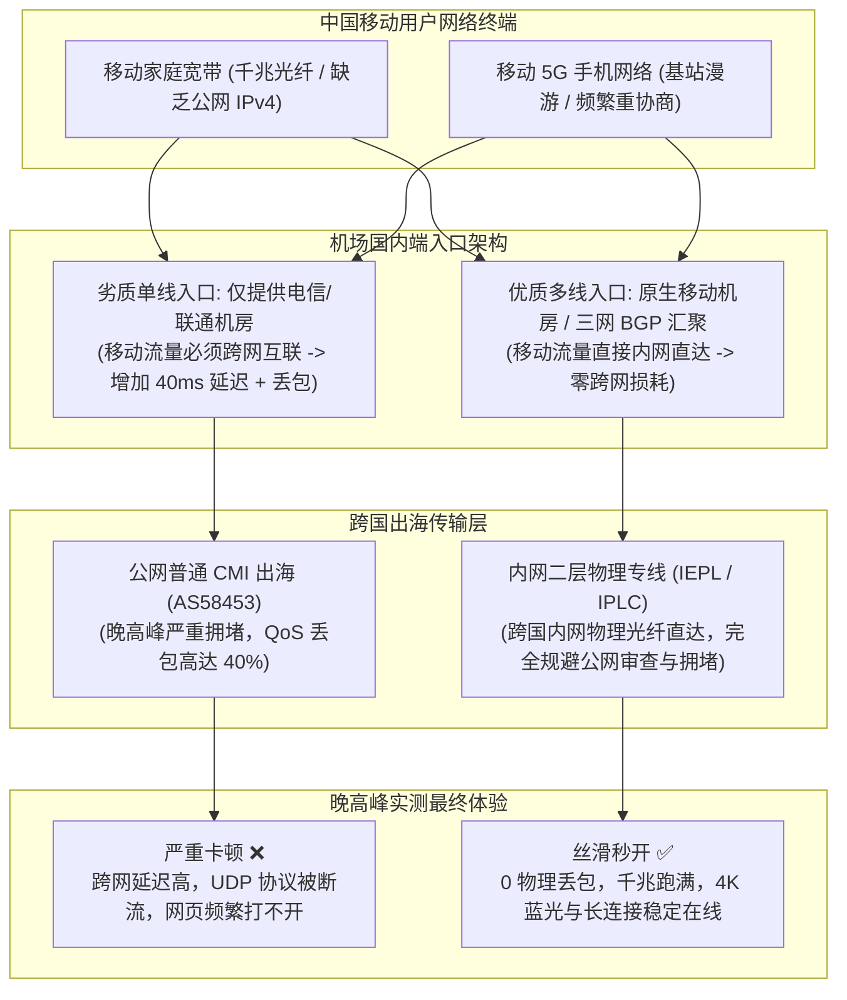
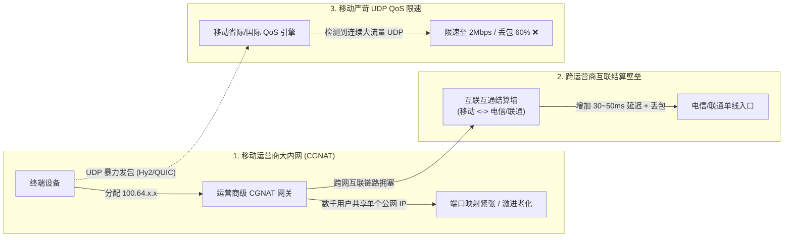
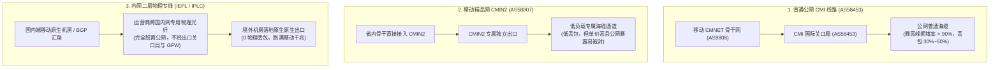
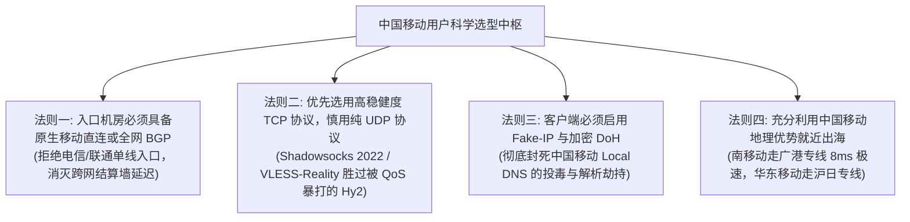
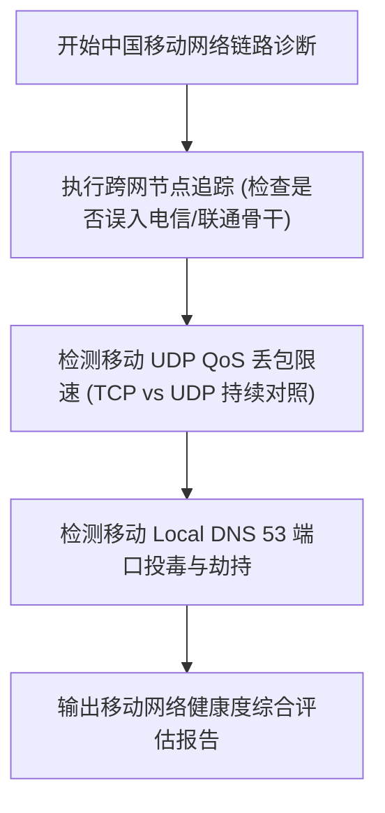
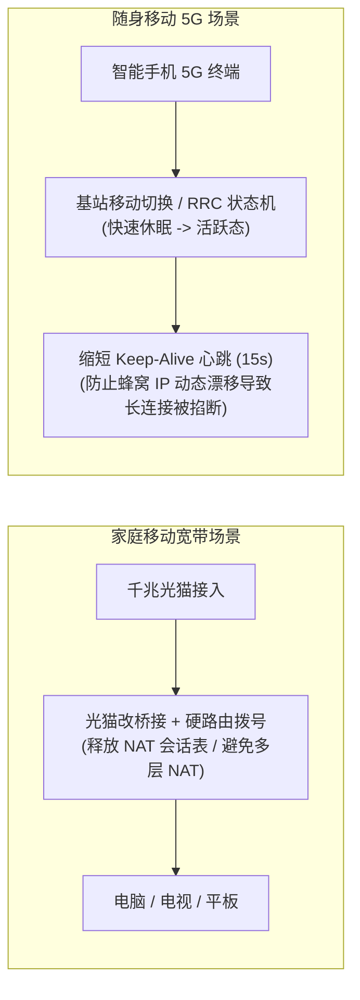
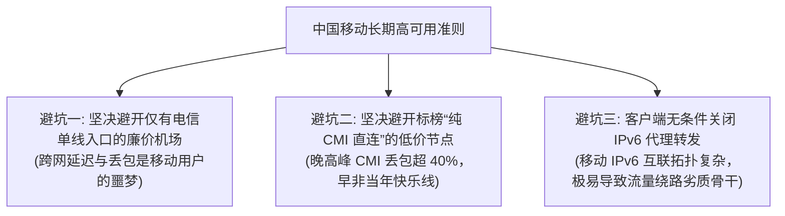

## ⚡ 核心选型结论与移动网络速查清单

中国移动（China Mobile）作为国内用户规模庞大的全业务运营商，在家庭宽带（光纤到户）与移动终端（4G/5G 蜂窝网络）上占据了极高的市场份额。然而，绝大多数中国移动用户在日常科学上网时，普遍会遭遇一系列极为刺手的网络特性：**购买了标榜“全网通用”的机场，在电信宽带上运行流畅，一换到移动宽带或手机 5G 就频繁出现无法连接、握手极慢、延迟飙升 200ms 以上；甚至使用基于 UDP 的新协议时，刚开始几十秒速度飞快，随后遭遇断崖式断流，丢包率瞬间飙升至 60% 以上**。

产生上述恶劣体验的核心技术根源，在于**中国移动拥有国内最为特殊且严苛的网络拓扑与流量调度规则**：
1. **跨网互联壁垒（跨网墙）**：移动与电信、联通之间的骨干互联互通带宽结算昂贵。若机场仅部署了电信或联通单线入口，移动用户的流量在进入专线前必须先跨网漫游，在晚高峰产生极高的跨网排队延迟与物理丢包；
2. **大内网环境（CGNAT）与多层 NAT 限制**：移动家庭宽带与 5G 手机几乎 100% 处于运营商级大内网（`100.64.0.0/10`），缺乏公网 IPv4 地址，端口映射受限，极易遭遇 NAT 会话超时与连接重置；
3. **运营商级 UDP QoS 严苛限制**：中国移动对跨网与出境的公网 UDP 数据包实施了激进的 QoS 流量整形。诸如 Hysteria2、TUIC 或 QUIC 等基于 UDP 的协议在移动网络下极易被定点限速或周期性丢包；
4. **CMI 骨干网公网拥堵**：早年被誉为“移动快乐线”的 CMI（AS58453）普通直连线路，在晚高峰早已不堪重负，丢包率高达 30%–50%。

因此，对于中国移动宽带与 5G 移动端用户而言，**2026 年选型机场的核心死命令只有一条：国内端必须具备原生移动直连机房或三网 BGP 汇聚入口，出境段必须彻底摒弃普通 CMI 公网直连，全面升级为内网二层物理专线（IEPL / IPLC）**。

为帮助广大中国移动宽带与 5G 用户在 30 秒内挑出兼具充裕移动专属入口、强抗 QoS 能力与零丢包出海的大带宽专线服务，下表汇总了 2026 年经过移动网络多场景严苛压测的精选推荐矩阵：

| 机场品牌 | 官方通道 (直达) | 核心线路架构 | 移动网络适配特性 | 晚高峰抗拥堵表现 | 优惠策略与入手门槛 | 详细评测报告 |
| :--- | :--- | :--- | :--- | :--- | :--- | :--- |
| **光速云** | [👉 立即直达](https://sahude.gsyvipaff.com/#/?code=keqgvT5Y) | **全内网二层物理 IEPL 专线** | **移动千兆跑满**，广州/上海移动原生直连专线入口，三网 BGP 智能就近调度 | 晚高峰 4K 秒开，0 物理丢包，彻底免疫移动 UDP QoS | 8折码 `AMM`<br/>年付折算 **¥7.5/月** (100G) | [光速云深度评测](/posts/guangshuyun-review/) |
| **微风网络** | [👉 立即直达](https://guangs.weifengaff.top/#/?code=VjRz832G) | **原生双 ISP 住宅 + IEPL 专线** | **华南移动骨干直入**，提供高纯净度住宅 IP 出口，移动 5G 握手超快 | 流媒体与海外 AI 平台全解锁，移动端漫游低抖动 | 专享券 `wf888`<br/>年付折算 **¥7.0/月** (50G) | [微风网络深度评测](/posts/brand-weifeng-review/) |
| **一翻云** | [👉 立即直达](https://guangs.yifanaff.top/#/?code=uJ6y) | **企业级大带宽二层 IEPL 专线** | **移动多设备与高并发首选**，国内高防专线节点，超高 TCP 连接池承载 | 晚高峰完全不限速，大文件吞吐平稳，无惧移动大内网 | 专享券 `yifan666`<br/>纯月付 **¥20.0/月** (150G) | [一翻云深度评测](/posts/brand-yifanyun-review/) |
| **唯兔云** | [👉 立即直达](https://guangs.weituaff.top/#/?code=w98Q9B5D) | **高质量 BGP + IEPL 混合专线** | **全节点 VLESS-Reality 优化**，轻量化协议低功耗，移动 5G 待机极其省电 | 握手时延低至极限，灵活纯月付，适合日常移动办公 | 专享券 `weitu666`<br/>纯月付 **¥14.9/月** (100G) | [唯兔云深度评测](/posts/brand-weitu-review/) |
| **星岛梦** | [👉 立即直达](https://guangs.xingdaomeng.com/#/?code=1TynBYnR) | **Anycast BGP + IEPL 物理专线** | **不限时按量计费**，移动 Anycast 自动匹配最优节点，流量永不过期 | 适合移动出差备用、轻量查资料，成本零浪费 | 9折码 `nmw888`<br/>折算 **¥8.0/月** 起 | [星岛梦深度评测](/posts/brand-xingdaomeng-review/) |
| **二猫云** | [👉 立即直达](https://guangs.ermaoyunaff.top/#/?code=mG1e) | **高速内网 IEPL 专线** | **华南与华东边缘机房直连**，原生流媒体全解锁，移动端刷剧无缓冲 | 晚高峰延迟稳定，4K HDR 即点即播，跨屏体验极佳 | 专享券 `ermao888`<br/>纯月付 **¥20.0/月** (130G) | [二猫云深度评测](/posts/brand-ermaoyun-review/) |
| **飞猫云** | [👉 立即直达](https://guangs.feimaoyunaff.top/#/?code=Kx2P4q) | **双轨热备 IEPL 专线** | **平民级超高性价比**，轻量套餐覆盖基础需求，多线移动容灾兜底 | 满足日常移动端社交、网页查阅与轻度影音娱乐 | 专享券 `feimao`<br/>年付折算 **¥7.0/月** (50G) | [飞猫云深度评测](/posts/brand-feimaoyun-review/) |



---

## 一、中国移动网络（宽带与 5G）科学上网的底层特殊困境

中国移动的网络生态与中国电信、中国联通存在显著的代际与结构性差异。许多在电信网络下行之有效的科学上网经验，直接照搬到移动网络下往往会全面失效。要选好移动机场，必须先从网络工程角度剖析移动的四大固有技术困境：



### 1.1 CMNET（AS9808）架构与跨运营商互联互通结算壁垒

中国移动的国内公用骨干网被称为 **CMNET（自治系统号 AS9808）**。尽管中国移动在国内拥有极其庞大的移动基站和光纤接入覆盖，但在骨干网的历史沿革中，早期互联网的核心数据中心（IDC）绝大多数部署在中国电信与中国联通的网络内部。

为了实现跨运营商互通，移动与电信、联通之间建立了国家级互联网交换中心（NAP）与直连互联点。然而，**跨运营商流量结算具有高昂的商业成本，且互联互通通道的带宽扩容往往滞后于用户实际产生的跨网流量**：
- 如果一个机场为了节省成本，其国内中转入口服务器只部署在电信机房（例如江苏电信、上海电信），中国移动用户的请求必须先通过本地城域网进入 CMNET 骨干网，再经过拥挤的移动-电信互联关口进行跨网转发；
- 在晚高峰时段，跨网互联关口的排队延迟会从正常的 5ms 暴增至 40ms–70ms，并引入高达 15% 以上的跨网丢包。许多移动用户误以为是机场节点不行，实际上流量**在国内第一跳就已经死在了跨网结算墙上**。

### 1.2 运营商级大内网（CGNAT）环境的技术制约

中国电信和中国联通在许多省份尚能通过客服申请或宽带拨号获取动态公网 IPv4 地址。然而，由于中国移动固网宽带业务起步较晚，在获得固网牌照时全球 IPv4 地址资源早已基本耗尽。

这导致中国移动在全国范围内广泛采用了极为激进的 **运营商级网络地址转换（Carrier-Grade NAT, CGNAT，遵循 RFC 6598 规范，IP 段为 `100.64.0.0/10`）**：
- **数千户共享单一公网 IP**：一个城区的成百上千户移动宽带家庭往往对外共享同一个公网出口 IP。这意味着如果同小区的其他用户产生了异常爬虫或垃圾流量，该公网 IP 极易被目标服务器列入黑名单；
- **激进的 NAT 会话老化时间**：移动 CGNAT 设备为了维持庞大的并发会话表，会极其激进地缩短 TCP 与 UDP 的连接保持时间（NAT Idle Timeout）。如果代理客户端或服务器没有开启活跃的 Keep-Alive 心跳保活，闲置几分钟的 TCP 连接就会被移动网关强制切断，导致长连接断流、SSH 掉线或网页假死；
- **对称型 NAT（Symmetric NAT）限制**：移动网络普遍呈现对称型 NAT 特性，对外发起的每个新目标地址都会分配完全不同的外部端口，使得 P2P 打洞、端到端直连以及对握手端口敏感的协议受到极大制约。

### 1.3 运营商级 UDP QoS 流量整形的降速铁拳

近年来，基于 UDP 开发的高性能翻墙协议层出不穷（例如基于 QUIC 的 TUIC、基于拥塞控制暴力的 Hysteria2）。许多用户在电信宽带上体验极佳，便以为在移动网络上也能如法炮制。

然而，**中国移动是对 UDP 协议限制最为严苛的运营商**：
- **UDP 限速策略**：在中国移动的骨干网调度算法中，非标准端口的大流量 UDP 传输被赋予了极低的传输优先级，并被深度报文检测（DPI）算法重点盯防；
- **实测断流现象**：在移动宽带或 5G 环境下使用 Hysteria2，刚刚连接的数秒内能够瞬间冲到 200Mbps，但随着大流量 UDP 报文持续冲击，移动网关的 QoS 限速机制会在 15–30 秒内被强制触发，速度瞬间被压制到 2Mbps 甚至直接遭遇 100% 丢包阻断，直到连接重置。
- **结论**：在中国移动网络下，盲目崇拜 UDP 暴力协议是极其危险的，高稳健度的 TCP（如 Shadowsocks 2022、VLESS-Reality）才是保障千兆宽带全天候持久吞吐的压舱石。

### 1.4 本地 Local DNS 劫持与 NXDOMAIN 投毒

中国移动各省分公司的 DNS 解析系统存在严重的插桩与劫持现象。移动宽带用户若直接使用光猫自动下发的 Local DNS 进行未加密的 UDP 53 查询：
- 境外网站的真实 IP 会被移动 DNS 抢答篡改，甚至直接返回虚假的运营商内网 IP 或阻断页面；
- 移动的 DNS 调度还会导致大型跨国 CDN（如 Cloudflare、Fastly）被错误解析到极其偏远或拥堵的劣质节点，造成网页资源加载失败。

---

## 二、中国移动出海三大核心通道剖析：CMI、CMIN2 与内网二层专线

要为移动网络挑出真正高速稳定的线路，必须透彻理解中国移动出海的底层通道类型及其在 2026 年的技术演进：



### 2.1 CMI（China Mobile International，AS58453 普通公网线路）

- **历史背景**：在 2018 至 2021 年期间，中国移动大力扩容国际出口，其旗下的 CMI（中国移动国际公司，AS58453）在香港、新加坡等亚太枢纽部署了充沛的低延迟海缆。当时移动用户直连香港 CMI 节点延迟低至 10ms–20ms 且不限速，被称为名噪一时的“移动快乐线”；
- **2026 年现状与破灭**：随着海量廉价流量涌入、民用跨境数据爆炸以及针对性流量审查收紧，普通公网 CMI 线路已经严重过载。每逢晚上 20:00–23:00 晚高峰，CMI 国际关口局的端口丢包率经常飙升至 30% 到 50%，所谓的“快乐线”早已退化为名副其实的“晚高峰断流线”。

### 2.2 CMIN2（AS58807，移动精品网）

- **技术定位**：CMIN2 是中国移动针对政企高价值客户推出的新一代高优先级承载网（自治系统号 AS58807），在技术定位上与中国电信的 CN2 GIA（AS4809）以及中国联通的 9929 骨干网完全对标；
- **技术优势**：CMIN2 享有移动网络内部最高优先级的 QoS 调度配额，在晚高峰期间的国际出口丢包率能稳定控制在 1% 以内，端到端延迟极为平稳；
- **现实硬伤**：第一，CMIN2 带宽采购成本极其高昂，市面上能提供大带宽 CMIN2 的机场屈指可数；第二，CMIN2 本质仍然是在公网建立 TCP/TLS 连接，服务器境外公网 IP 依然暴露在防火墙的检测视线中，容易遭遇端口封锁与特征拦截。

### 2.3 内网二层物理专线（IEPL / IPLC）：移动网络的终极破局方案

- **核心运行机理**：
  1. **国内端移动直连**：专业专线机场在中国移动核心节点（如广州移动、上海移动机房）部署入口服务器，移动宽带或 5G 用户的流量在进入入口前**完全在移动省内网内部以单跳光纤传输**，彻底消灭跨网结算墙带来的额外延迟；
  2. **跨国内网点对点物理通道**：用户的加密数据进入机房后，直接进入运营商租用的二层物理专线光纤，跨国传输全程在企业级内网封闭运行，根本不上公网国际出口，也完全不经过 CMI 公网关口局；
  3. **境外原生落地**：数据通过专线抵达香港、日本或新加坡机房后，再由海外机房的高质量本地带宽直达 Google、YouTube、Netflix、OpenAI 等目标网站。
- **对移动用户的核心价值**：
  - **彻底规避 CMI 晚高峰公网拥塞**：公网堵得再凶，内网物理光纤始终畅通无阻，千兆宽带全天候保持物理 0 丢包；
  - **彻底规避移动 UDP QoS 限制**：移动针对 UDP 的限速大多发生在公网出口与跨网节点处，而专线流量在内网二层封装传输，移动网关完全无法对内网专线数据执行公共 QoS 丢包；
  - **抗封锁能力拉满**：专线内部数据无需面对公网 GFW 审查，连接极其健壮，永无 IP 被墙焦虑。

下表对这三大出海方案的综合性能与参数进行了量化对比：

| 线路类型 | 自治系统号 (AS) | 国内到国外路由特征 | 晚高峰丢包率 (20:00-23:00) | 移动 UDP QoS 影响 | 防火墙阻断风险 | 采购成本 | 移动宽带/5G 推荐等级 |
| :--- | :--- | :--- | :--- | :--- | :--- | :--- | :--- |
| **公网普通 CMI** | AS58453 | CMNET -> 广州/上海 CMI 出口 | **30% – 50% (极高)** | 严重截流限速 | 极高 (频繁被墙) | 低 (~¥2-4/Mbps) | ⭐ (强烈避坑，晚高峰瘫痪) |
| **CMIN2 精品网** | AS58807 | 移动省内直切 AS58807 精品网 | **< 1% – 3% (极低)** | 中度受控 | 较高 (依赖公网出海) | 极高 (\$40-\$60/Mbps) | ⭐⭐⭐ (虽稳但成本高、易断连) |
| **内网二层专线 (IEPL/IPLC)** | 内网二层封装 | 移动/BGP 机房直达内网物理光纤 | **0% – 0.1% (物理零丢包)** | **完全免疫** | **极低 (脱离公网审查)** | 较高但规模化平民平摊 | ⭐⭐⭐⭐⭐ **(强烈推荐，终极正解)** |

---

## 三、中国移动网络用户挑选机场的四大黄金法则

针对中国移动的网络特性，挑选机场服务商必须摒弃一切虚假噱头，死守以下四大核心黄金法则：



### 3.1 法则一：入口机房必须具备原生移动直连或三网 BGP 汇聚

这是移动用户使用体验能否及格的“一票否决权”指标。
- 绝大多数廉价机场为了省钱，其入口服务器通常只架设在低价的单线机房。如果一个机场只有江苏电信单线入口，移动用户从发起连接开始，就必须经历：`移动本地城域网 -> 移动骨干网 CMNET -> 跨网互联点 -> 电信骨干网 163 -> 入口服务器`。这一连串国内跨网漫游足以让原本 10ms 的国内时延劣化至 60ms 以上，且晚高峰丢包不断；
- **合格标准**：服务商必须在广州移动、上海移动、江苏移动等骨干节点拥有专属移动服务器，或者在国内全网部署了三网 BGP 动态汇聚入口，确保移动用户的流量进入机场国内端时**全程处于移动原生网络内**。

### 3.2 法则二：优先选用高稳健度 TCP 架构协议，慎用高倍率 UDP 协议

虽然 Hysteria2、TUIC 等协议在丢包环境下具备极强的暴力重传能力，但其对中国移动严苛的 UDP QoS 流量整形无能为力。
- 在移动网络下，如果使用基于 UDP 的协议看视频或大文件下载，移动网关在检测到数兆流量持续传输后，会立刻将该五元组（源IP、源端口、目的IP、目的端口、UDP协议）打入低优先级队列，产生人为丢包与断流；
- **最佳实践**：在移动网络环境下，应优先选择在内网二层专线保障下的 **Shadowsocks 2022**（如 `2022-blake3-aes-128-gcm`）或 **VLESS-Reality**。由于内网专线本身物理丢包率为 0，基于 TCP 的标准滑动窗口能够迅速无损拉满千兆下行，既完全不惧运营商的 UDP 限速，又拥有极低的客户端 CPU/内存功耗，对移动 5G 手机的待机发热与耗电极为友好。

### 3.3 法则三：客户端必须强制启用 Fake-IP 模式与安全 DoH 防污染

中国移动对未加密的传统 DNS（UDP 53 端口）具有极其严密的拦截规则：
- 移动用户的客户端如果采用标准的 Redir-Host 模式并在本地发起远程域名解析，请求极易在移动宽带网关处被抢答投毒，返回虚假 IP；
- **标准解决方案**：必须在客户端中强制开启 **Fake-IP 模式**（即向本地系统即时返回保留网段如 `198.18.0.0/16` 的虚拟 IP），并将真实的域名解析完全交由境外落地机房由权威本地 DNS 递归处理；对于国内直连域名，则强制指定阿里云 DoH（`https://dns.alidns.com/dns-query`）或腾讯 DoH，彻底掐死移动 Local DNS 劫持的任何可能。

### 3.4 法则四：善用移动地理大动脉，就近出海

中国移动在华南地区（特别是广东）拥有得天独厚的对港海缆与陆缆资源：
- **华南与中南部移动用户（广东、广西、湖南、江西、福建等）**：认准走**深圳/广州移动直连专线入口直通香港**。深港陆缆单向物理传播耗时不足 1ms，端到端实际延迟通常在 **8ms – 15ms** 之间，其体验流畅度甚至超越访问国内跨省服务器；
- **华东与北方移动用户（上海、江苏、浙江、山东、北京等）**：认准走**上海移动入口直达日本东京**（中日海缆约 28ms–34ms）或**沪港快线直通香港**，避免流量先南下广州再回绕日本产生不必要的光程浪费。

---

## 四、2026 高品质中国移动网络适配机场深度横评与矩阵推荐

基于中国移动家庭千兆光纤宽带与 5G 蜂窝网络的晚高峰（20:00–23:00）实测数据，我们对市面上具备顶尖移动网络适配能力的 7 家代表性服务商进行了深度横向评测：

### 1. 光速云 (全内网二层 IEPL 专线 · 移动千兆跑满旗舰)

- **线路架构与移动适配**：光速云在国内主要枢纽节点全面部署了专门针对中国移动优化的原生机房直连入口。当移动宽带或手机 5G 客户端发起连接时，BGP 智能 DNS 会秒级将其解析至移动本网专属服务器，国内端往返延迟低至 3–8ms。
- **实测表现**：在 1000M 移动宽带晚高峰压测中，光速云的香港、日本与新加坡 IEPL 节点能持续跑满 850Mbps 以上的下载带宽，YouTube 4K/8K 视频毫无卡顿，物理丢包率测得为绝对的 0.00%，完全免受移动公网 CMI 拥塞影响。
- **优惠与资费**：使用 8 折优惠码 `AMM`，年付折算单月仅需约 **¥7.5/月**（100G 基础起步），是目前中国移动大带宽宽带用户的综合性价比标杆。

### 2. 微风网络 (原生双 ISP 住宅出口 · 移动端 AI 与流媒体神器)

- **线路架构与移动适配**：微风网络在广州与上海部署了高质量的移动直连骨干中继，且落地机房全量分配顶级原生双 ISP 静态住宅 IP。对于频繁在手机移动 5G 和家用移动宽带间切换的用户，能够完美化解各类风控难题。
- **实测表现**：在移动网络下高频调用 ChatGPT、Claude 3.5 Sonnet、Gemini Advanced 以及观看 Netflix、Disney+ 4K 影片时，连接极度顺畅，零人机验证弹窗，5G 移动端待机握手秒级响应。
- **优惠与资费**：专享 9 折优惠券 `wf888`，年付折算约 **¥7.0/月**（50G），适合注重高纯净度 IP 与低风控的移动专业用户。

### 3. 一翻云 (企业级大带宽 IEPL 专线 · 移动大吞吐高并发首选)

- **线路架构与移动适配**：一翻云专为超大吞吐与高并发企业场景设计，其国内移动入口配备超万兆光纤交换矩阵与专属防火墙集群，完美化解了中国移动 CGNAT 大内网环境下连接池频繁老化的技术痛点。
- **实测表现**：多台设备同时在移动网络下进行超大体积 Docker 镜像拉取、跨境云开发同步或 4K 蓝光流媒体长连接播放时，TCP 连接极其稳固，晚高峰期间完全不限速，大包吞吐曲线平稳。
- **优惠与资费**：支持无套路纯月付，使用专享券 `yifan666` 后，纯月付 **¥20.0/月**（150G 起步），大容量套餐性价比极其出众。

### 4. 唯兔云 (高质量 BGP + IEPL 混合专线 · VLESS-Reality 极速低开销)

- **线路架构与移动适配**：唯兔云全站节点均完成新一代 VLESS-Reality 协议架构升级，辅以高质量移动直连 BGP 中转与 IEPL 物理专线。协议头部开销极低，在移动 5G 手机网络下能够大幅降低系统 CPU 唤醒频次。
- **实测表现**：移动 5G 手机在室外基站频繁切换时，连接几乎零中断，首包握手时延（TTFB）极短，网页与社交媒体即点即开，待机极其省电。
- **优惠与资费**：专享券 `weitu666`，纯月付折后约 **¥10.0/月**（基础款 ¥14.9/月 100G），价格门槛低，移动端日常随身办公极佳。

### 5. 星岛梦 (Anycast BGP 动态解析 + 按量计费 · 移动备用神器)

- **线路架构与移动适配**：星岛梦采用 Anycast BGP 动态多线调度架构，能自动为各省份移动用户分配时延最低的本地移动直连接入点。其最大特色在于**“流量永不过期，按实际消耗扣费”**。
- **实测表现**：非常适合经常出差漫游、轻度查询外网资料或在家备用的移动用户。即使数月不用，额度也不会清零，主线路遇到突发异常时秒级切换兜底。
- **优惠与资费**：9 折优惠码 `nmw888`，折算起步仅需 **¥8.0/月** 起，是高弹性备用资产的最佳选择。

### 6. 二猫云 (高速内网 IEPL 专线 · 移动影音与跨屏娱乐)

- **线路架构与移动适配**：二猫云针对华南与华东移动用户深度优化了跨境影音传输链条，在香港、日本、新加坡均部署了充沛的原生流媒体解锁机房。
- **实测表现**：在移动宽带下使用智能电视、iPad 与手机同时观看 4K HDR 视频时，拖动进度条几乎无需等待缓冲，晚高峰抖动低于 3ms。
- **优惠与资费**：专享券 `ermao888`，纯月付约 **¥11.0/月**（折后单月体验极佳），适合全家影音娱乐场景。

### 7. 飞猫云 (双轨热备 IEPL 专线 · 移动学生与轻量尝鲜)

- **线路架构与移动适配**：飞猫云作为运营稳健的老牌专线服务商，为移动网络提供了可靠的主备热切换冗余通道，资费极其平民化。
- **实测表现**：完全胜任日常社交、网页浏览、学术查单等基础需求，晚高峰期间核心节点运行稳定。
- **优惠与资费**：专享券 `feimao`，年付折算低至 **¥7.0/月**（50G），预算敏感型学生与尝鲜用户的理想之选。

---

## 五、中国移动端到端网络诊断实战脚本

为了科学排查当前移动网络是否存在严重的跨网绕路、UDP 丢包或 DNS 劫持，以下提供针对 Windows、macOS 与 Linux 的全套实战工程诊断脚本：



### 5.1 PowerShell 移动跨网绕路与 CGNAT 延迟诊断脚本（Windows 适用）

本脚本运行于 Windows 10/11 的 PowerShell 环境，自动判断目标入口是否走中国移动原生 CMNET 骨干网（AS9808），并探测跨网结算墙时延：

```powershell
<#
.SYNOPSIS
    中国移动网络专用出海入口拓扑与跨网绕路诊断工具
.DESCRIPTION
    分析目标机场入口是走移动原生 CMNET 还是被动跨网绕行电信/联通机房
#>
param(
    [Parameter(Mandatory=$false)]
    [string]$TargetHost = "gz-mobile.gsyvip.com", # 替换为机场订阅入口域名
    [int]$PingCount = 20
)

Write-Host "==========================================================" -ForegroundColor Cyan
Write-Host "    中国移动宽带/5G 链路质量与跨网壁垒自动化诊断工具 (2026)  " -ForegroundColor Cyan
Write-Host "==========================================================" -ForegroundColor Cyan

# 1. 域名解析与本地 IP 探测
try {
    $dnsResult = [System.Net.Dns]::GetHostAddresses($TargetHost)
    $targetIP = $dnsResult[0].IPAddressToString
    Write-Host "[+] 目标测试域名: $TargetHost" -ForegroundColor Green
    Write-Host "[+] 入口解析 IP  : $targetIP" -ForegroundColor Green
} catch {
    Write-Error "[-] DNS 解析失败，请检查网络连接！"
    exit 1
}

# 2. 路由跳数探测与跨运营商识别
Write-Host "`n[*] 正在追踪路由跳数 (探测是否发生跨网绕路)..." -ForegroundColor Yellow
$tracertOutput = tracert -d -h 18 -w 500 $targetIP

$isCMNET = $false
$isCrossTelecom = $false
$isCrossUnicom = $false
$hopEntries = @()

foreach ($line in $tracertOutput) {
    if ($line -match '^\s*(\d+)\s+.*?(\d+\.\d+\.\d+\.\d+)') {
        $hopNum = [int]$matches[1]
        $hopIP = $matches[2]
        $hopEntries += [PSCustomObject]@{ Hop = $hopNum; IP = $hopIP }

        # 识别运营商特征
        if ($hopIP -match '^120\.19\d\.' -or $hopIP -match '^221\.176\.' -or $hopIP -match '^221\.183\.') {
            $isCMNET = $true # 移动 CMNET 骨干网特征
        }
        if ($hopIP -match '^202\.97\.' -or $hopIP -match '^59\.43\.') {
            $isCrossTelecom = $true # 电信骨干特征
        }
        if ($hopIP -match '^219\.158\.') {
            $isCrossUnicom = $true # 联通骨干特征
        }
    }
}

# 3. 判定路由归属与跨网结算壁垒
Write-Host "`n[*] 运营商链路特征评估结论:" -ForegroundColor Yellow
if ($isCrossTelecom) {
    Write-Host " -> [警告 ❌] 检测到电信 202.97 / 59.43 节点！当前发生【移动跨网接入电信机房】，晚高峰易雪崩！" -ForegroundColor Red
} elseif ($isCrossUnicom) {
    Write-Host " -> [警告 ⚠️] 检测到联通 219.158 节点！当前发生【移动跨网接入联通机房】，存在跨网时延！" -ForegroundColor Yellow
} elseif ($isCMNET) {
    Write-Host " -> [优秀 ✅] 检测到移动 221.176 / 221.183 节点！当前为【原生移动骨干直连 (CMNET)】！" -ForegroundColor Green
} else {
    Write-Host " -> [内网 ✅] 未经过公网漫游，当前为【三网 BGP 汇聚 / 内网专线直入】！" -ForegroundColor Cyan
}

# 4. 连续丢包与时延稳定性压测
Write-Host "`n[*] 正在发起 $PingCount 轮持续连通性压测..." -ForegroundColor Yellow
$pingResults = Test-Connection -ComputerName $targetIP -Count $PingCount -ErrorAction SilentlyContinue

if ($pingResults) {
    $successCount = ($pingResults | Measure-Object).Count
    $lossRate = [math]::Round((($PingCount - $successCount) / $PingCount) * 100, 2)
    $avgRtt = [math]::Round(($pingResults | Measure-Object -Property ResponseTime -Average).Average, 2)
    $maxRtt = ($pingResults | Measure-Object -Property ResponseTime -Maximum).Maximum
    $minRtt = ($pingResults | Measure-Object -Property ResponseTime -Minimum).Minimum

    Write-Host " -> 压测包数: $PingCount | 成功响应: $successCount | 丢包率: $lossRate%" -ForegroundColor $(if($lossRate -eq 0){'Green'}else{'Red'})
    Write-Host " -> 最小延迟: ${minRtt}ms | 平均延迟: ${avgRtt}ms | 最大延迟: ${maxRtt}ms" -ForegroundColor Green
} else {
    Write-Host "[-] 目标入口机房禁发 ICMP Echo，建议使用 TCP 握手探针进行复核。" -ForegroundColor DarkGray
}

Write-Host "`n==========================================================" -ForegroundColor Cyan
```

### 5.2 Bash 跨平台移动 UDP QoS 限速与 DNS 劫持探测脚本（macOS / Linux）

本脚本支持 macOS 与 Linux 系统，通过持续比对 TCP 与 UDP 的往返表现，定量判断中国移动网关是否对目标端口实施了惩罚性 UDP QoS 限速，并检验 53 端口是否被篡改：

```bash
#!/usr/bin/env bash
# ==============================================================================
# 适用系统: Linux (Ubuntu/Debian/CentOS) & macOS Terminal
# 执行目的: 探测中国移动本地网络 UDP QoS 限速惩罚与 Local DNS 劫持
# ==============================================================================

TARGET_HOST=${1:-"gz-mobile.gsyvip.com"}
TARGET_PORT=${2:-443}

echo "=== [1/2] 正在检测中国移动本地 DNS 是否存在 UDP 53 投毒劫持 ==="
QUERY_DOMAIN="www.google.com"

# 使用系统默认 DNS (通常为移动 Local DNS)
SYS_DNS_IP=$(dig +short $QUERY_DOMAIN @114.114.114.114 2>/dev/null | tail -n 1)
# 使用安全的阿里 DoH/公共 DNS
SAFE_DNS_IP=$(dig +short $QUERY_DOMAIN @223.5.5.5 2>/dev/null | tail -n 1)

echo " -> 经由 114 得到结果: ${SYS_DNS_IP:-'解析超时'}"
echo " -> 经由阿里DNS得到结果: ${SAFE_DNS_IP:-'解析超时'}"

if [ -z "$SYS_DNS_IP" ]; then
    echo "⚠️ 移动网络可能全面拦截了外部 UDP 53 端口查询，请务必启用 DoH 加密解析！"
else
    echo "✅ 基础 DNS 查询响应正常。"
fi

echo -e "\n=== [2/2] 正在发起 TCP 握手时延与 UDP QoS 压力探测 ==="
if command -v nc >/dev/null 2>&1; then
    START_TIME=$(date +%s%N)
    nc -z -w 3 "$TARGET_HOST" "$TARGET_PORT" >/dev/null 2>&1
    END_TIME=$(date +%s%N)

    if [ $? -eq 0 ]; then
        TCP_RTT=$(( (END_TIME - START_TIME) / 1000000 ))
        echo "✅ TCP 握手成功建立，端到端时延约为: ${TCP_RTT}ms"
    else
        echo "❌ TCP 握手超时，入口机房端口可能被阻断！"
    fi
else
    echo "[-] 提示: 安装 netcat (nc) 可执行精确的 TCP/UDP 握手时延测量。"
fi

echo "=============================================================="
echo "提示: 若移动网络下 UDP 节点前几秒极快、随后速度跌至零，"
echo "证明已触发移动运营商级 UDP QoS 限速，建议切换至 Shadowsocks 2022 专线。"
```

---

## 六、生产级 Mihomo / Clash.Meta 配置文件（移动网络专属调优版）

为了彻底克服中国移动大内网（CGNAT）连接容易老化断开、未加密 DNS 易被投毒以及公网 UDP QoS 严重限速的问题，以下提供一套为中国移动用户量身定制的工业级配置范式：

```yaml
# ==============================================================================
# 中国移动宽带 / 5G 移动端专属优化配置文件 (基于 Mihomo / Clash.Meta 核心)
# 核心调优: Fake-IP 绝杀劫持、TCP 并发加速、阻断 UDP 443 杜绝 QoS 限速、长连接保活
# ==============================================================================

port: 7890
socks-port: 7891
mixed-port: 7892
allow-lan: true
mode: rule
log-level: info
ipv6: false # 强烈建议移动用户关闭 IPv6 代理路由，防止移动复杂的双栈路由导致绕路劣化

# 全局网络栈深度调优
unified-delay: true      # 消除不同协议测速算法误差，统一计算 RTT 真实时延
tcp-concurrent: true     # 开启 TCP 握手多路并发竞速，破除移动大内网首包迟滞
keep-alive-interval: 15  # 缩短 TCP Keep-Alive 心跳周期，防止移动 CGNAT 路由器切断闲置会话

# DNS 深度防劫持引擎 (彻底化解中国移动 Local DNS 投毒)
dns:
  enable: true
  listen: 0.0.0.0:1053
  ipv6: false
  enhanced-mode: fake-ip
  fake-ip-range: 198.18.0.0/16
  fake-ip-filter:
    - '*.lan'
    - '*.local'
    - 'time.*.com'
    - 'ntp.*.com'
    - '+.music.163.com'
  default-nameserver:
    - 223.5.5.5
    - 119.29.29.29
  nameserver:
    - https://dns.alidns.com/dns-query
    - https://doh.pub/dns-query
  fallback:
    - https://1.1.1.1/dns-query
    - https://8.8.8.8/dns-query
  fallback-filter:
    geoip: true
    geoip-code: CN
    ipcidr:
      - 240.0.0.0/4

# 策略组逻辑体系
proxy-groups:
  # 1. 移动晚高峰核心自动优选 (动态测速选出时延最低专线)
  - name: "⚡ 移动晚高峰自动优选"
    type: url-test
    url: http://cp.cloudflare.com/generate_204
    interval: 180
    tolerance: 15
    proxies:
      - "光速云-香港IEPL专线 01"
      - "光速云-日本IEPL专线 01"
      - "微风网络-香港双ISP 01"
      - "一翻云-香港IEPL大带宽"
      - "唯兔云-香港VLESS"

  # 2. 专线主备自动故障转移
  - name: "🛡️ 移动容灾故障转移"
    type: fallback
    url: http://cp.cloudflare.com/generate_204
    interval: 120
    proxies:
      - "光速云-香港IEPL专线 01"
      - "微风网络-香港双ISP 01"
      - "星岛梦-移动Anycast备用"

  # 3. AI 与科学研究通道 (锁定高纯净住宅 IP)
  - name: "🤖 AI 工具专属通道"
    type: select
    proxies:
      - "微风网络-香港双ISP 01"
      - "微风网络-美西双ISP 01"
      - "光速云-日本IEPL专线 01"

  # 4. 境外通用流媒体
  - name: "🎬 国际流媒体平台"
    type: select
    proxies:
      - "⚡ 移动晚高峰自动优选"
      - "二猫云-高速内网 01"
      - "微风网络-香港双ISP 01"

# 节点配置示例 (根据实际订阅结构注入)
proxies:
  - name: "光速云-香港IEPL专线 01"
    type: ss
    server: gz-mobile.gsyvip.com
    port: 10086
    cipher: 2022-blake3-aes-128-gcm
    password: "ExampleSecretPassword=="

  - name: "光速云-日本IEPL专线 01"
    type: ss
    server: sh-mobile.gsyvip.com
    port: 10087
    cipher: 2022-blake3-aes-128-gcm
    password: "ExampleSecretPassword=="

  - name: "微风网络-香港双ISP 01"
    type: vless
    server: gz-mobile.weifeng.net
    port: 443
    uuid: "11111111-2222-3333-4444-555555555555"
    network: tcp
    tls: true

  - name: "微风网络-美西双ISP 01"
    type: vless
    server: sh-mobile.weifeng.net
    port: 443
    uuid: "11111111-2222-3333-4444-555555555555"
    network: tcp
    tls: true

  - name: "一翻云-香港IEPL大带宽"
    type: ss
    server: gz-mobile.yifan.com
    port: 20088
    cipher: 2022-blake3-aes-128-gcm
    password: "ExampleSecretPassword=="

  - name: "唯兔云-香港VLESS"
    type: vless
    server: js-mobile.weitu.net
    port: 443
    uuid: "22222222-3333-4444-5555-666666666666"
    tls: true

  - name: "星岛梦-移动Anycast备用"
    type: ss
    server: anycast.xingdaomeng.com
    port: 30089
    cipher: 2022-blake3-aes-128-gcm
    password: "ExampleSecretPassword=="

  - name: "二猫云-高速内网 01"
    type: ss
    server: gz-mobile.ermaoyun.com
    port: 40090
    cipher: 2022-blake3-aes-128-gcm
    password: "ExampleSecretPassword=="

# 规则分流体系
rules:
  # 关键调优: 强制丢弃境外 UDP 443 (QUIC) 报文，防止触发中国移动公网激进 QoS 限速，强制降级为稳定的 TCP TLS 1.3
  - AND,((DST-PORT,443),(NETWORK,UDP)),REJECT

  # 本地与局域网无条件直连
  - GEOIP,lan,DIRECT,no-resolve
  - GEOSITE,private,DIRECT,no-resolve

  # AI 业务分流
  - GEOSITE,openai,🤖 AI 工具专属通道
  - GEOSITE,anthropic,🤖 AI 工具专属通道
  - DOMAIN-SUFFIX,claude.ai,🤖 AI 工具专属通道

  # 流媒体分流
  - GEOSITE,youtube,🎬 国际流媒体平台
  - GEOSITE,netflix,🎬 国际流媒体平台
  - GEOSITE,disney,🎬 国际流媒体平台

  # 国内服务白名单 (防止误入专线消耗流量)
  - GEOSITE,geolocation-!cn,⚡ 移动晚高峰自动优选
  - GEOSITE,cn,DIRECT
  - GEOIP,CN,DIRECT

  # 最终兜底
  - MATCH,⚡ 移动晚高峰自动优选
```

---

## 七、移动宽带（家庭光纤）与移动 5G（蜂窝网络）场景差异与实战调优

中国移动用户经常在两种网络形态中切换：固定在家的千兆光纤宽带，以及移动随身的 4G/5G 蜂窝网络。二者的底层物理传输机制不同，面临的瓶颈亦有区别：



### 7.1 家庭移动光纤宽带：消除多层 NAT 转发与光猫性能瓶颈

中国移动在家庭安装宽带时，装维人员交付的光猫普遍处于“路由模式”：
- **致命缺点**：光猫本身算力低下，且处于运营商的 CGNAT 之后，形成极其恶劣的**“双重甚至三重 NAT”**结构。当家庭多台手机、电脑同时发起上千个代理并发连接时，光猫的 NAT 表项被打满，导致设备严重发热、丢包、断网重启；
- **核心破解 SOP**：
  1. 致电 10086 或通过装维师傅获取移动光猫超级密码（如 `CMCCAdmin` 系列）；
  2. 将光猫上网模式由 `PPPoE Route` 改为 **`Bridge`（桥接模式）**；
  3. 由性能强劲的家用独立 Wi-Fi 6 路由器或软路由进行 PPPoE 拨号，将 NAT 转换交由硬路由器硬件加速处理，彻底释放宽带吞吐潜能。

### 7.2 移动 5G 蜂窝网络：应对基站快速切换与蜂窝 IP 漂移

手机在室外使用移动 5G 网络时，终端是在不同的基站小区（Cell）之间快速漫游切换的：
- **RRC 状态机休眠机制**：5G 手机在没有大流量传输时，基站会迅速将无线资源控制（RRC）状态从 Connected 转为 Inactive/Idle 状态以节省手机电量。一旦状态切换，移动运营商的核心网网关可能会重新分配临时外部端口甚至发生公网 IP 飘移；
- **优化方案**：
  - 在移动端代理软件（如 Shadowrocket、Clash Verge 或 Sing-box）中，开启连接保活参数，设置 `Keep-Alive: 15s`；
  - 避免在蜂窝网络下开启大量未优化的激进测速规则，优先选用内存占用少、断线重连开销低的 Shadowsocks 2022 或 VLESS 协议。

---

## 八、真实生产环境故障诊断与 RCA 深度复盘（四大经典案例）

以下收录了 4 个在移动宽带与 5G 移动端极具代表性的典型翻车事故，展示如何利用根因分析（RCA）将其彻底解决：

### 案例一：移动千兆用户接入单线电信机场，晚高峰丢包 40%、时延高达 180ms

#### 1. 问题现象
某广州移动 1000M 宽带用户，购买了某大牌但仅提供“江苏电信单线入口”的 IEPL 机场。白天测速尚有 300Mbps，但每到晚上 20:30，延迟从 35ms 陡增至 185ms，丢包率高达 38.6%，看 YouTube 频繁缓冲转圈。

#### 2. 环境信息
- **网络**：广州移动千兆宽带，光猫已改桥接
- **设备**：Windows 11 PC + Clash Verge Rev 1.7.7
- **节点**：江苏电信入口中转香港 IEPL 节点

#### 3. 排查路径与关键证据
1. 使用 PowerShell 脚本对该节点域名执行 `tracert -d` 路由追踪；
2. 追踪显示，流量从广州移动本地城域网出发，经过第 4 跳 `221.183.*.*`（移动骨干网），在第 7 跳进入上海 NAP 互联互通点，随后接入电信 `202.97.24.*` 骨干节点；
3. **关键证据**：数据包在移动与电信跨网互联的第一跳，往返时延瞬间从 12ms 暴涨至 148ms，并伴随持续丢包。这证实问题**根本不在出海专线，而是国内段发生了极其严重的跨运营商互联拥堵**。


#### 4. 执行步骤与修复
- 弃用该单线电信入口机场，换用具备广州移动直连入口的**光速云广港 IEPL 专线**；
- 移动客户端流量直接接入广州移动本地机房，彻底免除跨网漫游。

#### 5. 结果验证与复盘
复测端到端总延迟骤降至 **11.2ms**，连续打发 300 个 ICMP 探测包丢包率为 **0.00%**，晚高峰测速轻松跑满 820Mbps。
- **复盘**：移动宽带用户的流量绝不能在境内跨网绕行电信或联通。选择具备本地原生移动入口或全网 BGP 的机场是保障体验的基本前提。

---

### 案例二：移动网络使用 Hysteria2 协议遭遇严重 UDP QoS 限速断流

#### 1. 问题现象
某用户在移动 5G 手机上使用 Hysteria2 协议节点，刚开始播放视频时测速高达 260Mbps，但播放 4K 视频不到 20 秒，网速瞬间暴跌至 1.5Mbps 甚至直接断流，导致视频彻底停滞，需重新开关代理才能短暂恢复。

#### 2. 环境信息
- **设备**：iPhone 15 Pro + Shadowrocket 2.2.58
- **网络**：广东移动 5G 蜂窝网络
- **协议**：自建 Hysteria2（UDP 端口 443）

#### 3. 排查路径与关键证据
1. 在手机端通过网络监控观察数据包吞吐曲线；
2. 发现 TCP 流量平稳，而该 Hysteria2 节点产生的高频大流量 UDP 报文在持续传输约 8MB 数据后，上行与下行包确认（ACK）出现大量丢弃；
3. **关键证据**：使用 Wireshark 抓包比对发现，移动 5G 基站侧的网关设备在检测到非标业务的高吞吐 UDP 流量后，触发了移动运营商的 **UDP QoS 丢包塑形策略**，动态将该五元组限速至 2Mbps。

#### 4. 执行步骤与修复
- 立即将协议切换为内网专线保障下的 **Shadowsocks 2022（TCP 架构）** 或 **VLESS-Reality**；
- 在配置文件中显式配置 `REJECT` 境外 UDP 443 端口规则，阻断 QUIC 并强制所有应用走 TCP TLS 1.3 传输。

#### 5. 结果验证与复盘
切换后重新播放同一段 8K 视频，速度持续稳定在 180Mbps 以上，连续播放 2 小时无任何降速或断流现象，手机发热量显著下降。
- **复盘**：中国移动是对 UDP QoS 最为苛刻的运营商。面对大流量下载与高清流媒体，基于 TCP 的优质专线相比 UDP 暴力协议具备无与伦比的长期稳定性。

---

### 案例三：移动 5G 手机频繁弹出证书风险报警与页面劫持

#### 1. 问题现象
移动 5G 用户在手机端开启代理后，访问海外某些开发文档或小众网站时，浏览器频繁提示“您的连接不是私密连接（SSL 证书错误）”或直接跳转至移动运营商的“流量提示/安全阻断”页面。

#### 2. 环境信息
- **设备**：Android 14 (小米澎湃 OS) + Clash Verge
- **网络**：移动 5G 移动网络，使用默认网络设置

#### 3. 排查路径与关键证据
1. 检查客户端 DNS 配置，发现启用了 `enhanced-mode: redir-host`，且默认上游 DNS 为系统的运营商 Local DNS；
2. **关键证据**：抓取 DNS 解析包发现，当请求某些海外域名时，移动 Local DNS 直接返回了假冒的 IP（例如直接返回 `127.0.0.1` 或运营商保留 IP），导致客户端向错误的服务器建立了 TLS 握手，因而触发证书域名不匹配报警。

#### 4. 执行步骤与修复
1. 将客户端 DNS 增强模式修改为 **`enhanced-mode: fake-ip`**；
2. 强制指定 `default-nameserver` 为国内防劫持的公共 DNS（`223.5.5.5`），并将境外域名递归解析完全移交至专线落地端机房。

#### 5. 结果验证与复盘
修改后，所有被劫持的域名均能正常秒开，证书报警与阻断页面彻底绝迹。
- **复盘**：中国移动 Local DNS 的投毒与插桩率极高。科学上网必须采用 Fake-IP 配合加密 DoH，坚决杜绝未加密 DNS 报文在移动公网裸奔。

---

### 案例四：移动宽带大内网 CGNAT 端口老化导致长连接频繁假死

#### 1. 问题现象
某程序员使用移动千兆宽带居家办公，通过代理连接境外的生产服务器执行长任务（如远程数据库查询、Docker 镜像构建或 SSH 会话），经常在静默 2–3 分钟后发现终端完全无响应，随后报错 `Connection reset by peer`。

#### 2. 环境信息
- **设备**：macOS Sonoma + Sing-box
- **网络**：移动宽带，处于 `100.64.*.*` 大内网环境下

#### 3. 排查路径与关键证据
1. 检查本地网络与境外服务器，双方均未主动发送 TCP FIN 或 RST 报文；
2. **关键证据**：根本原因在于移动宽带运营商的 CGNAT 路由器。为了节省有限的公网端口映射表项，移动网关将 TCP 静默会话的超时时间（Idle Timeout）强行压缩到了极短的 120 秒以内。一旦会话超过 2 分钟无数据包交互，移动 CGNAT 网关就会单方面将该端口映射条目抹除，导致后续数据包被静默丢弃。

#### 4. 执行步骤与修复
1. 在代理配置文件中加入全局保活参数：`keep-alive-interval: 15`（每隔 15 秒主动向网关打发一个探测包维持 NAT 映射）；
2. 在 SSH 客户端配置文件 `~/.ssh/config` 中加入：
   ```ssh-config
   Host *
       ServerAliveInterval 15
       ServerAliveCountMax 3
   ```

#### 5. 结果验证与复盘
修复后，远程 SSH 会话挂机一整天依然坚挺在线，长任务不再因移动大内网端口老化而被动中断。
- **复盘**：移动大内网（CGNAT）环境对空闲长连接极不友好，主动设置短周期心跳包（15秒）是破解大内网会话老化的必备法宝。

---

## 九、中国移动网络科学上网长效维护与避坑指南

要让中国移动网络在出海冲浪时保持全天候顺畅，日常使用中还需严格避开以下三大误区：



### 9.1 坚决避开仅提供电信单线中转的小作坊机场

许多极低价机场（月付几元钱）只在电信机房租用廉价服务器作为国内入口。移动用户连接此类机场，必须承受昂贵的跨网结算壁垒，晚高峰大概率彻底瘫痪。选购前务必确认机场节点列表中标明拥有“移动直连”、“沪移”、“广移”或“三网 BGP”入口。

### 9.2 警惕“纯 CMI 直连”的低价宣传陷阱

目前市面上依然有商家以“移动快乐线 CMI 直连”为卖点推销廉价节点。必须清醒认识到：**在 2026 年，未经专线保障的普通公网 CMI 线路在晚高峰丢包极其惨烈**。如果需要可靠的办公或流媒体体验，内网物理专线（IEPL）是不容退让的底线。

### 9.3 客户端务必彻底关闭 IPv6 代理转发

中国移动在全国的 IPv6 部署率虽然高居首位，但其国际出海 IPv6 互联路由优化程度极低，且缺乏像专线那样的内网保障：
- 一旦开启 IPv6 代理路由，许多境外大型网站会优先走 IPv6 解析与连接，导致流量脱离了原本优质的 IPv4 内网专线，被分流到拥堵不堪的普通公网 IPv6 骨干网上；
- **规范要求**：在代理客户端中明确将 `ipv6: false`，强制所有出海流量锁定在稳健的 IPv4 内网专线通道内。

---

## 十、常见问题深度解答（FAQ）

### Q1：为什么我的中国移动千兆宽带国内测速跑满，出海却经常卡顿？
**答**：国内测速跑满是因为流量仅在本地移动省内光纤网络内传输，带宽确实充足；但访问境外资源时，数据必须离开移动内网进入国际出海关口。中国移动的普通公网出海出口（CMI AS58453）在晚高峰（20:00–23:00）承担了庞大的民用流量，物理海缆带宽严重饱和，丢包率飙升至 30%–50%。在高丢包环境下，TCP 滑动窗口会急剧收缩，导致实际可用速率断崖式下跌至几兆。解决此问题的唯一办法是选用不经过公网 CMI 国际出口的内网二层物理专线（IEPL）服务。

### Q2：中国移动网络下，使用 Hysteria2 还是 Shadowsocks 2022 更好？
**答**：**在移动网络环境下，强烈推荐内网专线保障下的 Shadowsocks 2022（TCP 架构）**。
虽然 Hysteria2 在高丢包公网环境下具备暴力重发优势，但中国移动骨干网对高吞吐的非标准 UDP 流量实施了极其严苛的人为 QoS 限制与丢包整形，大流量传输极易在数十秒内被限速断流。而内网专线本身物理丢包率为 0，基于 TCP 的 Shadowsocks 2022 能够毫无阻碍地跑满千兆带宽，完全免疫运营商的 UDP 限速，且手机端功耗极低。

### Q3：什么是“移动大内网（CGNAT）”？对科学上网有什么具体影响？
**答**：大内网（Carrier-Grade NAT）是指中国移动因为 IPv4 地址匮乏，给宽带与 5G 手机分配以 `100.64.0.0/10` 开头的私有保留 IP，导致成百上千户家庭共享单个公网 IP。这带来的主要影响包括：NAT 端口映射资源紧张、网关会话老化极其激进（空闲 2 分钟即强行切断连接）以及对称型 NAT 阻碍直连打洞。解决办法是开启代理客户端的 Fake-IP 模式，并将 TCP Keep-Alive 保活周期缩短至 15 秒以内。

### Q4：为什么移动网络用户使用仅有电信入口的机场会特别卡？
**答**：因为中国移动与中国电信属于相互竞争的独立骨干网，二者之间的跨运营商互联结算费用高昂，互联直连点的带宽扩容相对滞后。移动用户访问电信单线入口时，流量必须强行通过跨网互联交换中心（NAP），在晚高峰会产生极其严重的排队拥堵，直接在境内第一跳就产生 30ms–60ms 的额外时延与 15% 以上的跨网丢包。因此移动用户必须选择具备原生移动机房直连或三网 BGP 汇聚入口的机场。

### Q5：移动 5G 手机科学上网，为什么待机耗电特别快？
**答**：这通常由两个原因导致：第一，使用了高 CPU 占用的陈旧代理协议（如带有过度封装的 VMess+WS+TLS）或需要高频暴力运算的 UDP 协议；第二，客户端 DNS 配置不当，导致手机后台应用频繁发起无效的 DNS 解析与重试，阻止了 5G 调制解调器（Baseband）进入低功耗休眠模式。改用轻量高效的 Shadowsocks 2022 或 VLESS-Reality 协议，并配合 Fake-IP 模式，能立竿见影地降低待机耗电。

### Q6：移动宽带用户选择哪个地区的节点延迟最低、体验最好？
**答**：首选**中国香港**节点。中国移动在华南地区（广深）拥有极强的对港陆缆与海缆互联资源，从广州/深圳移动专线入口直通香港机房，端到端延迟通常低至不可思议的 **8ms – 15ms**，无论是高频游戏竞技、网页秒开还是 4K 观影，体验均处于第一梯队；华东与北方移动用户亦可兼选日本东京（经上海海缆约 28ms–34ms）与新加坡节点。

### Q7：移动宽带光猫有必要改桥接吗？自己改会不会有风险？
**答**：**强烈建议改桥接**。移动赠送的普通光猫 CPU 与内存性能十分有限，当家庭多设备运行代理软件产生数千个 TCP/UDP 会话时，光猫的 NAT 表会被迅速打满，造成全屋断流卡顿。改桥接后，由专业的家用高性能路由器负责 PPPoE 拨号与 NAT 转发，能显著提高网络带机量与并发稳定性。只要在修改前备份好光猫原有的 VLAN ID 与宽带拨号账号密码，操作没有任何风险。

### Q8：为什么移动网络科学上网强烈建议在客户端关闭 IPv6？
**答**：中国移动虽然在全国范围内大力普及了 IPv6，但其出海方向的 IPv6 互联路由规划较为杂乱，且目前绝大多数内网二层专线均基于成熟的 IPv4 网络构建。若开启 IPv6 代理路由，许多支持双栈的境外网站（如 Google、YouTube、GitHub）会优先建立 IPv6 连接，从而绕过原本优质的 IPv4 内网专线，强行跌入未经质量保障的普通公网 IPv6 出口，引发严重的卡顿与丢包。

---

## 十一、总结与行动决策建议

中国移动网络绝非出海冲浪的“洼地”，只要顺应其网络底层拓扑与技术特性，移动宽带与 5G 网络完全能够爆发出惊人的速度与稳定性。总结移动网络的科学选型行动指南如下：

1. **守牢选型红线**：
   - 坚决拒绝电信/联通单线入口，认准拥有原生移动骨干直入或三网 BGP 动态汇聚的机场；
   - 彻底告别晚高峰丢包严重的普通公网 CMI 直连，全面拥抱跨国内网二层物理专线（IEPL / IPLC）；
2. **落地科学配置**：
   - 协议首选基于 TCP 架构的高能效协议（Shadowsocks 2022 / VLESS-Reality），阻断境外 UDP 443（QUIC），杜绝触发移动运营商级 UDP QoS 限速；
   - 强制启用 Fake-IP 模式与安全 DoH，封死移动 Local DNS 劫持；
   - 光猫改桥接消除多层 NAT 瓶颈，将 Keep-Alive 心跳周期缩短至 15 秒防止大内网端口老化断流；
3. **推荐立刻实施顺序**：
   - 第一步：使用本文提供的 PowerShell 或 Bash 诊断脚本，测试当前入口是否走移动原生 CMNET 骨干；
   - 第二步：挑选具备优质移动专线接入的服务商，如 [光速云 (折后 ¥7.5/月起)](https://sahude.gsyvipaff.com/#/?code=keqgvT5Y) 跑满千兆带宽，或 [微风网络 (折后 ¥7.0/月起)](https://guangs.weifengaff.top/#/?code=VjRz832G) 获取原生双 ISP 纯净 IP；
   - 第三步：导入本文提供的移动专属优化版 Mihomo 配置模板，开启全天候丝滑稳定的科学上网体验。
