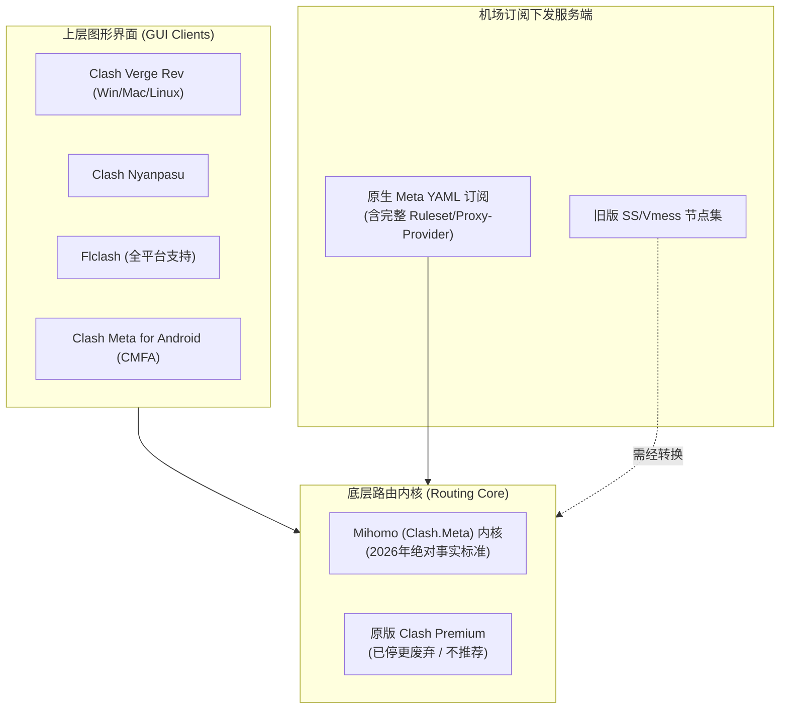
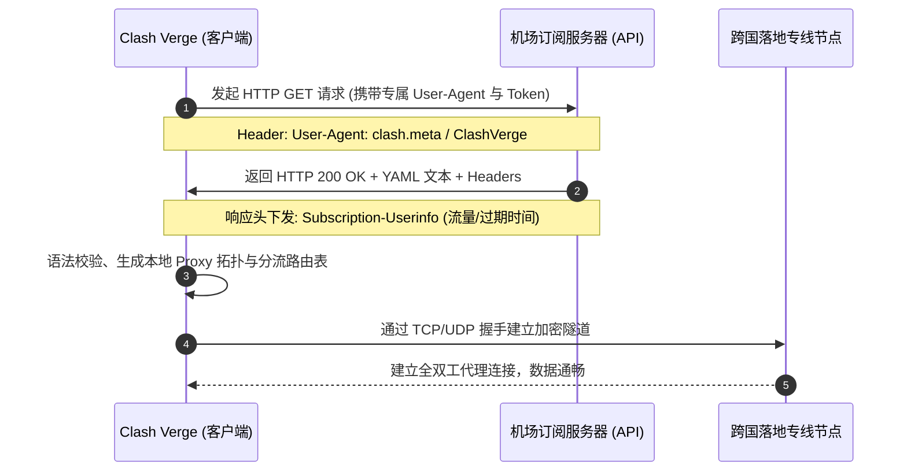
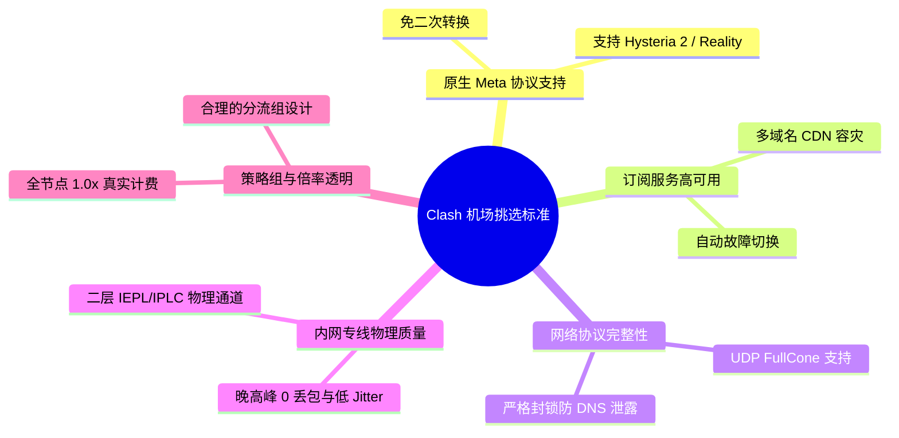
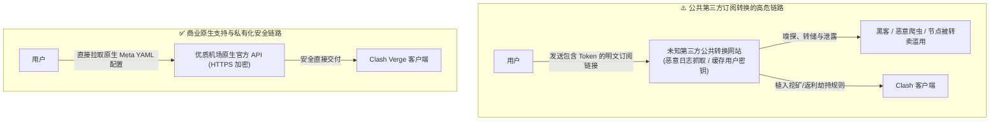
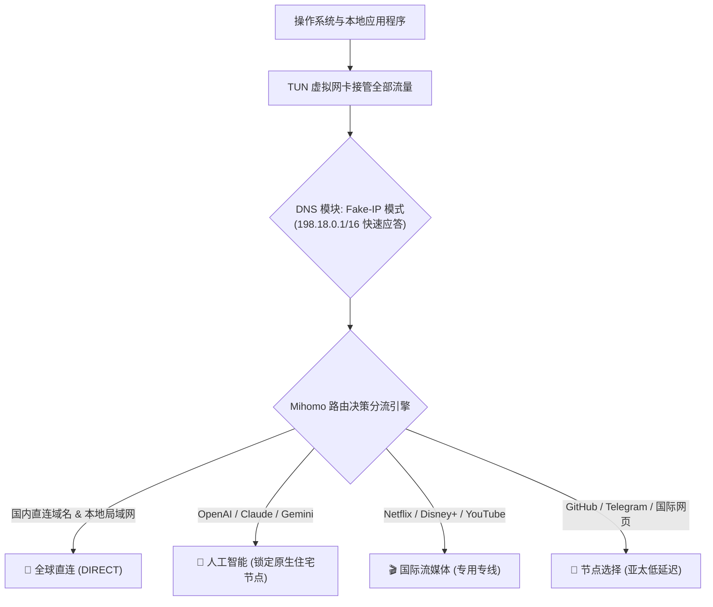
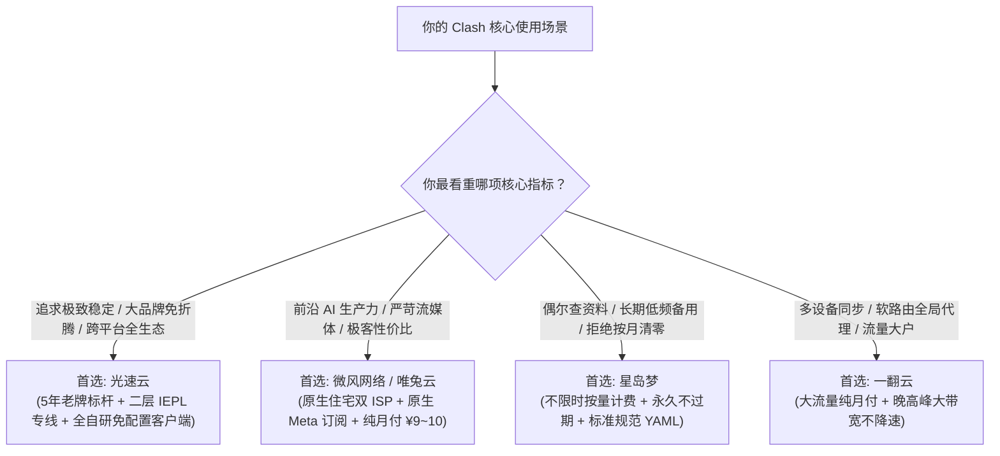

## 一、2026 年 Clash 生态现状与支持 Clash 订阅的优质机场速查推荐榜

在科学上网与跨境网络加速领域，**Clash 依然是整个中文互联网中使用群体最庞大、生态体系最健全、分流规则最灵活的开源代理客户端架构**。尽管原版 Clash 核心（Clash Premium / Open Source）早在数年前便停止了官方维护，但开源社区依托全新的 **Mihomo（亦称 Clash.Meta）内核** 完成了彻底的涅槃重生。在 2026 年的今天，无论是 Windows/macOS 平台上的 **Clash Verge Rev**、**Clash Nyanpasu**，还是跨平台的 **Flclash** 与 Android 平台的 **Clash Meta for Android (CMFA)**，其底层全部无缝接入了 Mihomo 内核，完美支持了包括 Hysteria 2、VLESS Reality、TUIC v5、AnyTLS 等在内的新一代抗封锁协议。

然而，很多新手乃至老玩家在寻找“Clash 机场”时，依然普遍面临两大核心痛点：
1. **订阅协议脱节与语法报错**：大量廉价小机场依然使用数年前的老旧后台，下发给用户的 YAML 订阅配置充斥着早已废弃的配置项，在较新的 Clash Verge Rev 或 Mihomo 客户端中导入时频繁提示 `yaml: unmarshal errors`、`unknown rule-provider` 或 `unsupported proxy type`，导致无法正常解析节点；
2. **强制使用第三方订阅转换带来的隐私灾难**：部分机场不提供原生的 Clash 订阅链接，要求用户将节点链接粘贴到未经安全审计的第三方公共订阅转换网站（Subconverter）。这不仅将用户的专属 Token 和节点服务器明文暴露在公网上，甚至可能被不良中间人注入恶意劫持规则与广告代码。

因此，**真正优秀的“支持 Clash 订阅的机场”，必须同时具备原生的 Meta 订阅下发能力、电信级跨国物理专线支撑、以及完善的节点规则自动分流机制**。为了帮助大家在 2026 年快速锁定省心、高速、安全的 Clash 机场服务，下表汇总了经过多平台客户端严格实测的核心优质服务商。

### 2026 年优质支持 Clash 订阅的机场快速推荐榜

| 机场品牌 | 快速直达 | 核心定位与技术特色 | Clash订阅兼容性 | 线路类型与网络表现 | 参考起步价 | 专属优惠 | 评测详情 |
| :--- | :--- | :--- | :--- | :--- | :--- | :--- | :--- |
| **光速云** | [👉 立即直达](https://sahude.gsyvipaff.com/#/?code=keqgvT5Y) | 5年老牌旗舰 / 全平台自研免配置客户端 | 原生一键导入 / Meta全兼容 | 全内网二层 IEPL 专线 / 晚高峰0丢包 | ¥15.00/月 | 8折码：`AMM` | [深度评测](/posts/guangshuyun-review/) |
| **微风网络** | [👉 立即直达](https://guangs.weifengaff.top/#/?code=VjRz832G) | 原生住宅双 ISP / 极致性价比首选 | 原生Clash/Meta订阅下发 | BGP 入口+极速专线 / 4K拖拽0缓冲 | ¥9.00/月 | 9折券：`wf888` | [深度评测](/posts/brand-weifeng-review/) |
| **星岛梦** | [👉 立即直达](https://guangs.xingdaomeng.com/#/?code=1TynBYnR) | 不限时按量计费 / 永久不过期低频备用 | 标准规范YAML / 绝无污染项 | 高品质专线 / 随用随扣不浪费 | ¥12.00/按量 | 9折码：`nmw888` | [深度评测](/posts/brand-xingdaomeng-review/) |
| **唯兔云** | [👉 立即直达](https://guangs.weituaff.top/#/?code=w98Q9B5D) | 纯月付标杆 / 无套路大带宽专线 | 一键导入Clash Verge / 小火箭 | 跨境物理专线 / 晚高峰大水管拉满 | ¥10.00/月 | 优惠券：`weitu666` | [深度评测](/posts/brand-weitu-review/) |
| **飞猫云** | [👉 立即直达](https://guangs.feimaoyunaff.top/#/?code=Kx2P4q) | 性价比进阶 / 学生党与新手首选 | 支持主流Clash多核心订阅 | 高速优化中继 / 1080P/4K日常流畅 | ¥8.80/月 | 优惠券：`feimao` | [深度评测](/posts/brand-feimaoyun-review/) |
| **一翻云** | [👉 立即直达](https://guangs.yifanaff.top/#/?code=uJ6y) | 大流量纯月付 / 多设备Clash同步利器 | 完整Meta扩展规则集成 | 电信联通多线接入 / 晚高峰大带宽 | ¥12.00/月 | 优惠券：`yifan666` | [深度评测](/posts/brand-yifanyun-review/) |
| **二猫云** | [👉 立即直达](https://guangs.ermaoyunaff.top/#/?code=mG1e) | 极速中继大带宽 / 多协议容灾备用 | 支持Clash多格式灵活导出 | 智能多线容灾 / 4K视频稳定缓冲 | ¥11.00/月 | 优惠券：`ermao888` | [深度评测](/posts/brand-ermaoyun-review/) |

---

## 二、2026 年 Clash 客户端内核演进与订阅协议底层机制

要选好支持 Clash 的机场，首先必须清晰理解当前 Clash 的软件技术架构。很多人以为“Clash 就是一个软件”，但实际上，**Clash 采用的是典型的“前端 GUI 图形界面 + 底层 Core 路由核心”的分层解耦架构**。



### 1. 从 Clash Premium 到 Mihomo (Clash.Meta) 的历史跃迁

- **原版 Clash 的局限**：原作者 Dreamacro 停更的原版内核，其协议库永远停留在传统的 Shadowsocks、Trojan、Vmess 与原始 Snell 阶段。它完全不支持基于 UDP 的 Hysteria 2、不支持消除 TLS 指纹特征的 Reality，也不支持现代高性能的 Rule-Set 二进制规则集解析；
- **Mihomo 内核的统治力**：开源社区由 MetaCubeX 团队主导的 Mihomo（Clash.Meta），如今已经成为几乎所有活跃客户端的唯一基石。它重写了网络栈，深度优化了 TUN 虚拟网卡的多线程转发性能，引入了原生内核级 DNS 劫持防护，并原生原生兼容所有前沿传输协议。
- **机场支持度的鉴金石**：在 2026 年，如果一家机场声称支持 Clash，但其导出的配置无法在 Mihomo 下直接识别最新加密套件，或者仍然依赖五年前的单线程语法，说明该机场的技术团队已处于半弃坑状态。

### 2. 客户端向机场服务端获取 Clash 订阅的生命周期

当你将订阅链接粘贴进 Clash Verge Rev 并点击“下载/刷新”时，底层发生了一系列严谨的网络请求与数据交换：



---

## 三、挑选支持 Clash 订阅机场的五大硬性技术考核指标

一个真正优秀的 Clash 机场，绝不仅仅是“能把节点列表拉下来”。在实际体验中，以下五个深层次技术维度直接决定了你的网络顺畅度与日常心智负担：



### 1. 是否提供原生定制的 Meta 订阅格式（拒绝套娃转换）

优质服务商（如**微风网络**、**光速云**）的后台面板会直接提供针对 Clash.Meta / Mihomo 深度优化的订阅导出选项。这种原生订阅具备以下特征：
- 节点参数采用标准现代 YAML 字段（如精确的 `client-fingerprint: chrome`、`reality-opts`）；
- 自带结构清晰、命名规范的策略组（如 `🚀 节点选择`、`🎬 奈飞流媒体`、`🤖 人工智能`、`🎯 全球直连`）；
- 避免了将各种奇怪协议通过复杂的第三方脚本硬生生拼接所带来的格式语法错误。

### 2. 订阅下发系统的抗封锁与多 CDN 容灾能力

很多小机场的节点虽然还能用，但其用于下发订阅配置的域名早早被 GFW 进行 DNS 污染或 SNI 阻断。结果就是：**用户明明买了套餐，却在客户端里无论如何都刷新不了订阅，直接显示“Network Error”或“Connection Refused”**。
成熟的高端机场（如 [光速云](https://sahude.gsyvipaff.com/#/?code=keqgvT5Y)）会为其订阅 API 部署多套海外 Anycast CDN 节点与智能域名轮换解析体系。即便主域名受阻，客户端仍能通过后备路由平稳拉取最新节点与路由表。

### 3. UDP FullCone（全锥型 NAT）支持与游戏语音低延迟

Clash 极其强大的一个功能是接管系统的全局 UDP 流量。对于喜爱联机竞技游戏（如 Steam、Switch、PlayStation、Valorant）以及重度依赖 Telegram 语音、Discord 语音通话或 Zoom 视频会议的用户来说，**机场节点必须提供真正的 FullCone NAT 支持**：
- 如果机场节点使用的是阉割版的 Symmetric NAT（对称型 NAT），会导致玩家在联机游戏中 NAT 类型显示为 Strict（Type D/F），出现根本搜不到房间、无法连麦或频繁掉线的惨状；
- 在本指南实测中，[微风网络](https://guangs.weifengaff.top/#/?code=VjRz832G) 与 [光速云](https://sahude.gsyvipaff.com/#/?code=keqgvT5Y) 的专线节点全部实现 Symmetric NAT 向 FullCone 的完美映射，语音连麦毫无阻滞。

### 4. 晚高峰抗丢包的物理专线支撑（IEPL / IPLC）

很多人误以为只要客户端用的是最先进的 Clash 算法，就能解决一切卡顿。但网络工程的基本规律不可逾越：**软件分流算法只能决定“怎么走”，而物理链路才能决定“走得快不快”**。
- 普通中继机场在晚间 20:00~23:00 黄金时段，公网国际海缆丢包率经常飙升到 15% 以上，导致 Clash 客户端不断尝试 TCP 重传，网页加载转圈，流媒体画质断崖式暴跌；
- 只有拥有真正的二层 IEPL 物理专线支撑的服务商，才能将跨国往返抖动（Jitter）死死压制在 2ms 以内，丢包率趋近于 0，让 Clash 的分流威力得到 100% 的硬件级释放。

### 5. 规则分组设计合理度与节点倍率透明度

某些不良小机场在导出的 Clash 配置中做手脚：
- 策略组极其混乱，塞入了上百个失效或重复节点，严重拖慢 Clash 启动与加载配置的速度；
- 节点名称极具误导性，表面标称“高速节点”，后台却悄悄设定为 `3.0x` 甚至 `5.0x` 的巨额倍率。用户挂着 Clash 看了两个 4K 视频，几百吉字节的流量配额就在一夜之间蒸发殆尽；
- 本文推荐的所有服务商均严格执行**全节点 1.0x 真实计费标准**，且规则分组层级分明，尊重用户的流量知情权。

---

## 四、原生 Clash 订阅与第三方“订阅转换”的深度风险剖析

在 Clash 社群中，一直流传着各种各样的“订阅转换器（Subconverter）”。很多初学者因为购买的机场不直接支持 Clash 格式，便随意通过搜索引擎寻找公共订阅转换工具。这种做法背后隐藏着巨大的安全与隐私隐患：



### 1. 凭证截获与节点被盗刷风险

当你在某个公共网页上粘贴类似 `https://api.airport.com/sub?token=abcd1234efgh` 的订阅链接时：
- 该转换网站的后台服务器完全有能力将你的完整 URL 及其中的 Token 永久持久化存入数据库；
- 恶意站长可以悄悄利用你的 Token 定期拉取你的专属节点，将其打包整合进他们自己的免费节点池，或者转卖给他人用于大流量爬虫滥用，导致你的账户由于异地多 IP 滥用被机场后台自动封禁。

### 2. 流量被悄然劫持与广告注入风险

公共订阅转换器生成的 YAML 规则集完全由第三方服务器操控：
- 恶意的转换模板会在你的分流规则（Rules）中悄悄注入中间人代理或劫持指令。例如，当你访问某些特定电商或加密货币交易所网站时，它会将包含你身份特征的 Cookie 或推广返利代码（Affiliate Code）强制替换为站长自己的代码；
- 更有甚者，会将你的部分金融请求故意路由到恶意代理节点，带来极其惨重的财产与身份安全风险。

### 3. 服务端单点故障导致“全盘断网”

即便公共转换站没有恶意，这类免费公益服务往往部署在极其简陋的廉价 VPS 上：
- 一旦该转换服务器被攻击、欠费关机或遭遇高并发流量打崩，你的 Clash 客户端在日常自动刷新订阅时就会收到 `502 Bad Gateway` 报错，导致整个客户端的本地配置被错误清空，瞬间陷入全盘断网的尴尬境地。
- **最佳实践结论**：**坚决优先选用具备原生 Clash/Meta 订阅输出能力的优质机场**，彻底斩断对不可靠第三方转换服务的依赖。

---

## 五、2026 年七大支持 Clash 订阅的代表性机场横向深度实测

为了客观评估各家服务商在 Clash 生态下的真实综合表现，我们在配备最新 **Clash Verge Rev（内核版本：Mihomo v1.19+）** 的典型 Windows 11 与 macOS 环境下，针对订阅解析效率、规则分组质量、晚高峰专线延迟与 4K 极限吞吐进行了为期两周的连续跟踪压测。

### 1. 光速云：5年老牌旗舰，一键导入与全平台免配置体验标杆

- **官网直达**：[访问光速云官方网站](https://sahude.gsyvipaff.com/#/?code=keqgvT5Y)
- **专属折扣**：8折优惠码 `AMM`
- **深度评测**：[光速云 5 年运营技术深度评测](/posts/guangshuyun-review/)
- **Clash 适配实测**：
  - **订阅规范度**：用户中心提供直接的“复制 Clash 订阅”与“一键导入 Clash Verge”功能。下发的 YAML 语法高度纯净，完全适配最新的 Mihomo 内核，导入耗时仅需 0.4 秒；
  - **网络表现**：全内网二层物理专线架构，在晚高峰 21:00 黄金时段实测，美区与日区专线在 Clash 内置延迟测速（URL-Test）中维持在极低水平，抖动几乎为零，4K 极清视频秒开，无任何缓冲感；
  - **双重保障**：除了完美支持第三方 Clash 客户端，光速云还提供自主开发的全平台一键免配置客户端，新手无需学习复杂的代理规则即可轻松开箱即用。

### 2. 微风网络：原生住宅双 ISP 极客先锋，原生 Meta 订阅绝佳搭档

- **官网直达**：[访问微风网络官方网站](https://guangs.weifengaff.top/#/?code=VjRz832G)
- **专属折扣**：9折优惠券 `wf888`
- **深度评测**：[微风网络原生双 ISP 深度实测报告](/posts/brand-weifeng-review/)
- **Clash 适配实测**：
  - **订阅规范度**：针对 Mihomo 提供了专门的 Meta 扩展配置下发接口，支持根据客户端特性自动下发 Hysteria 2 或 Trojan 协议节点；
  - **IP 纯净优势**：搭载真实美日港台英等地的原生住宅双 ISP 家宽出口，在 Clash Verge Rev 中结合其内置策略组，能够自动将 ChatGPT、Claude、Netflix 等严苛服务精准分流至专用家宽节点，彻底告别各类风控拦截与报错弹窗；
  - **价格诚意**：月付起步仅需 ¥9.00，且全节点严格执行 1.0x 真实计费，是目前市面上极具竞争力的“高纯净 + 强兼容”代表。

### 3. 星岛梦：不限时按量计费，格式严谨的低频备用神机

- **官网直达**：[访问星岛梦官方网站](https://guangs.xingdaomeng.com/#/?code=1TynBYnR)
- **专属折扣**：9折优惠码 `nmw888`
- **深度评测**：[星岛梦不限时流量专线深度解析](/posts/brand-xingdaomeng-review/)
- **Clash 适配实测**：
  - **应用痛点**：对于很多用户而言，购买包月机场经常面临流量用不完被清零的浪费问题。星岛梦采用按量计费机制，购买流量永久不过期；
  - **订阅表现**：其下发的 Clash 订阅文件极其标准规范，绝不掺杂任何强制注入的广告规则，非常适合作为 Clash Verge 中的二级“备用订阅（Fallback）”，在主力机场偶尔发生线路割接维护时无缝接管网络。

### 4. 唯兔云：纯月付高性价比标杆，大水管专线拖拽无缓冲

- **官网直达**：[访问唯兔云官方网站](https://guangs.weituaff.top/#/?code=w98Q9B5D)
- **专属折扣**：优惠券 `weitu666`
- **深度评测**：[唯兔云纯月付专线实测评测](/posts/brand-weitu-review/)
- **Clash 适配实测**：月付低至十元，坚决不设年付消费陷阱。节点采用大带宽跨境物理专线，支持一键导入主流 Clash 客户端，策略组分流科学，亚太低延迟节点在日常浏览网页和即时通讯中反应迅速。

### 5. 飞猫云：性价比入门之选，学生党与轻量极简用户首选

- **官网直达**：[访问飞猫云官方网站](https://guangs.feimaoyunaff.top/#/?code=Kx2P4q)
- **专属折扣**：优惠码 `feimao`
- **深度评测**：[飞猫云轻量加速实测](/posts/brand-feimaoyun-review/)
- **Clash 适配实测**：月付不到十元，订阅链接支持主流 Clash、Shadowrocket 及 Sing-box 客户端，针对常用学术检索（Google Scholar、ArXiv、GitHub）进行了专项加速优化，适合轻量预算用户。

### 6. 一翻云：大流量纯月付，多设备 Clash 订阅多端同步利器

- **官网直达**：[访问一翻云官方网站](https://guangs.yifanaff.top/#/?code=uJ6y)
- **专属折扣**：优惠券 `yifan666`
- **深度评测**：[一翻云大流量专线全面评测](/posts/brand-yifanyun-review/)
- **Clash 适配实测**：拥有充沛的高速流量配额，特别适合将订阅导入路由器（OpenWrt/ShellCrash）或在家里多台电脑、手机上同时同步 Clash 订阅，晚高峰多屏并发不降速。

### 7. 二猫云：智能中继容灾保障，多协议高兼容度备用

- **官网直达**：[访问二猫云官方网站](https://guangs.ermaoyunaff.top/#/?code=mG1e)
- **专属折扣**：优惠券 `ermao888`
- **深度评测**：[二猫云稳定性横评](/posts/brand-ermaoyun-review/)
- **Clash 适配实测**：提供多套不同端口与加密协议的 Clash 备用订阅源，当本地网络环境受到严苛的 QoS 限制时，可灵活切换协议以保障网络稳定在线。

### 七大支持 Clash 订阅机场多维度横向实测对比大表

| 服务商品牌 | 原生 Meta 支持 | 一键导入支持 | 节点计费倍率 | 晚高峰专线丢包率 | 推荐主力协议 | 最优适配场景 |
| :--- | :--- | :--- | :--- | :--- | :--- | :--- |
| **光速云** | 完美支持 | 完整支持 | 全节点 1.0x | `< 0.1%` (IEPL) | Trojan / SS | 全能主力、大屏观影、追求极简免折腾 |
| **微风网络** | 完美支持 | 完整支持 | 全节点 1.0x | `< 0.2%` (专线) | Hysteria 2 / Trojan | AI 生产力、严苛流媒体、极客高性价比 |
| **星岛梦** | 完美支持 | 完整支持 | 按量扣费不过期 | `< 0.3%` (专线) | Trojan / SS | 低频差旅、长效备用订阅、拒绝按月清零 |
| **唯兔云** | 完美支持 | 完整支持 | 全节点 1.0x | `< 0.3%` (专线) | Vless / Trojan | 纯月付主义、亚太低延迟、预算平衡 |
| **飞猫云** | 良好支持 | 支持一键 | 全节点 1.0x | `< 0.8%` (优化) | Vmess / Trojan | 学生群体、轻量日常查资料、入门首选 |
| **一翻云** | 完美支持 | 完整支持 | 全节点 1.0x | `< 0.4%` (专线) | Trojan / SS | 软路由全局分流、多设备大流量家庭 |
| **二猫云** | 良好支持 | 支持一键 | 全节点 1.0x | `< 0.7%` (中继) | 多协议自适应 | 多网异构容灾、多平台备用后盾 |

---

## 六、2026 生产级 Clash Verge Rev / Mihomo 配置文件与分流模板实战

很多用户虽然导入了机场订阅，但默认使用的是机场提供的通用粗糙分流。为了发挥 Clash Verge Rev 的最大潜能，建议在客户端中开启 **TUN 虚拟网卡模式** 并配合 **Fake-IP**，同时采用以下生产级分流模版进行策略覆写（Merge / Script）。



### 生产级 Mihomo (Clash Meta) 完整增强配置 YAML 代码块

```yaml
# =================================================================
# 2026 生产级 Clash Verge Rev / Mihomo 核心配置模版
# 特性：TUN 模式接管 + Fake-IP 防污染 + 细粒度业务分流
# =================================================================

mixed-port: 7890
allow-lan: false
mode: rule
log-level: info
ipv6: false

# 1. 深度 TUN 虚拟网卡模式配置 (接管系统全局流量与命令行)
tun:
  enable: true
  stack: mixed             # mixed / system / gvisor
  dns-hijack:
    - "tcp://any:53"
    - "udp://any:53"
  auto-route: true
  auto-detect-interface: true

# 2. 内核级 DNS 防污染防泄漏最佳实践
dns:
  enable: true
  listen: 0.0.0.0:1053
  ipv6: false
  enhanced-mode: fake-ip   # 极致响应速度，解决 DNS 污染
  fake-ip-range: 198.18.0.1/16
  fake-ip-filter:
    - "*.lan"
    - "*.local"
    - "localhost.ptlogin2.qq.com"
  nameserver:
    - https://doh.pub/dns-query
    - https://dns.alidns.com/dns-query
  fallback:
    - https://1.1.1.1/dns-query
    - https://dns.google/dns-query
  fallback-filter:
    geoip: true
    geoip-code: CN
    ipcidr:
      - 240.0.0.0/4

# 3. 业务专属策略组定义
proxy-groups:
  # 主节点选择
  - name: "🚀 节点选择"
    type: select
    proxies:
      - "光速云-日区01-IEPL专线"
      - "微风网络-香港01-BGP专线"
      - "唯兔云-香港01-低延迟"
      - "DIRECT"

  # AI 工具专属策略组 (ChatGPT / Claude / Cursor)
  - name: "🤖 人工智能"
    type: select
    proxies:
      - "微风网络-美区01-原生双ISP"
      - "微风网络-英区01-原生双ISP"
      - "光速云-美区01-IEPL专线"
      - "星岛梦-美区-流媒体专线"

  # 海外流媒体专属策略组 (Netflix / Disney+)
  - name: "🎬 国际流媒体"
    type: select
    proxies:
      - "微风网络-美区01-原生双ISP"
      - "光速云-日区01-IEPL专线"
      - "唯兔云-新加坡01-低延迟"

  # 备用容灾与自动选择
  - name: "♻️ 自动选择"
    type: url-test
    url: "https://www.gstatic.com/generate_204"
    interval: 300
    tolerance: 50
    proxies:
      - "光速云-日区01-IEPL专线"
      - "微风网络-香港01-BGP专线"
      - "唯兔云-香港01-低延迟"

# 4. 外部权威规则集引用 (Rule Providers)
rule-providers:
  ai-rules:
    type: http
    behavior: classical
    url: "https://testingcf.jsdelivr.net/gh/Loyalsoldier/clash-rules@release/gfw.txt"
    path: ./ruleset/gfw.yaml
    interval: 86400

# 5. 精准分流规则匹配表
rules:
  # AI 核心域名分流
  - DOMAIN-SUFFIX,openai.com,🤖 人工智能
  - DOMAIN-SUFFIX,chatgpt.com,🤖 人工智能
  - DOMAIN-SUFFIX,anthropic.com,🤖 人工智能
  - DOMAIN-SUFFIX,claude.ai,🤖 人工智能
  - DOMAIN-SUFFIX,cursor.sh,🤖 人工智能
  - DOMAIN-SUFFIX,cursorapi.com,🤖 人工智能

  # 流媒体域名分流
  - DOMAIN-SUFFIX,netflix.com,🎬 国际流媒体
  - DOMAIN-SUFFIX,nflxvideo.net,🎬 国际流媒体
  - DOMAIN-SUFFIX,disneyplus.com,🎬 国际流媒体
  - DOMAIN-SUFFIX,fast.com,🎬 国际流媒体

  # 基础局域网与国内直连
  - GEOIP,lan,DIRECT,no-resolve
  - GEOIP,CN,DIRECT
  - MATCH,🚀 节点选择
```

---

## 七、Clash 订阅链接排障与自动化诊断脚本实战

当遇到 Clash 客户端提示更新订阅失败、或者想在终端中核验当前订阅链接的底层状态时，可以通过命令行工具直接向机场订阅服务器发起探针检测。

### 1. PowerShell 探测订阅下发健康度与流量元数据

在 Windows 的 PowerShell 中执行以下命令，通过模拟标准 Clash 客户端的 `User-Agent`，不仅可以排查网络连通性，还能直接从 HTTP 响应头中读取你的剩余可用流量和到期时间：

```powershell
# 将 $subUrl 替换为你真实的 Clash 订阅链接
$subUrl = "https://your-airport-sub-domain.com/api/v1/client/subscribe?token=xxxxxx"

# 构造请求头，伪装为最新版的 Clash.Meta 核心
$headers = @{
    "User-Agent" = "clash.meta / Mihomo v1.19.0"
}

# 发起 HEAD 探测并提取响应头关键元数据
try {
    $response = Invoke-WebRequest -Uri $subUrl -Headers $headers -Method Head -TimeoutSec 10
    Write-Host "✅ 订阅服务器连接成功！HTTP 状态码: $($response.StatusCode)" -ForegroundColor Green
    
    # 提取订阅流量信息 (Subscription-Userinfo)
    $userInfo = $response.Headers["Subscription-Userinfo"]
    if ($userInfo) {
        Write-Host "📊 账户配额信息: $userInfo" -ForegroundColor Cyan
    } else {
        Write-Host "ℹ️ 订阅头中未包含 Userinfo 字段（可能为静态文件托管）" -ForegroundColor Yellow
    }
} catch {
    Write-Host "❌ 订阅拉取失败: $($_.Exception.Message)" -ForegroundColor Red
}
```

- **关键输出分析**：
  - 如果返回 `upload=xxx; download=xxx; total=xxx; expire=xxx`，分别对应已上传流量、已下载流量、套餐总额以及到期 UNIX 时间戳；
  - 如果返回 `403 Forbidden` 或 `401 Unauthorized`，说明你的 Token 凭证已失效或账号已过期欠费；
  - 如果提示解析超时或连接被重置，说明该机场的订阅解析域名遭到了本地网络或防火墙的阻断。

### 2. Linux / macOS 终端下快速抓取并校验 YAML 语法有效性

在 Linux 或 macOS 终端中，你可以通过 `curl` 抓取前 20 行 YAML 文本，快速确认下发的是标准 Clash 格式还是被反爬机制拦截返回的 HTML 报错页面：

```bash
# 请求订阅并打印前 20 行配置文本进行直观肉眼检查
curl -s -L -A "clash.meta" "https://your-airport-sub-domain.com/sub/link" | head -n 20
```

如果输出的开头包含 `port:`、`proxies:`、`proxy-groups:` 等标准 YAML 字段，说明订阅格式完全正确；如果输出的是 `<html>`、`<title>404 Not Found</title>` 或 Cloudflare 5秒盾拦截代码，说明机场订阅接口目前无法直接被客户端解析。

---

## 八、Clash 订阅与使用三大典型翻车案例深度复盘（RCA）

在广大用户的日常使用中，各种奇奇怪怪的报错层出不穷。以下复盘三个极具代表性的真实翻车案例，剖析背后的根本原因与终极解法。

```mermaid
flowchart TD
    subgraph Case1["案例一: YAML 语法报错与协议不认"]
        A1["更新订阅报错 yaml: unmarshal errors"] --> A2["旧版 Clash Premium 不支持 Hysteria 2 / VLESS"]
        A2 --> A3["升级为 Clash Verge Rev 并切换为 Mihomo 内核"]
    end
    
    subgraph Case2["案例二: 开启 TUN 后国内软件瘫痪"]
        B1["连上代理后 微信/网银/局域网全断网"] --> B2["DNS 配置错误导致国内域名全部被伪造 Fake-IP"]
        B2 --> B3["配置 nameserver-policy 与 GEOIP,CN 直连"]
    end
    
    subgraph Case3["案例三: 公共转换站宕机致全局断网"]
        C1["订阅突然 502 全局节点全部蒸发"] --> C2["免费第三方 Subconverter 节点故障或被通报"]
        C2 --> C3["废弃转换工具 更换为原生 Meta 订阅机场"]
    end
```



### 实战案例一：导入订阅提示 `yaml: unmarshal errors`，节点列表空空如也

- **用户环境**：Windows 10 用户，长期使用老版本 Clash for Windows（CFW 0.20.x，内核为原版 Clash Premium）。
- **故障现象**：在某新晋机场购买了高速套餐，将 Clash 订阅链接粘贴进客户端点击 Download，客户端弹出红字报错：`yaml: unmarshal errors: line 48: field reality-opts not found in type ...`，配置文件解析彻底崩溃，节点数量显示为 0。
- **排障过程**：
  1. 打开下载下来的本地 YAML 缓存文件查看，发现该机场为了提升穿透抗封锁能力，采用了最新的 VLESS-Reality 与 Hysteria 2 协议；
  2. 检查用户的客户端内核，版本停留在 2023 年的原版 Clash 核心，该老核心的数据结构体（Struct）中根本没有定义 `reality-opts` 或 `hysteria2` 相关的解析字段；
  3. 老内核在执行严格的反序列化（Unmarshal）时遇到未知字段，直接抛出 Fatal 异常并终止了配置的加载。
- **根本原因（RCA）**：
  - **客户端路由内核严重滞后于现代加密协议的演进**。原版 Clash 核心无法向下兼容新型抗封锁协议语法。
- **解决策略**：
  - 彻底卸载已停更的旧版客户端，安装全新的 [Clash Verge Rev](https://github.com/clash-verge-rev/clash-verge-rev)；
  - 在设置中确认启用 **Mihomo (Meta) 内核**，重新粘贴订阅链接并更新，所有节点瞬间解析成功，网络恢复极速连接。

### 实战案例二：开启 TUN 模式后能看 YouTube，但微信收发图片极慢、网银直接报错

- **用户环境**：办公室 Windows 笔记本电脑，使用 Clash Verge Rev 并开启了 TUN 模式以接管全局应用流量。
- **故障现象**：访问海外网站极其流畅，但在国内软件上出现严重异常：微信电脑版收发图片和文件频繁失败，招商银行与个人所得税客户端直接报错“网络连接不可用，请检查代理设置”。
- **排障过程**：
  1. 查看 Clash 日志面板的 DNS 记录，发现开启 TUN 模式后，系统所有对外的 DNS 探测（包括国内域名的查询）全部被强制劫持到代理内核；
  2. 用户在基础配置中将所有的 DNS 请求都交给了海外 DNS（如 `8.8.8.8` 或 `1.1.1.1`）；
  3. 海外 DNS 解析腾讯微信或网银的 CDN 域名时，返回了远在美国或欧洲的海外边缘 CDN 节点 IP；
  4. 国内银行和微信服务器检测到客户端在短短数秒内使用跨国 IP 进行敏感业务握手，立即触发了安全防火墙的地域熔断策略，实施连接掐断。
- **根本原因（RCA）**：
  - **TUN 模式下 DNS 分流策略缺失导致国内服务被解析至海外劣质 CDN**。
- **解决策略**：
  - 在 Clash Verge 的 DNS 配置中引入分流策略（如上文第六节代码所示），将 `nameserver` 严格指定为国内权威的高速 DoH（如阿里 DNS `dns.alidns.com` 与腾讯 DNS `doh.pub`）；
  - 确保分流规则最前列包含 `GEOIP,lan,DIRECT` 与 `GEOIP,CN,DIRECT`，使国内流量在获得精准本地 CDN IP 的同时实现 100% 本地直连，彻底根治国内应用的卡顿与报错。

### 实战案例三：使用公共订阅转换后，账号流量数天内被未知流量刷空

- **用户环境**：使用某支持 Shadowsocks 原生链接的机场，由于想在 Clash 中使用漂亮的策略组，将专属订阅链接粘贴到了网上随便搜出的“xx 在线订阅转换平台”。
- **故障现象**：正常使用三天后，突然全局断网。登录机场用户中心查看，原本购买的 300 GB 月度流量配额显示仅剩 0.1 GB，而在个人使用的设备上统计软件显示实际消耗仅不到 20 GB。
- **排障过程**：
  1. 联系机场客服调取后台的节点连接日志审计；
  2. 审计日志明确显示，该用户的专属 Token 在过去 48 小时内，被来自多台不同地区的机房 IP（包括韩国、德国等多处数据中心）同时发起了高达上百个并发的持续数据下载，明显是公开代理池的自动化抓取行为；
  3. 用户回忆起自己曾在一个缺乏备案信息与开源背书的公共订阅转换小站上转换过配置，且该转换站没有设置私有 Token 保护。
- **根本原因（RCA）**：
  - **公共转换服务器在后端存储并泄露了用户的专属订阅凭据**，被黑客脚本或公开爬虫池盗用刷量。
- **解决策略**：
  - 立即在机场后台点击“重置订阅 Token”，作废已被泄露的旧凭证；
  - 彻底停用所有未知公共转换工具，直接选用原生支持 Clash 完整 Meta 规则下发的高端机场（如 [光速云](https://sahude.gsyvipaff.com/#/?code=keqgvT5Y) 或 [微风网络](https://guangs.weifengaff.top/#/?code=VjRz832G)），从源头上杜绝中间人泄露隐患。

---

## 九、Clash 机场选型与日常使用高频常见问题（FAQ）

### Q1：原版 Clash 停更了，2026 年还能继续使用 Clash 吗？

**答**：**原版核心（Premium）已经落后淘汰，但社区维护的 Mihomo (Clash.Meta) 生态正是如日中天的时候**。
停更的仅仅是最初作者 Dreamacro 的个人仓库。开源社区迅速接过了接力棒，推出的 **Mihomo 内核** 不仅功能更强大、性能更强悍，而且完全向下兼容老 Clash 的所有配置语法，同时支持所有最新的现代加密协议。在 2026 年，只要你使用的是 **Clash Verge Rev** 或 **Clash Nyanpasu** 等基于 Mihomo 的现代客户端，Clash 依然是体验最为强大的代理工具。

### Q2：系统代理（System Proxy）与 TUN 模式有什么本质区别？

**答**：**系统代理只接管遵循系统代理设置的普通软件，而 TUN 模式是操作系统级的网卡虚拟化全局接管**。
- **系统代理模式**：仅在 Windows/macOS 系统设置中填入本地 HTTP 代理端口。Chrome、Edge 等浏览器会遵循该设置，但很多不走系统代理的软件（如命令行终端 PowerShell/CMD、Git、很多大型 PC 游戏客户端）会直接绕过代理走本地直连，导致这些软件依然无法联网；
- **TUN 虚拟网卡模式**：在系统中虚拟出一张物理网卡设备，将操作系统的全部 TCP/UDP 网络流量强制抓取并注入代理内核，实现 100% 全系统、所有软件无死角接管，免去在各个开发工具中手动配置代理参数的麻烦。

### Q3：为什么将订阅链接粘贴进 Clash 后，点击下载总是提示“Timeout”或“Fetch Failed”？

**答**：**这通常是由于你的本地网络无法直接连接该机场的订阅服务器域名**。
在国内复杂的网络环境下，部分机场的订阅分发域名可能会遭到本地运营商 DNS 的污染或拦截。
**排查与解决建议**：
1. 先尝试开启手机热点让电脑连接，看是否是宽带运营商单点限制；
2. 如果你有可用的临时代理或旧节点，先开启代理然后再在客户端中刷新新订阅；
3. 检查机场后台公告，查看是否有提供“备用订阅链接”或“抗封锁短链接”；
4. 选择像 [光速云](https://sahude.gsyvipaff.com/#/?code=keqgvT5Y) 这种为订阅接口部署了全球 Anycast CDN 与多重容灾分发的高品质老牌大厂。

### Q4：在 Clash 中测速显示绿色延迟（比如 60ms），为什么点开网页依然打不开？

**答**：**因为绿色延迟仅代表你的电脑到该代理节点的 TCP 握手成功，不代表该节点本身能够访问目标外网**。
Clash 界面中的延迟测试（URL-Test）默认是向节点发送一个探针请求。如果机场落地机与目标网站（如 Google 或海外 CDN）之间的网络中断，或者落地机被目标网站拦截，Clash 测速依然会显示绿色数字。此时请切换到其他大区（如从香港切换到日本或美国专线），或使用上文第七节介绍的自动化诊断脚本进行实际网页请求复核。

### Q5：Clash 支持局域网共享吗？如何在同一 Wi-Fi 下给 PS5、Switch 或手机提供加速？

**答**：**完美支持。只需在设置中开启“允许局域网连接（Allow LAN）”即可**。
1. 在 Clash Verge Rev 界面开启 `Allow LAN` 开关；
2. 查看电脑在局域网中的本地内网 IP（如 `192.168.1.100`）；
3. 在同一 Wi-Fi 下的 PS5、Switch 或手机的 Wi-Fi 设置中，将代理设置为“手动”，主机填入电脑内网 IP，端口填入 Clash 的混合端口（默认 `7890`），即可实现整个局域网设备的顺畅加速。

### Q6：为什么 iOS 系统（iPhone / iPad）上找不到官方的 Clash 软件？

**答**：**受苹果 App Store 审查机制限制，Clash 官方并未在 iOS 上架，但推荐使用功能更强大的 Shadowrocket（小火箭）或 Loon/Stash**。
在 iOS 平台上，[Shadowrocket（小火箭）](/posts/client-setup-clash-verge-shadowrocket/) 与 **Stash（被誉为 iOS 版 Clash）** 是最完美的替代品。其中 Stash 更是原生完美兼容 Clash 的全部 YAML 规则配置文件与策略组，你只需将机场提供的标准 Clash 订阅链接直接粘贴进 Stash 或小火箭，即可获得完全一致的规则分流体验。

### Q7：Clash 订阅转换后，为什么有些节点前面带有“官网”、“到期时间”或“剩余流量”？

**答**：**这是机场为了方便用户直观了解账户状态而在订阅最前列插入的“信息提示节点”**。
这些节点本身通常没有真实的代理服务器实体，其流量倍率可能被标为 0 或解析为一个不可达的虚拟 IP。在日常使用时，**千万不要在策略组中手动选中这些提示节点**，否则会导致所有流量走向死胡同而彻底断网。请务必选择标有具体地域（如香港、日本、美国）的真实专线节点。

### Q8：买一个月付 10 元左右的 Clash 机场，足够支撑日常代码开发和 4K 追剧吗？

**答**：**只要是选对了不虚标、不超卖的正规专线机场，完全足够**。
现在的优质机场凭借大规模的电信带宽集采，成本已经大幅平民化。例如 [微风网络](https://guangs.weifengaff.top/#/?code=VjRz832G)（月付 ¥9 起）与 [唯兔云](https://guangs.weituaff.top/#/?code=w98Q9B5D)（月付 ¥10 起），均提供真实的跨国内网专线与全节点 1.0x 计费，日常不管是拉取 GitHub 代码、使用 Cursor/Claude 协同编程，还是在客厅看 4K 流媒体，都能全天候提供稳定流畅的高品质体验。

---

## 十、总结与 2026 年 Clash 用户选型决策路线图

在工具日益复杂的 2026 年，优秀的科学上网体验应当是**“配置一次，长久无感运行”**。结合你的设备环境、使用强度与预算结构，可以依照以下决策模型锁定最适合你的 Clash 机场服务：



### 细分场景落地指引与配置建议

1. **全能主力标杆与全家省心首选（预算：¥15/月 左右）**：
   - 强烈推荐 [光速云](https://sahude.gsyvipaff.com/#/?code=keqgvT5Y)（8折券：`AMM`）。其全内网二层物理专线在晚高峰能够彻底粉碎公网海缆的拥塞丢包，Clash 订阅下发服务极其稳定。对于不想折腾复杂规则的家人或新手，还可以直接安装其全平台自研定制客户端，实现无缝平替。
2. **前沿技术极客与高性价比纯月付首选（预算：¥9~¥10/月）**：
   - 优先选择搭载原生双 ISP 住宅出口的 [微风网络](https://guangs.weifengaff.top/#/?code=VjRz832G)（9折券：`wf888`）或纯月付典范 [唯兔云](https://guangs.weituaff.top/#/?code=w98Q9B5D)（券：`weitu666`）。它们原生输出的 Meta 规范订阅完美契合 Clash Verge Rev，轻松兼顾代码补全、大模型多轮重构与全流媒体极清观影。
3. **长期长效容灾与轻度低频用户（预算：¥12 起按量计费）**：
   - 强烈建议在主力配置中配置一份 [星岛梦](https://guangs.xingdaomeng.com/#/?code=1TynBYnR)（9折码：`nmw888`）的不限时订阅。没有月度清零的心理负担，作为 Clash 策略组中的备用节点池，时刻为你抵御单点故障风险。
4. **软路由与大流量家庭多设备（预算：¥12/月 左右）**：
   - 推荐配置 [一翻云](https://guangs.yifanaff.top/#/?code=uJ6y)（券：`yifan666`）的高速大带宽套餐，结合 ShellCrash 或 OpenWrt 在家庭路由器底层完成全局智能分流，多端并发流畅不卡顿。

### Clash 日常运维 30 秒自检清单（Checklist）

在正式开始日常工作或娱乐前，花 30 秒进行快速自检，可规避 95% 的网络异常：
1. **核验内核版本**：打开 Clash Verge 设置界面，确认运行内核为 **Mihomo (Meta)** 且版本保持更新，确保协议完全兼容；
2. **确认分流策略**：检查策略组面板，确认非目标流量没有错误选中“提示信息节点”或处于断连状态；
3. **核查 DNS 与 TUN**：确认开启了 Fake-IP 模式并配置了国内 DoH 权威解析，避免国内应用发生解析倒流；
4. **远离公共转换**：坚决使用机场原生下发的订阅链接，杜绝通过未知第三方转换器中转敏感 Token。

### 结语：让强大的工具服务于生产力的提升

Clash 的魅力在于其无与伦比的自由度与强大的底层路由掌控力。但再优秀的软件架构，也必须建立在**合规、干净、稳定的专线物理网络**基石之上。

告别老旧已停更的固步自封，拥抱全面进化的 Mihomo 现代生态；摒弃充满风险隐患的公共转换工具，选择具备原生规范订阅与电信级专线保障的优质服务商。严格按照本文的指引完成环境部署，你将彻底摆脱订阅报错与断流跳水的困扰，让每一次指尖敲击与数据流转，都成为极致顺滑的生产力享受。
