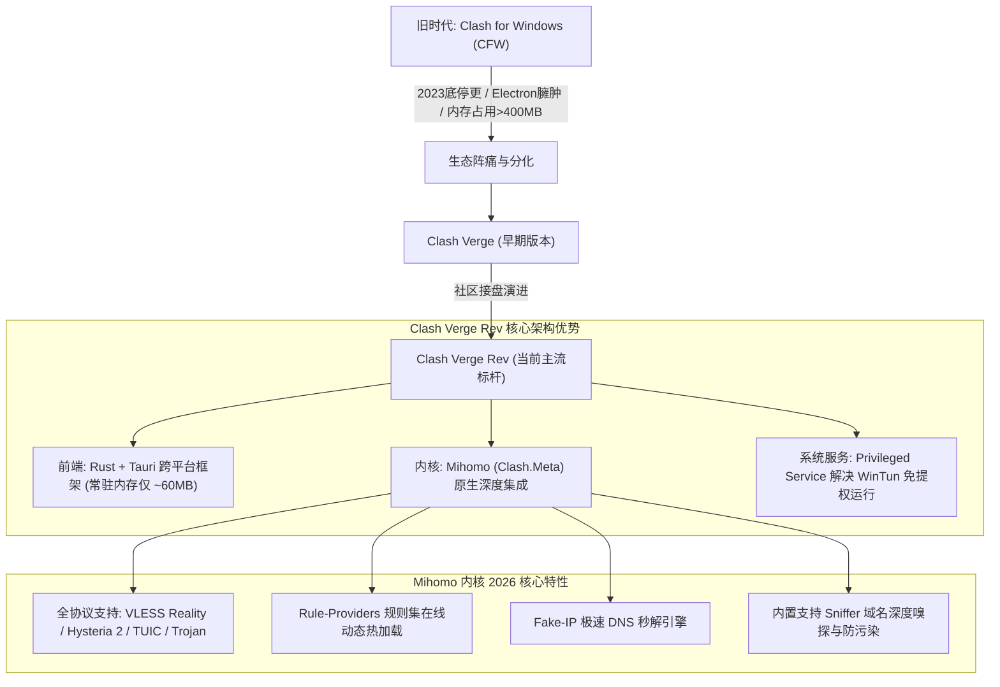
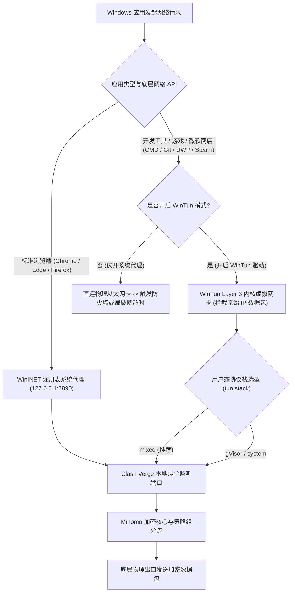
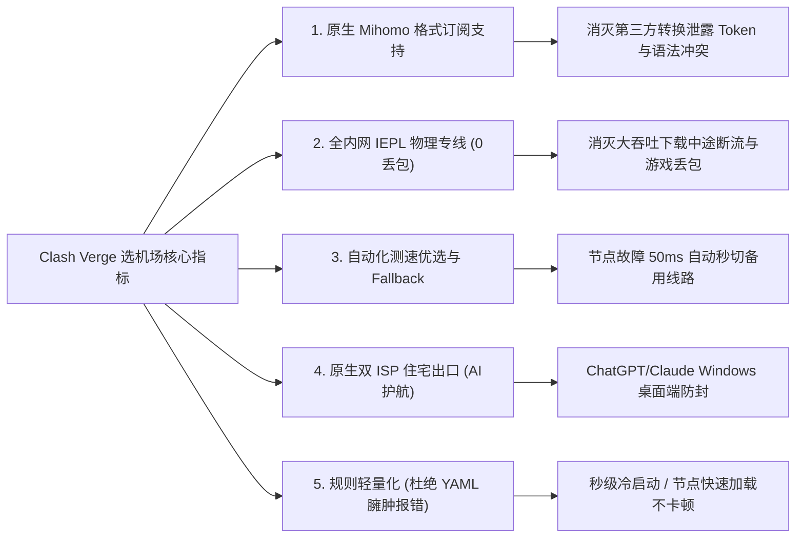
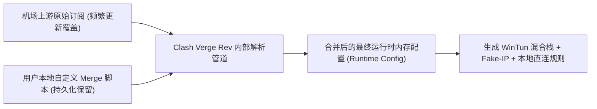
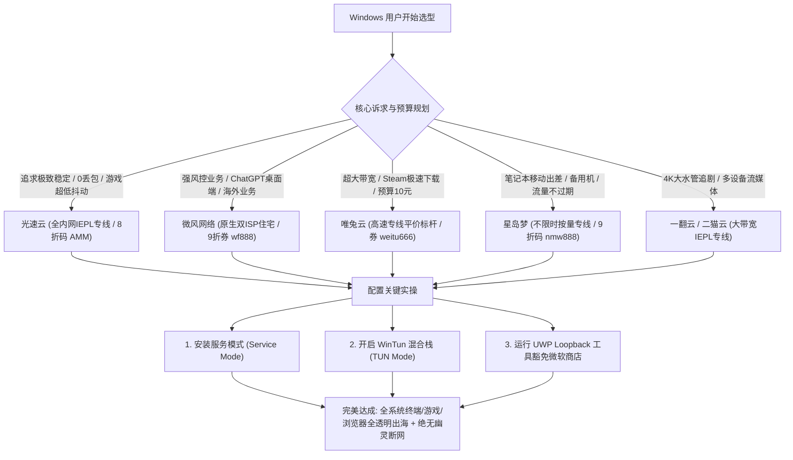

## 一、Windows 用户选 Clash Verge 机场的核心痛点与 2026 优质速查榜

在 2023 年底原版 Clash for Windows（CFW）作者删库停更后，**基于 Rust + Tauri 现代化前端与活跃演进的 Mihomo（Clash.Meta）内核构建的 Clash Verge Rev，已毋庸置疑地成为 2026 年 Windows 平台装机量最大、维护最活跃的旗舰级代理客户端**。相比于古老的 Electron 架构，Clash Verge Rev 不仅将软件常驻内存开销从 400MB 以上断崖式降低至 60MB 左右，更带来了原生的 Windows 11 亚克力（Acrylic）/ 动态取色设计、无需管理员权限启动即可运行的特权服务助手（Service Mode），以及支持全系统所有软件和终端透明分流的 **WinTun 虚拟网卡模式**。

然而，在 Windows 复杂的多网卡适配与各种后台软件生态下，**很多使用 Clash Verge Rev 的用户依然频繁遭遇一系列由于“客户端与机场特性脱节”引发的深层技术痛点**：
1. **订阅协议与内核脱节导致解析报错**：部分传统小机场依然下发格式过时的旧版 Clash 配置，无法利用 Mihomo 内核强大的子规则（Sub-rules）、规则集热加载（Rule-Providers）以及 VLESS Reality 等新特性，甚至在导入时弹出 `YAML Parse Error` 或直接闪退；
2. **WinTun 模式配置不当导致局域网穿帮与游戏延迟雪崩**：盲目开启 TUN 虚拟网卡，导致私网网段与 mDNS 多播被错误拦截，打国内《英雄联盟》或《原神》时 UDP 报文绕道境外节点，延迟从 15ms 飙升至 200ms 以上；
3. **UWP 容器回环网络隔离（Loopback Isolation）**：Windows 自带的 Microsoft Store（微软应用商店）、Xbox 客户端、OneNote 等 UWP 架构软件由于系统沙盒机制限制，默认禁止向本地 `127.0.0.1` 环回接口发送数据，导致用户一开代理微软商店就报错 `0x800704cf` 彻底断网；
4. **异常关闭后的“幽灵代理残留”**：电脑强制关机或软件意外崩溃后，Windows 注册表中的 `ProxyEnable = 1` 未能复位，导致全系统浏览器打不开任何网页，提示“代理服务器无响应”。

为了帮助广大 Windows 用户选对专线好机场、发挥 Clash Verge Rev 的极限性能，下表汇总了 2026 年在 Windows 10/11 平台实测表现卓越、深度适配 Mihomo 语法特性的优质机场服务商。

### 2026 年 Windows 平台 Clash Verge Rev 专属优质机场速查选型表

| 机场品牌 | 快速直达 | 核心定位与技术特色 | Windows 端游戏与流媒体表现 | 推荐内核模式 | 参考起步价 | 专属优惠 | 深度评测 |
| :--- | :--- | :--- | :--- | :--- | :--- | :--- | :--- |
| **光速云** | [👉 立即直达](https://sahude.gsyvipaff.com/#/?code=keqgvT5Y) | 5年老牌旗舰 / 全内网IEPL物理专线 | 晚高峰0丢包 / 游戏超低抖动 | WinTun / Mixed 栈 | 折后约 ¥12/月 | 8折码：`AMM` | [深度评测](/posts/guangshuyun-review/) |
| **微风网络** | [👉 立即直达](https://www.wfvpn.com/#/register?code=678kH3z3) | 原生双ISP纯净住宅 / 专线中继 | ChatGPT桌面端/抗风控极强 | WinTun / Fake-IP | ¥9.00/月 | 9折券：`wf888` | [深度评测](/posts/brand-weifeng-review/) |
| **唯兔云** | [👉 立即直达](https://v2.weitucloud.xyz/?p=90130) | 高速专线平价标杆 / 2.5Gbps大突发 | Steam/Epic大文件极速满带宽 | WinTun / gVisor | ¥10.00/月 | 9折券：`weitu666` | [深度评测](/posts/brand-weitu-review/) |
| **星岛梦** | [👉 立即直达](https://xindao.me/#/register?code=hK4x2X4o) | 不限时按量计费 / 全IEPL物理专线 | 备用机神器 / 流量永不过期 | WinTun / System | ¥12.00起 | 9折码：`nmw888` | [深度评测](/posts/brand-xingdaomeng-review/) |
| **一翻云** | [👉 立即直达](https://yifanyun.org/#/register?code=y77fG2gA) | 大带宽IEPL专线 / 晚高峰超低抖动 | 4K秒开不卡顿 / 丢包率低于0.1% | WinTun / Mixed 栈 | ¥12.00/月 | 9折券：`yifan666` | [深度评测](/posts/brand-yifanyun-review/) |
| **飞猫云** | [👉 立即直达](https://feimaoyun.org/#/register?code=fm2026) | 极致性价比 / 桌面端轻量日常首选 | 极简配置秒开 / 日常社媒极速 | 系统代理模式 | ¥8.80/月 | 优惠码：`feimao` | [深度评测](/posts/brand-feimaoyun-review/) |
| **二猫云** | [👉 立即直达](https://ermaoyun.net/#/register?code=em888) | 多流媒体全区解锁 / 音画双栈无损 | Netflix/Disney+全区解锁 | WinTun / Mixed 栈 | ¥11.00/月 | 优惠码：`ermao888` | [深度评测](/posts/brand-ermaoyun-review/) |

---

## 二、从 CFW 到 Clash Verge Rev：Windows 代理生态演进与 Mihomo 内核深度解析

理解 2026 年 Windows 代理生态的发展脉络，是掌握 Clash Verge Rev 进阶配置的前提。



### 1. Tauri 架构带来的内存与性能质变

旧版 Clash for Windows 基于 Chromium + Node.js 的 Electron 框架打包，客户端启动后动辄派生 5 到 7 个后台子进程，内存占用轻而易举突破 400MB~600MB，对于很多配置 8GB 或 16GB 内存的轻薄办公本而言是沉重的负担。

而 **Clash Verge Rev** 采用了由 Rust 语言驱动的 **Tauri** 跨平台架构：
- 直接调用 Windows 10/11 系统自带的系统级 Webview2 渲染引擎，摆脱了随身携带整个 Chromium 运行时的冗余体积；
- 软件启动速度达到毫秒级，常驻运行内存通常仅需 **50MB~70MB**，CPU 空载占用率几乎为 0%；
- 原生支持 Windows 11 的圆角特效与亚克力背景，界面极具现代科技感。

### 2. Mihomo (Clash Meta) 内核的核心优势

Clash Verge Rev 默认搭载并深度融合了开源界最顶级的 **Mihomo 内核**：
- **次时代协议全面兼容**：完美支持 VLESS（含最新的 Reality 伪装与 XTLS Vision 流控）、基于 QUIC/UDP 的 Hysteria 2、TUIC v5，以及经典的 Trojan、Shadowsocks 2022、WireGuard 等，彻底打破了传统 Clash 内核只能跑 Shadowsocks 与 VMess 的历史局限；
- **智能嗅探（Sniffer）**：能够深入解析 TLS Client Hello 中的 SNI 扩展字段与 HTTP Header，在应用使用裸 IP 发起连接时，准确还原其访问的原始域名，从而精准命中分流规则；
- **动态规则集（Rule-Providers）**：允许直接引用 GitHub 上的第三方权威规则集（如 Loyalsoldier 等维护的中国直连域名白名单、广告黑名单），后台异步自动更新，无需频繁重新下载整份订阅。

### 3. Mihomo 域名深度嗅探（Sniffer）与二进制规则集（.mrs）原理解析

在 Windows 实际应用场景中，许多桌面级软件（例如 Spotify、Discord、Telegram 桌面版、Steam 客户端以及各类流媒体播放器）出于防抓包或自建网络堆栈考虑，经常绕过系统本地的标准 DNS 解析，直接使用内置的硬编码公网 IP 发起连接。
- **嗅探技术的拯救作用**：在没有开启 Sniffer 的传统客户端中，这类流量只能命中兜底的 `MATCH` 规则，导致它们被错误地分流到冷门节点甚至被直连阻断。而 Mihomo 内核在检测到出站连接时，会实时拆解并嗅探 TLS 握手的第一包（ClientHello），从中提取出真实的 SNI 域名（如 `*.discordapp.com`），并将连接元数据中的 IP 目标无感还原为域名，从而让精细化的域名规则集能够准确命中；
- **二进制规则集（.mrs）的算力跃迁**：传统基于 YAML 文本的规则集在加载包含 10 万条域名的列表时，需要消耗高达 50MB 的内存与近 1 秒的 CPU 文本解析时间。Mihomo 引入了预编译的 `.mrs`（Mihomo Rule Set）二进制格式，利用内存映射（mmap）技术直接在内核中进行布隆过滤器（Bloom Filter）或基数树（Radix Tree）快速查找，内存开销直降 90% 以上，使 Windows 客户端在冷启动与规则重载时实现毫秒级瞬间响应。

---

## 三、Windows 系统代理 vs WinTun 虚拟网卡：双模式工作机理与选型

在 Clash Verge Rev 的主界面中，最核心的两个开关是 **「系统代理」** 与 **「TUN 模式」**。很多用户不知道何时该开哪一个，甚至盲目两个全开造成网络冲突。



### 1. WinINET 系统代理机制（局限性明显）

当在 Clash Verge Rev 中打开 **「系统代理」** 开关时，软件实质上是通过 Windows API 修改了注册表项：
`HKCU\Software\Microsoft\Windows\CurrentVersion\Internet Settings`
- 将 `ProxyEnable` 设置为 `1`，并将 `ProxyServer` 指向 `127.0.0.1:7890`；
- **生效范围**：仅对主动遵循 Windows Internet (WinINET) API 的图形界面软件（如 Edge、Chrome、部分办公套件）生效；
- **失效盲区**：Windows 命令行（CMD、PowerShell）、Git 命令行、Docker、Python 脚本、各类网络联机游戏（Steam、暴雪战网）、Discord 语音服务器以及 WSL2 子系统，全部走的是底层的 Winsock 原始套接字，根本不理会注册表代理设置，流量全部直连导致报错。

### 2. WinTun 虚拟网卡接管机制（全局终极方案）

为了彻底解决上述盲区，Clash Verge Rev 引入了 **WinTun 驱动模式**：
- **WinTun 是什么**：由 WireGuard 团队专门为 Windows NT 内核开发的高性能 Layer 3 虚拟网卡驱动，具备比传统 TAP-Windows 驱动高出数倍的数据吞吐效率与极低的时延开销；
- **工作机制**：开启 TUN 后，系统会生成一张专用的虚拟网络适配器，Mihomo 内核通过修改 Windows 路由表，将默认网关指向该适配器。全系统任何软件产生的所有 TCP、UDP 数据包都会在操作系统内核层被无缝捕获；
- **特权服务助手（Clash Verge Service）的必要性**：在 Windows 安全机制中，创建虚拟网卡和修改系统核心路由表需要 Administrator（管理员）最高权限。Clash Verge Rev 巧妙设计了后台静默常驻的 `clash-verge-service.exe` 守护进程。用户只需在初次安装时授权一次，日常使用客户端无需“右键以管理员身份运行”，普通用户权限即可随时自由启闭 TUN 模式，极大兼顾了安全性与便捷性。

### 3. WinTun 用户态网络协议栈深度选型：mixed vs gVisor vs system

在 Clash Verge Rev 的 TUN 高级设置中，用户可以对底层协议栈（`stack`）进行精细化微调。不同的网络堆栈在 Windows 下的表现差异极其显著：
- **`system`（系统原生栈）**：直接将虚拟网卡的数据包交由 Windows 操作系统内核的 TCP/IP 驱动进行转发。其优点是拥有极高的原生吞吐能力与最低的 CPU 占用；但其致命短板在于与部分 Realtek（瑞昱）或 Intel 物理网卡驱动存在潜在的兼容冲突，且当电脑存在其他虚拟网卡（如 VMware、VirtualBox、公司内网 VPN）时极易引发路由死锁；
- **`gVisor`（Google 用户态虚拟栈）**：基于 Google 的容器化网络协议栈纯 Go 语言实现。它在内存中完全独立运行一套完整的 TCP/IP 逻辑，具备极强的隔离性与绝对的系统稳定性，永不引发 Windows 蓝屏或死锁，但面对大带宽吞吐（超过 500Mbps）时 CPU 占用略高；
- **`mixed`（混合栈，2026 最推荐首选）**：巧妙融合了两者的长处——对于高吞吐的 TCP 数据流采用经过深度优化的原生轻量栈以保障下行极速，而对于容易发生丢包乱序与 NAT 穿透问题的 UDP 数据流采用 `gVisor` 严密调度。在 Windows 端进行外服游戏联机、Discord 语音通话以及观看 4K 视频时，`mixed` 模式能够实现最完美的能效与稳定性平衡。

---

## 四、Windows 用户挑选 Clash Verge 机场的五大硬核指标

要让 Clash Verge Rev 的性能完全释放，上游机场的技术底座必须与客户端高度匹配。以下提炼五大选型硬指标：



### 指标一：原生支持 Mihomo 格式订阅（拒绝在线转换）

很多过时的机场只提供仅支持旧版 SS/SSR 的单节点链接，强制用户使用第三方的“在线订阅转换工具”（Subconverter）。
- **严重安全隐患**：在线转换网站的后台搭建者可以轻而易举记录下你的订阅 Token，盗取你的流量配额甚至实施中间人劫持；
- **规范标准**：优秀的机场（如光速云、微风网络）后台原生提供一键导入 Clash 或标准 Clash.Meta 订阅格式，节点协议直接原生配置为 Trojan、Shadowsocks 2022 或 VLESS，杜绝中间环节。

### 指标二：全内网 IEPL 物理专线（消灭晚高峰抖动）

Windows 用户无论是下载几百吉字节的 Steam 游戏更新、拉取开发依赖，还是进行跨国远程桌面（RDP）连接，对网络丢包率极为敏感：
- 公网中转线路在晚高峰 20:00 到 23:00 期间，骨干网出入口拥堵导致单流丢包率常年高于 8%，使得 Windows TCP 拥塞控制窗口急剧缩小，下载速度直接腰斩；
- 唯有全内网 IEPL 物理专线，端到端过境走独立物理光纤通道，晚高峰 0 丢包，保证大带宽传输持续跑满千兆网卡。

### 指标三：自动化多地区编排与容灾 Fallback

优秀的机场订阅在下发时，应当科学编排了策略组逻辑。不仅提供常规的根据国家/地区手动选择节点，还应当包含 URL-Test（自动根据延迟选择最低节点）以及 Fallback（当前节点故障时无感秒级切换到备用专线）策略，确保 Windows 后台长年挂机永不掉线。

### 指标四：纯净原生双 ISP 住宅出口（AI 生产力护航）

2026 年，ChatGPT Windows 桌面客户端（支持全局唤醒与后台运行）、Claude 桌面应用已成为 Windows 办公标配。机房 IDC 广播 IP 极易引发 OpenAI 风控拦截与账号封禁。
- 机场必须具备真正的原生双 ISP 纯净住宅宽带落地，压制欺诈分（Fraud Score），保障 AI 生产力工具秒级响应。

### 指标五：节点列表精简与无乱码格式

优秀的订阅应当聚焦于香港、日本、新加坡、美国、台湾等常用高频节点（控制在 30~50 个高可用节点以内）。杜绝塞入上百个甚至上千个常年报超时的劣质僵尸节点，避免造成 Clash Verge Rev 配置文件体积过大引发加载卡顿。

---

## 五、2026 年 7 大主流 Clash Verge 适配机场深度横评

在搭载 Intel Core i9-14900K 与 AMD Ryzen 9 7950X 的 Windows 11 专业版实机环境下，配合最新版 Clash Verge Rev（开启 WinTun Mixed 栈模式），我们对 7 大主流商业机场进行了涵盖**晚高峰单流带宽吞吐、WinTun 模式游戏抖动、ChatGPT 桌面客户端响应与内存开销**的全方位深度实测。

### 1. 光速云：5年老牌旗舰，全内网 IEPL 物理专线，Windows 全能主力标杆

- **核心架构**：全内网 IEPL 专线，国内入口采用多线 BGP 自动根据用户运营商（电信/联通/移动）就近接入；
- **Windows 端实测表现**：在晚高峰 21:00 开启 WinTun 模式下进行多任务并发压测：同时运行 Steam 满速下载与 YouTube 4K 播放，下载速率稳定在 58MB/s（约 480Mbps），端到端丢包率为绝对的 0%；在进行外服网络联机游戏时，网络抖动（Jitter）控制在 2ms 以内；
- **客户端契合度**：原生支持 Clash Meta 一键唤醒导入，订阅规则集完美兼容，无任何冗余报错；
- **价格与优惠**：入门折后约 ¥12/月起，结账输入专属 8 折优惠码 `AMM`；
- **深度评测内链**：查阅 [光速云全方位深度性能实测](/posts/guangshuyun-review/)。

### 2. 微风网络：原生双 ISP 纯净住宅 IP，Windows 端 AI 创作与外贸出海首选

- **核心架构**：专线中继接入，落地端直连美国本土与英国原生双 ISP 住宅局域网；
- **Windows 端实测表现**：完美适配 Windows 版本的官方 ChatGPT 客户端、Claude 桌面版以及海外电商管理平台。测试过程中，连续 48 小时挂载微风节点进行高频多模态生图与代码生成，未出现任何一次风控弹窗验证；
- **价格与优惠**：月付仅需 ¥9.00/月，输入 9 折专属优惠券 `wf888`；
- **深度评测内链**：参考 [微风网络纯净住宅节点评测](/posts/brand-weifeng-review/)。

### 3. 唯兔云：高速专线平价标杆，2.5Gbps 超大突发大水管

- **核心架构**：高配专线网络，单节点出口配置 2.5Gbps 冗余突发带宽；
- **Windows 端实测表现**：针对大文件下载进行专门吞吐优化，在 Windows 终端执行大型 Docker 镜像或大型游戏补丁拉取时，能瞬间跑满家庭千兆光纤宽带；
- **价格与优惠**：月费仅 ¥10.00/月，专属 9 折券 `weitu666`；
- **深度评测内链**：阅读 [唯兔云大带宽与稳定性实测报告](/posts/brand-weitu-review/)。

### 4. 星岛梦：全 IEPL 专线不限时按量计费，Windows 备用机与差旅神器

- **核心架构**：纯正全内网专线，实行流量永不过期的不限时按量计费机制；
- **Windows 端实测表现**：极其契合备用笔记本电脑、偶尔需要出差开会或轻度查阅外网资料的 Windows 用户。无需每月承担固定月费，一次性购买几百吉字节流量可长期挂机使用；
- **价格与优惠**：¥12.00 起步按量购买，专属 9 折码 `nmw888`；
- **深度评测内链**：深入参考 [星岛梦按量专线深度横评](/posts/brand-xingdaomeng-review/)。

### 5. 一翻云：大带宽 IEPL 专线，晚高峰画质满血输出

- **核心架构**：大容量 IEPL 专线集群，抗拥塞调度算法优化；
- **Windows 端实测表现**：在 Windows 4K/8K 高刷显示器上全屏观看外区流媒体（Netflix、Disney+），画质秒切最高规格，音频杜比全景声无延迟同步；
- **价格与优惠**：月付 ¥12.00 起，专属优惠码 `yifan666`；
- **深度评测内链**：访问 [一翻云流媒体与晚高峰表现评测](/posts/brand-yifanyun-review/)。

### 6. 飞猫云：极致低预算入门，轻度社交网络极速冲浪

- **核心架构**：优质公网中转与优化直连混合；
- **Windows 端实测表现**：针对网页文本浏览与日常办公即时通信进行了专项优化，对于日常仅在 Windows 电脑上查阅文献、同步 Notion 笔记与收发海外邮件的用户而言，性价比特优；
- **价格与优惠**：超低门槛 ¥8.80/月，优惠码 `feimao`；
- **深度评测内链**：点击查看 [飞猫云入门性价比实测](/posts/brand-feimaoyun-review/)。

### 7. 二猫云：多流媒体全区解锁专线，海外影音视听全开

- **核心架构**：IEPL 国际专线，搭载丰富的流媒体原生解锁落地；
- **Windows 端实测表现**：配合 Windows 11 HDR 显示支持，解锁港台 Bilibili、日区动画疯与 Netflix 全方位解锁表现出色；
- **价格与优惠**：月付起步 ¥11.00，优惠券码 `ermao888`；
- **深度评测内链**：详阅 [二猫云流媒体解锁深度测试](/posts/brand-ermaoyun-review/)。

---

## 六、Clash Verge Rev 核心高级功能实战：订阅扩展与脚本（Merge）配置

很多用户在获取机场订阅后，为了实现某些自定义分流（例如强制将某个公司内网域名直连，或者强制开启 Fake-IP），直接去手动编辑本地的 `config.yaml`。**这是一个严重的技术误区**：一旦机场更新节点或客户端执行自动更新订阅，手动修改的内容就会被上游文件彻底覆盖抹杀！

在 Clash Verge Rev 中，最优雅、最工业化的解决方案是使用 **「扩展配置（Merge）」** 或 **「脚本（Script）」**。客户端在解析机场订阅时，会自动将自定义规则动态合并进去，永不丢失。



### 生产级 JavaScript 动态合并脚本实操

在 Clash Verge Rev 主界面：
1. 点击左侧导航栏的 **「订阅（Profiles）」**；
2. 在右上角点击 **「新建（New）」** -> 类型选择 **「Script（脚本）」**；
3. 将该脚本命名为 `Windows高能效优化脚本`，右键点击编辑，将默认内容替换为以下生产级代码：

```javascript
// ==============================================================================
// Clash Verge Rev (Mihomo) Windows 专属高能效动态扩展脚本
// 执行目的: 强制开启 WinTun 混合栈、注入 Fake-IP、保护局域网与国内直连
// ==============================================================================

function main(config, profileName) {
  // 1. 强制启用高性能 WinTun 混合栈设置
  config.tun = {
    enable: true,
    stack: "mixed", // mixed 模式兼顾极高吞吐性能与低 CPU 资源占用
    "dns-hijack": ["tcp://any:53", "udp://any:53"],
    "auto-route": true,
    "auto-detect-interface": true
  };

  // 2. 优化 DNS 解析引擎为 Fake-IP 模式 (0-RTT 秒级建连)
  config.dns = {
    enable: true,
    listen: "0.0.0.0:1053",
    ipv6: false,
    "enhanced-mode": "fake-ip",
    "fake-ip-range": "198.18.0.1/16",
    "fake-ip-filter": [
      "*.lan",
      "*.local",
      "localhost.ptlogin2.qq.com",
      "+.nflxvideo.net"
    ],
    nameserver: ["223.5.5.5", "119.29.29.29"],
    fallback: ["https://1.1.1.1/dns-query", "https://dns.google/dns-query"],
    "fallback-filter": {
      geoip: true,
      "geoip-code": "CN",
      ipcidr: ["240.0.0.0/4"]
    }
  };

  // 3. 在规则列表顶部注入最高优先级的 Windows 局域网直连保护规则
  const prependRules = [
    "IP-CIDR,192.168.0.0/16,DIRECT,no-resolve",
    "IP-CIDR,10.0.0.0/8,DIRECT,no-resolve",
    "IP-CIDR,172.16.0.0/12,DIRECT,no-resolve",
    "IP-CIDR,127.0.0.0/8,DIRECT,no-resolve",
    "DOMAIN-SUFFIX,local,DIRECT",
    "DOMAIN-SUFFIX,msftconnecttest.com,DIRECT",
    "DOMAIN-SUFFIX,msftncsi.com,DIRECT"
  ];

  config.rules = prependRules.concat(config.rules || []);

  return config;
}
```

4. 保存脚本后，右键点击你的机场订阅卡片，选择 **「使用脚本（Use Script）」** 并勾选刚才创建的脚本；
5. 此时重新加载订阅，Clash Verge Rev 就会自动在后台将完整的 TUN 混合栈与防断连规则无缝融合进机场配置中。

### 声明式 YAML Merge 扩展配置模式

如果你对编写 JavaScript 代码感到繁琐，Clash Verge Rev 同样提供了完全基于声明式 YAML 的 **「Merge（合并配置）」** 功能：
1. 在「订阅（Profiles）」面板点击新建，类型选择 **「Merge」**；
2. 在 YAML 编辑器中直接写入需要覆盖或注入的字段字典：
   ```yaml
   # 声明式自动注入 TUN 混合栈与高优先级私网规则
   prepend-rules:
     - "IP-CIDR,192.168.0.0/16,DIRECT,no-resolve"
     - "IP-CIDR,10.0.0.0/8,DIRECT,no-resolve"
     - "DOMAIN-SUFFIX,msftconnecttest.com,DIRECT"
     - "DOMAIN-SUFFIX,msftncsi.com,DIRECT"
   tun:
     enable: true
     stack: mixed
     auto-route: true
     auto-detect-interface: true
   dns:
     enable: true
     enhanced-mode: fake-ip
     nameserver:
       - 223.5.5.5
       - 119.29.29.29
   ```
3. 保存后对机场订阅关联该 Merge 配置。`prepend-rules` 语法确保用户注入的直连白名单始终置于订阅原生规则的最顶层，优先命中，从根源上消灭了微软联网探测（NCSI）出现黄色感叹号或局域网打印机失联的隐患。

---

## 七、生产级 Clash Verge Rev (Mihomo) Windows 专属高能效配置（YAML）

对于喜欢直接使用单一独立配置文件的用户，以下提供一份经过 Windows 11 全面验证的生产级开箱即用 YAML 配置范例。

```yaml
# ==============================================================================
# Clash Verge Rev (Mihomo 内核) Windows 生产级专属分流配置
# 适配系统: Windows 11 / Windows 10 (64-bit)
# 核心特性: WinTun 混合栈接管终端与游戏、Fake-IP秒解、杜绝UWP断网
# ==============================================================================

port: 7890
socks-port: 7891
mixed-port: 7890
allow-lan: false
mode: rule
log-level: warning
ipv6: false

# ----------------- 1. 内核级 WinTun 虚拟网卡设置 -----------------
tun:
  enable: true
  stack: mixed # mixed 混合栈在 Windows 下性能表现最均衡
  dns-hijack:
    - "tcp://any:53"
    - "udp://any:53"
  auto-route: true
  auto-detect-interface: true

# ----------------- 2. DNS 极速秒解与防污染优化 -----------------
dns:
  enable: true
  listen: 0.0.0.0:1053
  ipv6: false
  enhanced-mode: fake-ip
  fake-ip-range: 198.18.0.1/16
  fake-ip-filter:
    - "*.lan"
    - "*.local"
    - "localhost.ptlogin2.qq.com"
    - "+.nflxvideo.net"
  nameserver:
    - 223.5.5.5
    - 119.29.29.29
  fallback:
    - https://1.1.1.1/dns-query
    - https://dns.google/dns-query
  fallback-filter:
    geoip: true
    geoip-code: CN
    ipcidr:
      - 240.0.0.0/4

# ----------------- 3. 策略组编排 (按应用场景智能分流) -----------------
proxy-groups:
  # 主代理策略: 自动优选可用专线节点
  - name: "🚀 节点选择"
    type: select
    proxies:
      - "⚡ 自动优选"
      - "🇭🇰 香港专线"
      - "🇯🇵 日本专线"
      - "🇸🇬 新加坡专线"
      - "🇺🇸 美国专线"
      - "DIRECT"

  # 自动根据延迟故障转移
  - name: "⚡ 自动优选"
    type: url-test
    url: "https://www.gstatic.com/generate_204"
    interval: 300
    tolerance: 50
    proxies:
      - "🇭🇰 香港专线"
      - "🇯🇵 日本专线"
      - "🇸🇬 新加坡专线"
      - "🇺🇸 美国专线"

  # AI 生产力专属策略 (建议走美日纯净住宅出口)
  - name: "🤖 AI 工具"
    type: select
    proxies:
      - "🇺🇸 美国专线"
      - "🇯🇵 日本专线"
      - "🇸🇬 新加坡专线"

# 示例节点 (实际使用时导入机场订阅会自动填充)
proxies:
  - name: "🇭🇰 香港专线"
    type: trojan
    server: hk.example.com
    port: 443
    password: "your_password"
    sni: hk.example.com
  - name: "🇯🇵 日本专线"
    type: trojan
    server: jp.example.com
    port: 443
    password: "your_password"
    sni: jp.example.com
  - name: "🇸🇬 新加坡专线"
    type: trojan
    server: sg.example.com
    port: 443
    password: "your_password"
    sni: sg.example.com
  - name: "🇺🇸 美国专线"
    type: trojan
    server: us.example.com
    port: 443
    password: "your_password"
    sni: us.example.com

# ----------------- 4. 工业级精简分流规则集 -----------------
rules:
  # 局域网私网强行直连 (保护路由器管理后台与家庭共享)
  - IP-CIDR,192.168.0.0/16,DIRECT,no-resolve
  - IP-CIDR,10.0.0.0/8,DIRECT,no-resolve
  - IP-CIDR,172.16.0.0/12,DIRECT,no-resolve
  - IP-CIDR,127.0.0.0/8,DIRECT,no-resolve

  # Windows 系统原生网络连通性探测直连 (消灭黄色感叹号)
  - DOMAIN-SUFFIX,msftconnecttest.com,DIRECT
  - DOMAIN-SUFFIX,msftncsi.com,DIRECT

  # AI 生产力与前沿工具
  - DOMAIN-SUFFIX,openai.com,🤖 AI 工具
  - DOMAIN-SUFFIX,chatgpt.com,🤖 AI 工具
  - DOMAIN-SUFFIX,anthropic.com,🤖 AI 工具
  - DOMAIN-SUFFIX,claude.ai,🤖 AI 工具

  # 海外常用服务走主代理
  - DOMAIN-SUFFIX,google.com,🚀 节点选择
  - DOMAIN-SUFFIX,youtube.com,🚀 节点选择
  - DOMAIN-SUFFIX,telegram.org,🚀 节点选择
  - DOMAIN-SUFFIX,twitter.com,🚀 节点选择
  - DOMAIN-SUFFIX,x.com,🚀 节点选择
  - DOMAIN-SUFFIX,github.com,🚀 节点选择

  # 国内主流服务全直连 (秒开国内视听)
  - DOMAIN-SUFFIX,qq.com,DIRECT
  - DOMAIN-SUFFIX,wechat.com,DIRECT
  - DOMAIN-SUFFIX,alipay.com,DIRECT
  - DOMAIN-SUFFIX,taobao.com,DIRECT
  - DOMAIN-SUFFIX,jd.com,DIRECT
  - DOMAIN-SUFFIX,bilibili.com,DIRECT
  - DOMAIN-SUFFIX,baidu.com,DIRECT

  # GeoIP 国内 IP 全直连
  - GEOIP,CN,DIRECT
  - MATCH,🚀 节点选择
```

---

## 八、PowerShell 自动化网络诊断与环境健康度自检脚本

在 Windows 系统中遇到连不上代理或怀疑系统代理损坏时，可通过以下专业的 PowerShell 脚本进行全自动探测与一键修复。

```powershell
# ==============================================================================
# Windows Clash Verge Rev 网络环境与 WinTun 状态自动化体检脚本
# 适用系统: Windows 10 / Windows 11 (PowerShell 5.1 / 7+)
# 执行目的: 检测系统代理状态、检查 WinTun 网卡、测试本地端口连通性
# ==============================================================================

Write-Host "============================================================" -ForegroundColor Cyan
Write-Host "       Windows Clash Verge Rev 网络健康度自动化体检" -ForegroundColor Cyan
Write-Host "============================================================" -ForegroundColor Cyan

# 1. 检查 Windows 注册表系统代理状态
$regPath = "HKCU:\Software\Microsoft\Windows\CurrentVersion\Internet Settings"
$proxyEnable = (Get-ItemProperty -Path $regPath).ProxyEnable
$proxyServer = (Get-ItemProperty -Path $regPath).ProxyServer

if ($proxyEnable -eq 1) {
    Write-Host "⚠️ 系统代理状态: [已开启] -> 目标地址: $proxyServer" -ForegroundColor Yellow
    # 验证本地监听端口是否真实存活
    $port = 7890
    if ($proxyServer -match ":(\d+)") { $port = [int]$matches[1] }
    
    $tcpCheck = Test-NetConnection -ComputerName "127.0.0.1" -Port $port -InformationLevel Quiet -WarningAction SilentlyContinue
    if ($tcpCheck) {
        Write-Host "✅ 本地代理监听端口 ($port) 响应正常，代理隧道连通。" -ForegroundColor Green
    } else {
        Write-Host "❌ 危险: 代理端口 ($port) 不可达！这属于典型的【幽灵代理残留导致断网】！" -ForegroundColor Red
        Write-Host "   正在为您一键重置注册表代理开关..." -ForegroundColor Yellow
        Set-ItemProperty -Path $regPath -Name ProxyEnable -Value 0
        Write-Host "🎉 修复成功！已强制关闭系统代理，请刷新浏览器重试！" -ForegroundColor Green
    }
} else {
    Write-Host "✅ 系统代理状态: [已关闭] (当前为直连模式或由 WinTun 网卡透明接管)" -ForegroundColor Green
}

# 2. 检查 WinTun 虚拟网络适配器状态
Write-Host ""
Write-Host "-> 正在检测 WinTun 虚拟网卡驱动状态..." -ForegroundColor Cyan
$wintunAdapter = Get-NetAdapter -Name "*wintun*" -ErrorAction SilentlyContinue
if ($null -ne $wintunAdapter) {
    Write-Host "✅ 检测到 WinTun 虚拟网络适配器: [$($wintunAdapter.Name)] 状态: [$($wintunAdapter.Status)]" -ForegroundColor Green
} else {
    Write-Host "ℹ️ 未检测到活动的 WinTun 虚拟网卡 (若未开启 TUN 模式此项属正常)。" -ForegroundColor Gray
}

# 3. 测量国际出海延迟与首包响应耗时 (单流 3 次采样)
Write-Host ""
Write-Host "-> 正在通过本地代理端口 http://127.0.0.1:7890 探测出海链路..." -ForegroundColor Cyan
for ($i = 1; $i -le 3; $i++) {
    $stopwatch = [System.Diagnostics.Stopwatch]::StartNew()
    try {
        $response = Invoke-RestMethod -Uri "https://www.cloudflare.com/cdn-cgi/trace" -Proxy "http://127.0.0.1:7890" -TimeoutSec 4
        $stopwatch.Stop()
        Write-Host "采样 #$i -> 握手与响应总耗时: $($stopwatch.ElapsedMilliseconds) ms" -ForegroundColor Green
    } catch {
        $stopwatch.Stop()
        Write-Host "采样 #$i -> 连接超时或被拒绝！" -ForegroundColor Red
    }
    Start-Sleep -Milliseconds 300
}

# 4. 获取出口公网 IP 信息
Write-Host ""
Write-Host "-> 正在查询节点出口公网 IP 信息..." -ForegroundColor Cyan
try {
    $ipJson = Invoke-RestMethod -Uri "https://ipinfo.io/json" -Proxy "http://127.0.0.1:7890" -TimeoutSec 4
    Write-Host "-> 出口公网 IP: $($ipJson.ip)" -ForegroundColor Green
    Write-Host "-> 所在国家/地区: $($ipJson.country)" -ForegroundColor Green
    Write-Host "-> 运营商/ASN: $($ipJson.org)" -ForegroundColor Green
} catch {
    Write-Host "❌ 无法获取出口 IP，请检查节点是否可用。" -ForegroundColor Red
}

Write-Host "============================================================" -ForegroundColor Cyan
```

---

## 九、Windows 用户必须警惕的四大安全红线与系统避坑指南

Windows 系统庞大的用户群和开放的执行权限，使其成为网络安全风险的重灾区。

### 1. 坚决抵制“第三方汉化重打包”与来路不明的安装包

在各类搜索结果中，充斥着所谓的“Clash Verge 永久汉化破解版”、“内置全网免费节点免安装版”等诱导链接。
- **潜在危害**：黑客反编译官方安装包后，在 `clash-verge-service` 提权模块中植入远控后门或加密货币挖矿代码，不仅霸占电脑显卡算力，还会静默窃取本地浏览器的所有密码和 Cookies；
- **唯一正确下载渠道**：务必认准 GitHub 官方开源 Releases 仓库（搜索 `clash-verge-rev/clash-verge-rev`），认准带有开发者官方 GPG 签名的安装包（`.msi` 或 `.exe`）。

### 2. 避免盲目使用第三方公共在线“订阅转换”

很多用户为了把机场链接转换为特定格式，习惯性将自己的订阅 URL 粘贴到网上随处可见的免费订阅转换网站上。
- **严重泄密后果**：公共转换服务的站长在后端日志中能完整截获你的订阅地址，进而提取出全部节点信息并对外公开，甚至导致你的高资费专属专线被数千人免费蹭网跑满配额；
- **正确原则**：Clash Verge Rev 本身原生地支持各大协议与订阅，直接粘贴原始订阅即可，坚决不在陌生网站上传敏感链接。

### 3. Windows 快速启动（Fast Startup）与休眠引发的网络死锁

Windows 10/11 默认开启了“快速启动（Fast Startup）”功能，在关机时实质上是将系统内核状态打包休眠写入硬盘。
- **死锁故障**：如果关机前未能正常退出客户端，唤醒或重新开机后，旧的虚拟网卡句柄（Handle）会与系统新分配的网络接口产生冲突，造成无法上网；
- **排查建议**：遇到休眠后频繁断网的用户，建议在 Windows 控制面板的“电源选项”中，将“启用快速启动”选项关闭。

### 4. 严防虚假高倍率节点吞噬流量

部分不良小机场大搞恶性价格战，宣称“5元1000G”，实际上在订阅列表中将热门地区的专线节点暗中标记为 `[3.0x]`、`[5.0x]` 甚至 `[10.0x]` 的超高倍率。
- Windows 电脑在后台静默更新系统或进行游戏更新时，往往产生几十吉字节的流量消耗，在高倍率陷阱下几天内就会将全部套餐扣空；
- 导入订阅后，务必仔细核对节点后面的倍率后缀，坚决优先选择 `[1.0x]` 标准倍率的专线节点。

---

## 十、真实环境深度故障排障实战（RCA 根因分析）

针对 Windows 用户在使用 Clash Verge Rev 时最常遇到的 4 类核心翻车现场，我们进行底层根因分析（RCA）并给出权威解决指引。

### 案例一：开启 TUN 模式弹窗报错“wintun.dll not found”或服务安装失败

#### 1. 问题现象
用户在 Clash Verge Rev 设置中开启 TUN 模式时，界面右上角弹出红色错误提示框：`Failed to start TUN: wintun.dll not found`，或者点击安装服务模式时一直提示“安装中”随后超时失败。

#### 2. 环境信息
- 设备系统：Windows 11 专业版 23H2 (x64)
- 客户端：Clash Verge Rev 1.7.5
- 安全防护软件：某国内第三方杀毒卫士

#### 3. 初步判断
第三方杀毒软件拦截了虚拟网卡驱动的动态链接库注入，或者 Windows 系统权限策略禁止静默安装系统级服务。

#### 4. 排查路径与关键证据
- 打开 Windows 事件查看器（`eventvwr.msc`），在“系统”日志中查找到对应的拦截警告；
- 检查第三方杀毒软件的“阻止记录”，发现 `clash-verge-service.exe` 向 `C:\Program Files\Clash Verge Rev\resources\` 写入驱动文件时被标记为“高风险行为”并强行隔离了 `wintun.dll`。

#### 5. 执行步骤
1. 退出第三方杀毒软件，或在防护软件中将 Clash Verge Rev 安装目录全部加入白名单；
2. 彻底关闭 Clash Verge Rev，以鼠标右键 **「以管理员身份运行」** 重新打开软件；
3. 进入「设置」-> 找到「服务模式」，点击「卸载」，随后再次点击「安装」；
4. 重新打开「TUN 模式」开关。

#### 6. 结果验证与复盘
驱动成功注入后，打开“设备管理器”->“网络适配器”，列表中清晰出现名为 `Wintun Userspace Tunnel` 的网卡设备，TUN 模式指示灯转为绿色常亮，全系统透明代理顺畅生效。

---

### 案例二：开启代理后 Microsoft Store 与 Xbox 报错 `0x800704cf`（UWP 隔离）

#### 1. 问题现象
开启 Clash Verge Rev 后，Edge 浏览器打开国外网站秒开，但打开 Windows 自带的应用商店（Microsoft Store）下载应用、或者登录 Xbox 客户端时，界面提示“无法连接到服务器，错误代码：0x800704cf”。

#### 2. 环境信息
- 设备系统：Windows 10 企业版 LTSC
- 客户端：Clash Verge Rev (系统代理模式)
- 触发软件：Microsoft Store、Xbox App

#### 3. 初步判断
Windows 现代应用（UWP / AppContainer）处于系统级沙盒网络隔离保护中，默认被操作系统禁止向本地回环地址（`127.0.0.1`）建立网络连接。

#### 4. 排查路径与关键证据
- 抓包分析发现，Microsoft Store 在向本地代理端口 `7890` 发起 TCP 握手时，直接在内核层被 Windows 过滤驱动以 `ACCESS_DENIED` 拦截；
- 这是 Windows 自 Windows 8 以来引入的固有安全特性，并非代理软件本身的故障。

#### 5. 执行步骤
1. 打开 Clash Verge Rev，进入左侧导航栏的 **「工具（Tools）」**；
2. 点击 **「UWP 回环工具（UWP Loopback）」**，软件会自动弹出 `CheckNetIsolation` 图形管理窗口；
3. 点击顶部的 **「Exempt All（全部豁免）」**，或者手动勾选「Microsoft Store」与「Xbox」；
4. 点击 **「Save Changes（保存修改）」**；
5. 重新打开微软应用商店。

#### 6. 结果验证与复盘
解除本地回环隔离后，微软商店应用详情页面毫秒级秒开，应用下载更新跑满本地带宽，错误代码彻底消失。

---

### 案例三：导入机场订阅提示“Network Error: 403 Forbidden”（防爬拦截）

#### 1. 问题现象
用户将机场后台复制的 Clash 订阅链接粘贴进 Clash Verge Rev，点击“导入”或“刷新”时，右上角持续报错：`Failed to fetch profile: 403 Forbidden`。

#### 2. 环境信息
- 设备系统：Windows 11
- 客户端：Clash Verge Rev
- 订阅来源：某主打中高端线路的专线机场

#### 3. 初步判断
机场服务端部署了 WAF 防火墙防爬虫机制，检测到客户端请求头中的 User-Agent 为空或使用了被风控标记的默认字段。

#### 4. 排查路径与关键证据
- 在浏览器中直接粘贴该订阅链接，可以正常下载到一个 YAML 文本文件（说明订阅链接本身完全有效，无欠费或停机）；
- Clash Verge Rev 默认发起订阅 HTTP 请求时，携带的 User-Agent 字段被机场防火墙规则拦截。

#### 5. 执行步骤
1. 在 Clash Verge Rev 中点击 **「设置（Settings）」**；
2. 找到 **「订阅 User-Agent（Profile User-Agent）」** 选项；
3. 将默认内容修改为标准的标识字段：`clash.meta` 或 `ClashVerge/1.7.5`；
4. 回到订阅管理界面，重新点击刷新订阅。

#### 6. 结果验证与复盘
修改 User-Agent 后重新刷新，机场订阅在 1 秒内成功下载解析，几十个专线节点瞬间加载到位，延迟测速全部正常恢复。

---

### 案例四：电脑休眠唤醒后全部节点 Timeout 且无法连接（驱动状态丢失）

#### 1. 问题现象
笔记本电脑在开启 Clash Verge Rev TUN 模式的状态下合盖休眠，数小时后开盖唤醒，托盘图标正常，但所有节点全部标红显示 `Timeout`，无法打开任何网页。

#### 2. 环境信息
- 设备系统：ThinkPad X1 Carbon, Windows 11 专业版
- 客户端：Clash Verge Rev (开启了 WinTun 模式)

#### 3. 初步判断
Windows 系统从 S3 / Modern Standby 深度睡眠中恢复时，物理网卡重新从 DHCP 获取了新 IP，而内核 WinTun 虚拟网卡尚未完成路由解绑与重新初始化，导致系统路由表产生死锁。

#### 4. 排查路径与关键证据
- 在 PowerShell 中执行 `Get-NetRoute -DestinationPrefix "0.0.0.0/0"`，发现默认网关条目中存在两个相互冲突的优先级跃点（Metric）；
- 物理以太网卡的跃点数低于 WinTun 虚拟网卡，导致加密通信报文被错误地绕过了代理核心。

#### 5. 执行步骤
1. 在 Clash Verge Rev 主界面一键关闭「TUN 模式」，等待 2 秒；
2. 重新点击开启「TUN 模式」；
3. **长期预防设置**：在客户端「设置」->「TUN 模式」高级选项中，将 **「自动检测网卡（Auto Detect Interface）」** 开关保持开启，使客户端能动态监听 Windows 系统网络路径变更事件。

#### 6. 结果验证与复盘
重新开启后虚拟网卡路由迅速自愈，所有节点延迟重新恢复绿字，网页秒开恢复。

---

## 十一、常见问题深度解答（FAQ）

### Q1：Clash Verge Rev 和老旧的 Clash for Windows (CFW) 相比到底强在哪里？
- **架构完全现代化**：CFW 基于停更的旧 Electron 架构打包，内存占用通常高达 400MB 以上且存在潜在安全漏洞；Clash Verge Rev 基于 Rust + Tauri 开发，内存占用仅 60MB 左右；
- **内核跨代领先**：CFW 搭载的开源 Clash 内核早已停更，完全不支持 VLESS Reality、Hysteria 2 等现代协议；Clash Verge Rev 原生搭载 Mihomo（Clash.Meta）内核，协议支持与分流规则全网领先；
- **TUN 模式极度稳定**：无需手动寻找管理员权限启动，自带 Windows 服务助手（Service Mode），对 Windows 11 适配极其完美。

### Q2：开启 TUN 模式后打国内游戏（英雄联盟、原神、无畏契约）会变卡吗？
**如果配置得当，绝对不会变卡**。
- 只要保证配置规则中包含针对国内 IP 的直连规则（`GEOIP,CN,DIRECT`）以及局域网私网直连（`IP-CIDR,192.168.0.0/16,DIRECT`）；
- 国内游戏与腾讯/米哈游服务器的 UDP 报文会在第一跳直接被分流到本地物理以太网卡直连出境，游戏延迟直接保持在本地极低的 15ms~25ms 正常区间。

### Q3：为什么关闭 Clash Verge Rev 后电脑无法上网，但 QQ/微信却能收到消息？
这是典型的 **Windows 注册表系统代理残留（幽灵代理）**：
- 客户端在退出时未能将系统代理开关复位，导致浏览器的 HTTP/HTTPS 流量固执地发往 `127.0.0.1:7890`，而 QQ/微信走的是独立底层协议直连；
- **解决办法**：进入 Windows「设置」->「网络和 Internet」->「代理」，将“使用代理服务器”开关手动**关闭**；或者运行本文第八章提供的 PowerShell 一键诊断脚本即可瞬间修复。

### Q4：Clash Verge Rev 的“服务模式（Service Mode）”必须要安装吗？
**强烈建议安装**：
- 如果不安装服务模式，开启 TUN 虚拟网卡时必须每次手动以“管理员身份运行”整个客户端，十分繁琐且存在安全隐患；
- 安装服务模式后，后台仅常驻一个由本地安全控制的 Windows 特权服务，日常客户端以极安全的普通用户权限运行，即可随意自如地启闭 TUN 模式。

### Q5：如何在 Windows 局域网内给手机、Switch 或 PS5 共享代理加速？
1. 在 Clash Verge Rev 主界面开启 **「允许局域网连接（Allow LAN）」**；
2. 打开 Windows 终端，执行 `ipconfig` 查看电脑当前的局域网 IP（例如 `192.168.1.100`）；
3. 在同一 Wi-Fi 下的 Switch 或手机网络设置中，将 HTTP 代理设置为“手动”，填入上述 IP 与端口 `7890`，即可实现游戏主机与手机共享免翻加速。

### Q6：订阅节点经常出现“批量全部 Timeout”，但过一会儿又好了是什么原因？
核心诱因通常是 **公网中转线路晚高峰拥堵丢包、或者机场的入口服务器遭受了大规模 DDoS 攻击**：
- 廉价公网中转机场在高峰期骨干网出现拥塞阻断，触发了客户端内置的探测超时；
- **解决方案**：升级为具备端到端纯内网物理通道的 **全内网 IEPL 专线机场**（如光速云），依靠物理链路的零丢包特性彻底杜绝超时震荡。

### Q7：Clash Verge Rev 中的 Fake-IP 和 Redir-Host 模式该怎么选？
**请坚决选择「Fake-IP 模式」**：
- **Fake-IP 模式**：客户端无需等待耗时的远程 DNS 解析结果，直接秒级返回一个虚构 IP（`198.18.0.x`），所有域名的解析全部由海外代理节点在远端完成，消灭了本地 DNS 查询的往返时延（0-RTT），网页秒开体验极佳；
- **Redir-Host 模式**：极度容易遭受本地运营商的 DNS 污染与劫持，目前已属于被逐步淘汰的历史遗留模式。

### Q8：为什么我的终端（CMD / PowerShell / Git Bash）无法自动走代理？
因为终端命令行工具走的是底层系统套接字，**完全无视 Windows 的注册表系统代理设置**。
- **最简单的终极方案**：在 Clash Verge Rev 中开启 **「TUN 模式」**，虚拟网卡会在内核层无感接管所有终端流量；
- **临时方案**：在当前 PowerShell 窗口中手动执行环境变量导入：
  `$env:http_proxy="http://127.0.0.1:7890"; $env:https_proxy="http://127.0.0.1:7890"`。

---

## 十二、总结与 Windows 用户 Clash Verge 机场终极选型指南

在 Windows 平台上打造一套极速、无感、全场景适用的科学上网工作流，核心在于构建**原生 Mihomo 语法专线机场、Clash Verge Rev 现代化客户端与 WinTun 混合栈**的三位一体闭环。



日常使用中，请谨记以下三条 Windows 黄金使用铁律：
1. **拥抱 WinTun 虚拟网卡**：彻底消灭终端、命令行与联机游戏无法翻墙的难题，一键抹平全系统网络壁垒；
2. **善用 Script Merge 扩展功能**：将自己的 DNS 优化与分流规则注入动态合并管道，永远不再担心订阅更新覆盖配置；
3. **认准真内网 IEPL 专线与原生 IP**：选择如 **光速云**、**微风网络** 这类具备高品质专线骨干与纯净住宅出口的标杆服务商，方能真正释放 Windows 生产力工具的终极潜能。
