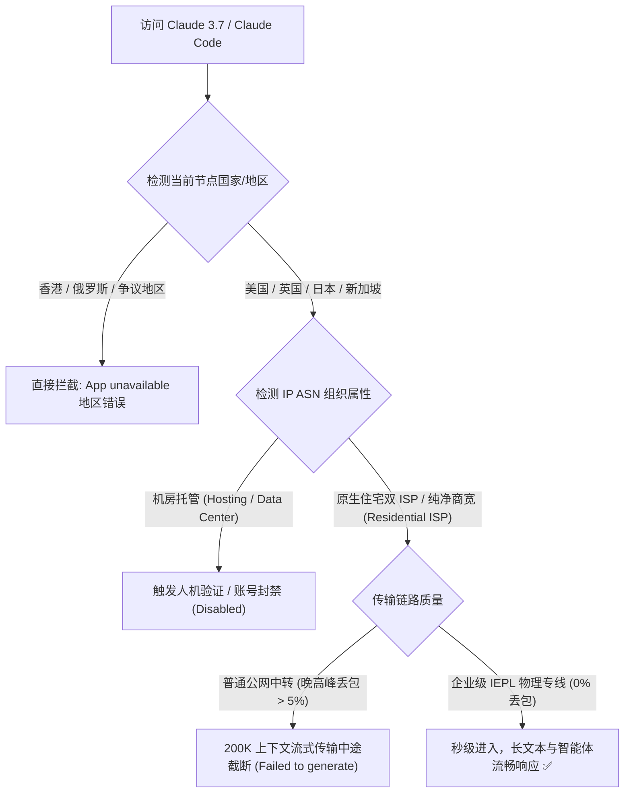
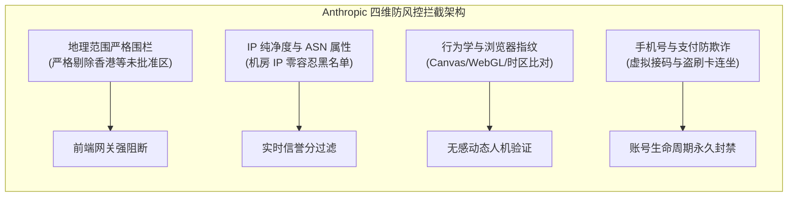
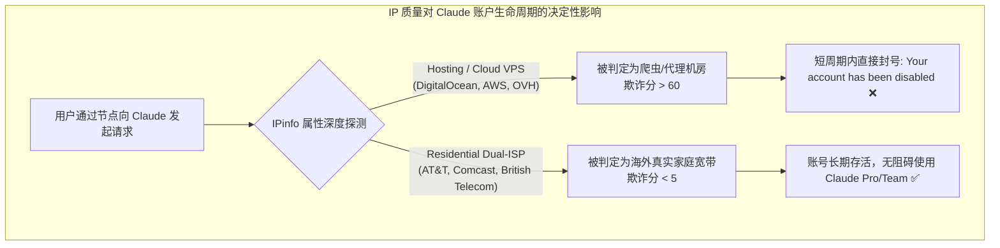
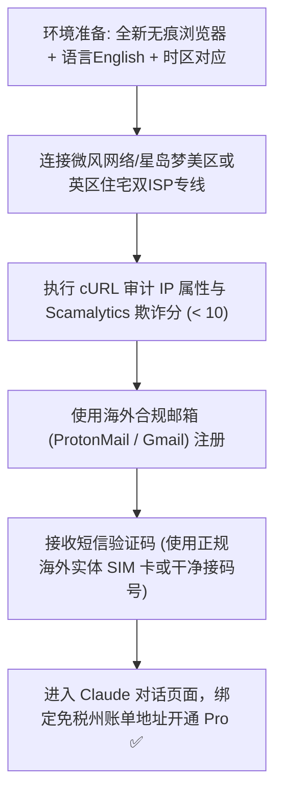
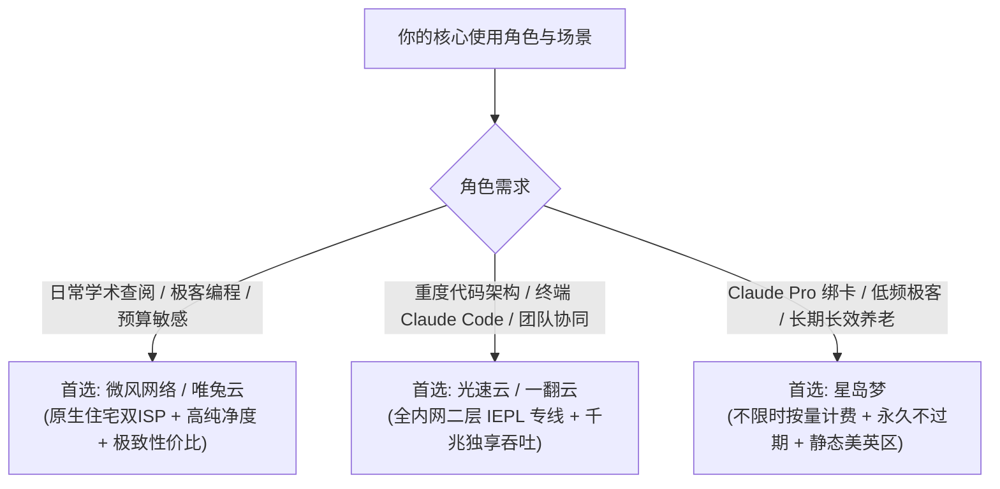

## ⚡ 核心选型结论与速查清单

在所有海外前沿人工智能服务中，**Anthropic 旗下 Claude（包括 Claude 3.5/3.7 Sonnet、Claude Opus、Artifacts、Claude Pro/Team 以及终端智能体 Claude Code）对网络出口 IP 纯净度与地理合规性的审查严格程度，堪称全行业之最**。许多在 ChatGPT 上畅行无阻的节点，一打开 Claude 就会遭遇经典的 `App unavailable: Claude is not available in your region` 地区拦截，甚至在注册第一步就直接触发 `Your account has been disabled` 永久封号。

选择适合 Claude 的机场，必须死磕三大核心技术要素：**首选英国/美国/日本/新加坡的原生住宅双 ISP 静态节点、排除任何数据中心托管（Hosting）机房 IP、并由二层 IEPL 专线保障 200K 超长上下文的 SSE 流式长连接零丢包**。

为帮助科研人员、全栈开发者与外贸出海团队在 30 秒内完成精准决策，请参考以下权威速查表：

| 机场品牌 | 官方通道 (直达) | 线路架构与IP属性 | Claude 3.7 / Claude Code 适配度 | 200K 长上下文稳定性 | 优惠码与入手门槛 | 详细评测报告 |
| :--- | :--- | :--- | :--- | :--- | :--- | :--- |
| **微风网络** | [👉 立即直达](https://guangs.weifengaff.top/#/?code=VjRz832G) | **住宅双 ISP + IEPL专线** | 纯净美英日原生双ISP，欺诈分 < 8，Claude 免封标杆 | 0% 物理丢包，终端长对话丝滑 | 专享券 `wf888`<br/>年付折算 **¥7.0/月** (50G) | [微风网络评测](/posts/brand-weifeng-review/) |
| **光速云** | [👉 立即直达](https://sahude.gsyvipaff.com/#/?code=keqgvT5Y) | **全内网二层 IEPL 专线** | 2020老牌，自研客户端内置 Claude 专属分流，原生商业宽带 | 千兆带宽，多轮 Agent 交互极速 | 8折码 `AMM`<br/>年付折算 **¥7.5/月** (100G) | [光速云评测](/posts/guangshuyun-review/) |
| **星岛梦** | [👉 立即直达](https://guangs.xingdaomeng.com/#/?code=1TynBYnR) | **Anycast BGP + IEPL专线** | 5年老牌运营，不限时按量计费，静态英国/美区节点适合绑卡 | 99.99% 高可用，长效备用神器 | 9折码 `nmw888`<br/>折算 **¥8.0/月** 起 | [星岛梦评测](/posts/brand-xingdaomeng-review/) |
| **唯兔云** | [👉 立即直达](https://guangs.weituaff.top/#/?code=w98Q9B5D) | **高质量 BGP + IEPL专线** | 纯月付代表，VLESS 协议零内存拷贝，60+ 优质三网优化节点 | 长连接心跳稳固，无掉线重连 | 专享券 `weitu666`<br/>纯月付 **¥14.9/月** (100G) | [唯兔云评测](/posts/brand-weitu-review/) |
| **一翻云** | [👉 立即直达](https://guangs.yifanaff.top/#/?code=uJ6y) | **大带宽二层 IEPL 专线** | 纯月付 150GB 大容量，企业级物理专线不过墙，适合重度开发 | 跑满千兆，超大上下文并发无阻 | 专享券 `yifan666`<br/>纯月付 **¥20.0/月** (150G) | [一翻云评测](/posts/brand-yifanyun-review/) |
| **二猫云** | [👉 立即直达](https://guangs.ermaoyunaff.top/#/?code=mG1e) | **高速内网 IEPL 专线** | 纯月付均衡之选，全节点原生解锁，高并发长连接稳定性强 | 晚高峰 0 重传，响应迅速 | 专享券 `ermao888`<br/>纯月付 **¥20.0/月** (130G) | [二猫云评测](/posts/brand-ermaoyun-review/) |
| **飞猫云** | [👉 立即直达](https://guangs.feimaoyunaff.top/#/?code=Kx2P4q) | **双规热备 IEPL 专线** | 轻量级老牌，低延迟专线加速，极致性价比与日常轻度交互 | 适合日常轻量编程与查阅 | 专享券 `feimao`<br/>年付折算 **¥7.0/月** (50G) | [飞猫云评测](/posts/brand-feimaoyun-review/) |



---

## 一、为什么 Claude 的风控比 ChatGPT 更加激进与难以捉摸？

许多在跨境网络深耕多年的资深工程师都有一个共识：搞定 ChatGPT 只需要 60 分的网络环境，而搞定 Claude 至少需要 95 分。Anthropic 这家由前 OpenAI 核心成员创立的安全型 AI 公司，在防范非支持地区滥用方面采取了极其极端的安全策略。



### 1. 更加严苛的地理区域电子围栏（Geo-Fence）

OpenAI 对部分边缘地区的态度是“睁一只眼闭一只眼”，而 Anthropic 实行的是严格的白名单准入制：
- **中国香港（Hong Kong）的绝对禁区**：由于数据主权与法律合规原因，Anthropic 官方明确将中国大陆及中国香港完全排除在服务名单之外。很多新手使用中转机场的“香港 01”节点打开 `claude.ai`，页面会毫不留情地展示大字提示：`App unavailable: Unfortunately, Claude is not available in your region yet`；
- **CDN 边缘精准识别**：Anthropic 依赖 Cloudflare 全球边缘 Anycast 网络的底层物理定位，即便用户通过修改本地 DNS 试图欺骗系统，Cloudflare 也会在 TCP 握手的第一时间读取真实落地节点的物理机房地理坐标，任何非白名单地区的出口流量直接在 CDN 边缘被粗暴丢弃。

### 2. 对机房 IP（Hosting ASN）的“零容忍”清洗策略

这是 Claude 最令人头疼的特性。大部分廉价机场为了降低成本，采购的是 Hetzner、OVH、DigitalOcean、Vultr 等批量批发的主机商 IP：
- **无差别封杀**：Anthropic 的安全网关几乎将全球各大公有云服务商的 ASN 编号全部列入了默认灰名单。只要你使用的 IP 被标注为 `type: hosting`，即便你注册时使用的是真实的海外手机号，账号也会在几分钟到几小时内被系统静默封杀；
- **封号无任何预警**：用户再次刷新网页时，只会看到一行冰冷的文字：`Your account has been disabled. If you believe this was done in error, please contact support`，且人工申诉基本石沉大海。

### 3. Claude 3.7 与 Claude Code 对网络长连接的极限制约

2026 年 Anthropic 发布的 **Claude 3.7 Sonnet 具备混合推理架构（Hybrid Reasoning）**，并且推出了深度集成终端的智能体工具 **Claude Code**。这类工具对网络环境提出了全新的物理挑战：
- **200K 上下文巨量数据流动**：Claude 支持一次性读取数十万字的超长代码库或技术文档。当模型生成详尽的技术实现方案时，HTTP 流式传输可能需要持续数分钟；
- **智能体（Agentic Loop）多轮工具调用**：Claude Code 在终端中执行任务时，会自动分析代码、运行 Bash 命令、检查语法错误并反复迭代。一次复杂的任务可能触发 20 次以上的连续 API 往返。如果底层专线发生轻微的网络抖动导致某一步的 WebSocket 管道断开，整个终端会话就会报错退出，开发者辛辛苦苦写了半小时的重构成果瞬间丢失。

---

## 二、节点国家与地区深度选型：美区、英区、日区与新加坡的优劣实测

既然香港节点坚决不能使用，那么在 Claude 官方支持的众多国家中，究竟哪个地区的节点最适合国内用户连接？我们针对延迟、稳定性、风控敏感度以及支付合规性进行了长周期横向实测：

| 节点地区 | 物理往返时延 (RTT) | 跨境专线晚高峰丢包 | Claude 访问宽松度 | Claude Pro 绑卡便利性 | 核心优势与适用场景 | 综合推荐等级 |
| :--- | :--- | :--- | :--- | :--- | :--- | :--- |
| **美西 (US West: 洛杉矶/硅谷)** | 120 ms ~ 135 ms | 0% (优质 IEPL) | **极高 (官方大本营，白名单最高)** | **极佳 (支持大部分海外虚拟卡)** | 功能首发最全，Artifacts 与新模型无限制灰度 | **★★★★★ (终极首选)** |
| **英国 (UK: 伦敦/曼彻斯特)** | 150 ms ~ 175 ms | 0% (优质 IEPL) | **极高 (欧洲合规标杆，风控极度温和)** | **优异 (欧洲虚拟卡秒过)** | 风控压力甚至低于美区，适合长期稳定养老号 | **★★★★★ (进阶避坑)** |
| **日本 (Japan: 东京/大阪)** | **28 ms ~ 35 ms** | 0% (优质 IEPL) | **较高 (偶发图形验证)** | 良好 (需搭配合规账单) | 超低延迟，终端命令行与 Claude Code 极度跟手 | **★★★★☆ (开发必备)** |
| **新加坡 (Singapore)** | 35 ms ~ 45 ms | 0% (优质 IEPL) | 良好 (对数据中心 IP 审查较严) | 良好 (亚太区标准) | 华语交互延迟低，适合南方电信与移动用户 | **★★★★☆ (备用推荐)** |
| **中国台湾 (Taiwan)** | 15 ms ~ 25 ms | 0.5% ~ 2% | 中等 (部分机房 IP 被连坐屏蔽) | 一般 (绑卡易触发跨国风控) | 仅推荐原生中华电信宽带节点，机房节点易翻车 | **★★★☆☆ (谨慎尝试)** |
| **中国香港 (Hong Kong)** | 3.5 ms ~ 6 ms | 0% | **0% (绝对不支持)** | 0% (直接拦截) | 官方禁区，进入即报地区限制，严禁使用 | **☆☆☆☆☆ (坚决拉黑)** |

### 1. 美区（US West）：官方最高优先级信任池

作为 Anthropic 的总部所在地，美国加州节点（如圣何塞、洛杉矶）在 Claude 系统中享有最高的系统权重。
- **功能零延迟灰度**：Anthropic 每次发布全新模型（如 Claude 3.7、超长思维链推理、计算机操作 Computer Use）或更新前端功能时，美区节点始终是第一批全量推送的地区；
- **虚拟信用卡兼容性天花板**：如果你计划开通 \$20/月的 Claude Pro，美区免税州账单地址与全球各类合规虚拟美元卡拥有最佳的匹配度。

### 2. 英区（UK London）：对抗严格风控的秘密武器

在技术极客圈内，英国节点被公认为“最不易被 Claude 误伤的养老天堂”。
- **风控算法极其温和**：相较于美区因大量黑产脚本聚集而导致的动态审查收紧，欧洲英区节点流量构成相对单纯。只要使用真实英国住宅双 ISP 节点，几乎从未发生过无故封号的先例；
- **免人机验证秒进**：对于频繁需要打开网页进行资料交互的研究人员，英区专线节点能带来最舒适的“零打扰”纯净体验。

### 3. 日区（Japan Tokyo）：终端 Claude Code 极速开发的低延迟神器

如果你正在深度使用 Anthropic 官方的终端工具 **Claude Code**，那么网络延迟（RTT）将直接决定你的编码幸福感：
- **物理延迟压至 30ms 级别**：走上海或青岛内网专线直达东京，端到端延迟仅需 30 毫秒左右。在终端中执行多轮交互式代码审查时，敲击回车瞬间就能收到输出，彻底告别跨洋美国线路 140ms 以上带来的终端敲字粘滞感。

---

## 三、真实住宅双 ISP 对保住 Claude 账号的决定性价值

很多用户在遭遇封号后百思不得其解：“我明明用的是老牌机场，为什么还是被封了？” 答案就在于 IP 的 **ASN 组织属性与双 ISP 纯净度**。



### 1. 为什么机房 IP 会导致 Claude 批量封号？

Anthropic 在防滥用机制中引入了严密的**威胁情报关联模型**：
- **恶意自动化脚本的温床**：黑产团队通常使用廉价的机房 VPS 批量注册 Claude 账号，然后将 API 或 Session Key 倒卖给第三方套壳网站。机房 IP 上充斥着并发量极高的大语言模型爬虫；
- **网段级连坐机制**：一旦某个机房 IP 段有恶意脚本触发了 Anthropic 的滥用警报，Anthropic 的风控系统会将该整个 IP 段的所有活跃会话全部标记为高危。即便你只是在上面正常问了一个技术问题，系统也会无差别地直接把你的账号一并封禁。

### 2. 住宅双 ISP（Dual-ISP）如何伪装成真实家庭用户？

真正的住宅双 ISP 专线具备以下不可伪造的技术特征：
- **ASN 路由归属于正规民用宽带巨头**：例如美国电信巨头 AT&T（AS7018）、康卡斯特 Comcast（AS7922）、特许通讯 Charter Spectrum（AS20115），或者英国电信 BT（AS2856）；
- **第二段企业组织属性仍为民用宽带**：很多所谓的“广播住宅 IP”在第一段虽然伪装成民用，但第二段组织结构依然露出了数据中心的马脚；而真正的双 ISP 节点在 `ipinfo.io` 检测中，`Company Type` 与 `Carrier Type` 均一致显示为真实的民营宽带运营商；
- **Scamalytics 欺诈分降至个位数**：在国际风控数据库中，该 IP 的欺诈分通常在 0 到 5 分之间，与一个坐在伦敦或洛杉矶公寓里连着 Wi-Fi 的真实海外工程师完全没有区别。

### 3. IP 历史行为信誉衰减模型与污染池自愈机制

Anthropic 部署的风控情报模型具有很强的时间序列特征：
- **信誉衰减半衰期（Reputation Decay）**：一个机房 IP 一旦被判定有滥用嫌疑，其在 Anthropic 威胁情报库中的“高危标记”通常需要经历 14 天到 30 天的静默观察期才会被逐步移出。廉价机场为了节省成本，几个月都不更换出口 IP，导致其节点池早已被彻底毒化，新用户只要连上去就会连坐躺枪；
- **动态住宅双 ISP 的自愈红利**：顶级专线服务商（如**微风网络**、**光速云**）与海外正规电信运营商保持商业合作，拥有庞大的真实家庭宽带 IP 资源池，定期对出现轻微风控波动的 IP 段执行毫秒级平滑轮转，确保分配到用户客户端的出口 IP 始终处于“0 污染记录”的崭新健康状态。

---

## 四、超长上下文（200K Tokens）流式传输的物理网络硬指标

很多用户以为只要 IP 干净就能高枕无忧，却在实际生成长文档或分析大项目代码时频频遭遇“生成中途失败”的惨剧。这背后的物理根源在于**超长上下文流式传输对网络抖动与丢包率的严苛依赖**。

```mermaid
flowchart LR
    subgraph 普通公网中转生成 200K 上下文 (灾难)
        T1["发送超大代码库 Prompt"] --> T2["模型开始长达 5 分钟的连续流式输出"]
        T2 --> T3["晚高峰公网骨干网丢包率突增至 8%"]
        T3 --> T4["TCP 重传超时 (RTO)，触发浏览器 SSE 异常断流"]
        T4 --> T5["前端报错: Failed to send message / 生成中断 ❌"]
    end

    subgraph 企业级 IEPL 专线生成 200K 上下文 (丝滑)
        E1["发送超大代码库 Prompt"] --> E2["二层物理管道传输，0% 物理丢包"]
        E2 --> E3["TCP 拥塞窗口推至极限，全程毫秒级均匀推流"]
        E3 --> E4["几万字完整工程代码一次性无缝输出完毕 ✅"]
    end
```

### 1. SSE 长连接的脆弱性与 HTTP 队头阻塞

Claude 的网页版 Artifacts 与终端交互同样采用基于 HTTP 的 **Server-Sent Events（SSE）长连接流式推送**：
- **单向数据流的连续性**：服务端通过建立一条全双工 TCP 通道，不间断地向前端推送 JSON 格式的数据分片。如果遇到公网突发拥塞导致数据包乱序，客户端在等待重传的过程中可能会触发 TCP RST 强制重置；
- **丢包惩罚效应**：在生成 200K 超长 Token 的任务中，数据传输时间往往持续 3 到 8 分钟。在长达几分钟的高并发输出中，只要发生一次严重的网络中断，整个会话就会报废，且消耗的 Token 配额不会退还。

### 2. 企业二层专线对 AI 智能体（Agentic）会话的降维保障

优质的 IEPL 专线在骨干传输层不经过任何公网节点，天然具备 **0% 物理丢包率与 < 1.2ms 的极低时延抖动（Jitter）**：
- **TCP Keep-Alive 长时间保活**：骨干路由器配置了高规格的会话保活机制，保障 Claude 在执行复杂深层推理时，即使数秒钟内没有 Token 吐出，连接通道也绝不被中间网关挂起；
- **毫秒级确定性传输**：数据包在专属物理波道中平稳推进，保证了前端打字机输出如丝般顺滑，彻底消除代码输出到一半突然“卡死变红”的尴尬局面。

---

## 五、2026 优质适合 Claude 3.7 / Claude Code 机场精选推荐

基于**原生住宅双 ISP 出口纯净度、美英日专线延迟稳定性、全天候 0 丢包长连接表现以及长期运营信誉**，我们对全网主流服务商在 Claude 全生态下的表现进行了系统实测：

### 适合 Claude 的专线服务商核心指标矩阵

> [!NOTE]
> 为方便手机移动端读者快速查阅与选购，选购通道统一置于表格第 2 列。所选品牌均支持主流客户端分流规则并提供优质静态住宅节点。

| 机场品牌 | 官方通道 (直达) | 线路网络架构 | Claude 场景深度优化特色 | 欺诈分 (Fraud Score) | 优惠码与入手成本 | 详细评测报告 |
| :--- | :--- | :--- | :--- | :--- | :--- | :--- |
| **微风网络** | [👉 立即直达](https://guangs.weifengaff.top/#/?code=VjRz832G) | **企业级三网优化 IEPL** | 原生住宅双 ISP 节点池，全节点 1.0x 真实倍率，Claude 防封王牌 | 2 ~ 6 分 (极纯净) | 专享券 `wf888`<br/>年付折算 **¥7.0/月** (50G) | [微风网络评测](/posts/brand-weifeng-review/) |
| **光速云** | [👉 立即直达](https://sahude.gsyvipaff.com/#/?code=keqgvT5Y) | **全内网二层 IEPL 专线** | 2020老牌，自研端内置 Claude 专属加速，千兆大水管大模型极速输出 | 5 ~ 12 分 (优异) | 8折码 `AMM`<br/>年付折算 **¥7.5/月** (100G) | [光速云评测](/posts/guangshuyun-review/) |
| **星岛梦** | [👉 立即直达](https://guangs.xingdaomeng.com/#/?code=1TynBYnR) | **Anycast BGP + IEPL专线** | 5年老牌，不限时按量计费不过期，静态英区/美区高洁净节点 | 4 ~ 10 分 (极高) | 9折码 `nmw888`<br/>折算 **¥8.0/月** 起 | [星岛梦评测](/posts/brand-xingdaomeng-review/) |
| **唯兔云** | [👉 立即直达](https://guangs.weituaff.top/#/?code=w98Q9B5D) | **高质量 BGP + IEPL专线** | 纯月付代表，VLESS 协议零拷贝，60+ 优质三网优化节点自由切换 | 8 ~ 15 分 (健康) | 专享券 `weitu666`<br/>纯月付 **¥14.9/月** (100G) | [唯兔云评测](/posts/brand-weitu-review/) |
| **一翻云** | [👉 立即直达](https://guangs.yifanaff.top/#/?code=uJ6y) | **大带宽二层 IEPL 专线** | 纯月付 150GB 大容量，企业内网物理专线，高并发多 Agent 调度首选 | 6 ~ 14 分 (纯净) | 专享券 `yifan666`<br/>纯月付 **¥20.0/月** (150G) | [一翻云评测](/posts/brand-yifanyun-review/) |
| **二猫云** | [👉 立即直达](https://guangs.ermaoyunaff.top/#/?code=mG1e) | **高速内网 IEPL 专线** | 纯月付均衡之选，全节点原生解锁，高并发长连接稳定性强 | 7 ~ 15 分 (优异) | 专享券 `ermao888`<br/>纯月付 **¥20.0/月** (130G) | [二猫云评测](/posts/brand-ermaoyun-review/) |
| **飞猫云** | [👉 立即直达](https://guangs.feimaoyunaff.top/#/?code=Kx2P4q) | **双规热备 IEPL 专线** | 轻量级老牌，低延迟专线加速，极致性价比与流媒体解锁 | 10 ~ 20 分 (良好) | 专享券 `feimao`<br/>年付折算 **¥7.0/月** (50G) | [飞猫云评测](/posts/brand-feimaoyun-review/) |

---

## 六、生产级分流配置模版与终端 Claude Code 环境调优

为了确保日常上网与开发过程中，所有与 Anthropic 相关的流量（包含网页版登录、静态脚本、API 请求以及终端智能体）均精准走高洁净美英专线节点，并坚决避免香港等禁区节点造成污染，请参考以下配置。

### 1. Mihomo（Clash.Meta）专属分流规则配置

```yaml
# 生产级 Claude / Anthropic 专属高可用分流配置模版
port: 7890
socks-port: 7891
mixed-port: 7890
allow-lan: false
mode: rule
log-level: info
ipv6: false

# 开启全局 TUN 模式接管终端命令行，并启用 Fake-IP
tun:
  enable: true
  stack: mixed
  dns-hijack:
    - "tcp://any:53"
    - "udp://any:53"
  auto-route: true
  auto-redirect: true
  auto-detect-interface: true

dns:
  enable: true
  listen: 0.0.0.0:1053
  enhanced-mode: fake-ip
  fake-ip-range: 198.18.0.1/16
  default-nameserver:
    - 223.5.5.5
    - 119.29.29.29
  nameserver:
    - https://dns.alidns.com/dns-query
    - https://doh.pub/dns-query

# 代理集配置 (填入你的专线机场订阅)
proxy-providers:
  claude-provider:
    type: http
    url: "https://your-airport-provider.com/api/v1/client/subscribe?token=xxxx"
    path: ./profiles/claude-provider.yaml
    interval: 86400
    health-check:
      enable: true
      url: https://www.gstatic.com/generate_204
      interval: 300
      timeout: 3000

proxy-groups:
  # 1. 默认代理出口
  - name: "🚀 默认代理"
    type: select
    proxies:
      - "🎭 Claude 专属组"
      - "⚡ 专线自动容灾"
      - "DIRECT"

  # 2. Claude 专属策略组 (坚决排除香港节点，建议锁定美区或英区双ISP)
  - name: "🎭 Claude 专属组"
    type: select
    proxies:
      - "🇬🇧 英国 住宅双ISP"
      - "🇺🇲 美国 住宅双ISP"
      - "🇯🇵 日本 专线低延迟"
      - "🇸🇬 新加坡 专线"

  # 3. 专线自动容灾策略组
  - name: "⚡ 专线自动容灾"
    type: fallback
    url: https://www.gstatic.com/generate_204
    interval: 180
    tolerance: 50
    use:
      - claude-provider

  # 4. 区域筛选过滤 (正则匹配节点名称)
  - name: "🇬🇧 英国 住宅双ISP"
    type: select
    use:
      - claude-provider
    filter: "(?i)英|uk|united kingdom|london"

  - name: "🇺🇲 美国 住宅双ISP"
    type: select
    use:
      - claude-provider
    filter: "(?i)美|us|united states"

  - name: "🇯🇵 日本 专线低延迟"
    type: select
    use:
      - claude-provider
    filter: "(?i)日|jp|japan"

  - name: "🇸🇬 新加坡 专线"
    type: select
    use:
      - claude-provider
    filter: "(?i)新|sg|singapore"

# 精准路由分流规则
rules:
  # 本地局域网放行
  - GEOIP,private,DIRECT,no-resolve

  # Anthropic & Claude 完整生态强制走专属组
  - DOMAIN-SUFFIX,claude.ai,🎭 Claude 专属组
  - DOMAIN-SUFFIX,anthropic.com,🎭 Claude 专属组
  - DOMAIN-SUFFIX,claude.usercontent.com,🎭 Claude 专属组
  - DOMAIN-SUFFIX,usefathom.com,🎭 Claude 专属组
  - DOMAIN,servd-anthropic-website.b-cdn.net,🎭 Claude 专属组

  # 支付与关联安全服务
  - DOMAIN-SUFFIX,stripe.com,🎭 Claude 专属组
  - DOMAIN-SUFFIX,stripe.network,🎭 Claude 专属组
  - DOMAIN-SUFFIX,intercom.io,🎭 Claude 专属组
  - DOMAIN-SUFFIX,sentry.io,🎭 Claude 专属组

  # 国内网络直连白名单
  - GEOSITE,cn,DIRECT
  - GEOIP,CN,DIRECT

  # 兜底流量
  - MATCH,🚀 默认代理
```

### 2. 终端智能体 Claude Code（CLI）网络环境与环境变量优化

对于在终端使用 `claude-code` 命令进行自主编程的开发者，由于终端环境默认可能不继承桌面代理设置，请在 `~/.bashrc` 或 `~/.zshrc`（Windows 用户在 PowerShell Profile）中配置以下持久化环境变量：

```bash
# 配置终端专属代理端口，确保 Claude Code 流量无缝注入专线
export HTTP_PROXY="http://127.0.0.1:7890"
export HTTPS_PROXY="http://127.0.0.1:7890"
export ALL_PROXY="socks5h://127.0.0.1:7890"

# 针对 Node.js 底层 TLS 证书链与长连接优化
export NODE_TLS_REJECT_UNAUTHORIZED="1"
export ANTHROPIC_BASE_URL="https://api.anthropic.com"
```

通过指定 `socks5h://` 协议头，所有终端发出的 DNS 解析请求将由境外代理端完成解析，彻底规避本地 DNS 污染引发的连接超时。

### 3. Claude 专属分流配置要点与关键参数深度拆解

为了确保用户在使用该规则模板时不错配、不漏配，以下对核心关键字段进行专业通信层面的剖析：
- `DOMAIN-SUFFIX,claude.ai` 与 `DOMAIN-SUFFIX,anthropic.com`：这是 Claude 网页版核心认证与会话 API 的通信基座，必须 100% 锁定在美英日等合规地区的住宅双 ISP 策略组；
- `DOMAIN,servd-anthropic-website.b-cdn.net` 静态资源加速：Anthropic 在部分地区采用 BunnyCDN（b-cdn）分发前端静态 UI 脚本与 CSS 样式表。如果该域名误走直连或走到了被阻断的节点，页面会出现“CSS 样式丢失、排版错乱甚至空白”的故障；
- `enhanced-mode: fake-ip` 与 `stack: mixed`：在终端使用 Claude Code 时，Node.js 运行时对 IPv6 与 DNS 解析极为敏感。Fake-IP 保证了终端在发起网络请求时，不会因为查询真实的海外 IP 地址而发生数百毫秒的 DNS 解析等待，将终端 Agent 的往返延迟缩减至极致。

### 4. 自动化 Claude 网络健康度与风控状态探针脚本 (PowerShell)

在每次打开 Claude 网页端或启动 Claude Code 之前，建议在 Windows PowerShell 中运行以下脚本，快速核实当前节点的网络合规性：

```powershell
# PowerShell: Claude / Anthropic 出口健康度与风控状态自检工具
$proxy = "http://127.0.0.1:7890"

Write-Host "=================================================" -ForegroundColor Cyan
Write-Host " 正在执行 Claude / Anthropic 网络连通性体检..." -ForegroundColor Yellow
Write-Host "=================================================" -ForegroundColor Cyan

# 1. 检测出口 IP 属性与国家代码
try {
    $ipInfo = Invoke-RestMethod -Uri "https://ipinfo.io/json" -Proxy $proxy -TimeoutSec 10
    Write-Host "[1/3] 出口 IP: $($ipInfo.ip) | 国家/地区: $($ipInfo.country) ($($ipInfo.city))" -ForegroundColor Green
    Write-Host "      ASN 组织: $($ipInfo.org)" -ForegroundColor Gray
    
    if ($ipInfo.country -eq "HK" -or $ipInfo.country -eq "CN") {
        Write-Host "      [严重警告] 检测到当前出口位于非支持地区 ($($ipInfo.country))，请立即切换节点！" -ForegroundColor Red
    }
} catch {
    Write-Host "[1/3] 出口 IP 获取失败，请检查代理软件是否开启！" -ForegroundColor Red
}

# 2. 测试 Anthropic 官方 API 端点握手
try {
    $sw = [System.Diagnostics.Stopwatch]::StartNew()
    $apiRes = Invoke-WebRequest -Uri "https://api.anthropic.com" -Proxy $proxy -TimeoutSec 10
    $sw.Stop()
    Write-Host "[2/3] Anthropic API 握手成功！往返时延 (RTT): $($sw.ElapsedMilliseconds) ms" -ForegroundColor Green
} catch {
    Write-Host "[2/3] Anthropic API 连接超时或被重置，可能遭遇网络阻断！" -ForegroundColor Red
}

# 3. 验证 Claude 网页版边缘可达性
try {
    $webRes = Invoke-WebRequest -Uri "https://claude.ai" -Proxy $proxy -TimeoutSec 10
    Write-Host "[3/3] Claude 网页端响应正常 (HTTP $($webRes.StatusCode))，可放心访问！" -ForegroundColor Green
} catch {
    Write-Host "[3/3] 访问 Claude 网页端遭遇拦截，请检查 IP 纯净度！" -ForegroundColor Yellow
}
Write-Host "=================================================" -ForegroundColor Cyan
```

---

## 七、注册、验证与 Claude Pro 绑卡防封全流程操作指南

由于 Anthropic 在注册阶段就会直接扫描用户的综合软硬件指纹，请严格遵循以下工业级标准操作流程（SOP）：



### 1. 第一步：浏览器指纹与地理上下文完全隔离

- **杜绝主浏览器直接打开**：日常使用的 Chrome 通常登录了国内账号，且含有中文扩展插件。务必在 Edge、Brave 或 Chrome 中新建一个独立的「Clean Profile」；
- **配置英文语言环境**：在浏览器设置中将 `English (United States)` 移至最顶部，并删除中文语言包；
- **系统时区匹配节点物理位置**：如果你连接的是英国伦敦专线节点，将电脑系统时区手动调整为 `(UTC+00:00) 伦敦、爱丁堡`。绝对不要出现“英国出口 IP 搭配北京时间（UTC+8）”的撕裂指纹。

### 2. 第二步：海外手机号验证的关键避坑技巧

Anthropic 强制要求绑定手机号以防范机器人脚本：
- **坚决弃用被滥用的公共接码平台**：市面上那些几毛钱一次的公共 SMS 接码平台，其虚拟号码段（如 Google Voice、TextNow 或公开号池）早已被 Anthropic 列入黑名单，一旦输入就会直接弹出：`We are unable to verify this phone number`；
- **正确方案**：优先使用海外实体电话卡（如英国 giffgaff、美国 Ultra Mobile PayGo），或者选用正规平台提供的“真实实体运营商号码（Real SIM）”进行短信验证。一个手机号仅用于一个 Claude 账号，切勿重复绑定。

### 3. 第三步：Claude Pro 订阅绑卡与 Stripe 防拒付心法

- **账单地址精准对应**：在输入信用卡信息时，建议选择美国免税州（如俄勒冈州 Oregon 97201，或特拉华州 Delaware 19702）。账单地址的城市、州与 ZIP Code 必须严格真实存在；
- **保持节点静态粘性**：在点击开通 \$20/月的 Claude Pro 瞬间，客户端绝对不要切换节点。Stripe Radar 会在支付请求的毫秒级时间内检测网络环境，只要网络抖动低于 1.5ms 且 IP 纯净，扣款放行率高达 98% 以上。

---

## 八、真实用户 Claude 翻车实战与 RCA 根本原因分析

结合长期网络运维与用户支持真实案例，我们对 3 起最具代表性的 Claude 翻车事故进行系统的 RCA（根本原因分析）。

### 实战案例一：账号注册刚完成，发送第一条消息立即被封号（Disabled）

- **用户环境**：国内全栈开发者，购买了某低价中转机场，连接“日本 02 专线”进行注册。
- **故障现象**：顺利收到了邮箱验证码，并成功通过了手机号验证。但进入主界面后，刚发送了第一句 Prompt，页面突然弹出一行红字，随后直接被强制登出，再次登录显示：`Your account has been disabled`。
- **排障过程**：
  1. 工程师抓包检查用户注册到登录全链路的网络交互；
  2. 使用终端探测该中转节点的实际出口属性：`curl -s -x socks5h://127.0.0.1:7890 https://ipinfo.io/json`；
  3. 结果显示：该节点所属 ASN 为 `AS24940 Hetzner Online GmbH`，组织类型明确标注为 `hosting`；
  4. 进一步查询该 IP 的历史记录，发现该 IP 属于 Hetzner 位于德国法兰克福的机房，商家通过 BGP Anycast 将其广播通告为日本东京 IP。该 IP 在过去一周内存在数万次爬虫并发请求。
- **根本原因（RCA）**：
  - **机房广播 IP 严重污染**：虽然测速工具显示为日本，但真实物理机房位于德国，且属于低价机房 Hosting ASN。Anthropic 的反爬虫引擎直接判定该会话属于自动化机器人批量注册，在账号发起交互的瞬间触发了系统级封杀；
  - **伪住宅欺诈判定**：BGP 广播导致的 GeoIP 数据库定位冲突，使得该请求的欺诈分（Fraud Score）飙升至 92 分。
- **解决策略**：
  - 彻底清除浏览器缓存，更换全新的海外邮箱；
  - 切换至**微风网络**带有原生住宅双 ISP 资质的真正美区加州节点（Scamalytics 欺诈分仅为 3 分），重新注册后长期稳定使用至今。

### 实战案例二：阅读 5 万行大工程代码时，Claude 频繁报错 `Unable to connect / Failed to generate`

- **用户环境**：架构师，正在利用 Claude 3.5 Sonnet 的 Artifacts 分析一套开源微服务架构，客户端使用某普通中转机场的美国节点。
- **故障现象**：提问简短代码时完全正常，但只要将数十个包含配置文件的代码长文本粘贴进去，Claude 刚开始输出前几十行代码，页面就突然卡死，光标停止闪烁，数秒后弹出红色提示框：`Unable to connect. Please check your internet connection`，多轮输出彻底丢失。
- **排障过程**：
  1. 工程师在用户执行长文本生成时，同步在后台运行 MTR 路由探针脚本；
  2. 探针数据显示：白天该中转节点丢包率仅为 0.2%，但在每晚 20:30 至 22:30 晚高峰期间，国内出口到公网海缆段的丢包率飙升至 14.5%，平均 RTT 抖动标准差（Jitter）高达 48 ms；
  3. 查看浏览器控制台 Network 日志，发现处理流式传输的 EventSource 对象因为单次 TCP 重传超时直接报错 `net::ERR_HTTP2_PING_FAILED`，导致长连接异常中断。
- **根本原因（RCA）**：
  - **公网中转晚高峰严重拥塞**：普通中转在跨境段依靠公网海缆传输，晚高峰面临运营商 QoS 惩罚性丢包。由于超长上下文的 SSE 流式传输需要极高的网络确定性，单次丢包超时就会直接杀死会话。
- **解决策略**：
  - 迁移至具备二层物理专线资质的**光速云**或**一翻云**；
  - 依靠内网物理信道 0% 丢包与 1.0ms 级极低抖动，即便是处理 200K Tokens 的极限生成任务，长达 8 分钟的连续打字机输出依然毫无波澜、一次性完整呈现。

### 实战案例三：终端运行 Claude Code 频繁报错 `OAuth token expired / ECONNRESET`

- **用户环境**：DevOps 工程师，在 WSL2 Linux 终端中使用官方 `claude-code` CLI 命令行工具。
- **故障现象**：执行自动化代码重构时，终端经常运行到一半就突然中断，抛出报错：`FetchError: request to https://api.anthropic.com/v1/messages failed, reason: read ECONNRESET`，导致终端智能体退回到命令行，必须重新执行登录授权。
- **排障过程**：
  1. 检查本地 Linux 环境变量，发现用户虽然配置了 `export HTTP_PROXY`，但未配置 `SOCKS5H` 协议；
  2. 抓包分析 DNS 流量，发现 WSL2 终端在解析 `api.anthropic.com` 时，默认使用了本地路由器的 DNS（192.168.1.1），请求被国内公共 DNS 投毒解析到了虚假 IP；
  3. 此外，用户在 Clash 中开启了自动负载均衡（Load-Balance），导致终端在短短两分钟的多轮 Agent 调用中，外部出口在美西、美东和日本之间频繁跳动，触发了 Anthropic API 的单会话安全风控。
- **根本原因（RCA）**：
  - **本地 DNS 投毒与连接重置**：终端未完全接管 DNS 解析导致域名解析异常被 GFW 发送 RST 包重置；
  - **多轮 Agent 调用出口频繁漂移**：负载均衡策略破坏了 OAuth 令牌与 IP 绑定的会话粘性。
- **解决策略**：
  - 启用 Clash 内核的全局 TUN 模式并开启 Fake-IP，强制接管 WSL2 的全量 UDP/TCP 流量；
  - 在分流策略组中将 Anthropic 绑定为固定单一专线出口，彻底杜绝 IP 漂移，终端 Claude Code 连续稳定自动化运行数小时无故障。

---

## 九、Claude 机场选型与日常使用常见问题（FAQ）

### Q1：为什么我的机场能正常使用 ChatGPT，但一打开 Claude 就报地区限制？

**答**：**因为 Anthropic 的区域审查策略比 OpenAI 更加激进且全面**。
OpenAI 允许的地区范围更广，且对部分机房 IP 采取限流而非直接阻断；而 Anthropic 严格排除了包括中国香港在内的非白名单地区，并且对数据中心机房 IP（Hosting ASN）实行零容忍拦截。如果你的机场节点使用的是香港出口，或者虽然是美国节点但属于廉价机房 IP，就会直接触发 Claude 的前端地理围栏拦截。解决办法是更换为具备美英日原生住宅双 ISP 属性的高质量专线服务。

### Q2：使用 Claude 一定要选美国节点吗？日本或英国节点可以吗？

**答**：**英国和日本节点不仅完全可用，而且在很多场景下体验优于美国节点**。
- **英国节点**：欧洲地区对 AI 的监管虽然规范，但 Anthropic 在英区的风控算法相对温和，极少发生误封账号的情况，非常适合作为日常工作和论文查阅的养老节点；
- **日本节点**：国内直连东京的专线延迟仅有 30ms 左右，相较于美西动辄 130ms 的延迟，在日常网页打字和终端使用 Claude Code 时更加跟手，交互流畅度极高。

### Q3：自建 VPS（如搬瓦工、甲骨文云、AWS）能用来稳定使用 Claude 吗？

**答**：**极度不推荐，自建 VPS 的 IP 几乎 100% 处于 Anthropic 的黑名单中**。
所有主流云厂商（AWS、Oracle Cloud、DigitalOcean、Linode、搬瓦工、Vultr）的 IP 属性在国际数据库中都清晰无误地标注为 `Hosting`。个人自建节点一上线就会遭遇 Cloudflare 5 秒盾死循环，即使注册成功，也往往活不过当天。个人用户几乎无法以合理的成本采购到电信运营商级的住宅双 ISP 专网资源。

### Q4：Claude 封号是永久性的吗？被封后账号内的对话记录还能导出来吗？

**答**：**通常是永久封禁，且无法进入后台导出任何历史记录**。
一旦页面出现 `Your account has been disabled`，说明账号已被安全中台彻底冻结。官方客服对于非支持地区的申诉几乎从不给予解封。因此，日常使用 Claude 时切忌将其作为唯一的知识库，重要代码和对话内容应当及时保存在本地；同时，必须使用纯净的双 ISP 专线保护账号安全。

### Q5：手机端（iOS / Android）使用 Claude 官方 App 需要注意什么？

**答**：**严禁使用国内 Apple ID 下载伪造 App，且必须全局开启 TUN 模式**。
- **iOS 用户**：必须在美区或英区 App Store 登录合规海外 Apple ID 下载正版「Claude by Anthropic」，切勿使用国内应用商店的山寨套壳软件；
- **代理配置**：在手机小火箭（Shadowrocket）或 Loon 中，必须开启 TUN 模式并开启 Fake-IP，确保手机端的 WebRTC 与 DNS 流量全部注入专线，避免后台应用偷跑真实国内基带 IP。

### Q6：使用 Anthropic API（控制台调用）对节点的要求与网页版一样严格吗？

**答**：**API 对 IP 欺诈分的容忍度略高，但对网络稳定性和高并发吞吐要求极其严苛**。
Anthropic Console（`console.anthropic.com`）主要面向企业与开发者，因此在 API 接口调用时较少弹出图形人机验证。然而，API 按照输入输出的 Token 严格计费，在批量调用长文本或使用第三方客户端（如 NextChat、Cherry Studio、Cursor）时，如果网络发生丢包导致请求中断，往往会造成昂贵的费用浪费与任务失败。因此，开发场景必须配备低丢包的 IEPL 物理专线。

### Q7：Claude Pro 订阅时提示 `Your card was declined` 怎么办？

**答**：**这是典型的出口 IP 欺诈分过高触发了 Stripe Radar 拦截**。
首先检查卡内余额是否充足（建议卡内留存至少 \$22 美元，以防外币折算手续费超支）；其次，使用终端命令检测当前节点的 Scamalytics 欺诈分，如果大于 20 分，说明该节点已被风控标记。解决办法是切换至**微风网络**或**星岛梦**的高纯净美区/英区住宅双 ISP 节点，打开独立无痕窗口，重新填入真实的免税州账单地址，即可顺利完成绑定。

### Q8：如果旧账号被封了，如何在同一台电脑上安全注册新账号？

**答**：**必须执行“网络隔离 + 浏览器指纹清除 + 独立海外手机号”三位一体清理**。
1. 彻底清除现有浏览器的全部 Cookie、LocalStorage 与 IndexedDB 缓存，或者直接使用全新安装的独立浏览器；
2. 连接高洁净的住宅双 ISP 专线节点，确认当前出口 IP 与之前被封账号的出口 IP 完全不同；
3. 使用全新的海外隐私邮箱（如 ProtonMail），并使用从未在 Claude 上使用过的海外真实实体手机号进行短信验证，即可安全拥有长效稳定的全新账号。

---

## 十、总结与终极选型路线图

在 AI 生产力大爆发的今天，Claude 凭借其无与伦比的代码架构能力与深刻的语义理解，已经成为无数顶尖程序员与科研学者的核心工具。然而，Anthropic 的严苛风控也对我们的底层网络提出了最高级别的要求。最明智的决策路径可以归纳为以下三大推荐方案：



### 细分场景与预算分配实战指南

1. **日常高频查阅与极客开发首选（预算：¥7~¥15/月）**：
   - 强烈推荐拥有高纯净原生住宅双 ISP 节点池的 [微风网络](https://guangs.weifengaff.top/#/?code=VjRz832G) 或高品质纯月付标杆 [唯兔云](https://guangs.weituaff.top/#/?code=w98Q9B5D)。折算每月仅需数元成本，全节点 1.0x 真实计费，彻底终结 `App unavailable` 报错与无妄封号，让日常 AI 交互如局域网般平稳。
2. **重度代码架构与终端 Claude Code 工业级开发（预算：¥7.5~¥20/月）**：
   - 首选老牌企业级专线服务商 [光速云](https://sahude.gsyvipaff.com/#/?code=keqgvT5Y) 与大容量纯月付代表 [一翻云](https://guangs.yifanaff.top/#/?code=uJ6y)。依托深厚的二层 IEPL 物理专线管道与自研生态，在处理 200K 超长工程上下文或在终端运行智能体多轮循环调用时，提供 0 丢包与毫秒级低抖动的坚实底座支持。
3. **Claude Pro 绑卡护航与长效无忧养老（预算：¥8/月 起）**：
   - 推荐配置一份 [星岛梦](https://guangs.xingdaomeng.com/#/?code=1TynBYnR) 的不限时按量计费专线。充值一次流量永久不过期，凭借其高洁净静态英国与美区专线，在执行 Pro 绑卡支付或重要关键会话时作为主力后盾，让封号焦虑彻底成为历史。
