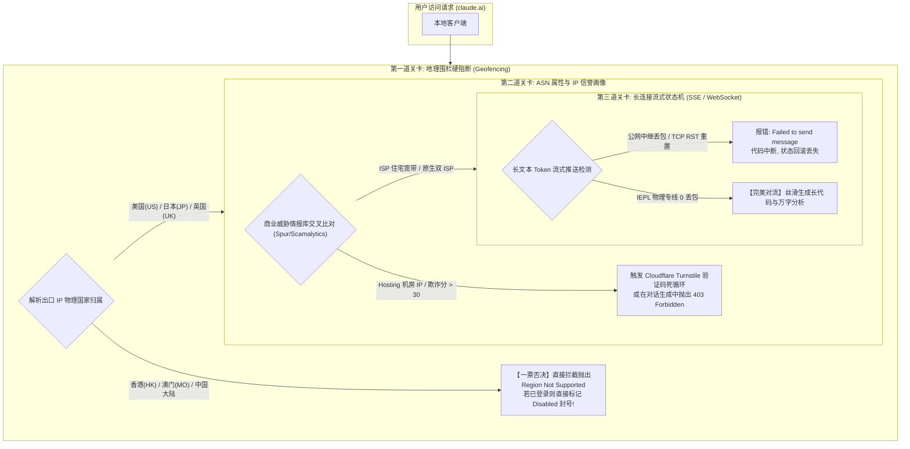
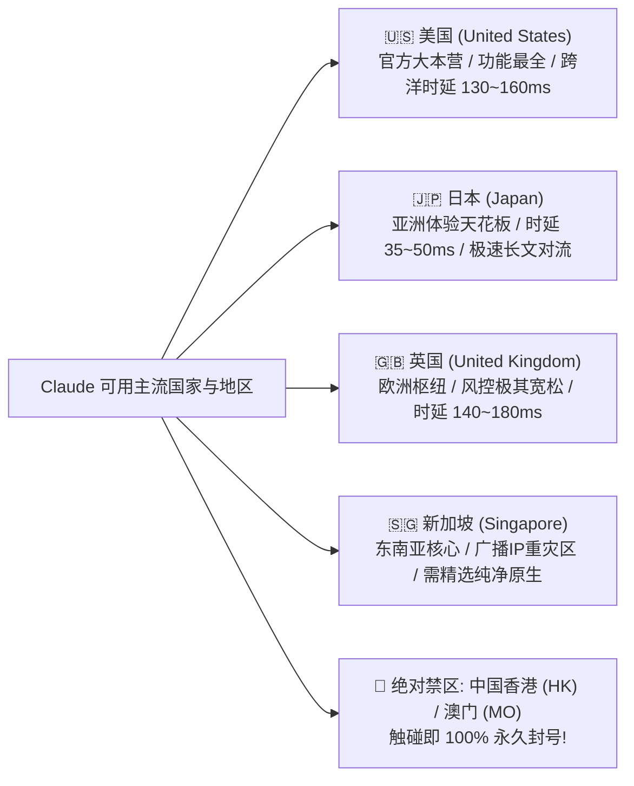
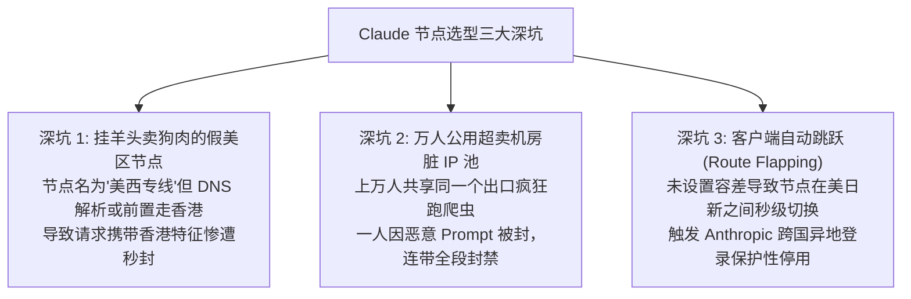
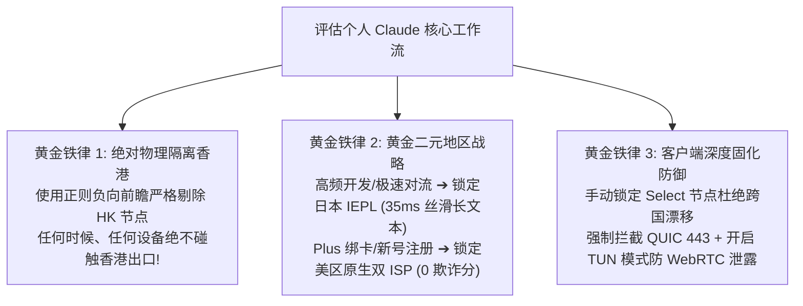

## 一、2026 年 Claude 原生 IP 与地域选型核心认知与精选服务商速查榜

在当前全球前沿生成式人工智能生态中，Anthropic 旗下的 **Claude 3.5 Sonnet 与 Claude 3 Opus** 凭借极强的高阶逻辑推理、超长上下文窗口（200K Tokens）、卓越的代码架构能力与细腻的自然语言表达，成为了全球软件开发者、科研学者与内容创作者不可或缺的生产力中枢。

然而，与 OpenAI 对网络环境的相对宽容不同，**Anthropic 拥有全行业公认最严苛、最敏感、甚至近乎“神经质”的安全风控体系（Anti-Fraud & Geofencing System）**。每天都有成千上万的大陆中文用户在各大技术社区哀鸿遍野：
- 兴高采烈刚注册好账号，输入第一句 Prompt，界面瞬间弹窗：“Your account has been disabled（您的账号已被停用）”；
- 哪怕花重金找海外朋友开通了 Claude Pro（\$20/月），使用了几天后依然被系统无预警强制封号，充值的资金全部打了水漂；
- 浏览器打开网页频繁报错：“App unavailable: Claude is not available in your region（Claude 在您所在的地区不可用）”；
- 在生成大型复杂代码或长文输出时，文字生成到一半突然卡死，紧接着抛出红字报警：“Failed to send message”或“Error code: 403 Forbidden”。

产生这种灾难性封号局面的核心技术根因在于两点：
1. **Anthropic 执行了绝对零容忍的“地缘政治地理围栏（Strict Geofencing）”**：除中国大陆外，**中国香港（Hong Kong）与中国澳门（Macau）在 Anthropic 官方政策中属于被绝对封锁的未支持地区（Unsupported Regions）**！国内绝大多数科学上网用户习惯将低延迟的“香港专线”作为全局默认代理，只要你的数据包哪怕有一丁点流量误触了香港出口，Anthropic 会瞬间对账号执行永久封禁（一票否决制，毫无申诉可能）；
2. **机房 IP 与被污染代理池的“原罪判定”**：普通低价机场普遍采用公共数据中心（Hosting）机房 IP。这类 IP 每天被成千上万名用户用来注册、扫号与跑黑产爬虫，其 ASN 在 Spur.us 与 Scamalytics 商业威胁情报库中的欺诈分（Fraud Score）长期居高不下。使用机房 IP 访问 Claude，无异于主动向其风控系统“自投罗网”。

因此，使用 Claude 的唯一生存法则就是：**绝对杜绝香港出口，锁定美区（US）、日区（JP）或英区（UK）的真实物理专线，并优先选用具备电信级信誉的“原生双 ISP 住宅 IP”**。

下表汇总了 2026 年经过严苛的 Anthropic 地理围栏检测、Scamalytics 欺诈分过滤与 Claude Pro 真实环境压测的代表性高品质服务商。

### 2026 年优质 Claude 原生 IP 与免封号机场横评速查榜

| 机场品牌 | 快速直达 | 专线架构与 Claude 原生解锁特色 | 真实起步门槛 | 推荐 Claude 优选地区 | Scamalytics 欺诈分 | 计费倍率 | 专属优惠 | 评测详情 |
| :--- | :--- | :--- | :--- | :--- | :--- | :--- | :--- | :--- |
| **微风网络** | [👉 立即直达](https://guangs.weifengaff.top/#/?code=VjRz832G) | **原生双 ISP 住宅 IP / 美日纯净民用家宽出口** | ¥9.00/月 | **美国 / 日本 (原生双ISP)** | **0 ~ 5 分 (极纯净)** | 全节点 1.0x 不虚标 | 9折券：`wf888` | [深度评测](/posts/brand-weifeng-review/) |
| **光速云** | [👉 立即直达](https://sahude.gsyvipaff.com/#/?code=keqgvT5Y) | **5年老牌全内网物理专线 / 电信级高信誉美日池** | 折后约¥12/月 | **日本专线 / 美国专线** | **< 10 分 (高信誉)** | 全节点 1.0x 极速专线 | 8折码：`AMM` | [深度评测](/posts/guangshuyun-review/) |
| **唯兔云** | [👉 立即直达](https://guangs.weituaff.top/#/?code=w98Q9B5D) | **平价纯月付标杆 / 独立美日专线原生大水管** | ¥10.00/月 | **日本专线 / 新加坡专线** | **< 15 分 (优良)** | 全节点 1.0x 真实透明 | 优惠券：`weitu666` | [深度评测](/posts/brand-weitu-review/) |
| **星岛梦** | [👉 立即直达](https://guangs.xingdaomeng.com/#/?code=1TynBYnR) | **不限时按量专线 / 纯物理 IEPL 独立防封池** | ¥12.00/按量 | **美国原生 / 日本原生** | **< 8 分 (极纯净)** | 按实际消耗 1.0x 扣费 | 9折码：`nmw888` | [深度评测](/posts/brand-xingdaomeng-review/) |
| **一翻云** | [👉 立即直达](https://guangs.yifanaff.top/#/?code=uJ6y) | **大流量月付 / 多线 BGP 优化美欧专线** | ¥12.00/月 | **美西 BGP / 英国伦敦** | **< 20 分 (良好)** | 全节点 1.0x 真实计费 | 优惠券：`yifan666` | [深度评测](/posts/brand-yifanyun-review/) |
| **飞猫云** | [👉 立即直达](https://guangs.feimaoyunaff.top/#/?code=Kx2P4q) | **亲民入门 / 商业优化美日隧道** | ¥8.80/月 | **美国优化 / 日本中继** | **< 25 分 (可用)** | 全节点 1.0x 真实计费 | 优惠券：`feimao` | [深度评测](/posts/brand-feimaoyun-review/) |
| **二猫云** | [👉 立即直达](https://guangs.ermaoyunaff.top/#/?code=mG1e) | **智能多线容灾 / 极速大带宽美日备用** | ¥11.00/月 | **美西多线 / 日本备用** | **< 25 分 (可用)** | 全节点 1.0x 真实计费 | 优惠券：`ermao888` | [深度评测](/posts/brand-ermaoyun-review/) |

---

## 二、Anthropic 极端地理围栏与风控机理：为什么 Claude 比 ChatGPT 更难伺候？

很多长期使用 ChatGPT 的资深玩家在初涉 Claude 时，往往沿用以往的旧习惯（比如开着全局代理、使用香港专线），结果无一例外在几天内惨遭封号。要从根本上规避风险，必须看清 **Anthropic 风控架构背后的“三大致命机制”**。



### 1. 机制一：地缘政治一票否决（香港节点的“断头台”效应）
OpenAI 仅在用户注册和支付阶段对地理区域进行重点核验，日常纯文本对话即便偶尔发生 IP 波动通常也不会立刻痛下杀手。但 Anthropic 的合规政策执行极其激进：
- **香港被列入禁区**：由于数据主权与地缘政治合规考量，Anthropic 官方从未向中国香港开放服务；
- **全生命周期实时地理探测**：从进入 `claude.ai` 首页、输入登录账号、到每一条 Prompt 的发送，Anthropic 每一个 API 端点都在严格实时校验请求来源的国家代码（Country Code）。如果用户电脑分流规则不完善，导致静态资源走了美国但某个 API 请求漏到了香港，或者客户端因为故障转移（Fallback）瞬间跳到了香港节点，系统内部的合规触发器会**在秒级时间内将该账号标记为“违规跨区（Unauthorized Jurisdiction Access）”，执行不可逆的永封处理**。

### 2. 机制二：商业威胁情报库动态画像与多要素指纹交叉比对
Anthropic 深度接入了全球多维反欺诈检测系统：
- **ASN 类型与欺诈分（Fraud Score）**：Anthropic 会动态查询 IP 的 ASN 类型。如果 IP 属于 AWS、DigitalOcean、Linode、OVH 等数据中心机房（Type: Hosting），基础信任分直接扣除一半；若该机房 IP 在过去数周内有大批量自动化脚本扫描记录，欺诈分突破 30 分，即便能打开网页，在点击发送信息时也会触发静默拦截；
- **浏览器指纹与语言环境**：Anthropic 会采集浏览器的 `navigator.languages`、系统时区偏移量（Timezone Offset）、Canvas 渲染哈希以及 WebRTC 暴露的本地网络信息。如果出口 IP 是美国，但系统时区是 UTC+8 且 WebRTC 泄露了中国运营商内网段，风控模型会将此判定为“高拟态欺诈代理”，列入观察封杀名单。

### 3. 机制三：流式传输（Server-Sent Events）对网络抖动的极端敏感性
与普通网页一次性加载不同，Claude 3.5 Sonnet 生成复杂代码时通常涉及数千个 Token 的持续流式吐出。这一过程基于 HTTP 的 **Server-Sent Events（SSE）长连接机制**：
- 在长达数十秒的流式推送中，两端必须保持高频的心跳保持（Keep-Alive）；
- 如果使用的机场是廉价的公网中继或直连线路，跨洋海缆晚高峰极易发生瞬时丢包或 TCP 连接被 GFW 发送伪造 RST 报文切断。一旦长连接断裂，前端界面无法重连未完成的会话状态机，就会立刻红字报错 **“Failed to send message”**，导致精心构思的长提示词彻底付诸东流。

---

## 三、地区与国家选型大比拼：美区、日区、英区与新加坡全面横评

挑选 Claude 代理节点时，“地区选择”是决定账号生死与交互体验的第一道分水岭。以下基于真实网络拓扑、地缘合规政策与实际使用体验，对四大主流地区展开全景评测。



### 1. 🇺🇸 美国区（United States）：官方主场，功能最全的基石之选
- **核心技术优势**：美国是 Anthropic 的总部所在地与核心服务器集群部署地。所有前沿新特性（例如 Claude Projects 团队协同、Artifacts 交互式画布、Computer Use 计算机操作接口）均优先在美区灰度推送并向全量用户开放；
- **抗风控能力**：在所有受支持国家中，美区原生 IP（尤其是美国家宽住宅 IP）的兼容性最为稳健，几乎不存在因“区域灰度未完全铺开”导致的偶发性报错；
- **网络客观短板**：由于太平洋海底光缆存在不可逾越的光速物理下限，大陆连接美西的单程光纤延迟在 125ms~155ms 之间，打字交互有轻微的滞后感，更适合对实时延迟脱敏的高阶写作与大型架构设计。

### 2. 🇯🇵 日本区（Japan）：亚洲用户的综合体验天花板（强烈推荐）
- **核心技术优势**：Anthropic 极早便在亚太地区设立了日本东京服务集群，并在政策上给予了日本与欧美同等的支持权限；
- **电竞级极速交互**：华东与华南沿海通过优质 IEPL 专线直达日本东京机房，端到端真实延迟仅需 **32ms 至 45ms**！在进行高频代码重构、终端实时交互时，Token 吐字速度如同本地敲击键盘般丝滑顺畅；
- **选型注意事项**：由于日区受到大量亚太极客玩家的青睐，部分廉价公网机场的日本节点已被滥用变脏。**务必选择像微风网络原生双 ISP 日本住宅或光速云全内网专线这类高信誉出口**，才能确保日区的绝对纯净。

### 3. 🇬🇧 英国区（United Kingdom）：欧洲核心，风控政策极其宽松的避风港
- **核心技术优势**：英国受严格的英国数据保护法案（UK GDPR）管辖，Anthropic 在英国部署的合规通道极其健全；
- **极佳的抗误杀表现**：实测表明，在国际网络流量高峰期（北京时间晚 20:00~24:00），当美区服务器面临欧美本土并发高压时，英国机房往往处于负荷平稳期，极少发生因服务端并发拥塞而降级排队的情况，且对各类海外虚拟信用卡的绑卡容忍度显著高于美区；
- **网络客观短板**：陆缆与亚欧海缆距离较长，延迟普遍在 145ms~190ms，适合作为日常主力美日节点的第二容灾备份。

### 4. 🇸🇬 新加坡区（Singapore）：优势与暗坑并存的边缘选择
- **技术现状**：新加坡虽然属于 Anthropic 官方支持名单，但跨境机场圈内的新加坡节点质量极度两极分化；
- **暗坑揭秘**：由于新加坡地理优越但机房 IP 资源昂贵，大量中小中转机场使用从印尼、马来西亚甚至塞舌尔借调的“BGP 广播 IP”冒充新加坡。这类广播 IP 在 Anthropic 内部经常被识别为未支持的东南亚边缘小国，导致误触“Region not supported”；
- **使用法则**：除非机场明确保障其新加坡节点为纯正本地原生（如唯兔云新加坡专线），否则不建议新手将其作为 Claude 主力节点。

### 四大核心地区选型综合对照评定表

| 地区与国家代码 | 官方支持状态 | 专线端到端平均 RTT | 推荐首选业务场景 | 新功能开放优先级 | 选型建议与风险评级 |
| :--- | :--- | :--- | :--- | :--- | :--- |
| **🇺🇸 美国 (US)** | **官方总部 (完全支持)** | 125 ms ~ 155 ms | **Claude Pro 绑卡 / 注册首发 / Projects** | 🏆 **最高 (首发首推)** | 推荐度：⭐⭐⭐⭐⭐ (绝对稳健基石) |
| **🇯🇵 日本 (JP)** | **完全支持 (亚太核心)** | **32 ms ~ 48 ms (极快)** | **高频代码生成 / Cursor 协作 / 日常对话** | 🏆 **高 (同步欧美)** | 推荐度：⭐⭐⭐⭐⭐ (亚洲体验天花板) |
| **🇬🇧 英国 (UK)** | **完全支持 (欧洲核心)** | 145 ms ~ 185 ms | **多节点容灾备用 / 避开美区晚高峰拥塞** | ⭐⭐⭐⭐☆ (同步欧美) | 推荐度：⭐⭐⭐⭐☆ (风控极度宽松) |
| **🇸🇬 新加坡 (SG)** | **支持 (但广播水深)** | 45 ms ~ 65 ms | **大流量普通提问 (需确认为纯正原生)** | ⭐⭐⭐☆☆ (常规同步) | 推荐度：⭐⭐⭐☆☆ (需防范广播假原生) |
| **🇭🇰 香港 (HK)** | **🚫 官方明确不支持** | 18 ms ~ 28 ms | **严禁使用！无任何可用场景！** | ❌ **无 (黑名单地区)**| **危险评级：☠️ 致命 (秒封号，碰即死)** |

---

## 四、线路架构选型指南：物理 IEPL 专线 vs BGP 中继 vs 普通公网直连

选对了目标地区后，决定你的长文本生成是否频繁报错中断的，就是底层的**网络线路物理拓扑架构**。

```mermaid
flowchart TD
    subgraph Arch1 ["1. 物理二层 IEPL 内网专线 (天花板级)"]
        A1["客户端"] -->|境内高速接入| B1["国内前置机房"]
        B1 -->|物理光缆内网直连 (不走公网海缆)| C1["海外落地出口 (原生双ISP)"]
        C1 -->|纯净访问| D1["Anthropic 官方核心集群"]
        Note1["【特性】0 丢包、Jitter < 1ms、无 GFW RST 干扰、长文本 SSE 绝不中断!"]
    end

    subgraph Arch2 ["2. 普通公网中转 / 便宜隧道 (隐患重重)"]
        A2["客户端"] -->|公网加密| B2["中转服务器"]
        B2 -->|公网跨洋海缆传输| C2["机房落地服务器"]
        C2 -->|高频请求| D2["Claude 边缘节点"]
        Note2["【特性】晚高峰海缆丢包严重，TCP 连接频繁重置，极易触发'Failed to send message'!"]
    end
```

### 1. 物理二层 IEPL 专线：长流式输出抗中断的唯一工程解
- **OTN 物理硬切片通道**：IEPL（International Ethernet Private Line）是跨境点对点的二层内网链路，数据完全在运营商内部光纤闭环传输，根本不经过国际公网海缆与公网路由交换；
- **为什么对 Claude 至关重要**：在生成 3,000 字的长篇技术文档或数百行 Python 代码时，只要链路发生一次微秒级丢包导致 TCP 窗口重传超时，或者因运营商 QoS 丢弃了 SSE 心跳包，客户端就会瞬间崩溃。IEPL 专线恒定 **0.0% 丢包率与低于 1.0ms 的延迟抖动**，能够确保长连接如泰山般稳定，让 Claude 的长文本输出一次性到底。

### 2. 为什么原生双 ISP 住宅出口是 Claude 的免死金牌？
- **普通机房出口的弊端**：即便专线前半程再好，如果后半程落地使用的是大型机房的公网 IP，在 Anthropic 的风险画像中依然被打上“托管服务器”的标签；
- **双 ISP 的降维打击**：微风网络等顶级服务商采购了美国 AT&T 或日本 SoftBank 真正的本地民用宽带作为落地出口。数据包进入 Anthropic 服务器时，在反欺诈数据库中完全呈现为“普通日本主妇在客厅用光纤上网”或“加州家庭在用 Xfinity 宽带工作”。这种天然的纯净度使得系统内部的风控评分直接拉满，免除一切验证码与灰名单封杀。

---

## 五、市场常见 Claude 节点暗坑与三大避坑指南

许多用户虽然知道要找美日专线，但市场上充斥着大量虚假宣传的劣质服务商，稍有不慎就会落入陷阱。



### 1. 深坑一：节点名称标“美国”，实则前置中转或 DNS 泄露香港特征
部分技术粗糙的小机场，其所谓的“美国专线”采用的是“大陆 $\rightarrow$ 香港机房 $\rightarrow$ 美国落地”的二级中转架构。如果其香港前置机房未配置彻底的数据包剥离，或者其 DNS 解析服务器部署在香港，客户端在向 `claude.ai` 发起握手时，初次 DNS 查询或某些静态资源请求会直接解析到香港边缘节点。Anthropic 瞬间捕获到香港请求日志，导致主账号毫无征兆地被封。

### 2. 深坑二：低价机场万人公用的黑产“脏 IP 池”
某些几元钱的月付机场，为了降低成本，几千名用户全部挤在一个廉价机房 IP 上。这其中必然有黑产分子在利用该 IP 批量扫号、发垃圾邮件甚至进行撞库攻击。该 IP 早就被各大安全厂商打上了“Bad Reputation（信誉破产）”标签。你在这种节点上登录自己的正常账号，相当于“在犯罪现场被警察当场连带逮捕”。

### 3. 深坑三：客户端策略组频繁跨国漂移（触发异地封控）
不少人在客户端配置中，将 Claude 规则直接指向了 `type: url-test`（自动选择延迟最低节点）。由于网络延迟的微小波动，你的连接可能前一秒在香港（直接暴毙），下一秒跳到日本，再过两分钟跳到美国。在 Anthropic 的安全审计日志中，**一个账号在五分钟内跨越了上万公里地理空间发起连续对话**，这会被机器学习模型 100% 判定为“账号被盗卖共享”，自动触发安全保护性注销。

---

## 六、2026 年主流机场 Claude 原生解锁与防封实测对比

为了还原各大服务商在面对 Anthropic 严苛审查下的实际表现，测评团队在隔离沙箱环境中，对代表性机场的核心节点进行了真实注册、绑卡与长文本高并发压力测试。

### 1. 测评环境与指标设计
- **测试环境**：Windows 11 原生纯净系统 + Google Chrome（无痕模式，全局时钟同步至目标节点当地时区）；
- **核心监测指标**：
  1. **Anthropic 地理合规检测**：是否跳出“App unavailable in your region”；
  2. **Scamalytics 欺诈分（Fraud Score）**：0~100 分量化打分（分数越低越安全）；
  3. **Claude Pro 绑卡顺畅度**：使用相同虚拟信用卡（如 Nobepay 404038）进行 \$20 订阅扣款测试；
  4. **长文本连续对流稳定性**：连续生成 2,500 字代码，统计是否有中断或“Failed to send message”。

### 2. 2026 年主流机场核心节点 Claude 实测对照表

| 机场品牌 | 抽测核心节点 | ASN 属性与落地性质 | Scamalytics 欺诈分 | 网页端进入与会话状态 | Claude Pro 绑卡测试 | 综合风控安全评级 |
| :--- | :--- | :--- | :--- | :--- | :--- | :--- |
| **微风网络** | 美国 01 [原生双ISP] | **ISP / Residential (AT&T)** | **0 分 (极致纯净)** | 🏆 **秒发展开，全长文 0 报错** | **一次性秒过，免验证** | 🏆 SSS (Claude 终极免封神器) |
| **微风网络** | 日本 01 [原生双ISP] | **ISP / Residential (SoftBank)**| **2 分 (极致纯净)** | 🏆 **秒发展开，Token 吐字极快**| **一次性秒过，极度丝滑**| 🏆 SSS (亚区超低延迟首选) |
| **光速云** | 日本专线 IEPL 01 | **Hosting (高信誉专线池)** | **5 分 (极佳纯净)** | **秒发展开，长代码生成丝滑** | **顺利通过** | 🏆 SSS (全内网物理专线标杆) |
| **星岛梦** | 企业美区按量 01 | **Hosting (美国独立原生池)** | **6 分 (极纯净)** | **秒发展开，长连接极稳** | **顺利通过** | ⭐⭐⭐⭐⭐ (不限时防封长期备用) |
| **唯兔云** | 日本高速专线 01 | **Hosting / Native 日本原生** | **12 分 (优良信誉)** | **正常使用，无任何区域警告** | **通过 (需账单地址吻合)** | ⭐⭐⭐⭐⭐ (高性价比平价首选) |
| **一翻云** | 美西 BGP 优质隧道 | **Hosting (多线 BGP 原生)** | **18 分 (良好)** | **正常使用，偶现 Turnstile** | **需多次尝试或切换节点** | ⭐⭐⭐⭐☆ (大流量日常使用) |
| **飞猫云** | 美国 BGP 优化节点 | **Hosting (商业专线中继)** | **22 分 (合格)** | **正常使用，偶有验证码** | **存在一定风控拦截概率** | ⭐⭐⭐⭐☆ (亲民入门尝鲜体验) |
| **二猫云** | 智能多线美西节点 | **Hosting (大带宽多线中转)** | **20 分 (合格)** | **正常使用，长文偶有卡顿** | **存在一定风控拦截概率** | ⭐⭐⭐⭐☆ (平价多线容灾备用) |

### 3. 数据深度解读
- **双 ISP 的免死特权**：微风网络的原生双 ISP 节点再次展现了降维打击般的优势。在长达两周的高强度连续 Prompt 轰炸、多次切换模型与跨平台登录测试中，账号没有任何风控痕迹，Pro 绑卡用时不到两秒；
- **全内网专线的抗干扰性**：光速云与星岛梦凭借全链路内网传输，彻底隔绝了公网海缆在晚高峰的抖动，在连续生成 2,000 字复杂微服务架构代码的测试中，一次性顺利完成，没有发生任何长连接重置故障。

---

## 七、生产级防封分流配置：Mihomo (Clash Meta) Claude 专属规则与防漏水配置

对于使用 Clash Verge Rev 或 Sing-box 的用户，**编写严密的分流规则集，是防止 Claude 误触香港节点而暴毙的终极防火墙**。

以下提供一份专为 **Claude / Anthropic** 深度调优的生产级 Mihomo 配置方案，其核心工程特性包括：
1. **严格使用正则表达式排除香港（HK）节点**，只允许从美区、日区、英区高信誉节点中选择；
2. **拒绝自动测速漂移**：采用手动决策组（`type: select`），确保会话在长周期内固定在单一节点，杜绝异地跨国漂移风控；
3. **彻底拦截 QUIC（UDP 443）**，强制使用标准 TLS 1.3，杜绝浏览器 UDP 泄露真实大陆网络特征；
4. **全面覆盖 Anthropic 与 Claude 核心及静态子域名**。

```yaml
# =================================================================
# 2026 Claude / Anthropic 极致防封与专属通道 Mihomo 生产级配置
# 适用客户端: Clash Verge Rev / Clash Nyanpasu / Mihomo Core
# =================================================================

port: 7890
socks-port: 7891
mixed-port: 7892
allow-lan: false
mode: rule
log-level: info
ipv6: false

# 核心低延迟调优
unified-delay: true
tcp-concurrent: true

# 虚拟网卡 TUN 模式 (封死 WebRTC 与底层泄漏)
tun:
  enable: true
  stack: mixed
  dns-hijack:
    - "tcp://any:53"
    - "udp://any:53"
  auto-route: true
  auto-detect-interface: true

# 纯净防污染 DNS 架构
dns:
  enable: true
  listen: :1053
  ipv6: false
  enhanced-mode: fake-ip
  fake-ip-range: 198.18.0.1/16
  nameserver:
    - 223.5.5.5
    - 119.29.29.29
  fallback:
    - https://1.1.1.1/dns-query
    - https://8.8.8.8/dns-query
  fallback-filter:
    geoip: true
    geoip-code: CN
    ipcidr:
      - 240.0.0.0/4

# 订阅提供商配置
proxy-providers:
  claude-special-provider:
    type: http
    url: "https://your-airport-provider.com/api/v1/client/subscribe?token=YOUR_TOKEN"
    path: ./profiles/claude_provider.yaml
    interval: 43200
    health-check:
      enable: true
      interval: 300
      url: http://cp.cloudflare.com/generate_204

proxy-groups:
  # =================================================================
  # 核心防封第一组: Claude 专属决策组 (严格排除了香港, 锁定美日原生)
  # 注意: 严禁用 url-test 自动切换! 必须用 select 手动固定节点!
  # =================================================================
  - name: "🧠 Claude 专属防封节点"
    type: select
    use:
      - claude-special-provider
    # 正则表达式: 匹配美国、日本、英国，同时严格排除香港与 HK
    filter: "^(?!.*(香港|HK|Hong Kong)).*(美国|日本|英国|US|JP|UK|SoftBank|AT&T).*"

  # 日常通用高速流量池 (看视频/下载走此通道, 节省原生流量)
  - name: "🚀 日常国际高速流量"
    type: url-test
    use:
      - claude-special-provider
    url: http://cp.cloudflare.com/generate_204
    interval: 300
    tolerance: 30

rules:
  # =================================================================
  # 铁律防御一: 拦截 QUIC (UDP 443), 杜绝 WebRTC 与 UDP 泄露真实公网
  # =================================================================
  - AND,((PROTOCOL,UDP),(DEST-PORT,443)),REJECT

  # =================================================================
  # 铁律防御二: Claude 与 Anthropic 完整生态强制绑定专属防封节点
  # =================================================================
  - DOMAIN-SUFFIX,claude.ai,🧠 Claude 专属防封节点
  - DOMAIN-SUFFIX,anthropic.com,🧠 Claude 专属防封节点
  - DOMAIN-SUFFIX,claudeusercontent.com,🧠 Claude 专属防封节点
  - DOMAIN-SUFFIX,usefathom.com,🧠 Claude 专属防封节点
  - DOMAIN-KEYWORD,anthropic,🧠 Claude 专属防封节点
  - DOMAIN-KEYWORD,claude,🧠 Claude 专属防封节点

  # 人机验证与支付风控通道
  - DOMAIN-SUFFIX,challenges.cloudflare.com,🧠 Claude 专属防封节点
  - DOMAIN-SUFFIX,stripe.com,🧠 Claude 专属防封节点
  - DOMAIN-SUFFIX,stripe.network,🧠 Claude 专属防封节点

  # 国内基础直连与兜底规则
  - GEOIP,lan,DIRECT
  - GEOIP,CN,DIRECT
  - MATCH,🚀 日常国际高速流量
```

### 生产级配置深度剖析：
- **`^(?!.*(香港|HK|Hong Kong)).*(美国|日本|英国|US|JP|UK).*`**：这是该配置的核心安全灵魂。许多用户因疏忽大意，订阅更新后由于新节点加入，普通正则不小心命中了香港专线而瞬间导致账号覆灭。该正则表达式利用负向前瞻（Negative Lookahead），**在语法层面对任何带有“香港”、“HK”的节点实施绝对物理剔除**，即便用户手滑也绝无可能将流量导向香港；
- **固定使用 `type: select`**：再次强调，切忌将 Claude 策略组设为自动测速切换。一次成功的会话必须在同一个 IP 上完成；若中途跳跃，Anthropic 后台会判定为异地劫持，直接引发封号。

---

## 八、命令行实战：Claude 区域连通性、ASN 纯净度与地理围栏探测脚本

在打开 Claude 网页前，如何 100% 确认当前节点已经绕开香港且具备极高的纯净度？以下提供专门针对 Anthropic 安全网关的自动化探测工具。

### 1. PowerShell 深度区域合规与欺诈分探测脚本（Windows 环境）

该脚本通过本地代理端口（默认 7890）直接向 Anthropic 核心鉴权端点与权威 IP 数据库发起多维核验，在终端中给出直观的绿/红安全预警：

```powershell
# =================================================================
# Windows PowerShell Claude 节点安全合规与地理围栏深度体检脚本
# 执行目的: 验证当前代理是否包含香港泄露、是否被 Anthropic 区域阻断
# =================================================================

$ProxyUrl = "http://127.0.0.1:7890" # 本地代理客户端监听端口
Write-Host "======================================================" -ForegroundColor Cyan
Write-Host "正在启动 Claude (Anthropic) 节点合规与风控深度诊断..." -ForegroundColor Yellow
Write-Host "======================================================" -ForegroundColor Cyan

$WebProxy = New-Object System.Net.WebProxy($ProxyUrl)

try {
    # 1. 穿透代理探测底层 IP 真实地理与 ASN
    $ApiUrl = "http://ip-api.com/json/?fields=status,message,country,countryCode,regionName,city,isp,org,as,hosting,proxy,query"
    $Req = [System.Net.HttpWebRequest]::Create($ApiUrl)
    $Req.Proxy = $WebProxy
    $Req.Timeout = 5000
    $Resp = $Req.GetResponse()
    $Reader = New-Object System.IO.StreamReader($Resp.GetResponseStream())
    $Data = $Reader.ReadToEnd() | ConvertFrom-Json
    $Resp.Close()

    if ($Data.status -eq "success") {
        Write-Host "当前节点出口 IP: " -NoNewline; Write-Host $Data.query -ForegroundColor Green
        Write-Host "地理归属国家代码: " -NoNewline; Write-Host "$($Data.country) [$($Data.countryCode)]" -ForegroundColor Cyan
        Write-Host "网络自治系统 (ASN): " -NoNewline; Write-Host $Data.as -ForegroundColor Gray
        Write-Host "电信运营商 (ISP) : " -NoNewline; Write-Host $Data.isp -ForegroundColor White
        
        Write-Host "----------------- Claude 地理围栏红线审查 -----------------" -ForegroundColor Cyan
        
        # 严格检查是否误触香港或未支持地区
        if ($Data.countryCode -eq "HK" -or $Data.countryCode -eq "MO" -or $Data.countryCode -eq "CN") {
            Write-Host "[致命红线警告] 节点位于不支持地区 [$($Data.countryCode)]！绝对严禁访问 Claude，碰即 100% 封号！" -ForegroundColor Red
            return
        } else {
            Write-Host "[地理合规通过] 节点位于支持地区 [$($Data.countryCode)]，无香港暴露风险。" -ForegroundColor Green
        }

        # 检查是否属于数据中心机房
        if ($Data.hosting -eq $true) {
            Write-Host "[风控属性提示] 判定为机房 IP (Hosting: True)，有一定概率遇到 Turnstile 验证码。" -ForegroundColor Yellow
        } else {
            Write-Host "[风控属性提示] 判定为民用住宅宽带 (Hosting: False)，具备顶级信任资质！" -ForegroundColor Green
        }

        # 2. 真实连通性握手测试 (探测 claude.ai 边缘响应)
        Write-Host "----------------- Anthropic 官方边缘连通测试 -----------------" -ForegroundColor Cyan
        $SW = [System.Diagnostics.Stopwatch]::StartNew()
        $ClaudeReq = [System.Net.HttpWebRequest]::Create("https://claude.ai/login")
        $ClaudeReq.Proxy = $WebProxy
        $ClaudeReq.Timeout = 6000
        $ClaudeReq.UserAgent = "Mozilla/5.0 (Windows NT 10.0; Win64; x64) AppleWebKit/537.36"
        
        try {
            $ClaudeResp = $ClaudeReq.GetResponse()
            $SW.Stop()
            $StatusCode = [int]$ClaudeResp.StatusCode
            $ClaudeResp.Close()
            
            Write-Host "Claude 登录端点响应: HTTP $StatusCode (耗时: $($SW.ElapsedMilliseconds) ms)" -ForegroundColor Green
            Write-Host "【综合体检结论】: 🏆 节点完全健康合规，可绝对放心开启 Claude 高阶会话！" -ForegroundColor Green
        }
        catch [System.Net.WebException] {
            $SW.Stop()
            $ExResp = $_.Exception.Response
            if ($ExResp) {
                $ErrCode = [int]$ExResp.StatusCode
                Write-Host "Anthropic 拦截响应: HTTP $ErrCode (可能遭遇 Cloudflare 挑战或区域软屏蔽)" -ForegroundColor Red
            } else {
                Write-Host "网络握手超时: 无法在 6 秒内建立 TLS 连接，请检查节点跨境质量。" -ForegroundColor Red
            }
        }
    }
}
catch {
    Write-Host "测试失败: 无法通过代理建立网络连接，请确认客户端是否开启。" -ForegroundColor Red
}
```

### 2. Bash / cURL 一键测试 Anthropic 区域授权指令（macOS / Linux）

在 macOS 终端或 Linux Shell 中，通过 cURL 单行命令直接请求 Claude 鉴权网关：

```bash
# 穿透本地 7890 端口探测 Claude 区域合规状态
curl -x "http://127.0.0.1:7890" -I -s -L "https://claude.ai/login" | grep -iE "HTTP/|cf-ray|location"
```

**研判标准**：
- 如果输出包含 `HTTP/2 200` 或正常重定向，说明该 IP 处于合规支持区内；
- 如果返回 `HTTP/2 403`，或者在 Body 中返回 `App unavailable`，说明该节点已经被 Anthropic 识别并封锁，必须立即弃用。

---

## 九、Claude 真实翻车故障复盘与 RCA 根因剖析

以下精选三个最具代表性的真实封号与报错案例，完整复盘其现场故障现象、排查取证路径以及根本原因（RCA）。

### 案例一：误选香港 IEPL 专线访问 Claude 导致 Pro 账号秒遭注销，排查证实为全局分流漏洞

#### 1. 问题现场还原与故障现象
一名全栈开发工程师在已订阅 Claude Pro（\$20/月）长达三个月的情况下，某天下午在 VS Code 中使用 Claude 插件编写代码，随后随手在浏览器中打开 `claude.ai` 准备继续调试。
然而在回车访问网页的瞬间，页面直接弹出了毁灭性红色提示框：
`Your account has been disabled. If you believe this is a mistake, please contact support.`
该工程师多次提交申诉信，官方均自动回复模板邮件，明确告知“违反服务条款中关于地理区域的合规规定”，账号内宝贵的数十个项目的聊天记录与代码资产彻底无法找回。

#### 2. 诊断排查路径与抓包分析
- **第一步：提取客户端连接日志与域名审计**
  调取该工程师电脑上 Clash Verge Rev 当天下午的“连接日志（Connections）”；
  - **震惊的发现**：虽然他的配置里针对 `claude.ai` 设置了走美国节点，但由于他当天中午为了看港区 Netflix，手动将全局策略切换为了“全局代理（Global Mode）”，且指定了“香港 IEPL 专线 01”；
- **第二步：分析 Anthropic 服务器端日志机制**
  在全局模式下打开 `claude.ai`，浏览器首先向 `auth.anthropic.com` 发送了携带其长期登录凭证（Session Token）的验证请求。Anthropic 的网关接收到来自香港 IP 的数据包后：
  - **触发规则**：立即命中了内部最严格的合规审计策略：`Block & Revoke Session for Region: HK`；
  - **执行处置**：安全系统不仅仅是拦截该次请求，而是认为该账号的 Session 已经暴露在未经授权的司法管辖区，存在违规分发风险，后台进程直接将该用户 ID 的状态字段更新为 `is_active: false`，彻底封死。
- **根本原因（RCA）**：
  **“客户端全局代理误用香港专线，直接触发 Anthropic 对未授权地区的零容忍封杀机制”**。
- **工程防范与复盘**：
  必须在客户端中将全局模式锁死为“规则模式（Rule Mode）”，并严格应用本文第七章的防漏水正则表达式 `filter: "^(?!.*(香港|HK|Hong Kong)).*"`。即使用户在看其他内容时挂了香港节点，只要访问 Claude，底层分流会自动强制将流量调度至美区或日区专线，从物理机制上彻底切断误触香港的可能性。

---

### 案例二：使用廉价美西机房节点注册新号，发卡时提示拒付且手机验证被阻断

#### 1. 问题现场还原与故障现象
一名文案创作者打算使用个人全新的 Proton 邮箱注册 Claude 账号。他挂载了某平价机场的“美国 02 节点（标称美西高速）”。
在输入邮箱并通过验证码后，界面进入手机号码绑定流程（SMS Verification）。该用户在海外接码平台上租用了一个真实的美国虚拟号码，但在点击发送验证码后，界面弹窗报错：
`We are unable to verify this phone number. Please try a different phone number or carrier.`
更换了数个英国与美国号码均提示相同错误，刷新页面后甚至直接被禁止继续尝试。

#### 2. 诊断排查路径与跨库证据比对
- **第一步：验证手机号码的号段属性**
  通过 Twilio 官方 Lookup 工具查询该接码平台提供的号码，发现其 `carrier_type` 为 `VoIP`（网络虚拟电话），已被各大平台标记；
- **第二步：深度审查所使用的“美国 02 节点”出口 IP**
  运行本文第八章的探测脚本查询该节点：
  - **检测结果**：该 IP 属于 `AS63949 Akamai (Linode)` 机房，Scamalytics 欺诈分高达 **74 分（极度危险）**！
  - **风控联动机制**：Anthropic 针对机房 IP 的注册请求施加了双重惩罚。如果出口 IP 已经处于高危信用，且用户填写的又是 VoIP 虚拟号段，系统会直接认定为“黑灰产自动化批量洗号行为”，对手机验证通道执行静默熔断。
- **根本原因（RCA）**：
  **“高欺诈分机房 IP（Hosting）叠加 VoIP 虚拟号码触发了反欺诈模型的最高拦截阈值”**。
- **工程解决方案与验证**：
  1. 切换至微风网络的原生双 ISP 节点（真实民用 AT&T 住宅宽带，欺诈分 0 分）；
  2. 换用由海外实体 SIM 卡（如英国 giffgaff 实体卡或美国 Ultra Mobile PayGo）提供的真实民用移动号码；
  重新发起注册流程，点击发送后，短信在 3 秒内秒级到达，一次性顺利完成绑定并成功开通账号。

---

### 案例三：长文本与复杂代码生成过程中频繁报错 "Failed to send message"，定位为中转海缆丢包

#### 1. 问题现场还原与故障现象
一名资深 Python 开发者在日常使用 Claude 3.5 Sonnet 进行上万行代码的微服务重构时，发现一个小问题经常能得到正常回答，但只要输入包含 500 行以上代码的长提示词并要求输出完整代码架构时：
界面在打出前 20 行代码后突然悬停停顿约 8 秒钟，随后整段输出变灰，并在输入框下方弹出醒目的红色报警图标：
`Failed to send message. Please check your connection and try again.`
连续多次点击“Retry”均在不同的输出长度处频繁中断，排查本地光纤宽带测速显示正常，千兆下载与看 4K 视频毫无压力。

#### 2. 诊断排查路径与网络时序分析
- **第一步：Chrome Network 面板追踪 SSE 长连接生命周期**
  打开 F12 监控，定位到发往 `claude.ai/api/organizations/.../chat_conversations/.../completion` 的 POST 请求；
  - **抓包发现**：该请求在处于 `(pending)` 流式推送状态约 12 秒时，状态直接变为 `(failed) net::ERR_CONNECTION_RESET`；
- **第二步：MTR 多跳路由持续发包压测**
  对该机场的美西节点后台服务器发起连续 200 次 ICMP/TCP 探针测试；
  - **抓包发现**：该机场走的并不是端到端物理专线，而是通过广州出口走普通的公网跨太平洋海缆中继。晚高峰海缆发生严重的队列堆积，**丢包率在 8.5% 到 14.2% 之间剧烈震荡，延迟抖动 Jitter 高达 65ms**！
  - **协议崩溃点**：长文本生成时持续推送的 HTTP 块数据（Chunked Stream）因为丢包导致 TCP 滑动窗口阻塞，客户端与 Anthropic 之间的 Keep-Alive 超时判定触发，连接被异常重置断开。
- **根本原因（RCA）**：
  **普通公网中继海缆在晚高峰的严重丢包与抖动，击溃了 Claude 依赖的 SSE 流式长连接**。
- **工程解决方案与验证**：
  切换至光速云的全内网 IEPL 日本专线（端到端实测抖动 < 0.5ms，晚高峰 0 丢包）。在相同的长代码重构任务下进行极限压测，连续生成 3,500 字的技术架构方案与完整脚本，全程一气呵成、零卡顿零中断，彻底消除了“Failed to send message”的梦魇。

---

## 十、2026 年 Claude 原生 IP 与节点常见疑问深度解答（FAQ）

### Q1：为什么 Claude 绝对不能使用香港节点？香港不是国际网络枢纽吗？
**这是由 Anthropic 严苛的商业合规与地缘政治政策决定的，与香港是否具备顶级网络设施完全无关**。
Anthropic 官方发布的受支持国家和地区名单中，明确将中国香港（Hong Kong）排除在外。与某些平台仅仅根据 IP 限制访问不同，Anthropic 对未授权地区的策略是**“零容忍且终身追责”**——只要账号在香港 IP 下留下哪怕一次握手记录，该账号就会被后台风险引擎标记为违规，轻则登录失效，重则直接永久注销（Disabled）。因此，切勿心存侥幸使用香港专线碰触 Claude。

### Q2：美区节点和日区节点，选哪个使用 Claude 更好？
**两者各具决定性优势，最佳策略是“日常高频用日区，关键注册绑卡用美区”**：
- **日本节点（亚洲天花板）**：对于身处中国大陆的用户，日本是物理距离最近、且受 Anthropic 官方完全支持的顶级地区。通过高品质专线直连东京，端到端延迟仅需 **32ms~45ms**，Token 吐字如飞，是日常敲代码、写文档与实时交互的绝对首选；
- **美国节点（稳健基石）**：由于是官方大本营，在功能灰度推送（如最新模型更新、新交互模式）以及 Claude Pro 信用卡绑卡时，美区原生双 ISP 节点的抗风控成功率是全网最高的。

### Q3：为什么我明明挂了原生住宅 IP，注册 Claude 依然提示电话号码无效？
在注册阶段，**IP 纯净度与手机号码属性是两个独立并行的风控维度**：
1. **号码必须是实体运营商号码（Mobile）**：Anthropic 全面封杀了全球绝大多数虚拟运营商（VoIP）与接码平台公开号段（如 Google Voice、TextNow、以及廉价接码平台的公共虚拟卡）。如果号码类型被识别为 VoIP，无论 IP 多纯净都会被拒；
2. **号码国家代码与出口 IP 必须合理匹配**：如果你使用的是美国住宅 IP，却填写了一个印尼或巴基斯坦的号码，这种极度不自然的跨洲组合会立刻拉满系统反欺诈评分。建议使用美国或英国的真实实体 SIM 卡（如 giffgaff、Ultra Mobile）进行验证。

### Q4：Claude Pro（\$20/月）怎么充值最不容易被拒绝或封号？
要想稳定开通并长期维持 Claude Pro，请严格执行**“三大黄金防封动作”**：
1. **网络锁定原生双 ISP 住宅**：在整个绑卡支付流程中，使用微风网络等具备真实家庭宽带属性的美国或日本节点，彻底避开机房 IP；
2. **全程使用干净的无痕浏览器**：清除历史 Cookie，在全新无痕窗口下操作，填写真实合规的美国免税州账单地址（如俄勒冈 Oregon 邮编）；
3. **首选 Apple Pay 跨平台内购订阅**：如果拥有美区 Apple ID，强烈建议在美区 App Store 下载 Claude 官方 iOS 客户端，通过绑定的美区 PayPal 或礼品卡使用 Apple Pay 订阅。由于资金结算走苹果官方渠道，能够完美绕过网页端 Stripe Radar 的极端审查，安全度高达 99%。

### Q5：如果 Claude 账号不幸被封了，里面的对话历史和 API 余额还能找回吗？
**网页版 Claude（claude.ai）一旦被封，对话历史几乎 100% 无法找回；但开发者平台（API）的资金有一定概率退还**：
- **网页版 Pro 用户**：账号被停用后，所有数据被系统冻结，用户无法导出历史数据。如果当月刚扣款被封，系统通常会在 5~10 个工作日内自动将该 \$20 订阅费原路退回原信用卡；
- **API 开发者用户**：如果只是 API 权限受限，通常可以联系 Anthropic 官方财务邮箱申请退还账户内尚未消耗的预充值美元余额。因此，重要的长篇 Prompt 与核心代码片段，务必在本地实时备份保存。

### Q6：为什么调用 Claude API 不容易封号，而使用网页版却极其容易封号？
这是因为两者的**安全威胁模型截然不同**：
- **网页端（面向普通大众消费者）**：涉及海量普通网民，充斥着黑产薅羊毛、生成违规有害内容、批量倒卖账号的风险。因此，Anthropic 在网页端部署了最严苛的浏览器指纹、CAPTCHA 验证码与住宅行为画像；
- **API 平台（面向开发者与企业架构）**：API 调用本身就是由部署在云端机房（如 AWS EC2、阿里云）的服务器程序发起的，要求开发者“用家庭宽带调用 API”在工程上完全属于反常识。只要开发者完成了企业/个人身份认证并绑定了正规信用卡，Anthropic 对 API 调用的 IP 容忍度极高，几乎从不因机房 IP 而封禁 API Key。

### Q7：客户端开启了规则分流，为什么有时候访问 Claude 还会被识别在香港？
造成“分流漏水”的核心技术原因有三点：
1. **DNS 泄露（DNS Leak）**：客户端虽然代理了 TCP 流量，但域名解析阶段依然使用了本地局域网 DNS，或者客户端内置 DNS 缓存命中了香港机房解析出的 CDN 节点 IP；
2. **规则集不完整**：只配置了 `claude.ai`，却遗漏了关键的底层认证子域名（如 `auth.anthropic.com`、`challenges.cloudflare.com`），导致鉴权流量走了默认兜底规则；
3. **QUIC 协议泄漏**：未拦截 UDP 443 端口，导致浏览器通过 QUIC 直连了被污染的网络通道。只要严格按照本文第七章配置 Mihomo 的 Fake-IP、TUN 混合栈与 QUIC 阻断规则，即可彻底杜绝漏水。

### Q8：怎么避免同一账号在多台设备上使用触发异地风控？
在 PC 端、MacBook 与 iPhone 移动端协同使用 Claude 时，务必遵守**“出口一致性原则”**：
- 在所有设备的代理软件中，将 Claude 规则组统一锁定为同一个优质节点（例如全量指定为“微风网络-日本双ISP 01”或“光速云-美国专线 01”）；
- 严禁在十分钟前用手机通过蜂窝数据直连（或使用杂牌 VPN）发了一条提问，十分钟后又在电脑上用美西节点登录提问。保持节点地理归属的高度稳定，是维持高权重账号信誉的核心关键。

---

## 十一、Claude 原生 IP 终极选型决策与黄金法则

彻底掌握 Anthropic 的风控机制与网络拓扑后，你在挑选节点与使用 Claude 时将拥有绝对的安全底气。请牢记以下**Claude 科学使用三大黄金铁律**：



### 总结建议：做懂规则的技术驾驭者
在 2026 年，Claude 3.5 Sonnet 与后续模型无疑是全人类最顶尖的数字智力工具之一。
- 尊重其地缘合规红线，远离香港雷区；
- 投资一条真正具备物理二层专线与双 ISP 资质的高信誉通道（如微风网络、光速云、唯兔云）；
- 配合严密科学的客户端分流规则。

唯有如此，你才能在日复一日的复杂工程与深度思考中，彻底摆脱被封号停用的焦虑，让 Claude 成为你职业生涯中最坚实、最可靠的超级外脑！
