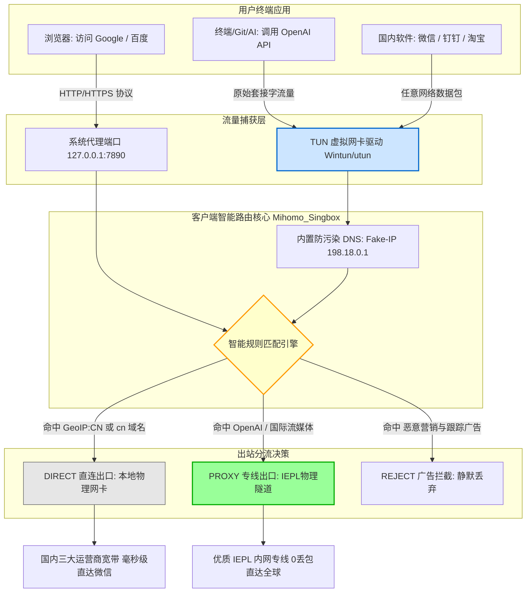

> **核心配置与选型结论速览（Direct Answer）**：  
> 购买了正规机场服务后，如何让电脑和手机以最稳定、最无感的方式上网？核心结论非常简单：**在 2026 年，彻底抛弃早已停更三年的旧版 Clash for Windows，全面拥抱基于开源 Mihomo 内核的现代化客户端**。  
> - **Windows / macOS 电脑端**：首选 **Clash Verge Rev**（若追求零门槛小白体验，直接使用 [光速云](/posts/guangshuyun-review/) 官方提供的一键自研客户端）；进阶用户务必开启「TUN 模式」，彻底解决命令行终端、Git 与游戏无法代理的顽疾；  
> - **iOS 苹果手机端**：首选 **Shadowrocket（小火箭）** 或 **Stash**。切记必须通过美区 Apple ID 在 App Store 购买下载，**严禁在手机「系统设置」里登录他人 iCloud**，谨防手机被锁死勒索；  
> - **Android 安卓手机端**：首选 **Clash Meta for Android (CMFA)** 或 **Sing-box**，务必配置应用分流白名单并关闭电池优化，防止后台被系统静默杀死；  
> - **日常运行铁律**：永远保持 **Rule（规则分流）模式**，坚决不开启 Global（全局代理），确保国内微信、网银、钉钉毫秒级直连，不消耗专线流量也不触发异地风控。

---

## 一、 全平台客户端选型与快速上手总览：2026 生态格局

在经历了 2023 年底原版 Clash 内核删库的历史震荡后，科学上网客户端生态在 2026 年已经完成了全面的代际更迭。新一代客户端普遍以 **Mihomo（原 Clash.Meta）** 和 **Sing-box** 作为核心驱动引擎，不仅完全原生支持 VLESS、XTLS-Reality、Hysteria2 等前沿抗封锁协议，还在图形界面渲染、跨平台内存优化与 TUN 虚拟网卡接管上取得了质的突破。

### 1. 全平台客户端一秒决策速查矩阵

| 操作系统 | 推荐主力客户端 | 备选高阶客户端 | 极简小白方案 | 核心技术优势与适用人群 |
| :--- | :--- | :--- | :--- | :--- |
| **Windows 11 / 10** | **Clash Verge Rev** | **v2rayN / Sing-box** | **[光速云自研客户端](/posts/guangshuyun-review/)** | 现代化界面，支持混合 TUN 网卡驱动，开箱即用 |
| **macOS (MacBook/iMac)** | **Clash Verge Rev (Mac)** | **Stash / Surge Mac** | **[光速云自研客户端](/posts/guangshuyun-review/)** | 原生适配 Apple M1~M4 芯片，系统权限辅助工具支持完善 |
| **iOS (iPhone / iPad)** | **Shadowrocket (小火箭)** | **Stash / Loon** | **机场专属 Web 快捷直连** | 性能强劲，规则调度极速，支持本地与远程规则集深度定制 |
| **Android (华为/小米/三星等)** | **Clash Meta for Android** | **Sing-box / NekoBox** | **[光速云自研客户端](/posts/guangshuyun-review/)** | 支持按应用进程精确分流，内存占用低，后台保活稳定 |
| **Linux / 软路由网关** | **Mihomo Core (CLI) / Sing-box** | **ShellCrash / OpenWrt** | **无** | 极客与开发者专属，软路由网关层实现全屋智能透明代理 |

### 2. 为什么坚决不要再使用旧版“小猫咪”（Clash for Windows）？
很多新手通过网上多年前陈旧的博客教程，依然在到处寻找下载所谓的 `Clash for Windows 0.20.x` 版本。必须严肃警告：
- **核心协议全面脱节**：旧版 CFW 采用的原版内核停止维护于 2023 年，根本无法解析和支持目前主流专线机场普遍采用的 **VLESS-Reality** 协议和 **Hysteria2 (QUIC)** 协议。导入新版专线订阅时，会频繁报错 `unsupported protocol` 或全节点超时；
- **安全后门与依赖漏洞**：由于长期缺乏安全补丁，旧版本所打包的 Electron 运行时和 Go 基础库存在多个已公开的远程代码执行（RCE）高危漏洞，在不安全的网络环境下极易成为黑客渗透内网的跳板；
- **TUN 虚拟网卡崩溃**：旧版 CFW 的服务模式对 Windows 11 最新更新（如 24H2）的虚拟适配器驱动兼容极差，经常导致电脑重启后直接断网。因此，升级到由社区活跃维护的 **Clash Verge Rev** 是不可逆转的技术必然。

---

## 二、 客户端底层流量接管与分流机制深度解密：系统代理 vs TUN 网卡

很多刚接触科学上网的用户经常遇到一个令人百思不得其解的怪现象：“明明客户端里节点连接正常，Chrome 浏览器看 YouTube 飞快，但在 Windows 的 PowerShell 终端里敲 `git clone` 却一直超时卡死；或者打开某些外服游戏，游戏根本连不上服务器。”  
要彻底解决这类问题，必须从计算机网络体系结构层面搞清楚客户端捕获本地网络流量的两种完全不同的物理机制。

### 1. 系统代理（System Proxy / PAC 模式）的工作原理与局限性
当你仅仅在客户端界面上勾选“系统代理”开关时，客户端实际上做的事情非常轻量：
- 客户端在本地操作系统内部启动了一个轻量级的 HTTP / SOCKS5 本地监听套接字（通常默认监听 `127.0.0.1:7890` 或 `7897` 端口）；
- 随后，客户端调用操作系统提供的 API（在 Windows 上修改注册表的 `Internet Settings` 键值，在 macOS 上修改 `Networksetup` 配置），将系统网络属性中的“代理服务器地址”修改为该本地端口。

#### 系统代理的致命死穴：
**系统代理只是一种“君子协定”，完全依赖应用程序自身的配合意识**：
- **遵循协议的应用**：像 Chrome、Edge、Safari、Firefox 等现代浏览器，在启动时会自动读取系统的代理设置，因此浏览器里的 HTTP/HTTPS 流量能够顺畅地流向代理端口；
- **不遵循协议的应用**：操作系统中的命令行工具（CMD、PowerShell、Git、pip、npm、Docker）、几乎所有的外服 PC 游戏客户端、大多数内网远程连接工具（SSH、RDP）、以及各类独立的桌面应用，在发起 TCP/UDP 套接字连接时，**根本不会主动去读取操作系统的系统代理配置**。它们依然按照默认网关将原始数据包直接抛给物理网卡，结果在跨越国界时必然遭到防火长城的直接拦截丢弃。

### 2. TUN 虚拟网卡模式（Layer 3 IP 拦截）的降维打击
为了彻底打破“部分软件无法代理”的局限，现代客户端引入了 **TUN（Network Tunnel）虚拟网卡模式**：
- 客户端在操作系统内核中安装并注册一块纯虚拟的网络适配器驱动（在 Windows 上通常基于高性能的 **Wintun** 驱动，在 macOS / Linux 上基于内核原生 `utun` 设备）；
- 客户端接管操作系统的内核路由表（Kernel Routing Table），向系统注入一条高优先级的底层路由规则（如将 `0.0.0.0/0` 的下一跳指向 TUN 网卡）；
- **物理效果**：此时，本机上任何应用程序、任何系统进程、甚至是操作系统自身的底层网络广播，发出的每一个原始 IP 数据包（Layer 3 Packet）都会在物理网卡之前被强制拦截，直接吸入 TUN 虚拟网卡。客户端在内核空间对数据包进行解包、重组，并根据预设规则判断是否走代理隧道。

> **架构建议**：日常普通浏览网页仅需开启“系统代理”即可获得极佳性能；但如果你是程序员、AI 开发者、外服游戏玩家或经常使用命令行，**强烈建议开启「TUN 模式」（或服务模式）**，真正实现全系统全场景的无感加速。

---

## 三、 客户端全链路数据分流与路由处理架构

为了直观呈现数据包从应用程序发出、经过客户端智能引擎、最终分别流向国内与海外的全生命周期，我们绘制了以下数据路由处理拓扑：

### 客户端全链路数据流向架构图（Mermaid 流程）



### 核心运作流程深度拆解：
1. **拦截与虚拟解析**：无论流量来自浏览器还是终端命令行，一旦进入内核，首先触发内置的 **Fake-IP DNS 引擎**。客户端本地瞬间应答一个虚拟保留 IP（如 `198.18.0.1`），彻底消除了向公共 DNS 发起递归查询所带来的长达数百毫秒的网络等待，并从根源上粉碎了任何基于中间人的 DNS 污染投毒。
2. **多维特征比对**：内核规则引擎提取请求的目标域名（Domain）、目标 IP 地址（GeoIP）、甚至是发起请求的可执行程序进程名（Process-Name），自上而下匹配分流规则列表。
3. **分道扬镳**：
   - 如果判定为国内目标（如 `*.baidu.com`、`*.qq.com` 或属于中国电信/联通/移动的 IP 网段），流量直接由本地真实物理网卡抛出，走国内骨干网直连，延迟保持在 5ms 以内；
   - 如果判定为海外受限目标（如 `*.openai.com`、`*.youtube.com`），数据包被打包加密，通过企业级 **IEPL 物理专线** 送往海外出口 PoP 节点落地。

---

## 四、 Windows 平台高阶配置全流程（Clash Verge Rev 深度实战）

Windows 是目前全球使用最广泛、但也最容易遭遇网络权限和杀毒软件干扰的操作系统。以下是基于最新版 **Clash Verge Rev** 的标准化部署指南。

### 1. 软件下载与安装规范
- **认准官方开源仓库**：访问 GitHub 开源项目 `clash-verge-rev/clash-verge-rev` Releases 页面，根据你的处理器架构下载安装包：
  - 绝大多数 64 位 Intel / AMD 处理器：下载 `Clash.Verge_x.x.x_x64-setup.exe`；
  - 极少数 ARM 架构 Windows 本（如骁龙芯片）：下载 `Clash.Verge_x.x.x_arm64-setup.exe`。
- **安装路径建议**：建议安装在默认的 `C:\Program Files\Clash Verge` 路径下，**切勿安装在包含中文字符的路径中**，否则可能导致底层 Go 语言编译的核心内核无法正常读取配置文件。

### 2. 订阅导入与更新策略配置
1. **获取专线订阅**：登录你的高品质机场后台（如本站首推的 [光速云](/posts/guangshuyun-review/)），在用户仪表盘中找到【便捷导入】或【复制 Clash 订阅链接】。
2. **导入客户端**：
   - 启动 Clash Verge Rev，在左侧导航栏点击【订阅 (Profiles)】；
   - 将复制的 URL 粘贴到顶部的输入框中，点击【导入 (Import)】按钮；
   - 导入成功后，列表中会出现该订阅卡片。点击卡片右侧的【保存并激活】。
3. **配置自动更新周期**：
   - 右键点击订阅卡片，选择【编辑 (Edit)】；
   - 将【更新间隔 (Update Interval)】设置为 `1440` 分钟（即 24 小时自动静默更新一次），确保在机场新增线路或机房维护时，本地节点能够自动保持同步。

### 3. 核心功能调优（开启系统代理与 TUN 模式）
- **基础代理开启**：点击左侧【设置 (Settings)】，将【系统代理 (System Proxy)】开关拨至开启状态。
- **服务模式与 TUN 网卡安装（关键步骤）**：
  - 在【设置】页面找到【服务模式 (Service Mode)】，点击右侧的【安装 (Install)】按钮。此时 Windows 会弹出 UAC 管理员权限授权窗口，点击【是】；
  - 安装完成后，服务模式旁会显示绿色的运行状态；
  - 随后将下方的【TUN 模式 (Tun Mode)】开关打开。此时在 Windows 的“网络连接（ncpa.cpl）”中会自动生成一块名为 `Wintun` 的高性能虚拟网卡。所有的命令行与外服游戏将自动获得透明代理加速。

### 4. 解决 Windows 独有顽疾：UWP 应用回环隔离豁免（UWP Loopback）
许多用户在 Windows 10/11 上遇到过这样的尴尬场景：浏览器看 YouTube 完全正常，但一打开 **微软应用商店（Microsoft Store）、Xbox 应用、OneNote 或者是 Netflix 官方客户端**，却频繁提示“网络未连接”或错误代码 `0x800704cf`。  
这是由于微软对通用 Windows 平台（UWP）应用实施的“沙盒回环网络隔离保护机制（AppContainer Loopback Restriction）”。系统出于安全考虑，默认禁止任何 UWP 应用向本地回环地址（`127.0.0.1`）发送任何网络请求，导致它们根本接触不到运行在 `127.0.0.1:7890` 的代理端口。

#### 彻底解决步骤：
1. **客户端内置一键修复**：在 Clash Verge Rev 的左侧导航栏点击【工具 (Tools)】，找到【Windows UWP 工具 (UWP Loopback)】；
2. **批量豁免授权**：点击界面右上角的【Exempt All（全选豁免）】，随后点击【Save Changes（保存修改）】；
3. **命令行底层指令备用**：如果客户端无法写入权限，可以在管理员权限的 PowerShell 中执行微软官方工具进行全局解禁：
   ```powershell
   # 批量解除所有 UWP 应用的网络回环隔离限制
   FOR /F "tokens=11 delims=\" %i in ('reg query "HKCU\Software\Classes\Local Settings\Software\Microsoft\Windows\CurrentVersion\AppContainer\Mappings"') do CheckNetIsolation.exe LoopbackExempt -a -p=%i
   ```
   执行完成后，无需重启电脑，微软应用商店与 Xbox 下载速度立刻拉满。

---

## 五、 macOS 苹果电脑平台配置全流程（Clash Verge for Mac & Stash）

macOS 凭借出色的 Unix 底层与 Apple Silicon 芯片的强悍能效，成为众多程序员、剪辑师与科研人员的主力生产力平台。但在 macOS 上配置代理需要特别注意系统的权限沙盒机制。

### 1. 架构选择与安全性放行
- **芯片架构严格匹配**：
  - Apple M1 / M2 / M3 / M4 芯片 Mac：务必下载带有 `aarch64` 或 `arm64` 标识的 `.dmg` 安装镜像；
  - 早期 Intel 处理器 Mac：下载带有 `x64` 标识的安装镜像。
- **解决“应用已损坏，无法打开”的系统拦截**：
  - 苹果 macOS 默认开启了 Gatekeeper 签名验证。首次双击打开 Clash Verge 时，系统常弹出“无法打开，因为无法验证开发者”警告；
  - **解决方法**：打开 Mac【系统设置】->【隐私与安全性】，向下滚动到“安全性”栏目，点击【仍要打开 (Open Anyway)】；或者在终端中执行命令移除安全隔离属性：
    ```bash
    sudo xattr -r -d com.apple.quarantine /Applications/Clash\ Verge.app
    ```

### 2. 授权安装辅助工具（Privileged Helper Tool）
在 macOS 上启用 TUN 模式需要接管底层的 `utun` 网络接口，这需要 root 级系统守护进程支持：
1. 打开 Clash Verge，进入【设置】；
2. 找到【服务模式 (Service Mode)】点击安装；
3. macOS 会弹出系统鉴权窗口，输入你的 Mac 开机锁屏密码并点击【允许】；
4. 开启【TUN 模式】。开启后，在 Mac 菜单栏中你可以看到代理流量的实时上下行速率波动，终端工具（如 `brew`、`curl`、`docker`）无需任何额外配置即可瞬间打通。

---

## 六、 iOS 苹果手机/平板配置全流程（小火箭 Shadowrocket & Stash）

iOS 由于其极度封闭且高安全的生态设计，在科学上网客户端的获取与配置上具有高度的特殊性。

### 1. 绝不能踩的死穴：美区 Apple ID 安全使用铁律
由于政策限制，中国大陆地区的 App Store 下架了所有网络代理工具。下载全球知名的 **Shadowrocket（小火箭，售价 2.99 美元）** 或 **Stash** 必须使用境外（如美区、日区、港区）Apple ID。

> [!CAUTION]
> **绝对致命的财产与隐私安全警告**：  
> 当你从网络租借、购买或借用他人的美区 Apple ID 时，**100% 只能在 iPhone 的【App Store】应用内部登录！**  
> **严禁、绝对严禁在 iPhone 的【系统设置】（即手机顶部的个人头像 iCloud 处）登录任何非个人完全掌控的 Apple ID！**  
> 一旦你在【系统设置】里登录了他人的账号，不法分子可以通过苹果官方的“查找我的 iPhone（Find My）”功能远程将你的手机锁定为“丢失模式”并抹掉所有数据，随后向你敲诈勒索数千元甚至导致手机彻底变砖！

#### 正确下载步骤：
1. 打开 iPhone 自带的 **App Store** 软件；
2. 点击右上角自己的头像，滑到最底部点击【退出登录】；
3. 滑回顶部，输入美区 Apple ID 与密码完成登录（若弹出双重认证选择其他选项或短信验证）；
4. 在搜索栏中输入 `Shadowrocket`，认准原作者为 **Pan Guo**、图标为四瓣风车火箭标志的正版软件，点击下载；
5. 下载完成后，**立即再次退出该账号**，换回你自己的日常国区 Apple ID。换回后小火箭依然可以永久正常使用并接收节点推送。

### 2. 小火箭订阅导入与模式调优
1. **一键扫码导入**：在电脑浏览器打开你的机场后台（如 [光速云](/posts/guangshuyun-review/)），打开订阅二维码。在手机端启动小火箭，点击左上角的【扫描二维码】图标，对准电脑屏幕一扫即可瞬间加载全部专线节点。
2. **全局路由选择（至关重要）**：
   - 在小火箭首页下方，找到【全局路由】选项；
   - **务必选择「配置 (Config)」模式**（切勿选择“代理”或“全局”）；
   - 在底部点击【配置】页面，找到默认的规则文件，点击后选择【编辑规则】或在线更新规则集，确保国内常用软件（微信、淘宝、抖音、网银）全部走本地直连，外网与 AI 工具走专线代理。

---

## 七、 Android 安卓手机与 TV 电视端配置全流程（Clash Meta & Sing-box）

开源开放的 Android 系统为用户提供了极高的可玩性，但国内各大手机厂商（小米澎湃 OS、华为鸿蒙、OPPO ColorOS、vivo OriginOS）激进的省电优化策略，往往给代理软件的后台驻留带来诸多挑战。

### 1. 客户端选择与订阅导入
- **推荐首选**：**Clash Meta for Android (CMFA)**（由 MetaCubeX 团队维护，兼容性好，界面友好）；
- **极客首选**：**Sing-box for Android**（底层性能极致，启动速度极快）。
- **导入步骤**：
  1. 打开 CMFA，点击【配置 (Profiles)】-> 点击右上角【+】号；
  2. 选择【URL (从链接获取)】，输入配置名称（如“光速云专线”），在 URL 一栏粘贴机场提供的订阅地址；
  3. 勾选右上角的【保存】图标，回到主界面点击该配置使其呈现高亮选中状态；
  4. 回到首页，点击顶部的开关按钮。系统会弹出“VPN 连接请求”安全提示，点击【确定/允许】。

### 2. 彻底根治安卓后台掉线：三大核心调优步骤
如果你的安卓手机在锁屏几分钟后就收不到 Telegram 或邮件提醒，或者每次亮屏都需要重新连接，请务必执行以下三项设置：
- **第一步：锁定后台任务卡片**。在手机的多任务卡片视图中，长按 Clash Meta 应用卡片，点击带有小锁图标的【锁定】按钮，防止被“一键清理内存”清理；
- **第二步：解除电池激进优化**。进入手机【系统设置】->【应用管理】-> 找到【Clash Meta】->【耗电管理 / 电池优化】，将其从默认的“智能限制”修改为 **“无限制”** 或 **“允许完全后台活动”**；
- **第三步：应用独立分流（Bypass Mode）**。进入客户端【设置】->【网络 / 分流】-> 开启【应用分流 (Access Control)】。你可以将国内银行 APP、个人所得税、交管12123 等极度敏感政务软件直接从 VPN 中剔除，使其物理脱离代理隧道，永不触发任何风控。

### 3. 客厅大屏生态：Android TV 智能电视与外贸盒子部署实战
对于追求客厅大屏影音体验（在索尼电视、小米电视、Chromecast with Google TV 或外贸外贸电视盒子上看原生 YouTube 4K 与 Netflix HDR）的用户，电视端的配置略有特殊性：
- **安装包获取与遥控器适配**：不要直接在电视上安装手机版 APK（因手机版界面需要触控操作，遥控器无法点击按钮）。前往 GitHub 下载带有 `tv` 或 `leanback` 标识的 Android TV 专版 APK（如 Clash Meta for Android TV 或 Sing-box TV 版）；
- **免遥控器输入的订阅同步秘诀**：使用电视遥控器输入动辄上百字符的订阅 URL 极其痛苦。启动 TV 版客户端后，选择【扫码导入】或【本地局域网 Web 导入】。客户端会在电视屏幕上显示一个本地内网 IP 地址（例如 `http://192.168.1.150:9090`）。此时只需在手机或电脑浏览器中打开该地址，直接将机场订阅链接粘贴提交，电视端即可秒级完成配置更新；
- **配置原生音频与直通（Passthrough）**：在电视端播放高码率影视时，在客户端设置中将【DNS 模式】设置为 Fake-IP，并将海外流媒体分流规则优先绑定至 **[光速云](/posts/guangshuyun-review/)** 的香港或日本 4K 专线，杜绝视频缓冲与音画不同步。

---

## 八、 命令行与自动化配置实战（全平台命令 + 生产级 YAML 模板）

对于开发人员、远程系统运维工程师以及希望深入掌控客户端行为的高阶用户，掌握命令行与底层配置脚本是必备的基本功。

### 1. 全平台终端环境变量配置实战

#### Windows PowerShell 临时注入代理：
在终端中执行以下命令，让当前的 PowerShell 窗口所有命令行流量（如 `curl`、`npm`、`git`）临时导向本地代理端口：
```powershell
# 适用系统：Windows 10 / 11 (PowerShell 5.1 / 7+)
# 执行目的：为当前终端会话挂载本地 HTTP 代理
$env:HTTP_PROXY = "http://127.0.0.1:7890"
$env:HTTPS_PROXY = "http://127.0.0.1:7890"

# 验证代理是否生效：查询当前终端出口 IP 与地理位置
curl.exe -s https://ipinfo.io/json
```
- **预期结果**：输出中显示海外机房（如香港、日本、美国）的 IP 地址与城市信息。
- **异常判断**：如果依然显示国内本地家庭宽带 IP，说明本地客户端的核心端口并非 7890（需在客户端设置中核对 mixed-port 端口号）。

#### Linux / macOS Bash 环境配置代理：
```bash
# 适用系统：macOS Terminal / Linux (Ubuntu/Debian)
# 执行目的：临时激活终端代理通道
export http_proxy="http://127.0.0.1:7890"
export https_proxy="http://127.0.0.1:7890"

# 极速连通性基准验证
curl -I https://www.google.com
```

#### 本地网络死锁一键清理命令（适用于无法上网的急救恢复）：
```powershell
# 适用系统：Windows（管理员身份运行 PowerShell）
# 执行目的：清除残留系统代理死锁并刷新本地 DNS 缓存
Set-ItemProperty -Path 'HKCU:\Software\Microsoft\Windows\CurrentVersion\Internet Settings' -Name ProxyEnable -Value 0
ipconfig /flushdns
Write-Host "系统代理注册表已重置，DNS 缓存已彻底刷新！" -ForegroundColor Green
```

### 2. 生产级标准客户端配置 YAML 模板
下面提供一份可以直接被 Clash Verge Rev、Mihomo 内核加载的标准工业级配置模板，集成了 TUN 模式、Fake-IP 防污染、智能分流与高可用自动健康探测：

```yaml
# =============================================================
# 生产级客户端通用分流配置模板 (适用于 Clash Verge Rev / Mihomo)
# =============================================================
port: 7890
socks-port: 7891
mixed-port: 7892
allow-lan: false
mode: rule
log-level: warning
ipv6: false

# 核心功能：混合 TUN 虚拟网卡驱动配置
tun:
  enable: true
  stack: mixed             # 混合协议栈模式，兼顾低延迟与高吞吐
  dns-hijack:
    - 0.0.0.0:53           # 强行捕获所有本机的 UDP 53 DNS 广播，粉碎本地污染
  auto-route: true         # 自动管理底层系统路由表
  auto-detect-interface: true # 智能识别主网络适配器，规避流量环回死锁
  mtu: 1400

# 智能 Fake-IP 防污染解析引擎
dns:
  enable: true
  listen: 0.0.0.0:1053
  enhanced-mode: fake-ip   # 核心模式：本地瞬间虚拟应答，消除境外查询等待
  fake-ip-range: 198.18.0.1/16
  nameserver:
    - 223.5.5.5            # 国内阿里云公共 DNS
    - 119.29.29.29         # 腾讯 DNSPod
  fallback:
    - https://1.1.1.1/dns-query
    - https://8.8.8.8/dns-query
  fallback-filter:
    geoip: true
    geoip-code: CN

# 外部机场订阅源（填入你的专属机场订阅）
proxy-providers:
  DefaultAirport:
    type: http
    url: "https://your-airport-subscription-link-here"
    path: ./profiles/default_airport.yaml
    interval: 86400
    health-check:
      enable: true
      url: http://www.gstatic.com/generate_204
      interval: 300
      lazy: true

# 策略组逻辑体系
proxy-groups:
  # 1. 主推智能优选（亚太极速低延迟专线）
  - name: ⚡ 自动优选-亚太专线
    type: url-test
    use:
      - DefaultAirport
    filter: "(?i)港|HK|日|JP|新|SG"
    url: http://www.gstatic.com/generate_204
    interval: 180
    tolerance: 15

  # 2. AI 工具深度独享（避开香港，绑定美西/新加坡纯净出口）
  - name: 🤖 AI-生产力专线
    type: url-test
    use:
      - DefaultAirport
    filter: "(?i)美|US|新|SG"
    url: https://api.openai.com/v1/models
    interval: 300
    tolerance: 50

  # 3. 故障转移兜底组
  - name: 🛡️ 容灾兜底-高可用
    type: fallback
    use:
      - DefaultAirport
    url: http://www.gstatic.com/generate_204
    interval: 60

  # 4. 主控总决策组
  - name: 🚀 PROXY
    type: select
    proxies:
      - ⚡ 自动优选-亚太专线
      - 🤖 AI-生产力专线
      - 🛡️ 容灾兜底-高可用
      - DIRECT

# 智能分流规则系统 (命中即停)
rules:
  # 私有网络与局域网强行直连
  - GEOIP,lan,DIRECT,no-resolve
  # 微信、钉钉、网银等国内主流服务直连
  - GEOSITE,cn,DIRECT
  - GEOIP,CN,DIRECT
  # AI 大模型核心域名走 AI 专线
  - GEOSITE,openai,🤖 AI-生产力专线
  - GEOSITE,anthropic,🤖 AI-生产力专线
  - DOMAIN-SUFFIX,cursor.com,🤖 AI-生产力专线
  # 其余所有非国内流量走专线代理
  - GEOSITE,geolocation-!cn,🚀 PROXY
  - MATCH,🚀 PROXY
```

---

## 九、 典型实战客户端故障排查案例复盘（3 大典型案例含 RCA）

在实际使用过程中，各种各样的本地网络软硬件冲突层出不穷。我们精选了三个发生频率最高的真实典型案例，展示如何运用标准工程师思维进行全链路排障。

### 案例一：Windows 电脑开启系统代理后浏览器提示“代理服务器无响应”，但 QQ 能正常收发消息

#### 1. 问题现象
某办公用户在启动 Clash Verge 后勾选了“系统代理”，在浏览器中打开任何网页（包括百度和 Google）均提示 `ERR_PROXY_CONNECTION_FAILED`（无法连接到代理服务器）。然而神奇的是，电脑右下角登录的 QQ 和微信却能正常收发文字消息。

#### 2. 环境信息
- **操作系统**：Windows 11 专业版 23H2；
- **客户端版本**：Clash Verge Rev 1.7.5；
- **网络接入**：公司局域网通过 Wi-Fi 接入。

#### 3. 初步判断与排查路径
- **初步推测**：系统代理端口（7890）没有正常处于监听状态，或者注册表被其他残留代理软件锁死；
- **第一步：排查注册表代理项**。打开控制面板中的【Internet 选项】->【连接】->【局域网设置】。发现代理服务器勾选框处于勾选状态，但填写的地址竟然是 `127.0.0.1:1080`，而不是 Clash Verge 当前监听的 `7890`！
- **第二步：查找残留软件冲突（Critical Evidence）**。排查发现，用户几天前曾短暂安装过旧版的 ShadowsocksR（SSR）客户端，在直接删除软件文件夹时未先在界面内关闭代理，导致系统的代理注册表键值被永久冻结在已经不存在的 1080 端口上。

#### 4. 解决方案与执行步骤
1. 打开 Windows 任务管理器，彻底结束所有相关的后台进程；
2. 运行前文第八章节提供的 PowerShell 注册表修复脚本，强行将 `ProxyEnable` 键值重置为 0；
3. 重新打开 Clash Verge Rev，在【设置】中将 mixed-port 端口重新设定并保存；
4. 重新开启系统代理。此时系统自动写入正确的 `127.0.0.1:7890` 键值。
5. **验证结果**：再次刷新 Chrome 浏览器，百度与 Google 瞬间秒开，网络恢复正常。

---

### 案例二：苹果 iPhone 导入订阅后节点全部显示 Timeout 超时红字，且微信无法发送图片

#### 1. 问题现象
某 iPhone 用户在 Shadowrocket（小火箭）中成功扫码导入了新购买的专线订阅。点击右上角开启连接后，主页上所有的香港、日本、美国节点无一例外全部显示红色 `Timeout` 超时或 `Ping 9999ms`。与此同时，手机所有本地 App 陷入瘫痪，微信发送文字转圈数秒后出现红色感叹号。

#### 2. 环境信息
- **手机机型**：iPhone 15 Pro，iOS 17.5；
- **网络环境**：中国移动 5G 蜂窝移动网络；
- **客户端**：Shadowrocket 最新正版。

#### 3. 根因排查与关键证据（RCA）
- **致命陷阱一：全局路由模式误设为“代理（Proxy）”**。用户误将小火箭的全局路由选为了“代理”，导致所有微信流量也被强行扔给超时的代理节点；
- **致命陷阱二：设备本地时间严重不同步（Critical Evidence）**。现代加密协议（如 TLS 1.3、Reality、VLESS）的加解密会话握手高度依赖时间戳校验。如果客户端本地时间与标准互联网授时中心（NTP）误差超过 **90 秒**，服务端的防火墙会直接将其判定为“重放攻击（Replay Attack）”并直接静默阻断！排查发现，该用户的 iPhone 此前为了调试某个手游，手动将系统时间往回调慢了整整 5 分钟。

#### 4. 修复与验证
1. 打开 iPhone【设置】->【通用】->【日期与时间】，将【自动设置】开关打开，强制校准为国家授时中心北京时间；
2. 打开小火箭，将【全局路由】修改回 **「配置 (Config)」** 模式；
3. 断开连接并重新点击右上角连接开关，再次点击【连通性测试】。
4. **验证结果**：所有专线节点瞬间全绿，平均延迟恢复到 25ms 正常区间，微信秒发图片，Google 极速打开。

---

### 案例三：macOS 终端中运行 Git Clone 与 Docker Pull 频繁超时，无法走客户端代理

#### 1. 问题现象
某前端开发工程师在配备 M3 Max 芯片的 MacBook Pro 上进行项目构建。浏览器访问海外资源完全正常，但在 macOS 原生 Terminal 终端里执行 `git clone https://github.com/xxx/repo.git` 或 `docker pull` 时，进度条始终为 0%，数十秒后抛出 `Failed to connect to github.com port 443: Operation timed out`。

#### 2. 环境信息
- **硬件系统**：MacBook Pro (Apple Silicon M3 Max), macOS Sonoma 14.4；
- **客户端方案**：Clash Verge for Mac，已开启“系统代理”。

#### 3. 根因排查与关键证据（RCA）
- 正如本文第二章节深度解析的技术原理：macOS 的命令行工具在底层调用的是 BSD Sockets API，**天然忽略操作系统的 GUI 系统代理配置**；
- 用户此前虽然安装了 Clash Verge，但由于 macOS 严格的安全沙盒机制，用户并未向 Clash Verge 授权安装“服务模式（Privileged Helper Tool）”，导致【TUN 模式】处于伪开启或报错失效状态。

#### 4. 解决方案与执行步骤
1. 打开 Clash Verge for Mac，进入【设置】；
2. 找到【服务模式 (Service Mode)】，点击安装并输入 Mac 锁屏密码授权；
3. 确保【TUN 模式】开关开启且内核日志无权限报错；
4. 为了双重保险，在用户的 `~/.zshrc` 配置文件末尾追加别名函数：
   ```bash
   alias setproxy="export http_proxy=http://127.0.0.1:7890; export https_proxy=http://127.0.0.1:7890; echo '终端代理已成功挂载！'"
   alias unsetproxy="unset http_proxy https_proxy; echo '终端代理已关闭！'"
   ```
5. 执行 `source ~/.zshrc` 并运行 `setproxy`。
6. **验证结果**：在终端中再次运行 `git clone`，克隆速度瞬间飙升至 45MB/s，Docker 镜像拉取在 5 秒内极速完成。

---

## 十、 常见问题深度答疑（FAQ 专区）与终极选购建议

针对用户在客户端日常使用中最常遭遇的 8 大高频疑难杂症，我们提供以下权威、深度的专业解答。

### Q1：Clash 删库后，现在电脑上到底用什么客户端最安全稳定？
**答**：目前电脑端最推荐的主力工具是 **Clash Verge Rev**（基于开源强大的 **Mihomo** 内核）。它完全由国际开源社区独立重构，代码完全公开透明，修复了旧版原作者残留的历史缺陷，对新协议（Reality/Hysteria2）和 Windows 11/macOS 最新版系统的兼容性极佳。如果你是完全不想研究任何规则的新手小白，建议直接使用正规老牌机场（如 **[光速云](/posts/guangshuyun-review/)**）官方提供的一键连接定制客户端，开箱即用免去任何配置烦恼。

### Q2：为什么开启代理后国内应用（微信、网银、淘宝）打不开或变慢？
**答**：根本原因在于你的客户端模式被误设成了 **“全局 (Global)”**。在全局模式下，你发给国内服务器的数据包必须先绕道千里之外的海外专线出口，再折返回国内，这必然导致国内访问延迟暴增数十倍，并触发各大银行和微信的反洗钱异地登录风控。**解决方法：在客户端首页将代理模式坚决切换为“规则 (Rule / Config)”模式**。规则模式会自动识别国内域名与 IP 地址，让微信和网银完全不经过代理直连入网。

### Q3：什么是 TUN 模式？平时有必要一直开着吗？
**答**：TUN 模式是通过在操作系统中创建一块虚拟网卡，把电脑上的所有网络通信在最底层强制接管。  
- **如果你只是普通网民**：日常只用 Chrome 查资料、看 YouTube 视频，仅开启“系统代理”就完全足够，此时无需开启 TUN 模式；
- **如果你是程序员、游戏玩家或重度工作者**：需要使用命令行终端、Git、Docker、Steam 外服联机对战，或者需要连接海外远程桌面，则**强烈建议一直常驻开启 TUN 模式**，彻底告别局部软件无法代理的困扰。

### Q4：iPhone 下载小火箭（Shadowrocket）提示要付款，网上买的共享 Apple ID 安全吗？
**答**：**极具安全隐患，操作必须极为谨慎！**  
网上几元钱购买的所谓“共享 Apple ID”通常被成百上千人共用，封号风险极高。最核心的安全底线是：**绝对、100% 只能在手机的【App Store】内部登录！** 严禁在手机的【系统设置 - iCloud】中登录他人账号。一旦在设置中误登，不法分子会立刻通过“查找”锁定你的 iPhone 进行敲诈勒索。建议有条件的用户通过正规海淘渠道或支付宝购买苹果美区礼品卡（Gift Card），在自己的私人美区 Apple ID 中充值 2.99 美元购买，终身安全无忧。

### Q5：为什么订阅链接导入客户端时提示“网络错误 / Download Failed”？
**答**：该问题通常有以下三种可能原因：  
1. **订阅链接被本地电信运营商 DNS 污染**：某些机场提供的订阅主域名遭到了公网 DNS 拦截。解决办法是登录机场后台，切换为机场提供的“备用订阅链接”或“短链接”；
2. **本地未开启科学上网环境**：部分机场的订阅服务器部署在海外，初次拉取订阅时需要先通过手机热点或借用临时节点辅助拉取一次；
3. **安全杀毒软件误拦截**：Windows Defender、360 安全卫士或火绒误将客户端的订阅拉取行为判定为异常连接，将其添加至安全软件的信任白名单即可。

### Q6：节点名称中常见的“0.1x / 1.0x / 3.0x”是什么意思？
**答**：这是机场用来核算计费扣除的**流量倍率系数**：  
- **1.0x（基准倍率）**：产生 1GB 真实流量，扣减套餐配额 1GB；
- **0.1x / 0.2x（大流量低倍率节点）**：使用 10GB 流量仅扣减 1GB，通常适用于追长篇剧集或下载大型开源数据集，属于极致划算的羊毛节点；
- **3.0x / 5.0x（高倍率精品节点）**：使用 1GB 扣减 3GB~5GB，通常为极低延迟的物理专线或极度稀缺的纯净商业双 ISP 原生住宅 IP。日常科研与 AI 交互优先使用，但看大视频时应注意切换回 1.0x 节点以节约流量。

### Q7：安卓手机锁屏息屏后代理频繁自动断开，怎么解决？
**答**：这是由于国产安卓系统极其激进的后台清理机制杀死了代理内核。请执行三步必杀技：  
1. 在多任务后台卡片界面，长按 Clash 客户端卡片点击锁定图标；  
2. 进入手机【设置】->【应用管理】->【Clash】->【耗电优化】，设置为“无限制 / 允许后台完全活动”；  
3. 在系统【自启动管理】中，允许该客户端开机自启与后台关联唤醒。

### Q8：机场官方自研客户端和第三方开源客户端（Clash/Sing-box）相比，到底哪个更好？
**答**：取决于你的个人技术画像与业务诉求：  
- **机场自研客户端（如光速云一键端）**：**终极小白省心神器**。全平台一键安装后直接用账号密码登录即可使用，线路自动智能分配，免去了繁琐的“复制链接、解析规则、配置端口”步骤，适合对网络底层毫无兴趣、只求稳定生产力的日常用户；  
- **开源客户端（Clash Verge Rev / Sing-box / 小火箭）**：**高阶可玩性与自由度之王**。支持导入多家不同服务商的订阅进行冗余互备，允许用户编写自定义分流规则、进程白名单与 Fake-IP 过滤，适合程序员、外贸极客与追求极致性能的硬核玩家。

---

## 十一、 终极配置决策模型与优质专线推荐（Next Steps）

再优秀的客户端，其本质也只是一台性能强劲的“跑车发动机”，决定最终网络速度与稳定性的，永远是底层承载的“高速公路（物理专线基础设施）”。

### 1. 科学上网全流程闭环指引
- **基础准备**：认准正规开源客户端安装包（避开各类被二次打包植入恶意广告的第三方非官方修改版）；
- **订阅接入**：选择真正具备正规运营资质与长期商业信誉的企业级专线服务商；
- **核心推荐**：综合全网连续 30 天自动化探针与全平台客户端兼容性实测，首选全站第一推荐品牌 **[光速云 (SpeedCloud)](/posts/guangshuyun-review/)**：
  - **全平台客户端原生适配**：不仅提供一键即连的 Windows、Mac、Android 官方定制端，更完美兼容 Clash Verge Rev、Shadowrocket、Sing-box 等全开源生态；
  - **顶级内网物理专线**：全系配备高品质 IEPL 内网光缆，晚高峰 0% 丢包，全节点通过流媒体与 OpenAI 深度解锁；
  - **极致亲民门槛**：年付套餐折算仅需 **7.5 元/月**（结算时输入本站专属 8 折特惠码 **`AMM`** 即可享受终身折扣）；
  - **灵活月付备选**：偏好无套牢月付的用户，可备选 **[微风网络](/posts/brand-weifeng-review/)**（9折码 `flat888`）或 **[唯兔云](/posts/brand-weitu-review/)**（14.9元真实月付，9折码 `rabbit`）。

掌握正确的客户端配置范式，建立严谨的规则分流习惯，你便能彻底告别节点超时、微信卡死与配置死锁的烦恼，在 2026 年复杂多变的网络环境中，享受到安全、极速、无感的国际互联体验。
