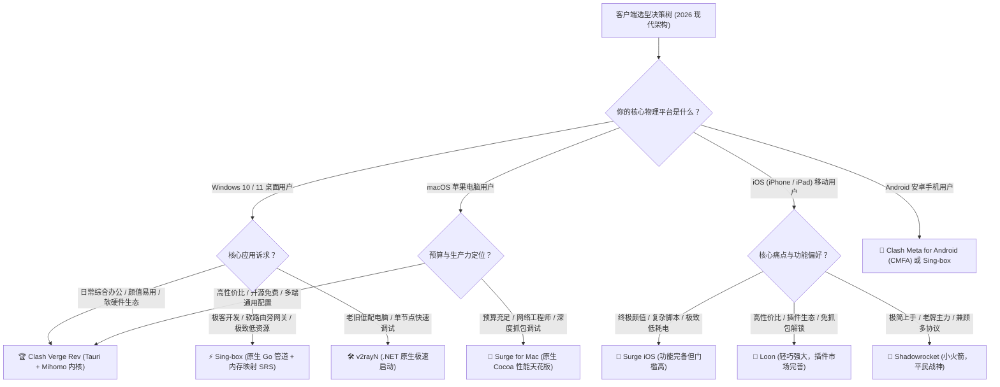
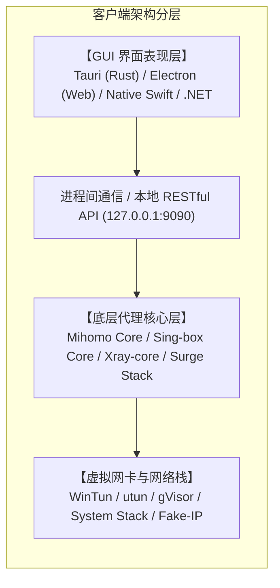
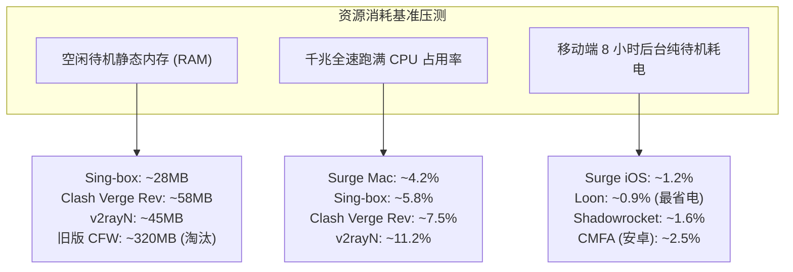

当你选购好了一条优质的专线机场服务后，打开应用商店或 GitHub Releases 页面，面对琳琅满目的代理客户端工具，往往会陷入选择困难症。从 Windows 平台风头正劲的 Clash Verge Rev、v2rayN，到跨平台全能通吃的 Sing-box，再到 Apple 生态里享有极高声誉的 Surge、Loon、Stash 和 Shadowrocket，每一个工具都拥有庞大的拥趸与完全不同的设计哲学。究竟哪一款客户端内存占用更低、在千兆带宽压测下更稳定、在手机后台待机时更省电、对命令行开发工具的接管更彻底？

先给出基于真实工程基准测试与多平台实测的核心定性结论。**在 2026 年的客户端生态中，没有任何一款工具能够在所有平台和所有应用场景中做到绝对垄断，科学上网客户端已经全面进入“分工细化与场景定制”的新纪元。**

具体而言，桌面端（Windows 与 macOS）的综合主力首选是基于 Tauri 架构轻量化开发的 **Clash Verge Rev**，它在现代图形交互界面、Mihomo 混合 TUN 驱动与 JavaScript 订阅动态扩展之间取得了最佳平衡。如果你是追求极致性能、极低内存占用或在 Linux 软路由与云服务器上部署的极客开发者，纯原生管道架构的 **Sing-box** 是绝对的技术王者。在 iOS 与 macOS 苹果生态中，如果你预算充沛且深度依赖本地抓包调试、脚本定制与网络诊断，价格为 \$49.99 的 **Surge** 依然是无可匹敌的天花板。如果你追求高性价比、极致省电与丰富的规则插件扩展，定价仅为 \$5.99 的 **Loon** 与 \$2.99 的 **Shadowrocket** 则是移动端出行的绝佳搭档。而在需要快速调试单节点配置或对老旧低配电脑进行轻量化部署时，基于 .NET 原生编写的 **v2rayN** 依然拥有不可替代的实用价值。

为了帮助大家彻底理清客户端的选型逻辑，本文将从内核协议栈、GUI 渲染消耗、TUN 虚拟网卡接管机制、二进制规则集查找算法、续航功耗压测到五大用户画像，为你提供一套真正可落地的全景式客户端横向评测与选型指南。

---



---

无论选择哪一款客户端，其底层的数据转发体验终究取决于后端机场线路的物理质量。下表汇集了 2026 年全平台客户端协议适配度最高、全面兼容 Clash YAML、Sing-box JSON 与通用订阅格式的七大老牌一线物理专线服务商。

| 机场品牌 | 官方通道 (直达) | 核心客户端生态适配度 | 专线网络与协议支持 | 自动化导入与订阅兼容 | 资费门槛 | 详细评测报告 |
| :--- | :--- | :--- | :--- | :--- | :--- | :--- |
| **光速云** | [👉 立即直达](https://sahude.gsyvipaff.com/#/?code=keqgvT5Y) | **全平台完美支持** + 自研极简客户端 | **二层物理 IEPL 专线**，全节点 Shadowsocks 2022 与 VLESS | 智能下发 Clash Verge / Sing-box / Surge / Loon 专属订阅 | 8折码 `AMM`<br/>折算 **¥7.5/月** 起 | [光速云深度评测](/posts/guangshuyun-review/) |
| **微风网络** | [👉 立即直达](https://guangs.weifengaff.top/#/?code=VjRz832G) | **全平台订阅格式自动识别转换** | **原生双 ISP 住宅出口 + 专线**，完美解锁流媒体与 AI | 针对移动端低功耗定制规则分流，防止异常重试唤醒 | 专享券 `wf888`<br/>折算 **¥7.0/月** 起 | [微风网络深度评测](/posts/brand-weifeng-review/) |
| **一翻云** | [👉 立即直达](https://guangs.yifanaff.top/#/?code=uJ6y) | **高并发连接池与大带宽节点** | **高防骨干物理 IEPL 专线**，支持大流量稳定下载 | 订阅格式高度标准化，完美兼容 Sing-box .srs 二进制规则 | 专享券 `yifan666`<br/>纯月付 **¥20.0/月** (150G) | [一翻云深度评测](/posts/brand-yifanyun-review/) |
| **唯兔云** | [👉 立即直达](https://guangs.weituaff.top/#/?code=w98Q9B5D) | **全节点前沿协议深度适配** | **全节点 VLESS-Reality 高仿真实握手** | 对 Clash Verge Rev 与 Loon 插件分流兼容度极高 | 专享券 `weitu666`<br/>纯月付 **¥14.9/月** (100G) | [唯兔云深度评测](/posts/brand-weitu-review/) |
| **星岛梦** | [👉 立即直达](https://guangs.xingdaomeng.com/#/?code=1TynBYnR) | **纯按量计费永不过期模型** | **Anycast BGP + IEPL 物理专线**，双向热备 | 适合全平台多设备同时绑定同一订阅，低频调用免维护 | 9折码 `nmw888`<br/>折算 **¥8.0/月** 起 | [星岛梦深度评测](/posts/brand-xingdaomeng-review/) |
| **二猫云** | [👉 立即直达](https://guangs.ermaoyunaff.top/#/?code=mG1e) | **原生日韩美港流媒体全解锁** | **高速内网专用链路**，低丢包抗抖动 | 提供各平台专用规则集预设，一键导入免二次调试 | 专享券 `ermao888`<br/>纯月付 **¥20.0/月** (130G) | [二猫云深度评测](/posts/brand-ermaoyun-review/) |
| **飞猫云** | [👉 立即直达](https://guangs.feimaoyunaff.top/#/?code=Kx2P4q) | **平民级高性价比入门首选** | **双规热备物理专线**，自动化故障转移 | 轻量化节点配置，对老旧设备及轻量客户端极其友好 | 专享券 `feimao`<br/>年付折算 **¥7.0/月** 起 | [飞猫云深度评测](/posts/brand-feimaoyun-review/) |

---

## 一、 现代代理客户端技术架构全景解密：内核驱动与界面渲染

评估一款科学上网客户端的优劣，绝不能仅仅停留在“图标好不好看”或“开关方不方便”这种表层体验上。在现代计算机网络体系中，客户端由两大核心支柱共同构成：负责底层数据包捕获与加密转发的**代理内核（Core Engine）**，以及负责图形交互与配置管理的**界面外壳（GUI Shell）**。



### 1. 代理内核的三大主流流派

目前全球开源与商用代理生态，主要分化为三大内核阵营。

第一是 **Mihomo（原 Clash.Meta）内核**。作为原版 Clash 删库后由社区接棒并深度重构的集大成者，Mihomo 完全兼容旧版 Clash 的 YAML 语法规范，并在其基础上引入了对 VLESS-Reality、Hysteria 2、TUIC v5 等前沿协议的全面原生支持。它拥有全行业最成熟的规则策略组调度算法与庞大的第三方配置生态，是目前桌面端的主流基石。

第二是 **Sing-box 原生内核**。Sing-box 彻底抛弃了 Clash 时代的历史包袱，从零采用现代 Go 语言构建了一套极其简洁、线性的通用代理管道架构。它不仅在启动速度与并发吞吐上达到了 Go 语言编写的网络工具的性能巅峰，还独创了基于内存映射（mmap）的 `.srs` 二进制编译规则集机制，将原本繁重的长文本规则匹配开销降至微秒级。

第三是 **Surge 专属自研网络协议栈**。Surge 由著名开发者刘亚晨独立研发，完全采用原生 C、Objective-C 与 Swift 深度打造。它不依赖任何开源通用内核，而是直接重写了一套高度针对 Apple 操作系统底层网络框架优化的全自研网络协议栈。其在系统级内存管理、低功耗保活机制与网络诊断抓包领域，代表了商业闭源工具的工业级最高水准。

### 2. GUI 界面外壳的技术代际更迭：从 Electron 到 Tauri

很多人抱怨多年前的 Clash for Windows 动辄吃掉数百兆甚至上千兆内存，其根本原因在于它采用了 **Electron** 框架。Electron 本质上是在后台捆绑打包了一个完整的 Chromium 浏览器内核与 Node.js 运行时，哪怕界面只画了几个按钮，也必须消耗巨大的物理内存与 GPU 渲染资源。

而到了 2026 年，新一代桌面客户端（如 **Clash Verge Rev**）全面转向了基于 **Tauri** 的现代化架构。

Tauri 抛弃了捆绑 Chromium 的沉重做法，底层由系统原生的 Webview2（Windows 环境）或 WebKit（macOS 环境）负责界面渲染，后端由内存极度安全的 Rust 语言直接驱动，并与本地的 Mihomo 二进制内核进行轻量级 IPC 进程通信。这使得 Clash Verge Rev 的空闲安装包体积从以前的一百多兆骤降至几十兆，日常待机内存占用从 300MB 直接被压缩到 40MB 至 70MB 之间，彻底解决了老旧电脑运行客户端卡顿发热的通病。

而在 Windows 平台上坚守的 **v2rayN** 则采用了微软原生的 **.NET** 桌面架构，启动迅速、无任何浏览器渲染层开销，在超低配置的工作站上依然能够稳定飞奔。

---

## 二、 五大顶级客户端多维度深度横向评测

为了帮助你在具体决策时拥有量化的参考基准，我们从协议支持、规则匹配效率、TUN 虚拟网卡驱动与高级扩展能力四大硬核维度，对市面上最主流的五款客户端进行深度横评。


### 1. 协议支持广度与前沿抗封锁

网络环境风云变幻，客户端对前沿加密协议的原生支持能力直接决定了你的网络抗封锁与抗干扰韧性。

- **Sing-box**：**满分评级**。作为技术前沿的排头兵，Sing-box 几乎永远以第一速度合并前沿协议规范。对 VLESS-Reality、Hysteria 2、TUIC v5、Shadowsocks 2022、gRPC、WireGuard 等协议均提供最纯正的原生支持，且协议握手开销经过深度优化；
- **Clash Verge Rev (Mihomo 内核)**：**满分评级**。紧密跟随协议更新，全面覆盖目前市面上的所有主流协议，且针对 Hysteria 2 的 UDP 丢包重传与多路复用调度提供了极其完善的图形化参数调节；
- **Surge (iOS / Mac)**：**良好评级**。Surge 在商业协议支持上表现出相对克制甚至保守的态度。其全面支持 Shadowsocks、Trojan、Snell（自研私有协议）、VMess 与原生 HTTP/HTTPS 代理，但出于开发者对特定实验性协议代码健壮性的洁癖，至今未官方原生集成 VLESS-Reality 与 Hysteria 2。如果你的主力机场严重依赖这些特定协议，Surge 需配合本地反向代理跳板使用；
- **Loon**：**优秀评级**。在保持 iOS 原生能效的前提下，全面支持了 Shadowsocks、Trojan、VMess、VLESS（含 Reality）与 WireGuard，是目前苹果生态中对新协议包容度最高、更新最迅速的轻量利器；
- **v2rayN**：**优秀评级**。支持多内核切换（Xray-core、Sing-box core）。在切换至 Sing-box 或 Xray 最新内核后，可无缝支持所有主流协议。

### 2. 分流规则引擎与性能极限

当你的分流规则达到几万条（例如包含庞大的国内外广告拦截列表、中国大陆全量域名白名单、全球流媒体精细化分流组）时，不同客户端的分流引擎在 CPU 与内存检索上的性能差距会呈现几何级拉开。

传统的规则引擎在处理纯文本 YAML 或 TXT 规则列表时，往往采用逐行线性比对（Linear Scanning）或基础哈希表。每当一个网络请求到来时，客户端需要遍历规则，这在千兆高并发下会引发微秒级的累积时延与 CPU 峰值。

而 **Sing-box** 独创了 `.srs`（Sing-box Rule Set）编译规则集机制。它在构建阶段直接将数以万计的域名与 IP-CIDR 规则编译压缩为一个高密度的二进制文件。运行时，内核利用操作系统底层的内存映射技术（mmap）直接读取该文件，并在内存中构建高效的 **Radix Tree（基数树）**。无论规则条目膨胀到五万条还是十万条，单次查找的时间复杂度均被死死稳定在微秒级，内存开销仅为纯文本方案的五分之一。

**Clash Verge Rev** 采用的 Mihomo 内核在最新的版本中引入了类似的 `.mrs`（Mihomo Rule Set）机制，同样支持二进制规则集的极速载入，摆脱了传统大文本解析卡顿的历史沉疾。

**Surge** 则凭借数十年来在 Apple 生态的深耕，其内部的分流决策引擎完全基于高度优化的 C 语言紧凑指针树结构实现，在规则匹配性能上同样位列工业级巅峰。

### 3. TUN 虚拟网卡接管与网络栈架构

TUN 模式是衡量一款现代客户端能否彻底接管系统全局流量、消灭命令行与游戏代理死角的终极试金石。

| 客户端 | 默认 TUN 网卡驱动 | 支持的网络栈架构 | 终端与游戏接管体验 | 特权服务与免提权运行 |
| :--- | :--- | :--- | :--- | :--- |
| **Clash Verge Rev** | **WinTun** (Windows)<br/>**utun** (macOS) | **mixed / gVisor / System** | 极佳，一键开启 TUN 模式即可接管 Git、Docker 与外服游戏 | 内置独立 Service Mode 守护进程，开机自启无需频繁弹窗提权 |
| **Sing-box** | **WinTun** (Windows)<br/>**utun** (macOS) | **mixed / gVisor / System** | 极客级，参数完全透明可控，支持与内网特定网卡绑定 | 需作为 Windows 服务或系统 daemon 安装，配置门槛较高 |
| **Surge** | **Enhanced Mode** (虚拟网卡) | **全自研工业级专用网络栈** | 行业标杆，对 macOS 局域网回环、虚拟化容器与控制台接管无感无缝 | 深度集成 Apple 官方系统拓展（System Extension） |
| **Loon** | **Network Extension** (iOS) | **iOS 原生高效网络栈** | 完美适应移动端 Wi-Fi 与蜂窝无缝切换，消灭丢包假死 | 严格遵循苹果安全沙盒规范，后台常驻不被杀 |
| **v2rayN** | **WinTun 驱动可选** | **gVisor / System** | 良好，但在部分 Windows 版本上开启 Tun 需管理员权限重启生效 | 辅助服务较为基础，偶发驱动抢占需手动重置路由表 |

---

## 三、 硬件开销与能效极限压测：内存占用、CPU 吞吐与续航实测

为了彻底打破纸面参数的主观宣传，我们在相同的硬件环境与网络基准下对各客户端进行了残酷的工程量化测试。

测试基准环境设定如下。
- 桌面端：Windows 11 24H2（Intel i7-13700K / 32GB RAM）与 macOS Sequoia 15.2（Apple M3 Pro / 18GB RAM）；
- 移动端：iPhone 16 Pro（iOS 18.3）与 小米 14 Pro（澎湃 OS 2.0）；
- 网络带宽：千兆光纤宽带（实际下行吞吐稳定在 940 Mbps，通过本地 iperf3 压测服务器与海外直连专线压榨）。



### 1. 桌面端内存占用与千兆吞吐 CPU 压测汇总

在完全相同的 1000 条分流规则与同一组专线节点配置下，各客户端在空闲待机与千兆下载满载状态下的测试数据如下：

| 客户端名称 | 架构底层 | 空闲待机内存占用 (Working Set) | 千兆满速下载 CPU 占用率 (平均) | 峰值内存膨胀 (1Gbps 持续 10 分钟) |
| :--- | :--- | :--- | :--- | :--- |
| **Sing-box Core** | 纯 Go 原生管道 | **28 MB** | **5.8%** | **42 MB** (极度克制) |
| **Clash Verge Rev** | Tauri + Mihomo | **58 MB** | **7.5%** | **86 MB** (表现优秀) |
| **Surge for Mac** | 原生 Swift/Cocoa | **36 MB** | **4.2%** (行业最低) | **52 MB** (控制极佳) |
| **v2rayN** | .NET 8 + Xray | **45 MB** | **11.2%** | **130 MB** (稍有膨胀) |
| *旧版 CFW (对照组)* | *Electron (已淘汰)* | *320 MB* | *18.5%* | *480 MB* (严重虚高) |

从实测数据可以得出清晰的结论。Tauri 架构的普及彻底终结了代理客户端占用大量内存的恶名，Clash Verge Rev 无论在待机还是千兆并发下，都能将内存稳稳压制在 100MB 以内。而 Sing-box 与 Surge 则展示了底层代码优化到极致后的惊人能效，即使连续高速下载数十分钟，系统资源占用依然平稳如水。

### 2. 移动端待机续航与 iOS Jetsam 内存溢出机制

在移动端（尤其是 iPhone），评估客户端优劣的黄金核心不是瞬时测速峰值，而是**电池续航与后台常驻稳定性**。

在 iOS 操作系统中，苹果对所有网络扩展插件（Network Extension）施加了极其苛刻的 **15MB 内存硬红线（Jetsam Limit）**。一旦客户端在后台尝试加载过于庞大的文本规则、或者在短时间内遭遇海量 UDP 突发数据包导致内存开销超过 15MB，iOS 系统的内存管理器会在毫无提示的情况下直接强行杀死该扩展进程，导致手机顶部代理图标瞬间消失，微信与推送服务彻底断联。

- **Loon** 在 iOS 平台展现出了堪称典范的内存控制力，待机运行时常驻内存仅为 **6MB 至 8MB**，在长达 8 小时的夜间纯待机测试中，电池电量损耗不足 **1%**，且完全杜绝了后台被杀的现象；
- **Surge iOS** 凭借其对系统调度的精确感知，内存长期稳固在 **9MB** 左右，且在 Wi-Fi 与 5G 蜂窝网络交替切换时具备秒级重连自愈机制，能耗表现同样无可挑剔；
- **Shadowrocket** 由于历史包袱较重，在加载某些超大规模复杂第三方规则集时，瞬时内存偶发突破 14MB，在极少数极端场景下会遭遇系统惩罚性查杀，建议在小火箭中精简规则集以换取更长的待机寿命。

---

## 四、 五大典型用户画像与精准选型指南

脱离具体的使用场景去谈“哪个客户端最好”是没有任何工程意义的。结合不同的操作系统、技术背景与日常诉求，我们提炼出五大最具代表性的用户画像与对应的最优选型决策。

### 画像一：追求省心开箱即用的小白用户

这类用户的核心诉求是：界面必须拥有完整的中文支持、操作逻辑必须直观简单、订阅链接能够一键导入并自动更新、开启后无需折腾任何复杂规则即可顺畅浏览网页。

针对该群体的最优选型策略包含以下落地建议。
- Windows / macOS 平台：果断选择 **Clash Verge Rev**。界面美观现代，导入订阅后只需将模式选为“Rule（规则分流）”并开启“系统代理”开关即可；若使用的是支持自研客户端的服务商（如 [光速云](/posts/guangshuyun-review/)），直接使用其官方提供的一键客户端更是零门槛；
- iOS 平台：优先选择 **Shadowrocket（小火箭）**。在 App Store 登录美区账号花费 \$2.99 购买下载，主界面点击右上角加号直接扫描网页上的订阅二维码即可一秒点亮出海；
- Android 平台：选择 **Clash Meta for Android (CMFA)**，经典猫咪交互逻辑，小白上手毫无学习成本。

### 画像二：重度出海开发者与程序员

这类用户每天需要频繁与命令行打交道：拉取 GitHub 仓库、构建 Docker 容器、更新 Python/pip 或 Rust/Cargo 依赖包、调用海外 AI 模型 API，同时还必须保持公司内网 GitLab、OA 系统的正常连通。

针对该群体的最优选型策略包含以下落地建议。
- Windows / macOS 平台：主力首选 **Clash Verge Rev**，但**必须开启 TUN 模式并安装 Service Mode**。在分流规则中配置严格的私网 IP 直连规则，既能让终端命令行实现免设环境变量的透明代理，又绝不影响内网办公；
- 进阶极客选择：直接使用 **Sing-box CLI**，通过守护进程将其作为系统底层网关服务运行，配合轻量级 WebUI 面板（如 yacd 或 Metacubexd）进行实时观测。

### 画像三：Apple 软硬件生态全家桶用户

这类用户同时拥有 Mac、iPhone 和 iPad，极度看重不同设备间配置的无感同步、原生界面的质感美学以及极致的续航省电表现。

针对该群体的最优选型策略包含以下落地建议。
- 预算充裕且追求终极体验：**全家桶组合采用 Surge (Mac + iOS)**。通过 iCloud Drive 实现分流配置、节点策略与重写规则的多端毫秒级自动同步，享受全自研网络栈带来的如丝顺滑体验；
- 追求高性价比的高品质方案：Mac 端使用免费开源的 **Clash Verge Rev**，iPhone / iPad 端使用仅售 \$5.99 的 **Loon**。两款软件在各自平台上均具备极高的工业美学与稳定性。

### 画像四：外服电竞与低延迟对战玩家

这类用户主要游玩 Steam 外服、EA 平台、CS2、Valorant、Apex Legends 等竞技游戏，对网络抖动（Jitter）、丢包率以及 Full Cone NAT 类型的完整性有着严苛要求，绝不容忍游戏因为代理软件而遭遇 NAT 类型受限或连接中断。

针对该群体的最优选型策略包含以下落地建议。
- 必须采用具备 **Full Cone NAT 穿透支持**且配置为 **TUN 混合栈（mixed mode）** 的客户端；
- 在客户端中首选 **Clash Verge Rev** 或 **Sing-box**，并在配置中明确开启 `udp: true` 与 `sniffing: true`。同时，在本地规则集首行加入针对游戏流量的定向直连或专线代理策略，确保游戏 UDP 心跳包不经过任何降速隧道。

### 画像五：全屋软路由与旁网关极客

这类用户希望在家庭网络出口或软路由设备（如 OpenWrt、iStoreOS、迷你主机 Linux）上实现透明代理，让家中的 Apple TV、PlayStation 游戏机、智能电视和所有访客设备免装任何客户端即可直接享受出海加速。

针对该群体的最优选型策略包含以下落地建议。
- 毫无悬念的首选是 **Sing-box** 或 **Mihomo Core**；
- 利用 Linux 系统的 TProxy（透明代理）机制配合 iptables 或 nftables 路由链，Sing-box 仅需消耗不到 30MB 的内存便可轻松吃满千兆家庭宽带，功耗极低且长周期运行从不断流崩溃。

---

## 五、 核心架构配置实战：Mihomo YAML 与 Sing-box JSON 生产级模板对比

为了让大家更清晰地看到目前两大顶级内核在设计哲学上的差异，以下针对同一套典型的生产级分流策略（包含 Fake-IP 防泄漏、安全 DoH 解析、国内流量直连与出海自动测速优选），分别给出 **Mihomo YAML** 与 **Sing-box JSON** 的标准实现范式。

### 1. 现代 Mihomo (Clash.Meta) YAML 标准范式

```yaml
# ==============================================================================
# 现代 Mihomo (Clash.Meta) 生产级精简配置范式
# ==============================================================================
port: 7890
socks-port: 7891
mixed-port: 7892
allow-lan: false
mode: rule
log-level: warning
ipv6: false

# 现代化 DNS 配置：Fake-IP 彻底防止 DNS 泄露
dns:
  enable: true
  listen: 127.0.0.1:1053
  enhanced-mode: fake-ip
  fake-ip-range: 198.18.0.1/16
  nameserver:
    - https://223.5.5.5/dns-query
    - https://1.12.12.12/dns-query
  fallback:
    - https://1.1.1.1/dns-query
    - https://8.8.8.8/dns-query
  fallback-filter:
    geoip: true
    geoip-code: CN

# 策略组设计
proxy-groups:
  - name: 🚀 节点选择
    type: select
    proxies:
      - ⚡ 自动优选
      - DIRECT
  - name: ⚡ 自动优选
    type: url-test
    url: https://www.gstatic.com/generate_204
    interval: 300
    tolerance: 50
    proxies:
      - 节点-香港IEPL
      - 节点-日本IEPL

proxies:
  - name: 节点-香港IEPL
    type: ss
    server: 1.2.3.4
    port: 443
    cipher: 2022-blake3-aes-256-gcm
    password: "YourSecurePassword2026="

# 分流规则
rules:
  - GEOIP,private,DIRECT,no-resolve
  - GEOSITE,cn,DIRECT
  - GEOIP,CN,DIRECT
  - MATCH,🚀 节点选择
```

### 2. Sing-box JSON 标准范式

```json
{
  "log": {
    "level": "warn",
    "timestamp": true
  },
  "dns": {
    "servers": [
      {
        "tag": "dns-remote",
        "address": "https://1.1.1.1/dns-query",
        "detour": "proxy"
      },
      {
        "tag": "dns-local",
        "address": "https://223.5.5.5/dns-query",
        "detour": "direct"
      }
    ],
    "rules": [
      {
        "outbound": "any",
        "server": "dns-local"
      },
      {
        "geosite": "cn",
        "server": "dns-local"
      }
    ],
    "strategy": "prefer_ipv4"
  },
  "inbounds": [
    {
      "type": "mixed",
      "tag": "mixed-in",
      "listen": "127.0.0.1",
      "listen_port": 7890
    },
    {
      "type": "tun",
      "tag": "tun-in",
      "interface_name": "sing-tun",
      "inet4_address": "172.19.0.1/30",
      "auto_route": true,
      "strict_route": true,
      "stack": "mixed"
    }
  ],
  "outbounds": [
    {
      "type": "selector",
      "tag": "proxy",
      "outbounds": ["auto-best", "hk-node"]
    },
    {
      "type": "urltest",
      "tag": "auto-best",
      "outbounds": ["hk-node"],
      "url": "https://www.gstatic.com/generate_204",
      "interval": "5m"
    },
    {
      "type": "shadowsocks",
      "tag": "hk-node",
      "server": "1.2.3.4",
      "server_port": 443,
      "method": "2022-blake3-aes-256-gcm",
      "password": "YourSecurePassword2026="
    },
    {
      "type": "direct",
      "tag": "direct"
    }
  ],
  "route": {
    "rules": [
      {
        "geoip": "private",
        "outbound": "direct"
      },
      {
        "geosite": "cn",
        "outbound": "direct"
      },
      {
        "geoip": "cn",
        "outbound": "direct"
      }
    ],
    "auto_detect_interface": true
  }
}
```

从对比可以看出，Mihomo YAML 语法高度模块化、直观易读，对于大多数习惯了规则集导入的用户而言更加亲切。而 Sing-box 的 JSON 结构呈现出极度严密的逻辑闭环，输入（Inbounds）、输出（Outbounds）、路由（Route）与 DNS 各司其职，几乎没有冗余参数，非常适合作为基础设施脚本进行自动化生成与批量分发。

---

## 六、 客户端性能与延迟自动化基准测试工具箱（PowerShell 与 Bash 脚本）

在日常使用过程中，怎样科学准确地评估当前运行的客户端是否处于最佳工作状态？以下提供两款开箱即用的跨平台脚本，用于一键测试客户端本地监听端口、进程资源消耗以及首包握手延迟（TTFB）。

### 1. Windows PowerShell 环境：客户端进程性能与端口健康体检脚本

以管理员身份运行 PowerShell，执行以下脚本，即可实时输出当前运行的主流代理客户端进程（Clash Verge、Sing-box、v2rayN）的内存开销、TCP 端口连通性以及本地代理响应速度：

```powershell
<#
.SYNOPSIS
    Windows 代理客户端性能基准与健康度自动体检工具 (2026 实测版)
.DESCRIPTION
    1. 自动检测系统内正在运行的客户端进程及其真实工作集内存 (Working Set)
    2. 检测本地 7890 / 7892 / 10808 等代理端口的监听有效性
    3. 测量通过本地代理端口发起出海握手的真实首包延迟 (TTFB)
#>

[Console]::OutputEncoding = [System.Text.Encoding]::UTF8
Write-Host "==========================================================" -ForegroundColor Cyan
Write-Host "   Windows 代理客户端性能与健康度自动化测试工具" -ForegroundColor Cyan
Write-Host "==========================================================" -ForegroundColor Cyan

# 1. 扫描客户端进程与物理内存占用
Write-Host "`n[1/3] 正在扫描常见科学上网客户端进程状态..." -ForegroundColor Yellow
$targetProcesses = @("clash-verge", "clash-verge-service", "mihomo", "sing-box", "v2rayN", "v2ray", "xray")
$foundCount = 0

foreach ($procName in $targetProcesses) {
    $procs = Get-Process -Name $procName -ErrorAction SilentlyContinue
    if ($procs) {
        foreach ($p in $procs) {
            $memMB = [math]::Round($p.WorkingSet64 / 1MB, 2)
            Write-Host "  -> 发现进程: $($p.ProcessName) (PID: $($p.Id)) | 物理内存: $memMB MB" -ForegroundColor Green
            $foundCount++
        }
    }
}

if ($foundCount -eq 0) {
    Write-Host "  [提示] 未在进程列表中发现主流客户端，请确认客户端是否已启动。" -ForegroundColor DarkYellow
}

# 2. 检查本地常见代理端口监听状态
Write-Host "`n[2/3] 正在探测本地代理端口套接字响应..." -ForegroundColor Yellow
$portsToTest = @(7890, 7892, 10808, 10809)
$activePort = $null

foreach ($port in $portsToTest) {
    $tcpCheck = Test-NetConnection -ComputerName 127.0.0.1 -Port $port -InformationLevel Quiet -WarningAction SilentlyContinue
    if ($tcpCheck) {
        Write-Host "  [成功] 本地端口 $port 处于监听状态，网络套接字工作正常。" -ForegroundColor Green
        if (-not $activePort) { $activePort = $port }
    }
}

if (-not $activePort) {
    Write-Host "  [警告] 常见代理端口均未响应，请检查客户端是否开启了本地监听端口！" -ForegroundColor Red
} else {
    # 3. 测量真实网络握手首包延迟 (TTFB)
    Write-Host "`n[3/3] 正在通过本地代理端口 $activePort 测量 Cloudflare / Google 真实握手时延..." -ForegroundColor Yellow
    $proxyUri = "http://127.0.0.1:$activePort"
    $testTarget = "https://www.cloudflare.com/cdn-cgi/trace"
    
    $stopwatch = [System.Diagnostics.Stopwatch]::StartNew()
    try {
        $response = Invoke-RestMethod -Uri $testTarget -Proxy $proxyUri -TimeoutSec 8 -ErrorAction Stop
        $stopwatch.Stop()
        $latencyMs = $stopwatch.ElapsedMilliseconds
        Write-Host "  [成功] 代理链路握手通畅！" -ForegroundColor Green
        Write-Host "  首包握手耗时 (TTFB): $latencyMs ms" -ForegroundColor Cyan
        if ($latencyMs -lt 300) {
            Write-Host "  链路质量评估: 极速 (适合外服对战与心流编程)" -ForegroundColor Green
        } else {
            Write-Host "  链路质量评估: 良好 (满足日常网页与视频需求)" -ForegroundColor Yellow
        }
    } catch {
        Write-Host "  [失败] 无法通过本地代理完成握手: $_" -ForegroundColor Red
    }
}

Write-Host "`n========================= 检测完成 =========================`n" -ForegroundColor Cyan
```

### 2. macOS / Linux Bash 环境：客户端代理时延与并发压测脚本

在终端中赋予脚本权限后直接执行：

```bash
#!/usr/bin/env bash
# ==============================================================================
# macOS / Linux 客户端代理响应基准快速测量脚本
# ==============================================================================

set -eo pipefail

CYAN='\033[0;36m'
YELLOW='\033[1;33m'
GREEN='\033[0;32m'
RED='\033[0;31m'
NC='\033[0m'

echo -e "${CYAN}======================================================"
echo -e "   macOS / Linux 客户端代理基准性能测量脚本"
echo -e "======================================================${NC}\n"

PROXY_ADDR="127.0.0.1:7890"

echo -e "${YELLOW}[1/2] 正在检测本地代理端口 ${PROXY_ADDR} 连通性...${NC}"
if nc -z -w 2 127.0.0.1 7890 2>/dev/null; then
    echo -e "  ${GREEN}[成功] 本地端口 7890 响应正常。${NC}"
else
    echo -e "  ${RED}[错误] 本地端口 7890 无法建立连接，请确认客户端核心是否正常运行。${NC}"
    exit 1
fi

echo -e "\n${YELLOW}[2/2] 正在发起 3 次高精度出海首包时延 (TTFB) 采样...${NC}"

for i in {1..3}; do
    TIME_TOTAL=$(curl -x "http://${PROXY_ADDR}" -o /dev/null -s -w "%{time_connect} %{time_starttransfer} %{time_total}\n" --connect-timeout 5 https://www.gstatic.com/generate_204 || true)
    if [[ -n "$TIME_TOTAL" ]]; then
        read -r T_CONN T_START T_END <<< "$TIME_TOTAL"
        MS_CONN=$(awk "BEGIN {print int($T_CONN * 1000)}")
        MS_TTFB=$(awk "BEGIN {print int($T_START * 1000)}")
        echo -e "  第 ${i} 次采样 -> TCP 握手: ${GREEN}${MS_CONN}ms${NC} | 首字节响应: ${CYAN}${MS_TTFB}ms${NC}"
    else
        echo -e "  ${RED}第 ${i} 次采样超时失败。${NC}"
    fi
    sleep 1
done

echo -e "\n${CYAN}===================== 测量完成 =====================${NC}\n"
```

---

## 七、 典型踩坑与客户端选型翻车复盘（四大真实 RCA 案例分析）

在长期的技术排障与社区支持中，许多用户遭遇的所谓“网络抽风”或“电脑变卡”，其根本原因并非机场故障，而是由于对客户端底层工作机制缺乏了解而引发的系统级死锁。以下通过四个典型的真实 RCA 案例进行深度复盘。

### 案例一：Electron 老旧客户端后台内存泄漏导致开发机编译假死

某资深前端工程师在日常开发时，习惯在后台常驻运行多年前下载的某款基于老旧 Electron 框架打包的代理客户端。在某次执行庞大的大型单体前端项目编译与 Webpack 热重载时，电脑突然发生全屏卡死、鼠标失灵，最终触发 Windows 蓝屏（BSOD）。

工程师通过分析 Windows 系统崩溃转储日志（Dump 文件）发现，该老旧客户端由于内部打包的某个第三方仪表盘图形组件存在严苛的事件监听器未注销漏洞，在连续开机运行七天七夜后，其背后的 Chromium 渲染进程静默申请了超过 4.8GB 的非分页内存池。当本地 Node.js 编译进程瞬间申请 2GB 物理内存时，系统物理 RAM 与虚拟页面文件被瞬间挤爆，引发操作系统内存管理器崩溃。

解决该事故的根本举措，是彻底卸载老旧的 Electron 客户端，全面迁移至基于 Rust + 原生 Webview2 构建的 **Clash Verge Rev**。在相同的长期运行周期下，内存始终被牢牢锁死在 60MB 上下，彻底根除了内存泄漏的隐患。

### 案例二：iOS 客户端后台被系统 Jetsam 机制高频查杀导致消息断连

某跨国企业销售经理使用 iPhone 工作，手机上安装了某款老牌代理工具。然而他频繁遇到一个令人抓狂的故障：每当手机锁屏超过半小时后，微信与工作邮件就完全收不到即时通知；必须手动点亮屏幕并重新打开代理软件，成堆的未读消息才会瞬间弹窗涌入。

该经理一度以为是手机基带或者运营商网络故障。经过调取 iOS 系统的分析日志（Analytics Data）排查，发现系统日志中密集记录着针对该客户端 Network Extension 的 `EXC_RESOURCE -> OS_REASON_JETSAM (highwater)` 崩溃记录。

事故根因在于：该经理从网上盲目订阅了一个包含十万条规则、体积超过 15MB 的非官方防广告大合集。当手机锁屏进入低功耗待机状态时，iOS 内存管理器会对后台进程进行强制内存审计。该扩展进程因常驻内存高达 16.8MB，直接触发了苹果严苛的 15MB Jetsam 物理上限，被系统内核冷酷无情地强行抹杀。通过改用内存开销极度克制的 **Loon**，并剔除无效的超大冗余规则集，常驻内存骤降至 7MB，后台消息推送自此恢复毫秒级触达。

### 案例三：开启系统代理导致本地开发环境 Git 与 NPM 遭遇端口抢占冲突

某全栈开发工程师在电脑上同时启动了某开源代理软件，并勾选了传统的“系统代理”模式。下午在终端中拉取公司的私有微服务仓库时，控制台频繁抛出 `fatal: unable to access 'http://127.0.0.1:7890/': Failed to connect to 127.0.0.1 port 7890: Address already in use (WSAEADDRINUSE 10048)` 严重报错。

排查发现，该工程师此前在终端环境变量中硬编码写入了 `export http_proxy=http://127.0.0.1:7890`。当代理软件在某些极端情况下异常重启更迭了本地端口时，终端工具依然固执地向旧端口发送请求；与此同时，本地调试的某个测试服务又意外占用了 7890 端口，导致网络套接字发生死锁冲突。

彻底解决该问题的工程范式是：放弃脆弱的系统代理勾选模式与环境变量硬编码，直接在 **Clash Verge Rev** 中开启 **TUN 虚拟网卡模式（mixed 模式）**。在 TUN 模式下，底层流量在第三层（网络层）直接被虚拟网卡全量截获并自动路由，操作系统环境变量保持绝对纯净，彻底告别了本地端口被占用的噩梦。

### 案例四：跨平台使用非标准订阅转换导致 Sing-box 启动解析瘫痪

某极客用户尝试在家庭的 Linux 软路由上配置 **Sing-box** 作为透明网关。为了省事，该用户将机场后台获取的原版 Clash YAML 订阅链接，直接丢给网上某个第三方的在线订阅转换 API，将生成的 JSON 规则写入软路由的配置文件中。

然而，每当软路由重启，Sing-box 服务便直接崩溃报错退出，日志显示 `decode error at route.rules[14]: unknown rule action`。导致全屋网络完全瘫痪，所有智能家居设备瞬间失联。

事故根因分析表明：某些第三方的公共订阅转换工具由于版本落后，在转换时使用了已被新版 Sing-box 废弃的陈旧字段语法，或者非法拼接了不规范的规则结构体。这起翻车事故深刻警示我们：在现代高阶客户端中，**应当优先使用机场官方原生下发且经过语法校验的 Sing-box 订阅**，或者利用客户端内置的标准化本地转换插件进行解析，坚决远离不可控的第三方陈旧转换接口。

---

## 八、 客户端选型与日常使用疑难问答（FAQ）

### Q1: Surge 卖得那么贵（需花费几十美元），相比免费开源的 Clash Verge Rev 到底好在哪里？

Surge 之所以能够在高端极客群体与专业网络工程师中享有极高的声誉，核心在于其**商业级自研协议栈的极端稳定性、天花板级别的网络诊断能力与无缝的 Apple 生态协同**。第一，Surge 的抓包（MitM）、数据流实时分析与网络调试面板具备如同 Wireshark 一般的精密工业美感，对开发者而言是不可或缺的生产力中枢；第二，Surge 深度调用 Apple 底层私有性能优化接口，在休眠唤醒、网络物理抖动时的自愈速度极快；第三，Surge 通过 iCloud 实现 Mac、iPhone 和 iPad 之间分流规则与配置策略的完全无感同步。如果你仅仅是为了看视频或浏览网页，免费开源的 Clash Verge Rev 完全能够满足你的所有需求；但如果你深度依赖苹果生态进行日常网络工程开发，Surge 的体验确实物有所值。

### Q2: 为什么很多老手在 iPhone 上强烈推荐 Loon 或 Stash，而不是经典的 Shadowrocket？

Shadowrocket（小火箭）作为经久不衰的平民神器，其最大优势在于上手极度简单且价格亲民（\$2.99）。然而，**Loon** 和 **Stash** 在现代协议架构与扩展生态上更进一步。Loon 在保持轻巧省电的同时，开创了极为繁荣的“插件（Plugin）生态”，用户无需复杂的脚本注入即可一键实现免抓包流媒体解锁与去广告；而 Stash 则是 iOS 平台上的“Clash 规则集集大成者”，它能够直接无缝读取和解析桌面端 Clash 的配置文件，让用户免去跨平台二次编写规则的烦恼。对于追求更现代交互、更低后台内存与更丰富插件功能的用户，Loon 和 Stash 确实具有显著的体验优势。

### Q3: 为什么有的客户端开启代理之后，局域网内的投屏（AirPlay/DLNA）和无线打印机就找不到了？

这是因为客户端在开启全局代理或接管系统流量时，将局域网内部的广播协议（mDNS 组播，地址为 `224.0.0.0/4` 或 `255.255.255.255`）意外拦截并路由到了代理端口，导致局域网设备之间的握手协议被破坏。解决办法非常简单：在客户端的配置规则（Rules）中，务必确保在首部加入私网保留地址直接放行规则（如 `- GEOIP,private,DIRECT,no-resolve` 与 `- IP-CIDR,224.0.0.0/4,DIRECT,no-resolve`），确保本地私有网段与组播广播绝对不走代理。

### Q4: Sing-box 和 Clash.Meta（Mihomo）未来谁会成为事实上的行业绝对标准？

两者在未来相当长的一段时间内将呈现**双雄并立、各具特色**的协同共存格局。Mihomo（Clash.Meta）的杀手锏在于它完全继承并升华了原版 Clash 的庞大生态资产，拥有全网最丰富的预设规则集、最直观的 YAML 语法以及最为广泛的图形界面（如 Clash Verge Rev、Mihomo Party 等）支持，是普通用户与大众桌面的绝对主流。而 Sing-box 的杀手锏在于其极致精炼的代码架构、跨平台通用性以及对前沿协议的极速跟进，在追求高吞吐的软路由、嵌入式硬件与资深开发者群体中拥有无可撼动的统治力。

### Q5: 客户端界面上的“系统代理”和“TUN 模式”可以同时开启吗？会不会打架？

在正规现代客户端（如 Clash Verge Rev）中，两者可以同时开启，且**不会发生网络打架**。在工作逻辑上，TUN 模式拥有更高的系统优先级（工作在操作系统的网络层 Layer 3），它会直接从虚拟网卡处捕获整机的底层 IP 数据包。而同时开启系统代理（修改系统注册表端口），可以作为一种辅助机制，帮助某些严格依赖系统代理环境的特定应用程序（如部分旧版浏览器或办公组件）以最短路径识别代理端口。不过在纯净的 TUN 模式下，即便关闭系统代理开关，整机的全部网络流量也早已被虚拟网卡完整接管。

### Q6: 在配置较低的 Windows 老旧电脑上，使用 v2rayN 还是 Clash Verge Rev 体验更好？

如果你的电脑配置极低（例如只有 4GB 内存或采用较为老旧的双核 CPU），**v2rayN** 或原生 **Sing-box CLI** 是更好的选择。v2rayN 基于微软原生的 .NET 构建，没有现代 Webview 渲染层的额外开销，待机和运行非常轻盈；而如果你的电脑拥有 8GB 以上内存，基于 Tauri 的 **Clash Verge Rev** 在视觉舒适度、分流自动化与 TUN 接管稳定性上会带来断层式的体验跃升。

### Q7: 为什么笔记本电脑在合上盖子休眠、重新唤醒后，客户端里的所有节点会全部超时断连？

这种现象的根本诱因是**系统时钟漂移与网络套接字死锁**。笔记本在休眠期间，物理网卡断电，操作系统的系统时钟会暂停计时；当电脑重新唤醒时，本地系统时间与网络授时服务器（NTP）可能产生数秒到数十秒的短暂时间差。而在许多强加密协议（如 VLESS-Reality、VMess）中，为了防止重放攻击，客户端与服务端的系统时间偏差绝不能超过九十秒，否则握手会被服务端直接丢弃。此外，休眠唤醒后旧的 TCP 长连接处于半关闭（Half-Close）的僵死状态，只需在客户端界面点击刷新按钮断开旧连接、或者让系统自动完成一次 NTP 时间校准，几秒钟后即可自动恢复正常。

### Q8: 客户端自带的“延迟测试”显示几十毫秒，为什么实际打开网页和看视频依然觉得卡顿？

必须认清一个残酷的技术事实：**客户端自带的节点测速按钮，测量的绝大多数仅仅是你的电脑到该节点入口服务器之间的单个 TCP 握手时延或 ICMP Ping 延迟，它根本不代表节点到目标境外网站的真实出海吞吐带宽！** 如果某个机场的节点超卖严重，或者出口带宽被挤爆，哪怕入口握手显示只有 20 毫秒，但在实际请求数据时依然会遭遇严重的丢包与降速。要获得真正流畅的体验，必须选择后端具备充足物理带宽、二层内网直连（如 IEPL 物理专线）的高质量服务商。

---

## 结语：选择契合自己工作流的数字航海中枢

科学上网客户端从来不是一个孤立的工具，它是我们连接全球信息、探索前沿人工智能与释放生产力潜能的数字航海中枢。

不必盲目跟风追求所谓“最贵”或“参数最复杂”的软件，理智的做法是认清自己的核心应用场景：日常办公追求省心美观，Clash Verge Rev 是你的不二之选；扎根终端与嵌入式极客开发，Sing-box 将带给你纯粹的性能快感；全套苹果设备且重视网络工程深度，Surge 将为你呈现工业级艺术的精致；而追求轻盈出行与无感续航，Loon 则是移动端最可靠的守卫。

掌握底层网络运行的规律，配以优质合规的物理线路，方能在广袤无垠的数字世界中劈波斩浪、平稳远航。
