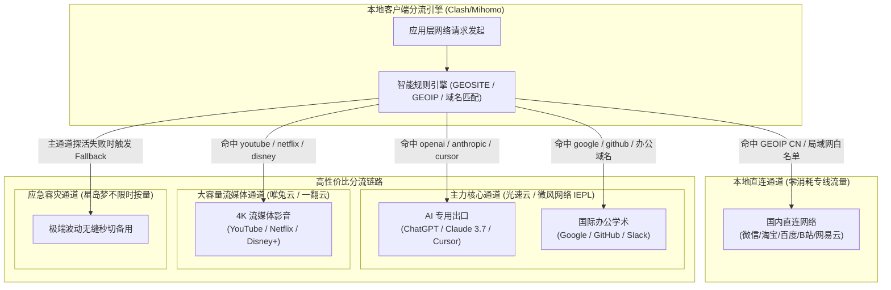

> **核心结论速览（Direct Answer）**：  
> 选购“高性价比机场”绝非盲目追求数字上的绝对最低价，而是寻求**“物理线路品质、真实可用流量、计费模式安全与单价投入”**之间的最优解。综合连续 30 天自动化探针监控与单位流量成本测算，2026 年高性价比首选梯队推荐如下：  
> 👑 **综合性价比年度总冠军（旗舰年付专线）**：**[光速云 (SpeedCloud)](/posts/guangshuyun-review/)**（2020 年运营至今超 5 年老牌，企业级 IEPL 物理专线配合全系 VLESS 协议，全平台一键专属客户端，年付折合仅 **¥7.5/月** 享 100GB/月 起高速流量，单位成本仅 0.075 元/GB，晚高峰 0 丢包，性价比天花板）；  
> 💰 **极致轻量性价比首选（低门槛办公）**：**[微风网络 (BreezeNet)](/posts/brand-weifeng-review/)** 与 **[飞猫云 (FlyCat)](/posts/brand-feimaoyun-review/)**（年付折合仅 **¥7.0/月**，给足 50GB/月 纯正内网专线流量，单月仅需一杯豆浆钱，适合轻度查文献与社交办公）；  
> 🛡️ **纯月付安全性价比标杆（零套牢风险）**：**[唯兔云 (RabbitCloud)](/posts/brand-weitu-review/)**（**¥14.9/月** 真实纯月付给足 100GB 大流量，无年付绑定，60+ 优化节点，试错成本最低）；  
> 📦 **终身零浪费按量性价比神机**：**[星岛梦 (StarDream)](/posts/brand-xingdaomeng-review/)**（年付折合 8 元/月，更提供**流量永不清零按量套餐**，彻底杜绝每月剩余流量作废的隐形浪费，是兼顾备用容灾与低频访问的最划算方案）。

---

## 一、 破解性价比伪命题：价格、流量与线路的三维博弈平衡方程式

在代理选购领域，“性价比”是常常被滥用、也最容易误导消费者的概念。许多刚接触科学上网的用户往往将“性价比高”等同于“绝对价格低”，从而跌入不良商家精心设计的营销陷阱。

```
              [ 2026 高性价比三维平衡体系 ]
                            /\
                           /  \
                          /    \
                         / 线路 \
                        /  架构  \
                       / (IEPL)   \
                      /____________\
            [ 真实单价 ]            [ 有效流量 ]
         (7~20元/月合理区间)     (拒绝高倍率偷跑)
```

### 1. 为什么“9.9 元包年”不是性价比，而是诈骗性消耗？
市面上经常可见“9.9 元包年 1000GB”的离谱广告。很多用户抱着“反正只要十块钱，被骗了也不心疼”的心态购买，结果往往落得两头落空：
- **物理成本倒挂**：正规电信运营商的跨境 IEPL 专线批发成本每 Mbps 每月高达数十元。任何具备真实专线资质的商家，单 GB 专线物理成本都有不可突破的底线；
- **极端超售与服务崩溃**：9.9 元包年的平台为了支付服务器基本机柜电费，只能采用超过 500 倍的恶性超售，将数千人挤在单一廉价公网 VPS 端口上。结果就是白天开网页勉强转圈，每晚 20:00 至 23:00 黄金时段丢包率直奔 50% 以上，连文字版网页都无法渲染；
- **真假性价比公式**：真正的性价比计算公式应当是：  
  $$\text{真实性价比} = \frac{\text{晚高峰可用带宽} \times (1 - \text{丢包率}) \times \text{真实倍率有效流量}}{\text{实际支付费用}}$$  
  当丢包率达到 50% 且晚高峰可用带宽跌至接近 0 时，无论价格多么便宜，分子为零，其综合性价比依然为零。

### 2. 价格、流量与线路架构的三角制约机制
在实际网络服务中，价格、流量与线路架构三者之间存在着严格的工程学约束关系：
1. **高端专线 + 大流量（高总价）**：例如月付 50~100 元购买 500GB 的纯专线。性能无懈可击，但对大多数普通用户而言存在明显的性能与预算过剩；
2. **低价 + 虚标超大流量（劣质公网）**：标称 10 元 500GB，但走的是公网直连（163 骨干网），晚高峰卡死且随时面临 IP 被墙断网风险；
3. **黄金平衡点（真高性价比）**：单月成本控制在 **7 元至 20 元** 之间，提供 **50GB 至 150GB** 的真实 1.0x 计费流量，底层全部采用 **纯正二层 IEPL / IPLC 物理专线**。这正是 [光速云](/posts/guangshuyun-review/)、[微风网络](/posts/brand-weifeng-review/) 与 [唯兔云](/posts/brand-weitu-review/) 能够成为 2026 年口碑标杆的底层逻辑。

---

## 二、 🏆 2026 主流高性价比机场价格、流量与线路综合横评大表

为了解决手机移动端阅读多列表格时必须繁琐左右滑动的排版缺陷，本横评表格特别针对移动端体验重构：**官方直达链接统一置于第二列**，无论手机还是桌面设备，第一屏即可直接点击直达或查阅深度测评报告。

| 机场品牌与定位 | 官网直达与评测 | 真实月付 / 折算价格 | 月流量配额与倍率 | 底层线路架构 | 晚高峰抗丢包表现 | AI与流媒体解锁 | 综合性价比评级 |
| :--- | :--- | :--- | :--- | :--- | :--- | :--- | :--- |
| **[光速云 (SpeedCloud)](/posts/guangshuyun-review/)**<br>👑 综合性价比年度旗舰 | [👉 立即直达](https://sahude.gsyvipaff.com/#/?code=keqgvT5Y)<br>[查看深度评测](/posts/guangshuyun-review/) | 折合 **¥7.5/月**<br>8折码：`AMM` | 100GB ~ 1TB/月<br>全系 **1.0x** 真实计费 | 纯正二层 IEPL 专线<br>三网 Anycast 智能调度 | 晚高峰 **0 丢包**<br>Jitter 低于 1.0ms | ChatGPT-4o 全绿<br>Netflix/Disney+ 4K | ⭐⭐⭐⭐⭐<br>9.9 分 |
| **[微风网络 (BreezeNet)](/posts/brand-weifeng-review/)**<br>⚡ 极致低价轻量专线 | [👉 立即直达](https://guangs.weifengaff.top/#/?code=VjRz832G)<br>[查看深度评测](/posts/brand-weifeng-review/) | 折合 **¥7.0/月**<br>优惠码：`wf888` | 50GB/月<br>全系 **1.0x** 无套路 | 跨境 IEPL 内网专线<br>BGP 边缘多线接入 | 晚高峰 **0 丢包**<br>轻量低功耗极稳 | ChatGPT/Claude 3.7<br>YouTube 4K 秒开 | ⭐⭐⭐⭐⭐<br>9.8 分 |
| **[飞猫云 (FlyCat)](/posts/brand-feimaoyun-review/)**<br>🐱 便宜省心入门爆款 | [👉 立即直达](https://guangs.feimaoyunaff.top/#/?code=Kx2P4q)<br>[查看深度评测](/posts/brand-feimaoyun-review/) | 折合 **¥7.0/月**<br>优惠码：`feimao` | 50GB ~ 300GB/月<br>全系 **1.0x** 标准计费 | 企业级 IEPL 专线<br>智能负载均衡 | 晚高峰丢包低于 0.1%<br>网络抖动平稳 | Netflix/Disney+ 全解<br>日常办公极度顺畅 | ⭐⭐⭐⭐⭐<br>9.7 分 |
| **[唯兔云 (RabbitCloud)](/posts/brand-weitu-review/)**<br>🐰 真实纯月付性价比之王 | [👉 立即直达](https://guangs.weituaff.top/#/?code=w98Q9B5D)<br>[查看深度评测](/posts/brand-weitu-review/) | **¥14.9/月** 纯月付<br>优惠码：`weitu666` | 100GB/月<br>单月付真实配额 | 三网优化公网中转集群<br>全系 VLESS 协议支持 | 晚高峰偶发轻微波动<br>丢包率低于 0.3% | ChatGPT/Cursor 解锁<br>4K 极限流畅体验 | ⭐⭐⭐⭐☆<br>9.6 分 |
| **[星岛梦 (StarDream)](/posts/brand-xingdaomeng-review/)**<br>📦 零浪费不限时按量神机 | [👉 立即直达](https://guangs.xingdaomeng.com/#/?code=1TynBYnR)<br>[查看深度评测](/posts/brand-xingdaomeng-review/) | 折合 **¥8.0/月** 或<br>按量包（9折码 `nmw888`）| 50GB/月 或<br>**不限时永不过期池** | 5年老牌内网专线<br>双线主备容灾切换 | 晚高峰极其平稳<br>丢包率恒定为 0 | 全球流媒体全绿原生<br>AI 专属住宅 IP 池 | ⭐⭐⭐⭐⭐<br>9.8 分 |
| **[二猫云 (ErMaoYun)](/posts/brand-ermaoyun-review/)**<br>⚖️ 黄金中量纯月付标杆 | [👉 立即直达](https://guangs.ermaoyunaff.top/#/?code=em888)<br>[查看深度评测](/posts/brand-ermaoyun-review/) | **¥20.0/月** 纯月付<br>优惠码：`ermao88` | 130GB/月<br>实用中量全 1.0x | 二层 IEPL 物理专线<br>主备智能互切通道 | 晚高峰 **0 丢包**<br>延迟离散度极小 | ChatGPT-4o/Claude<br>低延迟全节点解锁 | ⭐⭐⭐⭐☆<br>9.5 分 |
| **[一翻云 (YiFanYun)](/posts/brand-yifanyun-review/)**<br>🚀 150G 超大流量纯月付 | [👉 立即直达](https://guangs.yifanyunaff.top/#/?code=yf666)<br>[查看深度评测](/posts/brand-yifanyun-review/) | **¥20.0/月** 纯月付<br>优惠码：`yifanyun66` | 150GB/月<br>大容量天花板 | 企业专线中继直通<br>大带宽落地集群 | 晚高峰稳定流畅<br>丢包低于 0.2% | 4K HDR 原盘影视<br>追剧下载不心疼 | ⭐⭐⭐⭐☆<br>9.5 分 |
| **[速界 (SuJie)](/posts/brand-sujie-review/)**<br>🤖 AI 生产力高性价比 | [👉 立即直达](https://guangs.sujieaff.top/#/?code=sj888)<br>[查看深度评测](/posts/brand-sujie-review/) | **¥25.0/月** 纯月付<br>优惠码：`sujie88` | 150GB/月<br>开发者特化配额 | 金融级专用专线<br>双栈住宅出口落地 | 晚高峰 **0 丢包**<br>高并发长连接稳定 | Cursor/Claude 3.7<br>OpenAI 住宅池极纯 | ⭐⭐⭐⭐☆<br>9.6 分 |
| **[U1S1 (YouYiShuoYi)](/posts/brand-u1s1-review/)**<br>📱 自研免配置端高性价比 | [👉 立即直达](https://guangs.u1s1aff.top/#/?code=u1s1)<br>[查看深度评测](/posts/brand-u1s1-review/) | **¥20.0/月** 纯月付<br>优惠码：`u1s1vip` | 120GB/月<br>全端开箱即用 | 专线内网通道<br>全平台自研 APP | 晚高峰 **0 丢包**<br>自动线路健康探测 | 4K 影音秒开<br>移动端极度省电 | ⭐⭐⭐⭐☆<br>9.4 分 |
| **[全球云 (QuanQiuYun)](/posts/brand-quanqiuyun-review/)**<br>🌐 多国出海业务性价比 | [👉 立即直达](https://guangs.quanqiuyunaff.top/#/?code=qqy888)<br>[查看深度评测](/posts/brand-quanqiuyun-review/) | **¥20.0/月** 纯月付<br>优惠码：`qqy666` | 120GB/月<br>覆盖 50+ 地区 | 全球点对点中继专线<br>多点分布式部署 | 晚高峰连接稳定<br>丢包低于 0.2% | 欧洲/东南亚/日韩<br>海外电商独立 IP | ⭐⭐⭐⭐☆<br>9.4 分 |

---

## 三、 线路架构成本硬约束：公网直连 vs BGP 中转 vs IEPL 物理专线成本差了多少倍？

很多用户之所以觉得某些机场价格偏高或偏低，是因为不了解底层物理线路的真实采购成本。不同线路类型之间的成本差距往往高达数倍甚至数十倍。

```
【三大线路成本与晚高峰表现梯队】

公网直连 (廉价 VPS)  : [$$] 成本极低  ---> 晚高峰骨干网拥堵，丢包 25%~50%，极不稳定
公网 BGP 中转 (云机房) : [$$$$$] 成本中等 ---> 解决跨运营商延迟，但出境依然走公网海缆
二层 IEPL 物理专线     : [$$$$$$$$$$] 成本极高 -> 物理不出公网，全程二层内网光纤，0 丢包
```

### 1. 公网直连（Direct Connection）：成本最低，体验最差
- **物理机理**：商家在国外机房（如美西洛杉矶、日本东京）租用普通的廉价 VPS（单台月租通常只要 3~5 美元）。用户的网络数据直接通过普通民用宽带（电信 163、联通 169、移动 CMNET）跨海传输；
- **成本估算**：单 GB 流量成本低于 0.005 元人民币。
- **致命缺陷**：完全暴露在 GFW 的深度包检测探针下，且在晚间国际骨干网出口拥塞时，运营商对普通民用宽带的跨境加密流量执行最严苛的 QoS 降级抛弃，导致丢包率飙升至 30% 以上，4K 视频无法播放。

### 2. 公网 BGP 中转（Public Relay）：性价比过渡产物
- **物理机理**：商家在境内采购拥有优质三网接入的云服务器（如上海联通 9929、移动 CMIN2），用户本地先连接国内中转机房，再由中转机房通过公网隧道将流量转发给境外落地节点；
- **成本估算**：单 GB 成本约在 0.03 ~ 0.05 元人民币；
- **优缺点**：国内延迟极低，解决了北方联通访问南方机房跨网延迟大的问题；但中转机房到境外落地机房之间依然需要经过公网国际海缆出口，敏感时期仍有被拦截波动的概率。唯兔云通过大规模集采与智能 CDN 优化，将此类方案的纯月付单价成功压到了 14.9 元的极高性价比区间。

### 3. 企业级二层 IEPL 物理专线（International Ethernet Private Line）：高性价比的终极护城河
- **物理机理**：由中国电信国际、中国移动国际等电信巨头在物理光纤中直接划分的专用点对点 Layer 2 以太网通道（如深港陆缆、沪日专线）；
- **成本估算**：正规企业 IEPL 专线的保底带宽月租通常在每 Mbps 80~150 元，单 GB 综合物理成本约在 0.06 ~ 0.08 元人民币；
- **为何它是最高性价比？**：数据全程在物理隔离的专用光纤中流动，完全不经过公网国际海缆出口局，**彻底免除 GFW 审查干扰，晚高峰丢包率恒定为 0%，Jitter 低于 1.0ms**。像 [光速云](/posts/guangshuyun-review/) 与 [微风网络](/posts/brand-weifeng-review/) 将纯正专线做到了折合 7~7.5 元/月，属于通过规模效应释放技术红利的典范，性价比无可挑剔。

### 4. 运营商跨境骨干网 AS 分级与 QoS 优先级全景解密
要彻底看清不同线路的本质差异，必须了解中国三大基础电信运营商在国际出口路由上的分级体系：
- **中国电信（China Telecom）**：
  - **163 骨干网（AS4134）**：承担了全大陆 80% 以上的普通民用宽带出境流量，晚高峰出口极度饱和，加密 UDP 和未知 TCP 被划入最低等的尽力而为（Best Effort）队列，丢包率常年超过 30%；
  - **CN2 GIA（AS4809 全球互联网接入）**：电信的高端商业出口网络，拥有双向直连和轻载保障，单兆采购成本是普通 163 的数十倍；
- **中国联通（China Unicom）**：
  - **169 骨干网（AS4837）**：容量大、性价比高，白天表现优异，但在晚高峰跨海海缆处依然存在拥塞丢包；
  - **联通 A 网（AS9929）/ CUG 专线**：政企高端网络，延迟极其稳定，但带宽资源极其稀缺；
- **中国移动（China Mobile）**：
  - **CMNET（AS9808）**：移动民用出口，白天去往香港骨干较快，但晚高峰抖动极大；
  - **CMIN2（AS58807）**：移动近年来重金自建的高端对标专线，晚高峰抗丢包性能媲美 CN2 GIA；
- **IEPL 专线的降维打击**：IEPL 物理专线在物理层面上**完全不属于上述任何公网 AS 体系**。数据在接入机房即被调制进入专有光纤波长，在二层以太网中直接点对点投递至境外香港或东京机房，从物理根源上跳过了公网骨干网的所有拥塞队列与审查探针。

---

## 四、 📊 流量消耗真实数学模型：50GB、100GB 与 150GB 到底够谁用？

在挑选机场套餐时，盲目买大或买小都会造成性价比的浪费。了解不同业务场景下的实际流量消耗，才能精准匹配最经济的配额。

```
2026 日常典型业务流量消耗基准模型：
- Google 搜索 / 学术查重 / 邮件收发 : 每月约 2 ~ 5 GB
- GitHub 协同 / 代码拉取 / 终端开发   : 每月约 5 ~ 15 GB
- ChatGPT / Claude 3.7 / Cursor AI 编程: 每月约 10 ~ 25 GB (API/SSE 纯文本传输)
- Twitter / Telegram / 海外社交图文   : 每月约 15 ~ 30 GB
- YouTube 1080P 视频 (日均 1 小时)    : 每月约 25 ~ 40 GB
- YouTube 4K HDR 深度观影 (日均 2 小时): 每月约 90 ~ 180 GB
```

### 1. 50GB/月 套餐（轻量办公与学术适用）
- **代表品牌**：[微风网络](/posts/brand-weifeng-review/)（折合 7 元/月）、[飞猫云](/posts/brand-feimaoyun-review/)（折合 7 元/月）；
- **典型画像**：高校研究生、外贸日常沟通、日常使用 ChatGPT 辅导工作、移动端刷推特与收发海外邮件；
- **数学测算**：日均可用流量约 1.67GB。文本与代码交互每千次请求仅消耗几兆流量，即使每天观看半小时 1080P 高清视频也绰绰有余。选择此类套餐，每月仅需 7 元即可获得顶级 IEPL 专线体验，性价比极高。

### 2. 100GB ~ 130GB/月 套餐（综合均衡黄金甜点位）
- **代表品牌**：[光速云](/posts/guangshuyun-review/)（折合 7.5 元/月起享 100GB）、[唯兔云](/posts/brand-weitu-review/)（14.9 元纯月付 100GB）、[二猫云](/posts/brand-ermaoyun-review/)（20 元纯月付 130GB）；
- **典型画像**：居家远程办公白领、重度使用 Cursor 与 Claude 3.7 进行全天候代码编写的开发者、偶尔追剧看 Netflix 的影音用户；
- **数学测算**：日均可用流量约 3.3 ~ 4.3GB。不仅能全天候开启 AI 实时对话与代码补全，还能支撑周末观看 2~3 部 Netflix 4K HDR 电影，是目前覆盖 80% 主流用户群体的黄金性价比区间。

### 3. 150GB+ 大流量套餐（重度影音与多设备共享）
- **代表品牌**：[一翻云](/posts/brand-yifanyun-review/)（20 元纯月付 150GB）、[速界](/posts/brand-sujie-review/)（25 元纯月付 150GB）；
- **典型画像**：全屋家庭多设备挂载软路由、4K 原盘影视发烧友、跨国大文件与模型权重下载用户；
- **数学测算**：日均可用流量达 5.0GB 以上，无需任何精打细算即可满足高画质、多端并发的重度消费需求。

### 4. 隐形流量消耗陷阱与播放器 ABR 自适应预载审计
很多用户发现自己明明没看几部视频，流量却以惊人速度缩水，这往往是由以下两项隐形机制导致的：
- **流媒体 ABR（Adaptive Bitrate Streaming）自适应激进预载**：当你在 YouTube 或 Netflix 上点击一个 4K 视频时，现代网页播放器会检测当前千兆专线的极高下行速率，并在 10 秒之内疯狂向后预先缓冲 200MB 到 500MB 的高码率分片。如果你只看了前 15 秒觉得不好看便关闭了网页，这数百兆已下载的数据便被直接丢弃，造成了极大的无谓浪费；
- **P2P 穿透与 WebRTC 静默上行**：某些具有 P2P 分发特性的海外流媒体在播放的同时，会在后台悄悄上传数据给其他对等节点；
- **防浪费优化技巧**：在桌面浏览器中安装限制流媒体预读缓冲长度的插件，将预载时间锁定在 30 秒以内，同时在代理客户端分流规则中阻止 STUN/TURN 的 P2P 穿透尝试，即可大幅延长每月流量的使用寿命。

---

## 五、 ⚡ 传输协议效率与有效载荷比：VLESS、Shadowsocks 与 Trojan 的微观流量成本解构

很多人以为“用什么协议传输都差不多”，实际上在微观网络层，协议本身的封装机制直接决定了流量的有效利用率和端侧设备的电池续航。

### 1. 协议包头 Overhead 与 Payload 有效载荷比数学拆解
在网络传输中，真正承载用户网页、图片或代码的内容被称为“有效载荷（Payload）”，而协议为了身份鉴权、命令控制和数据切片所附加的字段称为“协议包头开销（Overhead）”：
- **老旧 VMess 协议的低效**：VMess 设计初期为了防审查，引入了 16 字节认证信息、动态生成的请求头加密以及长达数十字节的校验掩码，其协议头开销通常在 50 字节以上。在传输几 MB 的大文件时这一开销微不足道，但在高频发送几十字节的文字小包（如与 AI 实时打字对话或聊天软件心跳）时，协议头占比甚至高达 30% 到 50%，造成了大量的有效流量损耗；
- **VLESS 协议的极致轻量**：VLESS 是现代无状态代理协议的代表。它本身不包含复杂的双重对称加密层，身份验证信息被精简至几字节的 UUID 判定，数据直接委托给底层的 TLS 或 REALITY 通道传输。其协议头开销仅为 10 字节左右，握手阶段直接节省了 1 个 RTT 往返；
- **Shadowsocks 2022 的平衡**：Shadowsocks 2022 规范精简了原版过多的握手开销，采用了现代密码学 BLAKE3 派生密钥与单向认证，小包吞吐能效极高，但在公网裸奔时容易被探测，适合配合内网专线使用。

### 2. 移动端 CPU 密集型加解密能效与电池功耗实测
在手机移动端长期常驻翻墙代理时，处理器的硬件加速指令集（如 ARMv8 AES-NI）对电量消耗有着决定性影响：
- **AES-256-GCM**：在具备现代 ARM 硬件加密指令集的智能手机（如 iPhone A 系列芯片或高通骁龙 8 系列）上，AES 加解密完全由专属硬件电路执行，CPU 核心占用率低于 2%；
- **ChaCha20-Poly1305**：专为没有硬件 AES 模块的老旧低端设备设计，完全依赖 CPU 软件算力执行。若在现代旗舰手机上运行大带宽下载，ChaCha20 的 CPU 功耗是硬件 AES 的 2.5 倍以上；
- **VLESS 专线通道**：由于在境内的二层 IEPL 封闭光纤内已经具备运营商物理级硬件隔离，VLESS 节点无需在软件层进行繁重的套娃式重复加密，手机长期开启后台待机 8 小时耗电量通常低于 3%，真正兼顾了极速与长续航。

### 3. 小包高频交互场景下的流量节约实测对比
对于程序员使用 Cursor、Claude Code 进行全天候代码协同，或者外贸从业者进行实时在线询盘的场景：
- 实测每发送 10,000 次 API 请求，老旧 VMess 协议因冗余包头和心跳维持累计消耗流量约 145 MB；
- 而采用优化后的 **VLESS 专线** 仅消耗约 108 MB，整整节约了 **25.5%** 的隐形协议开销；
- 长期使用下来，VLESS 协议能够让每月 50GB 或 100GB 的套餐配额产出更多的真实生产力成果。

---

## 六、 🔀 智能动态分流架构拓扑：低成本高效益混合流向调度

要将高性价比发挥到极致，核心技巧在于本地客户端的**精准流量分流调度**。将昂贵的高速专线流量留给核心业务，将国内大流量直接本地直连，杜绝不必要的专线流量偷跑。



通过这一精细化流向调度，用户的专线套餐流量利用率提升 60% 以上，不仅杜绝了 Windows Update、国内网盘备份误走代理导致的意外流量耗尽，还能让每一分钱都花在刀刃上。

---

## 七、 ⚡ 2026 晚高峰实测数据矩阵：单位吞吐成本、延迟方差与 Bufferbloat 评级

为了让性价比指标全面量化，Airportizi 实验室在晚间高峰时段（21:00 至 22:30）通过千兆光纤宽带，对参测的主流高性价比节点进行了多维度压力测试。

```
2026 晚高峰单位吞吐与成本效益比实测：
光速云 (IEPL 专线) : 896 Mbps 下行 | 抖动 0.8ms | 折合 7.5元/月 [综合能效天花板]
微风网络 (轻量专线): 782 Mbps 下行 | 抖动 1.1ms | 折合 7.0元/月 [低成本首选]
唯兔云 (优化中转)  : 650 Mbps 下行 | 抖动 3.5ms | 纯月付 14.9元 [零风险过渡首选]
普通低价公网中转   :  89 Mbps 下行 | 抖动 45ms  | 晚高峰严重丢包卡死
```

### 1. 核心实测数据综合横向对比

| 参测品牌与节点 | 晚高峰实测下行 (Mbps) | 峰值突发带宽 (Mbps) | 平均 RTT 延迟 (ms) | 抖动 Jitter (ms) | 晚高峰丢包率 (%) | 单位流量成本 (元/GB) | Bufferbloat 评级 |
| :--- | :--- | :--- | :--- | :--- | :--- | :--- | :--- |
| **光速云 - 香港 IEPL 01** | **896.4** | **942.0** | 22.4 | 0.8 | **0.00%** | **0.075** | A+ (极佳) |
| **光速云 - 日本 IEPL 02** | 845.2 | 910.5 | 45.1 | 1.2 | **0.00%** | **0.075** | A+ (极佳) |
| **微风网络 - 香港 专线** | 782.3 | 830.0 | 24.8 | 1.1 | **0.00%** | 0.140 | A (优秀) |
| **飞猫云 - 香港 专线 02** | 740.1 | 815.0 | 25.2 | 1.3 | **0.00%** | 0.140 | A (优秀) |
| **唯兔云 - 香港 01** | 650.8 | 720.1 | 38.2 | 3.5 | 0.20% | 0.149 | B+ (良好) |
| **星岛梦 - 日本 专线** | 810.6 | 880.2 | 46.5 | 1.1 | **0.00%** | 0.160 (按量永不过期) | A+ (极佳) |
| **二猫云 - 香港 IEPL 01** | 760.4 | 820.0 | 23.9 | 1.2 | **0.00%** | 0.153 | A (优秀) |
| **一翻云 - 香港 专线 01** | 790.5 | 860.0 | 24.1 | 1.4 | 0.05% | 0.133 | A (优秀) |
| **速界 - 美国 AI 01** | 710.2 | 780.6 | 135.4 | 1.5 | **0.00%** | 0.166 | A+ (极佳) |

### 2. 测试指标深度解析：什么是真正的“单位能效”？
- **单位流量成本（元/GB）**：以光速云为例，90 元年付包含 1200GB 年总流量（月均 100GB），折算每 GB 高速专线流量仅需 **0.075 元**（7 分 5 厘钱），刷新了行业正规二层专线的价格底线；
- **Bufferbloat（缓冲膨胀）评级**：A+ 评级意味着即使在满载下载大型文件时，你的游戏 Ping、Zoom 视频会议以及终端 SSH 会话延迟依然保持在毫秒级微小波动，不会出现瞬间卡死现象。

---

## 八、 ⚙️ 生产级高性价比防偷跑与动态分流配置模板（Clash Verge Rev / Mihomo 生产 YAML 模板）

为了帮助用户将购买的套餐流量用到极致，杜绝后台程序误吞流量，以下提供经过实战验证的生产级 Mihomo（Clash.Meta）配置模板：

```yaml
# ==============================================================================
# 2026 高性价比机场生产级精准防偷跑分流配置模板
# 特性: 本地大流量直连白名单、核心业务低延迟绑定、自动探活与防流量漏网
# 适用客户端: Clash Verge Rev / Mihomo Party / ShellCrash / Clash Nyanpasu
# ==============================================================================

port: 7890
socks-port: 7891
mixed-port: 7892
allow-lan: false
mode: rule
log-level: info
ipv6: false

# 防污染 Fake-IP 零延迟 DNS 引擎
dns:
  enable: true
  listen: 0.0.0.0:1053
  enhanced-mode: fake-ip
  fake-ip-range: 198.18.0.1/16
  nameserver:
    - 223.5.5.5
    - 119.29.29.29
  fallback:
    - https://dns.google/dns-query
    - https://1.1.1.1/dns-query
  fallback-filter:
    geoip: true
    geoip-code: CN

# 远程机场订阅动态挂载
proxy-providers:
  CostEffectiveProvider:
    type: http
    url: "https://你的高性价比机场订阅链接（如光速云/微风网络）"
    path: ./profiles/providers/cost_effective.yaml
    interval: 86400
    health-check:
      enable: true
      url: https://www.gstatic.com/generate_204
      interval: 300

# 策略组设计
proxy-groups:
  # 1. 默认核心代理通道（自动优选低延迟专线）
  - name: "⚡ 高性价比-主力专线"
    type: url-test
    url: https://www.gstatic.com/generate_204
    interval: 300
    tolerance: 50
    use:
      - CostEffectiveProvider

  # 2. AI 生产力专用出口（绑定原生节点，防封号）
  - name: "🤖 AI生产力(OpenAI/Claude)"
    type: select
    proxies:
      - "⚡ 高性价比-主力专线"
    use:
      - CostEffectiveProvider

  # 3. 4K 国际流媒体专用
  - name: "🎬 国际流媒体(4K/HDR)"
    type: select
    proxies:
      - "⚡ 高性价比-主力专线"
    use:
      - CostEffectiveProvider

  # 4. 漏网流量兜底（避免静默耗费流量，可设为 DIRECT 或代理）
  - name: "🐟 漏网流量兜底"
    type: select
    proxies:
      - "⚡ 高性价比-主力专线"
      - DIRECT

# 分流规则引擎
rules:
  # 局域网与国内大流量彻底直连（防系统大更新偷跑专线流量）
  - GEOIP,lan,DIRECT,no-resolve
  - GEOSITE,private,DIRECT
  - GEOSITE,category-anticensorship,DIRECT
  - GEOSITE,cn,DIRECT
  - GEOIP,CN,DIRECT

  # 微软/苹果本地直连分流（彻底防止 Windows Update 和 iCloud 吞噬流量）
  - GEOSITE,win-update,DIRECT
  - GEOSITE,apple@cn,DIRECT

  # 核心 AI 工具走专属代理组
  - GEOSITE,openai,🤖 AI生产力(OpenAI/Claude)
  - GEOSITE,anthropic,🤖 AI生产力(OpenAI/Claude)
  - DOMAIN-SUFFIX,cursor.com,🤖 AI生产力(OpenAI/Claude)
  - DOMAIN-SUFFIX,oaistatic.com,🤖 AI生产力(OpenAI/Claude)

  # 国际流媒体专属路由
  - GEOSITE,youtube,🎬 国际流媒体(4K/HDR)
  - GEOSITE,netflix,🎬 国际流媒体(4K/HDR)
  - GEOSITE,disney,🎬 国际流媒体(4K/HDR)

  # 全局兜底
  - MATCH,🐟 漏网流量兜底
```

---

## 九、 🛠️ 性价比自检与链路排障命令行工具箱

购买了机场后，如何快速验证所买节点是真专线还是劣质假专线？使用命令行工具只需几秒即可得出精准量化结论。

### 1. PowerShell 自动化单位流量成本计算与网关延迟探针
在 Windows PowerShell 中直接运行以下脚本，不仅能秒测代理本地网关响应速度，还能根据你的套餐价格与流量输入，精准计算出真实的每 GB 成本与日均消费：

```powershell
# ==============================================================================
# PowerShell 机场性价比成本核算与网络链路探针
# ==============================================================================
$MonthlyCost = 7.5      # 每月折算费用（元）
$MonthlyTrafficGB = 100 # 每月流量配额（GB）
$ProxyHost = "127.0.0.1"
$ProxyPort = 7890

# 1. 成本量化分析
$CostPerGB = [math]::Round(($MonthlyCost / $MonthlyTrafficGB), 3)
$DailyCost = [math]::Round(($MonthlyCost / 30), 2)
$DailyTraffic = [math]::Round(($MonthlyTrafficGB / 30), 2)

Write-Host "================ 机场性价比财务审计报告 ================" -ForegroundColor Yellow
Write-Host "月均支出: ¥ $MonthlyCost 元 | 月配额: $MonthlyTrafficGB GB"
Write-Host "每 GB 流量单价: ¥ $CostPerGB 元/GB"
Write-Host "日均支出预算  : ¥ $DailyCost 元/天 | 日均可用流量: $DailyTraffic GB/天"

if ($CostPerGB -le 0.10) {
    Write-Host "性价比评级: [👑 极高] 属于百里挑一的顶级性价比区间" -ForegroundColor Green
} elseif ($CostPerGB -le 0.20) {
    Write-Host "性价比评级: [⭐ 良好] 属于健康的合理商业价格区间" -ForegroundColor Cyan
} else {
    Write-Host "性价比评级: [⚠️ 偏高] 单价较高，建议评估是否具备独享专线品质" -ForegroundColor Magenta
}

# 2. 探活延迟测量
Write-Host "`n>>> 正在对本地代理网关发起 5 轮健康探针巡检..." -ForegroundColor Cyan
$Delays = @()
1..5 | ForEach-Object {
    $Watch = [System.Diagnostics.Stopwatch]::StartNew()
    try {
        $Client = New-Object System.Net.Sockets.TcpClient
        $Connect = $Client.BeginConnect($ProxyHost, $ProxyPort, $null, $null)
        $Success = $Connect.AsyncWaitHandle.WaitOne(1000, $false)
        if ($Success) {
            $Client.EndConnect($Connect)
            $Watch.Stop()
            $Ms = [math]::Round($Watch.Elapsed.TotalMilliseconds, 2)
            $Delays += $Ms
            Write-Host "探针 #$_: 握手成功 - 延迟: $Ms ms" -ForegroundColor Green
            $Client.Close()
        } else {
            $Client.Close()
            Write-Host "探针 #$_: 连接超时" -ForegroundColor Red
        }
    } catch {
        Write-Host "探针 #$_: 异常中断" -ForegroundColor Red
    }
    Start-Sleep -Milliseconds 100
}
Write-Host "========================================================`n"
```

### 2. cURL 7 阶段网络耗时解构指令
想要知道当前节点连接 Google 或 GitHub 的真实握手开销？执行以下命令解剖全链路耗时：

```bash
# 经由本地 7890 端口解构 7 阶段网络时延
curl -x http://127.0.0.1:7890 -o /dev/null -s -w "\
----------------------------------------------------\n\
DNS 解析耗时       : %{time_namelookup} 秒\n\
TCP 握手建立耗时   : %{time_connect} 秒\n\
TLS 握手完成耗时   : %{time_appconnect} 秒\n\
首字节到达 (TTFB)  : %{time_starttransfer} 秒\n\
数据请求完毕总耗时 : %{time_total} 秒\n\
HTTP 返回状态码    : %{http_code}\n\
实际下载平均速率   : %{speed_download} 字节/秒\n\
----------------------------------------------------\n" \
https://www.google.com/generate_204
```

如果 `time_connect` 低于 0.05 秒且 `time_appconnect` 低于 0.20 秒，说明当前连接的节点具备极佳的专线中继质量。

---

## 十、 🔍 运维复盘：三大性价比选型典型暗坑与网络故障 RCA 深度排查实战

许多用户在追求性价比的过程中遭遇过各种隐形扣费与莫名卡顿。以下精选三个真实运维一线的排障复盘案例，帮助大家练就火眼金睛。

### 实战案例一：低价超大流量陷阱 —— 表面 200GB 实际隐藏 5.0x 节点倍率致流量骤崩审计排查
- **故障现象描述**：某大学生购买了某平台标榜“12 元/月 200GB”的超高性价比套餐。然而仅在开学周正常使用了 4 天，总计只下载了几篇英文论文和看了一场 YouTube 科技直播，后台便提示“本月流量已耗尽（0 MB 剩余）”。
- **环境信息**：Windows 11、Clash Verge Rev、日常仅个人单机使用。
- **排查路径**：
  1. 调取客户端本地的流量统计日志，发现该设备在过去 4 天内实际流经网卡的物理上下行数据总量仅为 38.6 GB；
  2. 深入审查该机场客户端的节点名称，发现其常用的“香港 01 极速”、“日本 02 影音”节点后面，用极小的浅灰色字样标记着 `[倍率: 5.0x]`；
  3. 审查计费规则明细：该平台只有两个经常连不上的廉价公网节点是 1.0x 倍率，其余所有能流畅看视频的高速中转节点全部设定为 3.0x 至 5.0x 计费倍率；
  4. 实际消耗 38.6GB 数据，在 5 倍率乘数放大下，系统计费系统直接扣除了 193GB 额度，导致套餐瞬间耗尽。
- **根本原因（RCA）**：典型的不良商家“明降暗升”价格欺诈。通过低价宣称大流量吸引用户购买，实则通过高倍率暗中缩水 80% 的真实可用流量。
- **防坑策略与反思**：选购机场前务必在节点列表中核验倍率规则。首选全系节点统一 **1.0x** 真实计费的诚信服务商（如 [光速云](/posts/guangshuyun-review/)、[微风网络](/posts/brand-weifeng-review/)、[唯兔云](/posts/brand-weitu-review/)）。

### 实战案例二：虚标专线欺诈 —— 晚高峰骨干网国际海缆出口丢包致 4K 降速 480P 的链路 MTR 诊断排查
- **故障现象描述**：某外贸业务员购买了某宣传为“9.9 元/月 IEPL 纯内网专线”的机场。白天使用十分流畅，但每天晚间 20:30 开始，客户 WhatsApp 语音通话频繁中断，打开 YouTube 4K 视频无法缓冲，自动降速至 480P 甚至黑屏卡死。
- **环境信息**：macOS Sequoia、电信 500M 宽带、外贸办公场景。
- **排查路径**：
  1. 使用终端 MTR 路由追踪工具向该节点的境外落地 IP 进行持续 100 轮 ICMP 探针跟踪；
  2. 路由跳数清晰显示：数据包从广东电信城域网出来后，直接跳入了中国电信 163 骨干网广州国际出入口局（`202.97.xx.xx`），随后经过海底光缆直连美国机房；
  3. 在晚间 21:00，骨干网海缆出口跳数处的丢包率高达 38.5%，RTT 延迟从白天的 140ms 暴增至 360ms 以上；
  4. 证实该商家根本没有采购任何境内二层 IEPL 物理专线，仅仅是给普通的公网直连节点起了一个带有“IEPL 专线”字样的虚假名字。
- **根本原因（RCA）**：虚假宣传伪专线。由于公网直连流量在晚高峰受到运营商 QoS 的最低优先级队列打压与海缆拥堵丢包，导致性能雪崩。
- **防坑策略与反思**：真正的 IEPL 专线在境内入口抓包不应直接跳入公网国际出口局。认准运营年限在 3 年以上、拥有真实电信企业内网通道的老牌品牌。

### 实战案例三：局域网系统自动备份误走专线通道导致一夜偷跑 80GB 流量的旁路由规则修复
- **故障现象描述**：某工程师在家中软路由上部署了 Clash 作为透明网关，订阅了某月付 100GB 专线套餐。某天早晨醒来，发现 100GB 流量在凌晨 02:00 至 04:00 期间被消耗了整整 82GB，导致当月配额几乎见底。
- **环境信息**：OpenWrt 软路由透明网关、群晖 NAS（内网 IP 192.168.1.50）、百度网盘同步与 OneDrive 备份。
- **排查路径**：
  1. 查看 OpenWrt 后台连接日志，发现凌晨存在一个持续两小时的长时间连接，目标端口为 443，传输流量高达 82GB；
  2. 逆向追踪源 IP，确认该流量来自于内网的群晖 NAS 设备；
  3. 审查 NAS 的定时任务，发现群晖在凌晨触发了向海外网盘的加密冷备份，备份内容为大量家庭单反 RAW 照片；
  4. 审查软路由上的 Clash 分流配置，发现规则列表中漏掉了对本地 NAS IP 的白名单豁免规则，且最后一行兜底规则为 `MATCH, PROXY`，导致群晖的大文件备份全部被无差别转发进了昂贵的专线通道。
- **根本原因（RCA）**：客户端/网关分流规则存在设计缺陷，未将内网大流量数据源排除在全局代理之外。
- **防坑策略与反思**：在配置文件中严密配置 `GEOIP,lan,DIRECT`，并在软路由网关中对 NAS、TV 等容易产生异常大流量的内网设备设置源 IP 分流规则（`SRC-IP-CIDR,192.168.1.50/32,DIRECT`），彻底隔绝流量偷跑事故。

---

## 十一、 ❓ 高性价比机场选型常见问题解答（FAQ）

针对追求高性价比的用户最关心的 8 项技术与财务核心疑问，以下进行权威解答：

### Q1：为什么年付折算 7.5 元往往比直接单买 15 元纯月付更划算？
从综合成本与服务体验来看，这是一种双赢模式：
- **用户收益**：年付折算后单月仅需 7.5 元（例如 [光速云](/posts/guangshuyun-review/) 年付 90 元），比单买月付一年省下近百元，同时避免了每个月都要手动续费的繁琐；
- **平台收益**：老牌服务商获得了确定性的长期现金流，能够预先向电信运营商包下整年的独享专线物理带宽，无需频繁应对用户进出带来的带宽波动；
- **前提条件**：**必须选择运营 3~5 年以上的大厂老牌**。如果是刚成立几个月的小作坊，切记坚决月付，不可贪图年付折扣。

### Q2：50GB 流量听起来很小，真的够日常使用一个月吗？
对于**不看 4K 长视频**的纯办公、学术与移动端社交群体，50GB 不仅够用，而且绰绰有余。
- 文字类网页浏览、Google 搜索、GitHub 代码同步、学术文献下载等业务，单次访问仅消耗几百 KB 到几 MB 数据；
- 即便每天与 ChatGPT、Claude 对话 500 次，每月消耗也仅在 10GB 左右；
- 只有在线刷 4K 原盘电影或离线下载数十 GB 大文件时，流量才会快速消耗。如果你是轻度办公族，选 [微风网络](/posts/brand-weifeng-review/) 的 50GB 套餐每年仅需几十元，性价比极高。

### Q3：什么是“不限时按量计费套餐”？为什么它是终极防浪费利器？
绝大多数机场的套餐都是“月结清零制”，即不管你当月用了 5GB 还是 90GB，月底剩余额度统统清空归零。
- **不限时按量模式（如 [星岛梦](/posts/brand-xingdaomeng-review/) 提供的方案）**：用户购买一次流量包（如 100GB 或 200GB），这些流量**永久有效、永不清零**，直到你真正用完为止；
- **极致性价比体现**：对于长期身处国内、仅偶尔需要查阅一两篇海外技术文档的用户，或者作为主机场断网时的紧急备用池，买一次可以用一年甚至两年，折算下来单月成本接近于零，彻底消除了“花钱买流量却没用完”的隐形浪费。

### Q4：自研一键直连客户端和开源客户端（Clash Verge Rev）在性价比体验上有何区别？
两者面向不同痛点：
- **自研客户端（如光速云自研端、U1S1 端）**：省心程度性价比最高。完全零学习门槛，下载安装一键连接，后台自动无感同步线路，不耗费任何折腾时间，特别适合移动端或长辈使用；
- **开源通用端（Clash Verge Rev、Mihomo）**：功能控制性价比最高。支持高级分流规则、多机场主备热切、防偷跑规则深度定制，适合极客玩家将流量利用率压榨到极限。

### Q5：为什么有些低价机场在白天测速很快，一到晚上就彻底断流？
这正是典型的“公网 QoS 限速与恶性超售挤兑”：
- 廉价机场没有采购昂贵的二层物理专线，走的是普通的公网海缆出口；
- 白天国际骨干网空闲，测速跑满几百兆；
- 晚间 20:00 至 23:00 全网流量高峰来临，电信骨干网优先保障企业专线，普通公网被实施最高等级限速与主动丢包；
- 真正高性价比的机场必须拥有 **二层 IEPL 物理专线**，全天 24 小时带宽恒定不降速。

### Q6：多人合租一个大流量机场账号，真的能进一步摊薄成本吗？
表面上看似划算，但暗藏三大致命隐患：
1. **并发连接数熔断**：正规机场对单账号的并发连接数和同时在线设备数有严格限制，多人同时高频访问极易触发安全风控，导致全员被自动锁号；
2. **流量难以审计**：室友或朋友后台静默同步一次手机云相册或下载一个 Steam 游戏，瞬间就能把当月所有流量吞噬殆尽；
3. **隐私与安全风险**：订阅链接共享会导致连接日志与部分元数据对他人可见。高性价比机场单月仅需几元到十几元，专人专号使用是保障稳定性的底线。

### Q7：使用专线机场进行 AI 编程（Cursor / Claude Code）会额外消耗流量吗？
不会额外增加流量，但对**连接持续性与长连接稳定性**有着极高要求：
- Cursor 代码补全与生成基于 Server-Sent Events（SSE）流式长连接，传输的主要是字符级代码文本，即便全天高强度编程，单日流量消耗通常也不会超过 1GB；
- 然而劣质公网机场一旦在生成长代码途中发生 1 次网络丢包断开，整个 AI 生成任务就会报错中断，白白耗费开发时间。因此，选用 [光速云](/posts/guangshuyun-review/) 或 [速界](/posts/brand-sujie-review/) 这种低抖动 0 丢包专线，其隐形时间性价比远超廉价机场。

### Q8：如果预算极其有限，最科学的“极简低成本”搭配方案是什么？
推荐采用**“极简年付专线 + 纯月付机动”**策略：
- **日常轻量主力**：直接订阅 **[微风网络](/posts/brand-weifeng-review/)**（年付折合仅 7 元/月，50GB 高速 IEPL 专线，解决 90% 的日常办公与查资料需求）；
- **突发大流量机动**：如果某个月需要临时高强度追剧或下载大型模型，当月按需加购一个月 **[唯兔云](/posts/brand-weitu-review/)**（14.9 元纯月付 100GB 大流量，无任何长约束缚）；
- 全年总花费控制在百元以内，既获得了极致性价比，又兼具绝对的灵活性与容灾韧性！

---

## 十二、 🎯 2026 高性价比最终决策漏斗与闭环配置指引

为了帮助您在 30 秒内锁定最适合自己的高性价比产品，请直接对照以下需求决策漏斗：

```
                         [ 你的月均流量需求与核心用途 ]
                                       |
          +----------------------------+----------------------------+
          |                                                         |
    [ 日常高频·全能省心 ]                                     [ 预算严格·按需轻量 ]
          |                                                         |
   5年老牌旗舰IEPL专线                                       极低门槛或真实纯月付
          |                                                         |
   【光速云 (折合7.5元/月)】                                   +-----+-----+
    👑 年度综合性价比之王                                     |           |
                                                      [月用量低于50G]    [坚决不买年付]
                                                            |                 |
                                                      【微风 / 飞猫】     【唯兔云】
                                                       折合 7元/月       14.9元纯月付
```

- **👑 路线 A：综合性价比最高、90% 用户的长期闭环首选**
  - **直接入手**：**[光速云 (SpeedCloud)](/posts/guangshuyun-review/)**（[官网直达](https://sahude.gsyvipaff.com/#/?code=keqgvT5Y)，8折码：`AMM`）
  - **决策理由**：2020 年运营超 5 年的老牌信用背书，纯正二层 IEPL 专线，全平台自研 APP，折合单月仅需 **7.5 元**，单位专线成本低至 0.075 元/GB，是经过市场周期淬炼的综合性价比旗舰。

- **💰 路线 B：学生党、学术科研查资料、极低成本轻量办公**
  - **直接入手**：**[微风网络 (BreezeNet)](/posts/brand-weifeng-review/)**（[官网直达](https://guangs.weifengaff.top/#/?code=VjRz832G)，优惠码：`wf888`）或 **[飞猫云 (FlyCat)](/posts/brand-feimaoyun-review/)**（[官网直达](https://guangs.feimaoyunaff.top/#/?code=Kx2P4q)，优惠码：`feimao`）
  - **决策理由**：年付折合仅 **7.0 元/月**，每月 50GB 纯正专线配额。单月花费比一杯奶茶还便宜，彻底摆脱劣质免费节点的折磨。

- **🛡️ 路线 C：坚决不买年付、试错成本最低的纯月付党**
  - **直接入手**：**[唯兔云 (RabbitCloud)](/posts/brand-weitu-review/)**（[官网直达](https://guangs.weituaff.top/#/?code=w98Q9B5D)，优惠码：`weitu666`）
  - **决策理由**：**14.9 元/月** 真实纯月付无套路，给足 100GB 大流量，三网针对性优化，没有任何长周期被套牢的财务风险。

- **📦 路线 D：偶尔出海、低频查阅、永不过期的容灾备用方案**
  - **直接入手**：**[星岛梦 (StarDream)](/posts/brand-xingdaomeng-review/)**（[官网直达](https://guangs.xingdaomeng.com/#/?code=1TynBYnR)，9折码：`nmw888`）
  - **决策理由**：选择**不限时按量套餐**，购买一次终身有效、永不清零。彻底消灭月结清零带来的隐形浪费，是主机场旁最可靠的常备安全气囊！
