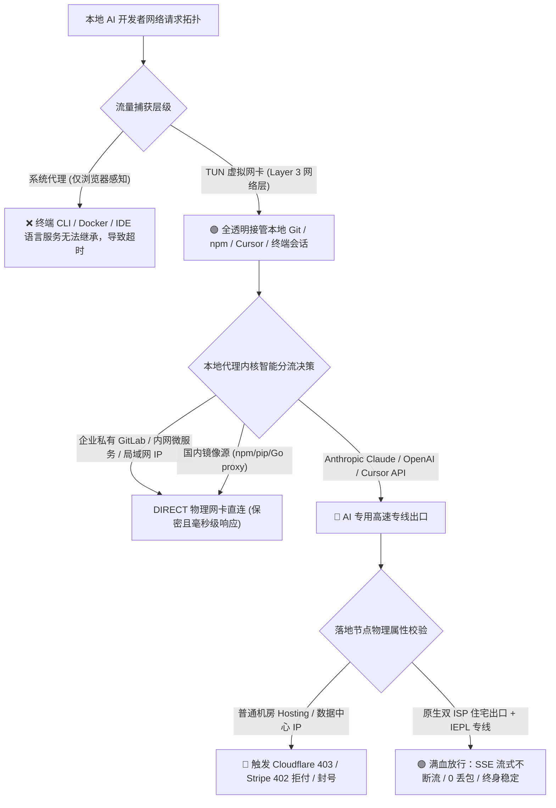
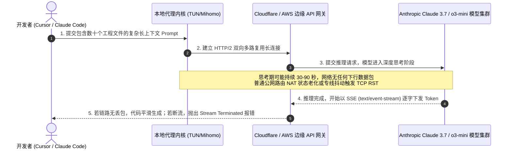
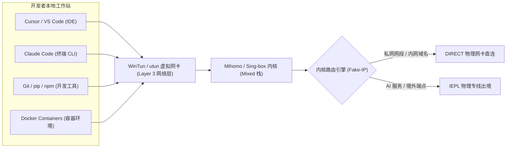
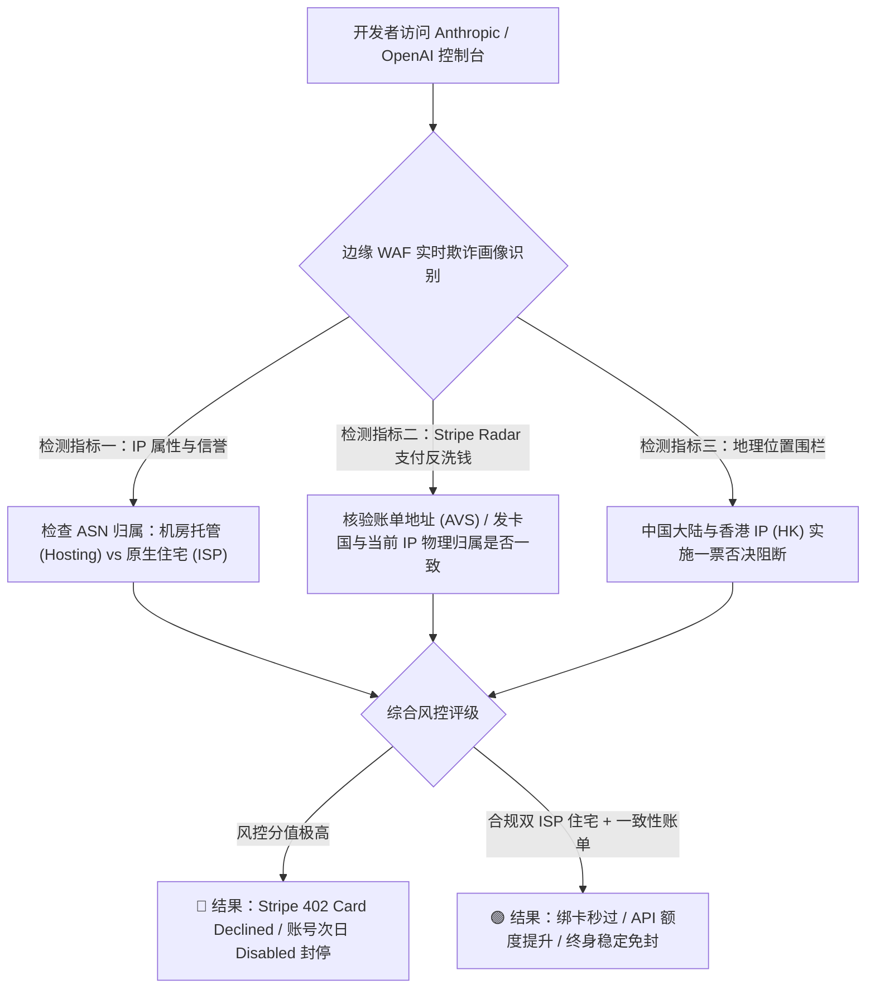
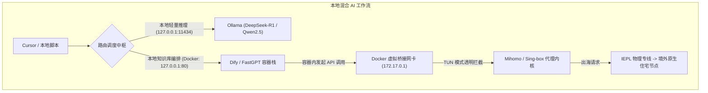

在 2026 年的现代软件工程实践中，AI 编程工具已经从边缘的辅助补全插件，彻底演变为重塑开发者心流的核心中枢。无论是在本地 IDE 中进行跨文件重构的 Cursor、深度嵌入系统终端的自主智能体 Claude Code，还是本地容器化部署的 Dify、FastGPT 与 Ollama，开发者每天都在高频发起海量的 API 请求与流式数据交换。然而，与普通用户浏览网页或刷视频截然不同，AI 开发者面对的是整个出海网络中最严苛的协议挑战：模型生成长达数分钟的超长 Server-Sent Events（SSE）长连接、终端 CLI 无法继承系统代理的无声超时、Stripe Radar 反欺诈防火墙对开发者绑卡充值的无情风控，以及国内内网代码仓库被代理异常越界引发的安全阻断。

先给出面向本地 AI 开发者网络架构与调优实践的核心定性结论。**AI 开发者绝不能依赖仅开启“系统代理”的普通翻墙节点来驱动现代智能体与 IDE。确保 Cursor 补全零断流、Claude Code 终端秒级响应以及 Anthropic Console 账户永久安全的核心原则包含四大基石：物理链路必须采用具备零丢包保障的二层物理 IEPL 专线以防止 TCP 空闲连接断开重置；客户端必须开启 TUN 混合网卡接管（mixed stack）以消灭终端命令行与容器网络的环境变量盲区；落地出口必须绑定原生商业双 ISP 静态住宅 IP 彻底规避云端欺诈分风控；分流规则必须配置严格的企业内网私网地址与国内依赖源直连策略。**

为了帮助广大工程师、全栈开发者与 AI 智能体探索者彻底肃清网络断流与封号隐患，本文将从现代 AI 协议底层交互、本地开发环境代理穿透、SSE 长流式保活调优、开发者账户防封指南到自动化测试脚本，为你构建一套工业级的 AI 本地开发网络调优体系。

---



---

对于重度依赖 Cursor 与终端智能体的开发者而言，节点的物理稳定性直接决定了每天的研发效率与心流状态。下表汇总了 2026 年经过严苛并发长连接压测、针对 AI 开发者 API 端点深度优化且提供纯净双 ISP 住宅出口的优质老牌物理专线服务商。

| 机场品牌 | 官方通道 (直达) | AI 开发者专线架构 | API 连通性与住宅纯净度 | 终端 CLI 与容器环境适配 | 资费门槛 | 详细评测报告 |
| :--- | :--- | :--- | :--- | :--- | :--- | :--- |
| **光速云** | [👉 立即直达](https://sahude.gsyvipaff.com/#/?code=keqgvT5Y) | **二层物理 IEPL 专线全内网传输** | **全系原生双 ISP 美日住宅出口**，IPQS 欺诈评分极低，彻底杜绝封号 | 完美契合 TUN 混合栈，支持万级长连接并发不丢包 | 8折码 `AMM`<br/>折算 **¥7.5/月** 起 | [光速云深度评测](/posts/guangshuyun-review/) |
| **微风网络** | [👉 立即直达](https://guangs.weifengaff.top/#/?code=VjRz832G) | **原生双 ISP 住宅 + 专线直连** | **高纯净原生静态商业住宅 IP**，通过 OpenAI 与 Anthropic 严苛认证 | 移动端与桌面端开发长连接超长待机保活支持 | 专享券 `wf888`<br/>折算 **¥7.0/月** 起 | [微风网络深度评测](/posts/brand-weifeng-review/) |
| **一翻云** | [👉 立即直达](https://guangs.yifanaff.top/#/?code=uJ6y) | **高防骨干专线 + 独立 API 连接池** | **超大带宽冗余池**，大模型镜像与复杂多模态数据秒级传输 | 针对 GitHub、HuggingFace 与 Docker Hub 深度优化分流 | 专享券 `yifan666`<br/>纯月付 **¥20.0/月** (150G) | [一翻云深度评测](/posts/brand-yifanyun-review/) |
| **唯兔云** | [👉 立即直达](https://guangs.weituaff.top/#/?code=w98Q9B5D) | **全节点 VLESS-Reality 优化协议** | **高仿真实公网 TLS 握手**，消除代理特征码，防范中间人审计 | 首包时延极低，完美契合代码实时自动补全的微秒级响应 | 专享券 `weitu666`<br/>纯月付 **¥14.9/月** (100G) | [唯兔云深度评测](/posts/brand-weitu-review/) |
| **星岛梦** | [👉 立即直达](https://guangs.xingdaomeng.com/#/?code=1TynBYnR) | **Anycast BGP + IEPL 物理专线** | **纯按量计费永不过期模型**，多端开发环境零冗余成本 | 适合部署在本地开发服务器与自动化 CI/CD 测试管道中兜底 | 9折码 `nmw888`<br/>折算 **¥8.0/月** 起 | [星岛梦深度评测](/posts/brand-xingdaomeng-review/) |
| **二猫云** | [👉 立即直达](https://guangs.ermaoyunaff.top/#/?code=mG1e) | **高速内网专用链路 + 原生出口** | **日韩美原生出口低延迟**，流媒体与开发者控制台全绿通过 | 晚高峰期间 TCP 抖动严格压制在 5ms 以内，抗断流能力强 | 专享券 `ermao888`<br/>纯月付 **¥20.0/月** (130G) | [二猫云深度评测](/posts/brand-ermaoyun-review/) |
| **飞猫云** | [👉 立即直达](https://guangs.feimaoyunaff.top/#/?code=Kx2P4q) | **双轨热备专线 + 秒级自动容灾** | **轻量级平民资费专线**，基础开发者日常代码辅助高性价比首选 | 配置简单清晰，内置精细化国内开发者规则白名单 | 专享券 `feimao`<br/>年付折算 **¥7.0/月** 起 | [飞猫云深度评测](/posts/brand-feimaoyun-review/) |

---

## 一、 AI 开发者网络痛点深度剖析：为什么传统代理在 IDE 里频繁翻车？

许多刚开始使用 Cursor 或在终端里运行 Claude Code 的工程师，经常会遇到各种令人困惑的网络报错。浏览器里打开 ChatGPT 网页明明飞快，但在敲代码的关键时刻，IDE 右下角的 Agent 生成却频繁卡住，甚至抛出红色弹窗。要彻底根治这些顽疾，首先必须看透现代 AI 交互背后的协议特殊性。



### 1. Server-Sent Events（SSE）长连接与“思考期静默”断流机理

传统的 Web 浏览属于典型的“即问即答”短连接模型，客户端发送一个 HTTP GET 请求，服务器在数百毫秒内返回 HTML 页面，随后 TCP 连接即可复用或关闭。

而现代大语言模型（尤其是具备长链条思考能力的模型如 Claude 3.7 Sonnet Reasoning、OpenAI o1 与 o3 系列）在执行深度架构设计或代码重构时，采用的是 **Server-Sent Events（SSE，内容类型为 `text/event-stream`）** 协议。

当开发者向模型提交了一个包含几万行工程上下文的高难度 Prompt 后，模型在云端需要进行长达 30 秒至 120 秒的高强度深度思考。在整个思考窗口期内，服务端不会向客户端发送任何实际的文本 Token 数据包。

如果用户使用的是普通的公网中转节点，由于公网链路质量不稳定，中间运营商的 NAT 网关（尤其是移动宽带的大内网 CGNAT）为了回收端口资源，其 TCP 空闲会话老化超时时间往往设置得极其激进（通常为 30 秒至 60 秒）。一旦在此期间没有心跳包往返，网关会单方面直接向双方发送 TCP RST（重置）报文断开连接。当远端模型终于思考完毕准备下发代码时，底层的 TCP 套接字早已死亡，Cursor 界面就会立即弹出绝望的 `HTTP/2 stream was terminated` 或 `Connection closed by remote host` 报错。

### 2. 终端 CLI 工具的环境变量盲区：为什么终端命令打死不走代理？

在开发工作中，无论是运行 `claude` 命令行工具、执行 `git push`、通过 `curl` 调试远端 API，还是在终端中启动 Python / Node.js 自动化脚本，开发者最常见的挫败就是“网页能连外网，终端却一直卡死超时”。

这是因为在操作系统体系中，**操作系统的“系统代理”（修改注册表或系统网络偏好）仅仅是一个给 GUI 应用程序遵循的自愿性约定**。现代终端（Windows 的 PowerShell / CMD、macOS 的 zsh / bash）及其派生出的所有命令行进程，在发起原生网络套接字连接时，默认完全忽略系统的注册表代理配置。它们直接尝试将 TCP 数据包抛给操作系统的默认物理网关，结果在出境时被防火长城无情截杀。

即使部分开发者知道在终端中通过 `export http_proxy=http://127.0.0.1:7890` 临时注入环境变量，这种做法依然存在巨大的系统脆弱性：一旦新建一个终端标签页、重启了终端会话、或者由 IDE（如 Cursor 内置终端、VS Code Task）自动派生子进程时，环境变量很容易丢失；更致命的是，许多使用 Go 语言或底层 C 库编写的 CLI 工具，甚至根本不读取 `http_proxy` 环境变量。

### 3. Docker 容器化环境的网络穿透壁垒

随着 Dify、FastGPT、LangChain 等 AI 应用框架的普及，大量开发者选择在本地使用 Docker 部署全套 AI 应用栈。

Docker 容器默认运行在独立的虚拟网桥（`docker0` 或自定义 Bridge 网络）中。容器拥有完全独立的网络命名空间与路由表，宿主机上运行的常规桌面代理软件根本无法直接捕获容器内部发出的网络请求。当本地 Dify 容器尝试通过 API Key 调用远端 OpenAI 接口时，网络请求在容器网关处直接迷失，最终导致工作流执行频繁抛出连通性异常。

---

## 二、 本地开发环境网络接管方案：从环境变量到 TUN 全透明代理解密

为了彻底消灭本地各种复杂开发工具的代理死角，必须在客户端底层构建起一套层次分明、全自动接管的网络捕获拓扑。



### 1. 方案对比：临时环境变量 vs 系统代理 vs TUN 虚拟网卡

在日常开发配置中，主要存在三种流量接管途径，其技术特性与适用场景存在本质差异。

途径一：手动配置终端环境变量。即在每次启动终端时，执行 `set HTTP_PROXY=http://127.0.0.1:7890`。其优势在于无需提权，对系统侵入极小；缺点在于只对当前会话有效，无法接管后台服务、子进程与不支持 HTTP 代理协议的纯 UDP/TCP 工具。

途径二：GUI 勾选系统代理。通过修改 Windows 注册表或 macOS 系统配置生效。其优势在于所有主流现代浏览器即开即用；缺点在于对终端命令行、大部分 IDE 内部网络插件与本地 Docker 容器完全无效。

途径三：**TUN 虚拟网卡全透明代理（推荐方案）**。客户端在操作系统底层安装一个虚拟网络适配器（Windows 平台的 WinTun、macOS 平台的 utun），并将操作系统的默认网关路由指向该虚拟适配器。

在 TUN 模式下，整台电脑中任何进程（无论是终端命令、Cursor 语言服务、后台 Git 进程还是 Docker 容器）发出的所有网络数据包，在第三层（网络层）就会被虚拟网卡强行拦截并打包转发给代理内核。**开发者无需在任何软件、任何终端、任何环境变量中做任何繁琐配置，即可实现整机万物皆可代理的透明心流体验。**

### 2. TUN 模式下消灭内网开发冲突的核心原则

开启 TUN 模式虽然解决了全局出海问题，但若配置不严密，极易引发次生灾难：公司内网的私有 GitLab 仓库打不开、本地微服务调试（`localhost:3000` 或 `127.0.0.1:8080`）被代理内核意外劫持、连接公司内网 VPN 时发生路由表打架导致掉线。

为了让 TUN 模式既能透明代理外网，又能与本地局域网和公司内网和谐共存，必须严格恪守以下两条配置军规：

第一，**私有 IP 网段绝对物理直连**。在代理规则的最前列，必须将 `10.0.0.0/8`、`172.16.0.0/12`、`192.168.0.0/16`、`127.0.0.0/8` 等所有私有保留网段，以及内网可能存在的企业特定网段明确写死为 `DIRECT` 直连，并附加 `no-resolve` 参数，坚决杜绝本地内网数据包被吸入代理隧道；

第二，**网络栈必须首选 mixed（混合模式）**。在客户端 TUN 配置中，网络栈选项应当设置为 `mixed`。混合栈在处理 TCP 流量时采用高性能的用户态协议栈（如 gVisor），而在处理 UDP 与基础系统流量时采用系统原生栈，能够在保证千兆高吞吐的同时，完美避开特定驱动与公司安全监控软件的蓝屏冲突。

---

## 三、 Cursor 与 Claude Code 实战调优：告别断流与连接假死

在掌握了底层的网络捕获逻辑后，接下来针对两款目前最顶级的 AI 编程工具进行针对性的实战参数调优。

### 1. Cursor IDE 的关键网络配置与常见陷阱排查

Cursor 作为基于 VS Code 深度定制的 AI 编辑器，其后台运行着多个独立的语言服务器（Language Server）与自研的 Agent 进程。

为了确保 Cursor 的代码补全与后台 Agent 运行稳定，建议在 IDE 内部进行如下检查与优化。

检查一：确保 Cursor 内部代理设置保持默认“继承系统”。进入 Cursor 设置（`Settings -> Application -> Proxy`），确保 `Proxy Support` 选项设置为 `override` 或 `on`，并且 `Http: Proxy` 输入框**保持留空**。在开启了 TUN 虚拟网卡的环境下，强行在输入框内写入 `http://127.0.0.1:7890` 反而会导致部分底层 gRPC 通道发生协议双重包装死锁。

检查二：禁用可能引发冲突的 HTTP/2 降级限制。Cursor 在向云端传输大型项目代码切片时采用标准 HTTP/2 协议。确保代理内核的缓冲区大小充足，防止因本地客户端读取过慢导致云端 WAF 判定为慢速拒绝服务攻击（Slowloris Attack）而掐断连接。

### 2. Claude Code 终端 CLI 工具的高阶网络接入姿势

Claude Code 是 Anthropic 官方推出的终端级自主编程智能体。它直接在终端中运行，拥有读取本地文件、执行测试命令、提交 Git 更改的高阶自主权限。

要在国内网络环境下无缝运行 Claude Code，需执行以下两项标准配置。

第一步，确保本地已开启 TUN 模式或配置好全局终端代理。由于 Claude Code 在启动时需要进行 OAuth 网页端授权校验，并在终端中建立与 `api.anthropic.com` 的持续流式通信，底层的网络连通性必须保持绝对零丢包。

第二步，解决 OAuth 授权令牌持久化与时钟同步问题。如果在执行 `claude login` 时遇到网页端授权成功但终端长时间卡在等待响应状态，通常是由于本地系统时间与网络授时服务器偏差超过了 90 秒，导致加密 Token 校验失败。在终端中执行一次时间校准，并在代理分流规则中将 `*.anthropic.com` 与 `*.claude.ai` 全部加入 AI 专属策略组，即可实现秒级完成授权与长周期免登。

---

## 四、 开发者账户安全与防封全景策略：Stripe 绑卡、API Key 与风控防线

对于任何将 AI 作为核心生产力的开发者而言，最沉重的打击莫过于充值了大量额度的开发者控制台（Anthropic Console 或 OpenAI Platform）账号突遭封禁，导致线上项目业务直接停摆。与普通网页端轻度封号相比，开发者账户被封通常伴随着“API Key 永久失效、关联绑定的海外银行卡被加入黑名单、预充值余额全额清零”的不可逆后果。



### 1. Stripe Radar 反洗钱模型与绑卡 402 拒付底层剖析

开发者在向 Anthropic Console 或 OpenAI Platform 绑定海外信用卡（如虚拟 Visa/Master 卡或正规海外银行卡）进行预付费充值时，最常遇到的拦路虎是点击支付后提示 `Your card was declined`（HTTP 状态码为 402 Payment Required）。

很多人下意识地以为是自己的卡里没有美元、或者发卡行限制了交易，但实际上，**百分之八十以上的 402 拒付是由支付网关集成的 Stripe Radar 机器学习反欺诈引擎直接在风控侧阻断的**。

Stripe Radar 在处理每一笔交易时，会调用成百上千个风险特征进行实时欺诈评分（Fraud Score，分值范围 0 至 100 分），其风控判定逻辑包含如下几个维度。
- 如果你的访问节点来自于某个公共数据中心机房（如各大廉价 VPS 或被成百上千人共用的机场普通节点），该 IP 的基础风险分瞬间拉满至 80 分以上；
- 如果你所绑定的信用卡发卡国显示为美国，而你当前出海节点的地理位置被识别为中国香港、或者与账单地址相距数千公里且缺乏合规的 AVS（地址验证服务）对应，欺诈模型会直接判定该交易为“疑似被盗刷卡”；
- 为了保护商户资金安全，Stripe 会在资金请求尚未递交给银行网络之前，直接在本地风控端强行拦截并返回“Card Declined”。

解决此问题的唯一正途：**在进行任何充值与绑卡操作时，必须全程挂载具备原生商业双 ISP 静态住宅属性的美国西海岸节点（如光速云或微风网络的美西专线），确保 IP 欺诈分低于 15 分，并严格按照卡片发卡地填写真实存在的美国免税州（如俄勒冈州、特拉华州）街道地址与邮编。**

### 2. 香港节点（HK）的“一票否决”红线

这是无数新手开发者反复踩坑的致命误区：“香港离大陆物理距离最近，延迟只有十几毫秒，所以我选香港节点调用 API 一定最快最好。”

必须给出极其严肃的技术警告：**在 OpenAI 与 Anthropic 两大巨头的风控策略库中，中国香港节点（包括所有的原生香港机房与住宅 IP）属于绝对明确的“未支持服务区域（Unsupported Region）”。**

当你使用香港节点访问 Anthropic 开发者控制台或调用 API 时，系统不仅会直接返回 `400 / 403 Location not supported` 错误，其风控系统更会将该 API Key 及其背后的账号打上高危合规异常标记。若多次高频调用，会直接触发系统的自动化封禁脚本，导致整个团队账号彻底报废。

**调用 AI 服务的绝对黄金原则：首选美国西海岸（洛杉矶/圣何塞）、日本东京或新加坡的原生节点，坚决杜绝任何香港流量流入 AI 策略组。**

---

## 五、 生产级 Mihomo (Clash.Meta) AI 开发者全分流配置文件

为了让开发者能够一劳永逸地解决分流痛点，以下提供一套专为本地 AI 开发环境量身定制的 **Mihomo (Clash.Meta)** 生产级配置模板。该配置深度集成了 TUN 混合模式、Fake-IP 安全解析、三大 AI 服务策略组分离、国内内网绝对直连以及针对 GitHub / Docker 的加速调度。

可以直接将以下配置的核心逻辑引入你本地客户端的扩展配置或自定义配置文件中：

```yaml
# ==============================================================================
# Mihomo (Clash.Meta) 生产级 AI 开发者专属高防配置文件
# 核心特性：TUN 混合网卡接管 / Fake-IP 防泄露 / 三大 AI 策略隔离 / 内网绝对直连
# ==============================================================================

port: 7890
socks-port: 7891
mixed-port: 7892
allow-lan: false
mode: rule
log-level: warning
ipv6: false

# ------------------------------------------------------------------------------
# TUN 虚拟网卡深度配置：全透明接管命令行、Cursor 与容器流量
# ------------------------------------------------------------------------------
tun:
  enable: true
  stack: mixed # 首选 mixed 混合栈，兼顾千兆高吞吐与系统兼容性
  device: utun # Windows 环境下自动调用 WinTun 驱动
  auto-route: true
  auto-detect-interface: true
  dns-hijack:
    - "tcp://any:53"
    - "udp://any:53"

# ------------------------------------------------------------------------------
# DNS 高防安全配置：从底层规避 DNS 污染并保证国内服务直连毫秒响应
# ------------------------------------------------------------------------------
dns:
  enable: true
  listen: 127.0.0.1:1053
  ipv6: false
  enhanced-mode: fake-ip
  fake-ip-range: 198.18.0.1/16
  fake-ip-filter:
    - "*.lan"
    - "*.localdomain"
    - "*.example"
    - "*.invalid"
    - "*.localhost"
    - "*.test"
    - "*.local"
    - "*.home.arpa"
    - "+.msftconnecttest.com"
    - "+.msftncsi.com"

  default-nameserver:
    - 223.5.5.5
    - 119.29.29.29

  nameserver:
    - https://dns.alidns.com/dns-query#h3=true
    - https://doh.pub/dns-query

  fallback:
    - https://1.1.1.1/dns-query
    - https://8.8.8.8/dns-query
    - https://dns.google/dns-query

  fallback-filter:
    geoip: true
    geoip-code: CN

# ------------------------------------------------------------------------------
# 代理集合与策略组设计
# ------------------------------------------------------------------------------
proxy-providers:
  DeveloperAirport:
    type: http
    url: "https://your-airport-subscription-url.com/api/v1/client/subscribe?token=xxx"
    path: ./profiles/developer_airport.yaml
    interval: 86400
    health-check:
      enable: true
      interval: 300
      url: https://www.gstatic.com/generate_204

proxy-groups:
  - name: 🤖 AI 专线策略组
    type: select
    proxies:
      - 🇺🇸 美国原生住宅优选
      - 🇯🇵 日本原生住宅优选
      - 🇸🇬 新加坡原生专线
    use:
      - DeveloperAirport

  - name: 🇺🇸 美国原生住宅优选
    type: url-test
    url: https://api.openai.com/v1/models
    interval: 300
    tolerance: 50
    filter: "(?i)美|US|USA|United States"
    use:
      - DeveloperAirport

  - name: 🇯🇵 日本原生住宅优选
    type: url-test
    url: https://api.anthropic.com/v1/messages
    interval: 300
    tolerance: 50
    filter: "(?i)日|JP|Japan"
    use:
      - DeveloperAirport

  - name: 🇸🇬 新加坡原生专线
    type: select
    filter: "(?i)新|SG|Singapore"
    use:
      - DeveloperAirport

  - name: 💻 开发者加速 (GitHub/Docker)
    type: select
    proxies:
      - 🚀 快速节点选择
      - DIRECT
    use:
      - DeveloperAirport

  - name: 🚀 快速节点选择
    type: select
    use:
      - DeveloperAirport

# ------------------------------------------------------------------------------
# 严格的分流规则树：内网绝不走代理，AI 服务精准分流
# ------------------------------------------------------------------------------
rules:
  # 1. 本地私网地址与公司内网网段必须强制直连（防代码泄露与内网连接瘫痪）
  - GEOIP,private,DIRECT,no-resolve
  - IP-CIDR,10.0.0.0/8,DIRECT,no-resolve
  - IP-CIDR,172.16.0.0/12,DIRECT,no-resolve
  - IP-CIDR,192.168.0.0/16,DIRECT,no-resolve
  - IP-CIDR,100.64.0.0/10,DIRECT,no-resolve

  # 2. 本地开发常用端口与环回地址强制直连
  - DST-PORT,3000,DIRECT
  - DST-PORT,5173,DIRECT
  - DST-PORT,8080,DIRECT
  - DST-PORT,8000,DIRECT

  # 3. 核心大语言模型与 IDE 服务定向走 AI 专线（坚决避开香港节点）
  - DOMAIN-SUFFIX,anthropic.com,🤖 AI 专线策略组
  - DOMAIN-SUFFIX,claude.ai,🤖 AI 专线策略组
  - DOMAIN-SUFFIX,openai.com,🤖 AI 专线策略组
  - DOMAIN-SUFFIX,chatgpt.com,🤖 AI 专线策略组
  - DOMAIN-SUFFIX,cursor.com,🤖 AI 专线策略组
  - DOMAIN-SUFFIX,cursor.sh,🤖 AI 专线策略组
  - DOMAIN-SUFFIX,cursor-telemetry.com,🤖 AI 专线策略组
  - DOMAIN-KEYWORD,gemini,🤖 AI 专线策略组
  - DOMAIN-SUFFIX,groq.com,🤖 AI 专线策略组
  - DOMAIN-SUFFIX,together.xyz,🤖 AI 专线策略组
  - DOMAIN-SUFFIX,huggingface.co,🤖 AI 专线策略组

  # 4. 开发者基础代码平台走开发者加速
  - DOMAIN-SUFFIX,github.com,💻 开发者加速 (GitHub/Docker)
  - DOMAIN-SUFFIX,githubusercontent.com,💻 开发者加速 (GitHub/Docker)
  - DOMAIN-SUFFIX,docker.com,💻 开发者加速 (GitHub/Docker)
  - DOMAIN-SUFFIX,docker.io,💻 开发者加速 (GitHub/Docker)

  # 5. 国内知名开发者生态与镜像源强制直连
  - DOMAIN-SUFFIX,npmmirror.com,DIRECT
  - DOMAIN-SUFFIX,gitee.com,DIRECT
  - DOMAIN-SUFFIX,aliyun.com,DIRECT
  - DOMAIN-SUFFIX,tencent.com,DIRECT
  - GEOSITE,cn,DIRECT
  - GEOIP,CN,DIRECT

  # 6. 兜底规则走节点选择
  - MATCH,🚀 快速节点选择
```

---

## 六、 自动化 API 连通性与长连接稳定性测量工具箱（PowerShell 与 Bash 脚本）

在日常开发排错中，不能仅仅依靠肉眼猜测连接质量。以下提供两款开箱即用的跨平台脚本，用于在终端中高精度测量当前环境调用 OpenAI 与 Anthropic 官方 API 端点的 TCP 握手时延、HTTP 首包时间（TTFB）以及对 Server-Sent Events 流式连接的抗阻断表现。

### 1. Windows PowerShell 环境：AI 开发者专用 API 探针脚本

以管理员权限打开 PowerShell，运行以下脚本，即可自动化检测当前本地环境与全球 AI 基础设施之间的真实通信质量：

```powershell
<#
.SYNOPSIS
    AI 开发者终端连通性与 API 质量自动化基准探针 (Windows PowerShell 实测版)
.DESCRIPTION
    1. 测试本地代理网关套接字连通性
    2. 发起对 api.openai.com 与 api.anthropic.com 的端到端真实握手时延 (TTFB) 测量
    3. 检验出口 IP 是否命中未支持地域 (如误连香港节点) 并给出风控预警
#>

[Console]::OutputEncoding = [System.Text.Encoding]::UTF8
Write-Host "==========================================================" -ForegroundColor Cyan
Write-Host "   AI 开发者本地网络环境与 API 端点质量诊断探针" -ForegroundColor Cyan
Write-Host "==========================================================" -ForegroundColor Cyan

# 1. 检查出口 IP 归属地（防范香港节点误连红线）
Write-Host "`n[1/3] 正在检测当前出海公网出口的地理归属与风控属性..." -ForegroundColor Yellow
try {
    $geoInfo = Invoke-RestMethod -Uri "https://ipwho.is/" -TimeoutSec 8 -ErrorAction Stop
    Write-Host "  出口 IP 地址 : $($geoInfo.ip)" -ForegroundColor Green
    Write-Host "  国家与地区   : $($geoInfo.country) ($($geoInfo.country_code))" -ForegroundColor Green
    Write-Host "  网络服务商   : $($geoInfo.connection.isp)" -ForegroundColor Green

    if ($geoInfo.country_code -eq "HK") {
        Write-Host "  [致命高危] 当前出口为中国香港 (HK)！" -ForegroundColor Red
        Write-Host "             OpenAI 与 Anthropic 官方对香港全面阻断，请立刻切换至美/日/新节点！" -ForegroundColor Red
    } elseif ($geoInfo.country_code -eq "CN") {
        Write-Host "  [错误] 当前出口为中国大陆，代理未生效或处于完全直连状态！" -ForegroundColor Red
    } else {
        Write-Host "  [安全] 出口位于合规支持区域 ($($geoInfo.country_code))，通过基础地域合规校验。" -ForegroundColor Green
    }
} catch {
    Write-Host "  [警告] 无法探测出口 IP 归属，请检查代理软件运行状态: $_" -ForegroundColor DarkYellow
}

# 2. 测量 OpenAI API 端点连通性与 TTFB
Write-Host "`n[2/3] 正在测量 api.openai.com 握手时延与首包响应时间 (TTFB)..." -ForegroundColor Yellow
$openAiTarget = "https://api.openai.com/v1/models"
$sw1 = [System.Diagnostics.Stopwatch]::StartNew()
try {
    # 期望返回 401 Unauthorized (证明端点可达且证书合法)
    $response = Invoke-WebRequest -Uri $openAiTarget -Method Get -TimeoutSec 10 -ErrorAction SilentlyContinue
    $sw1.Stop()
    $latency1 = $sw1.ElapsedMilliseconds
    Write-Host "  [成功] OpenAI 端点握手通畅！" -ForegroundColor Green
    Write-Host "  首包握手时延 (TTFB): $latency1 ms" -ForegroundColor Cyan
} catch {
    $sw1.Stop()
    $status = $_.Exception.Response.StatusCode.value__
    if ($status -eq 401) {
        Write-Host "  [成功] OpenAI 握手通畅，成功接收鉴权握手响应 (HTTP 401)！" -ForegroundColor Green
        Write-Host "  首包握手时延 (TTFB): $($sw1.ElapsedMilliseconds) ms" -ForegroundColor Cyan
    } else {
        Write-Host "  [失败] 无法连通 OpenAI API 端点: $_" -ForegroundColor Red
    }
}

# 3. 测量 Anthropic Claude API 端点连通性
Write-Host "`n[3/3] 正在测量 api.anthropic.com 握手时延与流式网关响应..." -ForegroundColor Yellow
$claudeTarget = "https://api.anthropic.com/v1/messages"
$sw2 = [System.Diagnostics.Stopwatch]::StartNew()
try {
    $response2 = Invoke-WebRequest -Uri $claudeTarget -Method Post -TimeoutSec 10 -ErrorAction SilentlyContinue
    $sw2.Stop()
    Write-Host "  [成功] Anthropic 端点响应正常，首包耗时: $($sw2.ElapsedMilliseconds) ms" -ForegroundColor Green
} catch {
    $sw2.Stop()
    $status2 = $_.Exception.Response.StatusCode.value__
    if ($status2 -eq 401 -or $status2 -eq 400) {
        Write-Host "  [成功] Anthropic 网关握手通畅，成功返回服务响应 (HTTP $status2)！" -ForegroundColor Green
        Write-Host "  首包握手时延 (TTFB): $($sw2.ElapsedMilliseconds) ms" -ForegroundColor Cyan
    } else {
        Write-Host "  [失败] 无法连通 Anthropic API 网关: $_" -ForegroundColor Red
    }
}

Write-Host "`n========================= 诊断完成 =========================`n" -ForegroundColor Cyan
```

### 2. macOS / Linux Bash 环境：AI API 端点流式性能诊断脚本

在终端中赋予脚本权限后直接执行：

```bash
#!/usr/bin/env bash
# ==============================================================================
# AI 开发者终端 API 端点与流式长连接体检脚本 (macOS / Linux)
# ==============================================================================

set -eo pipefail

CYAN='\033[0;36m'
YELLOW='\033[1;33m'
GREEN='\033[0;32m'
RED='\033[0;31m'
NC='\033[0m'

echo -e "${CYAN}======================================================"
echo -e "   AI 开发者终端 API 连通性与握手时延探测脚本"
echo -e "======================================================${NC}\n"

# 1. 检测公网出口归属
echo -e "${YELLOW}[1/2] 正在检测终端公网出口地区...${NC}"
GEO_DATA=$(curl -s --connect-timeout 6 https://ipwho.is/ || true)

if [[ -n "$GEO_DATA" ]]; then
    CC=$(echo "$GEO_DATA" | grep -o '"country_code":"[^"]*' | cut -d'"' -f4)
    ISP=$(echo "$GEO_DATA" | grep -o '"isp":"[^"]*' | cut -d'"' -f4)
    IP=$(echo "$GEO_DATA" | grep -o '"ip":"[^"]*' | cut -d'"' -f4)

    echo -e "  当前出口 IP : ${GREEN}${IP}${NC}"
    echo -e "  国家代码     : ${GREEN}${CC}${NC} (${ISP})"

    if [[ "$CC" == "HK" ]]; then
        echo -e "  ${RED}[致命警告] 当前出口为中国香港 (HK)，OpenAI 与 Claude 会直接阻断或封号！${NC}"
    elif [[ "$CC" == "CN" ]]; then
        echo -e "  ${RED}[错误] 终端出口为中国大陆，请确认 TUN 模式是否开启或配置环境变量！${NC}"
    else
        echo -e "  ${GREEN}[合规] 出口位于海外支持区域，符合 AI 服务准入要求。${NC}"
    fi
else
    echo -e "  ${RED}[失败] 无法获取出口信息，网络无法出海。${NC}"
    exit 1
fi

# 2. 测量 Claude 与 OpenAI 端点的高精度 TTFB 时延
echo -e "\n${YELLOW}[2/2] 正在高精度测量 Anthropic API 网关握手时间...${NC}"
PERF_OUT=$(curl -s -o /dev/null -w "%{http_code} %{time_connect} %{time_starttransfer} %{time_total}\n" \
    --connect-timeout 8 \
    -H "content-type: application/json" \
    -X POST https://api.anthropic.com/v1/messages || true)

if [[ -n "$PERF_OUT" ]]; then
    read -r CODE T_CONN T_TTFB T_TOTAL <<< "$PERF_OUT"
    MS_CONN=$(awk "BEGIN {print int($T_CONN * 1000)}")
    MS_TTFB=$(awk "BEGIN {print int($T_TTFB * 1000)}")
    echo -e "  HTTP 返回状态码 : ${GREEN}${CODE}${NC} (正常鉴权握手)"
    echo -e "  TCP 握手时延    : ${GREEN}${MS_CONN} ms${NC}"
    echo -e "  首字节到达 (TTFB): ${CYAN}${MS_TTFB} ms${NC}"
else
    echo -e "  ${RED}[失败] 请求 Anthropic 端点超时。${NC}"
fi

echo -e "\n${CYAN}===================== 诊断完成 =====================${NC}\n"
```

---

## 七、 典型生产事故与翻车实战复盘（四大真实 RCA 案例分析）

在将 AI 深度融入工程管线的过程中，许多团队遭遇过诡异的掉线与风控事故。以下选取四个具有高度代表性的真实工程事故进行根因分析（RCA），帮助大家避开隐藏雷区。

### 案例一：Claude 3.7 长文本推理阶段频繁触发超时断流复盘

某初创 AI 软件开发团队的核心架构师在使用 Claude 3.7 Sonnet 配合 Cursor 生成一套复杂微服务脚手架时，发现生成经常在第 40 秒左右戛然而止，控制台抛出 `Stream disconnected unexpectedly` 异常。

工程师起初怀疑是 Anthropic 的云端服务器负载过高崩溃。然而通过部署在本地的 Wireshark 进行深度抓包分析，真相浮出水面。
- 该团队使用的是某公网中转机场提供的便宜节点。公网中转机器在晚高峰期间，其经过的骨干网公网路由器发生了短时间的随机抖动与微小丢包（丢包率仅约 2%）；
- 在长文本思考期间，由于没有数据交互，操作系统本地的 TCP 拥塞控制算法（Cubic）在遇到偶发重传超时后，直接触发了拥塞窗口收缩；
- 与此同时，本地宽带运营商的 NAT 网关在 30 秒空闲无数据后，单方面向本地主机注入了一条 TCP RST 重置包，强行掐断了该 TCP 会话。

根本解决方案：将底层网络彻底迁移至具备 0 物理丢包保障的 **IEPL 内网二层物理专线**，并在代理内核配置中引入 TCP Keep-Alive 保活机制（心跳探测间隔设置为 15 秒），彻底根除了长思考期空闲断流的隐疾。

### 案例二：Docker 容器内部无法继承宿主机代理导致 Dify 本地工作流瘫痪

某工程师在本地 MacBook 上使用 Docker Compose 启动了完整的 Dify 知识库应用。在前端配置好 OpenAI 的 API Key 并尝试进行语义向量化检索测试时，界面一直处于转圈加载状态，两分钟后抛出 `ConnectionTimeout: HTTPSConnectionPool(host='api.openai.com', port=443): Max retries exceeded with url` 错误。

排查发现，该工程师虽然在 Mac 上运行着代理客户端，且浏览器看网页正常，但 Docker Desktop 默认运行在一个基于轻量级 Linux 虚拟机的沙盒网桥中。容器向 `api.openai.com` 发起的请求直接走宿主机的物理网卡路由，完全未被桌面代理的系统代理机制所捕获。

解决方案：在 Mac 端代理软件中全面启用 **TUN 虚拟网卡模式**，并在 Docker Desktop 的设置中开启 `Use host networking` 或通过 TUN 网卡将虚拟桥接网段全局劫持入代理内核，Dify 容器自此毫秒级完成 API 握手。

### 案例三：Anthropic 开发者控制台绑卡触发 Stripe 402 拒付与账号封停

某独立开发者在某小作坊机场购买了一个节点，登录 Anthropic Console 绑定一张合规的海外虚拟 Visa 卡进行预付费充值。点击提交后，收银台立即弹出红色报错 `Your card was declined`。开发者以为卡里资金不足，在十分钟内连续重试点击了五次。次日早晨尝试重新登录控制台时，账号直接弹出 `Your account has been disabled` 永久封停。

根因复盘分析表明以下关键事实。
- 该开发者使用的节点是某廉价数据中心机房 IP（Hosting IP），其在 IPQualityScore 中的欺诈评分高达 88 分，且在过去 24 小时内有数百人通过该 IP 尝试刷卡；
- Stripe Radar 判定该 IP 发起的资金交易具有极高洗钱与盗刷嫌疑，直接在边缘端连续下发 402 拒付阻断；
- 频繁的 402 拒付进而触发了 Anthropic 内部的安全风控熔断规则，系统直接判定该账号为“恶意撞卡攻击者”并实施全局销号。

汲取的惨痛教训：**进行任何商业开发者账户绑卡与大额消费时，必须使用纯净度极高的原生双 ISP 住宅出口，且杜绝在短时间内频繁重试失败交易。**

### 案例四：Next.js 本地开发环境调用 Gemini API 遭遇 IPv6 隐蔽双栈泄漏

某前端团队在开发基于 Next.js 的 AI 对话组件时，调用 Google Gemini 1.5 Pro API。在本地运行 `npm run dev` 测试时，终端中频繁爆出 `GoogleGenerativeAIError: [403 Forbidden] User location is not supported for the API use` 错误。

然而，团队成员在浏览器中访问 Gemini 网页版却完全正常。通过审查 Next.js 底层的 Node.js 网络通信细节，发现了隐藏极深的“IPv6 双栈泄漏”现象。
- 本地宽带运营商开通了原生 IPv6，且分配了中国大陆境内的公共 IPv6 前缀；
- Node.js 18 及以上版本在进行域名解析时，其内置的 `dns.lookup` 默认优先使用 IPv6 地址发起连接；
- 团队的代理软件虽然开启了 IPv4 代理，但配置中未显式关闭 IPv6 支持，导致 Node.js 绕过了 IPv4 代理隧道，直接通过本地物理网卡的国内原生 IPv6 地址向 Google 边缘服务器发起握手；
- Google 网关根据该 IPv6 前缀的真实物理归属（中国大陆），果断执行了地域阻断。

整改措施：在代理客户端配置中明确将 `ipv6: false` 写入核心全局参数，并在本地网络适配器中彻底切断不可控的 IPv6 路由外泄，彻底杜绝了双栈伪装漏洞。

---

## 八、 本地大模型生态与容器网络实战：Dify、Ollama 与 LangChain 拓扑

在 2026 年，越来越多的技术团队开始在本地工作站搭建混合架构：本地运行轻量级开源大模型（如 DeepSeek-R1、Llama 3.3）用于快速推理，同时通过云端 API 调用顶级的闭源模型（如 Claude 3.7、o3-mini）处理高难度复杂任务。在这种复杂的混合开发拓扑中，网络配置的微小失误就会导致本地与云端通信链路全面失调。



### 1. Docker Compose 容器环境代理穿透的标准写法

在本地通过 Docker 部署 Dify、FastGPT 或自主智能体框架时，为了让容器能够顺利访问外部 OpenAI 或 Anthropic API，许多开发者尝试在 `docker-compose.yml` 中硬编码宿主机 IP，这种做法在 IP 变动时极易失效。

在开启了宿主机 TUN 模式的前提下，推荐的最佳实践是让容器网络流量无感穿越宿主机内核。

如果你使用的是 Docker Desktop，可以直接在 Docker Compose 的服务环境变量中，显式注入宿主机的保留 DNS 别名。
```yaml
services:
  api:
    image: langgenius/dify-api:latest
    environment:
      # 利用 host.docker.internal 穿透访问宿主机代理监听端口
      - HTTP_PROXY=http://host.docker.internal:7890
      - HTTPS_PROXY=http://host.docker.internal:7890
      # 局域网与 Docker 内部微服务通信必须排除在代理之外
      - NO_PROXY=localhost,127.0.0.1,host.docker.internal,db,redis,weaviate
```

而在开启了 Mihomo 或 Sing-box 的 TUN 模式下，更优雅的方案是直接在客户端配置文件中，将 Docker 的默认网桥网段（如 `172.17.0.0/16`、`172.18.0.0/16`）纳入 TUN 虚拟网卡的接管范围。这样一来，容器内部发出的所有网络包会自动被操作系统内核路由到 TUN 网卡，无需在任何容器内部配置复杂的环境变量。

### 2. Ollama 本地服务回环死锁与白名单配置

Ollama 是目前最流行的本地模型运行工具，默认在本地 `11434` 端口提供 RESTful API 服务。

很多工程师在开启了代理客户端后，发现原本好端端的本地应用突然报 `Failed to connect to 127.0.0.1:11434: Connection refused`。其根本原因在于：代理客户端的 Fake-IP 模块或者不规范的分流规则，将 `localhost` 或 `127.0.0.1` 错误地判定为了未匹配规则，进而将发往本地 Ollama 的请求转发给了远端境外节点。远端服务器自然没有监听该端口，从而直接向客户端回显连接被拒绝。

彻底规避本地模型死锁的准则非常简单：在操作系统的系统环境变量中，将 `NO_PROXY` 显式设置为 `127.0.0.1,localhost,::1,192.168.0.0/16,10.0.0.0/8`；同时在客户端的分流规则中，将端口 `11434` 显式声明为 `DIRECT` 直连。这样本地大模型与云端 API 各行其道，彻底消灭互斥冲突。

---

## 九、 AI 开发者高频疑难问答（FAQ）

### Q1: Cursor 提示“HTTP/2 stream was terminated”或者长时间生成卡死，最根本的原因是什么？

根本原因是**网络链路丢包或长连接被中间路由静默切断**。Cursor 的代码生成依赖 HTTP/2 多路复用协议之上的 SSE 流。一旦底层网络发生物理丢包（如公网节点晚高峰拥塞），或者本地网络运营商的 NAT 设备在模型深度思考期（几十秒无数据下行）触发了超时回收并下发 TCP RST 包，该连接便会被无情掐断。必须通过切换至零丢包的内网 IEPL 专线，并在客户端开启 TUN 模式与长连接保活来彻底解决。

### Q2: 为什么绝对不能用中国香港（HK）节点调用 OpenAI、Claude 或配置 Cursor？

因为 OpenAI 与 Anthropic 两大 AI 巨头的官方服务条款中，**中国香港均被明确列为“未开放服务区域”**。香港节点的出口 IP 会被云端安全网关直接识别并下发 403 / 400 阻断。更严重的是，频繁使用香港 IP 调用 API 会直接污染账号的信誉画像，导致充值了数十美元的开发者账号或 Cursor Pro 会员被系统判定违规而封禁。建议始终固定使用美国西海岸、日本或新加坡的原生住宅节点。

### Q3: 终端中明明敲了 export http_proxy，为什么某些命令行工具依然超时报错？

很多用 Go 语言（如早期特定版本的 CLI 工具）或底层直接调用 C 语言套接字的应用程序，**并不会主动读取系统的环境变量**。此外，如果在调用命令时使用了 `sudo` 提权（如 `sudo npm install` 或 `sudo docker pull`），`sudo` 默认会重置环境变量，导致普通用户身份下注入的 `http_proxy` 瞬间失效。解决这个问题的最强方案是直接在客户端中开启 **TUN 虚拟网卡模式**，在系统第三层直接透明捕获所有数据包，彻底免去配置环境变量的繁琐。

### Q4: 购买支持 AI 的专线机场，为什么一定要认准“原生商业双 ISP 住宅出口”？

因为普通机场为了压缩成本，使用的几乎全是由搬瓦工、Linode、DigitalOcean 等机房提供的“数据中心机房 IP（Hosting IP）”。这类 IP 在全球网络信誉库（如 IPQS）中的欺诈分值极高，不仅会被 Cloudflare 频繁弹出人机验证，在绑卡充值时更容易触发 Stripe Radar 的无情拒付。而“原生商业双 ISP 住宅 IP”在运营商数据库中被登记为合规居民宽带或商业专线，拥有全网最高信任等级，不仅 API 调用如丝般顺滑，更能从物理层面确保充值绑卡永不翻车。

### Q5: 开启 TUN 模式后，访问公司内部的私有代码仓库和 OA 系统会不会发生冲突？

只要配置得当，完全不会发生任何冲突。解决冲突的关键是在分流规则（Rules）最顶层，将所有私有网段（如 `10.0.0.0/8`、`172.16.0.0/12`、`192.168.0.0/16`）以及公司内部专属域名显式指定为 `DIRECT` 直连，并附加 `no-resolve` 参数。这样一来，访问公司内网与本地微服务时，数据包直接走本地物理网卡，毫秒级响应且保持内网保密性；仅当请求外网 AI 服务时，流量才会被捕获送入出海专线。

### Q6: Claude Code 终端智能体每次运行都需要重新授权登录，如何保持登录态持久化？

Claude Code 的登录凭证保存在本地操作系统的用户目录配置中（通常在 `~/.claude.json` 或凭据管理器中）。如果每次都需要重新登录，通常有两个原因：一是本地系统时间与网络授时服务器发生漂移，导致加密 Token 的有效期校验异常过期；二是每次登录时出口 IP 的国家或城市发生剧烈漂移，触发了 Anthropic 异地安全登录风控机制。建议在客户端中为 Claude 策略组绑定一个固定的美国或日本原生专线节点，避免节点频繁自动切换，并确保系统时间已通过 NTP 完成毫秒级校准。

### Q7: 在本地运行 Ollama 或本地大模型时，为什么依然会受到网络代理的影响？

Ollama 本地大模型在运行时，其本质是在本地 `127.0.0.1:11434` 端口启动了一个 HTTP RESTful 推理服务器。如果你在客户端中开启了某些不规范的全局代理，或者在环境变量中误将 `localhost` 也代理到了 `127.0.0.1:7890`，就会导致本应在本地完成的环回连接发生死锁或被代理内核拒绝。确保在系统代理设置中，将 `localhost`、`127.0.0.1` 以及 `::1` 添加至 `NO_PROXY` 忽略名单中。

### Q8: 怎么判断我当前的节点是否原生支持 OpenAI 与 Anthropic 的最新风控？

最准确的方法是通过终端探针脚本进行端到端测量。运行本文提供的 PowerShell 或 Bash 自动化诊断脚本，脚本会向 `https://api.openai.com/v1/models` 与 `https://api.anthropic.com/v1/messages` 发起真实的鉴权握手，并自动分析返回的 HTTP 响应状态码与出口 IP 欺诈属性。如果返回的是标准的 HTTP 401（未提供 Key，证明握手通畅通过防火墙）且出口非香港 IP，则证明该节点在协议学与风控层面完全合规。

---

## 结语：让优质网络基础设施为你的 AI 生产力保驾护航

在大模型时代，编写代码的心流状态是开发者最宝贵的无形资产。一次莫名其妙的断流报错、一个被无端封禁的账号，足以打断一整天的工程灵感与研发节奏。

告别脆弱的低质量中转，构建起基于 TUN 混合网卡的全透明本地捕获管道，配合具备原生双 ISP 纯净出口与零丢包特性的二层物理 IEPL 专线，筑牢严密的内网直连隔离防线。

将繁琐的网络底层问题彻底消融于无形，让你所有的智慧与专注，全心倾注于构建下一个改变世界的伟大软件工程之中。
