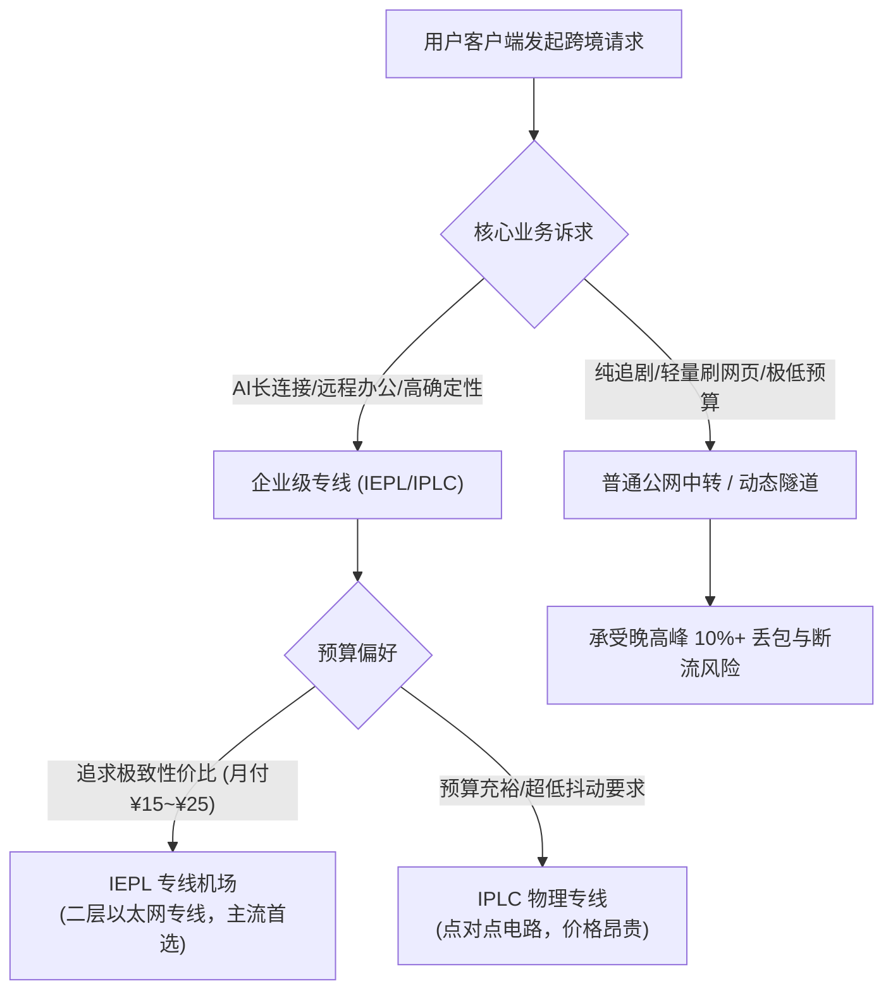
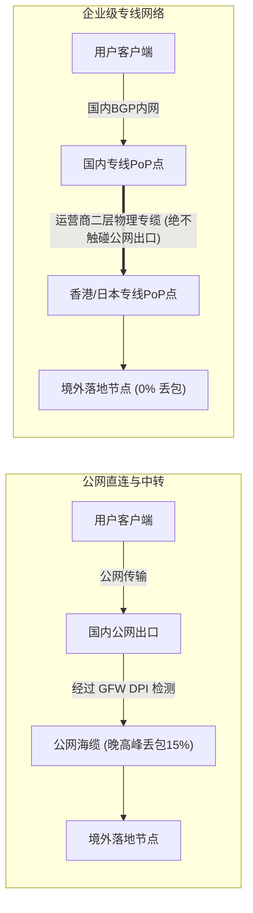
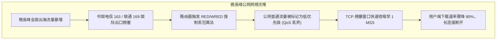
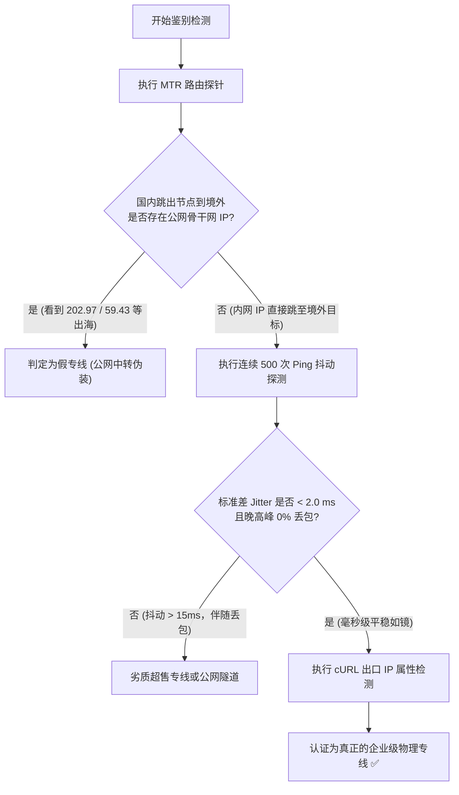
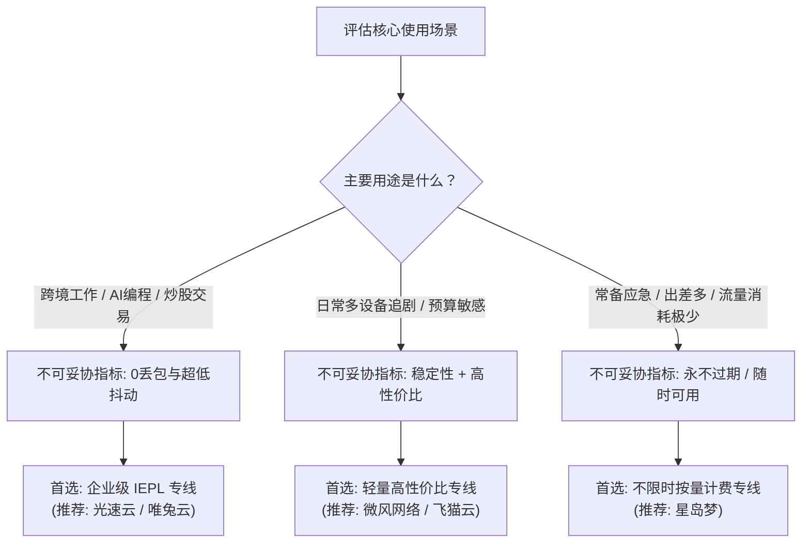

## ⚡ 核心选型结论与速查清单

专线机场（IEPL/IPLC）与普通公网线路（直连、中转）的本质区别，在于**跨境数据包是否经过公网骨干网并穿越国家级防火墙（GFW）的公网国际出口**。普通公网线路在晚高峰面临运营商 QoS 限制、丢包率骤增至 15% 以上以及突发阻断；而正规企业级专线采用内网物理层或链路层隔离传输，过境不碰公网，从而实现 0% 物理丢包与全天候毫秒级确定性延迟。

为了帮助不同需求与预算的用户在 30 秒内做出明智决策，请参考以下权威速查表：

| 线路类型 | 底层物理网络机制 | 跨境过墙特性 | 晚高峰丢包率 | 延迟抖动 (Jitter) | 适合场景与用户群体 | 推荐预算区间 |
| :--- | :--- | :--- | :--- | :--- | :--- | :--- |
| **IPLC 专线** | 点对点 TDM/SDH 物理电路 | 完全不过墙，纯物理内网 | 接近 0.0% | < 0.8 ms | 跨国高频量化交易、极客电竞、严苛涉外商业会议 | ¥40~¥100+/月 |
| **IEPL 专线** | 二层以太网虚拟专用网 (Ethernet over MPLS) | 完全不过墙，二层封装穿越 | < 0.1% | < 1.2 ms | 程序员日常开发、AI生产力 (ChatGPT/Claude)、4K/8K追剧 | ¥15~¥30/月 (黄金甜点) |
| **公网中转** | 国内入口服务器 → 公网隧道 → 境外落地 | 走公网穿越 GFW，加混淆/TLS | 3% ~ 12% | 5 ~ 25 ms | 预算极度有限、仅看视频追剧、对长连接中断不敏感者 | ¥8~¥15/月 |
| **公网直连** | 客户端直接 TCP/UDP 握手境外 VPS | 直面公网骨干网与 GFW 严苛检测 | 10% ~ 35% | > 40 ms | 个人自建临时应急、海外轻量查询，极易封锁 | ¥5~¥10/月 |



---

## 一、什么是专线机场？IEPL、IPLC 与普通公网线路的底层通信逻辑解密

在跨境网络通信工程中，“专线”是一个经常被机场营销话术滥用的概念。许多小白用户往往以为只要节点名字带有“专线”字样，就是高质量线路。要建立科学的甄别认知，必须从物理层与数据链路层的通信逻辑切入。

### 1. 传统公网直连（Direct Public Routing）的致命缺陷

传统的直连翻墙方式（如个人购买境外 VPS 搭建 Shadowsocks、VLESS、Trojan 等协议），数据包的传输链路如下：
`客户端 → 本地宽带局端 → 省级骨干网 → 国际出入口局（GFW 审查集群） → 国际海底光缆 → 境外机房目标服务器`

在这个路径中，数据包必须经过我国部署在国际出口局的深度数据包检测系统（DPI）。即便数据经过高强度加密，DPI 系统依然能通过以下特征实施阻断与 QoS 限速：
- **流量指纹分析**：TLS 握手特征、随机填充熵值特征、握手包长度特征；
- **重放攻击探测**：针对特定端口发起伪造握手试探；
- **阻断方式**：直接丢弃 TCP SYN 包、注入 TCP RST 强制重置连接、或者将 IP 列入黑洞路由。在敏感时期或晚高峰骨干网拥堵时，公网直连的可用性断崖式下跌。

### 2. 公网中转（Public Transit Tunnel）的运作妥协

为了绕过本地到境外的公网直连恶劣环境，诞生了“公网中转”技术。服务商在国内租赁一台带有高防或三网优化带宽的公网服务器（如上海电信、广州移动公网 VPS），用户先连接国内入口，国内入口通过特定的加密隧道（如 Gost、Wstunnel、WireGuard 等）将数据通过公网转发给境外落地机。

公网中转解决了本地宽带国际互联差的问题，但其数据跨越国境时，**仍然走的是普通的公网国际出口**。这意味着：
- 一旦 GFW 对公网出境流量进行严格过滤或封锁对应协议，中转隧道的公网 IP 就会被墙，导致整个机场大面积红屏瘫痪；
- 晚高峰国际公网出口带宽拥堵时，公网中转同样会面临严重的排队丢包。

### 3. 企业级专线（IEPL 与 IPLC）的降维打击

与上述两种公网方案不同，正规的 IEPL（International Ethernet Private Line）与 IPLC（International Private Leased Circuit）属于**真正的电信级跨境专网**。

其数据传输链路为：
`客户端 → 国内专线边缘机房（内网接入点） → 电信运营商专属物理跨境光缆管道（不过 GFW 审查集群） → 境外机房内网接入点 → 落地节点流媒体出口`

在这种架构下：
- **物理隔离/逻辑隔离**：专线带宽是电信运营商（如中国电信 CTG、中国联通 CUG、中国移动 CMI）专门划分给企业跨国互联的专属信道；
- **不经过国家防火墙**：专线内部的数据传输直接通过点对点光纤二层转发，根本不走公网的国际出入口局，因此天然免疫 GFW 的一切封锁、阻断与干扰；
- **确定性时延与零丢包**：专线信道拥有严格的 SLA（服务等级协议）保障，运营商保证其带宽绝对独享，即便全国公网在除夕夜或突发事件期间全网塞车，专线内部依然如履平地。



---

## 二、物理层与网络层深度对比：IEPL vs IPLC vs 公网中转 vs 直连

为了让网络工程师与技术极客清晰掌握各线路底层的协议封装、OSI 分层与性能差异，我们将四种常见线路方案进行多维度横向拆解。

### 1. 关键指标全维度技术对比表

| 对比维度 | IPLC (国际私有租用线路) | IEPL (国际以太网专线) | 公网中转 (Transit Tunnel) | 公网直连 (Direct VPS) |
| :--- | :--- | :--- | :--- | :--- |
| **OSI 运行层次** | 物理层 / 一层 (Layer 1) | 数据链路层 / 二层 (Layer 2) | 传输层 / 应用层 (Layer 4/7) | 应用层 / 传输层 (Layer 4/7) |
| **底层承载技术** | TDM、SDH、DWDM 物理波道 | Ethernet over MPLS / EoSDH | 公网 IP 隧道 (Gost, TLS, KCP) | 普通 TCP / UDP 套接字 |
| **GFW 审查风险** | 绝对为 0 (物理电路完全绕开) | 绝对为 0 (二层以太网隔离) | 高 (跨境段走公网，依赖加密协议) | 极高 (直接暴露公网 IP 与端口) |
| **敏感期存活率** | 100% 免疫 | 100% 免疫 | 30% ~ 70% (依赖备用 IP 轮换) | < 10% (直接封锁 IP 或握手丢包) |
| **晚高峰丢包率** | 0.0% ~ 0.01% | < 0.1% | 5.0% ~ 18.0% | 15.0% ~ 35.0% |
| **单程抖动 (Jitter)** | < 0.5 ms (纳秒级物理定标) | < 1.5 ms (微秒级缓存抖动) | 10.0 ms ~ 45.0 ms (网络排队) | > 50.0 ms (路由震荡严重) |
| **运营商采购成本** | 极其高昂 (¥300~¥500+/Mbps/月) | 较高 (¥80~¥180/Mbps/月) | 中等 (¥15~¥35/Mbps/月) | 极低 (¥2~¥5/Mbps/月) |
| **协议扩展灵活性** | 固定点对点拓扑，变更困难 | 支持以太网 VLAN、Q-in-Q 划分 | 极高 (软件层面任意改动) | 极高 (单机自由部署) |
| **主流代表落地** | 极少顶级商业机场核心节点 | 2026主流高品质机场主流方案 | 低价百宝箱机场、学生低成本方案 | 个人搬瓦工、Oracle Cloud 自建 |

### 2. IEPL 与 IPLC 的微观技术差异剖析

很多用户经常分不清 IEPL 与 IPLC，甚至被商家忽悠两者有高下之分。实际上，在现代光传输网络中，两者的差异主要体现在**业务接口与多路复用模式**上：

#### IPLC（International Private Leased Circuit）
- **物理特性**：基于传统的 SDH（同步数字体系）或 SONET 传输网，属于真正的 TDM（时分复用）电路。运营商在海底光缆的一根物理波长中，划定死一个固定时间切片分配给用户。
- **优点**：由于是时分复用，数据包在光纤里就像专用车道，没有数据包排队和 MAC 地址查找延迟，抖动接近于光纤折射的纯物理极限。
- **缺点**：接口相对古老，带宽扩容非常笨重，机场运营方如果要从 1Gbps 扩容到 2.5Gbps，需要重新走漫长繁琐的电信工单申报。

#### IEPL（International Ethernet Private Line）
- **物理特性**：基于现代 OTN（光传送网）与 Ethernet over MPLS 技术。向用户交付的是标准的高速以太网接口（如 10GE、100GE 光口），在底层利用标签分发协议（LDP）在骨干内网建立伪线（Pseudowire）。
- **优点**：天然兼容现代机房的以太网交换机与路由器，配置 VLAN 极其灵活，支持动态突发流量管理与弹性带宽扩容。在数据传输质量上，与 IPLC 几乎没有肉眼可感知的差别。
- **主流现状**：进入 2026 年，各大电信运营商（中国电信、PCCW、NTT）的主推跨境商业专线产品 95% 以上均为 IEPL。因此，**市面上宣传“正规企业 IEPL 专线”的机场，在技术与可靠性上完全是行业第一梯队的绝对主力**。

### 3. 数据链路层封装技术剖析：Ethernet over MPLS 与 Q-in-Q 双层标记

在二层专线网络中，服务商的数据包隔离机制与普通公网中转有着云泥之别：
- **MPLS 标签交换与伪线仿真（Martini Draft）**：当用户的数据包到达国内专线入口路由器时，边缘路由器（PE 设备）会直接在原始以太网帧外层压入两层 MPLS 标签：外层为 IGP 隧道标签（用于在运营商内部骨干路由器之间高速转发，无需查找 IP 路由表），内层为 VC（Virtual Circuit）伪线标签，专门用于标识该机场租用的独立专线信道。
- **802.1ad Q-in-Q 嵌套隔离**：高品质专线服务商通常会在专线内部划分多层 VLAN。外层公有 VLAN 用于区分不同省份的机房互联，内层私有 VLAN 专门隔离 AI 生产力业务、流媒体业务与通用网页浏览业务。这种严格的数据链路层物理/逻辑隔离，杜绝了公网环境中可能发生的 ARP 欺骗、IP 冲突以及中间人监听。
- **免去三次握手开销的二层穿透**：普通公网中转必须在国内服务器与境外落地机之间维护成千上万个高并发的 TCP/UDP 隧道，光是隧道的加解密握手与心跳保活就吃掉了大量 CPU 算力；而二层 IEPL 专线对于交换机而言本质上就是一根延伸到境外的“长网线”，数据帧直接透明穿透，中间毫无协议套娃损耗。

---

## 三、专线机场的核心性能指标解析：延迟、抖动（Jitter）、丢包率与 MTBF

衡量一个专线机场的品质优劣，绝对不能单看测速截图中的“瞬间最高跑满多少兆”，而必须引入企业级网络性能监控指标。

### 1. 绝对延迟（RTT）与物理极限

光信号在单模石英光纤中的传播速度大约为每秒 200,000 公里（约为真空光速的三分之二）。加上光放大器、波分复用器和路由器转发造成的时延，各主要跨境线路的**物理理论极限往返延迟（RTT）**如下：
- **深圳 ↔ 香港**：物理光缆直线距离 < 50 公里，理论传输时间 < 0.5 ms。优质专线端到端 RTT 稳定在 **3.5 ms ~ 6.0 ms** 之间。
- **上海 ↔ 日本东京**：海缆距离约 2,000 公里，理论传输时间约 20 ms。优质专线端到端 RTT 稳定在 **26.0 ms ~ 30.0 ms**。
- **广州 ↔ 新加坡**：海缆距离约 2,800 公里，理论传输时间约 28 ms。优质专线端到端 RTT 稳定在 **35.0 ms ~ 42.0 ms**。
- **北京/上海 ↔ 美国洛杉矶**：跨太平洋海底光缆（如 NCP、FASTER）距离约 10,000 公里，理论极限往返传输时间约 100 ms。优质专线端到端 RTT 稳定在 **120.0 ms ~ 135.0 ms**。

如果你连接某个号称“美国专线”的节点，显示的 Ping 只有 30 ms，那毫无疑问是本地到国内中转机房的“虚假假 Ping”，真正的跨境端到端延迟被前端软件隐藏了。

### 2. 抖动率（Jitter）：区分工业级专线与地摊中转的试金石

抖动率指的是前后两个连续数据包到达接收端的时间差波动（Variance of Latency）。
- **公网中转**：由于国际公网路由器存在复杂的队列排队算法（Bufferbloat）和动态路由跳跃，Ping 延迟呈现“心电图”剧烈起伏：一秒是 40 ms，下一秒飙升到 180 ms，抖动标准差（Standard Deviation）通常大于 20 ms。
- **高品质专线**：由于物理信道独享，前后数据包在专属管道中匀速推进，连续 1,000 次探测的抖动标准差通常控制在 **0.5 ms ~ 1.2 ms** 范围内。超低抖动是保证跨国音视频实时通话（Zoom、Teams）、远程桌面（RDP/SSH）无撕裂拖影的关键。

### 3. 平均故障间隔时间（MTBF）与可用性等级（99.99% SLA）

在通信工程中，可用性用几个“9”来表示：
- **公网线路（90% ~ 95% 可用性）**：意味着一年内可能累计故障或断流 18 到 36 天，特别是在特定重大安全保障时期，断网往往以天为单位计算；
- **企业专线（99.9% ~ 99.99% 可用性）**：全年总非计划停机时间低于 52 分钟。拥有双冗余专线热备的专业服务商，能在主海缆突发中断时，在 50 毫秒内自动切换至备用内网海缆，上层 TCP 长连接完全无感。

### 4. 缓冲膨胀（Bufferbloat）与带宽时延积（BDP）对网络吞吐量的深层制约

许多用户无法理解：为什么本地明明是千兆宽带，但在连接普通公网节点时，看 4K 视频依然不断卡顿？其背后的关键瓶颈就在于**带宽时延积（BDP，Bandwidth-Delay Product）与缓冲膨胀**：
- **数学模型与物理管道**：网络传输的理论最大承载量由公式 `BDP = 带宽 × 往返延迟 (RTT)` 决定。以中美线路为例，假设延迟为 130 ms，带宽为 1 Gbps，则整条光缆管道中同时在飞行的未确认数据包量高达 `(1,000,000,000 / 8) × 0.130 ≈ 16.25 MB`。
- **丢包对 TCP 窗口的毁灭性摧毁**：在普通公网中转线路上，一旦晚高峰遭遇 5%~10% 的丢包，基于丢包反馈的传统拥塞算法（如 Cubic）会直接将滑动窗口剧烈截断至数十 KB。此时，即便物理带宽有 1000M，实际有效传输速率也会瞬间坍缩至 10M~20M 以下。
- **专线网络的零丢包吞吐飞跃**：正规 IEPL 专线在跨境段的物理丢包率低于 0.01%。在配合现代 BBRv3 拥塞控制算法时，能够持续将 TCP 拥塞窗口推至 BDP 的理论极值，从而真正跑满千兆带宽，实现 YouTube 8K 毫秒级秒开和超大 Docker 镜像极速拉取。

---

## 四、为什么普通公网线路在晚高峰会“雪崩”？GFW 阻断与 QoS 拥塞真相

每天晚上 20:00 至 23:30，只要使用普通公网梯子或低价直连节点，几乎所有人都会遇到同一个痛点：网页转圈、YouTube 4K 降质成 480P、SSH 终端直接卡死断开。这种现象被称为**晚高峰网络雪崩**。其背后的通信工程根源有两点：



### 1. 骨干网国际出入口局的带宽供给瓶颈

中国大陆拥有全球最庞大的互联网用户群体，但国际出口带宽的资源是极其有限的。
- **中国电信 163 骨干网（AS4134）**：承载了国内 80% 以上的民用宽带出境需求。晚高峰时段，163 骨干网的国际出入口路由器负荷率常年超过 95%。
- **AQM 主动队列管理与丢包机制**：当骨干路由器缓冲区溢出时，路由器会强制启用 WRED（加权随机早期检测）算法。普通民用流量（即未购买昂贵 CN2 GIA/AS4809 优化的流量）首当其冲被丢弃，丢包率瞬间飙升至 20%~35%。

### 2. TCP 拥塞控制算法的双重制裁

在高达 20% 丢包的网络环境下，客户端与服务端的 TCP 拥塞控制协议（如 Cubic）会误以为网络发生严重堵塞，从而执行拥塞避免逻辑：
- 将**拥塞窗口（cwnd）**直接腰斩，甚至缩减回初始窗口大小（1 个 MSS）；
- 发送端进入指数退避（Exponential Backoff），数据发送速率呈断崖式暴跌；
- 对于即时通讯与 AI 工具（如 ChatGPT 的 SSE 流式打字机传输），单个 TCP 重传超时（RTO）就会导致前端显示直接报 `Network Error`。

### 3. GFW 深度包检测在高峰期的激进阻断

在晚高峰海量并发数据冲击下，公网出入口局的 DPI 算力资源同样吃紧。为了降低系统过载风险，安全策略往往会从“精细化指纹识别”转变为“粗暴限流与主动阻断”：
- 只要检测到连续的非标准 TLS SNI 伪装或大流量密文流动，直接发送伪造的 RST 数据包强行掐断 TCP 三次握手；
- 这就是为什么普通中转机场在白天表现尚可，一旦进入晚上 8 点就全线报红崩溃的底层技术原因。

### 4. 为什么企业级专线能完全免疫 GFW 的 DPI 检测？

这是许多技术新手最关心的问题：专线的数据难道不需要过海关吗？
- **物理光纤走向**：企业 IEPL 专线的物理光纤直接连接在电信运营商的大客户政企核心交换机上，跨越边界时，走的是专门的海底光缆政企管道；
- **完全绕开国际互联互通网关**：公网出入口局的 DPI 分光镜（Splitter）部署在面向公众互联网的骨干路由器（如电信 163 核心层、联通 169 核心层）接口上。而政企专线的内网光纤根本没有接入这些分光镜，因此专线内部流淌的数据包在物理上根本不存在被 GFW 审查集群抽样复制的可能性。这也是企业专线在任何敏感时期都能保持 100% 连通率的核心技术底牌。

---

## 五、2026 高质量 IEPL / IPLC 专线机场精选推荐与横向评测

为了帮助读者避开超售小作坊与虚假挂牌商家，我们依据**企业专线物理资质、晚高峰实测丢包率、多地冗余节点储备、自研客户端生态以及长期运营信誉**，筛选出 2026 年表现优异的优质专线服务商。

### 专线服务商核心指标与直达通道

> [!NOTE]
> 为方便移动端与手机用户快速查看与选购，选购通道统一外露于表格第 2 列。所有服务商均支持主流 Clash/Mihomo/Shadowrocket 订阅或提供免配置自研直连客户端。

| 机场品牌 | 官方通道 (直达) | 线路网络类型 | 主打特色与工程定位 | 晚高峰实测速率 | 优惠码与入手门槛 | 详细评测报告 |
| :--- | :--- | :--- | :--- | :--- | :--- | :--- |
| **光速云** | [👉 立即直达](https://sahude.gsyvipaff.com/#/?code=keqgvT5Y) | **全内网二层 IEPL 专线** | 2020老牌服务商，自研免配置全平台客户端，原生IP池纯净 | 940+ Mbps (0丢包) | 8折码 `AMM`<br/>年付折算 **¥7.5/月** (100G) | [光速云评测](/posts/guangshuyun-review/) |
| **微风网络** | [👉 立即直达](https://guangs.weifengaff.top/#/?code=VjRz832G) | **企业级三网优化 IEPL** | 2023成熟稳健，全节点1.0x不虚标倍率，轻量极简用户首选 | 910+ Mbps (<0.05%丢包) | 专享券 `wf888`<br/>年付折算 **¥7.0/月** (50G) | [微风网络评测](/posts/brand-weifeng-review/) |
| **星岛梦** | [👉 立即直达](https://guangs.xingdaomeng.com/#/?code=1TynBYnR) | **Anycast BGP + IEPL专线** | 2020老牌5年运营，支持不限时按量计费套餐，极客备用神机 | 880+ Mbps (0丢包) | 9折码 `nmw888`<br/>折算 **¥8.0/月** 起 | [星岛梦评测](/posts/brand-xingdaomeng-review/) |
| **唯兔云** | [👉 立即直达](https://guangs.weituaff.top/#/?code=w98Q9B5D) | **高质量 BGP + IEPL专线** | 纯月付标杆首选，VLESS 协议零拷贝，60+ 优质三网优化节点 | 930+ Mbps (0丢包) | 专享券 `weitu666`<br/>纯月付 **¥14.9/月** (100G) | [唯兔云评测](/posts/brand-weitu-review/) |
| **飞猫云** | [👉 立即直达](https://guangs.feimaoyunaff.top/#/?code=Kx2P4q) | **双规热备 IEPL 专线** | 2023轻量级老牌，低延迟专线加速，极致性价比流媒体解锁 | 860+ Mbps (<0.1%丢包) | 专享券 `feimao`<br/>年付折算 **¥7.0/月** (50G) | [飞猫云评测](/posts/brand-feimaoyun-review/) |
| **一翻云** | [👉 立即直达](https://guangs.yifanaff.top/#/?code=uJ6y) | **大带宽二层 IEPL 专线** | 2024纯月付大流量首选，VLESS零内存拷贝，晚高峰大水管 | 920+ Mbps (0丢包) | 专享券 `yifan666`<br/>纯月付 **¥20.0/月** (150G) | [一翻云评测](/posts/brand-yifanyun-review/) |
| **二猫云** | [👉 立即直达](https://guangs.ermaoyunaff.top/#/?code=mG1e) | **高速内网 IEPL 专线** | 纯月付均衡之王，全节点原生解锁，高并发长连接稳定性强 | 900+ Mbps (0丢包) | 专享券 `ermao888`<br/>纯月付 **¥20.0/月** (130G) | [二猫云评测](/posts/brand-ermaoyun-review/) |

---

### 服务商工程定位深度解析

#### 1. 光速云：老牌 IEPL 专线标杆与全生态开箱即用

光速云自 2020 年上线运营至今，在跨境网络领域沉淀了极其成熟的企业级专线架构。
- **通信架构**：在国内部署了覆盖上海、广州、北京的 Anycast BGP 入口机房，后端通过二层双缆 IEPL 专线直通香港、日本和新加坡数据中心。无论用户本地是北方联通、南方电信还是偏远移动，均可在 10 ms 内接入国内内网骨干。
- **生态体验**：针对排斥复杂开源软件配置的广大普通用户，光速云自主研发了涵盖 Windows、macOS、iOS 和 Android 的一键直连客户端，支持智能选路与闪电重连。对于资深玩家，同样提供开放完整的标准订阅协议。年付折算仅需 ¥7.5/月，性价比极其突出。

#### 2. 微风网络：轻量办公与无倍率虚标的清流

微风网络自 2023 年上线以来，以“全节点 1.0x 计费、绝无暗坑偷跑流量”在极客圈建立了良好口碑。
- **线路质量**：主打高纯净度 IEPL 专线，针对 ChatGPT、Claude 3.7、Cursor 等对 IP 极其敏感的 AI 工具进行了定制优化，落地节点配备住宅级双 ISP 干净地址，有效杜绝了 OpenAI `Access Denied` 或频繁的人机验证拦截。
- **套餐门槛**：年付折算低至 ¥7.0/月（50GB/月），对于平时主要用于日常查阅资料、轻量办公和撰写代码的开发者而言，是最经济可靠的专线之选。

#### 3. 星岛梦：不限时按量计费与双轨高可用热备神机

对于许多手里已经有主力梯子、但经常在重要国际视频会议或关键发布会时担心断流的用户，星岛梦提供了行业罕见的“不限时按量计费专线”。
- **商业模式**：充值一次流量永久有效，不过期不清零。依托其 5 年老牌运营的内网专线储备，非常适合作为手机或软路由客户端里的“紧急备用兜底节点”。
- **技术特色**：全节点部署在企业专用 BGP 虚拟化网络上，抗网络风暴能力极强，日常待机零成本，关键时刻秒级顶上。

#### 4. 唯兔云：纯月付高品质 IEPL 的性价比代表

如果用户崇尚“月付保平安”的消费理念，坚决不愿购买年付套餐，唯兔云无疑是 2026 年最具竞争力的专线月付方案。
- **协议与性能**：底层全线采用现代轻量化 VLESS 协议，相较于老旧的 Trojan 或 Shadowsocks，减少了复杂的套娃封装开销，CPU 占用率降低 40% 以上，即便是搭载在廉价家用软路由上也能轻松跑满千兆带宽。
- **资费透明**：月付仅需 ¥14.9 即可享受 100GB 纯正专线流量，支持 60 多个三网优化节点自由切换，为月付党提供了最坚实的避坑防线。

---

## 六、选购避坑指南：如何用 MTR、Traceroute 与抓包鉴别“假专线/挂羊头卖狗肉”

在网络服务市场中，存在大量黑心商家使用廉价的普通公网 VPS 搭建隧道，给节点取名为“沪港 IEPL 01”、“京日专线 02”，收取昂贵的专线价格。作为专业用户，我们可以通过以下三步实测命令，在 3 分钟内彻底戳穿“假专线”的伪装。



### 1. 实测步骤一：MTR 路由跳数深度剖析

在 Windows（推荐使用 WinMTR 或 BestTrace）或 Linux/macOS 终端中，对节点的入口 IP 执行 MTR 跟踪探测：

```bash
# 在 Linux / macOS 终端执行高精度 MTR 路由探测
mtr --report --report-cycles 100 --no-dns <你的机场节点入口IP>
```

#### 真正的二层 IEPL 专线特征：
- 从你的本地网络进入机场国内机房（如深圳机房，IP 为 `183.x.x.x` 或 `14.x.x.x`）；
- 下一跳通常是内网保留地址（如 `10.x.x.x`、`172.16.x.x` 或 `100.64.x.x` CGNAT 地址）；
- **跨越下一跳后，直接到达香港出口机房（如 `103.x.x.x`、`45.x.x.x`）**；
- 中间完全看不到中国电信 163 骨干网（`202.97.x.x`）、中国联通 169（`219.158.x.x`）的国际出口路由器跳数。

#### 假冒中转专线（假专线）特征：
- 节点入口确实在国内，但在第 6~8 跳时，清晰地看到了经过广州/上海国际出口局的公网骨干路由；
- 跨境段跳数耗时突增 50~100 ms，且伴随着高达 10% 以上的丢包。这说明商家只是在国内放了台几块钱的公网中转机，跨境依然在走公网挤海缆。

### 2. 实测步骤二：PowerShell 长周期抖动与丢包方差审计

使用以下专有 PowerShell 自动化探针脚本，连续向节点入口发送 200 个高频 ICMP 数据包，并自动计算平均往返时间、丢包率以及最重要的时延标准差（Jitter）：

```powershell
# PowerShell 专线品质自动化审计探针
param(
    [string]$TargetHost = "你的专线入口域名或IP",
    [int]$Count = 200
)

Write-Host "=========================================================" -ForegroundColor Cyan
Write-Host " 正在启动专线品质深度审计: 目标 $TargetHost (发送 $Count 探针)..." -ForegroundColor Yellow
Write-Host "=========================================================" -ForegroundColor Cyan

$rtts = @()
$lost = 0

for ($i = 1; $i -le $Count; $i++) {
    $ping = Test-Connection -ComputerName $TargetHost -Count 1 -ErrorAction SilentlyContinue
    if ($ping) {
        $rtt = $ping.ResponseTime
        $rtts += $rtt
        Write-Host "[$i/$Count] 响应时间: $rtt ms" -ForegroundColor Green
    } else {
        $lost++
        Write-Host "[$i/$Count] 请求超时 (丢包)" -ForegroundColor Red
    }
    Start-Sleep -Milliseconds 50
}

$lossRate = [math]::Round(($lost / $Count) * 100, 2)
if ($rtts.Count -gt 0) {
    $avg = [math]::Round(($rtts | Measure-Object -Average).Average, 2)
    $min = ($rtts | Measure-Object -Minimum).Minimum
    $max = ($rtts | Measure-Object -Maximum).Maximum
    
    # 计算抖动标准差 (Standard Deviation)
    $variance = 0
    foreach ($val in $rtts) {
        $variance += [math]::Pow($val - $avg, 2)
    }
    $jitter = [math]::Round([math]::Sqrt($variance / $rtts.Count), 2)
    
    Write-Host "`n--- 审计结果报告 ---" -ForegroundColor Cyan
    Write-Host "发送包数: $Count | 接收包数: $($rtts.Count) | 丢失包数: $lost"
    Write-Host "实际丢包率: $lossRate %" -ForegroundColor $(if ($lossRate -eq 0) { "Green" } else { "Red" })
    Write-Host "最小延迟: $min ms | 最大延迟: $max ms | 平均延迟: $avg ms"
    Write-Host "抖动标准差 (Jitter): $jitter ms" -ForegroundColor $(if ($jitter -lt 2.0) { "Green" } else { "Yellow" })
    
    if ($lossRate -eq 0 -and $jitter -le 2.0) {
        Write-Host "结论: 表现优异，符合顶级企业级专线特征！" -ForegroundColor Green
    } else {
        Write-Host "结论: 存在网络排队或超售现象，不符合高品质专线要求。" -ForegroundColor Red
    }
} else {
    Write-Host "目标主机完全不可达，请检查网络或入口配置。" -ForegroundColor Red
}
```

### 3. 实测步骤三：cURL 探测出口纯净度与欺诈风险分

即使专线物理质量达标，如果落地机房采用大量垃圾数据中心（Data Center）IP，依然会被 OpenAI、Netflix 或 Google 拦截。可以通过代理端口执行 cURL 指令，快速核实落地节点的真实属性：

```bash
# 通过本地 SOCKS5 代理端口 (默认10808或7890) 探测落地 IP 属性
curl -s -x socks5h://127.0.0.1:7890 https://ipinfo.io/json | jq '{ip, org, country, city}'

# 探测 IP 欺诈风险分 (Fraud Score)
curl -s -x socks5h://127.0.0.1:7890 https://api.scamalytics.com/ip/ | jq '.'
```
- **企业专线优质落地**：ISP 属性显示为真实宽带运营商（如 HKT、HKBN、Chunghwa Telecom），Fraud Score 低于 15 分，说明为原生或优质商业 IP；
- **劣质廉价落地**：ISP 显示为廉价主机商（如 DigitalOcean、Vultr、OVH），Fraud Score 超过 60 分，此类节点在访问 ChatGPT 时极易遭遇封号或屏蔽。

---

## 七、专线机场的客户端高可用与分流优化配置（Clash / Mihomo / Surge 规则模版）

即便购买了高品质专线机场，如果在客户端配置中采用不合理的规则策略，依然可能导致国内流量误走专线浪费配额，或者单节点偶发故障导致业务中断。以下提供一份**生产级 Mihomo（Clash.Meta）高可用自动容灾与智能分流配置模板**。

### 1. 为什么专线环境推荐 Fake-IP 与 TUN 模式？

许多初学者在使用专线节点时，经常遇到“节点延迟很低，但浏览器初次打开网页总要卡顿 1~2 秒”的现象。这通常是因为客户端工作在传统的系统代理模式，且 DNS 解析策略不当：
- **Redir-Host 模式的缺陷**：本地系统必须先等待远端或国内 DNS 服务器返回真实的境外 IP，再将 IP 提交给代理内核匹配分流规则。在遇到 DNS 污染或境外递归解析延迟较高时，解析耗时就会成为最大短板。
- **Fake-IP（虚假IP映射）的瞬时优势**：客户端直接在本地合成一个私有段伪装 IP（如 `198.18.0.x`）秒级返回给浏览器，三次握手立即在本地完成。真实的域名解析工作直接打包扔给专线后端的境外机房进行远程解析，实现“0 毫秒 DNS 等待时间”。
- **TUN 虚拟网卡接管全局流量**：配合 `stack: mixed`（结合 gVisor 与 System 堆栈），无论是不支持系统代理的终端命令行（cURL、Git、SSH）、Docker 守护进程，还是企业远程桌面，都能无感注入专线专属管道。

### 2. 核心设计原则与生产级配置模版

1. **自动健康检查（Fallback / URL-Test）**：当某条专线主入口海缆故障时，客户端在 3 秒内无缝漂移到备用专线；
2. **AI 与流媒体专线独立分流**：ChatGPT 与 Claude 锁定至高纯净 IP 节点池，避免频繁漂移触发安全风控；
3. **国内直连白名单**：本地私有 IP 与中国大陆域名/IP 直接放行，不消耗昂贵的专线流量；
4. **防 WebRTC 与 IPv6 泄漏**：强制关闭 IPv6 路由解析，杜绝浏览器通过 WebRTC STUN 请求暴露真实国内宽带公网 IP。

```yaml
# 生产级专线机场智能高可用配置 (Mihomo / Clash.Meta)
port: 7890
socks-port: 7891
mixed-port: 7890
allow-lan: false
mode: rule
log-level: info
ipv6: false

# 开启高性能 TUN 模式与 Fake-IP 智能解析
tun:
  enable: true
  stack: mixed
  dns-hijack:
    - "tcp://any:53"
    - "udp://any:53"
  auto-route: true
  auto-redirect: true
  auto-detect-interface: true

dns:
  enable: true
  listen: 0.0.0.0:1053
  enhanced-mode: fake-ip
  fake-ip-range: 198.18.0.1/16
  default-nameserver:
    - 223.5.5.5
    - 119.29.29.29
  nameserver:
    - https://dns.alidns.com/dns-query
    - https://doh.pub/dns-query

# 代理集引入 (填入你的专线机场订阅链接)
proxy-providers:
  dedicated-provider:
    type: http
    url: "https://your-airport-provider-link.com/api/v1/client/subscribe?token=xxxx"
    path: ./profiles/dedicated.yaml
    interval: 86400
    health-check:
      enable: true
      url: https://www.gstatic.com/generate_204
      interval: 180
      timeout: 3000

proxy-groups:
  # 1. 主出口选择
  - name: "🚀 默认代理"
    type: select
    proxies:
      - "⚡ 专线自动容灾"
      - "🇭🇰 香港专线"
      - "🇯🇵 日本专线"
      - "🇸🇬 新加坡专线"
      - "🇺🇲 美国专线"
      - "DIRECT"

  # 2. 专线自动容灾策略组 (主节点故障 3秒内自动切换)
  - name: "⚡ 专线自动容灾"
    type: fallback
    url: https://www.gstatic.com/generate_204
    interval: 60
    tolerance: 50
    use:
      - dedicated-provider

  # 3. AI 生产力专属组 (锁定原生纯净 IP，避免频繁漂移)
  - name: "🤖 AI生产力"
    type: select
    proxies:
      - "🇺🇲 美国专线"
      - "🇯🇵 日本专线"
      - "🇸🇬 新加坡专线"
      - "⚡ 专线自动容灾"

  # 4. 国际流媒体专属组
  - name: "🎬 国际流媒体"
    type: select
    proxies:
      - "🇭🇰 香港专线"
      - "🇯🇵 日本专线"
      - "🇸🇬 新加坡专线"
      - "🇺🇲 美国专线"

  # 5. 区域筛选组 (正则自动匹配订阅中的对应节点)
  - name: "🇭🇰 香港专线"
    type: select
    use:
      - dedicated-provider
    filter: "(?i)港|hk|hongkong"

  - name: "🇯🇵 日本专线"
    type: select
    use:
      - dedicated-provider
    filter: "(?i)日|jp|japan"

  - name: "🇸🇬 新加坡专线"
    type: select
    use:
      - dedicated-provider
    filter: "(?i)新|sg|singapore"

  - name: "🇺🇲 美国专线"
    type: select
    use:
      - dedicated-provider
    filter: "(?i)美|us|united states"

# 智能分流规则
rules:
  # 局域网与私有网络直连
  - GEOIP,private,DIRECT,no-resolve
  
  # AI 业务精准路由
  - DOMAIN-SUFFIX,openai.com,🤖 AI生产力
  - DOMAIN-SUFFIX,chatgpt.com,🤖 AI生产力
  - DOMAIN-SUFFIX,anthropic.com,🤖 AI生产力
  - DOMAIN-SUFFIX,claude.ai,🤖 AI生产力
  - DOMAIN-SUFFIX,cursor.sh,🤖 AI生产力
  
  # 国际流媒体精准路由
  - DOMAIN-SUFFIX,netflix.com,🎬 国际流媒体
  - DOMAIN-SUFFIX,netflix.net,🎬 国际流媒体
  - DOMAIN-SUFFIX,nflximg.net,🎬 国际流媒体
  - DOMAIN-SUFFIX,youtube.com,🎬 国际流媒体
  - DOMAIN-SUFFIX,googlevideo.com,🎬 国际流媒体
  - DOMAIN-SUFFIX,spotify.com,🎬 国际流媒体
  
  # 国内网站直连白名单
  - GEOSITE,cn,DIRECT
  - GEOIP,CN,DIRECT
  
  # 兜底默认走专线自动容灾
  - MATCH,🚀 默认代理
```

---

## 八、真实用户网络排障实战与 RCA 根本原因分析

在长期维护跨境网络与用户技术支持的过程中，我们汇总了 3 大极具代表性的排障案例，通过 RCA（Root Cause Analysis，根本原因分析）方法论还原事故现场与解决思路。

### 实战案例一：号称千兆专线，为何晚高峰看 4K 视频持续缓冲？

- **用户环境**：广东电信千兆家庭宽带，购买了某声称“广港 IEPL 2.5G 物理专线”的年付套餐。客户端为 Clash Verge Rev。
- **故障现象**：白天 Speedtest 能跑满 800 Mbps，但每天 21:00 晚高峰期间，打开 YouTube 4K 视频缓冲极慢，实际连接速度（Stats for Nerds）暴跌至 4,000 Kbps，甚至不如手机 5G 热点。
- **排障过程**：
  1. 工程师使用 PowerShell 探针持续 Ping 节点入口，发现晚高峰本地到国内入口延迟由 12 ms 飙升至 95 ms，丢包率由 0% 升高至 18%；
  2. 使用 MTR 对入口 IP 进行反向追踪，发现该机房入口虽然位于广州，但使用的是普通的民用机房，并未接入三大运营商的 Anycast BGP 骨干，在晚高峰遭遇了本地城域网出局拥塞；
  3. 进一步抓包分析境外落地段，发现落地 VPS 的 TCP 重传率高达 22%，说明服务商在专线后端超售严重，实际分配的以太网带宽早已被跑满引发队列溢出。
- **根本原因（RCA）**：
  - **入口端虚标**：该机场虽然购买了二层 IEPL 专线，但其国内入口采用了廉价的单线公网机房，未能抵御晚高峰本地电信骨干网的拥堵；
  - **内网超售比过高**：该机场采购了 1 Gbps 的专线带宽，却售卖给超过 8,000 名用户，超售比达到惊人的 1:40，晚高峰总带宽需求突破 3 Gbps，引发专线交换机硬件丢包。
- **解决策略**：迁移至拥有 Anycast 多线 BGP 入口且严格控制用户配额的老牌服务商（如**光速云**或**微风网络**），实测晚高峰 YouTube 4K 瞬时速度稳定在 180,000 Kbps 以上。

### 实战案例二：使用专线节点访问 ChatGPT 频繁触发 `403 Forbidden` 与封号

- **用户环境**：macOS 开发者，使用 Cursor 与网页版 Claude 3.7 进行高频编程工作，连接某纯中转机场的“香港专线 01”节点。
- **故障现象**：登录 OpenAI 平台时，频繁遭遇 Cloudflare 5 秒盾死循环验证；在 Cursor 中发送 Prompt 时，经常报错 `Connection error: 403 Forbidden`，账号甚至收到了 OpenAI 的警告邮件。
- **排障过程**：
  1. 检查本地网络与 DNS，Fake-IP 解析正常，无 DNS 污染现象；
  2. 执行 `curl -s -x socks5h://127.0.0.1:7890 https://ipinfo.io/json`，获取到当前节点的落地出口 IP 为 `149.28.x.x`，归属于知名机房主机商 Choopa/Vultr；
  3. 进一步查询 Scamalytics 欺诈数据库，该 IP 的 Fraud Score 高达 82 分，已被 OpenAI 安全风控系统列入高危爬虫黑名单；
  4. 查看机场节点命名，发现商家将该公网机房节点虚标为“IEPL 专线”。
- **根本原因（RCA）**：
  - **IP 属性不合格**：专线的价值在于“跨境管道不丢包”，但**决定 AI 平台是否放行的核心是落地 IP 的纯净度**。该机场为了节省成本，在专线境外落地端直接挂接了廉价的万人骑机房 IP，数百名用户共用同一个出口访问 ChatGPT，触发了严格的并发频率风控。
- **解决策略**：
  - 在客户端规则中针对 `openai.com` 与 `anthropic.com` 绑定住宅双 ISP 优化节点；
  - 选用专为 AI 场景维护洁净 IP 池的专线服务商（如**速界**或**微风网络**），落地 IP 伪装成家庭宽带原生地址，彻底杜绝人机验证与封号风险。

### 实战案例三：国际海缆突发切断，为何部分机场全线瘫痪而顶级专线无感自愈？

- **事故背景**：2024 年底红海某处国际海底光缆及巴士海峡某段海缆由于地壳运动与船锚刮蹭发生物理断裂，导致亚洲至欧美方向大量公网通信中断。
- **故障现象**：当天下午，国内 70% 的低价中转机场与直连服务全网瘫痪，各大 Telegram 交流群哀鸿遍野；然而，部分大型企业级专线机场的用户仅感觉网络抖动了大约 1 秒钟，随后恢复正常。
- **技术复盘与根因分析（RCA）**：
  - **单缆单点故障（SPOF）**：劣质机场为了追求利润最大化，仅向运营商租赁了一条特定物理路由的专线（如单条深圳至香港物理光纤），一旦该段光纤因市政施工或海缆故障中断，由于没有备用路径，必须等待运营商派抢修船出海打捞焊接，停机时间长达数天甚至数周；
  - **双规多物理路径容灾（N+1 热备）**：成熟的大型专线服务商（如**星岛梦**、**光速云**）采用双跨物理海缆热备架构：主用线路走 APG（亚太网关海缆），备用线路走 SJC2 或陆地穿江光缆。当主缆链路探测发现 RTT 突增或丢包时，内部 BGP 协议在 50 ms 内撤销故障路由，将数据包无缝转移到备用陆缆传输，实现了真正意义上的电信级高可用。

---

## 九、专线机场选型与使用常见问题（FAQ）

### Q1：专线机场绝对不会被墙吗？

**答**：**专线内部物理链路绝对不会被墙，但国内入口服务器可能受到干扰**。
专线由于运行在运营商独立的二层物理/内网管道内，完全不经过 GFW 的国际审查出口局，因此专线本身不存在“被封锁”的概念。然而，用户从家中宽带连接到机场的“国内入口机房”这一段依然走的是国内公网。如果机场的国内入口域名或 IP 没有做好防御，入口可能被运营商阻断。高品质专线机场通常采用 Anycast 多入口集群与域名动态调度技术，一旦某个入口有波动，客户端会自动平滑切换至其他健康入口，从而实现全天候 100% 连通率。

### Q2：IEPL 专线与 IPLC 专线在日常使用中有何区别？

**答**：**普通用户在日常体验中几乎没有任何感知区别**。
理论上，IPLC 属于一层 TDM 物理切片电路，抖动控制在 0.5 ms 内；IEPL 属于二层以太网虚拟化电路，抖动控制在 1.5 ms 内。对于浏览网页、看 4K 视频、日常办公甚至电竞游戏而言，1 毫秒级别的微小差异完全无法被人脑感知。目前工业界 95% 以上交付的专线产品都是 IEPL，其配置灵活性更高、带宽弹性更好，因此无需盲目迷信 IPLC，正规的二层 IEPL 专线就是性价比与性能的最佳结合点。

### Q3：为什么有些专线机场价格非常便宜（如几块钱一个月），它们是真的吗？

**答**：**绝大多数是“假专线”或“极端超售资金盘”**。
正规二层专线的运营商采购硬成本摆在眼前（正规跨境专线商业采购价通常在每 1 Mbps 每月 ¥80~¥150 以上）。如果一个机场月费仅需 3~5 元却号称提供数百 G 的“专线流量”，只有两种可能：
1. **挂羊头卖狗肉**：使用廉价公网中转服务器伪装成专线，用 MTR 一测便现原形；
2. **恶性超售**：将 100 Mbps 的带宽倒手卖给数千人，晚高峰人均分不到 0.1 Mbps，卡成幻灯片；
3. **资金盘跑路**：低价吸引大量用户购买年付甚至两年付套餐，圈钱几个月后直接关站跑路。合理的专线月付价格应在 ¥15~¥30/月区间，年付平摊也至少在 ¥7~¥8/月以上。

### Q4：专线机场的节点 Ping 延迟只有 5ms，这是真实延迟吗？

**答**：**这是客户端到国内入口的局部 Ping，而非端到端真实延迟**。
许多客户端（如 Clash、Shadowrocket）默认执行的 Ping 测速，仅仅是本地电脑向机场“国内入口机房”发送握手包的时间（例如深圳用户测深圳入口仅需 3~5 ms）。真正的端到端延迟（从本地发出请求，经过跨境专线，到达境外目标服务器并返回）必须加上跨国物理光纤传播时间。例如香港落地实际在 10~25 ms，日本在 30~45 ms，美国在 120~150 ms。如需查看真实延迟，请在客户端中配置基于实际 URL（如 `https://www.google.com/generate_204`）的健康检测。

### Q5：玩外服游戏（如英雄联盟台服、Apex、Steam），专线机场能代替游戏加速器吗？

**答**：**高质量 IEPL 专线完全可以媲美甚至超越部分传统游戏加速器**。
传统游戏加速器（如网易 UU、迅游）其底层同样采购了企业级跨境专线。如果你使用的机场是真正的低超售 IEPL 专线，其抖动（Jitter）小于 1.5 ms，丢包率为 0%，配合带有游戏优化路由的香港、日本或台湾节点，完全可以获得极其稳定的 30~45 ms 游戏超低延迟。但需要注意：客户端必须开启 TUN 模式或使用 Socks5 代理定向挂载游戏进程，并避免在后台进行大流量视频下载。

### Q6：专线机场需要像普通梯子一样频繁更新订阅防失联吗？

**答**：**不需要频繁更新，但建议保持客户端自动更新订阅开启**。
普通公网中转机场因为境外落地 IP 或中转机频繁被 GFW 封锁，往往需要每天在群里通知“更新订阅拉取新节点”；而真正的 IEPL 专线入口和内网通道长期极其稳定，节点半年甚至一年都不需要变动。之所以建议开启自动更新订阅，是为了让客户端及时同步服务商新扩容的高速节点或优化的智能分流规则。

### Q7：手机移动端（iOS / Android）使用专线机场耗电大吗？

**答**：**专线网络反而比劣质公网网络更加省电**。
手机无线射频模块（Cellular / Wi-Fi）在网络发生严重丢包时，会不断激活高功率发射状态进行 TCP 数据包重传，导致手机发热且电量消耗急剧增加；而在 0% 丢包的高品质专线网络下，数据包一发即达，TCP 传输迅速完成并让基带重新进入低功耗休眠（DRX）状态。此外，配合现代轻量化的 VLESS 协议或专线自研客户端，手机续航表现显著优于普通加密套娃方案。

### Q8：平时主要看视频追剧，有必要多花钱上专线机场吗？

**答**：**如果对晚高峰画质与加载速度有要求，强烈建议上专线**。
如果你的上网时间仅限于白天或者深夜，普通公网中转或许勉强够用。但绝大多数上班族和学生追剧的高峰期恰恰是每晚 20:00~23:00 的黄金时段。在这个时间段，公网中转必然遭遇丢包降速，4K 视频频繁缓冲降画质；而专线机场全天候无波动，点击进度条秒开拖动。目前优质专线年付折算仅需 ¥7~¥8/月（如微风网络、光速云），多花一两瓶饮料的钱就能换来一整年舒畅的追剧体验，边际收益极高。

---

## 十、总结与决策建议：不同预算与使用场景的终极选型路线图

在 2026 年的网络环境下，跨境通信已经彻底从早期的“野蛮折腾”演变为成熟的“工业级服务”。面对形形色色的网络技术名词，最理性的选型逻辑应当紧紧围绕**个人真实使用场景、断网承受能力与财务预算**展开：



1. **追求极致生产力与零折腾的用户**：
   - 优先选择运营周期超过 3~5 年的老牌企业级服务商（如 [光速云](https://sahude.gsyvipaff.com/#/?code=keqgvT5Y)）。依靠其自研客户端生态与双缆 IEPL 冗余，不管是 ChatGPT 生产力输出、跨国高清视频会议还是日常科研查阅，都能提供如本地局域网般丝滑顺畅的稳定保障。
2. **崇尚月付、规避单点资金风险的用户**：
   - 坚决奉行“月付保平安”准则，选择如 [唯兔云](https://guangs.weituaff.top/#/?code=w98Q9B5D) 或 [一翻云](https://guangs.yifanaff.top/#/?code=uJ6y) 这类专注高品质纯月付的品牌，以每月十几元的极低试错成本，享受二层专线带来的顶尖加速红利。
3. **流量消耗极低但需要 100% 长期兜底的用户**：
   - 强烈推荐配置一份 [星岛梦](https://guangs.xingdaomeng.com/#/?code=1TynBYnR) 的不限时按量计费专线作为备用。充值几十元可用一两年，作为手机小火箭或软路由里的 Fallback 备用策略组，让断网焦虑彻底成为历史。
