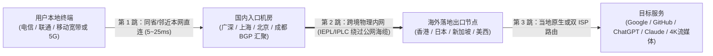

> **核心结论速览（Direct Answer）**：  
> 机场订阅列表里常见的「国内入口 / 广东 / 上海 / 北京 / 深圳中转节点」，学名为 **国内接入汇聚节点（Domestic Ingress / Relay Node）**，**并非用于海外华人访问国内视频的“回国 VPN”**，而是跨国代理链路的第一跳高速入口：**用户本地宽带 → 国内三网 BGP 接入机房 → 跨境专线（IEPL/IPLC）→ 境外落地节点（香港/日本/新加坡/美国）**。真正决定一条“机场高速节点”晚高峰稳不稳的关键，在于 **“离你物理距离最近的本网 BGP 入口” + “纯内网不过 GFW 的二层专线”**。若只追求低延时直达或综合榜单，可延伸阅读 **[《全球节点分布与专线网络测速指南》](/posts/global-nodes-speedtest-benchmark-guide/)** 与 **[《三网优化机场推荐》](/posts/three-major-carriers-optimized-airports-guide/)**。

---

## 一、先澄清概念：什么是“国内机场节点”？它能用于回国加速吗？

在搜索引擎与 AI 问答中，“国内机场节点”是高频被误解的关键词。新手看到订阅里出现 `深港 IEPL 01`、`沪日专线 02`、`广州移动入口 → 香港` 时，常会产生两种截然相反的疑问：
1. **海外留学生/华人的误解**：“写着广州/上海/北京节点，是不是连上就能把 IP 变成中国大陆，用来解锁 B 站、网易云和腾讯视频？” —— **答案是否定的**。国内机场节点只是你流量进入专线内网前的**境内第一跳中转入口**，最终访问目标网站的出口 IP 依然是后端标明的香港、日本、新加坡或美国服务器；
2. **大陆用户的误解**：“在软件里测速只有 4ms，是不是代表访问美国网站也只要 4ms？” —— **同样不是**。那只是你的设备到国内中转机房的本地 ICMP/TCP 握手时间。判断一条“高速节点”的真实速度，必须看经过跨境段到达海外目标后的端到端 URL 响应时间。

---

## 二、为什么现代机场高速节点必须使用“国内入口中转”？

早期的科学上网主要依赖海外 VPS 公网直连（客户端直接握手洛杉矶或东京 IP），但在国内运营商国际出口拥塞与 GFW 主动探测机制面前，公网直连几乎不可用。现代正规机场普遍采用 **三段式接入 + 专线透传架构**：



这一设计解决了三大底层网络工程难题：
1. **消除本地运营商跨网绕路**：中国电信（AS4134）、中国联通（AS4837）、中国移动（AS9808）之间存在跨网结算壁垒（NAP 瓶颈）。如果一个仅买单线电信入口的机场被移动用户直连，数据包会在国内跨网丢包 20% 以上；而部署了三网 BGP 多线入口的机房可以让三家运营商用户“就近本地进机房”；
2. **屏蔽境内流量特征与端口封锁**：从用户设备到国内入口机房属于国内合法合规的商业 IDC 通信；进入入口机房后，加密流量直接被封装进运营商级二层内网专线（IEPL/IPLC）跨境，**不再裸露于公网国际出口局**，从物理机制上避免敏感时段的大规模阻断；
3. **支持多入口热备容灾**：成熟服务商会在同一套香港或日本落地池前，同时挂载广东、上海、北京等多个国内入口。一旦某个城市IDC机房例行维护或遭遇区域性波动，只需切换入口前缀（如将“上海入口”切为“广州入口”），即可秒级恢复正常，详细架构对比可参阅 **[《IEPL 是什么？专线与公网中转深度对比》](/posts/dedicated-lines-iepl-iplc-vs-standard-transit-guide/)**。

---

## 三、全国五大主流国内入口节点地理分工与三网适配对照表

挑选机场订阅中的高速节点，本质上是为自己所在的**省份城市**与**宽带运营商**匹配正确的境内入口网关：

| 国内入口城市 | 核心骨干接入优势 | 最佳覆盖地理区域 | 常见直通跨境方向 | 晚高峰注意事项 |
| :--- | :--- | :--- | :--- | :--- |
| **深圳 / 广州（广深入口）** | 粤港光缆物理最近，端到端跨港物理延迟最低（常为 5~18ms） | 华南、西南及部分华中地区（粤/桂/湘/闽/琼） | 香港、新加坡、台湾、东南亚节点 | 广州/东莞移动出口常为移动用户高性价比首选，需避开低端单线电信小作坊 |
| **上海（沪日/沪美入口）** | 国际海缆东亚登陆核心（APG/NCN），直连日韩及跨太平洋美西 | 华东地区（沪/苏/浙/皖/鲁）及长江沿线 | 日本、韩国、美国西海岸（美西/圣何塞） | 华东用户走日本与美西的物理基准比绕道广深快 15~30ms |
| **北京 / 天津（京津入口）** | 北方联通（AS4837/AS9929）与科研教育网枢纽骨干直连 | 华北、东北、西北地区（京/津/冀/辽/吉/黑/陕） | 日本、韩国、欧洲（法兰克福/伦敦） | 北方联通直连北京出口极具优势，若强连广深入口会额外多出 35~50ms 国内传输耗时 |
| **成都 / 重庆（西南入口）** | 西南多线 BGP 汇聚节点，就近消化本地流量后再走内网送广深/沪 | 西南地区（川/渝/云/贵） | 香港、新加坡 | 部分大厂为西南用户单独设立省内高速接入点，大幅减少跨省长途抖动 |
| **Anycast BGP 智能入口** | 单一接入域名自动通过边界网关协议路由至最近三网机房 | 全国通用、经常跨省出差或家庭多宽带双拨用户 | 全部主流区域 | 无需手动区分“电信/联通/移动”后缀，开箱即用，代表品牌如 **[光速云](/posts/guangshuyun-review/)** |

---

## 四、2026 具备优质国内 BGP 入口与高速节点的机场推荐矩阵

评判一家机场的国内入口是否扎实，应重点看其**是否同时具备多地三网 BGP 入口、是否透明标注 1.0x 真实计费、以及晚高峰是否采用真专线而非公网中继**。以下依据本站站点实测体系梳理的代表性服务商（更多完整对比请前往 **[全球节点与线路专题](/nodes/)**）：

| 机场品牌 | 国内入口架构特色 | 跨境底层线路 | 适用核心人群 | 详细深度评测 |
| :--- | :--- | :--- | :--- | :--- |
| **光速云** | 京/沪/穗三中心 Anycast 三网动态汇聚，自动就近接入 | 企业级二层 IEPL 物理内网专线 | 追求免手工调参、全端自研客户端与长期稳定的主力用户 | [光速云深度评测](/posts/guangshuyun-review/) |
| **微风网络** | 三网优化 BGP 多入口 + 原生双 ISP 住宅落地池 | 纯内网 IEPL 专线 | 注重性价比、高频使用 ChatGPT / Claude 的极客与科研用户 | [微风网络深度评测](/posts/brand-weifeng-review/) |
| **唯兔云** | 60+ 节点三网动态负载均衡，电信/联通/移动独立分流入口 | 高品质 BGP + IEPL 混合专线 | 反对年付绑定、偏好 **14.9 元/月（100G）纯月付** 的灵活性用户 | [唯兔云深度评测](/posts/brand-weitu-review/) |
| **一翻云** | 高并发企业级三网汇聚大带宽入口，支持千兆突发性吞吐 | 大带宽二层 IEPL 专线集群 | 终端开发者、GitHub 大库克隆、Claude Code 长会话用户 | [一翻云深度评测](/posts/brand-yifanyun-review/) |
| **星岛梦** | 多地多海缆入口热备冗余 + 永久不过期按量计费通道 | 5 年老牌企业级内网专线 | 差旅办公备用、低频科研查询与主线路防断网容灾 | [星岛梦深度评测](/posts/brand-xingdaomeng-review/) |

> 💡 选型原则：如果你使用单月尝试心态、尚未确定长期绑定某家服务商，建议先查阅 **[《月付机场推荐》](/posts/monthly-payment-airports-no-annual-plan-guide/)** 或直接参考 **[《2026 IEPL 专线机场推荐》](/posts/iepl-airports-dedicated-lines-guide-2026/)** 建立“一条主力 IEPL + 一条不限时备用”的容灾组合。

---

## 五、四步实操：如何在客户端挑出真正低延迟的“机场高速节点”？

即便订阅里提供了几十个带有各地前缀的高速节点，不同城市、不同宽带（尤其是晚间移动宽带或校园网）的实际表现也会大相径庭。按以下 4 个工程步骤操作，只需 3 分钟即可锁定最适合你本地网络的节点：

### 第 1 步：把延迟测试地址改为真实海外 204 探针
在 Clash Verge Rev、v2rayN 或 Shadowrocket 设置中，检查你的延迟测速 URL（Test URL）：
- 切勿使用国内地址或单纯的 TCPing；
- 统一设为 `https://www.gstatic.com/generate_204` 或 `https://cp.cloudflare.com/generate_204`。这样测出来的毫秒数，才是“国内入口 → 跨境专线 → 海外服务器”的**真实端到端全链路响应耗时**。

### 第 2 步：利用客户端正则筛选“地理就近”策略组
以 Mihomo（Clash Meta）内核为例，如果你身处华东地区（如上海/杭州），希望优先用上海入口的日本与新加坡节点，在客户端配置文件中建立如下 `url-test` 自动测速分组：

```yaml
proxy-groups:
  - name: ⚡ 华东高速自动优选
    type: url-test
    url: https://www.gstatic.com/generate_204
    interval: 300
    tolerance: 30
    include-all: true
    # 优先匹配上海/沪日/沪港高速入口节点，同时排除高倍率测试节点
    filter: "(?=.*(上海|沪|JP|日本|HK|香港|SG|新加坡))(?!.*(到期|官网|倍率3|倍率5))"
```

### 第 3 步：识别并剔除“假高速 / 单线跨网拥塞”入口
若在同一地区看到多个相似节点（例如 `广州电信-香港` 与 `广州移动-香港`），移动宽带用户若盲目依赖全局自动测速，白天可能选到跨网还算通畅的电信入口，一到晚间 21:00 就会直接跨网丢包卡死。**务必手动把非本网的异网入口踢出主力策略组**，只保留标明 **“BGP”** 或 **与你宽带同运营商** 的入口节点。

### 第 4 步：AI 业务单独分流，避免“低延迟入口”把 ChatGPT 送进香港落地
一个经典的高频失误是：**因为“广州入口 → 香港”只有 15ms，用户开启全局智能优选后，所有流量全部涌向香港节点**，结果瞬间触发 OpenAI 锁区提示或 Anthropic / Claude 账号风控。  
正确做法参见 **[《AI 机场与风控分流配置指南》](/posts/claude-airports-ip-node-selection-guide/)**：将常规网页、YouTube、GitHub 留在 `HK/JP` 亚洲低延迟高速节点；将 `openai.com`、`chatgpt.com`、`claude.ai`、`anthropic.com` 单独分流至 **美国或日本原生住宅出口**。

---

## 六、常见问题解答（FAQ）

### Q1：订阅列表里出现“上海/广州/北京节点”，连上之后 IP 会变成中国大陆吗？
不会。机场中标注国内城市名的节点是“国内中转接入入口（Ingress Server）”，仅用于优化你电脑到跨境专线机房之间的国内段传输。你的最终公网出口 IP 依然位于后面的境外落地国家（例如“上海入口 → 香港 01”最终出口是香港 IP）。如果需求是海外华人访问国内视频/音乐，需要使用专用的回国加速器，而不是跨境机场节点。

### Q2：为什么客户端显示延迟只有 5ms，实际打开外网网页却非常慢甚至打不开？
5ms 通常是纯 ICMP Ping 或局部 TCP 握手的虚假延迟——你只测到了“自家路由器到国内入口机房”的距离，没有测量跨境后半段。如果该机场后端接入的是拥堵的公网直连海缆或海外服务器过载，真实体验照样卡顿。请务必将测速 URL 切换为 `https://www.gstatic.com/generate_204` 查看端到端 HTTP 状态码响应时间。

### Q3：联通、移动、电信用户各自适合选哪种国内入口机场节点？
电信用户优先选择 CN2 GIA 或三网 BGP 多线入口；联通用户优先选择联通原生 4837/9929 或标注“三网 BGP”的北方/华东入口；移动用户因为晚高峰国际直连带宽较紧且对跨网极其敏感，务必选择带有 **移动专项优化 / 广深移动直连入口 + IEPL 物理专线** 的服务商，详细诊断技巧见 **[《三网优化机场推荐与运营商分流指南》](/posts/three-major-carriers-optimized-airports-guide/)**。

### Q4：同一个机场既有“直连节点”又有“IEPL 中转节点”，价格差在哪里？
“直连节点”没有租用高成本的国内 BGP 入口机房和跨境物理内网专线，流量从本地宽带直接裸奔撞向公网海缆，晚高峰丢包极高且容易端口被封；而正规“国内入口 + IEPL 专线节点”需要支付昂贵的国内三网机房带宽与二层跨国光纤月租，因此能够提供全天接近 0% 丢包与极低抖动。

### Q5：机场高速节点是不是越贵、名字后缀倍率越高就越好？
不一定。常见节点名称中的 `0.2x / 1.0x / 2.0x / 3.0x` 代表流量扣除倍率，并非绝对速度等级。部分服务商的高倍率节点代表成本高昂的稀缺原生住宅双 ISP 出口（适合 Claude/TikTok/Stripe 等高风控场景）；对于看 4K 视频、GitHub 克隆或日常网页浏览，主流老牌大厂 **1.0x 基准倍率的普通 IEPL 专线节点** 已完全够用，无需花冤枉钱常驻 3.0x 高倍率节点。

### Q6：遇到某个国内入口突然全线超时（Timeout），该如何快速应急恢复？
先检查同一机场订阅内的**异地入口前缀节点**（例如把“广州入口”全部切到“上海入口”或“北京入口”）。很多时候只是单一城市的境内接入机房正在进行凌晨例行线路割接或突发防护清洗；同时建议常备一份支持不限时按量计费的备用订阅（如星岛梦）配置为客户端 `Fallback` 兜底，彻底消除单点中断焦虑。
