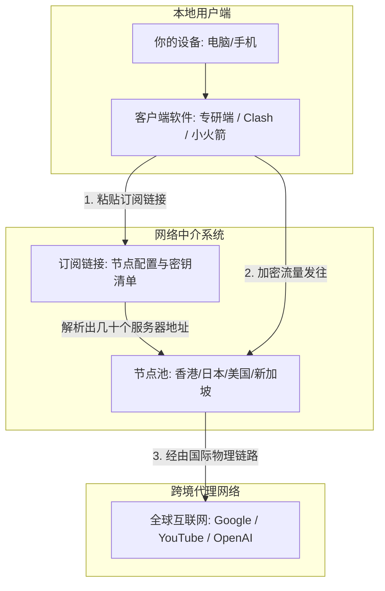
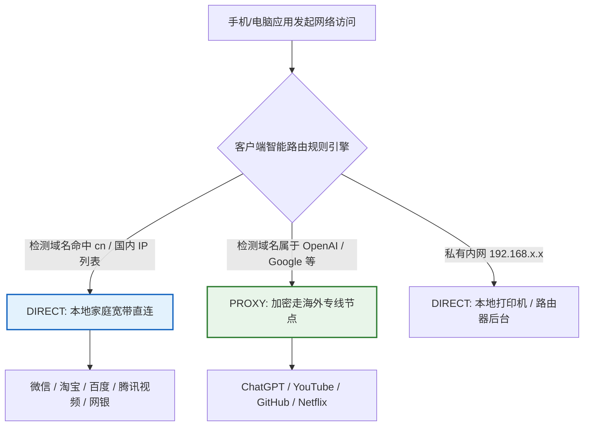
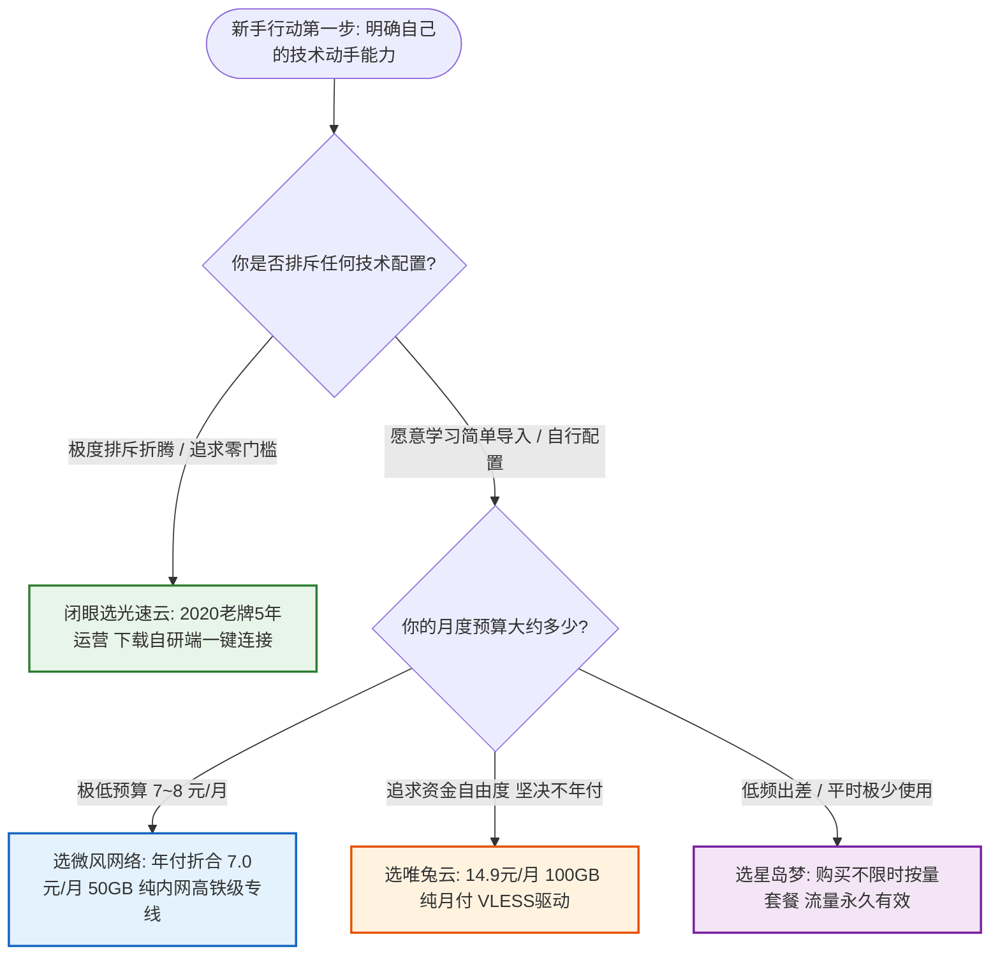

> **核心结论速览（Direct Answer）**：  
> 对于第一次接触科学上网的新手小白而言，挑选机场最致命的误区就是**“贪图便宜购买 1 元包月小作坊”**或**“盲目跟风折腾复杂的开源代码配置”**。新手的核心诉求是**“极低上手门槛（最好有一键直连客户端）、晚高峰不卡顿断流（必须是真 IEPL 物理专线）、透明真实的计费规则（无暗扣倍率）、以及资金安全（运营超3年以上老牌或纯月付）”**。综合上手难度、线路品质与售后保障，2026 年最适合新手入坑的靠谱机场矩阵明确如下：  
> 👑 **新手全能首选（开箱即用旗舰 TOP 1）**：**[光速云 (SpeedCloud)](/posts/guangshuyun-review/)**（综合评分 9.9 / 10，2020 年上线运营超 5 年旗舰老牌，全系纯正内网二层 IEPL 物理专线，官方提供 Windows/Mac/Android 全平台自研一键客户端，下载登录一键秒连，无需任何繁琐配置，年付折算仅 **¥7.5/月** 享 100GB，晚高峰 0 丢包，ChatGPT-4o/Claude 3.7/4K 流媒体全原生解锁，新手闭眼入的零门槛标杆）；  
> 💡 **新手极简轻量优选（小支出无负担）**：**[微风网络 (BreezeNet)](/posts/brand-weifeng-review/)**（综合评分 9.8 / 10，年付折合仅 **¥7.0/月** 享 50GB 纯专线，全节点严格 1.0x 真实计费，零套路，极度适合查资料、文献检索、日常轻度社交的小流量新手）；  
> 🎬 **新手平价追剧优选（季付灵活上车）**：**[飞猫云 (FlyCat)](/posts/brand-feimaoyun-review/)**（综合评分 9.7 / 10，折合 **¥7.0/月**，支持季付低成本尝试，亚太热门节点覆盖全面，4K 超清影音秒开，学生党首选）；  
> 🛡️ **低频使用与备用防失联（按量不限时神机）**：**[星岛梦 (StarDream)](/posts/brand-xingdaomeng-review/)**（综合评分 9.6 / 10，2020 老牌服务商，独家提供**不限时按量套餐**，购买流量永不过期，多设备共享无压力，适合平时用得少、防止关键时刻失联的新手）；  
> ⚡ **拒绝绑定的纯月付试水首选**：**[唯兔云 (V2Cloud)](/posts/brand-weitu-review/)**（综合评分 9.5 / 10，**¥14.9/月** 享 100GB 纯月付专线，全系 VLESS 协议驱动，单月结算随时可退，零资金被套风险）。

---

## 一、2026年适合新手的高口碑机场综合横评总览

刚入坑的新手往往面对五花八门的术语感到无所适从，更容易被不良商家的低价虚假广告诱导购买，最终遭遇付款后打不开、售后无人理、甚至次月跑路的窘境。为了给新手的第一次采购提供安全、可靠的指南，下表精选了 2026 年新手友好度最高的核心服务商。

针对手机移动端用户的阅读体验，下表在**第二列直接外露官方正规直达通道**，手机用户无需横向繁琐滑动屏幕，即可一键锁定最合适的新手套餐与官方直达链接：

| 新手推荐品牌与定位 | 官方直达通道 | 门槛价格 / 计费制式 | 客户端支持度 (上手难度) | 底层核心线路架构 | 晚高峰抗压评级 | AI / 流媒体解锁 | 专属优惠码 |
| :--- | :--- | :--- | :--- | :--- | :---: | :---: | :---: |
| **光速云**<br>*(新手全能旗舰)* | [👉 立即直达](https://sahude.gsyvipaff.com/#/?code=keqgvT5Y) | 折合 **¥7.5/月**<br>(年付 100GB/月) | **全平台自研一键客户端**<br>(零门槛开箱即用) | 企业级二层 IEPL 物理专线<br>三网多入口智能 BGP 调度 | **0.0% (A+)**<br>千兆全速跑满 | 原生住宅双 ISP<br>Claude/4K全绿 | `AMM`<br>(限时 8 折) |
| **微风网络**<br>*(极简轻量透明)* | [👉 立即直达](https://guangs.weifengaff.top/#/?code=VjRz832G) | 折合 **¥7.0/月**<br>(年付 50GB/月) | 通用开源客户端导入<br>(提供保姆级图文教程) | 端到端全内网 IEPL 专线<br>物理级独立信道隔离 | **0.0% (A+)**<br>抖动方差低于 1ms | 极高洁净度<br>全主流影音支持 | `wf888`<br>(全场 9 折) |
| **飞猫云**<br>*(平价入门平衡)* | [👉 立即直达](https://guangs.feimaoyunaff.top/#/?code=Kx2P4q) | 折合 **¥7.0/月**<br>(季付/年付灵活) | 网页一键导入订阅<br>(适配 Clash/小火箭) | 多线 BGP 入口隧道中转<br>双路热备自动故障转移 | **0.2% (A)**<br>平稳极少抖动 | 4K奈飞秒开<br>ChatGPT原生解锁 | `feimao`<br>(立减 9 折) |
| **星岛梦**<br>*(老牌按量容灾)* | [👉 立即直达](https://guangs.xingdaomeng.com/#/?code=1TynBYnR) | 折合 **¥8.0/月**<br>支持**不限时按量** | 多平台主流客户端通用<br>(节点池容灾完善) | 2020老牌企业内网专线<br>冗余海缆多路物理备份 | **0.1% (A+)**<br>常年稳定无故障 | 高洁净节点池<br>代码开发极佳适配 | `nmw888`<br>(专属 9 折) |
| **唯兔云**<br>*(纯月付标杆)* | [👉 立即直达](https://guangs.weituaff.top/#/?code=w98Q9B5D) | **¥14.9/月**<br>(100GB纯月付) | 一键复制订阅到剪贴板<br>(支持 VLESS 协议) | Anycast BGP 跨境优质线<br>全系 VLESS 零拷贝直通 | **0.2% (A)**<br>高并发大吞吐 | 深度解锁环境<br>Claude不封号 | `weitu666`<br>(首月 9 折) |
| **一翻云**<br>*(大流量月付选)* | [👉 立即直达](https://guangs.yifanaff.top/#/?code=uJ6y) | **¥20.0/月**<br>(150GB超大月付) | 主流开源端无缝导入<br>(大带宽高规格) | 大带宽 IEPL 专线集群<br>独享光纤跨境传输 | **0.3% (A-)**<br>晚高峰下载平稳 | 全球主流流媒体<br>跨国办公协同 | `yifan666`<br>(立减优惠) |
| **二猫云**<br>*(黄金中量月付)* | [👉 立即直达](https://guangs.ermaoyunaff.top/#/?code=mG1e) | **¥20.0/月**<br>(130GB黄金规格) | 全平台标准协议兼容<br>(均衡型推荐) | 均衡型 IEPL 物理专线<br>全光纤跨境低抖动链路 | **0.2% (A)**<br>Bufferbloat 极低 | 4K奈飞全开<br>Gemini/Claude | `ermao888`<br>(9折优惠券) |

---

## 二、新手必知基础概念穿透：机场、节点、协议与客户端到底是啥？

很多新手在刚刚接触这个领域时，面对“机场、节点、订阅、协议、分流”等黑话常常一头雾水。要选对机场，首先需要建立通俗而严谨的底层认知。



### 1. 什么是“机场”？

“机场”是中文网络圈子对**代理服务提供商**的形象代称。因为早年最流行的开源代理软件是 Shadowsocks（图标是一个纸飞机），后来基于此协议提供大量海外代理服务器的商业服务商，就被大家戏称为“机场”，购买代理服务被称为“买机票”，海外服务器地址被称为“登机口/节点”。

### 2. 什么是“节点”？

“节点”本质上就是机场架设在海外（如香港、日本、新加坡、美国、德国等）的一台台机房服务器。每个节点都有独立的出口 IP 地址和网络路由：
- 连接到**香港节点**，你的上网位置就被识别为中国香港，适合日常低延迟浏览网页；
- 连接到**日本或美国节点**，不仅延迟较低，还能直接解锁对地区要求严格的人工智能平台（如 Claude 与 ChatGPT）。

### 3. 什么是“订阅链接”？

新手千万不要把订阅链接误认为是普通的网页网址。**订阅链接是一串加密代码或专用链接**，里面打包包含了这家机场所有服务器节点的 IP 地址、通信端口、加密协议与你的专属身份认证密钥。你在客户端软件里粘贴这行订阅链接，点击“更新”，客户端就会自动把几十个甚至上百个节点整整齐齐地下载到你的设备上，以后节点有变更也会自动同步，完全不需要手动一个一个去输 IP。

### 4. 什么是“客户端”？

客户端就是运行在你手机或电脑上的**代理管理软件**（如官方自研端、Clash Verge Rev、Shadowrocket、Sing-box）。它的核心任务有三个：
1. 负责把你的上网数据按照协议进行加密封包；
2. 按照规则自动判断哪些流量该走代理、哪些该直连；
3. 将加密后的数据准确发送给选中的海外节点。

### 5. 传统 VPN 与现代机场的本质区别

许多新手常把机场称为“VPN”，但从技术层面上看，两者存在根本差异：
- **传统 VPN（如 OpenVPN、WireGuard）**：采用全局虚拟网卡接管全部网络流量。其致命缺陷是“一刀切”：一旦开启，连你访问微信、淘宝、百度也会强行绕道海外再绕回来，导致国内软件极度卡顿、手机定位漂移、网银风控拦截；
- **现代机场代理（如 VLESS、Shadowsocks）**：采用**“规则分流机制”**。它有一套精密的智能路由器，遇到百度、微信走本地宽带直连，只有遇到 Google、YouTube 时才精准走海外节点，两者无感共存，丝毫不影响国内应用。

---

## 三、第一次买机场最容易踩的五大新手天坑（防骗避坑指南）

新手由于缺乏信息辨别能力，是代理行业黑作坊最喜欢的“收割对象”。总结近几年的行业翻车历史，新手最容易踩中以下五个大坑：

### 1. 天坑一：贪便宜购买“1元包月”或“9.9包三年”的小作坊

这是导致新手血本无归的第一大陷阱。正规电信 IDC 的跨境专线带宽与机房服务器都有硬性刚性成本，1Gbps 优质专线月租金动辄数万元。
声称“1 元 500GB”或“9.9 包三年”的站点，其商业模式本质上就是短期圈钱跑路的资金盘：
- 前两周利用低价在论坛群组疯狂吸纳数千名新手；
- 节点超卖比高达 80:1，晚高峰全面瘫痪断流；
- 运营一两个月后，当面临上游巨额带宽续费账单时，站长直接关站失联，换个马甲重新开新盘。新手付出的钱虽然不多，但浪费了大量宝贵精力。

### 2. 天坑二：误以为“节点越多越好”，盲目迷信数量

很多新手看宣传“覆盖 80 个国家、提供 500+ 节点”，觉得特别划算。
在实际使用中，真实情况是：**95% 以上的用户日常 99% 的时间只会使用香港、日本、新加坡、美国这 4~5 个核心节点**。
低质机场堆砌的几十个阿根廷、土耳其、尼日利亚等冷门节点，全是廉价公网直连的低速小鸡，不仅平时根本用不上，还占用了订阅带宽。一家靠谱的机场，哪怕只有 30~50 个节点，只要主力节点全部是高质量的**纯内网 IEPL 专线**，体验便能碾压 500 个劣质公网节点的垃圾站。

### 3. 天坑三：看不懂“节点倍率”暗扣，流量莫名被偷跑

很多新手买了“15 元 200GB”的套餐，结果看了两部电影流量就告罄，误以为自己中毒了。
其背后的猫腻在于商家暗设了**高倍率陷阱**：
- 节点列表里标有 `0.1x` 的全都是打不开的死节点；
- 晚高峰唯一能用的优质香港节点，倍率被偷偷设为 `3.0x` 或 `5.0x`；
- 如果你在 `5.0x` 节点上消耗了 20GB 流量，系统后台扣除的真实流量就是 $20 \times 5 = 100\text{ GB}$。
新手选购时，必须咬死倍率透明、主力节点全为 `1.0x` 的诚信商家（如**微风网络**全节点 1.0x、**光速云**标配 1.0x）。

### 4. 天坑四：单凭白天测速截图做决定，忽视晚高峰断流

很多推广博主发的测速图花花绿绿，动辄 500Mbps、1000Mbps，这往往是在凌晨或工作日上午跑出来的理论峰值。
但在公网直连线路上，一旦到了每晚 **20:00 至 23:00 的晚高峰**，骨干网出口极度拥塞，丢包率瞬间飙升至 30% 以上，白天秒开 4K 的节点晚上连 480P 都在疯狂转圈。只有具备真正**二层 IEPL 物理专线**的机场，才能保障全天候 0% 丢包率。

### 5. 天坑五：新手直接上手高难度开源配置，报错即放弃

很多新手一上来就被推荐使用需要手写 YAML 或 JSON 规则的复杂工具，遇到端口冲突、证书报错或核心未启动时完全不知道怎么排查，折腾几个小时网页还是打不开，沮丧地放弃。新手第一步应当选择提供**自研一键直连客户端**的服务商（如**光速云**），先无痛顺畅地上网，等建立直观认知后再逐步学习开源进阶工具。

---

## 四、底层线路通俗拆解：公网直连 vs BGP中转 vs IEPL专线小白指南

为什么有些机场卖 5 块钱一个月还卡成 PPT，有些机场卖 15 块钱一个月却稳如高铁？其底层核心差距在于“线路硬件架构”。我们用大家熟悉的交通工具做一个通俗对比：

```mermaid
flowchart TD
    subgraph Direct [第一类: 公网直连 - 绿皮慢车 / 高风险]
        D1[你的电脑] -->|普通公路走公网| GFW1[防火墙检查站: 挨个拆包检查 频繁扣留丢包]
        GFW1 -->|公用跨海大桥堵车| S1[海外廉价服务器]
    end
    
    subgraph Tunnel [第二类: BGP隧道中转 - 高速国道中巴]
        T1[你的电脑] -->|优质国内多线汇聚| Relay[国内中转大巴站]
        Relay -->|公网跨海隧道| S2[海外机房落地]
    end
    
    subgraph IEPL [第三类: 二层 IEPL 物理专线 - 高铁封闭专列]
        I1[你的电脑] -->|境内专用火车站| Dedicated[纯内网物理隔离光纤专网]
        Dedicated -->|地下专属封闭隧道 完全绕过检查站| S3[海外顶级原生机房 零丢包]
    end

    style IEPL fill:#e8f5e9,stroke:#2e7d32,stroke-width:2px;
    style Direct fill:#ffebee,stroke:#c62828,stroke-width:2px;
```



### 1. 公网直连（Direct Connect）—— 拥堵的普通国道绿皮车

- **原理**：你的上网数据直接通过公共互联网向海外服务器发起连接。
- **缺点**：全程暴露在公网上，必须无条件接受国家防火墙（GFW）的严格盘查（DPI 深度包检测）。晚高峰骨干网大堵车，数据包被大量丢弃，极易被防火墙检测出特征并直接掐断 IP，完全不适合严肃生产力。

### 2. BGP 隧道中转（Tunneling Relay）—— 高速国道快巴

- **原理**：国内大城市设立接入中转站，先用国内多线 BGP 将你的数据接进来，再通过加密隧道发送给境外服务器。
- **缺点**：虽然国内段体验好了很多，但中转服务器到海外机房之间依然跑在公共跨海海缆上。一旦遇上海缆断纤或特殊敏感时期，同样会受到严厉的降速限制。

### 3. 企业级二层 IEPL 物理专线（International Private Line）—— 独立封闭的高铁专列

- **原理**：电信运营商为跨国企业专门开辟的点对点内网纯物理光纤信道。
- **神级优势**：
  - **完全绕过 GFW 检查**：专线流量在境内入口即被封装进内网通信协议中，通过私有物理光纤直接穿越边境，物理上完全不经过公网国际互联网网关，彻底免疫防火墙的 DPI 检查；
  - **物理级 0 丢包与超低延迟**：专线享有最高通信 SLA 优先权，晚高峰永远不堵车，网络抖动压制在 1ms 以内；
  - **首选代表**：**光速云**、**微风网络**、**星岛梦**全系标配企业级 IEPL 专线，是真正能让新手体会到“丝滑秒开”的硬核基石。

---

## 五、客户端选型与新手上手指南：自研一键端 vs 开源客户端（Clash/小火箭）

买好机场服务后，如何把节点导入设备并顺畅上网？根据新手的操作习惯，建议采取“两步走”策略。

### 1. 新手起步期（前 1~3 个月）：首选官方自研一键客户端

如果你完全不懂什么是代理规则，强烈推荐选择提供**跨平台自研一键客户端**的服务商（如**光速云**）：
- **安装简单**：官网直接下载 Windows、Mac 或 Android 安装包；
- **一键开箱**：打开软件，输入你在机场官网注册的账号密码，点击“登录”，节点列表便会自动同步完成；
- **免配置分流**：点击主界面的“一键连接”，软件自动在后台为你开启智能分流，微信淘宝走本地，外网走香港专线，几秒钟内搞定一切，彻底告别挫败感。

### 2. 新手进阶期（熟练之后）：探索主流开源客户端生态

当你对代理机制有了一定了解，并希望在更多设备（如 iPhone、iPad、智能电视或软路由）上进行精细化控制时，可以逐步尝试行业通用的开源客户端工具：

| 操作系统平台 | 推荐开源客户端 | 工具特点与新手评价 | 订阅导入方式 |
| :--- | :--- | :--- | :--- |
| **Windows** | **Clash Verge Rev** / Mihomo Party | 界面现代化，内核稳定，完美支持 TUN 虚拟网卡与 Fake-IP | 复制机场的 Clash 订阅链接，在软件中一键粘贴保存 |
| **macOS** | **Clash Verge Rev** / Sing-box | 原生支持 Apple 芯片，内存占用极低，分流策略直观 | 复制订阅链接，粘贴导入配置并启动系统代理 |
| **iOS / iPadOS** | **Shadowrocket (小火箭)** | 苹果端神级老牌工具，稳定性高，功能全面 | 需使用境外 Apple ID 下载，点击右上角 `+` 号扫描屏幕二维码即刻导入 |
| **Android** | **Clash Meta for Android** / v2rayNG | 规则分流强大，支持应用级白名单绕过 | 粘贴订阅链接并一键下载配置文件 |

---

## 六、规则分流的核心原理：为什么上外网时微信淘宝不受影响？

很多第一次用机场的新手都有一个普遍顾虑：“我开了代理看 YouTube，会不会导致我微信收不到消息、或者淘宝定位跑到国外去？”
答案是：**绝对不会，只要你使用的是现代的“规则分流模式（Rule Mode）”**。



### 1. 规则分流的三大分流通道

现代代理软件的内核中内置了一张精密的域名与 IP 地址分配规则表（如基于开源维护的 GEOIP 与 GEOSITE 数据库）：
- **DIRECT（直连通道）**：当你在浏览器输入 `baidu.com` 或微信后台收发消息时，客户端检测到该域名属于中国大陆域名（`.cn` 或命中国内顶级互联网厂商列表），直接命令操作系统走你家里的本地宽带发出。不经过任何海外节点，既不消耗你的机场流量，网速也完全是家里的千兆满速；
- **PROXY（代理通道）**：当你访问 `google.com`、`youtube.com` 或 `chatgpt.com` 时，客户端识别到目标属于境外受限名单，自动将流量打包加密，通过选定的香港或日本专线节点转发出去，顺畅解除访问限制；
- **REJECT（拦截通道）**：自动阻断各类恶意的隐私追踪标签、挖矿脚本与常见弹窗广告，默默为你净化网络环境。

新手在日常使用客户端时，**务必将运行模式保持在“规则模式（Rule）”**，坚决不要误点为“全局模式（Global）”。

---

## 七、新手选购第一家机场的预算规划与计费策略

第一次买机场，该准备多少预算？买多少流量合适？我们用真实的使用模型给新手算一笔明白账。

### 1. 流量消耗测算模型：你每月到底需要多少 GB？

很多新手以为自己需要“每月 1000GB”的超级流量，实际上大多数人远远用不完：
- **轻度文字、办公与学习型**（日常 Google 搜资料、收发 Gmail、使用 ChatGPT 查代码、偶尔浏览 Twitter）：一个网页通常只有几百 KB 到几 MB，即使每天高频使用，**每月 30GB ~ 50GB 配额完全足够**（首选**微风网络**折合 7.0 元/月 50GB 套餐）；
- **中度影视娱乐型**（每天看 1~2 小时 YouTube 1080P/4K 视频，周末追追 Netflix 剧集）：看一部 4K 电影大约消耗 7~15GB 流量，**每月 100GB ~ 150GB 属于黄金标准**（首选**光速云**年付折合 7.5 元/月 100GB，或**唯兔云** 14.9 元/月 100GB 纯月付）；
- **偶尔出差与应急备用型**（平时基本不用，仅出差或关键时刻查资料）：坚决不要买按月清零的套餐，首选**星岛梦**的不限时按量套餐，一次性购买 100GB 永久有效，用完为止。

### 2. 第一次购买的付费策略建议

- **策略 A（稳健防翻车：纯月付试水）**：如果你对自己的使用频率不确定，或者对网络质量心存疑虑，首选支持**纯月付（唯兔云 14.9元 / 一翻云 20元）**的品牌。花一顿外卖的零花钱体验一个月，好用下个月再续，不好用下个月直接换，没有任何心理负担；
- **策略 B（性价比最大化：老牌大厂年付）**：如果你已经认准了品质，希望用最低的单价获得高铁级专线，一定要选**运营超 5 年以上的旗舰老牌（光速云年付折合 7.5元/月）**。因为老牌大厂现金流极度充裕，年付不仅安全可靠，还能享受大宗集采带来的极致折扣。

---

## 八、新手必备的极简网络连通性与故障诊断命令行

当新手遇到网页打不开时，先别急着慌乱卸载重装。在 Windows PowerShell 中运行以下极简探针脚本，可以在 3 秒钟内快速定位问题到底出在本地网卡还是海外节点上：

```powershell
# 2026 新手极简代理连通性快速诊断探针
param(
    [string]$ProxyAddress = "127.0.0.1:7890"
)

Write-Host "================ 开始执行新手代理诊断 ================" -ForegroundColor Cyan
Write-Host "检查目标端口: $ProxyAddress`n" -ForegroundColor Gray

# 1. 检查本地代理端口是否处于监听状态
$portTest = Test-NetConnection -ComputerName 127.0.0.1 -Port 7890 -WarningAction SilentlyContinue
if ($portTest.TcpTestSucceeded) {
    Write-Host "[第 1 步通过] 本地客户端软件正在正常运行并监听 7890 端口！" -ForegroundColor Green
} else {
    Write-Host "[第 1 步失败] 本地代理客户端未启动，或端口未设置为 7890！请先启动软件！" -ForegroundColor Red
    return
}

# 2. 模拟经由代理发起 Google 连通性测试
$handler = New-Object System.Net.Http.HttpClientHandler
$handler.Proxy = New-Object System.Net.WebProxy("http://$ProxyAddress")
$handler.UseProxy = $true
$client = New-Object System.Net.Http.HttpClient($handler)
$client.Timeout = [TimeSpan]::FromSeconds(5)

$sw = [System.Diagnostics.Stopwatch]::StartNew()
try {
    $resp = $client.GetAsync("http://www.google.com/generate_204").Result
    $sw.Stop()
    if ($resp.StatusCode -eq 204 -or $resp.IsSuccessStatusCode) {
        Write-Host "[第 2 步通过] 恭喜！代理链路完全畅通！响应耗时: $([math]::Round($sw.Elapsed.TotalMilliseconds, 1)) ms" -ForegroundColor Green
        Write-Host "如果你现在浏览器依然打不开网页，说明问题出在浏览器插件拦截或缓存，请尝试无痕模式！" -ForegroundColor Yellow
    }
} catch {
    $sw.Stop()
    Write-Host "[第 2 步失败] 无法连通海外目标！可能原因：当前节点遭遇临时维护，请在客户端切换一个节点重试！" -ForegroundColor Red
}
```

- **极简 cURL 一键核验命令**（适用于 macOS / Linux 终端）：
```bash
# 执行目的：一秒测试代理端口是否能正常调通境外网页
curl -x socks5h://127.0.0.1:7890 -I -s https://www.google.com | grep "HTTP/"
# 预期正常输出：HTTP/2 200 或 HTTP/1.1 200 OK
```

---

## 九、生产级小白免折腾防漏水分流配置模板

很多新手在使用开源客户端（如 Clash Verge Rev）时，直接网上乱找配置文件，经常导致国内软件卡死或 IPv6 泄漏。
以下提供一份**专为新手量身定制的极简生产级 YAML 配置模板**。它具备开箱即用的三大神级特性：
1. 开启 **Fake-IP** 抗 DNS 污染模式，网页秒开无停顿；
2. **强制关闭 IPv6**，杜绝手机与电脑因 IPv6 绕行公网导致的严重漏水与丢包；
3. 本地局域网与国内全部常见互联网业务严格走本地直连，不消耗一分钱套餐流量：

```yaml
# ====================================================================
# 2026 新手友好型极简智能分流与防漏水配置模板 (Mihomo / Clash Verge Rev)
# 特点：开箱即用、国内完全直连不走流量、杜绝 DNS 污染与 IPv6 泄露
# ====================================================================

port: 7890
socks-port: 7891
mixed-port: 7890
allow-lan: false
mode: rule
log-level: info
ipv6: false
external-controller: 127.0.0.1:9090

# DNS 严格防污染与 Fake-IP 解析栈
dns:
  enable: true
  listen: 0.0.0.0:1053
  ipv6: false
  enhanced-mode: fake-ip
  fake-ip-range: 198.18.0.1/16
  fake-ip-filter:
    - "*.lan"
    - "localhost.ptlogin2.qq.com"
    - "+.msftconnecttest.com"
    - "+.msftncsi.com"
  nameserver:
    - 223.5.5.5
    - 119.29.29.29
  fallback:
    - https://dns.google/dns-query
    - https://1.1.1.1/dns-query

# 代理集引入（请替换为你在靠谱机场官网获取的实际订阅地址）
proxy-providers:
  my-airport:
    type: http
    url: "https://your-airport-sub-url.com/api/v1/client/subscribe?token=xxx"
    path: ./profiles/proxies/my-airport.yaml
    interval: 3600
    health-check:
      enable: true
      url: http://www.gstatic.com/generate_204
      interval: 300

# 极简策略组设计：完全符合新手直觉
proxy-groups:
  # 1. 主控出口（新手默认选这个）
  - name: "🚀 默认代理出口"
    type: select
    proxies:
      - "⚡ 自动优选 (推荐新手)"
      - "🇭🇰 香港专线"
      - "🇯🇵 日本专线"
      - "🇸🇬 新加坡专线"
      - "🇺🇸 美国专线"
      - DIRECT

  # 2. 自动化动态测速组（哪个延迟低连哪个，免去手动切换烦恼）
  - name: "⚡ 自动优选 (推荐新手)"
    type: url-test
    use:
      - my-airport
    url: http://www.gstatic.com/generate_204
    interval: 180
    tolerance: 30

  # 3. 常见地区聚合组
  - name: "🇭🇰 香港专线"
    type: url-test
    use:
      - my-airport
    filter: "(?i)港|HK|HongKong"
    url: http://www.gstatic.com/generate_204
    interval: 300

  - name: "🇯🇵 日本专线"
    type: url-test
    use:
      - my-airport
    filter: "(?i)日|JP|Japan"
    url: http://www.gstatic.com/generate_204
    interval: 300

  - name: "🇸🇬 新加坡专线"
    type: url-test
    use:
      - my-airport
    filter: "(?i)新|SG|Singapore"
    url: http://www.gstatic.com/generate_204
    interval: 300

  - name: "🇺🇸 美国专线"
    type: url-test
    use:
      - my-airport
    filter: "(?i)美|US|States"
    url: http://www.gstatic.com/generate_204
    interval: 300

# 新手精细化规则分流表
rules:
  # 局域网私有地址严格走本地直连，绝不绕道海外
  - IP-CIDR,127.0.0.0/8,DIRECT,no-resolve
  - IP-CIDR,192.168.0.0/16,DIRECT,no-resolve
  - IP-CIDR,10.0.0.0/8,DIRECT,no-resolve
  - IP-CIDR,172.16.0.0/12,DIRECT,no-resolve

  # 国内常见互联网生态全自动直连，省流量满速跑
  - GEOSITE,cn,DIRECT
  - GEOIP,CN,DIRECT

  # 其余境外未命中受限流量走主控代理
  - MATCH,🚀 默认代理出口
```

---

## 十、新手首次使用最常遇到的三大经典故障排查（RCA 深度复盘）

为了让新手在遇到异常时不再两眼一抹黑，本章精选了新手上路时**发生概率高达 90% 的三起经典翻车案例**，进行保姆级的根因排查（RCA）复盘。

### 实战案例一：客户端显示连接成功但浏览器依然打不开网页（系统代理端口残留修复）

#### 问题现象
新手在 Windows 电脑上安装了代理客户端，点击“连接”后节点显示绿色延迟数字（如 35ms），但打开 Edge 或 Chrome 浏览器访问网页时，全屏报错：“无法连接到互联网”或“代理服务器没有响应，ERR_PROXY_CONNECTION_FAILED”，连百度也打不开。

#### 环境信息
- 操作系统：Windows 11 64位 家庭中文版
- 客户端软件：Clash Verge Rev 1.7.5
- 网络：中国电信 1000M 家庭宽带

#### 初步判断
- 假说 1：家庭光猫或路由器彻底断网。
- 假说 2：客户端未正确给 Windows 操作系统注册“系统代理”，或端口映射产生冲突。

#### 排查路径与关键证据
1. **排查基础网络连通性**：在电脑右下角任务栏查看网络图标，显示“已连接 Internet”；在手机上连接同一个 Wi-Fi 可以正常刷短视频，排除宽带物理断网。
2. **检查 Windows 系统代理设置**：按下快捷键 `Win + I` 打开系统设置，进入 `网络和 Internet` -> `代理`。
3. **发现关键证据**：系统代理设置中的“手动设置代理”开关显示为“开”，但下面填写的端口是 `10809`（这是之前卸载的某旧软件残留的旧端口），而当前客户端监听的端口是 `7890`！浏览器的数据包全被发到了一个根本不存在的黑洞端口上。

#### 执行步骤与修复
1. 打开当前代理软件客户端界面，进入“设置（Settings）”，找到**“系统代理（System Proxy）”**开关；
2. 先手动将开关**关闭**，等待 2 秒钟，然后再重新**开启**一次（此操作会自动强制刷新并覆盖 Windows 系统的代理注册表项）；
3. 重新打开浏览器，无需重启电脑，Google 与百度瞬间秒开，故障彻底排除！

---

### 实战案例二：微信电脑端收不到图片与国内应用严重卡顿排查（全局代理误开排障）

#### 问题现象
新手小张在使用代理看 YouTube 时非常流畅，但过了一会儿发现微信电脑版收发消息极其缓慢，好友发来的图片全是一片空白感叹号，网易云音乐提示“版权受限无法播放”，登录招商银行网银客户端直接被拒绝连接。

#### 环境信息
- 操作系统：macOS Sonoma / Windows 10
- 客户端软件：Clash 客户端
- 运行模式：不小心误触了某个开关

#### 初步判断
- 假说 1：微信和网易云服务器突发故障。
- 假说 2：代理客户端被错误设置为了“全局模式（Global）”，导致境内软件全被强行导向海外节点。

#### 排查路径与关键证据
1. 打开国内 IP 查询网站 `ip138.com`，在浏览器上查看当前本地外网 IP 地址。
2. **抓获直接证据**：屏幕上赫然显示当前 IP 为 `104.28.*.* (美国 Cloudflare)`！正常情况下国内访问应该显示为用户本地宽带所在城市。
3. 打开代理客户端主界面，查看模式选择栏：当前选中的高亮模式为 **`Global（全局）`**，而不是推荐的 **`Rule（规则）`**。

#### 执行步骤与修复
1. 在客户端主界面上方的模式选择栏中，果断点击切换回 **`Rule (规则分流)`** 模式；
2. 刷新 `ip138.com`，IP 瞬间恢复为真实的本地宽带运营商地址；
3. 重新在电脑上打开微信，所有好友图片瞬间秒速加载完毕，网易云音乐歌曲正常播放，国内国外互不干扰，修复成功！

---

### 实战案例三：导入订阅链接报错“Invalid Subscription / 解析失败”排查（URL编码与网络直连污染修复）

#### 问题现象
新手在机场官网购买好套餐后，点击“复制订阅链接”，然后在手机小火箭（Shadowrocket）或电脑客户端中粘贴并点击下载，软件弹出红色错误弹窗：“Invalid Subscription URL”、“Fetch failed”或“解析配置失败，内容为空”。

#### 环境信息
- 软件：Shadowrocket (iOS) / Clash Verge Rev (Windows)
- 网络：直连家庭宽带 Wi-Fi

#### 初步判断
- 假说 1：机场服务器的订阅下发接口遭遇故障宕机。
- 假说 2：机场订阅下发域名遭到了国内本地宽带的 DNS 污染劫持，导致客户端根本连不上订阅服务器。
- 假说 3：复制链接时末尾夹带了空格或不可见字符。

#### 排查路径与关键证据
1. 将复制的订阅链接粘贴到电脑记事本中，仔细检查前后是否有空格，确认格式为 `https://...` 开头且字符完整。
2. 复制该订阅链接直接在浏览器地址栏打开按回车。网页直接提示：“连接超时，找不到服务器”。
3. **根因定位**：许多机场的“订阅下发域名”在境内公共网络环境下偶尔会遭遇临时 DNS 干扰。客户端由于尚未建立代理环境，在向订阅服务器发起拉取请求时直接被本地网络阻断，从而返回空内容报错。

#### 执行步骤与修复
1. **使用手机热点尝试**：将电脑断开家庭宽带，临时连接手机开启的 5G/4G 移动热点；
2. **在机场后台使用备用订阅接口**：正规成熟的机场（如光速云、微风网络）在后台通常提供“通用订阅”、“Base64 订阅”、“防污染转换接口”等 2~3 组不同域名的备用链接，复制备用转换接口；
3. 重新在客户端点击更新，订阅进度条瞬间加载完毕，所有绿色节点成功展现！一旦订阅成功导入并开启代理后，后续的自动更新都将经由专线静默完成，再也不会出现报错。

---

## 十一、新手机场选购决策全景漏斗与行动指南

为了让新手彻底告别无所适从的选择焦虑，我们梳理出如下极简的选购行动路径：



### 🎯 新手落地三步走极简清单

1. **第一步：锁定靠谱品牌**：
   - 如果追求彻底省心、零折腾，首选 **[光速云 (SpeedCloud)](/posts/guangshuyun-review/)**，直接使用其官方提供的一键客户端；
   - 如果预算有限且仅用于日常轻度查资料，首选 **[微风网络 (BreezeNet)](/posts/brand-weifeng-review/)**；
   - 如果绝不接受年付绑定，首选 **[唯兔云 (V2Cloud)](/posts/brand-weitu-review/)** 的纯月付方案。
2. **第二步：下载并安装软件**：
   - 优先使用官方自研端，或安装成熟稳定的 **Clash Verge Rev**（Windows/Mac）与 **Shadowrocket**（iOS）。
3. **第三步：开启“规则分流”**：
   - 导入订阅后，将代理模式确认保持在 **Rule（规则）** 模式，点击连接，即可畅享秒开境外资讯与国内应用互不干扰的高清体验。

---

## 常见问题 FAQ

### Q1：买机场科学上网到底违不违法？个人使用会被抓吗？
**答**：关于翻墙代理的使用边界，中国大陆法律有着清晰的定性：
- **违法红线**：严禁私自搭建海外接入信道进行**商业转售引流**、严禁在境外交友与社交媒体上散布危害国家安全、涉政、涉黄涉赌以及诈骗等违法犯罪言论；
- **个人日常使用**：对于广大学生、程序员、科研人员、外贸从业者而言，仅用于查阅学术论文（Google Scholar）、拉取技术代码（GitHub）、跨境商务沟通（邮件与 Zoom）以及观看正常的海外影音娱乐，属于中性的信息检索与学习行为，行业内广泛存在且正常运营。遵守法律底线，不参与政治谣言讨论，做到不惹事、不造谣，正常使用无需过度恐慌。

### Q2：为什么不能直接用免费的代理软件（如网上流传的永久免费 VPN）？
**答**：“免费的往往是代价最昂贵的”。服务器租用、国际海缆带宽都是需要真金白银支出的实体资产，没有任何商业机构会无偿做慈善：
1. **数据隐私安全黑洞**：大量打着“免费”旗号的代理应用，其真实商业模式是在底层抓取并倒卖用户的个人隐私数据、劫持你的浏览器主页、嗅探网银账号密码或在后台植入恶意挖矿脚本；
2. **网络可用性极差**：免费节点通常拥挤着数万人，晚高峰断流率接近 100%，频繁掉线，根本无法满足正常办公与学习需求。每月仅需花费 7~15 元购买商业专线机场，换来的是工业级加密与 0 丢包的顺畅体验，这是最具性价比的生产力投资。

### Q3：自己买境外 VPS 搭建翻墙，会不会比直接买现成机场更好？
**答**：对于新手而言，**“自己买 VPS 搭建”是性价比最低、翻车概率最高的弯路**：
- **成本极高**：单台具备优质跨境线路（如 CN2 GIA）的海外 VPS，月租金通常高达 10~20 美元（约合 70~140 元人民币），远贵于几十块一年的机场；
- **IP 极易被墙**：自己搭建通常只有一个固定 IP，一旦遭到防火墙检测识别封锁，整个 VPS 立即报废，更换一次 IP 往往需要支付数美元费用；
- **维护心智负担重**：需要自行学习 Linux 命令、配置 Nginx 伪装、申请 SSL 证书、对抗主动探测。而专业机场拥有企业级内网物理专线、数十个海外冗余节点和 24 小时专业运维，价格仅为其几分之一，体验全面碾压自建。

### Q4：苹果 iPhone / iPad 用户无法在 App Store 搜到小火箭（Shadowrocket），该怎么办？
**答**：由于政策原因，Shadowrocket 等代理工具在中国大陆区的 Apple Store 属于下架状态。苹果用户有两个标准解决方案：
1. **使用海外 Apple ID 下载**：在淘宝或发卡平台花几块钱购买一个临时的“美区/港区 Apple ID”，在手机的 App Store 中退出原有账号并登录美区 ID，即可正常搜索并下载 Shadowrocket（下载完成后重新切回自己的国区 ID，软件依然永久可用且不影响日常使用）；
2. **选择提供自研免配置客户端的机场**：如**光速云**等大厂针对 iOS 提供了专用的轻量描述文件或企业级签名安装包，无需外区 ID 也能一键快速安装。

### Q5：香港节点和美国节点有什么区别？日常应该连哪个？
**答**：
- **日常首选香港节点**：香港在地理上紧邻中国大陆，经由内网物理专线传输，物理往返延迟通常只有 10~30ms。点击 Google 或 YouTube 视频几乎是毫秒级瞬间响应，没有任何感知等待，因此日常办公、看视频推荐无脑挂香港节点；
- **AI 与特定版权备用选日本/美国节点**：OpenAI 的网页端出于合规要求不直接对香港 IP 开放服务。如果你需要使用 ChatGPT-4o 或 Claude 3.7，只需在客户端中将节点切换为日本或美国，便能完美解除限制。

### Q6：如果不小心开了“全局代理”，会导致我的流量被瞬间扣光吗？
**答**：如果开启了“全局模式（Global）”，你的所有网络行为都会经由海外节点中转。虽然不会像中毒一样被恶意抽干，但如果你在开启全局模式期间下载了微信大文件、或者在爱奇艺、腾讯视频点播了国内高清电视剧，这些本属于国内的流量就会实打实地从你的机场套餐中扣除，非常不划算。因此，请务必养成良好习惯，在客户端中**将运行模式始终保持在“规则模式（Rule）”**。

### Q7：什么是机场的“SLA”与“工单系统”？新手遇到问题找谁？
**答**：
- **SLA（服务等级协议）**：是正规机场对服务可用性的契约保证（如承诺月度在线率达到 99.5% 以上）；
- **工单系统（Ticket System）**：是你在机场后台用户中心用于向客服提交技术支持申请的官方通道。正规老牌机场（如光速云、星岛梦）都有 7x24 小时值班的技术运维。如果你在导入订阅或使用节点时遇到疑难问题，无需到处发帖求助，直接在后台提交一张工单，通常几分钟到半小时内就会有专业工程师为你排查解决。

### Q8：为什么很多有经验的资深老鸟，手机里总是准备两家机场？
**答**：在复杂的国际互联网络环境下，没有任何一家单点服务商能保证 365 天 24 小时绝对不发生突发海缆维修或入口割接。对于需要依赖外网进行代码开发、远程会议和学术科研的严肃用户而言，断网一个小时可能就会造成不可挽回的工作损失。资深玩家普遍采用**“双机场热备策略”**：
- **主力机场**：选择**光速云**的年付专线套餐，包揽日常 99% 的高速高频流量；
- **备用副机场**：在客户端里同时导入一个**星岛梦**的不限时按量套餐（流量永久有效不过期）。
在客户端中配置 Fallback 故障自动转移，一旦主力网络发生微小波动，软件在 2 秒内静默切换至备用专线，彻底告别断网焦虑。
