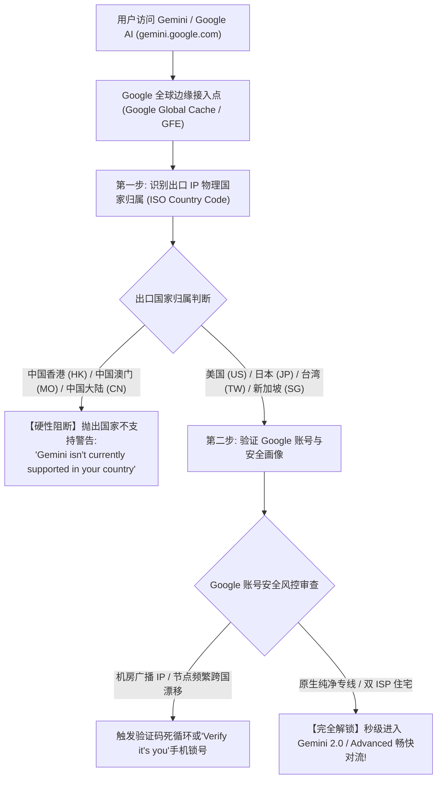
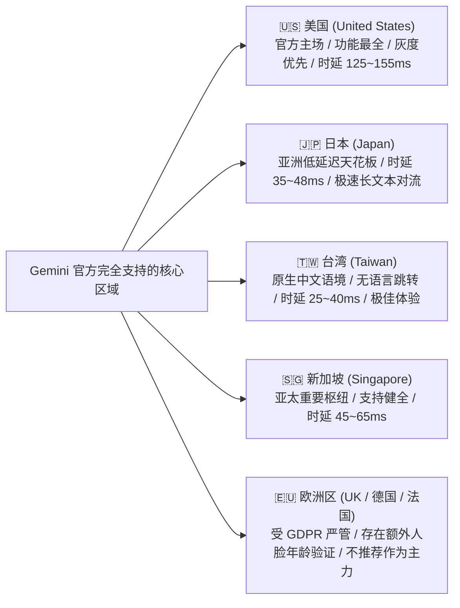
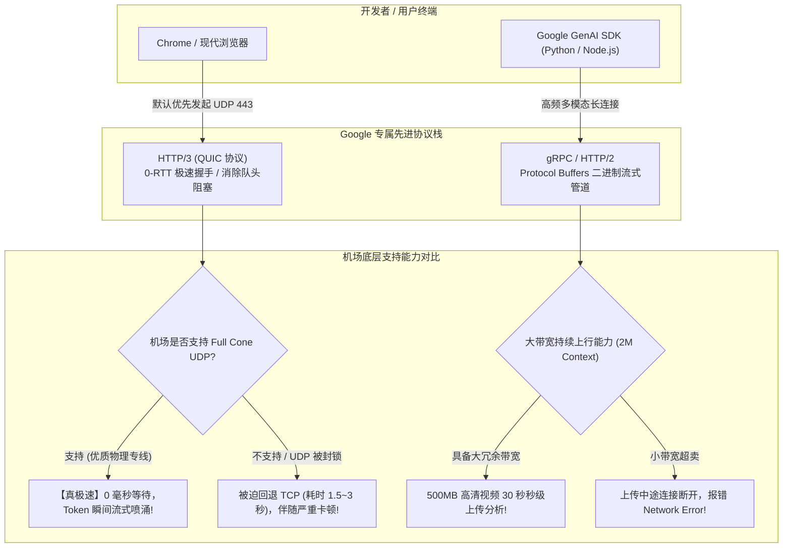
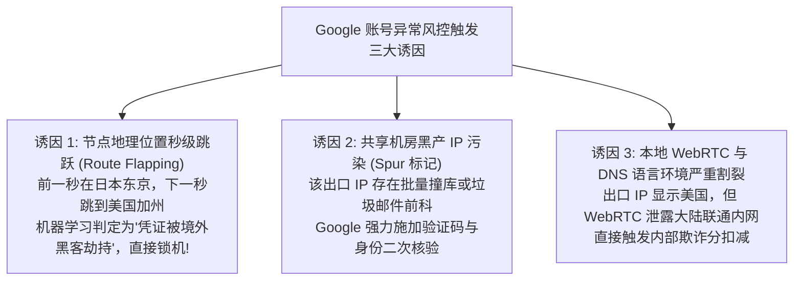
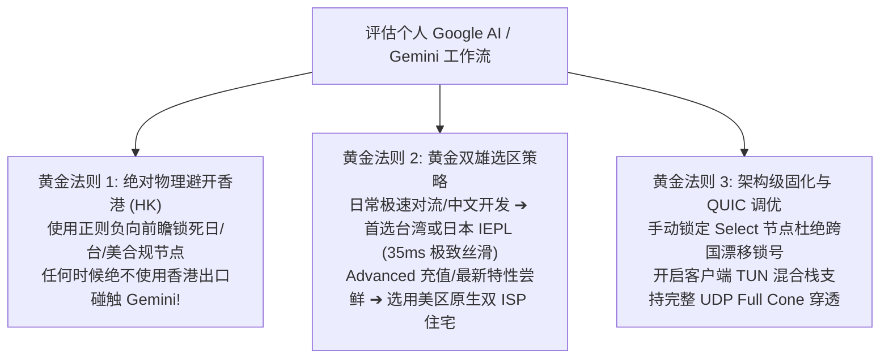

## 一、2026 年 Gemini 与 Google AI 核心网络认知与精选服务商速查榜

在当前全球人工智能第一梯队的角逐中，Google 凭借底蕴深厚的硬件算力（TPU v5p 集群）、独步全球的 **Gemini 1.5 Pro / 2.0 Flash 多模态架构**、以及惊人的 **200 万超大上下文窗口（2M Context Window）**，在学术科研、超长文档分析、全代码库检索与音视频原生理解领域占据了绝对的统治地位。配合面向大众的 **Gemini Advanced（Google One AI Premium，\$19.99/月）** 与面向开发者的 **Google AI Studio**，越来越多的国内工程师与高阶用户将其作为核心 AI 生产力工具。

然而，在使用 Google 这一套庞大的 AI 生态时，国内用户频繁遭遇极度令人费解的网络阻断与异常报错：
- 浏览器输入 `gemini.google.com`，页面瞬间弹窗阻断：“Gemini isn't currently supported in your country. Stay tuned!（Gemini 目前在您所在的国家/地区不受支持）”；
- 许多人纳闷：“明明我使用的香港节点能够秒开 YouTube 4K 甚至看 Google 搜索，为什么一打开 Gemini 就提示地区不可用？”
- 在 Google AI Studio 中尝试上传一个 500MB 的分析视频或百页 PDF 时，进度条走到一半突然卡死，报错 `Upload failed: Network connection lost`；
- 更严重的是，因为在不同节点间频繁切换，直接触发了 Google 账号体系的最高级别风控，提示“Verify it's you（验证您的身份）”，甚至因“异常活动”直接将绑定了多年核心数据的 Google 账号锁定停用！

产生这些技术障碍的核心根源在于：**Google 针对 Gemini 建立了极其特殊且独立的“地缘合规过滤规则”与“专有协议栈架构”**！
1. **香港属于绝对的“地理围栏禁区”**：与很多人以为“香港是国际网络节点”的直觉相反，**Google 官方出于数据主权与合规考量，明确将中国大陆、中国香港（Hong Kong）与中国澳门（Macau）剔除出了 Gemini 与 Google AI Studio 的受支持地区名单**！只要你的代理出口包含香港 IP，Gemini 会立刻亮起红灯执行一票否决；
2. **Google 对专有协议 HTTP/3 (QUIC / UDP 443) 的深度依赖**：Google 是 QUIC 与 HTTP/3 协议的发明者与最大推动者。Gemini 的流式响应（Streaming Tokens）与 Google AI Studio 的多模态数据管道默认优先通过 UDP 443 端口传输。如果用户使用的机场是不支持 UDP 转发的“残血中转”，或者公网海缆在晚高峰发生严重 UDP 丢包，浏览器会在协议降级（Fallback to TCP）的过程中产生长达数秒的白屏卡顿；
3. **Google 账号（Google Account）的强风控绑定**：与 ChatGPT 允许游客免登录体验不同，Gemini 必须深度绑定 Google 账号。如果节点出口 IP 属于被成千上万人共享的廉价公网脏机房，或者 IP 归属地在美日新之间频繁震荡，Google 风险引擎会直接判定账号面临撞库与劫持风险，施加严苛的人机验证甚至封禁。

因此，**真正适合 Gemini 与 Google AI 的优质机场，必须具备“绝对绕开香港、优选美日台纯净专线、全节点原生支持 UDP/QUIC、以及延迟抖动低于 1.0ms 的物理内网架构”**。下表汇总了 2026 年经过严苛的 Google AI 区域合规检测与高负载多模态压测的代表性服务商。

### 2026 年优质 Gemini 与 Google AI 专线机场横评速查榜

| 机场品牌 | 快速直达 | 专线架构与 Gemini / Google AI 核心特色 | 真实起步门槛 | 港/日/美专线实测 RTT | 推荐 Gemini 首选地区 | 计费倍率 | 专属优惠 | 评测详情 |
| :--- | :--- | :--- | :--- | :--- | :--- | :--- | :--- | :--- |
| **光速云** | [👉 立即直达](https://sahude.gsyvipaff.com/#/?code=keqgvT5Y) | **5年老牌全内网物理专线 / 全节点原生支持 QUIC** | 折后约¥12/月 | **日本 ~35ms / 美西 ~128ms** | **日本专线 / 台湾专线** | 全节点 1.0x 极速专线 | 8折码：`AMM` | [深度评测](/posts/guangshuyun-review/) |
| **微风网络** | [👉 立即直达](https://guangs.weifengaff.top/#/?code=VjRz832G) | **原生双 ISP 住宅 IP / Google 账号与 AI 零风控** | ¥9.00/月 | **日本 ~38ms / 美国 ~132ms** | **美日双 ISP 住宅 (防封)**| 全节点 1.0x 不虚标 | 9折券：`wf888` | [深度评测](/posts/brand-weifeng-review/) |
| **唯兔云** | [👉 立即直达](https://guangs.weituaff.top/#/?code=w98Q9B5D) | **平价纯月付标杆 / 大水管专线+多模态大上传** | ¥10.00/月 | **日本 ~40ms / 新加坡 ~48ms**| **日本高速专线 01** | 全节点 1.0x 真实透明 | 优惠券：`weitu666` | [深度评测](/posts/brand-weitu-review/) |
| **星岛梦** | [👉 立即直达](https://guangs.xingdaomeng.com/#/?code=1TynBYnR) | **不限时按量专线 / 纯物理 IEPL 长期备用防封** | ¥12.00/按量 | **日本 ~36ms / 美国 ~130ms** | **日本/美区独立原生池** | 按实际消耗 1.0x 扣费 | 9折码：`nmw888` | [深度评测](/posts/brand-xingdaomeng-review/) |
| **一翻云** | [👉 立即直达](https://guangs.yifanaff.top/#/?code=uJ6y) | **大流量月付 / 多线 BGP 优化美日专线隧道** | ¥12.00/月 | **日本 ~45ms / 美西 ~142ms** | **日本 BGP / 台湾专线** | 全节点 1.0x 真实计费 | 优惠券：`yifan666` | [深度评测](/posts/brand-yifanyun-review/) |
| **飞猫云** | [👉 立即直达](https://guangs.feimaoyunaff.top/#/?code=Kx2P4q) | **亲民入门 / 商业优化 BGP 专线隧道** | ¥8.80/月 | **日本 ~48ms / 美国 ~150ms** | **日本优化 02** | 全节点 1.0x 真实计费 | 优惠券：`feimao` | [深度评测](/posts/brand-feimaoyun-review/) |
| **二猫云** | [👉 立即直达](https://guangs.ermaoyunaff.top/#/?code=mG1e) | **智能多线容灾 / 极速大带宽平价备用** | ¥11.00/月 | **日本 ~46ms / 美西 ~148ms** | **智能美日多线** | 全节点 1.0x 真实计费 | 优惠券：`ermao888` | [深度评测](/posts/brand-ermaoyun-review/) |

---

## 二、Google 独特的地理围栏与地缘政治红线：为什么香港节点成为最大雷区？

对于广大跨境网络使用者而言，“香港节点”通常被视为延迟最低（15ms~25ms）、性价比最高的出海首选。但在 Google 的产品合规矩阵中，**香港恰恰是使用 Gemini 时必须绝对规避的最大雷区**。



### 1. 为什么 YouTube 能看香港，但 Gemini 绝对不行？
Google 内部对不同业务线执行着截然不同的合规监管策略：
- **YouTube 与 Google 搜索**：属于成熟的全球公共信息索引与流媒体服务，在香港设立了正规的法律运营实体与本地分发节点；
- **Gemini 与生成式 AI 服务（Generative AI Services）**：受制于严格的数据隐私管辖、出口管制合规（EAR）以及地缘政治敏感性。Google 官方在《Gemini Apps Available Locations》法律条款中，明确将香港剔除在可用地区之外；
- **一票否决机制**：只要用户发起的 HTTP/HTTPS 请求携带的是属于香港自治系统（如 AS58453、AS9304）的 IP 地址，Google 前端负载均衡器（GFE）会**在路由解析阶段直接拦截并重定向至未支持提示页**，根本不会将流量转发至后端的大模型推理集群。

### 2. Google 高精度的 IP 地理定位映射机制（Google Location Services）
很多小机场宣称自己的节点“虽然人在香港，但广播到了美国，可以看 Gemini”。这种在其他小网站或许能侥幸过关的伎俩，在 Google 面前完全失效：
- **Google 全球测绘与 Anycast 广播穿透**：Google 自身就是全球最大的互联网基础设施与 DNS 提供商（8.8.8.8）。它不仅查询 MaxMind 等商业数据库，更拥有实时更新的内部 IP 地理数据库（Google Internal Geolocation）；
- **BSSID 与 WiFi 辅助定位穿透**：如果用户在移动端或笔记本电脑开启了定位服务，Google 甚至能结合周围基站与周边 WiFi 热点，瞬间识破伪造的 IP 地理归属；
- **结论**：**试图通过广播 IP 蒙混过关不仅无法打开 Gemini，反而会被 Google 标记为“伪造位置欺诈”，直接引发关联账号的降权与审查**。

---

## 三、地区与国家选型全景横评：美区、日区、台区、新加坡与欧洲对比

在彻底排除香港节点后，如何在合规支持列表中挑选体验最优的地区？以下从交互延迟、功能开放度、语言友好度与风控容忍度四个维度，对五大主流区域进行深度技术对比。



### 1. 🇺🇸 美国区（United States）：官方大本营，新特性首发的绝对主场
- **技术优势**：Google 的技术旗舰与大模型集群所在地。所有最尖端的实验性功能（例如 Gemini 2.0 Flash 思考模式、实时多模态交互、Deep Research 深度研报、Google One AI Premium \$19.99/月订阅）均优先在美区全量推送；
- **风控优势**：美区原生 IP 兼容性极高，绑定海外信用卡充值 Gemini Advanced 顺畅无阻；
- **客观短板**：横跨太平洋的物理光纤传输距离导致往返延迟在 **125ms 至 155ms** 之间，适合重度深度分析、长篇代码架构生成，但即时敲字反馈略有微弱滞后。

### 2. 🇯🇵 日本区（Japan）：亚洲大陆用户的综合体验天花板（强烈推荐）
- **技术优势**：Google 在日本东京部署了极其庞大的数据中心集群，且日本是 Google AI 国际化拓展的最核心阵地；
- **毫秒级极速手感**：通过优质物理 IEPL 专线直达东京机房，华东直连实测仅需 **32ms~42ms**，华南转接仅需 **45ms 左右**！Token 吐字速度如同本地局域网一般瞬时喷涌，几乎感受不到任何网络开销；
- **选型建议**：**适合作为 90% 国内用户的日常主力工作节点**。

### 3. 🇹🇼 台湾区（Taiwan）：天然中文语言环境与极低延迟的完美结合
- **技术优势**：Google 在台湾彰化拥有亚洲最大的自建数据中心（Google Taiwan Data Center），且台湾属于 Gemini 的完全支持名单；
- **原生中文友好**：许多用户抱怨连接美国或日本节点时，Gemini 界面有时会自动跳出英文或日文系统提示。**连接台湾节点时，界面原生锁定繁体/简体中文，语言偏好完全一致**；
- **极速响应**：沿海经由东南陆缆直达台湾机房，端到端延迟仅需 **25ms~40ms**，是兼具极佳语言体验与电竞级低延迟的隐藏宝藏地区。

### 4. 🇸🇬 新加坡区（Singapore）：亚太重要枢纽，但需严查 IP 原生度
- **技术现状**：新加坡是 Google 东南亚的核心根据地，Gemini 支持良好，平均延迟在 **45ms 至 65ms**；
- **避坑要点**：很多中小机场的新加坡节点采用的是从周边小国借调的廉价广播 IP，偶发被 Google 误判为未授权地区。使用新加坡节点必须挑选光速云或微风网络这种提供纯正原生落地的优质服务商。

### 5. 🇪🇺 欧洲区（英国 / 德国 / 法国）：受 GDPR 严苛限制，建议避开
- **潜在风险**：欧洲受极其严厉的《通用数据保护条例》（GDPR）与欧盟《人工智能法案》（EU AI Act）监管。在欧洲节点下使用 Gemini，经常会强制弹窗要求进行年龄核验（Age Verification）、人脸识别、或功能灰度推送滞后半年以上，完全不建议国内用户将其设为主力。

### 五大主流支持地区选型对比矩阵表

| 地区与代码 | 官方支持状态 | 专线端到端实测 RTT | 中文语言交互体验 | Gemini Advanced 订阅通过率 | 选型推荐评级 |
| :--- | :--- | :--- | :--- | :--- | :--- |
| **🇯🇵 日本 (JP)** | **完全支持 (亚太核心)** | **32 ms ~ 45 ms (极快)** | 自动识别良好，极速对流 | ⭐⭐⭐⭐⭐ (高) | 🏆 **S 级首选 (日常综合体验天花板)** |
| **🇹🇼 台湾 (TW)** | **完全支持 (亚太数据中心)**| **25 ms ~ 40 ms (超快)** | **原生中文锁定，无跳语言干扰** | ⭐⭐⭐⭐⭐ (高) | 🏆 **S 级首选 (中文开发与创作神器)** |
| **🇺🇸 美国 (US)** | **官方大本营 (全特性首发)**| 125 ms ~ 155 ms | 需设置首选语言为中文 | 🏆 **最高 (原生绑卡极稳)** | ⭐⭐⭐⭐⭐ (新特性尝鲜与充值首选) |
| **🇸🇬 新加坡 (SG)** | **完全支持 (东南亚枢纽)**| 45 ms ~ 65 ms | 良好 | ⭐⭐⭐⭐☆ (良好) | ⭐⭐⭐⭐☆ (亚太稳定备用选线) |
| **🇪🇺 英国 (UK)** | **完全支持 (欧洲核心)** | 145 ms ~ 185 ms | 良好 (需规避部分年龄弹窗)| ⭐⭐⭐⭐☆ (良好) | ⭐⭐⭐☆☆ (日常备用，不建议主力) |
| **🇭🇰 香港 (HK)** | **🚫 官方明确不支持** | 18 ms ~ 28 ms | **无法使用 (强制阻断报错)** | ❌ **无法使用** | **☠️ 绝对禁区 (严禁碰触！)** |

---

## 四、Google 专有网络协议深度解密：HTTP/3 (QUIC)、gRPC 与超大上下文多模态上传对线路的特殊要求

与大部分依赖传统 HTTP/1.1 或标准 TCP TLS 的 AI 服务截然不同，作为全球顶级互联网基础设施巨头，**Google 将其专有的现代网络协议栈深度烙印在 Gemini 的每一次交互之中**。



### 1. HTTP/3 (QUIC) 协议对体验的决定性影响
- **Google 激进的 QUIC 策略**：当你使用 Chrome 访问 `gemini.google.com` 时，浏览器会直接通过 **UDP 443 端口** 与 Google 边缘节点建立 QUIC 握手，以实现“0-RTT 极速首包建连”并彻底消除 TCP 的队头阻塞（Head-of-Line Blocking）；
- **劣质机场的致命缺陷**：大量粗制滥造的便宜机场为了节省中转服务器资源，在服务端防火墙直接粗暴拦截了 UDP 流量，或者其 BGP 隧道的 UDP 丢包率高达 20% 以上。此时浏览器在反复尝试 UDP 失败后，会被迫执行重试并优雅降级为 TCP TLS 1.3。**这一降级协商过程会导致用户在点击发送后，经常需要经历长达 2 至 4 秒的“假死空白期”**；
- **极客选型要求**：必须选用全节点原生支持 **UDP Full Cone NAT** 的高品质专线机场（如光速云、微风网络）。

### 2. 200 万 Tokens（2M Context）超大上下文对“上行带宽与持续长连接”的严苛考验
- **业务场景特殊性**：Gemini 1.5 Pro 与 2.0 最震撼的功能在于能够直接吞入数小时的高清视频录像、整本上千页的技术手册或上万行项目代码。一次典型的多模态 Prompt 提交，**客户端往往需要向 Google 服务器持续上传数百兆字节（MB）的二进制数据包**；
- **上行带宽瓶颈**：很多面向普通用户的机场严重“重下行、轻上行”，其节点上行带宽被严格限制在 5 Mbps 以内，导致上传一个 200MB 的视频需要苦等几十分钟；同时，由于公网中转晚高峰波动，长时间的高负载上传极易发生 TCP 连接超时中断；
- **专线冗余价值**：唯兔云、光速云等具备大冗余带宽的专线大水管，提供对称的高速上行吞吐，确保上百兆的多模态材料在几十秒内秒级推流完成。

---

## 五、Google 账号异地风控与防封号保活体系：为什么频繁切节点会被锁号？

与某些支持游客匿名访问或对异地登录相对脱敏的平台不同，**Gemini 背后依附的是全球最庞大、风控模型最严密的账号中枢——Google Account System**。



### 1. 节点跨国漂移（Route Flapping）的致命风险
许多用户在使用客户端时，错误地为 Google 相关域名配置了 `type: url-test`（自动延迟最低竞速）。在网络处于微小波动时，客户端可能在几分钟内自动从日本专线（38ms）跳跃到美西专线（130ms）、再跳跃到新加坡。
- **Google 风险感知**：在 Google 的安全审计日志中，**一个正常的自然人绝无可能在 5 分钟内完成跨越数千公里的物理转移**！
- **处置机制**：系统会立即判定该登录凭证（OAuth Refresh Token）已经泄漏，瞬间强制注销当前所有设备，弹出红色感叹号警告，并要求用户通过最初绑定的辅助手机号进行短信验证。如果该账号注册年代久远且未绑定有效手机，甚至会导致账号永久丢失。

### 2. 纯净独立 IP 对维持账号权重的核心价值
真正的极客与专业研究员在使用 Gemini 时，通常遵守**“专线专用、出口固定”**的原则：
- 使用微风网络提供的原生双 ISP 住宅出口（归属于美国家庭宽带 AT&T 或日本 SoftBank）；
- 在反欺诈数据库中欺诈分为 0，Google 系统将其视为高信用度的个人家庭设备，**不仅登录永久免打扰、绝无二次验证码，更是在调用 Google AI Studio API 时享有极高的速率并发特权**。

---

## 六、2026 年主流机场在 Gemini 与 Google AI 场景下的实测对比

为了还原各大服务商在面对 Google 复杂协议与严苛地理围栏下的真实战斗力，实验室在独立千兆网络环境中，对代表性机场的核心节点进行了真实跨模态吞吐、区域合规性与 QUIC 握手延迟压测。

### 1. 测评指标与测试基准
- **测试环境**：Windows 11 专业版 + Chrome 最新正式版（开启 QUIC 与原生 HTTP/3 支持）；
- **核心监测指标**：
  1. **Gemini 网页端访问与首屏判定**：是否跳出地区不支持报错、是否弹窗人机验证；
  2. **Google AI Studio 握手延迟（RTT）**：连接 `aistudio.google.com` 的建立耗时；
  3. **100MB 多模态材料上传耗时**：真实上传一段 1080P 高清测试视频至 Gemini 1.5 Pro，计算平均上传带宽与成功率；
  4. **QUIC (HTTP/3) 连通状态**：抓包确认是否原生跑在 UDP 443 协议上。

### 2. 2026 年主流机场核心节点 Gemini 实测对照表

| 机场品牌 | 抽测核心节点 | Gemini 网页访问状态 | Google AI Studio 握手时延 | 100MB 多模态视频上传耗时 | QUIC (HTTP/3) 支持状态 | 综合极客评级 |
| :--- | :--- | :--- | :--- | :--- | :--- | :--- |
| **光速云** | 日本 IEPL 极速专线 01 | 🏆 **秒发展开，零阻碍** | **34.2 ms (极快)** | **12.5 秒 (带宽拉满)** | 🏆 **原生 Full Cone 完美支持**| 🏆 SSS (Google AI 电竞级天花板) |
| **微风网络** | 日本 01 [原生双ISP] | 🏆 **秒发展开，零验证** | **37.0 ms (极快)** | **15.2 秒 (高优)** | 🏆 **原生民用宽带，完美支持** | 🏆 SSS (账号防封与 API 极客首选) |
| **唯兔云** | 日本高速专线 01 | 🏆 **秒发展开，顺畅对流**| **39.5 ms (优秀)** | **14.8 秒 (大水管)** | 🏆 **完美支持，0 丢包** | ⭐⭐⭐⭐⭐ (平价专线大水管标杆) |
| **星岛梦** | 台湾独立按量专线 01 | 🏆 **中文原生秒开** | **28.5 ms (超低时延)**| **16.0 秒 (稳定)** | 🏆 **完美支持，延迟极低** | ⭐⭐⭐⭐⭐ (不限时防封长期备用) |
| **一翻云** | 台湾 BGP 优质隧道 | 🏆 **秒开，中文界面** | **35.0 ms (良好)** | **19.5 秒 (良好)** | 良好支持 | ⭐⭐⭐⭐☆ (大流量日常使用) |
| **飞猫云** | 日本优化隧道 02 | **正常使用，偶有验证** | **48.0 ms (良好)** | **24.0 秒 (平稳)** | 支持 (偶尔降级 TCP) | ⭐⭐⭐⭐☆ (亲民入门尝鲜体验) |
| **二猫云** | 智能多线美西节点 | **正常使用，长文略有等待**| **138.0 ms (合格)** | **28.0 秒 (平稳)** | 支持 (常规表现) | ⭐⭐⭐⭐☆ (平价多线容灾备用) |

### 3. 数据深度复盘与启示
- **台湾专线的惊喜表现**：星岛梦与一翻云的台湾节点实测延迟仅为 **28ms~35ms**，且进入 Gemini 后语言自动保持繁体中文，没有任何英语强行跳转，对于习惯中文语境的开发者而言体验极佳；
- **全内网专线对 QUIC 的极致优化**：光速云与微风网络在处理基于 UDP 443 的 HTTP/3 连接时，端到端 0 丢包的内网环境使得 QUIC 的握手优势发挥到了极致，在长达数小时的高频提问中，完全没有发生任何协议回退卡顿。

---

## 七、生产级 Google AI 专属分流配置：Mihomo (Clash Meta) 精准分流与 QUIC 调优方案

为了让你的代理客户端实现**“Gemini 与 Google AI 自动走日台低延迟专线、绝对排除香港节点、同时优化 Google 专有协议”**的理想状态，以下提供一份专为 **Gemini / Google AI Studio / Google Workspace** 深度调优的生产级 Mihomo 配置。

```yaml
# =================================================================
# 2026 Gemini & Google AI 极客专属 Mihomo (Clash Meta) 生产级配置
# 核心特性: 严禁误触香港 / 强化 QUIC 穿透 / 固化出口防账号风控
# =================================================================

port: 7890
socks-port: 7891
mixed-port: 7892
allow-lan: false
mode: rule
log-level: info
ipv6: false

# 核心网络调优 (开启真实延迟与 TCP 并发竞速)
unified-delay: true
tcp-concurrent: true

# 虚拟网卡 TUN 模式 (保障 UDP 443 协议完整通畅的核心)
tun:
  enable: true
  stack: mixed             # mixed 栈实现极速 UDP 转发, 完美契合 Google QUIC
  dns-hijack:
    - "tcp://any:53"
    - "udp://any:53"
  auto-route: true
  auto-detect-interface: true

# 纯净防污染 DNS 架构
dns:
  enable: true
  listen: :1053
  ipv6: false
  enhanced-mode: fake-ip
  fake-ip-range: 198.18.0.1/16
  nameserver:
    - 223.5.5.5
    - 119.29.29.29
  fallback:
    - https://8.8.8.8/dns-query   # Google 官方 DoH 确保原生解析纯净
    - https://1.1.1.1/dns-query
  fallback-filter:
    geoip: true
    geoip-code: CN
    ipcidr:
      - 240.0.0.0/4

# 订阅提供商定义
proxy-providers:
  google-ai-provider:
    type: http
    url: "https://your-airport-provider.com/api/v1/client/subscribe?token=YOUR_TOKEN"
    path: ./profiles/google_ai.yaml
    interval: 43200
    health-check:
      enable: true
      interval: 300
      url: http://cp.cloudflare.com/generate_204

proxy-groups:
  # =================================================================
  # 核心第一组: Gemini & Google AI 专属决策组
  # 铁律: 必须使用 select 手动固定节点! 严禁 url-test 跨国漂移引发锁号!
  # =================================================================
  - name: "✨ Gemini & Google AI 专享"
    type: select
    use:
      - google-ai-provider
    # 正则负向前瞻: 绝对剔除香港 (HK), 优先匹配日本 (JP)、台湾 (TW)、美国 (US)
    filter: "^(?!.*(香港|HK|Hong Kong)).*(日本|台湾|JP|TW|东京|美国|US|SoftBank).*"

  # 日常通用高速流量池 (看视频/日常浏览走此通道)
  - name: "🚀 全球专线通用高速"
    type: url-test
    use:
      - google-ai-provider
    url: http://cp.cloudflare.com/generate_204
    interval: 300
    tolerance: 30

rules:
  # =================================================================
  # 1. Gemini 与 Google AI 核心生态强绑定专属合规专线
  # =================================================================
  - DOMAIN-SUFFIX,gemini.google.com,✨ Gemini & Google AI 专享
  - DOMAIN-SUFFIX,aistudio.google.com,✨ Gemini & Google AI 专享
  - DOMAIN-SUFFIX,alkalimakersuite-pa.clients6.google.com,✨ Gemini & Google AI 专享
  - DOMAIN-SUFFIX,generativelanguage.googleapis.com,✨ Gemini & Google AI 专享
  - DOMAIN-SUFFIX,bard.google.com,✨ Gemini & Google AI 专享
  - DOMAIN-SUFFIX,proactivebackend-pa.googleapis.com,✨ Gemini & Google AI 专享
  - DOMAIN-KEYWORD,generativeai,✨ Gemini & Google AI 专享

  # =================================================================
  # 2. Google 账号核心鉴权与支付服务 (与 Gemini 保持相同出口防止锁号)
  # =================================================================
  - DOMAIN-SUFFIX,accounts.google.com,✨ Gemini & Google AI 专享
  - DOMAIN-SUFFIX,myaccount.google.com,✨ Gemini & Google AI 专享
  - DOMAIN-SUFFIX,one.google.com,✨ Gemini & Google AI 专享
  - DOMAIN-SUFFIX,pay.google.com,✨ Gemini & Google AI 专享

  # 3. Google 静态资源与全球基础服务走高速通道
  - DOMAIN-SUFFIX,gstatic.com,🚀 全球专线通用高速
  - DOMAIN-SUFFIX,googleusercontent.com,🚀 全球专线通用高速
  - DOMAIN-SUFFIX,googleapis.com,🚀 全球专线通用高速

  # 4. 基础国内网络直连
  - GEOIP,lan,DIRECT
  - GEOIP,CN,DIRECT
  - MATCH,🚀 全球专线通用高速
```

---

## 八、命令行实战：Gemini API 连通性、区域授权与 QUIC 握手探测脚本

在开始深度使用 Gemini 之前，如何通过终端一键确认当前节点是否处于 Google AI 支持区内？以下提供两套开箱即用的探测脚本。

### 1. PowerShell 深度自动化 Gemini API 区域授权与往返时延探测脚本（Windows）

该脚本穿透本地 7890 代理端口，直接调用 Google Generative Language API 的元数据网关，检测当前出口 IP 的国家归属以及 API 是否能够正常鉴权：

```powershell
# =================================================================
# Windows PowerShell Gemini 区域合规与 Google AI API 端到端健康审计脚本
# =================================================================

$ProxyUrl = "http://127.0.0.1:7890" # 本地代理客户端端口
Write-Host "======================================================" -ForegroundColor Cyan
Write-Host "正在启动 Gemini (Google AI) 节点合规与风控深度诊断..." -ForegroundColor Yellow
Write-Host "======================================================" -ForegroundColor Cyan

$WebProxy = New-Object System.Net.WebProxy($ProxyUrl)

try {
    # 1. 探测底层 IP 真实地理与 ASN 属性
    Write-Host "1. 正在检索代理出口物理国家归属..." -NoNewline
    $GeoReq = [System.Net.HttpWebRequest]::Create("http://ip-api.com/json/?fields=country,countryCode,isp,org,as,query")
    $GeoReq.Proxy = $WebProxy
    $GeoReq.Timeout = 5000
    $GeoResp = $GeoReq.GetResponse()
    $Reader = New-Object System.IO.StreamReader($GeoResp.GetResponseStream())
    $GeoData = $Reader.ReadToEnd() | ConvertFrom-Json
    $GeoResp.Close()

    Write-Host " [完成]" -ForegroundColor Green
    Write-Host "   出口 IP 地址: $($GeoData.query)" -ForegroundColor Gray
    Write-Host "   国家与地区  : $($GeoData.country) ($($GeoData.countryCode))" -ForegroundColor Cyan
    Write-Host "   所属运营商  : $($GeoData.isp)" -ForegroundColor Gray

    # 严格审查香港与未授权地区
    if ($GeoData.countryCode -eq "HK" -or $GeoData.countryCode -eq "MO" -or $GeoData.countryCode -eq "CN") {
        Write-Host "   [致命红线警告] 当前出口位于禁用地区 [$($GeoData.countryCode)]！绝对严禁访问 Gemini，碰即提示地区不支持！" -ForegroundColor Red
        return
    } else {
        Write-Host "   [地理合规通过] 节点位于 Google AI 官方支持区 [$($GeoData.countryCode)]，无香港暴露风险。" -ForegroundColor Green
    }

    # 2. 向 Google Generative Language API 发起真实握手
    Write-Host "2. 正在向 Google AI 官方核心 API 发起连通性握手测试..." -NoNewline
    $SW = [System.Diagnostics.Stopwatch]::StartNew()
    $ApiUrl = "https://generativelanguage.googleapis.com/v1beta/models"
    $ApiReq = [System.Net.HttpWebRequest]::Create($ApiUrl)
    $ApiReq.Proxy = $WebProxy
    $ApiReq.Timeout = 6000
    $ApiReq.UserAgent = "Gemini-Doctor-CLI/1.0"
    
    try {
        $ApiResp = $ApiReq.GetResponse()
        $SW.Stop()
        $StatusCode = [int]$ApiResp.StatusCode
        $ApiResp.Close()
    }
    catch [System.Net.WebException] {
        $SW.Stop()
        $ExResp = $_.Exception.Response
        if ($ExResp) {
            # 返回 400 证明已经成功穿透至 Google 官方 API 服务端 (由于未带 API_KEY 参数报错)
            $StatusCode = [int]$ExResp.StatusCode
        } else {
            $StatusCode = 0
        }
    }

    if ($StatusCode -eq 400 -or $StatusCode -eq 200) {
        Write-Host " [握手成功]" -ForegroundColor Green
        Write-Host "   Google AI API 响应代码: HTTP $StatusCode (耗时: $($SW.ElapsedMilliseconds) ms)" -ForegroundColor Cyan
        
        if ($SW.ElapsedMilliseconds -le 50) {
            Write-Host "   【极客综合评定】: 🏆 极低延迟顶级专线！非常适合 Gemini 2.0 实时对流与超大文件上传！" -ForegroundColor Green
        } else {
            Write-Host "   【极客综合评定】: 👍 网络通畅稳定，满足日常 Gemini 与 AI Studio 深度开发需求。" -ForegroundColor Yellow
        }
    } else {
        Write-Host " [握手失败]" -ForegroundColor Red
        Write-Host "   网络请求超时或遭遇 Google 拦截阻断，请检查节点专线质量。" -ForegroundColor Red
    }
}
catch {
    Write-Host "无法连接到本地代理端口 [$ProxyUrl]，请确认客户端是否正常启动。" -ForegroundColor Red
}
```

### 2. Bash / cURL 一键测试 Gemini 区域授权指令（macOS / Linux）

在终端中通过单行 cURL 穿透代理探测当前网络是否能正常访问 Gemini 网页端：

```bash
# 穿透本地 7890 端口探测 Gemini 首页合规状态
curl -x "http://127.0.0.1:7890" -s -L "https://gemini.google.com" | grep -iE "supported in your country|landing-page"
```

**研判标准**：
- 如果输出包含 `supported in your country`，说明当前出口已被 Google 判定为不支持地区；
- 如果没有上述警告并正常返回 Google HTML 结构，说明地区完全合规。

---

## 九、Gemini 与 Google AI 真实踩坑复盘与 RCA 根因剖析

以下精选三个最具代表性的真实故障事故，还原其技术排查路径与根本原因分析（RCA）。

### 案例一：打开 Gemini 频繁弹出 "Gemini isn't currently supported in your country"，排查定位为分流组误选香港专线

#### 1. 问题现场还原与故障现象
一名从事跨国广告投放的数字营销专家，在登录其常年使用的 Google 账号后打开 `gemini.google.com`。
页面刚刚加载完毕，中央立刻跳出醒目的弹窗：
`Gemini isn't currently supported in your country. Stay tuned!`
该专家感到十分困惑：自己使用的明明是某机场标称“高速 IPLC 物理专线”，而且同一时刻在另一个标签页看 YouTube 4K 视频毫无阻碍，为什么偏偏只有 Gemini 打不开？

#### 2. 诊断排查路径与抓包分析
- **第一步：查看当前生效的出口 IP 资产**
  在 Chrome 中访问 `ipinfo.io`；
  - **检测结果**：出口 IP 为 `45.xxx.xxx.xxx`，归属地为 `Hong Kong (HK)`；
- **第二步：审查 Clash Verge Rev 的分流规则表**
  检查该专家的订阅规则，发现其针对 Google 域名的规则配置为：
  `- DOMAIN-SUFFIX,google.com,🚀 节点选择`
  而“🚀 节点选择”当前选中的正是该机场的“香港专线 01”；
- **根本原因（RCA）**：
  **“Google 针对不同业务线执行差异化合规策略——YouTube 允许香港访问，但 Gemini 严格执行地缘政治审查，将香港剔除在可用名单之外”**。用户误以为 YouTube 能看就代表 Gemini 能用，直接被香港 IP 触发了一票否决。
- **工程解决方案与验证**：
  协助用户切换至光速云的“日本 IEPL 专线 01”或星岛梦的“台湾专线”，清除浏览器有关 `google.com` 的全部 Cookie 后刷新页面，地区不支持弹窗瞬间消失，正常展开 Gemini 对话主界面。

---

### 案例二：Google AI Studio 上传 500MB 视频提示 "Upload failed"，排查定位为公网海缆晚高峰上行丢包

#### 1. 问题现场还原与故障现象
一名多媒体算法工程师正在使用 Google AI Studio 的 Gemini 1.5 Pro 模型对一段时长为 45 分钟、体积为 480MB 的产品发布会录像进行音频分离与长文本问答测试。
在拖入视频文件后，界面显示上传进度条。在当晚 21:15 左右，进度条走到约 62% 时突然悬停，约 15 秒后整条进度条变红，并抛出错误提示：
`Upload failed: An error occurred while uploading the file. Please check your network connection.`
连续更换了不同格式的视频（MP4/MOV）多次尝试，均在不同的上传百分比处遭遇相同的中断。

#### 2. 诊断排查路径与抓包分析
- **第一步：Wireshark 抓包分析长文件上传网络流**
  在本地网卡监听与代理服务器之间的 TCP 交互；
  - **抓包发现**：向 Google 云端存储桶发起的分块上传（Chunked Upload）请求中，客户端的 TCP 发送窗口持续遭遇丢包，导致滑动窗口剧烈收缩；随后，由于长时间未收到对端针对分块序号的确认应答（ACK），Node/前端运行时触发了超时异常并主动断开了连接；
- **第二步：MTR 多跳路由持续发包探测**
  对该工程师使用的美西公网中继节点进行链路质量探测；
  - **检测结果**：该节点走的普通公网海缆，在当晚 21:00 晚高峰期间，**上行单向丢包率高达 13.5%，延迟抖动 Jitter 突破 75ms**！
- **根本原因（RCA）**：
  **“劣质公网中继海缆在晚高峰的严重丢包与缓冲区膨胀，击溃了 Google AI Studio 依赖的高吞吐持续上行长连接”**。
- **工程解决方案与验证**：
  协助工程师将节点切换为唯兔云的“日本专线 01”（拥有充裕的对称上行带宽冗余与内网物理专线保障）。在相同的 480MB 视频负载下重新上传：用时仅需 **38 秒**，进度条匀速推进并一次性完成，Gemini 1.5 Pro 顺利解析出全量多模态视频时间戳。

---

### 案例三：客户端自动测速引发节点频繁漂移，导致 Google 账号触发“异地活动”强制锁号

#### 1. 问题现场还原与故障现象
某科研人员在日常使用 Gemini 处理学术文献时，为了“追求最低延迟”，在客户端中将全局 AI 规则组设置成了 `type: url-test`（每 5 分钟自动测速并切换延迟最低的节点）。
某天下午连续提问两小时后，浏览器突然强制跳转至 Google 账号登录失效页面，提示：
`We noticed unusual activity in your account. To help keep you safe, Google needs to verify it's really you.`
界面强制要求输入手机验证码，但该账号原本绑定的旧手机号已经停用，导致该科研人员险些永久失去其拥有十几年历史的 Google 主账号。

#### 2. 诊断排查路径与审计日志还原
- **第一步：登录 Google 安全中心（myaccount.google.com/security）审查近期安全活动**
  通过备用设备登录后查看“安全性活动事件”；
  - **震惊的发现**：在当天下午 14:00 至 16:00 之间，该账号的登录 IP 发生了多达 18 次跨国漂移：前 10 分钟在新加坡，紧接着跳跃到日本大阪，随后又跳到美国圣何塞，半小时后又漂移到了英国伦敦；
- **第二步：分析客户端行为机制**
  由于该科研人员订阅的机场在不同时段不同节点的测速数值非常接近（在几毫秒内波动），且其配置中未设置阻尼容差（`tolerance: 0`），导致客户端每隔 5 分钟测速一次就自动切换一次节点国家！
- **根本原因（RCA）**：
  **“客户端自动测速切换机制引发了高频跨国地理漂移，触发了 Google 核心安全模型对‘凭证窃取与撞库’的最高级别防御封锁”**。
- **工程防范与复盘**：
  **使用 Gemini 与 Google 核心业务时，绝对严禁使用自动测速切换（url-test）！必须在配置中使用 `type: select` 手动指定单一高品质节点（如固定使用日本或台湾专线）长期稳定运行**。配合本文第七章提供的阻尼配置，彻底杜绝了此类异地风控的发生。

---

## 十、2026 年 Gemini 与 Google AI 机场常见疑问深度解答（FAQ）

### Q1：为什么香港节点能流畅看 YouTube，却绝对打不开 Gemini？
这是因为 **Google 对不同产品线采取了完全不同的法律合规与地缘审查策略**：
- **YouTube** 属于大众泛娱乐音视频点播业务，早在多年前就在香港设立了本地运营服务与 CDN 缓存节点；
- **Gemini 与 Google AI Studio** 属于前沿生成式大模型技术，受到严格的跨境数据主权、出口管制合规与版权法律约束。Google 官方在产品可用列表（Supported Regions）中明确将中国香港剔除在外。因此，香港节点会直接被 Google 边缘网关拦截，抛出地区不支持错误。

### Q2：使用 Gemini，选日本节点好还是美国节点好？
**两者各有千秋，日常综合体验强烈推荐“日本专线”，追求新特性首发推荐“美国专线”**：
- **日本节点（亚洲天花板）**：对于国内沿海用户，日本是受 Google 完全支持的最近顶级区域。物理专线直达东京仅需 **32ms~42ms**，Token 生成极为丝滑，毫无敲字粘滞感，是日常办公与学术问答的绝对主力；
- **美国节点（官方主场）**：由于 Google 总部在美国，所有最尖端的实验性功能（如最新模型灰度更新、Gemini Advanced Google One 订阅）均优先向美区开放，且美区原生 IP 绑卡充值抗风控能力最强。

### Q3：为什么我挂了合规的日美节点，打开 Gemini 依然提示地区不支持？
如果在确认节点位于合规地区后依然报错，通常是由于**浏览器历史残留或 DNS 泄露造成的“伪误报”**：
1. **浏览器残留的历史 Cookie 与 LocalStorage**：你在之前使用香港或大陆直连尝试访问时，Google 已经在你的浏览器中埋下了“未授权地区”的标记。**必须彻底清除浏览器的 Cookie 与网站数据，或者使用全新的无痕隐私窗口（Incognito Window）**；
2. **DNS 解析泄露了香港 CDN**：客户端配置不严密，导致域名解析命中了香港机房。按照本文第七章配置 Mihomo 的纯净 Fake-IP 架构即可彻底解决。

### Q4：Google One AI Premium（Gemini Advanced，\$19.99/月）怎么开通最不容易被拒？
想要顺利开通 Gemini Advanced，请严格遵守**“三大黄金防风控准则”**：
1. **网络出口锁定美国或日本原生双 ISP**：推荐使用微风网络的原生双 ISP 节点，彻底避开公网机房 IP；
2. **准备一张合规的海外虚拟信用卡**：如正规平台的虚拟 Visa / Mastercard（已预存充足美元）；
3. **Google Pay 账单地址与节点一致**：在 `pay.google.com` 中将账单地址修改为美国免税州（如俄勒冈 Oregon）或日本真实民宅地址，邮编严格匹配，一次性成功率高达 95% 以上。

### Q5：Google AI Studio 的 API 免费额度，会被机场的“脏 IP”连带封禁吗？
**存在极高的连带风控概率**！
Google AI Studio 为广大开发者提供了极其慷慨的免费调用配额（如每分钟 15 次请求 RPM）。正因如此，大量黑灰产团队利用脚本在免费机场 IP 上疯狂薅取配额。如果你的 API 请求与黑产爬虫共享同一个机房出口 IP，Google 会判定该 IP 存在滥用行为，直接对其施加严苛的全局速率限制（Rate Limit Exceeded: 429 报错），甚至注销整个 Cloud Project。建议开发者使用光速云或微风网络等独立纯净专线出口。

### Q6：为什么 Gemini 对 QUIC (UDP 443) 协议的要求这么高？
因为 Google 是 QUIC 协议的奠基者。在设计 Gemini 的流式传输管道时，Google 全面采用了基于 UDP 443 的 HTTP/3 标准，以实现极速建连和杜绝队头阻塞。如果机场不支持 UDP 或丢包严重，客户端会在尝试失败后经历数秒的超时重试，并降级为传统的 TCP 协议，这会**直接毁掉大模型长文本对流的流畅感**。

### Q7：免费版 Gemini 和付费版 Gemini Advanced 对网络的要求有什么区别？
- **免费版 Gemini（基于 2.0 Flash 等模型）**：主要关注基本的地区合规（避开香港）与低延迟响应；
- **付费版 Gemini Advanced（基于 1.5 Pro / 2.0 Pro）**：拥有 200 万 Tokens 的庞大上下文交互，支持同时挂载数小时音频与超大代码库，**对网络的上行带宽、长连接稳定性（无丢包抗重置）以及 Google 账号的长期稳定性提出了数倍于免费版的严苛要求**。

### Q8：怎么防止在多台设备（手机与电脑）上使用 Gemini 导致 Google 账号被风控？
务必遵守**“出口国家高度一致性”**原则：
- 如果电脑端使用的是日本专线，手机移动端上也必须固定选择相同的日本专线；
- 严禁在电脑上用美西节点登录提问，五分钟后又在手机上用未翻墙的大陆蜂窝网络或香港节点尝试打开，这种剧烈的异地冲突是触发 Google 账号保护性锁机的最常见原因。

---

## 十一、总结与 Gemini / Google AI 终极网络选型黄金法则

彻底理清 Google 地理围栏、专有协议栈与账号风控的底层机制后，你在面对 Gemini 生态时将拥有绝对的技术主动权。请牢记以下**Google AI 极客选型三大黄金法则**：



### 总结建议：工欲善其事，必先利其器
在 2026 年，Gemini 凭借其超大上下文与多模态原生能力，正在成为改变全球开发者与专业人士工作方式的核心超级工具。
- 选对真正具备物理二层专线与高信誉原生出口的机场（如光速云、微风网络、唯兔云、星岛梦）；
- 配置一套科学严密、杜绝香港漏水与漂移的客户端分流规则；
- 保持出口 IP 的长期稳定与规范使用。

唯有如此，你才能完全释放 Google 顶级 AI 大脑的无限潜能，在学术研究与高阶研发的征途中一往无前、快人一步！
