> **核心测速与节点选型结论速览（Direct Answer）**：  
> 如果你在客户端节点列表里看到某个“美国节点”的延迟显示为 **5ms**，请立即意识到：**这绝对是一个彻头彻尾的“入口 Ping 假象”**。光在光纤中的物理传播速度约为每秒 20 万公里，从中国大陆跨越太平洋到美国西海岸的单向直线光缆距离超过 10,000 公里，物理定律决定的往返往返时间（RTT）理论极限就在 **120ms 至 150ms 之间**。客户端显示的 5ms，仅仅是你本地设备到服务商境内 BGP 入口服务器的延迟，丝毫不能代表端到端海外通信的真实速度。  
> 2026 年科学的节点选型原则只有三条：**第一，追求最低延迟与无感交互（日常浏览、网页秒开、外服对战），优先选择香港（深港专线 5~8ms）与日本（沪日专线 25~35ms）；第二，追求 AI 生产力与无风控环境（ChatGPT-4o、Claude 3.7、海外金融），坚决避开香港节点（OpenAI 官方屏蔽该地区），优先选择新加坡与美西原生住宅 IP 节点；第三，测速不看多线程跑满千兆的虚假峰值，而看晚高峰（20:00~23:00）的单线程稳定带宽与丢包率**。本站第一主推的 [光速云 (SpeedCloud)](/posts/guangshuyun-review/)（专属 8 折码 `AMM`，折合 7.5 元/月起）全线采用纯正 IEPL 内网物理专线，全球 70+ 核心 PoP 节点端到端恒定低抖动，是彻底告别虚假测速与卡顿的最佳选择。

---

## 一、 直接测速与节点选型决策总览：打破三大认知误区

在科学上网与跨境网络加速的使用过程中，“测速”是用户最热衷、但也最容易被误导的操作。各大 Telegram 群组和社交论坛中充斥着花花绿绿的批量测速图，但很多用户兴冲冲地购买了测速图里“全绿满速”的套餐后，却发现实际看视频依然转圈、远程远程桌面依然卡顿。

### 1. 必须纠正的三大测速致命误区

#### 误区一：把“入口 Ping 延迟”当作实际跨境延迟
绝大多数现代专线机场为了防止境内入口被污染，采用了“国内 BGP 入口中转”架构。当你在 Clash、Shadowrocket 或 v2rayN 中点击“延迟测试”时，默认情况下客户端仅仅是向订阅配置中填写的域名（即境内的中转入口 IP）发起了一个 TCP 握手。  
如果你的物理位置在深圳，而专线入口机房恰好在深圳电信，测试结果就会显示惊人的 `3ms` 或 `5ms`。但实际上，数据包从深圳入口进入专线内网、穿透边境、到达香港或美国机房、再请求目标服务器的后半段耗时，完全被隐藏了。**不测试真实端到端（End-to-End）HTTP 响应的测速，没有任何参考价值。**

#### 误区二：盲信多线程跑满千兆，忽视单线程与首字延迟（TTFB）
很多人评判一个节点优劣的唯一标准是测速软件（如 Speedtest 或 MiaoKo 探针）能跑出多大的带宽数字。然而，市面上的大流量测速工具普遍采用 **8 至 16 线程并发压测**。  
多线程压测可以掩盖严重的丢包与网络抖动，因为只要其中一条连接断开，其他连接立刻补上。但在日常真实场景中：
- 网页浏览、API 接口调用、在线即时通讯（Telegram / Discord）、SSH 终端交互，**全部基于单 TCP 连接**；
- 如果一个节点单线程丢包率高达 10%，即便多线程能跑到 500Mbps，你访问网页时依然会感觉极其卡顿，因为每一个资源文件的加载都需要等待丢包重传。真正决定体感流畅度的是 **首字节时间（TTFB，Time to First Byte）** 和 **晚高峰单线程吞吐量**。

#### 误区三：陷入“节点数量崇拜”，认为几百个节点一定优于几十个精选节点
某些劣质机场在宣传时声称“全球拥有 500+ 节点、覆盖 80 个国家”。但只要稍微具备云计算常识就会明白，维护 500 个真实有效且具备优质带宽的独立海外服务器，每个月的机房成本至少数万乃至数十万美元。  
这类服务商绝大多数是在 2~3 台廉价境外母鸡上，利用虚拟化技术切出了上百个共享同一 IP 和同一物理带宽的“假节点”，甚至大量节点常年处于离线红字状态。**科学的使用策略是拥有 10~20 个具备真正内网专线保障、分布在核心国际互联网枢纽的高质量 PoP 节点，这远胜过 500 个滥竽充数的公网垃圾节点。**

### 2. 全球核心节点功能与应用场景速查矩阵

| 节点区域 | 物理网络定位 | 典型物理延迟 (国内专线) | 最适核心场景 | 禁忌与风控预警 |
| :--- | :--- | :---: | :--- | :--- |
| **中国香港 (HK)** | 亚太超级枢纽 / 华南直达 | 5 ~ 20 ms | 极速日常网页浏览、外贸即时通讯、低时延炒股外汇 | ⚠️ **严禁用于访问 OpenAI / ChatGPT**（官方锁区） |
| **日本东京 (JP)** | 亚太核心骨干 / 华东直达 | 25 ~ 45 ms | 全球流媒体（Netflix/YouTube）、二次元、AI 全生态 | 极度优秀，几乎全场景全能万金油 |
| **新加坡 (SG)** | 东南亚总枢纽 / 华南直达 | 35 ~ 55 ms | ChatGPT、Claude 3.7、TikTok 东南亚跨境电商 | 优质家宽住宅 IP 较为稀缺，需认准正规专线 |
| **中国台湾 (TW)** | 华东与东南沿海中继 | 20 ~ 40 ms | 繁体中文本地化、Bilibili 港澳台特供番剧、动画疯 | 部分流媒体平台版权限制较多 |
| **美国西海岸 (US)** | 全球互联网心脏 / 跨洋互联 | 125 ~ 150 ms | 纯正美区内容、ChatGPT 首发新功能、GitHub/开源拉取 | 物理延迟较高，不适合实时电竞对抗 |
| **欧洲地区 (UK/DE)** | 欧洲经济与科研核心 | 140 ~ 180 ms | 欧洲本土跨境电商（Amazon 欧站）、学术数据库 | 仅适合特定业务出海，普通浏览无需常驻 |

---

## 二、 全球核心 PoP 节点分布与网络拓扑物理时延基准

要想准确评估节点性能，首先必须尊重现代通信工程的基本物理定律。许多用户经常询问：“为什么我连美国节点不能像连香港那样达到 10ms 延迟？”答案写在物理学教科书里。

### 1. 光纤传输的物理折射极限公式
光在真空中的传播速度约为 $300,000 \text{ km/s}$。然而，现代跨国通信依靠的是二氧化硅（石英）玻璃光纤，光在玻璃纤维介质中的折射率约为 $1.47$ 左右，这意味着光在光纤中的实际传播速度约为：
$$v_{\text{fiber}} = \frac{c}{n} \approx \frac{300,000}{1.47} \approx 204,000 \text{ km/s}$$

换算为工程实践中的时延：**光信号在光纤中每前进 1,000 公里，单向大约需要耗时 5 毫秒，往返（Round-Trip Time, RTT）则必然消耗至少 10 毫秒。**  
再加上沿途光纤放大器、密集波分复用（DWDM）设备、BGP 核心路由器查找转发表（FIB）的硬件交换处理时延，实际物理时延会在此理论极限上上浮 20%~30%。

### 2. 核心区域物理链路与时延基准深度拆解

#### ① 香港节点（Hong Kong PoP）：物理极致与特定锁区
- **物理拓扑**：香港是亚太地区最大的海缆登陆点与互联网交换中心（HKIX）。从深圳到香港仅有一河之隔，深港陆地内网专线穿透光缆距离仅数十公里，物理光纤 RTT 仅需 **2~4ms**。即便是从上海或北京走专线内网骨干汇聚到深圳过境，北京到香港的端到端专线延迟也能稳定控制在 **30ms 以内**。
- **业务特性**：由于物理距离最近，香港节点是日常打开网页、处理外贸邮件、下载大文件体验最丝滑的区域。
- **致命痛点**：由于国际版权与合规原因，OpenAI 明确将中国香港列为“不支持的服务地区”。使用香港 IP 登录 ChatGPT，会立刻遭遇 `Not Available in your country` 阻断甚至封号；部分 Disney+ 区域片库亦受限。

#### ② 日本东京节点（Tokyo PoP）：亚太最均衡的枢纽
- **物理拓扑**：华东地区（上海、江苏、浙江）拥有直达日本的国际海底光缆（如 SJC2、APG、NCP）。上海到日本九州或东京的陆缆加海缆物理距离仅约 1,800 公里，沪日专线端到端 RTT 维持在 **26~32ms**。华北地区（北京）走京沪专线再出海，日本延迟亦可在 **40ms 左右**。
- **业务特性**：日本几乎是当前中国大陆网民综合体验最完美的节点。不仅延迟极低，而且日本机房直接接入了全球各大 CDN（Cloudflare、Fastly、Akamai）在亚洲的核心节点。更重要的是，日本属于 OpenAI 和各类欧美前沿 AI 服务的完全支持区域，且流媒体（Netflix 包含最全动漫片库）解锁率极高。

#### ③ 新加坡节点（Singapore PoP）：AI 与东南亚出海核心
- **物理拓扑**：新加坡是南亚与东南亚的网络咽喉，拥有丰富的海缆连接欧洲、澳洲与东亚。从广州或深圳经由南海海缆或陆缆穿透至新加坡，物理专线延迟约为 **35~45ms**。
- **业务特性**：新加坡网络环境极其自由开放，是 TikTok 东南亚电商、Shopee 卖家以及出海金融业务的核心部署地。对各类主流大模型（Claude、OpenAI、Gemini）的原生 IP 支持极佳，是香港节点在 AI 场景下的最佳替代者。

#### ④ 美国西海岸节点（US West - 洛杉矶/硅谷）：全球资源终极策源地
- **物理拓扑**：横跨整个太平洋的直达跨洋海缆（如 Trans-Pacific Express, TPE 和 New Cross Pacific, NCP）。从上海崇明或青岛登陆站跨越广袤的太平洋到达美国俄勒冈或加州洛杉矶，物理海缆单向距离普遍超过 11,000 公里，物理单向光速耗时约 55ms，端到端往返 RTT 的绝对物理理论极限为 **115ms~125ms**。
- **业务特性**：所有全球顶级科技服务（Google 母机房、OpenAI 核心计算集群、Anthropic、GitHub、AWS/Azure 核心区）的物理大本营。虽然 RTT 无法与亚洲周边相比，但由于无需进行任何二次跨洲中转，其对各类欧美本土软件的兼容性与抗封控能力最为强悍。

---

## 三、 专线网络物理传输与端到端链路拓扑

要彻底理解为什么优质专线能做到高速度与超低抖动，我们需要从数据包的完整生命周期建立透视视角。

### 1. 跨境端到端多级传输拓扑（Mermaid 架构全景图）

```mermaid
flowchart LR
    subgraph 本地客户端
        Client[终端设备 PC / 手机]
    end

    subgraph 境内汇聚网络
        LocalISP[本地家庭宽带 电信/联通/移动]
        BGPEntry[境内 BGP 核心机房 入口 PoP]
    end

    subgraph 跨境核心专线段
        BorderIn[境内边界端]
        FiberCable[企业级点对点物理光缆 IEPL/IPLC]
        BorderOut[境外落地端]
    end

    subgraph 境外边缘交换
        OverseasPoP[境外出口机房 出口 PoP]
        GlobalIXP[国际互联网交换中心 HKIX / JPIX / Equinix]
    end

    subgraph 目标服务
        TargetServer[目标服务器 YouTube / OpenAI / GitHub]
    end

    Client -- "第1段: 本地接入时延 (1~5ms)" --> LocalISP
    LocalISP -- "第2段: 国内骨干汇聚 (5~25ms)" --> BGPEntry
    BGPEntry -- "第3段: 边界封包对接" --> BorderIn
    BorderIn -- "第4段: 物理内网直穿 0丢包" --> FiberCable
    FiberCable --> BorderOut
    BorderOut -- "第5段: 境外边缘落地" --> OverseasPoP
    OverseasPoP -- "第6段: 境外 BGP 互联 (1~3ms)" --> GlobalIXP
    GlobalIXP -- "第7段: 目标端响应" --> TargetServer

    style FiberCable fill:#99ff99,stroke:#00aa00,stroke-width:2px;
    style BGPEntry fill:#cce5ff,stroke:#0066cc,stroke-width:1px;
    style OverseasPoP fill:#cce5ff,stroke:#0066cc,stroke-width:1px;
```



### 2. 链路七大分段时延拆解与故障定界
当你发起一次测速时，总时延等于上述 7 个分段的时延累加：
- **$T_1$ 本地接入时延**：从你的电脑到家庭 Wi-Fi 路由器的距离。如果 Wi-Fi 隔了两堵墙，这里可能瞬间产生 20ms 的抖动；换用有线千兆网线可压至 1ms 以内。
- **$T_2$ 国内骨干网汇聚**：从你的城市电信/移动网络，路由到服务商的 BGP 入口机房（如上海、广州）。如果服务商拥有多地 BGP 入口并配置了智能 Anycast 就近接入，这部分时延通常在 5~15ms。
- **$T_3 \sim T_5$ 核心专线段（IEPL 命脉）**：这是专线机场与普通公网梯子产生质的飞跃的核心。普通公网梯子在这一步必须进入公网国际出口，经过 GFW 审查并与数千万公网数据包竞争拥挤的公网海缆，晚高峰丢包率直线上升至 30%~50%；而 **IEPL 内网专线走的是独享物理光缆，完全脱离公网，丢包率始终维持在物理级别的 0.00%**。
- **$T_6 \sim T_7$ 境外落地与目标互联**：专线抵达境外后，海外机房是否与 Google、Cloudflare、AWS 等大型网络直连（Direct Peering）。优质服务商在香港直连 HKIX、在东京直连 JPIX，出机房到达目标 CDN 节点仅需 1~2ms。

---

## 四、 网络测速的核心指标与四大技术测量层级

在进行网络评估时，很多用户把“延迟数字小”和“网速快”混为一谈。从计算机网络协议栈的角度来看，网络性能分为四个截然不同的测量层级，每一层所反映的真实体验完全不同。

### 1. 四大测量层级的技术本质

```text
+-------------------------------------------------------------+
| 层级 4：应用吞吐量 (Throughput)    -> 大文件下载速度 (MB/s)    |
+-------------------------------------------------------------+
| 层级 3：HTTP 首字时间 (TTFB)       -> 网页打开与首屏渲染感知   |
+-------------------------------------------------------------+
| 层级 2：TCP 握手时延 (TCP RTT)     -> 真实传输信道建立耗时     |
+-------------------------------------------------------------+
| 层级 1：ICMP 探测时延 (Ping)       -> 仅代表底层链路最粗糙往返 |
+-------------------------------------------------------------+
```

- **第一层：ICMP Ping 时延（网络层）**  
  通过发送 ICMP Echo Request 数据包并等待应答。许多机房防火墙将 ICMP 报文设为最低处理优先级，甚至直接丢弃；更重要的是，ICMP 根本不经过代理服务端的加密解密隧道，测出的数据与实际代理速度完全脱节。
- **第二层：TCP Handshake RTT（传输层）**  
  测试客户端与代理服务器之间完成 TCP 三次握手（SYN -> SYN/ACK -> ACK）的时间。这能真实反映网络链路的物理往返时延与稳定性。客户端软件（如 Clash）中的“TCP Ping”正是基于这一层级。
- **第三层：HTTP TTFB 首字节响应时间（应用层）**  
  **这是决定网页打开体感的最关键指标。** 它包含了从发起请求、DNS 解析、建立 TCP 连接、完成 TLS 1.3 证书握手、发送 HTTP GET 请求，到目标服务器真正返回第一个字节数据的全流程耗时。一个 ICMP 延迟 30ms 的节点，如果出口机房性能差，TTFB 可能会高达 1200ms，导致网页打开极其缓慢。
- **第四层：应用吞吐量（Throughput / Bandwidth）**  
  单位时间内传输的数据有效载荷大小（如 Mbps 或 MB/s）。它受制于端到端链路上最狭窄的瓶颈带宽，以及双方系统 TCP 拥塞控制算法（如 BBR、Cubic）的滑动窗口调整效率。

### 2. 致命隐形杀手：缓冲区膨胀（Bufferbloat）
很多用户遇到过这样的情况：不测速时玩游戏延迟挺低，一旦后台有人开始测速或看 4K 视频，游戏延迟立刻从 40ms 飙升到 600ms。这种现象被称为 **Bufferbloat（缓冲区膨胀）**。  
当路由器或中转服务器的带宽被跑满时，为了不丢包，网络设备会在硬件内存中建立超大的数据缓冲区对数据包进行排队。队列越积越长，导致高优先级的游戏或交互数据包必须排在海量视频缓冲包后面，造成严重的实时交互瘫痪。优质的专线服务商会在入口与边界路由器上配置智能队列管理算法（如 FQ-CoDel 或 CAKE），彻底消除缓冲区膨胀带来的恶性抖动。

---

## 五、 命令行实战网络性能基准测试与排障脚本

前端网页测速（如网页版 Speedtest）往往充斥着巨幅广告，且受浏览器内核与 JavaScript 单线程执行效率的干扰，极易出现偏差。专业的网络工程师与高阶玩家应当掌握直接在命令行终端进行纯净基准测试的方法。

### 1. cURL 精细化分段耗时分析（全平台适用）
通过 `curl` 的格式化输出参数，我们可以像手术刀一样，将一次网络请求的每个微秒耗时彻底解构。

#### 执行命令（Windows PowerShell / Linux / macOS 通用）：
```bash
# 执行目的：通过本地代理端口向 Google 发起请求，精确拆解代理隧道各阶段耗时
# 变量说明：-x http://127.0.0.1:7890 为本地代理端口；目标 URL 为 Google 204 探针
curl -x http://127.0.0.1:7890 -o /dev/null -s -w "\
---------- 网络耗时手术级剖析 ----------\n\
1. DNS 解析耗时    : %{time_namelookup}s\n\
2. TCP 握手完成耗时 : %{time_connect}s\n\
3. TLS 加密握手耗时 : %{time_appconnect}s\n\
4. 请求发送准备耗时 : %{time_pretransfer}s\n\
5. 首字节到达(TTFB) : %{time_starttransfer}s\n\
----------------------------------------\n\
总响应完成耗时     : %{time_total}s\n\
HTTP 响应状态码    : %{http_code}\n\
当前出口真实下载带宽: %{speed_download} 字节/秒\n" \
https://www.google.com/generate_204
```

#### 预期结果与正常数据区间（以优质 IEPL 日本节点为例）：
```text
---------- 网络耗时手术级剖析 ----------
1. DNS 解析耗时    : 0.001200s (本地Fake-IP瞬间应答)
2. TCP 握手完成耗时 : 0.035120s (本地到专线出口握手约35ms)
3. TLS 加密握手耗时 : 0.072450s (TLS 1.3 握手极速完成)
4. 请求发送准备耗时 : 0.072610s
5. 首字节到达(TTFB) : 0.108340s (首包约100ms返回)
----------------------------------------
总响应完成耗时     : 0.108510s
HTTP 响应状态码    : 204
```

#### 如何通过数据判断异常：
- **如果 `time_namelookup` 超过 0.5s**：说明你的本地 DNS 解析严重堵塞，未正确配置 Fake-IP 模式，正遭受公网 DNS 缓慢解析的拖累；
- **如果 `time_connect` 很小（如 0.005s），但 `time_appconnect` 暴增至 1.5s 以上**：这是典型的“入口 Ping 欺骗”特征！说明你本地到入口虽然快，但在专线或出口段发生了严重的加密握手拥堵或丢包重传；
- **如果 `http_code` 返回 403 或 000**：说明出口 IP 被 Google 或 Cloudflare 判定为高风险直接阻断，必须立即更换出口节点。

### 2. MTR 骨干网丢包与抖动精准诊断
当节点出现卡顿时，不要盲目怀疑服务商宕机。利用 `mtr`（My Traceroute）可以精准定位丢包发生在哪一个路由跳数（Hop）上。

#### 执行命令（Linux / macOS 终端）：
```bash
# 适用系统：Linux (Debian/Ubuntu/CentOS) 或 macOS (brew install mtr)
# 执行目的：向专线节点入口连续发送 50 组带有 TCP 443 端口特征的测试包
mtr -r -c 50 -P 443 --tcp 专线入口服务器域名或IP
```

#### 报告解读与故障责任判定：
```text
HOST: local-machine              Loss%   Snt   Last   Avg  Best  Wrst StDev
  1.|-- 192.168.1.1                0.0%    50    0.8   0.9   0.6   2.1   0.3
  2.|-- 100.64.0.1 (本地运营商城域网) 0.0%    50    3.2   3.5   2.8   8.4   1.1
  3.|-- 202.96.128.86 (省骨干网节点) 0.0%    50   12.1  13.4  11.5  24.2   2.5
  4.|-- 59.43.18.2 (ChinaNet 骨干) 0.0%    50   18.5  19.1  17.9  32.0   3.1
  5.|-- 专线入口BGP机房IP          0.0%    50   18.2  18.8  17.5  22.1   0.9
```
- **判定 1（用户自身环境故障）**：如果第一跳（`192.168.1.1`）就出现 10% 以上丢包，说明是你的无线路由器 Wi-Fi 信号不良，或者是家中网线水晶头接触不良；
- **判定 2（运营商骨干网拥堵）**：如果前两跳正常，在第 3~4 跳（省骨干网）出现高达 20% 丢包且晚高峰集中爆发，说明是你本地宽带运营商的出省路由负载过高；
- **判定 3（专线入口机房故障）**：如果前面所有跳数 Loss% 均为 0.0%，但最后一跳专线入口出现大幅度丢包或延迟激增，说明服务商入口遭到 DDoS 攻击或机房交换机满载，此时可向机场提交工单反馈。

---

## 六、 客户端自动化测速与健康检查配置实战（Clash / Sing-box YAML）

许多用户每天都在客户端中手动切换节点，遇到卡顿就碰运气点另一个。实际上，现代核心内核（Mihomo / Sing-box）内置了极其强大的自动化健康检查（Health Check）与容灾回退（Fallback）引擎。通过科学的配置文件，完全可以让客户端自动挑选当前延迟最低、绝无故障的健康节点。

### 自动化测速与低容差选优 YAML 配置模板

```yaml
# 适用客户端：Clash Verge Rev / Mihomo 内核 / Sing-box 转化配置
port: 7890
socks-port: 7891
mixed-port: 7892
allow-lan: false
mode: rule
log-level: warning
ipv6: false

# 全局 DNS 优化：Fake-IP 极速应答，杜绝解析等待
dns:
  enable: true
  listen: 0.0.0.0:1053
  enhanced-mode: fake-ip
  fake-ip-range: 198.18.0.1/16
  nameserver:
    - 223.5.5.5
    - 119.29.29.29
  fallback:
    - https://1.1.1.1/dns-query
    - https://8.8.8.8/dns-query

# 代理节点集合引入（以光速云订阅为例）
proxy-providers:
  SpeedCloud:
    type: http
    url: "https://your-subscription-link-here"
    path: ./profiles/speedcloud.yaml
    interval: 86400
    health-check:
      enable: true
      url: http://www.gstatic.com/generate_204 # 采用轻量且无阻断的官方探针
      interval: 300                          # 每5分钟自动执行一次真实端到端健康检测
      lazy: true                             # 懒加载：仅在节点组被使用时触发，节约流量

# 核心策略组设计：多层级自动优选与故障转移
proxy-groups:
  # 1. 主推日常自动优选组（通过 URL-Test 自动锁定最低时延香港/日本节点）
  - name: ⚡ 自动优选-亚太极速
    type: url-test
    use:
      - SpeedCloud
    filter: "(?i)港|HK|Hong|日|JP|Japan"
    url: http://www.gstatic.com/generate_204
    interval: 180      # 180秒测速一次
    tolerance: 15      # 容差阈值：新节点必须比旧节点快 15ms 以上才切换，防止频繁变动 IP 导致连接中断

  # 2. AI 与 ChatGPT 专属组（强制过滤掉香港，锁定新加坡与美西高纯净住宅节点）
  - name: 🤖 AI-智能专线
    type: url-test
    use:
      - SpeedCloud
    filter: "(?i)新|SG|Singapore|美|US|United States"
    url: https://api.openai.com/v1/models     # 深度探针：直接探测 OpenAI API 端点
    interval: 300
    tolerance: 50

  # 3. 故障转移兜底组（当首选节点故障时，零等待秒切备用节点）
  - name: 🛡️ 容灾兜底-高可用
    type: fallback
    use:
      - SpeedCloud
    url: http://www.gstatic.com/generate_204
    interval: 60       # 故障检测频率提高至 60 秒

  # 4. 全局最终决策控制组
  - name: 🚀 PROXY
    type: select
    proxies:
      - ⚡ 自动优选-亚太极速
      - 🤖 AI-智能专线
      - 🛡️ 容灾兜底-高可用

# 智能分流规则系统
rules:
  - GEOIP,lan,DIRECT,no-resolve
  - GEOSITE,cn,DIRECT
  - GEOIP,CN,DIRECT
  - GEOSITE,openai,🤖 AI-智能专线
  - GEOSITE,anthropic,🤖 AI-智能专线
  - GEOSITE,geolocation-!cn,🚀 PROXY
  - MATCH,🚀 PROXY
```

---

## 七、 2026 全球核心节点地区综合性能与功能横评对比表

为了帮助用户在繁多的节点列表中做出最科学的归类使用决策，我们将全球主要地区的物理性能与应用解锁能力进行系统化横评。

### 全球 8 大主流节点区域综合能力评估矩阵

| 区域代码与名称 | 选购与试用直达通道 | 专线往返延迟 (RTT) | 晚高峰稳定性 (20-23点) | 流媒体 4K 解锁 (Netflix/Disney+) | AI 服务原生支持 (ChatGPT/Claude) | 适用核心业务与典型画像 |
| :--- | :--- | :---: | :---: | :---: | :---: | :--- |
| **中国香港 (HK)** | [👉 直达光速云 (TOP1)](/posts/guangshuyun-review/) | **5 ~ 18 ms** | **极高 (0丢包)** | 良好 (部分平台版权锁区) | ❌ **官方严厉封控 (严禁访问)** | 华南地区日常浏览、外贸沟通、超低时延即时交互 |
| **日本东京 (JP)** | [👉 直达光速云 (TOP1)](/posts/guangshuyun-review/) | **25 ~ 38 ms** | **极高 (0丢包)** | **顶级 (动漫全库/100%全绿)** | **完全原生支持 (低风控)** | 全能万金油、YouTube 8K、二次元手游、跨国办公 |
| **新加坡 (SG)** | [👉 直达微风网络 (TOP2)](/posts/brand-weifeng-review/) | **35 ~ 48 ms** | **极高 (0丢包)** | 优秀 (东南亚完整片库) | **顶级支持 (ChatGPT/Claude首选)** | AI 大模型开发、TikTok 跨境电商、东南亚出海业务 |
| **中国台湾 (TW)** | [👉 直达飞猫云 (TOP3)](/posts/brand-feimaoyun-review/) | **22 ~ 38 ms** | 极高 (0丢包) | 顶级 (动画疯/B站港澳台) | 良好支持 | 华语本地化影视剧集、特定台服游戏、港澳台受限内容 |
| **美国西海岸 (US-West)** | [👉 直达光速云 (TOP1)](/posts/guangshuyun-review/) | **125 ~ 145 ms** | **极高 (低抖动)** | 完整美区片库 | **全生态完美支持 (极高权限)** | 欧美科研学术、SaaS 系统管理、美区金融交易 |
| **美国东海岸 (US-East)** | [👉 直达微风网络 (TOP2)](/posts/brand-weifeng-review/) | 160 ~ 190 ms | 极高 (低抖动) | 完整美区片库 | 全生态完美支持 | 纽约金融市场交易、美东企业跨国私有服务器互联 |
| **英国伦敦 (UK)** | [👉 直达飞猫云 (TOP3)](/posts/brand-feimaoyun-review/) | 135 ~ 170 ms | 高 (内网保障) | 完整英区片库 (BBC iPlayer) | 良好支持 | 英国本土电商（Amazon UK）、英国本土高校教务 |
| **德国法兰克福 (DE)** | [👉 直达星岛梦 (TOP4)](/posts/brand-xingdaomeng-review/) | 140 ~ 175 ms | 高 (内网保障) | 欧洲中陆片库 | 良好支持 | 欧洲工业软件协同、德国自建私有云仓储数据交互 |

> **测试标准与环境说明**：  
> 上述测试基于具备纯正 **IEPL 企业内网专线** 的网络环境（测试基准：中国电信与中国联通双栈千兆骨干网络接入）。如果使用的是普通公网中转或公网直连（非专线），上述节点的晚高峰延迟将普遍上浮 80ms~150ms，且伴随 15%~40% 的严重丢包。在注册与使用时，请认准具备高质量 SLA 保障的品牌服务商。

---

## 八、 典型实战网络测速与节点故障排查案例复盘（3 大典型案例含 RCA）

为了让读者掌握面对网络异常时的实战定位能力，我们选取了三个具有深度工程代表性的真实故障案例进行全流程根因分析（RCA，Root Cause Analysis）。

### 案例一：Clash 显示美国节点“延迟 6ms”，实际打开 YouTube 却无限转圈

#### 1. 问题现象
某深圳用户在配置新购买的机场订阅后，在 Clash Verge Rev 中点击测试延迟，发现列表中的“美国 01 专线”显示绿色且延迟只有令人震惊的 `6ms`。用户欣喜地切换到该节点尝试观看 YouTube 4K 视频，结果页面无限卡在加载骨架屏，打开其他网页也提示 `ERR_CONNECTION_TIMED_OUT`。

#### 2. 环境信息
- **客户端环境**：Windows 11，Clash Verge Rev（Mihomo 内核）；
- **宽带网络**：深圳电信 1000M 家庭宽带；
- **节点配置**：某低价小机场的所谓的“全内网企业专线”。

#### 3. 初步判断与排查路径
- **第一步：怀疑入口 Ping 虚标欺骗**。在命令行中执行 `nslookup` 解析该节点配置中的服务器地址。发现该域名直接解析到了深圳本地的一台电信机房 IP（`183.x.x.x`）。
- **第二步：测试本地到入口的真实时延**。执行 `ping 183.x.x.x`，回显结果正是 5.8ms。这证实了 Clash 显示的 6ms 仅仅是“本地到深圳机房入口”的耗时，根本不是美国节点的端到端延迟。
- **第三步：穿透排查后半段链路（Critical Evidence）**。开启客户端的详细日志（Log-Level: Debug），观察访问 YouTube 时代理隧道的握手行为。日志中疯狂报错：
  ```text
  [Dial] [Proxy] dial TCP to 183.x.x.x:443 -> read: connection reset by peer
  ```
  进一步通过国内中转机反查境外出口，发现该服务商在境内的入口机房到境外落地机房之间根本没有物理 IEPL 专线，而是通过普通的公网隧道进行中转。由于晚高峰期间公网 IP 遭到防火墙针对性阻断，后半截国际公网链路早已彻底瘫痪断连！

#### 4. 解决方案与执行步骤
1. 立即放弃该虚标入口延迟的劣质小机场；
2. 换用具备真实物理专线的 **[光速云 (SpeedCloud)](/posts/guangshuyun-review/)**；
3. 在 Clash 中将默认的 URL 测速地址修改为端到端探针：`http://www.google.com/generate_204` 或 `http://www.gstatic.com/generate_204`；
4. **验证结果**：光速云的真实美国节点测试端到端延迟显示为真实的 **132ms**，再次打开 YouTube 4K 视频，首屏缓冲时间在 0.3 秒内完成，4K 码率稳定维持在 85,000 Kbps 以上。

---

### 案例二：MiaoKo 批量测速跑满千兆带宽，实际单线程下载与 ChatGPT 对话频繁中断

#### 1. 问题现象
某 AI 团队工程师在 Telegram 测速机器人中运行 MiaoKo 对某机场进行全面压测，测试大图显示所有节点下行带宽全绿，普遍在 600Mbps 至 950Mbps 之间。然而在实际工作环境中，使用 Python 脚本调用 ChatGPT API 以及使用 Telegram 接收海外客户发送的几十兆 PDF 文件时，传输速度只有几十 KB/s，且频繁出现 `Connection aborted: RemoteDisconnected` 异常。

#### 2. 环境信息
- **开发设备**：Ubuntu 22.04 LTS 云开发工作站；
- **网络环境**：通过轻量代理接入某“大带宽集群机场”；
- **业务场景**：长连接 API 交互与单线程大文件拉取。

#### 3. 根因排查与关键证据（RCA）
- **致命陷阱：多线程掩盖了极高的恶性丢包率**。MiaoKo 和普通测速工具默认开启 16 线程同时下载超大分块。当单条连接发生丢包时，剩余 15 条连接会拼命填补带宽缝隙，从而在短时间内呈现出“千兆满速”的虚假视觉繁荣；
- 在 Ubuntu 终端中使用单线程进行压测验证：
  ```bash
  curl -x http://127.0.0.1:7890 -o /dev/null -v https://speed.cloudflare.com/__down?bytes=50000000
  ```
  测试显示：前 3 秒速度冲到 20MB/s，随后速度瞬间断崖式跌至 0，等待数秒后才艰难重传。
- **定位底层配置缺陷**：通过 Wireshark 抓包比对发现，该服务商的服务器内核使用的是极其老旧的 Linux 默认 **Cubic 拥塞控制算法**，且完全未针对代理封装调整 TCP 窗口大小；一旦链路产生 2% 的偶发丢包，Cubic 算法就会直接将发送窗口砍掉一半，引发单线程吞吐量雪崩。

#### 4. 修复与验证
1. 建议服务商或切换至启用了 **Google BBRv3 拥塞控制算法** 的专线节点；
2. 在本地客户端配置中微调 MTU 大小至 1380，规避跨境段 IP 报文二次分片导致的无谓重传；
3. **验证结果**：单线程下载测试速度稳定在恒定的 28MB/s，Python 连续调用 200 次 OpenAI API 保持 100% 成功率，不再发生任何断连。

---

### 案例三：香港专线节点访问 Google 正常，但访问 Shopify 与 PayPal 频繁弹出反欺诈挑战

#### 1. 问题现象
某跨境独立站卖家使用某知名专线机场的“香港 01 IEPL 节点”管理自己的 Shopify 店铺与 PayPal 账户。平时搜索 Google、看 YouTube 非常流畅，但只要登录 Shopify 后台，系统就会频繁弹出“异地异常登录”红色警报，要求短信验证码，甚至在进行资金提现结算时直接被 PayPal 实施临时风控冻结 24 小时。

#### 2. 环境信息
- **业务终端**：MacBook Pro，日常使用 Chrome 浏览器；
- **网络节点**：某专线机场标称的“香港原生住宅专线”。

#### 3. 根因排查与关键证据（RCA）
- 使用专业 IP 欺诈度检测工具在终端查询该香港节点的实际出口特征：
  ```bash
  curl -x http://127.0.0.1:7890 https://ipinfo.io/json
  ```
  返回信息显示：
  - `org`: "AS138997 Data Communication Co." (明显属于机房托管商，根本不是家宽住宅 IP)；
  - 在 Scamalytics 数据库中查询，该出口 IP 的欺诈风险分（Fraud Score）高达 **78 分**。
- **深层原因分析**：该机场虽然过境走的是真专线，但其香港出口为了节约成本，采购了廉价的机房广播 IP（BGP 机房广播段）。由于该 IP 段曾被大量羊毛党用于批量注册虚假账号，早已被 Shopify 和 PayPal 的反欺诈风险引擎列入高风险黑名单。对于支付机构而言，任何来自此类数据中心 IP 的敏感资金操作都会被默认为高危攻击。

#### 4. 解决方案与执行步骤
1. 立即停止使用任何数据中心广播 IP 处理敏感电商资金账户；
2. 接入 **[光速云](/posts/guangshuyun-review/) 纯净住宅/双 ISP 专线节点**（其出口具备原生商业 ISP 授权与极低风险评分）；
3. 在分流规则中建立专用策略：将 `*.shopify.com` 和 `*.paypal.com` 绑定至固定、低变动频率的专属住宅出口，杜绝多节点频繁跳跃变动 IP。
4. **验证结果**：后续连续办公 30 天，Shopify 与 PayPal 登录顺畅无阻，未再触发一次人机挑战或账户冻结。

---

## 九、 常见问题深度答疑（FAQ 专区）

针对广大用户在日常测速与节点使用过程中最普遍的困惑，我们整理了以下 8 个高价值深度解答。

### Q1：为什么我的测速结果每次都不一样，忽高忽低？
**答**：网络速度是一个动态波动的物理量，影响因素极其繁多：  
- **本地负载变化**：本地 Wi-Fi 信号干扰、其他家庭成员正在下载大文件；
- **公共网络潮汐效应**：晚上 20:00 至 23:00 是全网流量高峰期，公网路由出现全局拥塞；
- **测速目标服务器负载**：你选择的 Speedtest 测速节点本身带宽被其他人占满；
- **专线节点动态调度**：部分高端机场启用了动态负载均衡算法，每次测试可能将你调度至不同的出口服务器。这属于正常工程现象，只要晚高峰单线程带宽能够满足你的实际业务需求即可。

### Q2：运行一次全面的批量节点测速，会消耗多少套餐流量？
**答**：**消耗非常巨大，请务必谨慎！**  
以市面上流行的 MiaoKo 探针或 Clash 批量测速脚本为例，每一个节点的测速过程通常会持续 5~10 秒并试图跑满本地带宽。如果一个节点跑出 500Mbps 速度，单节点测试就会瞬间消耗约 300MB~600MB 流量。如果你订阅内有 50 个节点，一次全局完整压测就会直接**蒸发掉 15GB 至 30GB 的宝贵套餐流量**。对于流量有限的月付用户，切忌频繁运行全量测速。

### Q3：既然香港节点延迟最低，为什么玩欧美服竞技游戏依然要连美国节点？
**答**：因为**物理总延迟无法凭空消除，中转只会增加总耗时**。  
如果美服游戏服务器坐落在洛杉矶，中国大陆到洛杉矶的直线物理延迟是 130ms。如果你强行连接香港节点，数据包的物理路径变成了：`你的电脑 -> (10ms) 香港 -> (140ms) 洛杉矶`，往返总延迟不仅没有变小，反而因为绕道香港并多经历一次协议解包转发，变成了 150ms 以上。因此，连接目标服务器物理所在地的专线节点，永远是总延迟最低的正确选择。

### Q4：经常运行测速脚本，会不会被机场封号？
**答**：**完全有可能被自动化风控系统封禁。**  
正规商业专线的带宽采购成本极高，属于高成本稀缺资源。当某些用户在本地设置定时脚本、每隔半小时就对几十个节点进行一次千兆满载压测时，这种行为在机房流量监控中与恶意消耗带宽的“肉鸡攻击”完全一致。绝大多数正规机场的用户协议（ToS）中均明确禁止“滥用并发脚本进行恶意测速”，严重者会触发系统自动封禁账号且不予退款。

### Q5：为什么同一个节点在电脑上测速很快，在手机上测速却慢了一大半？
**答**：主要受制于**手机移动端芯片的加解密功耗调度**与**无线 Wi-Fi 协商协商机制**：  
- 现代代理协议（如 VLESS with Reality、Trojan）在传输过程中依赖高强度的 AES-256 或 ChaCha20-Poly1305 对称加解密。电脑端的 x86 处理器拥有强大的 AES-NI 硬件指令集与主动散热，跑满千兆毫无压力；而手机端在电池供电与发热控制下，操作系统会自动限制后台网络进程的 CPU 核心频率；
- 此外，手机的天线 MIMO 数量（通常仅 2x2）远弱于电脑的有线网卡或高增益外置网卡，局域网损耗直接拉低了手机测速的上限。

### Q6：节点名称中常见的“0.1x / 1.0x / 3.0x”倍率是什么意思？
**答**：这是服务商用来核算流量扣费的**流量倍率系数**：  
- **1.0x（标准倍率）**：使用 1GB 实际流量，从你的套餐配额中扣除 1GB；
- **0.1x / 0.2x（大流量低倍率节点）**：使用 10GB 实际流量，账户仅扣除 1GB。通常适用于看长视频、下载大容量游戏或冷门备份，线路可能是成本较低的普通公网中转；
- **3.0x / 5.0x（高倍率精品节点）**：使用 1GB 实际流量，账户扣除 3GB~5GB。通常是高成本的 IEPL 纯内网专线、原生商宽住宅 IP 或超低时延专属电竞节点。日常使用时需留意倍率，避免高倍率节点迅速耗尽流量。

### Q7：节点在客户端显示“超时（Timeout）”一定代表服务器宕机了吗？
**答**：**不一定，绝大多数情况下是网络配置或本地拦截问题**：  
1. **测试 URL 无法连通**：如果客户端内置的测速探针是 `http://www.google.com`，而你的分流规则将该域名分流到了错误的组，或者该域名在本地被污染，就会显示超时，但实际上节点可能完全正常；
2. **安全软件拦截虚拟网卡**：Windows Defender、360 安全卫士或火绒偶尔会误拦截 Clash 的 TUN 驱动核心，导致本地测试数据包根本无法从网卡发出；
3. **本地时间不同步**：如果你的设备时间与标准互联网时间相差超过 90 秒，基于时间戳的 TLS 握手会直接失效，表现为全节点超时红字。

### Q8：如何从测速表现中一眼识破不良商家拿“假专线（普通公网中转）”冒充真专线？
**答**：利用**晚高峰压力比对法则**。在白天下午 15:00 测速一次，并在晚上 21:30 骨干网高峰期再次测速比对：  
- **真 IEPL 专线**：白天与晚高峰的 Ping 延迟波动范围在 **2ms 以内**，丢包率始终为 **0.00%**，4K 缓冲速度几乎无差异；
- **假专线（公网中转）**：白天测试表现良好，但一到晚上 21:00，延迟从 35ms 激增至 120ms 以上，MTR 诊断显示出省骨干网出现断续丢包，网页打开有明显的停顿感。

---

## 十、 科学选型与测速维护决策指南（Decision Model & Next Steps）

网络测速的终极意义不是为了跑出一个漂亮的截图在社交平台上炫耀，而是为了让你在数字化的工作与生活中获得丝滑、无感、高可用的生产力保障。

### 1. 科学使用与维护的四条黄金准则
- **准则一：确立“够用即是最好”的理性带宽观**  
  观看流畅的 4K 60FPS HDR 视频仅需要稳定不丢包的 **35Mbps ~ 50Mbps** 带宽；流畅使用 ChatGPT、Claude 或敲代码仅需要稳定不丢包的 **5Mbps** 带宽。过度追求千兆测速数字毫无实际意义，反而容易陷入商家的营销套路。
- **准则二：让客户端自动化，摆脱手动调节点的疲劳**  
  合理利用本文第六章节提供的 `url-test` 策略组与 Fake-IP 智能分流，让客户端后台自动完成毫秒级的故障转移，把宝贵的精力投入到工作与学习中。
- **准则三：储备主备双通道，彻底告别单点故障**  
  任何商业服务商都有可能在极端情况下遭遇机房断电或光缆物理挖断。成熟的专业人士应当配置一条高质量主力专线，同时配备一条低门槛轻量备用专线，实现 100% 全天候在线容灾。

### 2. 2026 优质专线推荐矩阵
- **全站第一主推品牌：[光速云 (SpeedCloud)](/posts/guangshuyun-review/)**  
  - 核心优势：全内网真实 IEPL 专线网络架构，全节点 100% 流媒体与 OpenAI 深度解锁；
  - 测速表现：晚高峰物理丢包率 0.00%，单线程吞吐量表现极佳；
  - 超高性价比：年付折合仅需 **7.5 元/月**（输入本站专属 8 折优惠码 `AMM` 享受专属折上折）。
- **高性价比月付备选品牌：[微风网络](/posts/brand-weifeng-review/)**（专属 9 折码 `flat888`，适合轻量备用）；
- **极速大流量品牌：[飞猫云](/posts/brand-feimaoyun-review/)**（专属 8 折码 `flycat888`，适合大流量下载）。

保持理性的技术认知，认清物理链路与测速指标的本质，你就能在复杂的网络世界中精准避开所有消费与技术陷阱，享受真正高速、稳定的国际互联网互联体验。
