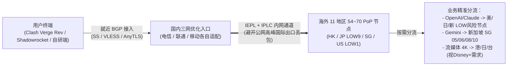

> **核心结论速览（Direct Answer）**：  
> **光速云（Guangshu Cloud）** 创立于 2020 年，是本站品牌库中实证资料最完整的 6 年老牌专线服务商，同时配齐**多协议适配（Shadowsocks / VLESS / AnyTLS）、6 张跨批次实测截图（含 32 线程测速、9Gbps 单线程测速及电信/移动/联通三网 AI 解锁对照表）与多梯队计费模型**。在价格结构上，光速云提供三类清晰入口：仅偶发备用可选 **¥147 一次性 247GB 不过期（致敬斯诺克 147 永久套餐）**；年付极低月均可选 **轻量版 ¥99/年（69GB/月，折合约 8.25 元/月）**；拒绝年付绑定可选 **极速版 ¥25/月（168GB/月）**。使用专属 8 折优惠码 **`AMM`** 可进一步降低成本。客观短板方面：部分新加坡/台湾节点在特定测试中显示 YouTube 送中，香港节点 OpenAI 多呈现仅 APP 解锁，Gemini 仅在新加坡/马来/土耳其等特定区域放行，购买前应结合后文实测矩阵按需切点；同时官方明确「特殊商品不支持退款」，更推荐先用月付或轻量档实测后再决定长期投入。

---

## 一、 光速云品牌定位与核心参数全景档案

挑选一家主力或长期备用服务商，首先看**运营存续年份、线路与协议真实性、以及价格口径是否透明**。下表严格区分月付、年付折算均价与永久按量包，避免以“年付均摊”混淆“真实月付”：

| 核心维度 | 官方通道 | 官方公开规格与实测核验参数 | 客观评估与注意事项 |
| :--- | :---: | :--- | :--- |
| **品牌名称与年限** | **[👉 光速云官方入口](https://sahude.gsyvipaff.com/#/?code=keqgvT5Y)** | **光速云（2020 年运营至今）** | 6 年+运营履历，抗跑路与团队延续性显著优于新站 |
| **专属 8 折优惠码** | **[👉 领码直达注册](https://sahude.gsyvipaff.com/#/?code=keqgvT5Y)** | **`AMM`**（结账页输入校验） | 请以下单结算页面实时显示折扣金额为准 |
| **永久不过期入口** | **[👉 查看 147 套餐](https://sahude.gsyvipaff.com/#/?code=keqgvT5Y)** | **致敬斯诺克 147 永久套餐：¥147 / 247GB** | 流量永久有效不按月清零，适合低频备份或长期挂备用 |
| **年付轻量入口** | **[👉 注册选购](https://sahude.gsyvipaff.com/#/?code=keqgvT5Y)** | **轻量版：¥99/年 · 69GB/月**（折合约 **8.25 元/月**） | 比常见 50~60GB 小包更宽裕；另须留意年付不支持中途退款 |
| **纯月付主力入口** | **[👉 注册选购](https://sahude.gsyvipaff.com/#/?code=keqgvT5Y)** | **极速版：¥25/月 · 168GB/月**（单 GB 约 ¥0.149） | 零年付捆绑，适合高频 AI 编程与 4K 流媒体用户测试主力稳定性 |
| **协议与线路栈** | **[👉 查看节点生态](https://sahude.gsyvipaff.com/#/?code=keqgvT5Y)** | **IEPL / IPLC 专线结合** · **SS / VLESS / AnyTLS** | 多协议共存（实测图可见 Shadowsocks、VLESS 与 AnyTLS 分组） |
| **地区与节点规模** | **[👉 进入面板查看](https://sahude.gsyvipaff.com/#/?code=keqgvT5Y)** | 涵盖 11 个主流地区 · 实测分组可见 **54~70 个节点** | 香港约 20 条、日本 10 条、新加坡 10 条、美国 10 条、台湾 5~10 条及欧亚多区 |
| **售后与退款政策** | **[👉 核对服务条款](https://sahude.gsyvipaff.com/#/?code=keqgvT5Y)** | **特殊商品明确不支持退款** | 虚拟网络订阅通常一旦激活即消耗资源，首次入手强烈建议月付或轻量档 |

> 🔗 **关联选型参照**：如果你坚持纯月付在 15 元以内、暂时不考虑 25 元档位，可对比查看 [宇宙云深度评测（14.9 元 100GB）](/posts/yuzhouyun-review-8-yuan/) 与 [唯兔云深度评测（14.9 元纯月付）](/posts/brand-weitu-review/)；如需更多不过期按量方案，见 [不限时按量计费机场指南](/posts/no-expiration-pay-as-you-go-airports-guide/)。

---

## 二、 2026 光速云最新套餐价格梯度与单 GB 成本精算

结合最新整理的官方套餐档案与 [42 家机场品牌实证库](/brands/) 交叉核对，光速云共设 **7 个主力及定制档位**（以下为原价标称，输入 **`AMM`** 后请以账单折算为准）：

| 套餐名称 | 计费方式 | 官方标价 | 每月 / 总额流量 | 折合单 GB 成本 | 典型适用人群与决策建议 |
| :--- | :---: | :---: | :---: | :---: | :--- |
| **光速云·致敬斯诺克147永久套餐** | 一次性付费 | **¥147** | **247GB 永久不过期** | **¥0.595 / GB**（不限时间） | **强烈推荐备用用户**：常驻挂梯应急、主力翻车兜底、长周期低频科研 |
| **光速云·轻量版** | 年付 | **¥99 / 年** | **69GB / 月** | **¥0.120 / GB**（约 ¥8.25/月） | 轻度查阅 Google 文献、收发海外邮件、日常微信/ChatGPT 文字问答 |
| **光速云·极速版** | **月付** | **¥25 / 月** | **168GB / 月** | **¥0.149 / GB** | **首次纯月付试水首选**：高频编程（Cursor/Claude Code）、1080P~4K 视频 |
| **光速云·流光版** | **月付** | **¥34 / 月** | **268GB / 月** | **¥0.127 / GB** | 性价比最均衡的中重度档，比极速版多 9 元即多出 100GB 月配额 |
| **光速云·量子版** | **月付** | **¥68 / 月** | **568GB / 月** | **¥0.120 / GB** | 小型研发团队、家庭多终端共享、经常拉取 Docker/模型权重者 |
| **光速云·无界版** | **月付** | **¥138 / 月** | **900GB / 月** | **¥0.153 / GB** | 全天候 4K/8K 视听发烧友与大流量云端协同需求 |
| **光速云·定制套餐** | **月付** | **¥680 / 月** | **500GB / 月** | **¥1.36 / GB** | 政企外贸与跨境工作室独享链路定制需求（需联系客服确认 SLA） |

---

## 三、 实测大图全披露：32 线程全节点 + 9Gbps 单线程测速拆解

> ⚠️ **测速口径与客观声明**：以下两张测速大图分别于 **2026-08-11 14:32:56 (CST)** 使用 `MAI-TEST-BOT`（32 线程，后端珠海联通 5Gbps，协议 `Shadowsocks`）与 **2026-08-19 批次** 使用 `MiaoKo 4.7.0`（`A14-1` 珠海联通 9Gbps **单线程 1 thread**，协议 `VLESS`）采集。单次后端测速仅反映当时特定测速机房直连带宽与节点存活度，**不代表用户在全国各地家用宽带的最终上限速率**。

### 1. MAI-TEST-BOT 全节点 32 线程基准测速（2026-08-11）

**核心实测观察与逐区读数**：
- **节点协议与规模**：本组测试涵盖 **54 个节点**（香港 `02~20`、台湾 `01~05`、新加坡 `01~10`、日本 `01~10`、美国 `01~10`），均标注为 `Shadowsocks`。
- **延迟与在线率**：香港群组 `HK | 香港 | 03~19` RTT 稳定在 **14~33ms**、HTTP 延迟 **34~54ms**；台湾组 RTT **82~120ms**（`HK 02` 当次显示 `0B`，`HK 20` 延迟跳升至 `201ms/408ms`，属于真实单点波动）；新加坡组 `51~74ms` RTT（`SG 05` 约 `138ms`）；日本组稳定维持在 **69~74ms**；美国全组 10 个节点维持在 **161~163ms**。
- **速度表现**：在 `5Gbps` 后端测试环境下，亚太与北美大部分可用节点平均速度集中在 **54~75 MB/s** 区间，且美国 `US 05/06/07` 最高冲至 **109~127 MB/s**；全组 54 节点中仅 `HK 02` 出现 0 速，整体高可用节点占比高，无大片超时掉队现象。

### 2. MiaoKo 珠海联通 9Gbps「单线程（线程=1）」测速验证

**为什么单线程测速更关键？** 日常打开 GitHub、加载网页 SPA 或串流 4K 缓冲往往取决于**单条 TCP/TLS 连接的吞吐与抗抖动能力**，而非 32 线程堆叠：
- 该批次采用 `MiaoKo 4.7.0` 在 `线程=1` 严格压测 **70/70 个 VLESS 节点**（香港 20、日本 10、新加坡 10、美国 10、台湾 10 等，其余节点见图底部滚动列表）。
- **香港 20 节点表现极亮眼**：单线程平均速率普遍达到 **375~424 MB/s**，峰值可达 **463~500 MB/s**，TLS RTT 在 **108~125ms**（极个别节点 `HK13` 216ms / `HK06` 217ms）。
- **新加坡与美国单线程同样充沛**：新加坡 `01~10` 单线程均速 **219~315 MB/s**；尤其值得开发者关注的是美国 `US01~10`（除 `US02` 当次为 1.6KB 故障外）其余 9 个美国节点单线程均速均高达 **313~370 MB/s**、峰值 **401~468 MB/s**——这在远程拉取美区 Docker 镜像与大型模型仓库时价值极高。

---

## 四、 四张解锁实测图深度拆解：流媒体与电信/移动/联通三网 AI 实况

光速云在 2026 年 8 月补齐了**全球媒体总表 + 长沙电信 / 广西移动 / 河北联通三网同测对比图**，这让我们可以用“证据矩阵”代替空泛的“全部解锁”话术：

### 1. 全球主流媒体与 OpenAI 深度解锁总表（MiaoKo 70 节点）

从上图 11 项平台检测（`YouTube`、`Netflix`、`Disney+`、`Bilibili 港澳台`、`TikTok`、`DAZN`、`Abema`、`巴哈姆特动画疯`、`OpenAI`、`Steam 货币区域`）可直观得出以下规律：
- **Netflix 与 Disney+**：日本、新加坡、美国、香港绝大部分 `VLESS` 节点呈现绿标解锁（`JP/SG/US/HK` 原生对应或跨区解锁）；部分台湾节点对 Disney+ 显示 `失败`（Netflix 仍可解）。
- **YouTube 送中警示（诚实披露）**：图中 **新加坡全部 10 节点（SG 01~10）与台湾多数节点（TW 01~10）在 `INTL_youtube` 列显示 `送中(CN)`**；如果你需要无送中警告的 YouTube 推荐与账号归属区，建议优先切换 **日本 / 美国 / 香港** 节点。
- **OpenAI 与多区域解锁**：`AI_openai` 列中，日本（1~2/4~10）、新加坡（除 07 为 N/A）、美国全部 10 节点及香港多数节点均呈现绿标解锁（另有部分 HK 及 电信 AnyTLS 节点标为 `N/A` 或请求失败）。

### 2. 三网宽带 AI 与流媒体交叉实测（长沙电信 · 广西移动 · 河北联通）

紧接着使用 `MiaoKo SC-2.3.1` 在三大运营商 `2Gbps` 后端分别测试 **62 个核心节点（含电信专用 AnyTLS/SS 分组）** 的 **IPType、ASN、IP 风险度（IPRisk）与 Disney+ / Netflix / YouTube / OpenAI / Gemini 五项核心指标**：

[grid]

[/grid]

**三网交叉对比提炼出的 4 条硬核结论（避免盲目选节点踩风控）**：
1. **IP 属性与风险度公开透明**：三张图清楚展示了节点 ASN 与性质——日本主要落在 `US-KOMI-NET-AS401243`（标为 `商宽/机房IP`，IPRisk `LOW(9)`）；香港专线落在 `HK-LSHIY-AS32167`（`MEDIUM(30)`）；美国落在 `US-Yancy-AS138415`（`LOW(1)`）。对需要低欺诈分（LOW Risk）的程序员而言，**美国节点 `LOW(1)` 与日本 `LOW(9)` 的风控安全性显著高于普通高风险中转 IP**。
2. **OpenAI（ChatGPT）实测规律**：在电信、移动、联通三网下，**美国、日本、新加坡均实现 OpenAI 网页+App 完整解锁**；而**所有香港专线节点均准确标示为 `仅APP(HK)`**（即网页端易受香港区域限制拦截）。这印证了我们在 [ChatGPT 节点选购指南](/posts/chatgpt-airports-openai-selection-guide/) 中强调的“用美/日/新而非香港登网页版 ChatGPT”原则。
3. **Google Gemini 放行边界**：三网实测中，**日本 `01~10`、香港 `01~20`、美国绝大多数节点在 Gemini 列均显示 `失败`**；反倒是 **新加坡 `02~10`（其中 `05/06/08/10` 稳定解锁 SG）与土耳其/马来西亚节点呈绿标 `解锁`**！所以用 Gemini 或 Google AI Studio 时，请直接定向选 **新加坡 `05/06/08/10`**！
4. **三网速率对比（6 线程测速）**：在同一工具版本下，长沙电信 2Gbps 后端最高单点均速约 `49.38 MB/s`；广西移动 2Gbps 后端新加坡/日本可达 `51~53 MB/s`，反而在部分场景略高于电信；河北联通 2Gbps 后端在 `30~41 MB/s` 左右且香港与日本维持较高可用率。

---

## 五、 IEPL 专线传输逻辑与多协议客户端选型实战

光速云在节点清单中同时提供了 **Shadowsocks、VLESS 与电信组 AnyTLS** 多种协议，意味着无论是老版本硬件还是最新的 Mihomo/sing-box 内核都能找到最佳切入点：

### 客户端适配指南
1. **新手一键开箱**：后台支持官方适配的一键客户端，适合零配置直接登录连线。
2. **进阶极客规则分流（推荐搭配策略组）**：使用 [Clash Verge Rev、v2rayN 与 iOS Shadowrocket（小火箭）通用配置教程](/posts/client-setup-clash-verge-shadowrocket/) 导入订阅后，建议在 YAML 分流规则中手动建两个策略组：**OpenAI 组锁定美/日节点**、**Gemini 组锁定新加坡特定解锁节点**，即可彻底根治频繁跳 IP 与地区报错。软路由与终端开发者还可延伸参考 [Cursor / Claude Code 代理调优实操指南](/posts/cursor-claude-code-ai-developer-proxy-tuning-guide/)。

---

## 六、 客观局限性与 2026 适用人群总结

没有任何一家机场能在所有指标上毫无妥协。客观评估光速云：
- **值得选择的人群**：看重 **6 年+运营口碑**、希望一次搞定**¥147 永久 247GB 防失联兜底**，或选择 **¥99/年 69GB 轻度主力**，以及程序员/AI 重度使用者选 **¥25/月 168GB** 搭配 `LOW(1)` 美国与 `LOW(9)` 日本节点使用，且手上有 **`AMM`** 优惠码。
- **不建议盲买的人群**：① **需要单月只花 10~15 元试错的纯月付党**（光速云纯月付最低 25 元，低于 20 元仅限年付，此类读者建议改看 [宇宙云](/posts/yuzhouyun-review-8-yuan/) 或 [唯兔云](/posts/brand-weitu-review/)）；② **下单后若不满意一定要无理由退款的用户**（官方对特殊虚拟商品明确不支持退款）。

## 七、 常见疑问解答（FAQ）

### Q1：光速云 2026 年的轻量版究竟是 90 元/年 59GB 还是 99 元/年 69GB？
以最新官方资料（2026 年更新档）为准：目前轻量版标准口径为 **¥99/年、每月 69GB**（折合约 8.25 元/月）；同时上线了更有特色的 **致敬斯诺克 147 永久套餐（¥147 一次性 247GB 不过期）** 与 **¥25/月 168GB 极速版**。下单结算前使用优惠码 **`AMM`** 后请以支付页面实际计价为准。

### Q2：用光速云访问 ChatGPT、Claude 和 Gemini 应该怎么选节点？
根据三网实测图：访问 **ChatGPT / OpenAI 网页版** 请避开仅支持 App 端的香港节点，优先选 **美国 `US`（IPRisk `LOW(1)`）或日本 `JP`（IPRisk `LOW(9)`）**；访问 **Google Gemini** 请避开日/港/美，直接测试 **新加坡（如 05/06/08/10）** 节点。

### Q3：光速云支持 Clash Verge Rev 和 iPhone 小火箭吗？限制几台设备？
全面支持通用订阅导入，适配 Clash Verge Rev（Mihomo 内核）、v2rayN、Shadowrocket、Stash 与 sing-box，同时也提供傻瓜式客户端供新手使用。如多端同时在线需合理控制并发连接，避免在短时间内跨多省市 IP 高频切换账号。

---

### 🌐 官方正版通道与相关推荐阅读
- 👉 **[点击进入光速云官方注册入口](https://sahude.gsyvipaff.com/#/?code=keqgvT5Y)** · 注册结账输入优惠码 **`AMM`**
- 📚 **延展阅读**：[2026 精选机场推荐总榜](/posts/recommend-2026-best-airports/) ｜ [返回 42 家机场品牌筛选数据库](/brands/) ｜ [2026 纯月付高性价比机场指南](/posts/monthly-payment-airports-no-annual-plan-guide/)
