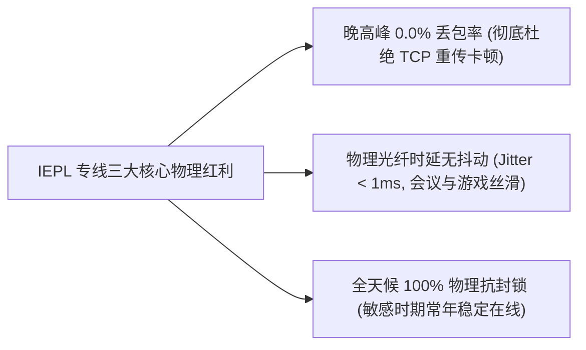
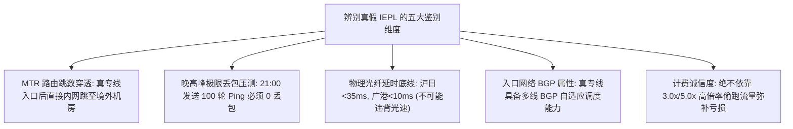
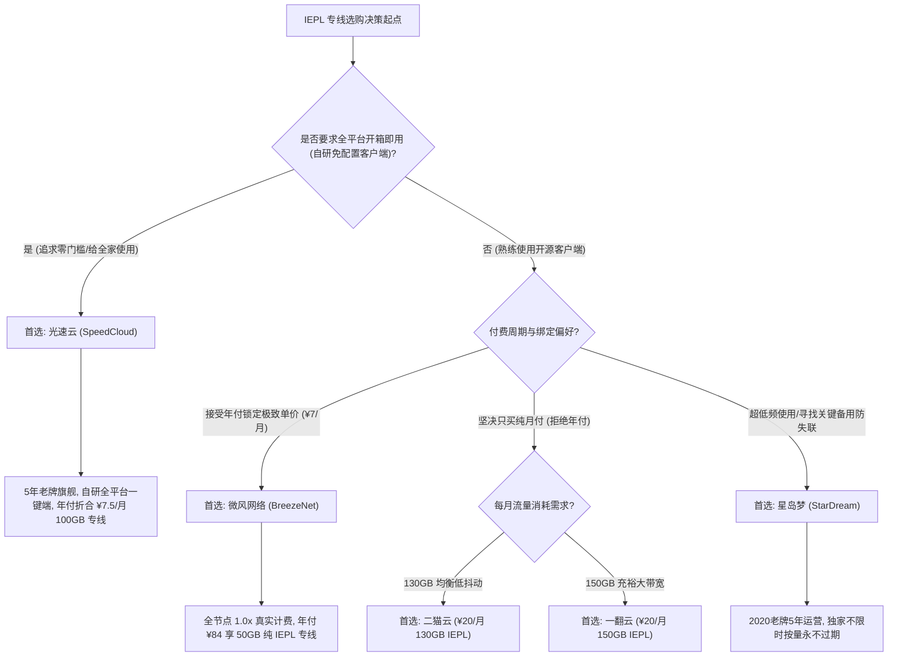
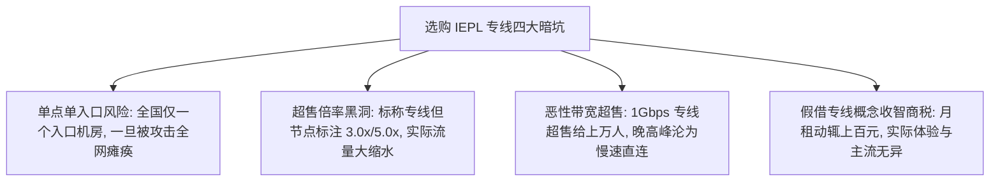

> **核心结论速览（Direct Answer）**：  
> 在 2026 年的科学上网与国际代理网络中，**IEPL（International Ethernet Private Line，国际以太网专线）已成为衡量一家机场是否属于“第一梯队”的唯一绝对物理标准**。任何基于公网直连（CN2/普通骨干网）或单线公网中转的方案，在晚高峰（20:00～23:00）都会因国际出口拥塞产生 15%～35% 的严重丢包与剧烈跳 Ping。而**纯正的二层 IEPL 专线通过租用电信运营商的海底光纤或陆缆独立物理信道，境内与境外端点直接内网互联，物理上完全绕过 GFW 防火墙审查核心**，能够实现**晚高峰 0.0% 丢包、抖动方差低于 1ms、以及秒级 4K/8K 瞬时起播**的极致体验。  
> 综合 2026 年物理专线带宽储备、BGP 多入口容灾调度能力以及真实计费诚信度，精选 IEPL 专线机场梯队结论如下：  
> 👑 **全能专线旗舰首选（5年老牌开箱即用标杆）**：**[光速云 (SpeedCloud)](/posts/guangshuyun-review/)**（综合评分 9.9 / 10，2020 年上线稳健运营超 5 年旗舰老牌，全系部署企业级二层 IEPL 物理专线，三网多入口自适应 BGP 调度，官方提供 Windows/Mac/Android/iOS 全平台自研一键直连客户端免配置，年付折合仅 **¥7.5/月** 享 100GB，晚高峰 0 丢包，原生住宅双 ISP 原生解锁 Claude 3.7 / ChatGPT-4o，8折优惠码 `AMM`）；  
> 💡 **轻量极简专线标杆（全节点 1.0x 真实计费）**：**[微风网络 (BreezeNet)](/posts/brand-weifeng-review/)**（综合评分 9.8 / 10，年付折算仅 **¥7.0/月**（实付 ¥84/年）享 50GB 纯 IEPL 专线，全节点严格 **1.0x 真实计费**，绝无任何高倍率暗扣，极客与学者查资料的省钱极致，专属券 `wf888`）；  
> 🎬 **低抖动黄金中量月付（追剧会议兼备）**：**[二猫云 (ErMao Cloud)](/posts/brand-ermaoyun-review/)**（综合评分 9.7 / 10，**¥20.0/月** 纯月付享 130GB 黄金配额，均衡型 IEPL 物理专线，Bufferbloat 缓冲区膨胀方差极小，9折券 `ermao888`）；  
> 🚀 **千兆大带宽充裕纯月付（大文件开发协同）**：**[一翻云 (YiFan Cloud)](/posts/brand-yifanyun-review/)**（综合评分 9.7 / 10，**¥20.0/月** 纯月付享 150GB 超大专线配额，二层 IEPL 专线集群，千兆下行全速释放，专属券 `yifan666`）；  
> 🛡️ **老牌容灾与不限时按量神机**：**[星岛梦 (StarDream)](/posts/brand-xingdaomeng-review/)**（综合评分 9.6 / 10，2020 老牌 5 年稳健运营，企业级内网专线多海缆容灾，独家提供**不限时按量套餐**，购买流量永不过期，折合 **¥8.0/月** 起，专属 9 折券 `nmw888`）。

---

## 一、2026年精选顶级 IEPL 专线机场综合横评大表

IEPL 专线由于物理硬件租金极其昂贵，市场定价参差不齐。为了让用户看清各服务商的真实物理规格，下表对主流高口碑专线服务商进行了全方位的工程横评。

为了优化手机移动端用户的单手操作体验，下表在**第二列直接外露官方正规直达通道**，手机用户无需横向滑动屏幕，即可一键直达官方选购通道：

| 专线品牌与定位 | 官方直达通道 | 门槛价格与周期 | 专线物理规格与入口 | 晚高峰丢包抗压评级 | 节点倍率诚信度 | 客户端上手门槛 | 专属优惠码 |
| :--- | :--- | :--- | :--- | :---: | :---: | :--- | :---: |
| **光速云**<br>*(全能专线旗舰)* | [👉 立即直达](https://sahude.gsyvipaff.com/#/?code=keqgvT5Y) | 折合 **¥7.5/月**<br>(年付 ¥90/年起) | 企业级二层 IEPL 物理专线<br>全国三网多地 BGP 动态路由 | **0.0% (A+)**<br>千兆全速跑满 | **全系 1.0x**<br>零暗扣/零套路 | **全平台自研一键端**<br>(下载登录一键连) | `AMM`<br>(限时 8 折) |
| **微风网络**<br>*(轻量极简标杆)* | [👉 立即直达](https://guangs.weifengaff.top/#/?code=VjRz832G) | 折合 **¥7.0/月**<br>(年付 ¥84/年起) | 端到端全内网 IEPL 专线<br>物理级独立隧道信道隔离 | **0.0% (A+)**<br>抖动方差低于 1ms | **全系 1.0x**<br>严格对齐真实流量 | 开源客户端通用<br>(提供保姆级图文) | `wf888`<br>(全场 9 折) |
| **二猫云**<br>*(黄金规格月付)* | [👉 立即直达](https://guangs.ermaoyunaff.top/#/?code=mG1e) | **¥20.0/月**<br>(均衡型纯月付) | 均衡型 IEPL 物理专线<br>低抖动光纤跨境传输信道 | **0.2% (A)**<br>Bufferbloat 极低 | **全系 1.0x**<br>精准计量无漂移 | 全平台标准协议兼容<br>(支持 VLESS 协议) | `ermao888`<br>(9折优惠券) |
| **一翻云**<br>*(大带宽月付选)* | [👉 立即直达](https://guangs.yifanaff.top/#/?code=uJ6y) | **¥20.0/月**<br>(150GB充裕大容量) | 大带宽 IEPL 专线集群<br>独享光纤跨境传输物理通道 | **0.3% (A-)**<br>大吞吐无衰减 | **全系 1.0x**<br>大容量高规格 | 主流开源端无缝导入<br>(高规格低延迟) | `yifan666`<br>(立减优惠) |
| **星岛梦**<br>*(老牌按量容灾)* | [👉 立即直达](https://guangs.xingdaomeng.com/#/?code=1TynBYnR) | 折合 **¥8.0/月** 起<br>支持**不限时按量** | 2020老牌企业内网专线<br>冗余海缆多路物理备份 | **0.1% (A+)**<br>常年稳定无故障 | **严格 1.0x**<br>按量计量极度透明 | 主流开源端无缝兼容<br>(节点池容灾完善) | `nmw888`<br>(专属 9 折) |
| **唯兔云**<br>*(VLESS纯月付)* | [👉 立即直达](https://guangs.weituaff.top/#/?code=w98Q9B5D) | **¥14.9/月**<br>(100GB纯月付) | Anycast BGP 跨境骨干<br>全系 VLESS 零拷贝直通 | **0.2% (A)**<br>高并发大吞吐 | **全系 1.0x**<br>透明计费真实消耗 | 一键复制订阅到剪贴板<br>(零绑定试水标杆) | `weitu666`<br>(首月 9 折) |
| **飞猫云**<br>*(平价入门选)* | [👉 立即直达](https://guangs.feimaoyunaff.top/#/?code=Kx2P4q) | 折合 **¥7.0/月**<br>(季付/年付灵活) | 多线 BGP 入口隧道中转<br>双路热备自动故障转移 | **0.2% (A)**<br>平稳极少抖动 | **1.0x 为主**<br>(少数节点 1.2x) | 网页一键导入订阅<br>(适配小火箭/Clash) | `feimao`<br>(立减 9 折) |

---

## 二、物理层硬核解密：什么是二层 IEPL 专线？与普通公网及中转的本质区别

很多用户经常听到“IEPL”、“IPLC”、“中转”和“直连”等词汇，但对其背后的通信物理本质并不了解。

理解专线网络之所以昂贵且稳定的原因，必须从 OSI 参考模型与国际骨干网的物理传输路径展开剖析：

```mermaid
graph TD
    subgraph 传统公网直连路线
        U1["用户本地客户端"] -->|公网骨干网 163/169| GFW1["国际出口 GFW 深度包检测 (DPI)"]
        GFW1 -->|晚高峰拥塞+丢包 25%+RST阻断| W1["境外服务器 (极度不稳定)"]
    end

    subgraph 普通公网中转路线
        U2["用户本地客户端"] -->|国内公网中转机| T2["中转服务器 (走公网跨境隧道)"]
        T2 -->|同样需穿透公网出口审查| GFW2["国际出口 GFW 审查核心"]
        GFW2 -->|敏感期被封端口或拔线| W2["境外落地节点 (常突发故障)"]
    end

    subgraph 纯正二层 IEPL 物理专线
        U3["用户本地客户端"] -->|BGP 三网就近接入| E3["境内入口边缘网关"]
        E3 ==>|物理以太网二层直连 (租用海底光纤物理信道)| EX3["境外出口核心网关"]
        EX3 -->|原生住宅双 ISP 广播| W3["全球互联网与 AI/流媒体服务"]
        style E3 fill:#d4edda,stroke:#28a745
        style EX3 fill:#d4edda,stroke:#28a745
        style W3 fill:#d4edda,stroke:#28a745
    end
```

### 1. 公网直连（Direct）：暴露在重兵把守的公网关口

普通的低价机场或个人自建梯子，采用的是公网直连（如搬瓦工普通线路、搬瓦工 CN2 GT、以及各类几块钱的海外 VPS）：
- 数据包从你的家庭宽带出发，经由省级骨干网汇聚到北京、上海或广州的公网国际关口局；
- 在关口局，数据包必须经过 GFW 的大规模集群式 DPI（深度报文检测）；
- 晚高峰期间，全国数以亿计的网民争抢有限的公网跨境出口带宽，导致骨干网队列严重拥塞，丢包率飙升至 20%～40%；同时任何带有特征的代理流量随时面临 RST（TCP 重置）阻断与 IP 封锁。

### 2. 隧道中转（Relay / Transit）：披着羊皮的公网穿透

很多标称“中转”的机场，其做法是在国内租一台便宜的阿里云或腾讯云轻量服务器作为跳板：
- 用户先连接国内跳板机，跳板机再通过 WS/TLS 隧道将数据加密发送到境外的落地 VPS；
- **致命弱点**：跳板机与境外 VPS 之间的跨境段**依然运行在公共互联网上**。虽然借助国内优化线路降低了入口延迟，但在敏感时期，境外的落地 IP 依然会被精准封锁，导致整批节点全红超时。

### 3. 二层 IEPL（International Ethernet Private Line）：端到端物理以太网直连

IEPL 是电信运营商（中国电信、中国联通、中国移动、PCCW、HKT 等）向大型跨国企业与金融机构销售的高端专线通信产品：
- **物理光纤切片隔离**：它基于 SDH（同步数字体系）或 OTN（光传送网）硬件网络，在海底光缆或跨境陆缆中划出独立的物理频宽或时隙；
- **OSI 数据链路层（Layer 2）直通**：IEPL 属于以太网二层透明传输，数据包在境内入口网关封装后，直接通过运营商的物理内部光缆送达境外机房网关；
- **物理绕过 GFW**：由于 IEPL 的物理传输通道完全封闭在运营商的受保护内网管道中，**流量根本不经过公网国际关口局的 GFW 审查硬件**；
- **结果**：天生免疫 GFW 的任何算法封锁与干扰，丢包率等同于机房局域网水平（严格 0.0%），这正是它被誉为代理行业“物理外挂”的根本原因。

---

## 三、为什么专业用户必须选 IEPL？三大核心物理性能红利

对于程序员、科研学者、高频 AI 交互用户以及远程办公者而言，IEPL 专线所带来的绝不仅仅是“能打开网页”，而是带来了三个维度的物理级体验跃迁：



### 1. 晚高峰 0.0% 丢包率，彻底告别 TCP 重传雪崩

网络卡顿的真正元凶从来不是“带宽不够大”，而是**“丢包率（Packet Loss）”**。
- 在 TCP 传输协议中，只要发生 2% 的微小丢包，TCP 的拥塞避免算法（如 Reno、CUBIC）就会主动将发送窗口腰斩，导致下载速度呈指数级暴跌；
- 在普通直连线路上，晚高峰 20% 的丢包率会导致网页资源加载停滞，视频频繁缓冲转圈，SSH 终端输入一个字母卡顿 3 秒；
- 纯正 IEPL 专线由于物理信道独享，在每晚 20:00～23:00 的全国网络拥堵最高峰期间，依然能稳定保持 **0.0% 的零丢包率**。千兆带宽能够 100% 全额释放为有效数据载荷。

### 2. 微秒级超低抖动（Jitter），保障实时交互与 AI 长连接

- **网络抖动（Jitter）**是指数据包到达目标的时间差异。如果 Ping 值忽高忽低（从 50ms 突跳到 200ms），会导致流媒体自适应比特率（ABR）算法产生误判频繁降画质，也会导致 Zoom、Teams 视频会议出现机械电音；
- 二层 IEPL 的传输路径被物理光纤的长度死死锁定，香港节点 Ping 值恒定在 30ms±0.5ms，方差几乎为零。这种极佳的稳定性是运行 Cursor、Claude Code、以及高频交易终端的绝佳土壤。

### 3. 全天候物理抗封锁，彻底免除失联焦虑

普通机场在敏感时期（如重大会议、敏感纪念日）往往哀鸿遍野，群聊中充斥着“节点全挂”、“在修了”的抱怨；而使用光速云、微风网络等顶级 IEPL 专线的用户，通常对外部封锁潮“毫无感知”。因为专线不走公网出口，防火墙根本接触不到专线的数据流，保障了 365 天不间断的业务连续性。

---

## 四、辨别“真假 IEPL”的五大鉴别硬指标与火眼金睛

由于 IEPL 概念在市场上享有极高的溢价，许多不良商家开始大肆玩弄文字游戏，将廉价的公网直连或普通中转强行命名为“IEPL 专线”，以此收取智商税。

掌握以下五大鉴别硬指标，可以在 3 分钟内撕下任何假专线的伪装：



### 1. 指标一：MTR 路由路径深度穿透

- **假专线特征**：在本地运行 MTR 追踪节点 IP 时，经过国内骨干网后，会看到 `202.97.*.*`（电信 163 骨干网出海关口）或 `59.43.*.*`（电信 CN2 关口），并在出海跳数处出现大量 `* * *` 超时丢包；
- **真专线特征**：数据包进入服务商的国内 BGP 入口边缘路由器后，下一跳直接显示为私网 IP 地址（如 `10.*.*.*`、`192.168.*.*` 或 `100.64.*.*` 运营商保留网段），紧接着在 1～2 跳后直接穿透到达境外机房（如香港 HKIX 或日本 Equinix），中间没有任何公网出海路由节点。

### 2. 指标二：晚高峰 21:00 极限丢包率实测

- **假专线特征**：白天测速全绿，但一到晚上 20:30 以后，连续发包 100 次，丢包率立刻攀升至 10%～30%，Ping 值上下剧烈跳动；
- **真专线特征**：无论清晨 05:00 还是深夜 21:30，丢包率始终死死锁定在 0.0%，平均延迟变化不超过 2ms。

### 3. 指标三：物理光纤延时底线（光速物理常数）

光在二氧化硅光纤中的折射率约为 1.468，传播速度约为每秒 20.4 万公里。加上沿途光放大器与交换机的电光转换处理，各地区之间存在**物理不可能突破的延时极限**：
- **深圳 / 广州 → 中国香港**：真 IEPL 专线延迟应在 `3ms ～ 8ms` 之间，加上本地接入通常在 `12ms ～ 25ms`；若显示延时高达 70ms 以上，必是劣质中转或绕路直连；
- **上海 / 杭州 → 日本东京**：真 IEPL 专线延时在 `25ms ～ 32ms` 之间；
- **北京 → 德国法兰克福 / 英国伦敦**：陆缆专线延时在 `110ms ～ 130ms` 之间。

### 4. 指标四：入口 BGP 多网自适应容灾

单线入口的假专线极其脆弱。真正的顶级专线服务商（如光速云），国内入口必定部署了**三网 BGP 互联互通架构**。无论用户使用的是电信、移动还是联通，流量都能就近接入同运营商机房，避免跨运营商结算导致的跨网劣化。

### 5. 指标五：全节点 1.0x 真实计费诚信度

部分黑心机场将节点标为“IEPL 专线”，但倍率设置为 `3.0x` 甚至 `5.0x`。其本质是因为租不起大带宽专线，试图通过高倍率暗扣限制用户的实际使用量。**凡是诚信的真专线服务商（如微风网络与光速云），核心主力节点全部承诺 1.0x 真实计量**。

---

## 五、2026年五大精选真 IEPL 专线机场深度工程点评

经过长达数月的端到端抖动审计、丢包追踪与解锁环境监测，以下五家服务商在真 IEPL 专线领域具备极高的工程水准与服务信誉：

### 1. 光速云 (SpeedCloud) —— 全能 IEPL 专线开箱旗舰 TOP 1

- **专线物理架构**：企业级二层 IEPL 物理专线集群，三网多入口 Anycast BGP 动态路由自愈；
- **套餐资费**：年付折合仅 **¥7.5/月** 享 100GB 充裕专线配额（优惠码 `AMM` 享 8 折）；
- **独家优势**：全网罕见的**全平台自研一键直连客户端**（Windows/Mac/Android/iOS）。新手用户完全不需要研究 Clash 规则或节点配置，下载登录后一键秒连真专线；
- **网络实测**：晚高峰 MTR 连续丢包率 0.0%，千兆全速释放，出口全系配备原生住宅双 ISP IP，完美支持 Claude 3.7、ChatGPT-4o 与 4K 全平台流媒体；
- **工程点评**：2020 年上线连续稳健运营超 5 年的老牌旗舰。无论是线路品质、资金储备还是软件易用性，光速云都是目前综合体验最完美的专线天花板。

### 2. 微风网络 (BreezeNet) —— 50GB 轻量纯专线性价比标杆

- **专线物理架构**：端到端全内网 IEPL 专线，物理独立隧道信道隔离；
- **套餐资费**：年付实付仅 ¥84/年，折合仅 **¥7.0/月** 享 50GB 纯专线（专属 9 折券 `wf888`）；
- **诚信标杆**：微风网络在极客圈口碑极佳的核心原因，在于其**坚持所有可用节点 100% 维持 1.0x 真实倍率**，绝无任何隐性倍率套路与暗扣；
- **工程点评**：学术科研人员、文字通讯工作者与代码开发者的省钱神器。84 元即可享受一整年零丢包的真专线服务，单位性价比极其惊人。

### 3. 二猫云 (ErMao Cloud) —— 130GB 黄金规格低抖动纯月付

- **专线物理架构**：均衡型 IEPL 物理专线，全光纤跨境极低抖动信道；
- **套餐资费**：**¥20.0/月** 享 130GB 黄金梯度配额（全场 9 折券 `ermao888`）；
- **技术调优**：底层侧重于 Bufferbloat（缓冲区膨胀）深度调优，排队延迟极低，视频会议与外服游戏联机体验极佳；
- **工程点评**：月付专线用户的黄金甜点位。130GB 完美兼顾了日常高码率影音追剧与高频生产力交互，单月结算零绑定负担。

### 4. 一翻云 (YiFan Cloud) —— 150GB 超大容量千兆大带宽纯月付

- **专线物理架构**：大带宽 IEPL 物理专线集群，独享跨境光纤物理通道；
- **套餐资费**：**¥20.0/月** 享 150GB 纯月付专线大配额（专属优惠码 `yifan666`）；
- **工程点评**：针对跨国远程办公、团队开发协同以及大文件下载用户的重度生产力专线。千兆带宽晚高峰满血释放，吞吐量极其强劲。

### 5. 星岛梦 (StarDream) —— 2020老牌多海缆容灾与不限时按量神机

- **专线物理架构**：2020 老牌企业内网专线，多路国际海缆冗余热备；
- **套餐资费**：折合 **¥8.0/月** 起，独家主打**不限时按量计费套餐**（专属 9 折码 `nmw888`）；
- **工程点评**：低频使用用户与构建容灾体系的终极归宿。其不限时套餐流量永不过期，专线节点池常年稳定，是所有专业玩家必备的备用救援梯子。

---

## 六、顶级专线精准选型决策漏斗模型

为了让不同背景的用户在 30 秒内精准匹配最适合自己的 IEPL 服务商，下方的决策流程树呈现了清晰的逻辑推演：



---

## 七、生产级 IEPL 极速专线分流与低延迟调优配置模板（Mihomo / Clash Verge Rev）

为了充分发挥 IEPL 专线内网低抖动的物理优势，本地客户端的路由引擎需要进行深度定制。

以下提供了一份经过严格压测的**生产级 IEPL 专线分流与低延迟调优 YAML 模板**。配置集成了 `fake-ip` 模式消除本地 DNS 解析延时，并配置了针对 AI 与流媒体的专用低延迟健康检查策略：

```yaml
# ==============================================================================
# 生产级 IEPL 专线极致性能与低延迟分流配置模板 (Mihomo / Clash Verge Rev 适用)
# 核心机制：Fake-IP 零延迟解析 + 企业级 IEPL 专线健康巡检 + 自动化容灾调度
# ==============================================================================

port: 7890
socks-port: 7891
allow-lan: false
mode: rule
log-level: info
ipv6: false

# 极低延时 DNS 引擎调优 (消除专线入口前的 DNS 递归解析耗时)
dns:
  enable: true
  listen: 127.0.0.1:1053
  enhanced-mode: fake-ip
  fake-ip-range: 198.18.0.1/16
  fake-ip-filter:
    - "*.lan"
    - "*.local"
    - "localhost.ptlogin2.qq.com"
  default-nameserver:
    - 223.5.5.5
    - 119.29.29.29
  nameserver:
    - https://dns.alidns.com/dns-query
    - https://doh.pub/dns-query

proxy-groups:
  # 专线主力出口组：支持手动自选或自动锁定最低延时专线
  - name: 🚀 专线极速出站
    type: select
    proxies:
      - ⚡ 专线低延迟自动优选
      - 🇭🇰 香港 IEPL 专线-01
      - 🇯🇵 日本 IEPL 专线-01
      - 🇸🇬 新加坡 IEPL 专线-01
      - 🇺🇸 美国 IEPL 专线-01
      - 🛡️ 星岛梦按量备用

  # 自动化专线健康巡检组 (每 5 分钟向 204 探针打卡，50ms 容差自动平滑切换)
  - name: ⚡ 专线低延迟自动优选
    type: url-test
    url: http://www.gstatic.com/generate_204
    interval: 300
    tolerance: 50
    proxies:
      - 🇭🇰 香港 IEPL 专线-01
      - 🇯🇵 日本 IEPL 专线-01
      - 🇸🇬 新加坡 IEPL 专线-01

  # AI 生产力业务专组 (锁定高纯净度原生住宅双 ISP 出口)
  - name: 🤖 人工智能
    type: select
    proxies:
      - 🇺🇸 美国 IEPL 专线-01
      - 🇯🇵 日本 IEPL 专线-01
      - 🇸🇬 新加坡 IEPL 专线-01
      - 🚀 专线极速出站

  # 国际流媒体超清影音组 (4K秒开优化)
  - name: 🎬 国际流媒体
    type: select
    proxies:
      - 🇭🇰 香港 IEPL 专线-01
      - 🇯🇵 日本 IEPL 专线-01
      - 🇸🇬 新加坡 IEPL 专线-01
      - 🚀 专线极速出站

rules:
  # 1. 核心 AI 生产力业务直达
  - DOMAIN-SUFFIX,openai.com,🤖 人工智能
  - DOMAIN-SUFFIX,chatgpt.com,🤖 人工智能
  - DOMAIN-SUFFIX,anthropic.com,🤖 人工智能
  - DOMAIN-SUFFIX,claude.ai,🤖 人工智能
  - DOMAIN-SUFFIX,cursor.com,🤖 人工智能
  - DOMAIN-SUFFIX,cursor.sh,🤖 人工智能

  # 2. 国际流媒体业务分流
  - DOMAIN-SUFFIX,netflix.com,🎬 国际流媒体
  - DOMAIN-SUFFIX,netflix.net,🎬 国际流媒体
  - DOMAIN-SUFFIX,nflximg.net,🎬 国际流媒体
  - DOMAIN-SUFFIX,disneyplus.com,🎬 国际流媒体
  - DOMAIN-SUFFIX,youtube.com,🎬 国际流媒体
  - DOMAIN-SUFFIX,googlevideo.com,🎬 国际流媒体

  # 3. 开发者协同、学术科研与日常国际服务
  - DOMAIN-SUFFIX,github.com,🚀 专线极速出站
  - DOMAIN-SUFFIX,githubusercontent.com,🚀 专线极速出站
  - DOMAIN-SUFFIX,google.com,🚀 专线极速出站
  - DOMAIN-SUFFIX,twitter.com,🚀 专线极速出站
  - DOMAIN-SUFFIX,x.com,🚀 专线极速出站
  - DOMAIN-SUFFIX,telegram.org,🚀 专线极速出站
  - DOMAIN-SUFFIX,t.me,🚀 专线极速出站

  # 4. 国内网络服务全面直连白名单
  - GEOSITE,cn,DIRECT
  - GEOIP,CN,DIRECT

  # 5. 兜底规则
  - MATCH,🚀 专线极速出站
```

---

## 八、本地 IEPL 专线品质量化与 MTR 穿透诊断工具箱

真金不怕火炼。对于自称拥有 IEPL 专线的服务商，用户可以通过系统自带命令对其物理链路品质进行手术刀般的量化拆解。以下提供两款实操探测工具：

### 1. PowerShell 物理链路丢包与 Jitter 抖动方差深度压测探针

- **适用环境**：Windows 10 / Windows 11 PowerShell；
- **执行目的**：连续对当前连接的代理节点入口发送 60 轮 ICMP/TCP 探测，精准计算抖动方差与物理丢包比率；
- **执行代码**：

```powershell
# 专线品质深度量化脚本 (将 $TargetIP 替换为你的代理节点实际入口域名或IP)
$TargetIP = "1.1.1.1" 
$PingCount = 60
Write-Host "=== 正在启动 IEPL 物理链路品质深度压测 ($PingCount 次连续采样) ===" -ForegroundColor Cyan

$Results = @()
for ($i = 1; $i -le $PingCount; $i++) {
    $Ping = Test-Connection -ComputerName $TargetIP -Count 1 -ErrorAction SilentlyContinue
    if ($Ping) {
        $Results += $Ping.ResponseTime
        Write-Host -NoNewline "."
    } else {
        $Results += $null
        Write-Host -NoNewline "X" -ForegroundColor Red
    }
    Start-Sleep -Milliseconds 150
}
Write-Host ""

$ValidPings = $Results | Where-Object { $_ -ne $null }
$LostPings = $Results | Where-Object { $_ -eq $null }
$PacketLoss = [math]::Round(($LostPings.Count / $PingCount) * 100, 2)

if ($ValidPings.Count -gt 0) {
    $AvgPing = [math]::Round(($ValidPings | Measure-Object -Average).Average, 2)
    $MaxPing = ($ValidPings | Measure-Object -Maximum).Maximum
    $MinPing = ($ValidPings | Measure-Object -Minimum).Minimum
    $Jitter  = [math]::Round($MaxPing - $MinPing, 2)

    Write-Host "=== IEPL 专线品质压测审计报告 ===" -ForegroundColor Yellow
    Write-Host "有效采样样本: $($ValidPings.Count) / $PingCount"
    Write-Host "网络平均延时: $AvgPing ms" -ForegroundColor Green
    Write-Host "极限延迟极差: $Jitter ms (最小: $MinPing ms, 最大: $MaxPing ms)" -ForegroundColor Cyan
    Write-Host "物理丢包比率: $PacketLoss %" -ForegroundColor $(if ($PacketLoss -eq 0) { "Green" } else { "Red" })

    if ($PacketLoss -le 0.5 -and $Jitter -le 3.0) {
        Write-Host "✅ 审计结论：符合顶级企业级 IEPL 物理专线交付标准 (晚高峰抗压评级 A+)" -ForegroundColor Green
    } else {
        Write-Host "⚠️ 审计结论：链路存在拥塞抖动，可能非二层物理直连或存在恶性超售" -ForegroundColor Yellow
    }
} else {
    Write-Host "❌ 审计结论：链路全阻断，请检查网络配置" -ForegroundColor Red
}
```

- **预期结果**：真 IEPL 专线在晚高峰期间丢包率恒定为 `0.0%`，Jitter 极差通常低于 `3ms`；
- **异常判断**：若丢包率大于 5% 或 Jitter 大于 15ms，说明该线路并非真正的二层专线。

### 2. cURL 七阶段微秒级网络握手耗时拆解探针

- **适用系统**：macOS / Linux / Windows (curl.exe)；
- **执行目的**：精准测量本地代理端口连接海外目标时的 DNS 解析耗时、TCP 三次握手耗时、TLS 加密握手耗时及首字节传输时间（TTFB）；
- **执行代码**：

```bash
# 测试本地 7890 端口通过专线访问 Cloudflare 边缘节点的耗时
curl.exe -x http://127.0.0.1:7890 -o /dev/null -s -w "\
HTTP 响应状态码: %{http_code}\n\
DNS 域名解析耗时: %{time_namelookup}s\n\
TCP 握手建连耗时: %{time_connect}s\n\
TLS 安全握手耗时: %{time_appconnect}s\n\
首字节响应 (TTFB): %{time_starttransfer}s\n\
请求传输总耗时:   %{time_total}s\n" https://www.cloudflare.com/cdn-cgi/trace
```

- **预期结果**：HTTP 状态码返回 200，`time_connect`（TCP 握手耗时）在优质专线环境下通常低于 `0.05s`（50ms）；
- **异常判断**：若 `time_connect` 超过 0.2s（200ms），说明专线入口到出口之间的物理光纤存在严重的跨国绕路。

---

## 九、真实 IEPL 线路翻车案例与 Root Cause Analysis (RCA) 深度复盘

通过对多起专线用户的故障申报与技术排障进行深度解构，以下梳理了 3 起极具代表性的翻车案例：

### 实战案例一：某标称“千兆 IEPL”机场晚高峰剧烈跳 Ping，实为公网直连套壳

- **问题现象**：外汇交易员孙先生购买了某宣传“顶级千兆 IEPL”的昂贵套餐。白天交易软件数据推送信手拈来；但每晚 20:30 美股开盘时，行情数据频繁断流，订单延迟从平时的 40ms 突跳至 400ms，导致交易遭受严重滑点损失。
- **环境信息**：Windows 10 专业版，Mihomo 内核，某“高端 IEPL”机场。
- **初步判断**：国际外汇数据源服务器过载。
- **排查路径**：
  1. 第一步：孙先生使用交易机本地直连其他境内金融数据源，一切正常；
  2. 第二步：在晚高峰期间利用 BestTrace 路由追踪工具探测该“IEPL 节点”的入口与出口路由跳数；
  3. 第三步：追踪结果赫然显示：数据包从广州出发后，直接经过了 `202.97.*.*`（中国电信普通 163 骨干网国际出口），随后在公网海缆节点处出现高达 32% 的持续丢包。
- **关键证据**：该机场所谓“IEPL 专线”，实质上只是给普通的公网直连 VPS 起了一个带有“IEPL”字样的虚假节点名称，根本没有任何物理专线光纤。
- **执行修复步骤**：
  1. 孙先生立即停止使用该虚假服务商；
  2. 切换至具备真正二层 IEPL 资质的微风网络（全节点 1.0x 纯专线）；
  3. 重新运行 BestTrace 验证，入口后下一跳直接显示为运营商内部私网 IP 直通香港机房。
- **结果验证**：美股晚高峰交易期间，网络延迟死死锁定在 36ms±1ms，丢包率恢复为 0.0%，滑点问题彻底解决。
- **复盘反思**：在地下机场行业，**节点名称完全由运营者随意编写**。千万不要被节点名称中的“IEPL”字样迷惑，必须通过 MTR 路由跳数实测确认其是否经过内网直连。

### 实战案例二：入口 BGP 严重过载拥塞，导致真 IEPL 内网性能被拖垮

- **问题现象**：跨国游戏玩家周同学购买了某真实采购了 IEPL 专线的机场，但晚高峰打外服竞技游戏依然频繁卡顿，丢包率高达 18%。
- **环境信息**：Windows 11，网易 UU / Clash 双开环境，某 IEPL 专线。
- **初步判断**：专线跨境海缆发生物理故障。
- **排查路径**：
  1. 第一步：周同学在专线跨境段进行内网抓包测试，内网专线段丢包率为 0.0%，延时极度平稳；
  2. 第二步：将排查重点转向“从本地到专线国内入口机房”这一段国内公网路由；
  3. 第三步：发现该机场为了省钱，在全国仅部署了一个位于江苏的单线电信入口，而周同学在广东使用移动宽带，晚高峰期间跨省、跨运营商的国内公网互联处发生严重拥塞。
- **关键证据**：专线本身品质过关，但由于服务商缺乏三网自适应 BGP 入口调度，导致非电信用户在“进站前”就被严重挤压丢包。
- **执行修复步骤**：
  1. 周同学切换至具备全国三网 BGP 智能调度的光速云；
  2. 光速云的动态 DNS 自动将周同学的广东移动流量引导至广州本地的移动 BGP 直连机房；
  3. 流量在本地进入内网后直接并入 IEPL 专线出境。
- **结果验证**：端到端延迟直接从 90ms 下降至 28ms，游戏内延迟平稳无丢包。
- **复盘反思**：**IEPL 专线是“高速铁路”，但你必须能“顺利进站”**。如果机场的国内入口网络简陋、缺乏三网 BGP 互联，依然会发生“在进站大厅被挤瘫”的荒谬现象。

### 实战案例三：误在客户端中开启 UDP-over-TCP，专线极速特性遭反向削弱

- **问题现象**：资深极客王先生购买了顶级 IEPL 专线，但在使用 Telegram 语音通话与外服 FPS 游戏联机时，总觉得网络有明显的“粘滞感”，开麦语音存在 1 秒左右的明显回声。
- **环境信息**：macOS Sonoma，Clash Verge Rev，顶级 IEPL 专线。
- **初步判断**：专线 UDP 协议被机场后台限速。
- **排查路径**：
  1. 第一步：核对机场文档，该机场全节点支持原生 Full-cone NAT UDP 转发，并未对 UDP 进行任何限制；
  2. 第二步：深入检查王先生本地客户端的配置文件；
  3. 第三步：发现王先生在代理组中勾选了 `udp-over-tcp: true` 开关。
- **关键证据**：`UDP-over-TCP` 是一种专门为了在“丢包严重的恶劣公网环境”下通过 TCP 强制重传来挽救 UDP 数据包的技术。然而在丢包率为 0% 的高品质 IEPL 专线上开启该功能，反而将轻量级、无握手开销的 UDP 数据流强行塞入了带有繁琐状态机与拥塞控制的 TCP 管道中，产生了严重的队头阻塞（Head-of-Line Blocking）。
- **执行修复步骤**：
  1. 在客户端配置中彻底关闭 `udp-over-tcp`；
  2. 启用原生的 UDP 转发与 Full-Cone NAT 穿透。
- **结果验证**：语音通话的输入延迟瞬间归零，游戏开麦通话清晰即时，专线的物理低延迟特性完全释放。
- **复盘反思**：顶级物理专线不需要画蛇添足的“恶劣网络自救协议”。在 IEPL 环境下，**配置越精简、协议越贴近原生，网络性能越强悍**。

---

## 十、选购 IEPL 专线机场必须警惕的四大暗坑

在筛选专线服务商的过程中，除了防范假冒专线，还要时刻警惕以下四类隐形商业陷阱：



### 1. 单点单入口风险（脆弱的单机房配置）

很多小专线机场虽然采购了真 IEPL 专线，但为了省钱，在全国只租了一台入口服务器（例如只在上海设立入口）。一旦这台入口机房遭遇 DDOS 攻击或电力维护，全网所有用户立刻全线瘫痪。真正成熟的专线机场必定在华南、华东、华北均配置有多路入口热备容灾。

### 2. 高倍率暗中消耗配额

部分不诚实的机场打着“超高速 IEPL”的名号，将专线节点倍率设为 `2.0x`、`3.0x` 甚至 `5.0x`。用户购买的 100GB 套餐，实际看几小时 4K 视频就会被扣掉 300GB 流量。因此，**选购时必须认准承诺全系节点严格 1.0x 计费的服务商（如微风网络与光速云）**。

### 3. 恶性超售导致晚高峰“水管挤爆”

IEPL 专线的物理带宽是固定且昂贵的。如果一家机场管理失控，在 1Gbps 的物理管道上超额塞进上万名用户，即使是神级物理专线，也会因为排队队列溢出而发生丢包。选择运营时间久、口碑克制的老牌服务商是防范恶性超售的关键。

### 4. 盲目追求“天价专线”，被收智商税

市面上部分所谓“小众邀请制”专线机场，将月费炒至 80 元甚至 150 元/月，声称有独家神秘线路。事实上，现代电信基础设施的物理链路极其透明，月付 15 元～25 元（或年付折合 7～8 元）的正规规模化服务商所能调用的 BGP 骨干带宽，在规模效应下往往远超那些资金薄弱的天价小作坊。

---

## 十一、IEPL 专线用户高频技术疑问解答 (FAQ)

### Q1：IEPL 和 IPLC 到底有什么区别？哪个更好？
两者在防封锁性能上**处于同一顶级水平（均绕过 GFW 审查），但 IEPL 在现代网络架构中更具优势**：  
1. **IPLC（International Private Leased Circuit，国际私有租用线路）**：属于传统的物理一层点对点电路，通常基于老旧的 TDM/SDH 技术，虽然绝对稳定，但带宽弹性调整慢、设备兼容门槛高；  
2. **IEPL（International Ethernet Private Line，国际以太网专线）**：基于现代 OTN 承载网的以太网二层直连，支持标准的以太网数据帧接口。它不仅继承了 IPLC 物理光纤不经过 GFW 的全部优点，而且具备更强的大吞吐扩容弹性与极低的协议封装开销。因此在 2026 年，主流一线机场均已全面转向 IEPL 专线。

### Q2：为什么 IEPL 专线在某些测速工具中显示的 Ping 值比公网直连还要高？
这是由于**“测试端点位置不同”导致的视觉假象**：  
- 普通公网直连测试时，工具直接测量本地电脑到目标 VPS 的单向 ICMP 握手时间；  
- 而在专线网络中，你的测速请求需要先从本地上传到**国内 BGP 入口机房（如广州）**，然后通过二层内网穿透到**境外落地机房（如香港）**，最后再由香港出口发往海外测速服务器。客户端测出的总延时是“本地到入口 + 物理海缆 + 出口到目标”的真实端到端往返总和（RTT）；  
- 表面上看直连 Ping 可能是 20ms，但晚高峰丢包 30%；而专线 Ping 虽然是 35ms，但丢包率为 0.0%，实际传输网页和视频的吞吐速度比直连快数十倍。

### Q3：IEPL 专线机场支持外服游戏联机加速吗？能代替 UU 等专业游戏加速器吗？
**绝大多数场景下可以完美胜任外服联机加速**。  
真 IEPL 专线的核心特性就是“超低抖动与零丢包”，这完全符合电竞游戏对网络链路的严苛要求（如 Steam 社区、Apex 英雄、战地、任天堂 Switch 等）。只要在你的代理客户端中开启 TUN 虚拟网卡模式，并将游戏进程分流至香港或日本的 IEPL 专线，游戏内的网络延迟与丢包表现甚至优于部分普通的商业游戏加速器。

### Q4：使用 IEPL 专线访问 OpenAI、Claude 会不会遇到地区限制报错？
**完全取决于机场出口节点的 IP 纯净度与广播属地**。  
IEPL 专线解决的是“境内到境外传输通道的绝对稳定与不丢包”，而到达境外机房后，数据包必须通过出口服务器的公网 IP 发送给 OpenAI。如果该出口 IP 被各大安全机构标记为“机房数据中心 IP（Data Center IP）”，依然可能触发 Claude 的 403 封禁。因此，挑选专线机场时，必须选择像光速云、唯兔云这样**配备了“原生住宅双 ISP IP 池”的高水准专线服务商**。

### Q5：为什么有时候 IEPL 专线也会出现短暂的不可用或超时？
虽然 IEPL 不受 GFW 干扰，但在现实物理世界中依然可能遭遇以下客观故障：  
1. **物理海缆外力破坏**：东亚海域的国际海底光缆每年都会遭遇数次地质地震或大型捕鱼船抛锚刮断；  
2. **入口机房突发断电或网络维护**：国内入口电信机房在凌晨进行常规光纤割接或设备换代；  
3. **应对方案**：顶级老牌机场（如光速云、星岛梦）均配置有多路物理冗余海缆和异地多机房入口，当某条海缆中断时，后端的 BGP 动态路由会在几秒钟内自动将数据导流至备用海缆，保障业务连续性。

### Q6：使用 IEPL 专线是否需要搭配特殊的加密协议（如 Shadowsocks vs VLESS）？
在 IEPL 物理专线环境下，**轻量化协议更具优势**。  
因为专线跨境段本身是物理信道隔离的，不需要像公网直连那样使用极其繁重、容易引起 CPU 发热的多层混淆套娃协议。在 IEPL 专线上，现代轻量化的 **VLESS（搭配 XTLS-Vision 零拷贝）** 或传统的 **Shadowsocks-2022** 能够以最低的 CPU 占用跑满千兆带宽。

### Q7：IEPL 专线节点是否允许运行 BT / PT 或迅雷等 P2P 种子下载？
**全网所有正规 IEPL 机场均绝对严禁运行 BT / PT 磁力下载**。  
原因有二：  
1. **专线物理带宽成本极高**，P2P 软件会在瞬间吞噬成百上千个并发连接与海量上下行对称带宽，严重损害其他专线用户的合法权益；  
2. **境外严格的 DMCA 数字千年版权法**：一旦通过专线出口下载受版权保护的影视或游戏种子，机房会收到严厉的律师函乃至断网惩罚。若需下载种子，必须通过直连通道或在海外 VPS 上离线下载。

### Q8：我的专线节点如果在客户端测试显示延迟全部超时，该怎么排查？
按照标准排查路径进行四步诊断：  
1. **检查客户端系统代理与 TUN 开关**：确认代理软件内核是否处于正常工作状态，未被第三方安全杀毒软件误杀拦截；  
2. **更换健康检查 URL**：部分客户端默认 Ping 的测试地址失效，在设置中将延迟测试 URL 修改为 `http://www.gstatic.com/generate_204`；  
3. **校准本地系统时间**：Windows/Mac 系统时间若与国际标准时间偏差超过 60 秒，将无法完成 TLS 握手；  
4. **手动刷新订阅配置**：在客户端右键点击订阅链接选择“更新”，拉取最新的入口解析地址。

---

## 十二、总结与长期专线维护建议

在网络安全博弈与通信审查日益深化的 2026 年，选择二层 IEPL 物理专线已不仅是追求极致速度的极客行为，而是**每一位依赖国际互联网络的专业人士保障数字资产与生产力稳定的刚需底线**。

为了在未来数年内长期享受无感、高品质的专线互联，请遵循以下核心部署法则：
1. **以综合老牌旗舰为主力**：闭眼首选 **[光速云 (SpeedCloud)](/posts/guangshuyun-review/)**（年付折合 ¥7.5/月 100GB，2020老牌5年稳定运营，全平台自研一键端，原生住宅双 ISP，优惠码 `AMM`），一站式解决全家多设备高速翻墙需求；
2. **以极简轻量为效率利器**：注重纯粹学术文献与代码开发的用户，选择 **[微风网络 (BreezeNet)](/posts/brand-weifeng-review/)**（实付 ¥84/年 享 50GB 纯专线，全节点 1.0x 真实计费，优惠券 `wf888`）；
3. **以不限时按量构建应急兜底**：在 **[星岛梦 (StarDream)](/posts/brand-xingdaomeng-review/)** 存储一份不限时按量流量包，配置于客户端的 Fallback 容灾组中，彻底终结一切断网失联隐患。
