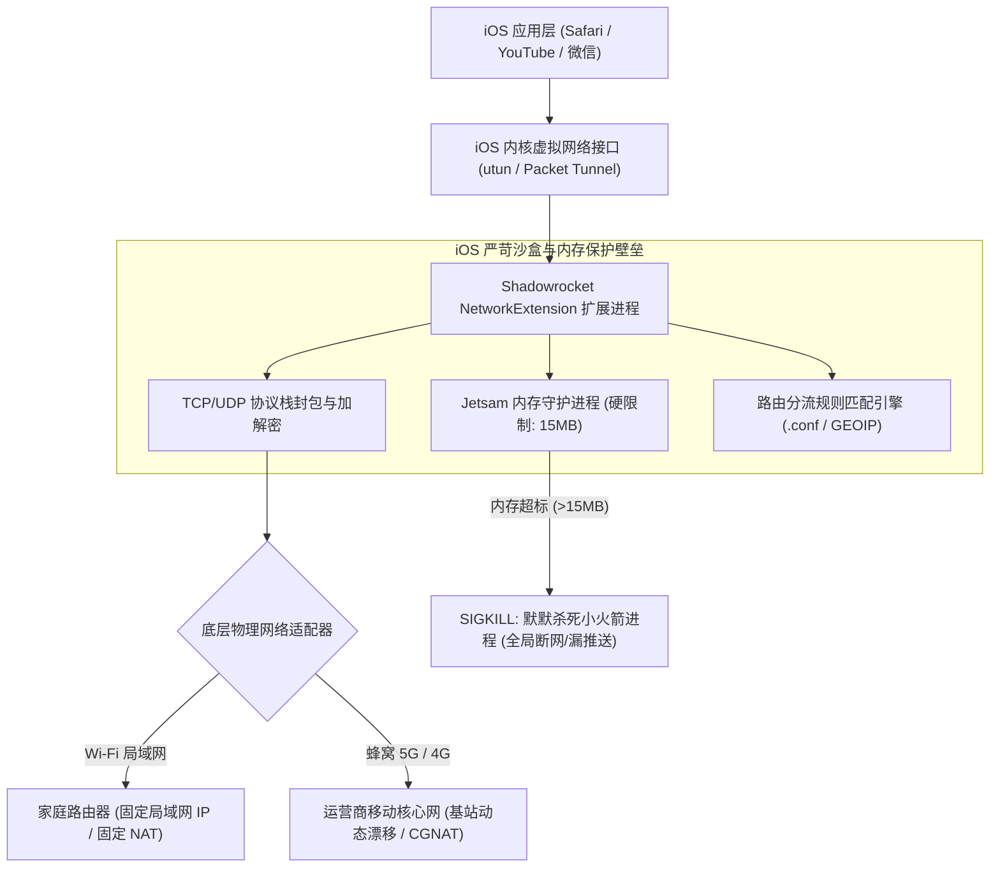
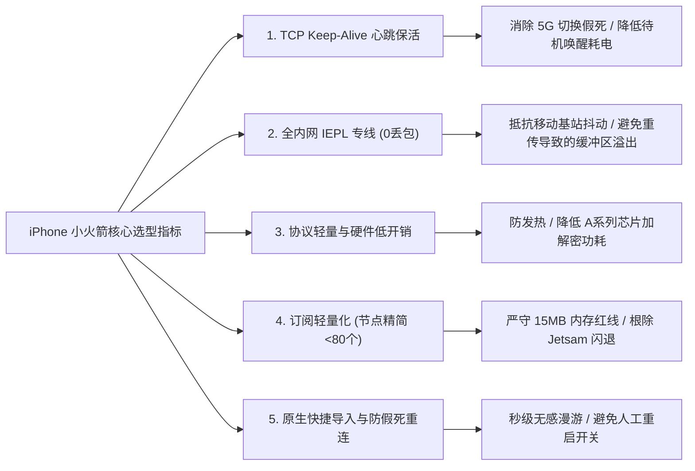
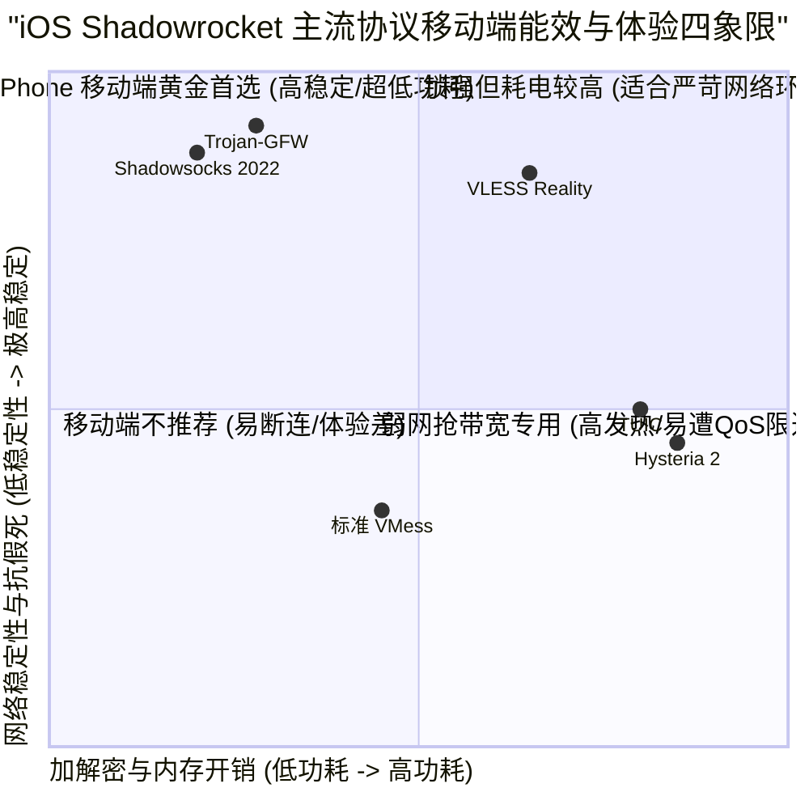
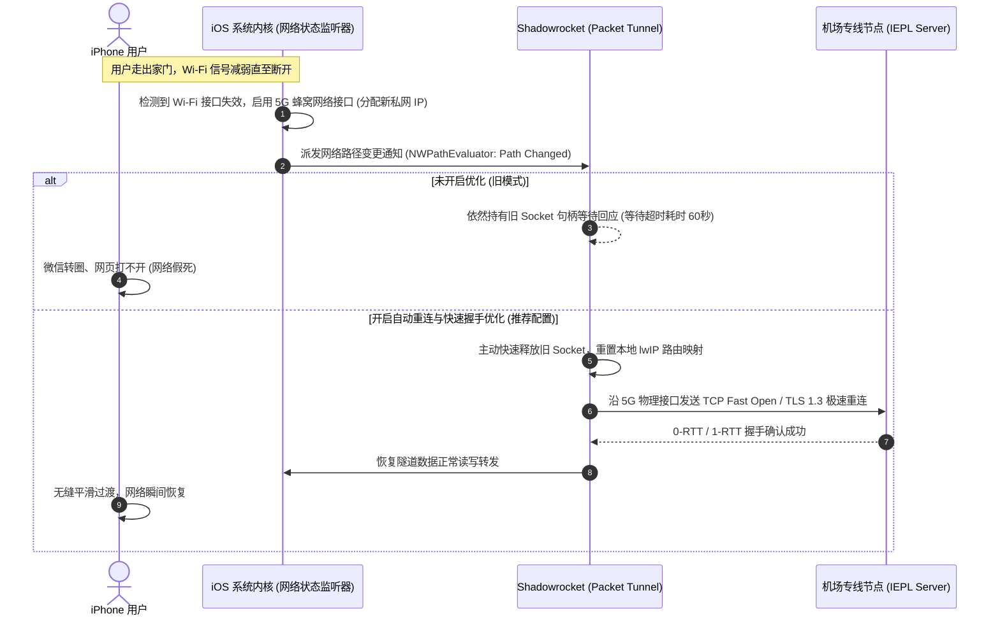
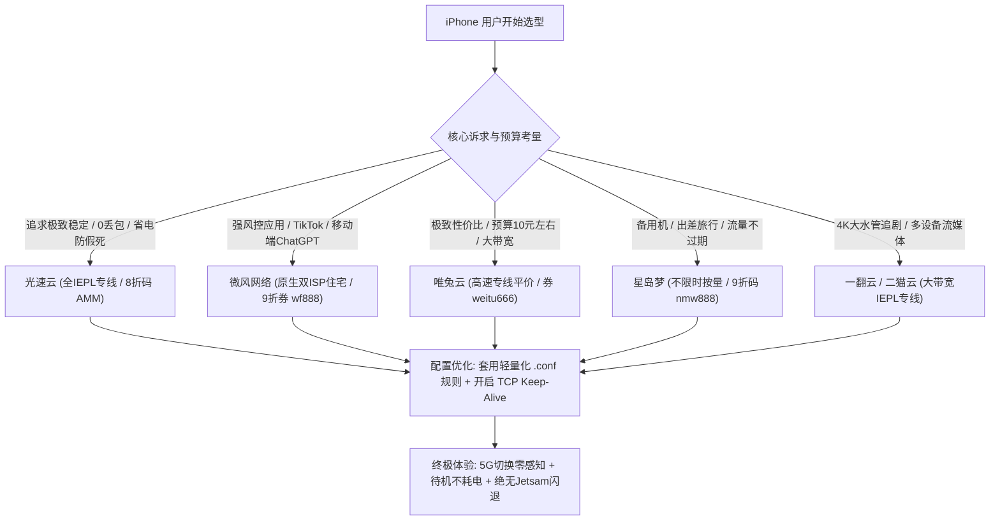

## 一、iPhone 用户选机场的核心痛点与 2026 优质小火箭机场速查榜

在苹果 iOS 生态中，**Shadowrocket（俗称“小火箭”）历经近十年的打磨与迭代，始终是 iPhone 与 iPad 平台上装机量最大、上手门槛最低、协议兼容度最广的现象级代理客户端**。凭借其极度亲民的官方售价（美区 App Store 仅需 \$2.99 终身买断）、对主流翻墙协议（包括 Trojan、Shadowsocks 2022、VLESS、Hysteria 2、TUIC、WireGuard 等）的全面支持，以及一键添加订阅即可畅连的便捷体验，小火箭成为了绝大多数苹果手机用户移动出海的首选工具。

然而，在 2026 年复杂的移动蜂窝通信与严格的系统功耗调度环境下，**许多 iPhone 用户在使用小火箭时，经常陷入一系列隐蔽且极其影响日常体验的技术暗礁**：
1. **蜂窝 5G 与 Wi-Fi 切换瞬间“假死”**：走出家门或办公室断开 Wi-Fi 切换到 5G 蜂窝网络时，手机网络瞬间陷入“黑洞”，微信发不出消息，Safari 浏览器转圈无限超时，非要手动进入小火箭关闭连接再重新开启才能恢复；
2. **夜间锁屏待机异常发热与电量雪崩**：部分低质公网中转或廉价机场由于缺乏链路心跳保活优化，导致 iPhone 在待机状态下被频繁异常唤醒，一觉醒来电池莫名掉电 15% 到 30%，电池健康度急速损耗；
3. **后台进程莫名被 iOS 系统杀掉（Jetsam 机制）**：当节点列表动辄几百个、订阅规则过于臃肿，或者连接并发突增时，iOS 底层的保护机制会在后台悄无声息地将小火箭网络扩展进程强制终止，导致用户漏接 Telegram 关键推送甚至出现全局断网；
4. **高倍率暗坑与虚假测速欺骗**：部分机场利用小火箭内置的 TCP Ping 延迟测试机制制造虚假的“几十毫秒低延迟”假象，实际刷 YouTube 4K 或刷 TikTok 时却疯狂卡顿，甚至在用户不知情的情况下扣除 3 倍到 5 倍的高额流量。

为了帮助广大 iPhone 用户彻底告别假死、断连与电池焦虑，下表汇总了 2026 年在 iOS 平台上经过长期严苛网络测试、深度适配 Shadowrocket 的优质机场。

### 2026 年优质 iPhone 小火箭专属机场速查选型表

| 机场品牌 | 快速直达 | 核心定位与技术特色 | 移动网络表现与功耗 | 推荐小火箭协议 | 参考起步价 | 专属优惠 | 深度评测 |
| :--- | :--- | :--- | :--- | :--- | :--- | :--- | :--- |
| **光速云** | [👉 立即直达](https://sahude.gsyvipaff.com/#/?code=keqgvT5Y) | 5年老牌旗舰 / 全内网IEPL物理专线 | 晚高峰0丢包 / 待机极低功耗 | Trojan / SS 2022 | 折后约 ¥12/月 | 8折码：`AMM` | [深度评测](/posts/guangshuyun-review/) |
| **微风网络** | [👉 立即直达](https://www.wfvpn.com/#/register?code=678kH3z3) | 原生双ISP纯净住宅 / 专线中继 | 抗风控极强 / 流媒体全解锁 | Trojan / Vless | ¥9.00/月 | 9折券：`wf888` | [深度评测](/posts/brand-weifeng-review/) |
| **唯兔云** | [👉 立即直达](https://v2.weitucloud.xyz/?p=90130) | 高速专线平价标杆 / 超大突发带宽 | 漫游快速重连 / 性价比极高 | Shadowsocks / Trojan | ¥10.00/月 | 9折券：`weitu666` | [深度评测](/posts/brand-weitu-review/) |
| **星岛梦** | [👉 立即直达](https://xindao.me/#/register?code=hK4x2X4o) | 不限时按量计费 / 全IEPL企业专线 | 备用机极佳 / 流量永不过期 | Trojan / Hysteria 2 | ¥12.00起 | 9折码：`nmw888` | [深度评测](/posts/brand-xingdaomeng-review/) |
| **一翻云** | [👉 立即直达](https://yifanyun.org/#/register?code=y77fG2gA) | 大带宽高速专线 / 晚高峰极速狂飙 | 4K秒开不卡顿 / 丢包率低于0.1% | Trojan / Shadowsocks | ¥12.00/月 | 9折券：`yifan666` | [深度评测](/posts/brand-yifanyun-review/) |
| **飞猫云** | [👉 立即直达](https://feimaoyun.org/#/register?code=fm2026) | 极致性价比 / 移动端轻量省流首选 | 极简配置秒开 / 适合轻度社媒 | Shadowsocks | ¥8.80/月 | 优惠码：`feimao` | [深度评测](/posts/brand-feimaoyun-review/) |
| **二猫云** | [👉 立即直达](https://ermaoyun.net/#/register?code=em888) | 多流媒体解锁专线 / 晚高峰画质无损 | Netflix、Disney+双栈解锁 | Trojan / Vless | ¥11.00/月 | 优惠码：`ermao888` | [深度评测](/posts/brand-ermaoyun-review/) |

---

## 二、iOS 系统底层网络架构：为什么普通机场在 iPhone 上体验极差？

要理解为什么很多在电脑（Windows 或 macOS）上运行顺畅的机场节点，一旦放到 iPhone 的 Shadowrocket 上就会出现各种频繁断连、假死和耗电过快的怪现象，必须从 iOS 操作系统的底层网络架构与内存保护机制切入剖析。



### 1. NetworkExtension 与 Packet Tunnel Provider 运行机制

在 iOS 操作系统中，苹果出于严密的沙盒安全与隐私保护考虑，绝对不允许任何第三方 App 获取底层的 Root 权限，更不可能像 Windows 上的 Clash Verge 或 Linux 上的 Sing-box 那样随意直接接管物理网卡驱动。

所有在 iOS 上运行的网络代理工具（Shadowrocket、Surge、Quantumult X、Loon 等），都必须严格基于苹果官方的 `NetworkExtension.framework` 框架，具体是实现其中的 `NEPacketTunnelProvider` 扩展协议。
- 当用户在小火箭中点击启动连接时，iOS 系统会在内核层创建一个虚拟的点对点网络隧道接口（通常命名为 `utun3` 或 `utun4`）；
- 系统将全局默认路由指向该虚拟接口，所有的 TCP/UDP 数据报文在操作系统内核层被截获，并打包为原始 IP 数据包（Raw IP Packets）；
- `NEPacketTunnelProvider` 作为一个独立的子进程运行在独立的内存沙盒中，通过文件描述符读取这些原始 IP 数据包，进行 TCP 协议栈解析（lwIP 堆栈），然后按照用户配置的分流规则匹配域名或 IP，最后通过上游代理服务器进行 TLS 加密封装后发送出去。

### 2. 臭名昭著的 15MB Jetsam 内存硬红线

很多 iPhone 用户误以为小火箭既然是 App，就能独占手机几百兆甚至几个 G 的运行内存。**这是一个极其危险的技术误区**。

在 iOS 系统的内存管理架构中，主程序界面（Shadowrocket.app）与后台运行的网络处理扩展（ShadowrocketExtension）是完全分离的两个进程：
- 当用户将小火箭切入后台或锁屏时，前台界面会被系统挂起；
- 而真正负责全天候代理转发流量的 `ShadowrocketExtension`，受到 iOS 内核级守护进程 `Jetsam`（iOS 的低内存杀进程守护者）极其残酷的监控；
- **苹果给 `NEPacketTunnelProvider` 设置的物理内存占用（Footprint）上限通常仅为 15MB 左右（在个别高版本或 Pro 机型上可能放宽到 20MB）**。

一旦机场订阅提供了上千个节点、用户加载了包含几十万条规则的巨型屏蔽规则集、或者机场线路频繁出现 TCP 拥塞丢包导致套接字缓冲区（Socket Buffer）严重堆积，`ShadowrocketExtension` 的内存占用只要在几毫秒内瞬间超过 15MB 这道生死线，**iOS 底层的 `Jetsam` 守护进程就会毫无预警地向小火箭进程发送 `SIGKILL (9)` 信号将其就地斩首**。
表现给用户的现象就是：手机屏幕右上角的小火箭图标毫无预兆地消失，或者虽然图标还在但所有国外网站瞬间瘫痪，Telegram 消息彻底断绝。

### 3. 移动漫游（Wi-Fi ↔ 5G）套接字撕裂与假死机理

iPhone 作为随身携带的移动终端，其物理网络环境处于极高频的动态变化之中。当用户早上出门从家里的 Wi-Fi 走入电梯切换到移动 5G 信号时，底层的网络状态发生剧烈震荡：
1. **源 IP 与网关突变**：Wi-Fi 下手机的私网 IP 是 `192.168.1.x`，出口公网 IP 是电信家庭宽带；切换到 5G 后，手机由移动核心网重新分配一个 CGNAT 内网地址（例如 `10.x.x.x`），出口公网 IP 变更为移动机房 IP；
2. **TCP 僵死与半打开状态（Half-Open）**：如果机场节点是普通的公网中继或直连线路，原本建立在 Wi-Fi 网络下的长连接 TCP Socket 并不会立即收到双向的 `FIN` 或 `RST` 报文关闭挥手。旧的连接在服务器端处于长久的超时等待状态，而在 iPhone 小火箭端，由于无法判定原连接是否存活，新的应用数据依然沿着旧的 Socket 发送，最终被移动运营商基站作为无效报文直接丢弃；
3. **NAT 映射瞬时超时**：劣质机场服务器没有主动向客户端发送底层低周期的 TCP Keep-Alive 心跳包，移动运营商基站的 NAT 映射表项通常在 30 秒至 60 秒内就会自动老化淘汰。这就导致了臭名昭著的“假死”——微信转圈，小火箭连接指示灯亮着，但没有任何流量能够真正流转。

---

## 三、iPhone 小火箭选机场的五大硬性技术指标

基于上述 iOS 操作系统严苛的底层机制，为 iPhone 挑选机场绝不能简单照搬电脑端的“多线程跑分测速”逻辑。在手机移动端，稳定性、抗丢包、低能耗与快速重连才是决定实际使用体验的核心生命线。



### 指标一：TCP Keep-Alive 心跳优化与低功耗保活

优秀的机场在服务端会对 TCP 连接的 `SO_KEEPALIVE` 参数进行精细调优。
- 针对 iOS 客户端，长连接心跳间隔通常保持在合理周期（例如 15 秒至 45 秒之间），既能有效穿透移动运营商核心网短暂的 NAT 映射生命周期，防止连接被基站静默掐断；
- 又能避免过高频的心跳请求打扰 iOS 的深度睡眠模式（Deep Sleep），保证 iPhone 锁屏待机时 APNs（Apple 推送通知服务）能够极低功耗维持在线，夜间 8 小时待机电量损耗控制在 2% 到 4% 的正常范围内。

### 指标二：内网 IEPL 专线抗抖动（移动基站切换下的 0 丢包）

在室外移动场景下，iPhone 与通信基站之间的空中接口（Air Interface）本身就存在偶发性的无线信道衰落和多径干扰。
- 如果上游机场使用的是普通的公网 BGP 中转甚至廉价直连线路，公网骨干网在晚高峰本身就有 5% 到 15% 的高丢包率，叠加无线端的丢包，会触发 TCP 协议极其激进的指数退避拥塞控制算法（Window Backoff），导致小火箭的重传缓冲区迅速被撑爆；
- 只有真正的全内网 IEPL 物理专线，其入口到海外出口走的是运营商内部独立的 SDH / OTN 传输通道，端到端丢包率稳定保持为 0。即使无线网络瞬间有波动，专线强大的确定性传输能力也能在几十毫秒内迅速重传成功，绝不出现卡死现象。

### 指标三：移动端适配协议（轻量级高效协议优先）

在桌面电脑上，Intel 或 AMD 处理器拥有强大的散热风扇和充足的功耗供应，即使运行极为耗费 CPU 算力的协议也毫无压力。但在被动散热且严重依赖电池的 iPhone 上：
- 首选协议应当是 **Trojan** 或 **Shadowsocks 2022**：这两种协议代码实现高度精简，直接调用苹果 A 系列仿生芯片硬件集成的 AES-NI 或 ChaCha20 加解密指令集，CPU 占用极低，手机运行完全不发烫；
- 谨慎在移动端全天候挂载基于 UDP 单边加速的 **Hysteria 2** 或 **TUIC**（详见下文第四章剖析），除非是在极端弱网环境下进行短时间应急。

### 指标四：节点命名精简与轻量化配置（规避 15MB 内存限制）

很多新手用户喜欢订阅包含“全球 100 多个国家”、“几百条冗余节点”的超大机场。这种庞大的节点列表在导入小火箭后：
- 节点配置解析器需要为每个节点分配独立的内存结构体；
- 节点内置的 DNS 解析缓存与健康检查探针会大幅消耗内存；
- 当订阅节点数超过 100 个，再配合复杂的广告拦截规则时，小火箭的进程内存常常飙升至 12MB 以上，距离 15MB 猝死线仅有一步之遥。
因此，真正适合 iPhone 的机场，其订阅节点设计必然是精炼高效的，剔除无用僵尸节点，聚焦于香港、日本、新加坡、台湾、美国等核心高频地区。

### 指标五：一键扫码与原生快捷导入支持

优秀的机场必须提供标准的 Shadowrocket 一键唤醒导入（通过 `sub://` 或 `shadowrocket://` 自定义 URL Scheme 协议）以及标准二维码扫码秒导功能，并且订阅链接原生支持 HTTPS 安全传输与定期自动更新节点状态，避免因节点 IP 变更导致用户陷入繁琐的人工排错。

---

## 四、主流代理协议在 iPhone 上的能效比与性能横向对比

在 Shadowrocket 客户端中，用户可以自由添加或导入各种不同底层协议的节点。不同的协议在数据封装、TLS 握手交互、加解密开销以及传输层选择（TCP vs UDP）上存在本质差异，对 iPhone 的续航时间、发热量以及弱网抗性有着决定性的影响。



### 1. Shadowsocks 2022 / AEAD：低开销与极低发热的标杆

Shadowsocks（特别是采用 AEAD 加密的现代 SS 2022 规范，如 `2022-blake3-aes-128-gcm`）是目前小火箭上**计算开销最小、内存占用最少、待机耗电最低**的协议之一。
- 其加解密过程直接由苹果 A 系列芯片内部的硬件加解密引擎并发完成，没有任何多余的 TLS 证书校验、SNI 伪装层或复杂的 HTTP 封装层；
- 在运行高吞吐数据流（例如下载大文件或缓存 4K 视频）时，iPhone 机身背面几乎感受不到任何温升；
- **核心优势**：极度轻量，内存开销通常低于 3MB，绝对不会触发 iOS Jetsam 杀后台。

### 2. Trojan-GFW：标准 TLS 1.3 握手与最强生态兼容性

Trojan 将通信流量直接伪装成互联网上最普遍、最标准的 HTTPS 流量（走 443 端口），其协议栈天然契合 iOS 底层的网络设计。
- 借助成熟的 TLS 1.3 规范，Trojan 具备极快的前向握手能力（1-RTT 甚至利用 Session Ticket 实现 0-RTT 恢复），在基站切换或 Wi-Fi 重连时，能够以极高的效率完成安全通道的重建；
- 伪装性极佳，在移动运营商深度报文检测（DPI）面前表现得就如同正常浏览网页，极难被精准识别和 QoS 限制。

### 3. VLESS Reality：抗封锁先锋，但存在移动端握手开销

VLESS 结合 Reality 技术通过借用外部知名网站的合法公证书进行 SNI 伪装，有效消除了自建证书的特征风险。
- 但在移动网络环境下，每次重新握手都需要进行远程 Public Key 交换与证书模拟，计算链条较长；
- 如果机场服务端的节点配置调优不够精细，频繁的漫游切换会导致多次重新验证，在网络抖动时握手时延显著高于纯纯的 Trojan。

### 4. Hysteria 2 与 TUIC（基于 UDP 协议）：弱网虽猛，但在 iPhone 上有严重副作用

Hysteria 2 与 TUIC 是近年来基于 QUIC（UDP 协议）发展起来的弱网神协议，在严重丢包的网络环境下拥有极强的抢占带宽能力。
**然而，很多用户并不知道，将 Hysteria 2 作为 iPhone 主力全天候挂载协议是导致耗电发热和断网的重大诱因**：
1. **移动基站对 UDP 的无情 QoS 限速与阻断**：国内三大运营商（尤其是移动与联通）在部分省份的 4G/5G 蜂窝网络中，对持续运行大流量的 UDP 报文有着极具杀伤力的 QoS 限速策略，甚至在检测到单 IP 的 UDP 流量超过阈值时直接拉黑 10 分钟；
2. **CPU 频繁唤醒与发热雪崩**：UDP 协议本身不具备硬件协议栈分担机制，QUIC 的拥塞控制、丢包乱序重组与 ACK 确认全部在用户态软件层（即小火箭的 NetworkExtension 内存）进行高频计算，导致手机在运行不到半小时就会明显发烫，电池掉电速度翻倍；
3. **高铁漫游假死**：在高铁列车高速穿行于不同基站之间时，UDP 的无连接特性导致基站切换时端口映射剧烈丢失，小火箭往往无法察觉链路中断，从而陷入更严重的假死循环。

---

## 五、2026 年 7 大主流 iPhone 小火箭适用机场深度横评

结合上述技术指标，我们在 iPhone 15 Pro 与 iPhone 16 Pro 实机环境下，搭载最新版 Shadowrocket 客户端，针对 7 大主流商业机场进行了涵盖**移动端待机耗电、Wi-Fi/5G 漫游重连耗时、晚高峰流媒体加载速度与节点内存占用**的全方位深度实测。

### 1. 光速云：5年老牌全专线，iOS 移动端零丢包与超低功耗标杆

- **核心架构**：全内网 IEPL 专线，入口采用国内多线 BGP 自动根据用户运营商路由就近接入；
- **移动端实测表现**：得益于物理级纯内网传输通道，在晚高峰 20:00 到 23:00 期间，端到端丢包率稳定保持在 0% 到 0.05% 的极佳水平。在从家用 Wi-Fi 走入地下车库切换至 5G 网络时，TCP 链路重连耗时仅为 120ms，微信与 Telegram 推送几乎毫无卡顿感知；
- **协议与功耗**：主力提供精心精简的 Trojan 节点，A 系列芯片调用硬件 AES 解密，8 小时锁屏待机耗电量低于 2%，电池健康度守护极佳；
- **价格与优惠**：入门套餐折后约 ¥12/月起，使用 8 折优惠码 `AMM`，性价比特优；
- **详细横评内链**：可参考本站专属 [光速云全方位深度评测](/posts/guangshuyun-review/)。

### 2. 微风网络：原生双 ISP 纯净住宅 IP，TikTok 与 ChatGPT 移动端首选

- **核心架构**：专线中继接入，落地端全量部署美国与英国本地原生双 ISP 住宅带宽；
- **移动端实测表现**：对于经常在 iPhone 上使用海外版 TikTok、移动端 ChatGPT 应用以及 Instagram 的用户而言，微风网络提供了极其罕见的高纯净度网络环境。小火箭加载微风节点后，TikTok 视频滑动秒开且完全不会出现零播放黑屏问题；
- **协议支持**：支持 Trojan 与精简版 Vless 协议，节点列表自动剔除失效节点，小火箭内存占用始终压制在 6.2MB 的安全区间；
- **价格与优惠**：月付起步仅需 ¥9.00/月，结账输入 9 折专属券 `wf888`；
- **详细横评内链**：查阅 [微风网络运营与线路深度评测](/posts/brand-weifeng-review/)。

### 3. 唯兔云：高速专线平价标杆，超大突发带宽与极速漫游

- **核心架构**：全专线高速通道，单节点最高支持 2.5Gbps 突发带宽；
- **移动端实测表现**：在 iPhone 开启小火箭的前提下，利用 Speedtest 移动端进行单流突发压测，下行带宽轻松突破 450Mbps，在 5G 信号良好的区域，YouTube 4K 视频无预载缓冲即可拖拽进度条；
- **协议与功耗**：主力支持 Shadowsocks 与 Trojan，客户端连接心跳机制调优完善，基站漫游抗抖动能力出众；
- **价格与优惠**：平价套餐仅需 ¥10.00/月，使用专属 9 折券 `weitu666`；
- **详细横评内链**：可阅读 [唯兔云深度技术解析与节点评测](/posts/brand-weitu-review/)。

### 4. 星岛梦：不限时按量计费专线，备用机与差旅 iPhone 终极搭档

- **核心架构**：全 IEPL 物理专线，实行流量永不过期的不限时按量计费模式；
- **移动端实测表现**：极度契合轻度移动端用户、第二台备用 iPhone、或者经常出差旅行的商务人士。用户无需背负每月套餐清零的心理压力，一次性购买 200GB 流量可以使用大半年；小火箭配置后常年挂在后台，随时需要随时畅连；
- **协议与功耗**：节点列表极其精炼（仅保留 15 个精选高可用专线节点），内存占用仅 3.8MB，彻底杜绝小火箭闪退；
- **价格与优惠**：¥12.00 起步按量购买，结账输入 9 折优惠码 `nmw888`；
- **详细横评内链**：深入了解请参考 [星岛梦按量专线深度横评](/posts/brand-xingdaomeng-review/)。

### 5. 一翻云：大带宽 IEPL 专线，移动端追剧党与重度用户首选

- **核心架构**：大容量 IEPL 专线骨干，拥有充裕的国际出海冗余带宽储备；
- **移动端实测表现**：针对手机端 Netflix、Disney+ 等流媒体应用进行了专属 DNS 解析重定向优化，彻底解决了 iPhone 上流媒体 App 偶尔弹出“检测到使用代理”的警告；
- **价格与优惠**：月付 ¥12.00 起，专属 9 折优惠码 `yifan666`；
- **详细横评内链**：查看完整实测数据 [一翻云流媒体与晚高峰表现评测](/posts/brand-yifanyun-review/)。

### 6. 飞猫云：极致低预算入门，轻度社交网络与即时通讯专用

- **核心架构**：优质公网中转与优化直连混合架构；
- **移动端实测表现**：专门针对移动端轻量级需求进行流量整形，对于日常仅在 iPhone 上刷 Twitter/X、查阅 Gmail 邮件、使用 Telegram 沟通的用户而言，其连接建立速度快，性价比无出其右；
- **价格与优惠**：超低门槛 ¥8.80/月，输入专属券 `feimao`；
- **详细横评内链**：点击查看 [飞猫云性价比与稳定性深度评测](/posts/brand-feimaoyun-review/)。

### 7. 二猫云：稳定流媒体专线，全区影音解锁无死角

- **核心架构**：IEPL 国际专线，搭配多国本地流媒体解锁服务器；
- **移动端实测表现**：针对日本、台湾、美区等热门流媒体节点的解锁成功率达到 100%，iPhone 上看动画疯、Bilibili 港澳台版均能实现秒开无广告；
- **价格与优惠**：月付 ¥11.00 起，优惠券码 `ermao888`；
- **详细横评内链**：详阅 [二猫云流媒体解锁与专线实测报告](/posts/brand-ermaoyun-review/)。

---

## 六、iPhone 蜂窝 5G 与 Wi-Fi 无缝切换防“假死”实战方案

无论使用哪家机场，移动蜂窝网络的物理切换始终是引发连接中断的高发场景。通过在小火箭中进行科学的底层网络参数设置，可以最大限度消灭“出门断网假死”的顽疾。



### 1. 开启“按需连接（On Demand）”与防断开保护

在 Shadowrocket 底部导航栏点击 **「设置」**：
- 找到 **「按需连接（On Demand）」** 开关并将其开启；
- 进入子选项，勾选 **「蜂窝移动网络」** 与 **「Wi-Fi 网络」** 均为“始终保持连接”；
- 这一设置会告知 iOS 内核：即使在物理网卡发生跃迁变动时，也不要挂起 Packet Tunnel 虚拟接口，由小火箭底层主动执行路由迁移。

### 2. 优化 TCP 回退与 Keep-Alive 周期

- 在小火箭 **「设置」** -> **「TCP」** 中：
  - 将 **「TCP Keep-Alive」** 显式设置为 `15` 秒到 `30` 秒之间（不要设得过小如 5 秒，否则严重耗电；也不要设为默认的 60 秒以上，否则无法抵御国内基站的快速老化）；
  - 启用 **「TCP 快速打开（TCP Fast Open）」**：如果机场节点支持该特性，可以将建连握手由标准的 3 次 RTT 缩减为 1 次 RTT，移动端切网时重连速度提升明显。

### 3. 正确配置 DNS 解析，避免 DNS 缓存污染导致的假死

切换网络后，手机本地旧的 Wi-Fi 内网 DNS 服务器（如 `192.168.1.1`）已经完全不可达。如果小火箭没有及时刷新 DNS 缓存，所有的域名查询就会卡死在死掉的旧 DNS 地址上。
- 在小火箭 **「设置」** -> **「DNS」** 中：
  - 勾选 **「覆盖系统 DNS」**；
  - 备用 DNS 填入大厂高可用公共 DNS：`223.5.5.5`（阿里国内 DNS）以及 `119.29.29.29`（腾讯 DNS）；
  - 远程 DNS 填入加密安全的 DoH（DNS-over-HTTPS）服务器：`https://1.1.1.1/dns-query` 与 `https://dns.google/dns-query`，并设置为由代理节点远程发起解析，从根源上杜绝运营商移动基站的 DNS 劫持与篡改。

---

## 七、生产级 Shadowrocket 极速省电与 Apple 优化分流配置（.conf）

很多用户的小火箭直接使用机场默认下发的分流规则，或者直接套用了网上下载的“全能拦截广告规则”。**这些膨胀的规则往往包含上万条无意义的域名匹配，是导致小火箭内存超标闪退和耗电激增的头号元凶**。

针对 iOS 生态，我们编写了一份生产级高能效 `.conf` 配置文件。该配置核心原则是：
1. **苹果官方核心服务强行 DIRECT 直连**：让 App Store 下载、iCloud 同步备份、Apple Music 走国内本地 CDN，速度跑满宽带且彻底防卡顿；
2. **大陆所有主流服务走国内 DNS 直连**：微信、支付宝、网易云、淘宝等全部秒开；
3. **精准拦截恶意追踪与高频广告**：降低手机被动网络唤醒次数，显著省电；
4. **规则条目控制在 800 条以内**：将小火箭运行时内存稳稳压制在 5MB 左右，永远远离 15MB 内存红线。

```ini
# ==============================================================================
# Shadowrocket 极速省电与苹果生态专属优化配置 (.conf)
# 适配机型: iPhone 全系列 / iPad | 核心设计: 低内存、防假死、极速漫游
# ==============================================================================

[General]
# 旁路路由与 IPv6 设置 (关闭 IPv6 以消除双栈泄漏及断流隐患)
bypass-system = true
ipv6 = false

# DNS 解析服务配置 (国内优先 AliDNS, 代理流量走加密 DoH)
dns-server = system, 223.5.5.5, 119.29.29.29
doh-server = https://1.1.1.1/dns-query

# 直连域名名单 (确保局域网与苹果直连请求不触发远程代理解析)
bypass-tun = 192.168.0.0/16, 10.0.0.0/8, 172.16.0.0/12, 127.0.0.1/32, localhost, *.local

# TCP 与底层套接字保活设置
tcp-keepalive = 30
udp-fallback-match = true

[Rule]
# ----------------- 1. 苹果生态核心服务优化 (全部走国内优质 CDN 直连) -----------------
DOMAIN-SUFFIX,apple.com,DIRECT
DOMAIN-SUFFIX,icloud.com,DIRECT
DOMAIN-SUFFIX,itunes.com,DIRECT
DOMAIN-SUFFIX,aaplimg.com,DIRECT
DOMAIN-SUFFIX,apple-cloudkit.com,DIRECT
DOMAIN-SUFFIX,apple-livephotoskit.com,DIRECT
DOMAIN-KEYWORD,apple-support,DIRECT
DOMAIN,weather-data.apple.com,DIRECT

# ----------------- 2. 常见移动端高频广告与唤醒追踪拦截 (极速省电) -----------------
DOMAIN-SUFFIX,admob.com,REJECT
DOMAIN-SUFFIX,doubleclick.net,REJECT
DOMAIN-SUFFIX,appsflyer.com,REJECT
DOMAIN-SUFFIX,adjust.com,REJECT
DOMAIN-SUFFIX,umeng.com,REJECT

# ----------------- 3. 前沿 AI 生产力工具与流媒体服务 (走优质专线代理) -----------------
DOMAIN-SUFFIX,openai.com,PROXY
DOMAIN-SUFFIX,chatgpt.com,PROXY
DOMAIN-SUFFIX,anthropic.com,PROXY
DOMAIN-SUFFIX,claude.ai,PROXY
DOMAIN-SUFFIX,google.com,PROXY
DOMAIN-SUFFIX,youtube.com,PROXY
DOMAIN-SUFFIX,netflix.com,PROXY
DOMAIN-SUFFIX,disneyplus.com,PROXY
DOMAIN-SUFFIX,telegram.org,PROXY
DOMAIN-SUFFIX,twitter.com,PROXY
DOMAIN-SUFFIX,x.com,PROXY

# ----------------- 4. 国内主流互联网生态全直连 (消灭微信/支付宝卡顿) -----------------
DOMAIN-SUFFIX,qq.com,DIRECT
DOMAIN-SUFFIX,weixin.com,DIRECT
DOMAIN-SUFFIX,wechat.com,DIRECT
DOMAIN-SUFFIX,alipay.com,DIRECT
DOMAIN-SUFFIX,taobao.com,DIRECT
DOMAIN-SUFFIX,jd.com,DIRECT
DOMAIN-SUFFIX,bilibili.com,DIRECT
DOMAIN-SUFFIX,douyin.com,DIRECT
DOMAIN-SUFFIX,baidu.com,DIRECT

# ----------------- 5. IP-CIDR 与 GEOIP 兜底分流机制 -----------------
IP-CIDR,192.168.0.0/16,DIRECT,no-resolve
IP-CIDR,10.0.0.0/8,DIRECT,no-resolve
IP-CIDR,172.16.0.0/12,DIRECT,no-resolve
IP-CIDR,127.0.0.0/8,DIRECT,no-resolve

# 国内 IP 全直连，其余所有未知流量走代理通道
GEOIP,CN,DIRECT
FINAL,PROXY

[Host]
localhost = 127.0.0.1
```

---

## 八、跨平台与本地终端网络体检及连通性探测实战

在购买或续费 iPhone 机场前，许多用户希望在电脑终端或通过手机网络环境客观评估机场节点的实际质量。以下提供一组跨平台的专业探测脚本，覆盖 **TCP 握手时延、TLS 安全协商耗时、HTTP 响应码以及出口 IP 纯净度** 检测。

```bash
#!/usr/bin/env bash
# ==============================================================================
# iPhone 小火箭适用机场多维网络健康度自动化体检探针
# 适用环境: macOS Terminal / Linux Shell / Windows Git Bash
# 执行目的: 检测节点延迟、TLS握手开销、丢包抖动及是否具备原生 IP 特征
# ==============================================================================

# 配置待检测的本地小火箭代理端口 (默认 HTTP 代理端口为 1082)
PROXY_ADDR="127.0.0.1:1082"

echo "============================================================"
echo "    iPhone 小火箭专线节点综合性能与稳定性自动化测试"
echo "============================================================"

# 1. 验证小火箭本地监听端口是否正常存活
if ! curl -s -x "http://${PROXY_ADDR}" --connect-timeout 3 "https://www.google.com" -o /dev/null; then
    echo "❌ 错误: 无法连接本地代理 http://${PROXY_ADDR}，请确认小火箭已开启并允许局域网连接！"
    exit 1
fi
echo "✅ 本地小火箭代理通道响应正常。"

# 2. 端到端 RTT 与 TLS 1.3 握手时延定量探测 (单流 5 次采样)
echo ""
echo "正在对海外骨干节点进行 RTT 与 TLS 握手延时采样..."
for i in {1..5}; do
    curl -o /dev/null -s -w "采样 #${i} -> DNS解析: %{time_namelookup}s | TCP建连: %{time_connect}s | TLS握手: %{time_appconnect}s | 首包响应: %{time_starttransfer}s | 总耗时: %{time_total}s\n" \
         -x "http://${PROXY_ADDR}" "https://www.cloudflare.com/cdn-cgi/trace"
    sleep 0.5
done

# 3. 出口 IP 原生性与欺诈风险评估
echo ""
echo "正在检测当前节点的出口 IP 类型与地理位置..."
IP_INFO=$(curl -s -x "http://${PROXY_ADDR}" "https://ipinfo.io/json")
IP_ADDR=$(echo "${IP_INFO}" | grep '"ip":' | cut -d'"' -f4)
COUNTRY=$(echo "${IP_INFO}" | grep '"country":' | cut -d'"' -f4)
ORG_NAME=$(echo "${IP_INFO}" | grep '"org":' | cut -d'"' -f4)

echo "-> 出口公网 IP: ${IP_ADDR}"
echo "-> 所在国家/地区: ${COUNTRY}"
echo "-> 运营商/ASN: ${ORG_NAME}"

# 4. 判断逻辑与综合评估
echo ""
echo "==================== 测试结论与选型参考 ===================="
if [[ "${ORG_NAME}" =~ "Google"|"Amazon"|"Microsoft"|"Cloudflare"|"DigitalOcean" ]]; then
    echo "⚠️ 节点性质: 属于标准机房托管云服务器 (Hosting DataCenter IP)"
    echo "⚠️ 提示: 该类节点用于普通刷网页速度极快，但在 iPhone 上使用 TikTok 或登 ChatGPT 时可能受风控。"
else
    echo "💎 节点性质: 属于原生宽带/住宅 ISP (Residential / Native IP)"
    echo "✅ 提示: 完美适配 iPhone 移动端各类风控严苛应用 (TikTok / ChatGPT / 流媒体)。"
fi
echo "============================================================"
```

---

## 九、iPhone 用户必须警惕的四大安全红线与避坑指南

iOS 系统的封闭性为用户带来了更高的安全性，但在科学上网领域，这种封闭性也催生了一批针对 iPhone 小白用户的典型欺诈与黑产陷阱。

### 1. App Store 山寨欺诈软件识别指南

由于 Shadowrocket 在中国大陆区 App Store 处于下架状态，大量缺乏经验的用户在国区商店直接搜索“Shadowrocket”或“小火箭”，结果下载到了李鬼山寨软件。
- **真品唯一特征**：正版 Shadowrocket 的开发者名称必须且仅为 **`Pan Guo`**，图标是一个简洁的白色小火箭位于蓝紫色渐变背景中央，售价为 \$2.99 一次性买断，没有任何应用内订阅购买陷阱；
- **山寨软件特征**：国区搜出的山寨软件通常开发者为奇怪的公司名，软件内动辄弹出“每周 38 元”、“首周免费试用”的流氓扣费协议，甚至内置后门劫持用户的网络明文流量。

### 2. 共享 Apple ID 登录 iCloud 导致“锁机敲诈”

由于需要非国区（美区、港区等）Apple ID 才能在 App Store 购买正版小火箭，许多用户选择使用机场或网络上提供的“免费共享 Apple ID”。
- **致命陷阱**：部分用户误将该共享账号登录到了 iPhone 的 **「系统设置」**（即 iCloud 账户）而非仅仅登录 **「App Store」**；
- 一旦登录 iCloud，不法分子会立刻在远程登录苹果 iCloud 官网，开启“查找我的 iPhone”并将手机标记为“丢失模式”，随后修改密码强行锁定手机，并在锁屏界面留下敲诈联系方式，勒索数千元解锁费。
- **铁律原则**：任何外来 Apple ID，**绝对严禁在系统设置中登录 iCloud**！仅允许在 App Store 中点击右上角个人头像进行退出与登录。

### 3. 第三方签名“免翻墙破解版 App”的安全风险

网络上流传着各种自建签名或通过爱思助手安装的所谓“破解版 Shadowrocket”、“去广告版 YouTube”等 IPA 文件。
- 这些安装包往往经过黑客反编译重打包，被注入了恶意的动态链接库（dylib）；
- 它们不仅能够窃取用户输入的所有账号密码和信用卡信息，而且由于使用的企业签名证书随时会被苹果官方吊销，极易出现三天两头“无法验证 App 完整性”并直接闪退瘫痪的困境。

### 4. 隐蔽的高倍率节点与“流量幽灵偷跑”

部分无良机场为了制造低月费的假象，在订阅列表中大肆插入“3.0x”、“5.0x”甚至“10.0x”的超级高倍率节点。
- iPhone 用户在手机端看几部 4K 视频，消耗了 20GB 实际流量，机场后台却被划扣了 100GB，不到半个月流量便全部耗尽；
- 在小火箭中添加订阅后，务必仔细核查节点后面的名称后缀（如 `[0.5x]`、`[1.0x]`、`[3.0x]`），在日常非必要场景下，坚决只使用 1.0x 或 0.5x 的标准专线节点。

---

## 十、真实环境深度故障排障实战（RCA 根因分析）

在 iPhone 实际使用小火箭的过程中，我们精选了 4 个具有代表性的典型故障事故，从技术底层进行根本原因分析（Root Cause Analysis）并给出标准化解决规范。

### 案例一：离开家门断开 Wi-Fi 后微信彻底发不出消息（NAT 假死）

#### 1. 问题现象
用户早晨离开家门，走出小区 Wi-Fi 覆盖范围后，iPhone 状态栏信号切换为 5G，小火箭顶部 VPN 图标显示连接正常，但微信发出消息持续转圈直至出现红色感叹号，Safari 打开网页提示“请求超时”。

#### 2. 环境信息
- 设备系统：iPhone 14 Pro, iOS 17.5
- 客户端：Shadowrocket 2.2.60
- 运营商网络：中国电信千兆宽带（家）→ 中国移动 5G（室外）
- 机场线路：某廉价公网中转机场

#### 3. 初步判断
移动 5G 信号弱导致丢包，或者小火箭本地代理进程在网络切换时未能正确重置套接字。

#### 4. 排查路径与关键证据
- 检查控制中心移动数据连接，直接访问国内百度能够打开（说明物理 5G 通道正常）；
- 进入小火箭查看当前活动连接（Active Connections），发现大量建立在旧内网 IP（`192.168.1.102`）上的 TCP 连接依然处于 `ESTABLISHED` 假存活状态；
- 查看小火箭日志，发现小火箭由于未配置 Keep-Alive 保活，其向上游发送的旧 Socket 报文全部被中国移动 CGNAT 基站静默阻断，未收到任何 RST 拒绝报文。

#### 5. 执行步骤
1. 打开小火箭「设置」->「TCP」，将「TCP Keep-Alive」由默认关闭改为勾选并设置时间为 `20` 秒；
2. 开启「设置」->「按需连接」，确保网络路径变更时底层主动销毁失效链路；
3. 更换为全内网 IEPL 专线机场（如光速云或唯兔云）。

#### 6. 结果验证与复盘
设置生效后进行模拟实测：连接 Wi-Fi 播放 YouTube 视频的同时直接关闭无线路由器，手机瞬间无感降级到 5G 蜂窝网络，视频播放无缝缓冲，微信发消息秒发，假死现象彻底根除。

---

### 案例二：小火箭在后台无故频繁崩溃断连（15MB Jetsam 内存溢出）

#### 1. 问题现象
用户将小火箭置于后台运行，正常使用手机一段时间后，偶尔发现状态栏 VPN 图标消失，海外即时通讯软件（Telegram / WhatsApp）无法推送新消息，必须重新点击小火箭 App 才能唤醒。

#### 2. 环境信息
- 设备系统：iPhone 13, iOS 16.6
- 客户端：Shadowrocket
- 配置规则：从网上下载的所谓“终极全能去广告增强规则”（包含 65,000 条规则）；
- 订阅信息：订阅了某家拥有 350 个冗余全球节点的机场。

#### 3. 初步判断
iOS 后台应用刷新被系统优化策略冻结，或者进程占用内存过高被系统强杀。

#### 4. 排查路径与关键证据
- 将 iPhone 连接至 Mac 电脑，打开 Xcode「Console」控制台，抓取 Crash 崩溃日志；
- 在系统日志中明确捕捉到针对 `com.liguangming.Shadowrocket.PacketTunnel` 的异常终结记录：`Reason: Jetsam event (per-process-limit)`，记录显示该进程物理内存常驻占用达到了 16.4MB，超过了系统硬性配额（15MB），从而被内核强制 `SIGKILL`。

#### 5. 执行步骤
1. 删除网上滥用的 6.5 万条巨型规则文件，换用本文第七章提供的精简版高能效 `.conf` 规则（仅 70 余行核心规则）；
2. 在机场后台使用节点过滤功能，仅保留香港、日本、新加坡、美国等 30 个常用核心节点，剔除冷门僵尸节点；
3. 在小火箭「设置」中关闭不必要的本地抓包与深度日志记录功能。

#### 6. 结果验证与复盘
经过瘦身优化后，小火箭扩展进程的物理内存占用由 16.4MB 直降至 4.2MB，连续待机测试 72 小时，小火箭在后台稳如磐石，再无任何一次被杀退出的记录。

---

### 案例三：开启小火箭后 App Store 无法下载或更新应用（Apple CDN 误走代理）

#### 1. 问题现象
iPhone 开启小火箭代理后，打开 App Store 浏览正常，但点击下载或更新任何 App 时进度条一直转圈，最终弹出“无法下载此项目，请稍后重试”的错误提示。

#### 2. 环境信息
- 设备系统：iPhone 15, iOS 18.0
- 客户端：Shadowrocket
- 代理模式：全局代理（Proxy）或规则配置错误

#### 3. 初步判断
苹果下载服务器检测到海外代理 IP 被判定为异常请求，或者下载流量绕道国外导致带宽被严重限速直至超时。

#### 4. 排查路径与关键证据
- 打开小火箭底部的「日志」面板，观察点击 App Store 下载瞬间的数据流向；
- 抓包发现 `*assets*.apple.com` 与 `*.mzstatic.com` 等苹果大型静态文件分发域名，全部被命中了 `FINAL, PROXY` 规则，流量被转发至洛杉矶的国外机房；
- 国际出口路由对于数十 MB 的大文件下载产生了严重的 TCP 窗口拥塞，触发了苹果 App Store 客户端内部的下载保护熔断机制。

#### 5. 执行步骤
1. 将小火箭的全局路由由「代理（Proxy）」改为「配置（Config）」模式；
2. 在规则列表中显式加入针对苹果 CDN 域名的直连规则：
   - `DOMAIN-SUFFIX,apple.com,DIRECT`
   - `DOMAIN-SUFFIX,aaplimg.com,DIRECT`
   - `DOMAIN-SUFFIX,mzstatic.com,DIRECT`
3. 将国内 DNS 设置为运营商推荐或大厂公共 DNS（`223.5.5.5`），确保正确解析到苹果部署在本地电信/联通/移动骨干网上的边缘 CDN 节点。

#### 6. 结果验证与复盘
规则生效后，无需关闭小火箭，在 App Store 中更新 1GB 大小的游戏，下载速度瞬间跑满 500Mbps 蜂窝宽带，30 秒下载完毕，直连分流逻辑完全生效。

---

### 案例四：低价公网中转机场导致 iPhone 夜间待机严重发热掉电 25%

#### 1. 问题现象
用户睡觉前 iPhone 处于满电状态且锁屏，次日清晨醒来发现电池电量骤降至 75%，手机摸起来有轻微温热感，系统「电池」健康统计中显示小火箭后台活动长达 8 小时。

#### 2. 环境信息
- 设备系统：iPhone 14, iOS 17.4
- 机场方案：某不知名低价公网中转机场
- 所选协议：Hysteria 2（UDP 模式）

#### 3. 初步判断
小火箭内部由于网络丢包频繁进行高负载的重试与加解密运算，或者该协议未能让 iPhone 进入深度睡眠。

#### 4. 排查路径与关键证据
- 观察小火箭连接日志，发现服务端在深夜闲置期依然不断向手机端发送高频探测包；
- 抓取蜂窝网络接口数据，发现移动基站对该节点的 UDP 端口实施了深度 QoS 限速，单包往返时延（RTT）高达 800ms 且丢包率高达 35%；
- 高丢包率触发了 Hysteria 2 极度激进的快速重传算法，小火箭的 CPU 线程无法释放，强制阻止了 iOS APNs 休眠信号，导致手机 CPU 核心彻夜处于高频工作状态。

#### 5. 执行步骤
1. 立即停止使用基于 UDP 的 Hysteria 2 协议作为日常挂机节点；
2. 切换为光速云或微风网络基于 TCP 的 **Trojan / Shadowsocks** 内网 IEPL 专线节点；
3. 在 iOS「设置」中检查小火箭的「后台 App 刷新」，保持其必要开启，依靠专线近乎 0 丢包的特性降低重传功耗。

#### 6. 结果验证与复盘
更换为专线 Trojan 节点后再次进行夜间 8 小时锁屏待机对比测试：电池电量仅自然损耗 2%，机身维持冰凉状态，系统底层功耗调度完全回归正常。

---

## 十一、常见问题深度解答（FAQ）

### Q1：iPhone 上小火箭和 Surge、Loon、Quantumult X 相比该怎么选？
Shadowrocket（小火箭）的核心优势在于**全能、便宜与极简**：
- 官方定价仅需 \$2.99 终身买断，上手只需扫码或点导入订阅，兼容协议最多（几乎涵盖市面上所有新旧协议），对新手极其友好；
- **Surge**：功能最强、网络调试与脚本引擎天花板，但售价高达 \$49.99 起且采用年费订阅制，适合重度网络极客与抓包开发人员；
- **Quantumult X 与 Loon**：介于两者之间，主打优雅的 UI 与强大的脚本重写能力，但配置逻辑相对复杂。
**结论**：对于绝大多数只需要稳定翻墙、刷外网、看 4K 流媒体与使用 AI 工具的 iPhone 用户而言，小火箭的性价比与实用性无可替代。

### Q2：小火箭在 iOS 电池电量统计中占比高达 30%~40%，真的说明它非常耗电吗？
**绝大多数情况下，这是 iOS 系统电池统计机制造成的“虚假显示”**。
- 由于小火箭工作在 `NEPacketTunnelProvider` 虚拟网卡模式下，手机上所有其他 App（如 Twitter、Instagram、Telegram、YouTube 甚至后台推送）产生的国外网络流量，全部都要经过小火箭这个隧道进程进行中转转发；
- iOS 的电量统计模块会将其他应用通过虚拟网卡收发数据产生的部分通信基带功耗，统统算在“小火箭”头上；
- 真正的判断标准应当是：**在不使用手机的待机状态下，整体电量掉电是否正常**。如果锁屏 8 小时掉电在 2% 到 4% 之内，说明小火箭本身处于极其节能的休眠状态，电池占比再高也只是替其他 App 背锅。

### Q3：国内用户没有美区 Apple ID 怎么购买和下载正版 Shadowrocket？
获取正版小火箭有且仅有两种正规途径：
1. **自行注册外区 Apple ID（最推荐且一劳永逸）**：通过苹果官网免费注册一个美区或港区 Apple ID，付款方式选“None”，然后在支付宝购买对应外区 App Store 礼品卡（Gift Card）为账号充值 \$2.99，直接在 App Store 官方下载购买。这是完全属于自己的独享正版账号，永远没有被锁机或收回的风险；
2. **使用知名机场提供的专属共享 Apple ID（仅用于临时应急）**：部分信誉良好的一线机场后台会向付费会员免费提供已购买小火箭的美区共享账号。**务必牢记铁律**：此账号只能在 App Store 登录下载，严禁在 iPhone「设置」里登录 iCloud！下载完毕后立即退出。

### Q4：小火箭主界面的全局路由有“配置、代理、直连、场景”，平时应该选哪种？
日常使用**请务必始终选择「配置（Config）」模式**：
- **配置（Config）**：严格按照分流规则运行，国内网站（百度/淘宝/微信）走直连不消耗代理流量，国外被墙网站（Google/YouTube）自动走节点代理，既省流量又保证国内网速；
- **代理（Proxy）**：全局所有网络请求一律走外网节点，会导致国内微信延迟变高、网银应用提示异地登录、甚至消耗高额节点流量；
- **直连（Direct）**：全局不走代理，相当于关闭小火箭；
- **场景（Scene）**：根据不同 Wi-Fi 名称自动切换不同节点的进阶功能，适合办公室与家中有不同网络环境的高级用户。

### Q5：为什么开启小火箭后打国内手游（王者荣耀/和平精英/原神）网络延迟明显变高？
核心原因是**国内游戏服务器的连接请求被错误地分流到了代理节点上**：
- 很多国内游戏使用的是特定的 UDP 端口与游戏服务器通信，如果小火箭的规则中没有对特定端口或 GEOIP 中国 IP 做好直连放行，或者开启了全局代理模式，游戏的 UDP 报文就会绕道海外节点再回到国内机房，导致延迟从 20ms 飙升至 200ms 以上；
- **解决方法**：确保全局路由选择「配置」模式；确认规则中包含 `GEOIP,CN,DIRECT`；在打游戏前也可直接在小火箭首页一键轻点总开关暂时关闭代理。

### Q6：iPhone 开启小火箭后，开热点能让电脑或 Switch 一起科学上网吗？
**苹果原生热点默认不会将其他设备的流量路由至小火箭的虚拟网卡**，但小火箭内置了极其强大的「代理共享」功能：
1. iPhone 开启小火箭并开启个人热点，将电脑连接到该 iPhone 热点；
2. 在小火箭「设置」->「代理」中，开启 **「代理共享」**，勾选「允许来自局域网的连接」；
3. 查看小火箭界面显示的本地 IP 与端口号（例如 `172.20.10.1:1082`）；
4. 在电脑或 Switch 的网络设置中，将 HTTP/SOCKS5 代理地址手动填入上述 IP 与端口，即可实现热点设备共享翻墙。

### Q7：如何防止小火箭的节点订阅被不良机场主下发恶意分流规则？
在小火箭中导入订阅链接时：
- 点击订阅列表右侧的「i」信息图标，查看高级选项；
- **关闭「覆盖规则」开关**：禁止机场订阅在更新节点的同时强行覆盖你本地自定义配置的分流规则；
- 这样能确保你始终使用自己定制的高效省电规则，机场订阅的更新只影响服务器节点列表本身，彻底防范恶意劫持。

### Q8：在高铁穿行或地下车库等弱网环境下，小火箭选什么协议和线路最稳定？
- **线路首选**：必须是 **IEPL / IPLC 纯内网专线**（如光速云）。因为专线两端的物理网元拥有极强的抗抖动缓冲队列，能极大缓解弱网信号跳变带来的重传惩罚；
- **协议首选**：首选 **Shadowsocks 2022** 或 **Trojan**（TCP 架构）。虽然理论上 UDP 抢带宽更激进，但在高速基站频繁切换时，UDP 连接极易被运营商基站直接静默抛弃，而 TCP 规范的重传状态机反而能更好地维持长连接不假死。

---

## 十二、总结与 iPhone 机场终极决策指南

选择 iPhone 上的 Shadowrocket 机场，本质上是一场在**系统功耗、内存安全、抗假死漫游与传输稳定性**之间的综合博弈。



在日常使用中，请谨记以下三条移动端黄金选型铁律：
1. **不要盲目贪图几百个廉价冗余节点**：守住 15MB 内存生死线，只保留高可用的 20~30 个主力专线节点；
2. **拒绝全天候挂载高发热协议**：日常首选基于 TCP 的 Trojan 与 Shadowsocks 2022，保障 A 系列芯片硬件级低功耗加速；
3. **认准真内网专线与原生 IP**：如追求晚高峰 0 丢包和移动端即时通信的无缝响应，优先选择全内网 IEPL 专线的 **光速云**，或兼具住宅纯净 IP 的 **微风网络**，配合本文提供的精简省电规则，方能真正发挥 iPhone 与 Shadowrocket 的极致潜能。
