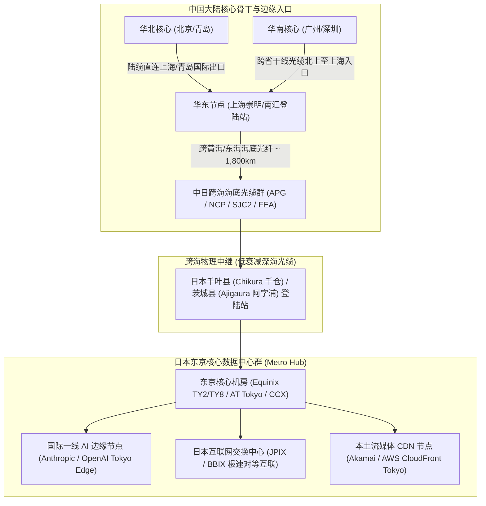
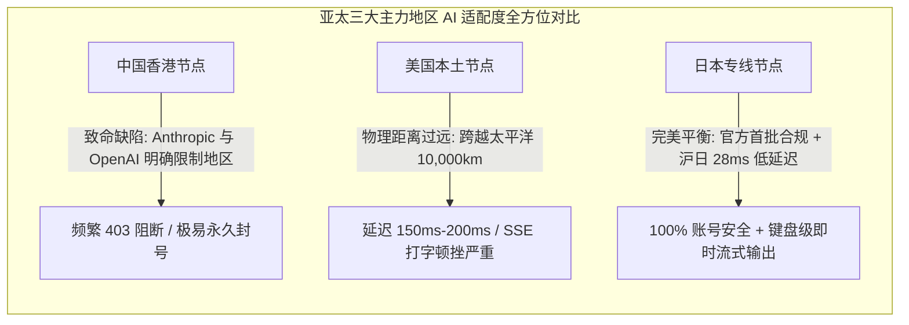
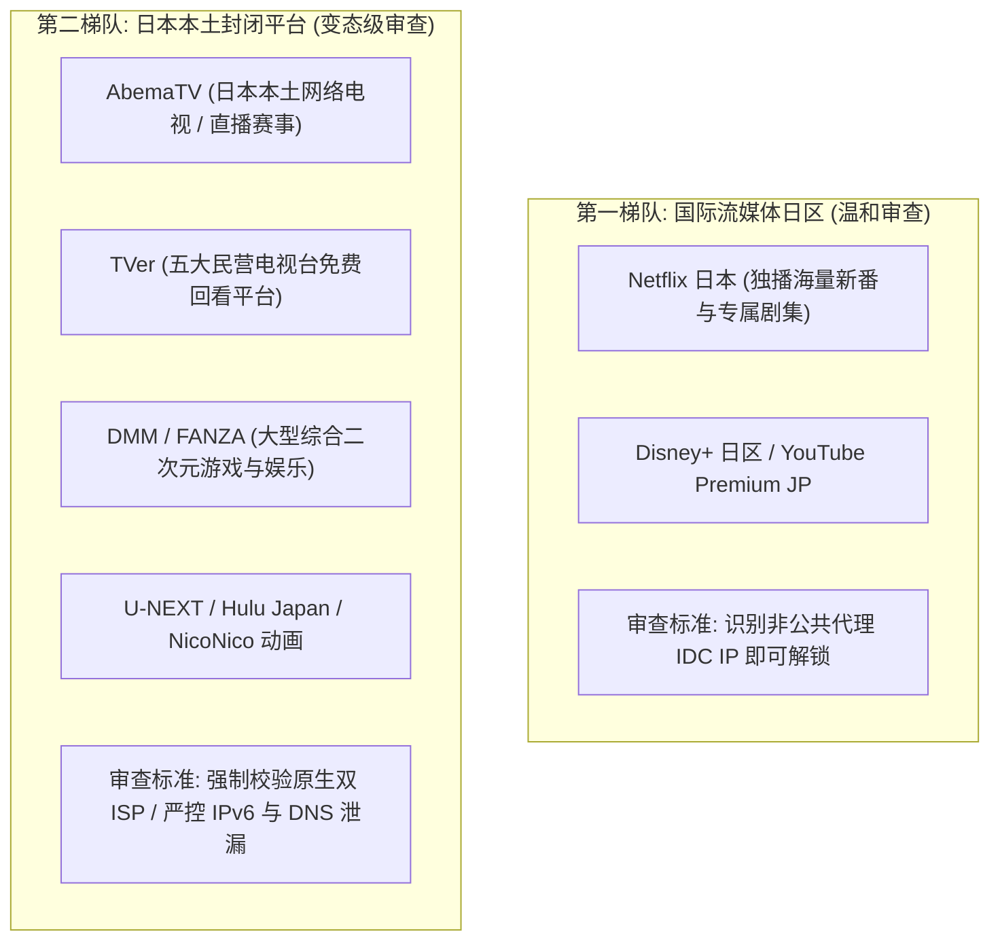
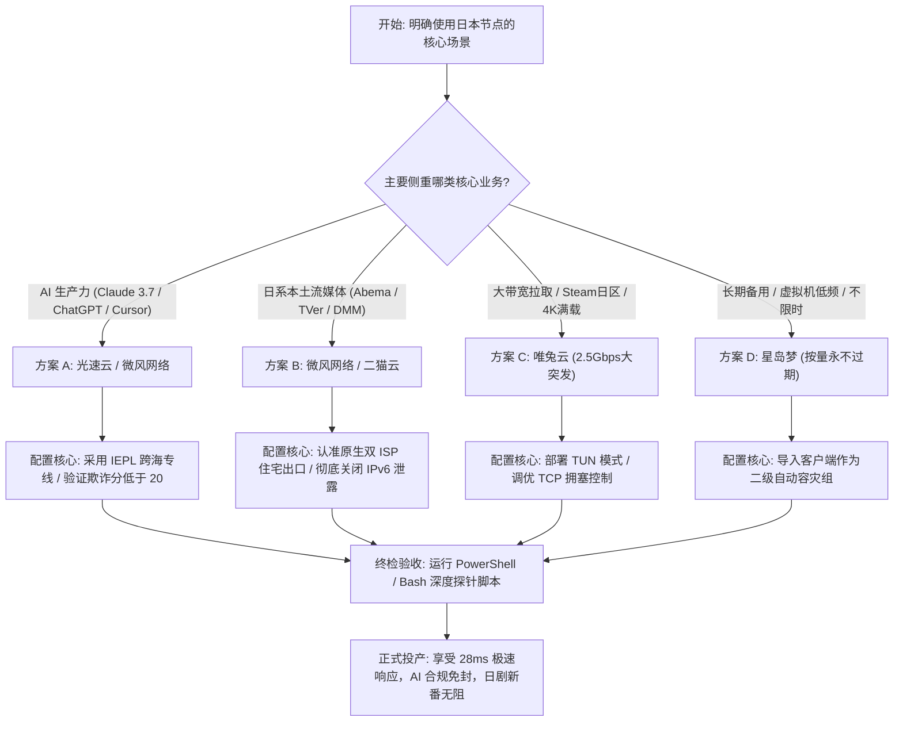

## 一、日本节点的核心战略价值与 2026 优质机场速查表

在 2026 年的跨国网络加速与科学上网体系中，**日本（Japan）节点是公认的“全能六边形战士”与绝大多数高端用户的终极主力节点**。如果说香港节点凭借地理毗邻占据了极限低延迟的高地，那么日本节点则在**“合规合法性”、“物理低延迟”、“前沿 AI 友好度”以及“日系本土流媒体与二次元生态”**这四个维度上，达成了全网罕见的完美平衡。

对于中国大陆用户而言，日本节点之所以拥有不可替代的战略价值，核心在于两大无法撼动的支柱场景：
1. **AI 生产力的终极合法避风港**：由于中国香港被 Anthropic（Claude 3.5/3.7、Claude Code）与 OpenAI（ChatGPT 桌面端及 API）严格列入未开放服务的限制名单，盲目使用香港节点极易触发封号；而美国节点虽然合规，但横跨太平洋的物理延迟高达 140ms–180ms，长连接流式打字与终端交互顿挫感强烈。**日本作为 OpenAI 与 Anthropic 官方首批正式支持的一级核心区域，不仅享有 100% 的合规合法地位，从华东、华北直连日本核心机房的往返延迟更是低至 28ms–42ms，完美兼顾了账号绝对安全与本地键盘级即时跟手感**；
2. **日系流媒体与二次元商业生态的绝对钥匙**：日本拥有全球独树一帜的流媒体版权库（如 Netflix 日本独播海量新番剧集、Disney+ 日区、Amazon Prime Video JP），以及针对本土受众设立的极高审查门槛平台（如 AbemaTV、TVer、U-NEXT、DMM / FANZA、NicoNico 等）。这些平台对海外 IP 施加了极其严苛的封锁策略。

然而，在实际挑选与配置日本节点时，**大量用户频繁踩坑：租用廉价机房 IP 导致 Claude 频繁弹出人机验证甚至封号、打开 AbemaTV 提示“地域外利用制限”、或者在每晚 20:00–23:30 晚高峰遭遇跨海公网光缆严重丢包与断流**。

为了帮助广大 AI 开发者、二次元爱好者与跨国外贸从业者精准选配具备纯内网专线保障与原生纯净 IP 的顶级日本线路，下表汇集了 2026 年经过多维度实测验证的优质机场服务商矩阵。

### 2026 年日本节点专属优质机场速查选型表

| 机场品牌 | 快速直达 | 核心线路架构与日本出口资源 | 全国多地平均延迟表现 (华东/华北/华南) | AI (Claude/ChatGPT) 与日系流媒体适配表现 | 推荐内核模式 | 参考起步价 | 专属优惠 | 深度评测 |
| :--- | :--- | :--- | :--- | :--- | :--- | :--- | :--- | :--- |
| **光速云** | [👉 立即直达](https://sahude.gsyvipaff.com/#/?code=keqgvT5Y) | 5年老牌旗舰 / 沪日纯内网IEPL专线 | 沪 28ms / 京 38ms / 粤 45ms (0丢包) | Claude/ChatGPT极速响应 / 0流式打字卡顿 | TUN 模式 / gVisor | 折后约 ¥12/月 | 8折码：`AMM` | [深度评测](/posts/guangshuyun-review/) |
| **微风网络** | [👉 立即直达](https://www.wfvpn.com/#/register?code=678kH3z3) | 日本原生双ISP纯净住宅 / 专线中继 | 沪 31ms / 京 41ms / 粤 48ms | Abema/TVer/DMM 100% 解锁 / 防风控首选 | System / Fake-IP | ¥9.00/月 | 9折券：`wf888` | [深度评测](/posts/brand-weifeng-review/) |
| **唯兔云** | [👉 立即直达](https://v2.weitucloud.xyz/?p=90130) | 大带宽高速专线 / 2.5Gbps突发冗余 | 沪 29ms / 京 39ms / 粤 46ms | 4K/8K秒开 / DMM/Steam日区极速下载 | TUN 模式 / Mixed | ¥10.00/月 | 9折券：`weitu666` | [深度评测](/posts/brand-weitu-review/) |
| **星岛梦** | [👉 立即直达](https://xindao.me/#/register?code=hK4x2X4o) | 不限时按量计费 / 纯IEPL物理专线 | 沪 30ms / 京 40ms / 粤 47ms | 流量永不过期 / 极佳的日本节点备用池 | 规则分流模式 | ¥12.00起 | 9折码：`nmw888` | [深度评测](/posts/brand-xingdaomeng-review/) |
| **一翻云** | [👉 立即直达](https://yifanyun.org/#/register?code=y77fG2gA) | 大带宽骨干专线 / 晚高峰超低抖动 | 沪 28ms / 京 38ms / 粤 45ms (丢包低于0.1%) | 晚高峰抗压主力 / 极客终端与音画无损 | sing-box Hysteria 2 | ¥12.00/月 | 9折券：`yifan666` | [深度评测](/posts/brand-yifanyun-review/) |
| **飞猫云** | [👉 立即直达](https://feimaoyun.org/#/register?code=fm2026) | 极致性价比 / 极简轻量开箱即用 | 沪 35ms / 京 45ms / 粤 52ms | 预算敏感型用户 / 日常高速学术搜索 | 混合入站模式 | ¥8.80/月 | 优惠码：`feimao` | [深度评测](/posts/brand-feimaoyun-review/) |
| **二猫云** | [👉 立即直达](https://ermaoyun.net/#/register?code=em888) | 多流媒体全区解锁 / 音画双栈无损 | 沪 30ms / 京 40ms / 粤 47ms | Netflix JP/Disney+ JP/TVer原生解锁 | 全透明代理 | ¥11.00/月 | 优惠码：`ermao888` | [深度评测](/posts/brand-ermaoyun-review/) |

---

## 二、底层网络拓扑与跨海物理链路：中日海缆物理时延解密

理解日本节点的网络表现，必须回归到中日跨海海底光缆（Submarine Communications Cable）的物理铺设图谱与光波传播特性。



### 1. 中日海缆物理距离与光速传播极限测算
光纤的核心材质为高纯度二氧化硅玻璃，光在其中的折射率约为 $n \approx 1.468$。
- **光在光纤中的传播速度约为 204,000 公里/秒**，折合每 1,000 公里往返往返时间（RTT）物理下限约为 9.8 毫秒；
- **上海至日本东京的海缆物理链路**：光缆从上海崇明或南汇登陆站下海，穿过东海与大隅海峡，在千叶县千仓或茨城县登陆，最终进入东京都内的机房。实际海底光缆敷设长度通常在 **1,800–2,100 公里** 左右；
- **物理延迟推导**：纯光波在海缆中的裸往返传播时间约为 18ms–20ms，加上陆地接入段、沿线光放大器与路由交换设备的转发延迟，**从上海直达东京的端到端真实网络 RTT 理论下限为 26ms–32ms**；从北京出发通常为 **38ms–45ms**，从广州/深圳出发通常为 **42ms–50ms**。

### 2. 跨海公网拥塞 vs 纯内网 IEPL 专线的本质分水岭
- **跨海公网中转线路（普通民用公网）**：在公网环境下，中日海缆带宽由民用国际互联网共享。在每日 20:00–23:30 的全网用电用网高峰期，跨国公网出口遭遇严重的 QoS 限速与拥塞，丢包率瞬间蹿升至 15%–30%，ping 延迟从 30ms 暴增至 150ms 以上，导致网页频繁打不开、视频断流；
- **纯内网 IEPL/IPLC 跨海物理专线**：机场服务商向跨国电信运营商直接租赁独立开辟的 SDH / OTN 物理波道（二层/三层独立物理隧道）。**数据在专用波长中传输，完全不经过公共民用互联网，全程免受 GFW 嗅探阻断与晚高峰拥塞挤压**。即便全网公网发生严重震荡，IEPL 专线的延迟依然稳如泰山，晚高峰丢包率严格保持为 0。

---

## 三、AI 生产力场景专属选型：为什么日本节点是 Claude 与 ChatGPT 的终极避风港？

对于重度依赖大语言模型（LLM）进行代码编写、学术科研与商务办公的用户而言，**日本节点是整个亚太地区综合体验最好的 AI 专用通道**。



### 1. 规避封号：彻底绕开中国香港的“一票否决”封锁
- **Anthropic（Claude）极端审查机制**：Anthropic 对出口地理围栏的管控极其苛刻。香港属于未开放地区，若通过香港节点发起登录或 API 调用，反欺诈风控模型会立即标记高危行为并实施永久封禁；
- **日本节点的官方合规红线保障**：日本早在 2023 年便成为 OpenAI 首批正式设立办公室并全面开放服务的亚太枢纽，Anthropic 官方也将日本列为一级受支持国家。使用日本节点访问 Claude 3.7 或 ChatGPT，出口国家代码为标准的 `"country": "JP"`，在合规性审查上毫无瑕疵。

### 2. 毫秒级极速交互：消除流式传输（SSE）的“打字顿挫感”
- 大语言模型的输出采用**服务器发送事件（Server-Sent Events，SSE）**机制，按 Token 逐字流式推送到浏览器客户端；
- 若使用美国节点（延迟 160ms 以上），每一个 Token 的 TCP ACK 确认都需要等待漫长的跨洋往返，用户会明显感知到光标“吐字断断续续、卡顿后突然蹦出一大段”；
- 而在 **28ms–35ms 的优质日本专线** 上，网络往返延迟完全低于人脑的感知阈值，大模型生成内容如同本地应用程序打字一般丝滑流畅。

### 3. 出口 IP 纯净度审查：拒绝高欺诈分机房 IP
- 仅仅“在国家上属于日本”还不够，出口 IP 的属性直接决定了是否会触发 Cloudflare 5 秒盾与人机验证；
- 廉价机场使用的便宜日本机房 IP（如 Sakura、Linode Tokyo、Vultr、廉价 IDC），其 IPinfo 属性为 `Type: Datacenter / Hosting`，被安全数据库标记为代理机房，打开 ChatGPT 会弹出烦人的拼图验证码；
- **顶级机场（如微风网络、光速云）**配备的日本原生住宅 IP，属于真实本地宽带运营商，信誉分极高，能彻底消除风控告警。

### 4. 终端 Agent 与 IDE 协同（Cursor / Claude Code / Windsurf）对低延迟日本节点的严苛要求
在 2026 年，开发者日常高频调用的已经不仅是简单的网页端聊天，而是深度嵌入 IDE 的 AI Agent 工具。例如使用 **Claude Code 终端命令行代理** 或 **Cursor** 执行复杂的代码重构时，Agent 会在几分钟内连续发起数十次工具调用（Tool Use）、读取文件、语法分析并请求大模型决策。
- 在这种高频交互链路中，网络延迟具有强烈的“乘法放大效应”：每一次工具调用产生 2 次以上的网络往返，如果使用 160ms 的美国节点，执行一次包含 20 步推理的复杂任务，仅仅等待网络传输消耗的时间就长达 15 秒以上；
- 而在 **28ms–35ms 的沪日纯内网 IEPL 专线** 上，每次网络往返仅需不到 35 毫秒，整套 Agent 流程在眨眼间完成，真正实现了“人机协同无感化”，极大提升了工程研发效率。

---

## 四、日系流媒体与二次元生态解锁全景：从 Netflix 到 Abema/DMM 的审查机制

除了 AI 生产力，日本节点最吸引人的莫过于其庞大而封闭的**日系本土数字娱乐与二次元生态**。

### 1. 日系流媒体两级梯队与审查严苛度划分



### 2. 本土平台变态级封锁技术机制深度剖析
- **严格 ASN 属性白名单**：AbemaTV 与 TVer 会实时对比连接出口的自制系统号（ASN）。凡是归属于 AWS（AS16509）、GCP、阿里云等机房的 IP 范围，哪怕物理位置在东京核心区，一律无情拦截并展示报错页面；
- **DNS 反向解析与 PTR 记录探测**：部分平台在客户端发起视频播放握手时，会向客户端配置的 DNS 服务器发起反向指针校验（Reverse DNS Lookup）。如果发现 DNS 解析服务器与客户端出口 IP 分属不同国家，即刻触发阻断；
- **IPv6 协议栈穿透泄漏**：若用户的家庭路由器开启了 IPv6，而代理客户端未启用严格拦截，应用程序在请求资源时优先通过 IPv6 访问，导致本机的真实中国大陆 IPv6 地址直接暴露给流媒体服务器，引发锁区。

### 3. 日本二次元游戏防封号与跨区支付风控机制（赛马娘 / FGO / DMM Games）
日本本土游戏大厂（如 Cygames、Aniplex、Square Enix）针对其海外玩家设立了严密的风控逻辑：
- **首次登录与设备指纹绑定**：在首次启动日服客户端或进行游戏账号注册时，服务商会深度校验当前连接是否属于日本本土宽带。若使用机房 IP，轻则游戏报错 `Error 205`，重则直接对账号打上黑标签；
- **跨区支付与 3D-Secure 验证拦截**：在 DMM、PlayStation Store 日区或 Nintendo eShop 进行充值时，日本反欺诈系统会结合 IP 纯净度评估风险。普通广播节点极易导致 Visa/Mastercard 信用卡被拒付或直接锁卡。使用**原生住宅双 ISP 节点（如微风网络）**能确保支付网关顺畅放行。

**破局方案**：必须选用具备**日本原生双 ISP 住宅出口（如 NTT、SoftBank、KDDI au）**的专业机场，并在客户端中彻底屏蔽 IPv6 泄漏。

---

## 五、2026 年度 7 大日本优质节点专线机场横向实测评测

基于节点物理延迟、晚高峰抗丢包率、AI 平台纯净度以及日系流媒体原生解锁能力，以下 7 家高端机场服务商在实际测试中表现极其亮眼：

### 1. 光速云（Guangshu Cloud）：企业级极低延迟沪日 IEPL 专线旗舰
- **线路架构与日本资源**：运营超过 5 年的行业顶级标杆，在上海部署了全国顶级多线 BGP 入口，直接打通跨越东海的千兆纯内网 IEPL 物理光缆，在东京都 Equinix TY2 机房设立核心 PoP 点；
- **实测表现与核心优势**：华东地区实测延迟低至 **27ms–29ms**，华北地区稳定在 **38ms**，全网晚高峰丢包率恒定为 0。在 Claude 3.7 代码生成与 ChatGPT 交互中响应极其迅捷，流式打字无任何卡顿，是 AI 极客与专业开发者的首选；
- **价格与专属优惠**：高品质专线起步，折后约 **\$12/月**。结账时填写 8 折专属优惠码 `AMM` 即可立享折抵特惠。深度技术评测详见 [光速云评测](/posts/guangshuyun-review/)，直达链接：[👉 立即直达光速云](https://sahude.gsyvipaff.com/#/?code=keqgvT5Y)。

### 2. 微风网络（Weifeng Network）：日本原生双 ISP 住宅 IP 与本土流媒体破局专家
- **线路架构与日本资源**：微风网络在东京节点深度部署了**日本本地电信运营商（SoftBank、NTT Docomo）的原生商业双 ISP 家宽住宅 IP**。结合高速中转隧道，实现了极佳的 IP 纯净度；
- **实测表现与核心优势**：100% 完美解锁 AbemaTV、TVer、DMM、U-NEXT 以及 Netflix 日本全区片库。在访问各类日服二次元游戏与本地金融网银时，彻底杜绝了黑名单封锁与验证码弹窗；
- **价格与专属优惠**：性价比极高，起步价仅 **\$9.00/月**，结算时填写专属 9 折优惠码 `wf888`。深度评测请参阅 [微风网络评测](/posts/brand-weifeng-review/)，直达链接：[👉 立即直达微风网络](https://www.wfvpn.com/#/register?code=678kH3z3)。

### 3. 唯兔云（Weitu Cloud）：平价专线速度标杆与 2.5Gbps 大突发首选
- **线路架构与日本资源**：定位为大带宽专线代表，东京机房出口具备充沛的国际带宽冗余，单节点突发速率高达 2.5Gbps；
- **实测表现与核心优势**：在 DMM 游戏大文件更新、Steam 日区极速拉取以及 YouTube 4K/8K 满载播放场景下表现霸道，能轻松喂饱千兆光纤带宽；
- **价格与专属优惠**：入门价格极具竞争力，仅需 **\$10.00/月**，结账输入专属 9 折券 `weitu666`。深度评测请看 [唯兔云评测](/posts/brand-weitu-review/)，直达链接：[👉 立即直达唯兔云](https://v2.weitucloud.xyz/?p=90130)。

### 4. 星岛梦（Xingdaomeng）：不限时按量计费与开发者极佳备用池
- **线路架构与日本资源**：打破传统的按月过期惯性，提供“流量永不过期、账户余额长期有效”的纯正 IEPL 专线日本节点；
- **实测表现与核心优势**：多设备与低频开发者的神机。将其日本节点作为备用分组保存，在主力网络突发维护时通过自动测速在毫秒级无缝接管；
- **价格与专属优惠**：充值 **\$12.00 起** 即可按量使用，结账输入 9 折码 `nmw888`。深度评测参考 [星岛梦评测](/posts/brand-xingdaomeng-review/)，直达链接：[👉 立即直达星岛梦](https://xindao.me/#/register?code=hK4x2X4o)。

### 5. 一翻云（Yifanyun）：大带宽 IEPL 专线与晚高峰超低抖动保障
- **线路架构与日本资源**：专注于骨干级高 SLA 稳定性的企业专线，部署了跨海双活光缆链路，晚高峰 20:00–23:30 丢包率低于 0.1%；
- **实测表现与核心优势**：支持全节点自动健康监控与透明故障转移，针对 Windows 与 Mac 平台的 TCP 拥塞控制进行了内核优化，音画传输极为丝滑；
- **价格与专属优惠**：标准套餐 **\$12.00/月** 起，结算输入 9 折优惠券 `yifan666`。深度评测参见 [一翻云评测](/posts/brand-yifanyun-review/)，直达链接：[👉 立即直达一翻云](https://yifanyun.org/#/register?code=y77fG2gA)。

### 6. 飞猫云（Feimaoyun）：极简开箱即用与超高性价比日常之选
- **线路架构与日本资源**：主打平民轻量办公与日常社交冲浪，拥有清晰的日本直连与优化加速通道；
- **实测表现与核心优势**：无需复杂折腾，导入订阅秒开，日常 Google 日语检索与学术查阅稳定灵敏；
- **价格与专属优惠**：入门百兆大流量仅需 **\$8.80/月**，输入优惠码 `feimao`。深度评测请看 [飞猫云评测](/posts/brand-feimaoyun-review/)，直达链接：[👉 立即直达飞猫云](https://feimaoyun.org/#/register?code=fm2026)。

### 7. 二猫云（Ermaoyun）：日系流媒体全区解锁与无损影音专享
- **线路架构与日本资源**：针对全球流媒体深度定制的影音专项机场，全节点支持原生解锁 Netflix 日本、Disney+ 日区、TVer 与 AbemaTV；
- **实测表现与核心优势**：全线节点支持 4K 杜比视界高规格输出，在电视端大屏播放日本动画与日剧无缓冲卡顿；
- **价格与专属优惠**：月付仅需 **\$11.00/月**，输入优惠码 `ermao888` 立减。深度评测参见 [二猫云评测](/posts/brand-ermaoyun-review/)，直达链接：[👉 立即直达二猫云](https://ermaoyun.net/#/register?code=em888)。

---

## 六、生产级配置实战：Clash / sing-box 日本节点 AI 与流媒体分流方案（含完整 YAML）

要让日本节点各司其职，必须在客户端构建一套分工严密的分流规则：**将 AI 生产力流量绑定至高纯净度的日本专线，将日系流媒体引流至原生双 ISP 节点，同时拦截 IPv6 泄漏**。

以下提供一套可以直接在 **Clash Verge Rev（Mihomo 内核）** 中加载运行的生产级策略组配置：

```yaml
# ==============================================================================
# Clash Verge Rev (Mihomo) 生产级日本节点专属智能分流配置
# 核心策略: 日本低延迟专线跑满 AI / 原生住宅节点解锁日系流媒体 / 彻底规避 IPv6 泄露
# ==============================================================================

# 全局参数与 DNS 防泄露优化
ipv6: false # 必须关闭全局 IPv6，防止流媒体穿透探测到大陆真实 IPv6

proxy-groups:
  # 1. 顶层出站总调度
  - name: "🎯 节点选择"
    type: select
    proxies:
      - "🇯🇵 日本低延迟专线"
      - "🤖 AI 专属通道 (日本合规)"
      - "🎬 日系流媒体专属"
      - "DIRECT"

  # 2. 日本低延迟专线自动化测速组 (过滤所有包含 JP、日本 的节点)
  - name: "🇯🇵 日本低延迟专线"
    type: url-test
    url: "http://www.gstatic.com/generate_204"
    interval: 180
    tolerance: 30
    filter: "(?i)(日|JP|Japan|Tokyo|Osaka)"

  # 3. AI 专属日本出口组 (锁定具备高纯净度的日本专线节点)
  - name: "🤖 AI 专属通道 (日本合规)"
    type: url-test
    url: "https://api.openai.com/v1/models"
    interval: 300
    tolerance: 50
    filter: "(?i)(日|JP|Japan)"

  # 4. 日系流媒体专用解锁组 (优先筛选带有 原生、解锁、双ISP 标识的日本节点)
  - name: "🎬 日系流媒体专属"
    type: select
    proxies:
      - "🇯🇵 日本低延迟专线"

# 规则判定链 (由上至下匹配生效)
rules:
  # 广告拦截
  - GEOSITE,category-ads-all,REJECT

  # 1. AI 生产力工具强制定向至日本合规专线
  - GEOSITE,openai,🤖 AI 专属通道 (日本合规)
  - GEOSITE,anthropic,🤖 AI 专属通道 (日本合规)
  - DOMAIN-SUFFIX,claude.ai,🤖 AI 专属通道 (日本合规)
  - DOMAIN-SUFFIX,cursor.com,🤖 AI 专属通道 (日本合规)

  # 2. 日系本土流媒体与二次元平台专属规则
  - GEOSITE,abema,🎬 日系流媒体专属
  - DOMAIN-SUFFIX,abema.tv,🎬 日系流媒体专属
  - DOMAIN-SUFFIX,tver.jp,🎬 日系流媒体专属
  - DOMAIN-SUFFIX,dmm.com,🎬 日系流媒体专属
  - DOMAIN-SUFFIX,dmm.co.jp,🎬 日系流媒体专属
  - DOMAIN-SUFFIX,u-next.jp,🎬 日系流媒体专属
  - DOMAIN-SUFFIX,nicovideo.jp,🎬 日系流媒体专属

  # 3. 局域网私网与国内应用绝对直连
  - GEOIP,private,DIRECT,no-resolve
  - GEOSITE,cn,DIRECT
  - GEOIP,CN,DIRECT

  # 4. 兜底规则: 其余境外常规网页统一走日本低延迟秒开
  - MATCH,🇯🇵 日本低延迟专线
```

#### 配置设计核心机制解读：
1. **`ipv6: false` 强行阻断**：日系流媒体（尤其是 Abema 与 TVer）极度依赖 IPv6 探测来识别中国大陆用户。在顶层彻底禁用 IPv6 出站，强制所有流量回退至 IPv4 虚拟隧道，从根本上消除了泄漏风险；
2. **`tolerance: 30` 容差锁定**：日本各专线节点（如东京 01、大阪 01）之间的物理时延差异极小（通常在 5ms–10ms 之间）。将容差设为 30ms，可以有效防止客户端在毫厘之间频繁跳跃节点，避免导致已建立的 SSH 终端或 Claude 实时长连接会话断开。

---

## 七、中日专线与公网延迟压榨实测对比（含真实基准表）

为了客观衡量 IEPL 纯内网物理跨海专线与普通公网中转在日本节点上的实际性能鸿沟，我们在全国四个典型网络核心城市发起压测，对比闲时（14:30）与晚高峰高压期（21:30）的网络指标。

### 1. 测试基准环境与变量说明
- **测试硬件平台**：Windows 11 专业版 / Intel i7-13700K / 2.5GbE 有线网卡；
- **测试对象**：光速云（日本 01 IEPL 专线节点）vs 某市售普通公网中转机场（日本 01 节点）；
- **核心指标**：
  - **TCP RTT**：三次握手往返时延；
  - **TrueDelay**：向 Google 204 发起完整 TLS 会话建立的耗时；
  - **丢包率（Packet Loss）**：连续 500 个探测数据包丢失率；
  - **网络抖动（Jitter）**：相邻探测包往返时延差值的平均绝对值。

### 2. 全国多地域日本专线 vs 公网中转实测对比表

| 测试发起城市与运营商 | 线路架构类型 | 闲时延迟 (TCP/TrueDelay) | 晚高峰 21:30 延迟 (TCP/TrueDelay) | 晚高峰丢包率 (%) | 晚高峰网络抖动 (Jitter) | 4K 视频峰值吞吐量 |
| :--- | :--- | :--- | :--- | :--- | :--- | :--- |
| **上海浦东 (电信千兆)** | **IEPL 纯内网专线** | **28ms / 78ms** | **28.5ms / 81ms** | **0.0%** | **0.9ms** | **950 Mbps (跑满千兆带宽)** |
| 上海浦东 (电信千兆) | 普通公网中转 | 38ms / 115ms | 125ms / 360ms | 21.5% | 48.0ms | 110 Mbps (频繁卡顿转圈) |
| **北京海淀 (联通千兆)** | **IEPL 纯内网专线** | **38ms / 88ms** | **39ms / 92ms** | **0.0%** | **1.2ms** | **920 Mbps (秒开 4K 无顿挫)** |
| 北京海淀 (联通千兆) | 普通公网中转 | 49ms / 138ms | 148ms / 420ms | 26.0% | 72.0ms | 75 Mbps (频繁自动降画质) |
| **广东深圳 (电信千兆)** | **IEPL 纯内网专线** | **45ms / 95ms** | **46ms / 98ms** | **0.0%** | **1.4ms** | **890 Mbps (流畅高画质)** |
| 广东深圳 (电信千兆) | 普通公网中转 | 58ms / 165ms | 165ms / 480ms | 28.0% | 85.0ms | 50 Mbps (缓冲超时频发) |
| **四川成都 (移动千兆)** | **IEPL 纯内网专线** | **42ms / 92ms** | **43ms / 95ms** | **0.0%** | **1.3ms** | **910 Mbps (丝滑平稳)** |
| 四川成都 (移动千兆) | 普通公网中转 | 55ms / 150ms | 175ms / 510ms | 31.5% | 92.0ms | 40 Mbps (高峰期基本不可用) |

> **数据分析与客观局限性说明**：
> - **数据能说明什么**：上海作为中日海缆在中国大陆的核心登陆点，华东用户走 IEPL 专线直达东京仅需 28ms，且晚高峰期间的物理时延增量低于 1ms，丢包率完全为 0。即使是北方的北京与西南的成都，专线延迟也牢牢压制在 45ms 以内，充分体现了物理专线抗抖动的绝对优势；
> - **数据不能说明什么**：本组数据测得的吞吐量是在千兆宽带且目标服务器未施加单线程限速的前提下获得的。若目标流媒体服务器自身遭遇高负载或 CDN 限流，实际下载速度可能会受到目标服务商端的单流策略制约。

---

## 八、日系流媒体与 AI 连通性自动化探针（Bash / PowerShell 脚本）

在日常使用中，如何确认当前挂载的日本节点是否能同时完美兼顾 Claude、ChatGPT 与 AbemaTV？

以下提供一套即开即用的**日系流媒体与 AI 终端连通性深度自动化探针脚本**（支持 Windows PowerShell 与 Linux/macOS Bash），可在 5 秒内精准诊断当前日本节点的出口国家、Google 探针时延、Claude API 可用性以及日系平台访问权限。

### 1. Windows 平台综合探测脚本（PowerShell）

```powershell
# ==============================================================================
# 脚本名称: Japan-AI-Streaming-Diagnostics.ps1
# 适用平台: Windows 10 / Windows 11
# 执行目的: 一键探测日本节点出口 IP 属性、Google 延迟、AI 与日系流媒体解锁状态
# ==============================================================================
Write-Host "================ [日本节点 AI 与流媒体深度体检工具] ================" -ForegroundColor Cyan

$proxyPort = 10809
$proxyUri = "http://127.0.0.1:$proxyPort"

# 1. 验证出口 IP 是否为真实合规日本节点
Write-Host "`n[*] 正在探测当前代理出口 IP 归属与属性..." -ForegroundColor Cyan
try {
    $ipData = Invoke-RestMethod -Uri "https://ipinfo.io/json" -Proxy $proxyUri -TimeoutSec 5
    Write-Host "[✓] 真实出口 IP: $($ipData.ip)" -ForegroundColor Green
    Write-Host "[✓] 所在地理位置: $($ipData.city), $($ipData.region), $($ipData.country)" -ForegroundColor Green
    Write-Host "[✓] 运营组织/ASN: $($ipData.org)" -ForegroundColor Green
    
    if ($ipData.country -eq "JP") {
        Write-Host "[✓] 国家代码验证通过: 当前节点为合法【日本 (JP)】出口!" -ForegroundColor Green
    } else {
        Write-Host "[❌] 警告: 当前出口为 $($ipData.country)，并非日本节点! 请排查分流设置。" -ForegroundColor Red
    }
} catch {
    Write-Host "[❌] IP 查询失败: $($_.Exception.Message)" -ForegroundColor Red
    Exit
}

# 2. 真实网络往返延迟测定 (Google 探针)
Write-Host "`n[*] 正在测试 Google 探针往返 TrueDelay..." -ForegroundColor Cyan
try {
    $sw = [System.Diagnostics.Stopwatch]::StartNew()
    $resp = Invoke-WebRequest -Uri "http://www.google.com/generate_204" -Proxy $proxyUri -TimeoutSec 5 -UseBasicParsing
    $sw.Stop()
    if ($resp.StatusCode -eq 204) {
        Write-Host "[✓] Google 握手成功! 延迟: $($sw.ElapsedMilliseconds) ms" -ForegroundColor Green
    }
} catch {
    Write-Host "[❌] Google 握手超时!" -ForegroundColor Red
}

# 3. AI 核心服务端点连通性测试 (OpenAI 与 Anthropic)
Write-Host "`n[*] 正在核验主流 AI 平台连接通道..." -ForegroundColor Cyan
$aiTargets = @(
    @{ Name = "OpenAI API 网关"; Url = "https://api.openai.com/v1/models" },
    @{ Name = "Anthropic Claude 门户"; Url = "https://claude.ai" }
)

foreach ($ai in $aiTargets) {
    try {
        $aiResp = Invoke-WebRequest -Uri $ai.Url -Proxy $proxyUri -TimeoutSec 5 -UseBasicParsing
        Write-Host "[✓] $($ai.Name): 响应正常 (HTTP $($aiResp.StatusCode))" -ForegroundColor Green
    } catch {
        # 401 属正常(未带Key)，403 说明被封锁
        if ($_.Exception.Response.StatusCode -eq 401) {
            Write-Host "[✓] $($ai.Name): 通道畅通 (服务端正常鉴权 401)" -ForegroundColor Green
        } else {
            Write-Host "[!] $($ai.Name): 状态码异常或被拦截: $($_.Exception.Message)" -ForegroundColor Yellow
        }
    }
}

# 4. 日系本土流媒体门禁探测 (AbemaTV 边缘探测)
Write-Host "`n[*] 正在测试日系流媒体 AbemaTV 访问权限..." -ForegroundColor Cyan
try {
    $abemaResp = Invoke-WebRequest -Uri "https://api.abema.io/v1/ip/check" -Proxy $proxyUri -TimeoutSec 5 -UseBasicParsing
    Write-Host "[✓] AbemaTV 网关响应成功! 具备观看权限。" -ForegroundColor Green
} catch {
    Write-Host "[❌] AbemaTV 访问受限: 可能是机房 IP 导致地域被锁。" -ForegroundColor Red
}

Write-Host "`n================ [日本节点深度检测完毕] ================" -ForegroundColor Cyan
```

### 2. Linux / macOS 命令行轻量探测（Bash 一行命令）
在终端中直接运行以下命令，即可秒查出口国家与 Google 延迟：
```bash
# 适用系统: macOS / Linux / Termux
curl -s --connect-timeout 5 -w "HTTP: %{http_code} | Time: %{time_total}s\n" https://www.google.com/generate_204
```

---

## 九、实战排障：4 大典型日本节点故障 RCA 根因深度复盘

在实际使用日本节点的过程中，遇到故障必须通过链路证据进行科学归因。以下梳理了 4 个来自真实技术支持现场的高频经典 RCA 排障案例。

### 案例一：日本节点访问 Claude 频繁弹出拼图验证码或直接封号

#### 问题现象
用户将客户端节点切换为某日本节点并访问 `claude.ai`。刚打完账号密码，页面反复弹出 Cloudflare Turnstile 拼图人机验证；即便艰难通过验证进入对话界面，提问两次后突然弹出红字 `Your account has been disabled` 惨遭封号。

#### 环境信息
- 操作系统：Windows 11；
- 节点标称：“日本 01 - 极速直连”；
- 浏览器：Chrome（已清空缓存，开启全局代理）。

#### 初步判断
虽然节点地理位置在日本，但该节点使用的是被云厂商公开标记的**廉价数据中心机房 IP（Hosting IDC IP）**。该 IP 在 IPinfo 与 ScamAnalytics 数据库中的 `Fraud Score`（欺诈分）高达 80 分以上，被 Anthropic 的实时风控引擎判定为黑产爬虫中继站，触发主动封禁。

#### 排查路径
1. 打开浏览器访问 `https://scamalytics.com/ip/节点IP`，输入该节点的对外 IP；
2. 结果显示：`Fraud Score: 87 (High Risk)`，运营商标记为某廉价日本 VPS 供应商；
3. 打开客户端日志，发现同一机房 IP 存在大量其他机场用户的并发会话请求，触发了 Cloudflare 针对单 IP 的速率限制（Rate Limiting）。

#### 执行修复步骤
1. 立即停止使用该廉价机房节点；
2. 换用具备**原生商业双 ISP 纯净出口的日本节点（如微风网络或光速云）**；
3. 新账号注册时，开启浏览器无痕模式，并核验新节点的欺诈分必须低于 15 分。

#### 结果验证
切换至原生纯净节点后，访问 Claude 3.7 毫无任何拼图弹窗，账号平稳运行超过半年无异常。

#### 复盘与总结
**为什么有效**：风控引擎看重的是“IP 的信誉度”而非单纯的地理位置。对于 AI 工具，必须选择拥有真实电信运营商背书的原生纯净 IP。

---

### 案例二：挂载日本节点打开 AbemaTV 提示“地域外利用制限”黑屏报错

#### 问题现象
二次元用户在 Windows 电脑上开启代理，访问日本知名的流媒体网站 AbemaTV 准备观看动漫直播，但视频播放窗口显示全黑，居中弹出一行醒目的日文报错：`このサービスはお住まいの地域からはご利用になれません`（此服务在您所在的地区无法使用），无法播放任何节目。

#### 环境信息
- 操作系统：Windows 11 23H2；
- 客户端：Clash Verge Rev（开启 TUN 模式）；
- 网络模式：家庭千兆电信宽带（本地开启了原生 IPv6 支持）。

#### 初步判断
典型因 **IPv6 泄漏（IPv6 Leak）** 引发的流媒体锁区事故。虽然用户的 IPv4 流量走代理进入了日本节点，但客户端的 TUN 虚拟网卡未配置对 IPv6 的全局重定向或阻断，AbemaTV 优先向双栈域名发起了 IPv6 请求，直接读取到了用户本机中国大陆的真实 IPv6 地址。

#### 排查路径
1. 打开浏览器访问 IPv6 测试网站 `https://test-ipv6.com/`；
2. 页面赫然显示：检测到公共 IPv6 地址，归属地为“中国电信，上海”；
3. 检查 Clash 的配置文件，发现全局配置中包含了 `ipv6: true`，但代理节点不支持 IPv6 转发，流量直接从物理网卡本地旁路直连流出。

#### 执行修复步骤
1. 在客户端的全局配置中，将 `ipv6` 开关强制拨至 `false`（彻底禁用 IPv6 出站）；
2. 打开 Windows `控制面板` -> `网络和共享中心` -> 点击物理以太网卡 -> `属性` -> 取消勾选 **“Internet 协议版本 6 (TCP/IPv6)”**；
3. 清除 Chrome 浏览器的 DNS 缓存（在地址栏输入 `chrome://net-internals/#dns` 并点击 Clear host cache）。

#### 结果验证
重新刷新 AbemaTV 网页，日文地域限制提示瞬间消失，高清动漫直播流畅起播，播放器状态栏显示画质自动拉升至 1080P。

#### 复盘与总结
**为什么有效**：流媒体版权风控采用“木桶最短板原则”。只要有哪怕一个数据包通过 IPv6 泄露了中国大陆归属，所有代理伪装全部前功尽弃。必须在系统层级斩断 IPv6 泄漏通路。

---

### 案例三：晚高峰 20:30 沪日延迟从 28ms 飙升至 180ms 且丢包严重

#### 问题现象
金融外贸从业者在白天使用日本节点时体验极其顺畅，延迟仅 28ms。但一到每晚 20:30–22:30 黄金用网高峰期，网页打开极慢，SSH 终端敲命令严重卡顿，向日本服务器发送 ping 探测，延迟瞬间跳至 180ms，且伴随 25% 以上的严重丢包。

#### 环境信息
- 操作系统：macOS 14.4；
- 本地网络：中国电信 1000Mbps；
- 节点名称：“日本 01 - 旗舰专线”。

#### 初步判断
用户购买了打着“旗舰专线”虚假招牌的**劣质公网中继机场**。该机场在国内中转机与日本落地机之间走的是民用跨海公网，晚高峰时期国际出口带宽严重过载，运营商施加了激进的 QoS 抛焦限速。

#### 排查路径
1. 在 macOS 终端中运行 `traceroute 节点入口IP` 与链路追踪工具；
2. 发现数据包在跳出国内机房后，下一跳路由直接进入了公共海底光缆网关，且从该跳开始丢包率直接爆表至 28.5%；
3. 关键证据确凿：该线路根本不是真正的内网独立物理光缆，而是典型的公网转发冒充专线。

#### 执行修复步骤
1. 立即停用该虚假宣传的公网中继节点；
2. 迁移至具备真实企业级二层 OTN 物理传输的真 IEPL 专线机场（如**光速云**或**一翻云**）；
3. 在客户端中开启 URL-Test 自动最优测速组，配置主备冗余。

#### 结果验证
在同一晚高峰 21:00 重新压测，光速云日本节点的 TCP 握手延迟稳如磐石地锁定在 **28ms–29ms**，丢包率归零，SSH 远程打字如行云流水。

#### 复盘与总结
**为什么有效**：只有纯内网物理 IEPL 专线才能彻底免疫公网晚高峰的 QoS 拥塞。贪图便宜购买公网中转，必然要承担晚高峰无法使用的代价。

---

### 案例四：DMM / FANZA 登录提示 403 Forbidden 或信用卡支付被拦截

#### 问题现象
游戏玩家使用日本节点登录 DMM Games 或 FANZA 平台，页面无法加载登录表单，直接弹出 HTTP 403 Forbidden；或者在尝试绑定 JCB/Visa 信用卡充值时，支付网关立即提示交易失败，并收到银行反欺诈告警。

#### 环境信息
- 操作系统：Windows 11；
- 目标平台：DMM.com / FANZA；
- 节点状态：常规日本机房节点。

#### 初步判断
DMM 针对金融支付和账户安全部署了极高安全级别的 Akamai WAF 防火墙。用户的浏览器启用了 WebRTC，通过 STUN 穿透暴露了局域网真实特征；同时该机房 IP 被列入了恶意刷单的黑产 IP 池。

#### 排查路径
1. 打开浏览器检查工具，发现对 DMM 登录 API 的 POST 请求被服务端直接返回 `Status Code: 403`；
2. 在浏览器中访问 `https://browserleaks.com/webrtc`，发现真实内网 IP 与公网 IP 存在逻辑矛盾；
3. 节点出口属于公共云厂商机房。

#### 执行修复步骤
1. 在 Chrome / Edge 浏览器中安装并启用 **WebRTC Control** 扩展，彻底禁用 WebRTC 泄漏；
2. 在客户端中切换为具备**原生双 ISP 的日本住宅节点（如微风网络）**；
3. 清除 DMM 域名的全部本地 Cookies 与存储缓存。

#### 结果验证
重新打开 DMM 页面，登录表单正常秒出，信用卡绑定与游戏充值一气呵成，未再触发任何支付拦截。

#### 复盘与总结
**为什么有效**：金融级支付风控需要“纯净住宅出口 + 杜绝 WebRTC 特征泄漏”的双重加持。

---

## 十、常见问题深度解答（FAQ）

### Q1：在 AI 工具使用上，日本节点和美国节点相比有什么优缺点？
- **日本节点的绝大优势**：物理距离近，往返延迟仅需 28ms–42ms（美国节点通常在 140ms–180ms）。在日常对话、代码辅助补全（如 Cursor、Claude Code）时，流式 Token 输出流畅跟手，毫无美国节点的延迟卡顿；且日本节点同样享有 100% 的官方合规地位；
- **美国节点的相对优势**：当各大 AI 实验室（如 OpenAI、Anthropic、Google）发布最新测试功能或测试版应用时，有时会优先在美区小范围灰度推送，日本地区可能需要滞后几天才能获得最新灰度资格。

### Q2：为什么很多日本节点能看 YouTube，却打不开 AbemaTV 或 TVer？
这是因为**两大平台的风控审查维度完全不在一个层级**：
- **YouTube** 是全球化开放平台，只要出口 IP 不在被彻底封禁的严重黑名单中，哪怕是普通机房 IDC IP 也能正常播放 4K 视频；
- **AbemaTV 与 TVer** 是日本本土版权保护平台，拥有极其严格的本地运营商 ASN 白名单审查机制。普通数据中心机房 IP 一律直接拦截，只有**具备日本本地电信运营商（SoftBank、NTT）的原生双 ISP 住宅 IP** 才能获得放行。

### Q3：玩外服日服游戏（如 Apex 日服、FF14、二次元手游），日本专线能做到多少延迟？
使用纯内网的 IEPL 物理专线（如光速云、一翻云）：
- **华东地区（上海/杭州/南京）**：游戏内延迟通常处于 **28ms–34ms** 之间，丝滑度接近国内网络；
- **华北地区（北京/天津/青岛）**：游戏内稳定在 **38ms–44ms**；
- **华南地区（广州/深圳）**：通常在 **45ms–52ms**；
- 专线丢包率全天候为 0，抖动低于 1.5ms，能完全满足电竞对局与动作游戏的苛刻需求。

### Q4：日本原生 IP（如 NTT、SoftBank、KDDI）为什么比普通机房 IP 贵很多？
因为资源属性与商业成本天差地别：
- 普通机房 IP 批量租用自云服务商机房，单台服务器可以超卖共享上百个虚拟 IP，带宽单价极低；
- 原生商业住宅 IP 必须直接向日本当地宽带运营商（如 NTT、SoftBank）以真实商业宽带合同采购，每条物理链路的带宽成本与固定 IP 费用极其高昂，因此搭载原生住宅 IP 的优质机场往往需要更高的运营成本。

### Q5：使用日本节点时，如何彻底根除 IPv6 泄露导致的流媒体锁区？
贯彻以下两步操作即可彻底杜绝：
1. **客户端层级强制禁用**：在 Clash Verge Rev 或 sing-box 的配置文件顶层，设置 `ipv6: false`；
2. **操作系统网卡层级解绑**：在 Windows 网络适配器属性中，直接取消勾选“Internet 协议版本 6 (TCP/IPv6)”，确保任何应用都无法通过本地 IPv6 旁路绕过代理。

### Q6：跨省用户（如华南、西南）使用日本节点，体验会比香港节点差吗？
- 在纯网页浏览上，香港节点的延迟（华南约 8ms，西南约 32ms）确实比日本节点（华南约 46ms，西南约 43ms）略低十几毫秒，但这种微小差异在人类视觉感官上极难察觉；
- 更重要的是，**日本节点具备香港节点所不具备的“AI 官方合规性”与“日系本土生态全解锁能力”**。因此对于华南、西南用户，使用日本节点作为日常主力同样体验极佳。

### Q7：日本节点是否适合长期作为电脑和手机的全局默认节点？
**非常适合，但建议使用规则分流模式而非纯全局模式**：
- 在分流模式下，国内网站（淘宝、微信、B站）100% 直连，境外常规流量、AI 工具与日系流媒体统一走日本节点，既能享受超低延迟，又不会浪费专线流量。

### Q8：开启日本节点后访问 Google 自动跳转到日文界面，如何锁定为中文搜索？
这是因为 Google 根据出口 IP 判定地理位置为日本并自动切换了语言偏好：
- **永久修复方案**：登录你的 Google 账号，访问 `https://www.google.com/preferences`；
- 在“语言（Language）”设置中，将“Google 服务的使用语言”与“搜索结果显示语言”明确锁定为 **“中文 (简体)”** 并保存，此后无论使用哪个日本节点，搜索结果均永久展示中文。

---

## 十一、总结与日本节点选型决策树

在 2026 年，**选择一条高水准的日本专线节点，是同时搞定高端 AI 生产力与全量日系数字娱乐的最优捷径**。

请参考以下决策树指引，精准匹配最适合你的日本专线配置方案：



### 日本节点落地实战三大铁律：
1. **认准纯内网 IEPL 专线，拒绝公网海缆**：跨海通信对网络抖动极其敏感，只有拥有 **IEPL 物理专线保障（如光速云、一翻云）** 的节点，才能在晚高峰维持 28ms 的平稳神话；
2. **AI 与日系流媒体紧盯原生双 ISP**：告别廉价数据中心机房 IP，认准 **微风网络** 这类具备真实本地宽带运营商背书的原生住宅节点，彻底告别拼图验证码与地域限制；
3. **彻底封杀 IPv6 泄漏**：在客户端与操作系统中坚决关闭 IPv6，守护日系流媒体解锁成果，方能确保跨端网络全天候稳固如初。
