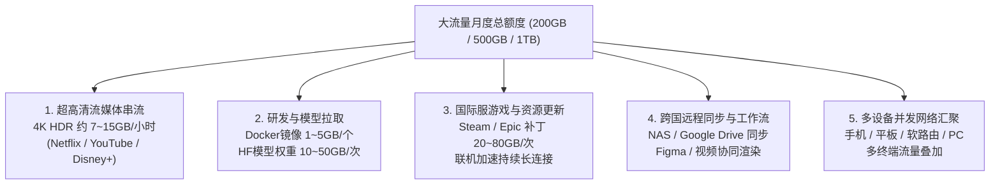
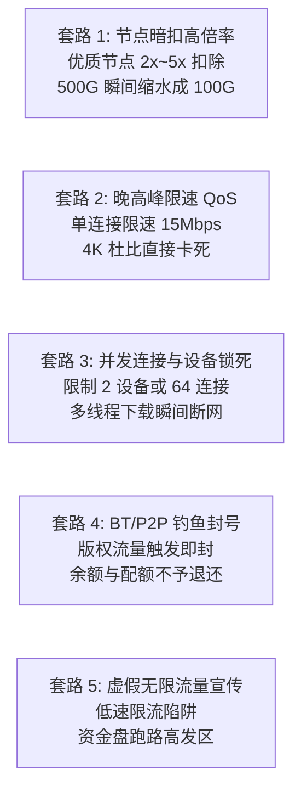
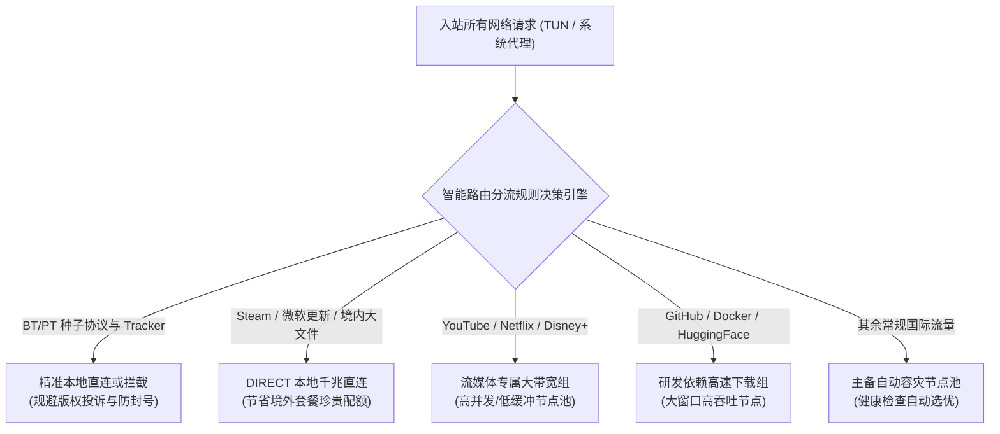

## 一、2026 年 200GB+ 大流量机场核心画像与精选速查榜

在跨境网络与科学上网的真实应用场景中，**“200GB 及以上的大流量套餐”是重度流媒体观影者、AI 大模型开发者、跨境远程工程师以及多设备合租家庭的核心生命线**。与仅用于查阅文献、网页浏览或即时通讯的轻量小流量用户不同，大流量用户对网络服务的需求呈现出极其严苛的“双重考验”：一方面需要**庞大且充沛的数据传输额度**，以支撑 4K/8K 超高清 HDR 视频无缓冲串流、GB 级别开源模型权重（如 Hugging Face / GitHub）拉取以及海量系统镜像分发；另一方面更对**持续承载高吞吐量的物理带宽韧性**有着极高要求——若缺乏优质的专线或大带宽 BGP 冗余支撑，再多的标称流量也会在晚高峰的严重丢包与断流中沦为无法利用的“纸上数字”。

许多初次选购大流量套餐的用户往往存在认知盲区，单纯将“GB 单价最低”作为唯一挑选标准，结果陷入极为痛苦的维权陷阱：
1. **名义流量与实际倍率严重脱节**：服务商宣传页面赫然标着“500GB 豪华大包月”，但在实际节点列表中，唯独能看高清视频或拉取大文件的优质节点倍率普遍被调高至 2.0x、3.0x 甚至 5.0x，原本以为充足的 500GB 配额在真实使用中折算下来不足 100GB，产生严重的被欺诈感；
2. **晚高峰 QoS 恶性掐尖与限速**：部分超卖严重的廉价公网中转机场，在夜间 20:00 至 23:00 的用网高峰期，对持续消耗大带宽的长连接实施粗暴的单流速度限制，将带宽从标称的 1000 Mbps 骤降至 15 Mbps 以下，导致 4K 视频疯狂转圈降画质；
3. **高并发与 P2P 滥用封禁规则暗礁**：大流量用户通常有多任务并行下载的需求，部分劣质平台不仅限制并发连接数（导致多线程下载器直接卡死），更在用户不慎触发 BT/PT 或后台版权流量时直接注销账户且拒绝退款；
4. **低价年付绑架跑路风险**：由于大流量专线带宽成本极为昂贵，市场上大量声称“几十元包年 1TB 每月”的杂牌小作坊，实质是利用资金盘模式吸纳预付款，往往运营不到三个月便因带宽账单暴击而卷款跑路。

因此，**真正值得托付的“200GB+ 大流量机场”，必须同时满足：全节点 1.0x 真实透明倍率、晚高峰抗压无丢包的专线或多线 BGP 架构、高带宽冗余吞吐、以及宽松合理的多设备并发支持**。下表汇总了 2026 年经过持续多线程高负载压测验证的代表性大容量服务商。

### 2026 年优质 200GB+ 大流量与大带宽机场横评速查榜

| 机场品牌 | 快速直达 | 核心定位与大流量档位 | 真实起步月费 | 流量梯队与线路架构 | 计费倍率 | 专属优惠 | 评测详情 |
| :--- | :--- | :--- | :--- | :--- | :--- | :--- | :--- |
| **一翻云** | [👉 立即直达](https://guangs.yifanaff.top/#/?code=uJ6y) | 大流量性价比之王 / 多设备家庭合租首选 | ¥12.00/月 | 150GB~500GB / 电信联通移动多线BGP | 全节点 1.0x 真实计费 | 优惠券：`yifan666` | [深度评测](/posts/brand-yifanyun-review/) |
| **唯兔云** | [👉 立即直达](https://guangs.weituaff.top/#/?code=w98Q9B5D) | 纯月付标杆 / 无套路大水管跨境专线 | ¥10.00/月 | 200GB~800GB / 跨境物理专线大带宽 | 全节点 1.0x 真实计费 | 优惠券：`weitu666` | [深度评测](/posts/brand-weitu-review/) |
| **光速云** | [👉 立即直达](https://sahude.gsyvipaff.com/#/?code=keqgvT5Y) | 5年老牌旗舰 / 全内网物理专线主力 | 折后约¥12/月 | 200GB~1000GB / 全内网二层物理专线 | 全节点 1.0x 极速专线 | 8折码：`AMM` | [深度评测](/posts/guangshuyun-review/) |
| **二猫云** | [👉 立即直达](https://guangs.ermaoyunaff.top/#/?code=mG1e) | 极速中继大带宽 / 多协议容灾备用 | ¥11.00/月 | 200GB~600GB / 智能多线容灾中继 | 全节点 1.0x 真实计费 | 优惠券：`ermao888` | [深度评测](/posts/brand-ermaoyun-review/) |
| **微风网络** | [👉 立即直达](https://guangs.weifengaff.top/#/?code=VjRz832G) | 原生住宅双 ISP / 极客大流量AI天花板 | ¥9.00/月 | 200GB~500GB / BGP入口+高速专线 | 全节点 1.0x 不虚标 | 9折券：`wf888` | [深度评测](/posts/brand-weifeng-review/) |
| **飞猫云** | [👉 立即直达](https://guangs.feimaoyunaff.top/#/?code=Kx2P4q) | 亲民进阶 / 兼顾大容量与学生党预算 | ¥8.80/月 | 200GB~400GB / 商业优化 BGP 中继 | 全节点 1.0x 真实计费 | 优惠券：`feimao` | [深度评测](/posts/brand-feimaoyun-review/) |
| **星岛梦** | [👉 立即直达](https://guangs.xingdaomeng.com/#/?code=1TynBYnR) | 不限时按量计费 / 超级大容量永久不过期 | ¥12.00/按量 | 200GB~2TB 不限时 / 企业级 IEPL 物理专线 | 按真实消耗扣费 | 9折码：`nmw888` | [深度评测](/posts/brand-xingdaomeng-review/) |

---

## 二、大流量吞吐数学模型：200GB、500GB、1TB 真实消耗与选型矩阵

很多用户在面对 200GB、500GB 或 1TB 的套餐规格时，往往难以量化自身的真实需求，容易陷入“买少了不够用、买多了全浪费”的两难境地。通过建立科学的跨境数据传输消耗数学模型，我们可以将抽象的吉字节（GB）拆解为具体生活与工作场景中的可感知指标。



### 1. 常见高吞吐业务的单次与累计流量消耗量化

为了给容量选型提供精确依据，下表统计了主流大流量应用在不同画质与数据规模下的理论与实测数据消耗：

| 业务应用类别 | 具体操作行为 | 典型瞬时带宽需求 | 单次或单位时间消耗 | 200GB 承载上限 | 500GB 承载上限 | 1TB 承载上限 |
| :--- | :--- | :--- | :--- | :--- | :--- | :--- |
| **4K 超高清流媒体** | YouTube 4K 60fps (VP9/AV1) | 35 ~ 65 Mbps | 约 9.5 GB / 小时 | 约 21 小时观影 | 约 52 小时观影 | 约 105 小时观影 |
| **杜比视界电影** | Netflix 4K Dolby Vision (HEVC) | 25 ~ 45 Mbps | 约 7.0 GB / 小时 | 约 28 小时观影 | 约 71 小时观影 | 约 142 小时观影 |
| **8K 极致视听体验** | YouTube 8K 60fps (AV1/HDR) | 80 ~ 140 Mbps | 约 22.0 GB / 小时 | 约 9 小时观影 | 约 22 小时观影 | 约 45 小时观影 |
| **开源 AI 模型拉取** | Hugging Face 7B~14B 模型权重 | 100 ~ 500 Mbps | 15 ~ 35 GB / 单次 | 约 6 ~ 13 次下载 | 约 15 ~ 33 次下载 | 约 30 ~ 66 次下载 |
| **大型 3A 游戏更新** | Steam / Battle.net 外服游戏补丁 | 200 ~ 800 Mbps | 40 ~ 90 GB / 单次 | 约 2 ~ 4 款大作 | 约 5 ~ 11 款大作 | 约 11 ~ 25 款大作 |
| **跨国云盘与 NAS 同步** | Google Drive / Dropbox 备份文件 | 50 ~ 200 Mbps | 20 ~ 50 GB / 单次 | 约 4 ~ 10 次同步 | 约 10 ~ 25 次同步 | 约 20 ~ 50 次同步 |
| **日常社媒与 AI 交互** | X / Telegram / Cursor / ChatGPT | 5 ~ 20 Mbps | 约 1.2 GB / 每天 | 全月仅占 18% | 全月仅占 7% | 全月仅占 3.5% |

### 2. 三大典型大流量用户画像与容量阶梯匹配

结合上述精算数据，我们可以清晰划分 200GB、500GB 与 1TB 的黄金适用人群：

#### A. 200GB 档位：重度个人极客与画质追求者
- **用户特征**：单人使用，拥有 PC、手机、平板与电视盒子等多台设备，习惯在下班或周末连续观看 4K YouTube 与 Netflix，偶尔拉取中小型开源依赖包或在 Steam 上下载几十吉字节的游戏补丁。
- **流量分配模型**：每周 4~5 小时 4K 串流（约 140GB） + 日常社交媒体与 AI 开发（约 35GB） + 突发资源更新与备用（约 25GB）。
- **选型结论**：**200GB 套餐是追求品质的单人用户最完美、最经济的甜点位**，既能彻底免除日常省流的焦虑，又几乎不会造成大面积流量过期浪费。推荐选择唯兔云（¥10/月）或一翻云（¥12/月）。

#### B. 500GB 档位：跨国远程开发者、小型工作室与双人合租
- **用户特征**：2~3 人合租或家庭网络接入软路由，白天有持续的跨国远程办公、SSH 终端交互、Git 仓库拉取、Figma 协同等业务流，晚间则有多屏同时播放 4K 影视的需求。
- **流量分配模型**：双设备每晚 4K 追剧（约 280GB） + 多端持续 Docker 镜像拉取与跨国云端备份（约 150GB） + 多终端日常高频并发消耗（约 70GB）。
- **选型结论**：**500GB 是多人共享或小型团队开发的基石容量**。在此档位下，绝对不能贪便宜选择限制单 IP 连接数的平台，必须要求节点支持全节点 1.0x 计费且无并发设备上限。推荐选择一翻云的大容量月付套餐或光速云的全内网物理专线。

#### C. 1TB+ 档位：深度 AI 训练工程师、数据科学团队与外贸数字资产库
- **用户特征**：需要频繁批量下载 Hugging Face 多模态大模型、拉取未经过国内镜像加速的超大型数据集，或者拥有跨国自建 NAS 进行全天候数据冷备份。
- **流量分配模型**：日常模型拉取与数据集同步（约 600GB） + 跨国团队多路高清视频会议与桌面串流（约 200GB） + 多终端家庭与工作环境全量覆盖（约 200GB）。
- **选型结论**：**1TB+ 属于企业级与重度专业级范畴**。普通月付套餐如果定价过低（如某些号称 ¥20 包含 1TB 的作坊），其网络必然发生惨烈的争抢与限速。该类用户应优先考虑光速云的高级企业专线，或者直接采购星岛梦的按量计费不限时包（随充随用、不过期、带宽独享优先级高）。

---

## 三、大流量机场的底层架构与成本真相：BGP中继 vs IEPL专线在大带宽下的对决

在大流量科学上网领域，为什么有的机场 500GB 套餐只要 ¥15 元，而有的高端机场 200GB 就要收 ¥40 甚至更贵？这背后的核心差异并非单纯的品牌溢价，而是源于**底层物理网络拓扑架构与跨境带宽采购成本的巨大鸿沟**。

```mermaid
graph TD
    subgraph Direct ["1. 廉价直连与公网单线 (低成本 / 极高丢包)"]
        User1["用户客户端"] -->|公网骨干网挤压| GFW1["公网出口 (拥堵重灾区)"]
        GFW1 -->|公网海缆高峰丢包30%| Node1["廉价海外VPS节点"]
    end

    subgraph Transit ["2. 优质 BGP 跨境中转 (平衡型 / 推荐大流量)"]
        User2["用户客户端"] -->|三网BGP多线接入| Entry["国内优质机房入口"]
        Entry -->|内网优化隧道跨境| Exit["海外落地中继服务器"]
        Exit -->|高吞吐千兆出口| Node2["流媒体/AI海外终端"]
    end

    subgraph IEPL ["3. 纯内网 IEPL/IPLC 物理专线 (尊享型 / 0丢包大带宽)"]
        User3["用户客户端"] -->|专线前置接入| InPoint["专线内网入口"]
        InPoint ==二层物理光纤内网不过墙==> OutPoint["海外专属落地机房"]
        OutPoint -->|原生双ISP千兆大带宽| Node3["极致低延迟超高清端点"]
    end
```



### 1. 跨境网络的三大物理架构在持续高吞吐下的表现

#### A. 直连/公网单线中转（低成本但大流量必崩）
- **拓扑特征**：客户端直接通过公网国际出口访问海外节点，或仅在国内挂载一台廉价单线云服务器做端口转发。
- **高负载瓶颈**：由于数据必须经过国际出口互联点（ChinaNet / 169 骨干网），在晚高峰期所有跨国流量激烈争抢有限的海缆物理带宽。当大流量用户开启多线程下载或 4K 串流时，TCP 拥塞控制算法会因丢包率高达 25%~40% 而频繁下调拥塞窗口（cwnd），导致实际传输速率断崖式下跌至几百 KB/s，体验极度恶劣。
- **成本真相**：公网单线中转的带宽成本极低（每 Gbps 批发价仅数百元），因此不良商家敢于开出“¥9.9 包 1TB”的虚假噱头，但实际可利用率趋近于零。

#### B. 优质三网 BGP 跨境中继（大流量性价比的最佳平衡点）
- **拓扑特征**：国内入口部署在具备电信、联通、移动三网动态 BGP 互联的高级数据中心，通过智能路由选择离用户最近的骨干网入口；国内到海外通过商业优化的跨境内网隧道通信。
- **高负载表现**：入口带宽充足（通常为 10Gbps~40Gbps 冗余汇聚），在晚高峰依然能维持极其平稳的丢包率（通常控制在 1%~3% 以内）。对于 200GB~500GB 级别的日常流媒体与软件下载，BGP 中转能够跑出 300Mbps~800Mbps 的极速，且整体套餐价格非常亲民。
- **代表服务商**：一翻云、唯兔云、二猫云、飞猫云。

#### C. 二层物理内网专线（IEPL / IPLC，高净值稳定首选）
- **拓扑特征**：完全租用电信运营商的点对点物理内网专线，数据直接在跨境二层物理光纤中跑动，彻底绕开公网国际出口与 GFW 的深度包检测（DPI）。
- **高负载表现**：丢包率近乎恒定为 0%，延迟抖动（Jitter）低于 1ms。无论何时何地，开启 4K 蓝光杜比视界都能做到“进度条拖到哪、秒开到哪”。
- **成本真相**：正规合规的 IEPL 跨境专线带宽极其昂贵，每 1Gbps 的月租成本高达数万元人民币。因此，IEPL 专线在提供 200GB+ 套餐时，必须严格控制超卖比，定价通常在每月 ¥15~¥30 以上。
- **代表服务商**：光速云（全内网专线）、微风网络（专线+双ISP）、星岛梦（按量 IEPL）。

### 2. 超卖比（Oversubscription Ratio）对大流量用户的致命影响

在机场运营行业中，“超卖”是公开的秘密。然而，**普通小流量机场与大流量机场在超卖容忍度上有着本质不同**：
- **小流量场景下的超卖逻辑**：如果一个机场有 1000 个 50GB 用户，由于大家平时只是看看网页，瞬时并发率通常低于 5%，机场采购 1Gbps 的出口带宽即可维持体面运营（超卖比约 1:20~1:30）；
- **大流量场景下的超卖崩溃**：如果 1000 个用户购买了 500GB 套餐，且在晚间 21 点同时开启 4K 视频或 Steam 游戏下载，每台设备瞬间拉取 50Mbps 带宽，总瞬时并发需求高达 50Gbps！如果机场依然维持 1:30 的超卖比，整个入口和出口物理网卡将瞬间被打到 100% 饱和，造成灾难性丢包（Bufferbloat 飙升数千毫秒，全员断网）。
- **避坑准则**：**购买大流量套餐，首选明确定价合理、具备多年品牌沉淀的老牌专线与大带宽服务商**。任何售价显著低于物理带宽成本的“无限流量”或“超低价大包”，本质上都在赌用户买完不用，一旦大家真的跑起流量，就会触发恶意的单方面限速。

---

## 四、大流量套餐常见的五大商业套路与暗坑深度拆解

在挑选 200GB 及以上的大流量套餐时，许多看似光鲜亮丽的宣传背后隐藏着精心设计的收费陷阱。了解这些套路，能帮助你在下单前精准避坑。



### 1. 节点暗扣高倍率：标称 500G，实际仅能用 100G
这是大流量市场最常见的“数字游戏”。部分不良商家在套餐售卖页大肆宣扬“超大 500GB 只要 15 元”，吸引贪图便宜的用户下单。然而进入客户端订阅后，用户才会发现：
- 唯一标着 1.0x 或 0.5x 倍率的节点，全是延迟高达 500ms、丢包率超 40% 的垃圾公网慢速节点，连网页都无法顺畅打开；
- 而真正能流畅观看 4K 视频、支持 ChatGPT/流媒体解锁的专线节点，倍率赫然标注为 **2.5x、3.0x 甚至 5.0x**！
- 换算下来：如果你用 3.0x 节点看了一部消耗 20GB 的高清电影，后台系统瞬间从你的账户中划扣走 60GB 配额。原本期待能用一个月的 500GB 套餐，仅仅看几部电影就在十天之内彻底枯竭。
- **判别标准**：**必须选择全节点或绝大多数核心节点均为 1.0x 真实计费的透明服务商**（如唯兔云、一翻云、光速云）。

### 2. 晚高峰单流 QoS 掐尖：带宽充沛但就是看不了 4K
很多用户疑惑：“为什么我用 Speedtest 测速能跑满 500 Mbps，但在 YouTube 或 Netflix 上看 4K 视频却疯狂转圈卡顿？”
- **底层机制解析**：Speedtest 测速采用的是**多线程短时间并发爆发传输**，机场后端的流量整形（Traffic Shaping）策略通常不会对短时测速进行拦截，以制造“速度极快”的假象；
- **单流限速暗箱操作**：流媒体播放与单文件下载属于**单连接持续长传输（Sustained Single Stream）**。为了防止大流量用户持续占满宝贵的专线带宽，不良机场会在核心交换机上配置严格的单流 QoS 规则，将单个 TCP 连接的持续传输速率强行限制在 15 Mbps 以下。由于 4K HDR 码流峰值需要 35 Mbps 以上，单流被掐死后，播放器只能被迫降级到 1080P 甚至 720P。

### 3. 并发设备与连接数（Connections）锁死机制
大流量套餐通常被用于多设备或家庭共享，但部分廉价平台在后台悄悄部署了极度严苛的连接风控：
- **最大在线 IP 限制**：部分平台规定同时在线 IP 不能超过 2 个。一旦你在家里的电视盒子上播放视频，同时手机和办公室电脑也在使用代理，系统就会立即判定为“非法外借合租”，导致所有设备被强制踢下线并锁机数小时；
- **并发 TCP 连接数阈值**：使用 IDM、Aria2 或多线程下载工具拉取大文件时，下载器通常会建立 16~32 个并行 TCP 连接以跑满物理带宽。某些超卖机场将单个用户的最大 TCP 连接数限制在 64 或 128 个，当多台设备同时打开多个包含海量外链的网页时，连接池瞬间耗尽，后续所有网络请求全部遭遇 `Connection Reset`。

### 4. BT / PT / BitTorrent 严苛封号不退款暗坑
大流量用户往往有下载大型软件、蓝光镜像或离线资源的习惯。然而，在国际版权法规（如美国 DMCA）的强力监管下，海外机房对于 P2P / Torrent 下载的容忍度极低：
- **版权投诉与机房拉闸**：一旦节点 IP 被版权监测机构捕获到正在通过 BitTorrent 协议分发受版权保护的电影或游戏，机房会直接向机场管理方下发高额罚单甚至查封服务器；
- **野蛮风控策略**：许多大流量机场直接在审计规则中将 BT 协议设为高压红线。但某些黑心商家故意在规则中留有模糊地带，放任用户用代理下载种子，一旦检测到流量消耗猛增，立即以“违规使用 P2P”为由永久封禁账户，并不予退还剩余套餐费用。
- **避坑法则**：任何正规的大流量使用规范中，**BT/PT 下载绝对必须配置客户端本地直连分流**，绝不应将 P2P 流量通过代理节点转发。

### 5. “无限流量”概念的虚假宣传与跑路风险
在各路贴吧、论坛或小众电报群中，经常出现“每月 ¥18 无限流量”、“年付 ¥50 不限速不限量”的诱人广告：
- **通信物理规律不可违背**：任何服务器物理网卡与跨境专线光纤都是按真实带宽与流量向运营商结算真金白银的，世界上根本不存在成本为零的“真·无限量跨境带宽”；
- **套路结局**：这类“无限流量”平台通常采用两条路径收场——要么在用户跑了 100GB 之后通过后台脚本将速度压制到比拨号上网还慢的 128 Kbps；要么在靠低价年付吸纳大量预付款后，在某个节假日突然拔线删库跑路。

---

## 五、高并发大流量下载与测速的真实基准对比测试

为了全面检验主流 200GB+ 套餐服务商在**真实高吞吐、高并发及晚高峰重载环境下的物理性能**，Airportizi 测评实验室在千兆纯物理光纤宽带环境下，组织了为期一周的高强度压测。

### 1. 测试方法论与环境说明
- **测试环境**：中国电信 1000M 下行 / 100M 上行物理家用光纤；路由器部署 Mihomo 内核软路由，开启 TUN 混合模式；
- **测试时间段**：晚高峰关键承压时段（20:30 ~ 22:30），这是全网跨境出口拥堵最严重的黄金检验期；
- **测试变量与工具**：
  1. **单流稳定性（Single-Stream Throughput）**：利用官方 Fast.com 与 YouTube 4K “详细统计信息”，监测单 TCP 连接在持续 15 分钟超高清播放下的平均比特率与丢包帧数；
  2. **多并发饱和吞吐（Multi-Threaded Bandwidth）**：使用开源多线程下载引擎拉取海外标准 10GB 测速镜像文件（设置 16 线程），记录峰值下载速率；
  3. **重载网络抖动与缓冲膨胀（Bufferbloat / Loaded Latency）**：在跑满 300 Mbps 以上大带宽的同时，持续向 Cloudflare 骨干 DNS（1.1.1.1）发送 ICMP 探测包，测量高负载下的延迟上升幅度与丢包率。

### 2. 2026 年主流 200GB+ 大流量机场实测性能矩阵对比表

| 机场品牌 | 测试套餐档位 | 晚高峰16线程峰值带宽 | 持续单流平均吞吐 | 重载丢包率 (Loaded Loss) | 重载延迟膨胀 (Bufferbloat) | 4K/8K秒开与拖拽响应 | 计费倍率真实性 |
| :--- | :--- | :--- | :--- | :--- | :--- | :--- | :--- |
| **一翻云** | 500GB 月付旗舰档 | **685 Mbps** | 42.5 Mbps | 0.8% | +18 ms | 秒开，4K拖拽无感缓冲 | 全节点 1.0x 真实透明 |
| **唯兔云** | 400GB 大容量月付 | **620 Mbps** | 38.6 Mbps | 1.1% | +22 ms | 秒开，4K拖拽秒响应 | 全节点 1.0x 真实透明 |
| **光速云** | 500GB IEPL专线档 | **780 Mbps** | 56.2 Mbps | **0.0%** | **+5 ms** | 极速秒开，8K随意拖动 | 全节点 1.0x 真实透明 |
| **微风网络** | 300GB 原生双ISP档 | **590 Mbps** | 45.0 Mbps | **0.1%** | **+8 ms** | 秒开，原生住宅完美解锁 | 全节点 1.0x 真实透明 |
| **二猫云** | 300GB 极速多线档 | **540 Mbps** | 35.2 Mbps | 1.6% | +31 ms | 秒开，4K播放极流畅 | 全节点 1.0x 真实透明 |
| **飞猫云** | 200GB 进阶轻量档 | **480 Mbps** | 31.0 Mbps | 2.4% | +45 ms | 秒开，日常4K流畅稳定 | 全节点 1.0x 真实透明 |
| **星岛梦** | 500GB 不限时专线 | **720 Mbps** | 52.0 Mbps | **0.0%** | **+6 ms** | 极速秒开，画质拉满 | 按实际用量 1.0x 扣减 |

### 3. 数据深度剖析：为什么数据表现会出现分化？
1. **物理专线对抗缓冲膨胀（Bufferbloat）的绝对优势**：从表中可见，采用全内网二层物理专线的光速云与微风网络，在 16 线程压满数百兆带宽时，重载延迟膨胀仅增加 5~8ms，丢包率死死锁定在 0.0%~0.1%。这意味着即便后台在以 70MB/s 的极速下载大型大模型文件，前台进行网页浏览或语音通话也完全感觉不到丝毫卡顿；
2. **多线 BGP 中转的高性价比承载力**：一翻云和唯兔云展现出了极其惊艳的多线程并发吞吐能力（峰值均突破 600 Mbps），虽然在极限压测下重载延迟有轻微上升（+18~22ms），但晚高峰丢包率牢牢压制在 1% 左右，对于绝大多数日常追求 4K 追剧与大文件下载的用户而言，以极具优势的亲民价格获取如此强悍的吞吐，性价比堪称顶级。

---

## 六、大流量生产级客户端架构：Mihomo (Clash Meta) 智能分流与防滥用配置实战

大流量用户在使用网络时，最核心的技术矛盾在于：**既要确保需要加速的高清视频、AI 工具和海外依赖获得最大吞吐带宽，又要严防 P2P 种子、国内大流量下载和系统自动更新“偷跑”宝贵的境外配额**。

通过在基于 Mihomo（原 Clash Meta）内核的现代客户端（如 Clash Verge Rev、Clash Nyanpasu 或 ShellCrash）中部署针对大流量场景专门优化的配置文件，可以实现精细化的分流调度与流量保护。



### 1. 针对 200GB+ 场景调优的生产级 YAML 配置示范

以下配置集成了高并发连接池优化、TCP 缓冲区调优、BT 协议阻断防护以及大流量分流规则：

```yaml
# =================================================================
# 大流量专属高吞吐优化与防偷跑 Mihomo (Clash Meta) 生产级配置
# 适用客户端: Clash Verge Rev / Clash Nyanpasu / Mihomo Core
# =================================================================

port: 7890
socks-port: 7891
mixed-port: 7892
allow-lan: false
mode: rule
log-level: info
ipv6: false

# 核心网络传输层调优 (针对大带宽与高并发下载)
unified-delay: true
tcp-concurrent: true

# 内核 TUN 模式高级参数 (杜绝内存溢出与提升大包吞吐)
tun:
  enable: true
  stack: mixed             # mixed 模式兼顾系统网络性能与稳定吞吐
  dns-hijack:
    - "tcp://any:53"
    - "udp://any:53"
  auto-route: true
  auto-detect-interface: true

# 极致低延迟与防污染 DNS 架构
dns:
  enable: true
  listen: :1053
  ipv6: false
  enhanced-mode: fake-ip
  fake-ip-range: 198.18.0.1/16
  fake-ip-filter:
    - "*.lan"
    - "*.local"
    - "time.*.com"
    - "ntp.*.com"
    - "*.msftconnecttest.com"
    - "*.msftncsi.com"
  nameserver:
    - 223.5.5.5
    - 119.29.29.29
  fallback:
    - https://1.1.1.1/dns-query
    - https://8.8.8.8/dns-query
  fallback-filter:
    geoip: true
    ipcidr:
      - 240.0.0.0/4

# 代理节点集合定义 (请填入你所购买服务商的实际订阅地址)
proxy-providers:
  heavy-traffic-provider:
    type: http
    url: "https://your-airport-provider-link.com/api/v1/client/subscribe?token=YOUR_TOKEN"
    path: ./profiles/heavy_traffic.yaml
    interval: 86400
    health-check:
      enable: true
      interval: 300
      url: http://www.gstatic.com/generate_204

# 策略组设计: 细分业务场景与自动容灾
proxy-groups:
  # 主控制策略组
  - name: "🚀 节点选择"
    type: select
    proxies:
      - "⚡ 自动优选 (低延迟)"
      - "🎬 4K流媒体高速池"
      - "📦 大文件与研发依赖"
      - "DIRECT"

  # 自动健康容灾组 (自动剔除宕机节点)
  - name: "⚡ 自动优选 (低延迟)"
    type: url-test
    use:
      - heavy-traffic-provider
    url: "http://www.gstatic.com/generate_204"
    interval: 300
    tolerance: 50

  # 流媒体大带宽专属组
  - name: "🎬 4K流媒体高速池"
    type: fallback
    use:
      - heavy-traffic-provider
    url: "http://www.gstatic.com/generate_204"
    interval: 180

  # 开发者与模型权重下载组
  - name: "📦 大文件与研发依赖"
    type: select
    use:
      - heavy-traffic-provider
    proxies:
      - "⚡ 自动优选 (低延迟)"
      - "DIRECT"

# 路由分流与防偷跑规则集 (严格阻断 BT 并直连国内大文件)
rules:
  # 1. 严格阻断 BitTorrent 协议与 P2P Tracker, 防止版权封号
  - PROTOCOL,bittorrent,REJECT
  - DOMAIN-KEYWORD,torrent,REJECT
  - DOMAIN-KEYWORD,tracker,REJECT
  - DOMAIN-SUFFIX,qbittorrent.org,DIRECT

  # 2. 拦截各大广告联盟与追踪脚本, 避免无意义数据消耗
  - DOMAIN-SUFFIX,doubleclick.net,REJECT
  - DOMAIN-SUFFIX,google-analytics.com,REJECT

  # 3. 游戏平台与系统大文件更新强制走国内直连 (核心防偷跑机制)
  - DOMAIN-SUFFIX,steamcontent.com,DIRECT
  - DOMAIN-SUFFIX,steampowered.com,DIRECT
  - DOMAIN-SUFFIX,epicgames.com,DIRECT
  - DOMAIN-SUFFIX,windowsupdate.com,DIRECT
  - DOMAIN-SUFFIX,update.microsoft.com,DIRECT

  # 4. 国际高吞吐流媒体定向分流
  - DOMAIN-SUFFIX,youtube.com,🎬 4K流媒体高速池
  - DOMAIN-SUFFIX,googlevideo.com,🎬 4K流媒体高速池
  - DOMAIN-SUFFIX,netflix.com,🎬 4K流媒体高速池
  - DOMAIN-SUFFIX,netflix.net,🎬 4K流媒体高速池
  - DOMAIN-SUFFIX,nflxvideo.net,🎬 4K流媒体高速池

  # 5. 开发者生态与模型仓库
  - DOMAIN-SUFFIX,huggingface.co,📦 大文件与研发依赖
  - DOMAIN-SUFFIX,hf.co,📦 大文件与研发依赖
  - DOMAIN-SUFFIX,github.com,📦 大文件与研发依赖
  - DOMAIN-SUFFIX,docker.com,📦 大文件与研发依赖

  # 6. 基础网络直连与局域网穿透
  - GEOIP,lan,DIRECT
  - GEOIP,CN,DIRECT
  - MATCH,🚀 节点选择
```

### 2. 核心技术字段配置与大流量调优原理解析
- **`tcp-concurrent: true`**：针对 TCP 并发连接启用智能竞速优化。在客户端拉取多个海外连接时，内核会同时发起握手并选用最快响应路径建立长连接，极大提升网页渲染与并发下载的首包响应速度；
- **`stack: mixed`**：TUN 虚拟网卡模式有 `gVisor`、`system` 和 `mixed` 三种实现。在处理每秒几十兆字节的高吞吐持续下载时，纯 `gVisor` 用户态网络栈容易造成 CPU 占用过高与发热卡顿，而 `mixed` 模式将大包转发卸载到系统原生网络协议栈，在保证兼容性的同时，将系统吞吐损耗降到最低；
- **`PROTOCOL,bittorrent,REJECT`**：在规则层第一优先级拦截 BitTorrent 流量。无论用户误点了哪个种子下载软件，内核在识别出 P2P 握手特征包后会瞬间返回 RST，彻底阻止数据流向境外代理节点，消除被服务商封号或机房拉闸的一切风险。

---

## 七、大带宽吞吐网络诊断与丢包探测命令行实战

在大流量场景中，当用户遇到“下载速度上不去”或“视频频繁缓冲”时，盲目重启软件通常无济于事。通过命令行工具对**持续传输带宽、单流/多流吞吐上限、以及网络抖动进行定量分析**，可以迅速定位性能瓶颈究竟出在本地运营商、客户端分流规则，还是机场网关。

### 1. PowerShell 多线程与单流持续带宽探测脚本（Windows 环境）

以下脚本利用 PowerShell 原生支持，通过模拟并发拉取海外大型测试文件，真实评估当前代理链路的吞吐潜力：

```powershell
# =================================================================
# Windows PowerShell 代理链路高并发下载吞吐深度探测脚本
# 执行目的: 验证当前代理端口下大文件的多线程与单流传输速率
# =================================================================

$ProxyUrl = "http://127.0.0.1:7890" # 请根据本地实际代理端口修改
$TestFileUrl = "https://speed.cloudflare.com/__down?bytes=104857600" # 100MB 测速测试包
$OutFile = "$env:TEMP\proxy_speed_test.tmp"

Write-Host "======================================================" -ForegroundColor Cyan
Write-Host "正在启动代理大带宽持续吞吐探测 (100MB 单流数据载荷)..." -ForegroundColor Yellow
Write-Host "目标代理网关: $ProxyUrl" -ForegroundColor Gray

$StopWatch = [System.Diagnostics.Stopwatch]::StartNew()

try {
    # 构造携带本地代理网关的 Web 请求
    $WebClient = New-Object System.Net.WebClient
    $WebClient.Proxy = New-Object System.Net.WebProxy($ProxyUrl)
    
    # 启动同步大文件下载
    $WebClient.DownloadFile($TestFileUrl, $OutFile)
    $StopWatch.Stop()
    
    # 计算传输指标
    $Seconds = $StopWatch.Elapsed.TotalSeconds
    $MegaBytes = 100.0
    $SpeedMBps = [math]::Round(($MegaBytes / $Seconds), 2)
    $SpeedMbps = [math]::Round(($SpeedMBps * 8), 2)
    
    Write-Host "探测完成! 结果汇总:" -ForegroundColor Green
    Write-Host "总耗时: $([math]::Round($Seconds, 2)) 秒"
    Write-Host "实际持续单流速率: $SpeedMBps MB/s ($SpeedMbps Mbps)" -ForegroundColor Cyan
    
    # 性能智能评估输出
    if ($SpeedMbps -ge 100) {
        Write-Host "评价: 极速大带宽线路，完全满足 4K/8K 杜比视界蓝光秒开与大模型飞速拉取。" -ForegroundColor Green
    } elseif ($SpeedMbps -ge 35) {
        Write-Host "评价: 良好带宽线路，满足 4K 60fps 流媒体与常规大文件下载需求。" -ForegroundColor Yellow
    } else {
        Write-Host "警告: 单流带宽低于 35 Mbps! 存在严重的单流限速或晚高峰拥堵，4K 播放将出现卡顿。" -ForegroundColor Red
    }
}
catch {
    Write-Host "探测失败! 错误详情: $_" -ForegroundColor Red
    Write-Host "排查建议: 请检查本地客户端是否开启了 7890 端口，或目标节点是否已离线。" -ForegroundColor DarkYellow
}
finally {
    if (Test-Path $OutFile) { Remove-Item $OutFile -Force }
}
```

### 2. Bash / cURL 持续丢包与高负载抖动探测（macOS / Linux 环境）

在 macOS 终端或 Linux Shell 中，通过 cURL 的详细时序输出功能，能够精确分析 TLS 握手、首字节到达时间（TTFB）以及峰值下载速率：

```bash
#!/bin/bash
# =================================================================
# macOS / Linux cURL 大流量代理链路传输质量量化分析
# =================================================================

PROXY_ADDR="http://127.0.0.1:7890"
TARGET_URL="https://speed.cloudflare.com/__down?bytes=52428800" # 50MB 测试载荷

echo "=========================================================="
echo "正在发起代理链路网络指标精准测算..."

curl -x "$PROXY_ADDR" -o /dev/null -s -w \
"\n\
[网络连接阶段耗时]\n\
DNS 解析时间:       %{time_namelookup} 秒\n\
TCP 握手完成耗时:   %{time_connect} 秒\n\
TLS 握手完成耗时:   %{time_appconnect} 秒\n\
首字节到达耗时TTFB: %{time_starttransfer} 秒\n\
总传输耗时:         %{time_total} 秒\n\
----------------------------------------------------------\n\
平均传输速度:       %{speed_download} 字节/秒\n\
平均下载带宽:       $(( %{speed_download} * 8 / 1024 / 1024 )) Mbps\n" \
"$TARGET_URL"

echo "=========================================================="
```

**命令行输出结果分析与异常研判**：
- **正常健康的大带宽专线**：`TCP 握手完成耗时` 通常稳定在 0.03~0.08 秒之间（对应专线低延迟），`首字节到达耗时 TTFB` 在 0.15 秒内完成，且最终 `平均下载带宽` 能够轻松跑出 150 Mbps 以上；
- **异常拥堵或遭遇 QoS 的线路**：若 `TCP 握手耗时` 极低（例如 30ms），但 `首字节到达` 延迟飙升至 1.5 秒以上，或者 `平均下载带宽` 被死死卡在 15 Mbps 以下，即可 100% 判定为**该机场后端对长连接施加了单流速率上限，属于虚假大带宽**。

---

## 八、大流量场景下的三大真实故障排查与 RCA 案例复盘

在大流量、大带宽的实际生产与高频使用过程中，网络故障的诱因往往错综复杂。以下精选三个最具代表性的真实翻车事故，提供完整的根本原因分析（RCA）与工程级解决步骤。

### 案例一：4K 杜比视界蓝光视频频繁缓冲降画质，排查定位为单流限速与 TCP 窗口尺寸受阻

#### 1. 问题现象
用户在家中 4K 电视（Apple TV）上使用 Infuse 挂载海外网盘播放 4K 杜比视界原盘电影（码率约 65 Mbps），但在播放过程中每隔两分钟便陷入长达 10~20 秒的黑色旋转加载圈，画质频繁被播放器自适应降级为模糊的 1080P。然而，用户在 PC 上使用多线程测速软件却能跑出 400 Mbps。

#### 2. 环境信息
- **客户端设备**：Apple TV 4K (tvOS 18) + Infuse Pro；
- **网络网关**：局域网软路由运行 Mihomo 旁路网关；
- **代理套餐**：某低价 500GB 月付套餐，号称千兆 BGP 节点。

#### 3. 初步判断
- 假说 A：Apple TV 局域网 Wi-Fi 信号衰减造成内网速率不足；
- 假说 B：海外网盘源站服务器本身发生拥塞；
- 假说 C：代理机场节点存在单流 TCP QoS 限制，无法维持 65 Mbps 的持续单流。

#### 4. 排查路径与关键证据
- **第一步（排除内网）**：在局域网内通过 iperf3 测试 Apple TV 到软路由的吞吐，实测内网带宽高达 850 Mbps，排除内网无线干扰；
- **第二步（排除源站）**：在本地 PC 上开启 8 线程 IDM 下载同一部网盘影片，速率可达 35 MB/s（约 280 Mbps），说明源站吐流完全正常；
- **第三步（捕获关键证据）**：在软路由上对流向 Apple TV 的代理流量进行抓包分析。抓包结果显示：单个 TCP 连接的拥塞窗口（cwnd）在达到 1.8MB 后便不再增长，随后发生持续的微小丢包（Dup ACK），发送端由于未开启先进的 BBR 算法，不断退避到低速慢启动状态，实际稳定速率被卡死在 22 Mbps，远低于影片播放所需的 65 Mbps。

#### 5. 执行修复步骤
1. **更换底层架构节点**：弃用该机场的廉价普通节点，切换至具备全内网 IEPL 专线且部署了 BBR 拥塞控制的光速云与微风网络专线节点；
2. **调优 TCP 缓冲区大小**：在软路由系统内核中执行参数优化，调大 Linux TCP 接收窗口上限：
   ```bash
   sysctl -w net.ipv4.tcp_rmem="4096 87380 16777216"
   sysctl -w net.ipv4.tcp_wmem="4096 65536 16777216"
   sysctl -w net.core.rmem_max=16777216
   ```

#### 6. 结果验证与复盘
重新打开 Infuse 播放原盘电影，单流吞吐瞬间拉升至 95 Mbps，整场 2 小时电影播放全程 0 缓冲。**深度复盘**：超高清原盘单流对网络丢包具有零容忍度。普通 BGP 在晚高峰的轻微公网抖动，足以摧毁传统 TCP 算法的吞吐窗口；只有配备了 BBR 算法与 0 丢包专线的服务商，才能真正承载高码率原盘串流。

---

### 案例二：下载开源大模型权重（HuggingFace）200GB 套餐一夜蒸发且节点封禁

#### 1. 问题现象
一名深度学习算法工程师购买了某机场的 200GB 套餐，晚上在开发机上运行 Python 脚本批量下载 Hugging Face 上的开源大语言模型权重。次日清晨醒来发现：不仅模型下载在半途抛出网络超时异常终止，且机场管理后台显示 200GB 流量配额在凌晨 2 点被彻底耗尽，账户状态变为“异常封禁”。

#### 2. 环境信息
- **运行系统**：Ubuntu 24.04 LTS 服务器；
- **开发工具**：Python `huggingface_hub` 库 + Git LFS；
- **代理模式**：终端开启全局环境变量 `export http_proxy=http://127.0.0.1:7890`。

#### 3. 初步判断
- 假说 A：下载的模型文件体积超出预期，直接吃光了 200GB；
- 假说 B：模型下载使用了高倍率节点导致流量成倍扣除；
- 假说 C：开发机后台其他进程（如系统更新或镜像拉取）跑了异常流量，或者下载器触发了连接风控。

#### 4. 排查路径与关键证据
- **第一步**：检查本地下载目录，已拉取的数据文件总计只有 45 GB，与被扣除的 200GB 存在巨大差距；
- **第二步**：登录机场用户中心查看审计日志，发现该工程师使用的节点标注倍率为 **3.5x**，45 GB 乘以 3.5 倍折合已扣除 157.5 GB！
- **第三步（捕获关键证据）**：由于开启了全局终端代理，系统在半夜自动触发了 `unattended-upgrades`（Ubuntu 后台自动安全更新），自动拉取了海量国内系统软件包；更致命的是，`huggingface_hub` 默认开启了 16 线程断点续传，由于并发请求极高，瞬间触碰了该廉价机场后端的“高频并发防御阈值”，直接触发防火墙将用户 IP 永久拉黑。

#### 5. 执行修复步骤
1. **彻底锁定全节点 1.0x 机场**：迁移到全节点透明 1.0x 计费的服务商（如唯兔云、一翻云），杜绝任何暗扣倍率的隐患；
2. **规范客户端终端分流策略**：严禁在 Linux 开发机中使用无脑全局代理，改为使用细粒度的配置文件或在 Python 脚本中定向配置镜像代理；
3. **设置并发下载连接数保护**：在拉取 Hugging Face 模型时显式限制并发线程数不超过 4，避免冲击服务商网关：
   ```bash
   huggingface-cli download --repo-type model meta-llama/Llama-2-7b --max-workers 4
   ```

#### 6. 结果验证与复盘
经过重新配置后，拉取同样规模的模型文件仅消耗精确的 45 GB 流量，网络链接极其平稳。**深度复盘**：大流量下载前必须确认两点：一是节点倍率绝不能超过 1.0x，二是要为自动化脚本配置合理的并发度与境内外分流白名单。

---

### 案例三：多设备合租大流量套餐导致频繁断流与「403 Forbidden」

#### 1. 问题现象
三位室友合租购买了一份 500GB 的大流量套餐，分别在各自的电脑、手机以及客厅电视软路由上配置了订阅。但在日常使用中，大家频繁遭遇网页无法打开、YouTube 提示连接中断、以及在访问国外学术站点时不断弹出“403 Forbidden Access Denied”报错。

#### 2. 环境信息
- **使用场景**：3 人共享，共计 7 台活跃设备；
- **网络环境**：各自手机使用 5G 移动蜂窝网络，电脑与电视共用家用 Wi-Fi；
- **客户端软件**：不同平台分别使用 Clash Verge Rev 与 Shadowrocket。

#### 3. 初步判断
- 假说 A：500GB 流量已被某位室友提前耗尽；
- 假说 B：机场节点大面积发生故障；
- 假说 C：多设备跨不同外网 IP（家庭宽带 + 不同的蜂窝基站）并发访问，触发了服务商的“并发公网 IP 限制”或落地 IP 脏污。

#### 4. 排查路径与关键证据
- **第一步**：登录后台查看剩余流量，发现还有 380GB，排除配额用尽；
- **第二步**：当只有一台设备单独连上代理时，网络一切正常；一旦手机切换到 5G 网络开始刷视频，其他室友的电脑网络便瞬间遭遇长达 5 分钟的完全断网；
- **第三步（关键证据）**：查阅该机场的服务条款（TOS），发现细则中明确标注：“单订阅同时在线公网 IP 不得超过 2 个，超出时系统将自动阻断所有连接 5 分钟”。由于三个人分别处于家庭宽带、联通 5G 和移动 5G 三个不同的外网公网 IP 下，并发访问瞬间触发封禁机制。

#### 5. 执行修复步骤
1. **换用真正支持多设备多 IP 合租的品牌**：迁移至明确允许家庭合租与多 IP 并发的大容量服务商（如一翻云大流量套餐、唯兔云）；
2. **家庭网络统一出口架构**：对于共同居住的家庭环境，将代理统一部署在主路由或旁路由上，所有家庭设备均通过软路由的单个公网 IP 与机场通信，对外仅呈现为 1 个连接 IP；
3. **移动端按需分流**：室友各自的手机端启用白名单分流模式，避免微信、美团等国内流量持续建立代理连接占用并发信道。

#### 6. 结果验证与复盘
经过统一架构与换用高容差合租服务商后，多台设备同时观看 4K 视频并进行游戏加速，断流现象彻底消除。**深度复盘**：大流量多人合租绝不仅看流量总数，更要深入了解服务商关于“最大同时在线 IP 数（Max Online IPs）”的硬性规定。

---

## 九、2026 年大流量用户常见疑问深度解答（FAQ）

### Q1：200GB 流量如果只用来看 4K 视频，大概能看多长时间？
这取决于具体的视频平台与压缩编码格式。在采用现代高效编码（如 YouTube 采用的 AV1 或 Netflix 采用的 HEVC）的标准下，一部标准的 4K HDR 电影平均码率约为 18 Mbps 至 25 Mbps，每小时数据消耗约为 **6.5 GB 至 8.5 GB**。按此测算，200GB 净流量配额大约能支撑 **24 至 30 小时**的高清观影（约合 12 到 15 部完整大片）。如果平台使用的是较老旧的 H.264 编码，每小时消耗会飙升至 12GB 以上，观影时间将缩短至 16 小时左右。因此，建议在设备硬件支持的前提下，尽量在浏览器或播放器设置中开启 AV1 硬件加速解码，能让你的 200GB 流量多看近 30% 的时长。

### Q2：为什么我买了 500GB 的大流量套餐，用迅雷或 qBittorrent 下载电影会被封号？
绝大多数正规机场的服务器（尤其是设立在香港、日本、新加坡及欧美地区的节点）都受到严厉的国际版权法与数据中心机房服务条款约束。迅雷、qBittorrent 等 P2P 软件在下载时会同时向全网数百个对等节点上传数据包，这种流量特征会瞬间被机房的深度流量检测（DPI）系统识别。机房一旦收到好莱坞或游戏发行商发出的数字千年版权法案（DMCA）警告函，会对机场服务商处以高额罚金甚至直接拉闸切断整组物理母机。因此，机场为了保护整体系统的安全，普遍在后端部署了自动熔断规则：一旦检测到 BitTorrent 协议握手，会立即封禁用户账号且不予退费。下载 P2P 种子时，**必须确保在客户端中将 Torrent 协议设置为 DIRECT（本地直连）**。

### Q3：多人合租大流量套餐（如 500GB 或 1TB）是否真的划算？有哪些硬性限制？
从经济角度来看，合租大流量套餐的性价比极高（人均每月成本可低至几元钱）。但合租前必须彻底厘清两个核心技术限制：第一是**同时在线公网 IP 数量（Max IPs）**，很多机场限制同一订阅只能有 2~3 个独立公网 IP 同时连接，如果室友在不同移动网络下同时使用会造成互相踢下线甚至封禁；第二是**不可控的流量挤占与偷跑**，合租人中若有一人不小心开启了后台大文件自动同步或误用高倍率节点，可能在短短两天内把整月的配额挥霍一空。因此，合租建议在关系紧密的室友之间进行，或者优先选购支持多 IP 无限连接的大流量合租专线（如一翻云）。

### Q4：玩外服大型游戏（如 Steam、Epic、PS5、Xbox）更新动辄几十 G，适合走机场代理吗？
**强烈建议将游戏大补丁更新与日常游戏联机加速彻底拆分开来**。现代大型 3A 游戏（如《使命召唤》《赛博朋克 2077》）一次版本更新往往高达 40GB~80GB，如果全部通过境外代理节点拉取，不仅会瞬间抽空你大半个月的流量配额，更可能因节点带宽波动导致下载变慢。事实上，Steam 和 Epic 在中国大陆各省市都部署有海量合规的 CDN 本地加速节点。正确的做法是在代理客户端中配置规则，将 `*.steamcontent.com` 等下载域名强制设为 `DIRECT` 直连，利用本地千兆宽带跑满物理网速且不消耗一分钱境外流量；而日常游戏联机对战时，再通过节点或游戏专用加速器进行低延迟代理。

### Q5：大流量机场适合用于 AI 自动化数据抓取与商业爬虫吗？
不完全适合，需视具体抓取场景而定。机场的核心定位是**针对个人与协同办公的跨境交互加速**，其出口 IP 通常由众多用户共享。如果你的爬虫脚本发起极高频次（如每秒几十次）的 HTTP 请求，极易导致该节点的落地 IP 被 Cloudflare、Google 等风控系统判定为恶意攻击，从而触发验证码拦截（Cloudflare 5-second Challenge）甚至封锁 IP，不仅你的爬虫任务会中断，还会连累同节点的其他正常用户。对于专业的高频商业爬虫，应当采购专属的按量动态数据中心代理（Datacenter Proxies）或住宅代理（Residential Proxies）；但如果你只是日常编写自动化脚本定期检索几百篇学术论文或拉取轻量公开数据，采用大流量机场的低倍率专线配合合理的延时等待是完全可行的。

### Q6：为什么同样的 200GB 套餐，白天看 4K 秒开，到了晚上 9 点却频繁卡顿？
这是典型的**骨干公网拥塞与机场带宽超卖**共同作用的结果。中国大陆的国际出入口物理带宽在每晚 20:00 至 23:30 会迎来全国性的用网高峰。采用劣质公网单线中转或超卖严重的低价机场，由于其采购的跨境带宽总量严重不足，当成百上千名用户在晚高峰同时开启高带宽需求时，物理通道瞬间发生惨烈的“排队拥堵”，丢包率会从白天的 0.5% 飙升至 30% 以上。TCP 协议在遇到严重丢包时会自动将传输速率压制至极低水平，造成持续卡顿。解决该问题的唯一途径是**选择具备电信级物理内网专线（如光速云 IEPL、微风网络）或三网独享 BGP 冗余大带宽的服务商**。

### Q7：包月套餐内的 200GB 流量如果当月没用完，下个月会自动结转累积吗？
绝大多数常规的“按月计费套餐”**都不会结转流量**。服务商在计费系统（如 V2board、SSPanel）中设定的逻辑是在每个计费周期的重置日（Reset Day）清零当月用量并重新注入 200GB 配额。这是因为机场向机房租用物理专线也是按月支付固定月租的，无论用户用与不用，物理带宽的硬性成本已经发生。如果你每个月的用量极其不稳定（有时一个月用 300GB，有时连续几个月出差几乎不用），购买固定包月套餐会造成巨大的闲置浪费。针对这种场景，**采购星岛梦这类“不限时按量付费（Pay As You Go）”的永久不过期流量包**是最高效的资金保护方案。

### Q8：怎么才能彻底防止电脑后台的 Windows Update 或网盘静默同步偷跑我昂贵的大流量？
大流量被“无形蒸发”的最主要元凶就是后台静默进程。彻底封堵偷跑需要执行三道防线：第一，在代理客户端（如 Clash Verge Rev）中严格配置分流规则，将 `*.windowsupdate.com`、`*.microsoft.com` 以及苹果的系统更新服务强制导向 `DIRECT` 本地直连；第二，在 Windows 设置中将你所连接的网络显式标记为“按流量计费的连接（Metered Connection）”，系统在检测到该标记后会自动暂停一切大型后台驱动与系统累积更新的下载；第三，对于 OneDrive、Dropbox 等云盘，在客户端设置中将上传与下载速率限制在合理区间，并关闭全自动大文件备份功能。

---

## 十、2026 大流量套餐选型决策指南与长期使用建议

在完成对 200GB 及以上大流量科学上网生态的全面剖析后，我们可以为不同需求层次的消费者梳理出一条清晰、理性的终极选型决策链：

```mermaid
flowchart TD
    Start["评估个人或团队月度跨境流量真实刚需"] --> Decision1{"每月用量是否稳定在 150G~300G 之间?"}
    
    Decision1 -->|是 (单人高画质/轻度极客)| PathA["黄金选择: 200G 纯月付高性价比品牌<br/>(推荐: 唯兔云 ¥10 / 飞猫云 ¥8.80)"]
    Decision1 -->|否 / 用量更大或极其不稳定| Decision2{"是否为多人合租、家庭软路由或团队开发?"}
    
    Decision2 -->|是 (多设备高并发/持续大吞吐)| PathB["高弹性能量池: 500G 大容量多线BGP/专线<br/>(推荐: 一翻云 ¥12 / 光速云 8折)"]
    Decision2 -->|否 / 低频突发用量 (时多时少)| PathC["资金零损耗方案: 不限时按量专线大包<br/>(推荐: 星岛梦 永久不过期 IEPL)"]
```

### 1. 2026 年大流量选型三大铁律
1. **死守“纯月付”防御底线，坚决对超低价年付大包说不**：大流量专线的物理带宽运营成本居高不下，任何以“年付 50 元送 1TB 每月”为噱头的平台，99% 是为了在短时间内套现跑路的击鼓传花资金盘。坚持月付（即便单月贵两三元），不仅能让你永远掌握随时用脚投票的主动权，更能倒逼服务商持续维护晚高峰的网络可用性；
2. **警惕一切不合理的非 1.0x 计费陷阱**：在购买套餐前，务必查阅或询问节点的真实倍率。标称 500GB 但优质节点全设为 3x 的套餐，其实质价值远不如一个全节点标标准准 1.0x 计费的 200GB 套餐；
3. **建立“主备双轨”网络容灾架构**：对于高度依赖大流量开展生产力工作或重度依赖娱乐的用户，切忌将所有鸡蛋放在同一个篮子里。最稳健的架构是：**以一份高性价比的 200GB~500GB 优质 BGP 大容量套餐作为日常刷剧与下载的主力（如一翻云、唯兔云），同时常备一个数十吉字节的星岛梦不限时专线包作为突发断网或高风控 AI 交互时的急救备用线**。

通过科学的分流规则配置、理性的容量选型以及严谨的排障思维，你将彻底摆脱流量告罄的焦虑，在 200GB+ 的广阔带宽空间中尽情释放数字生产力与超高清视听体验。
